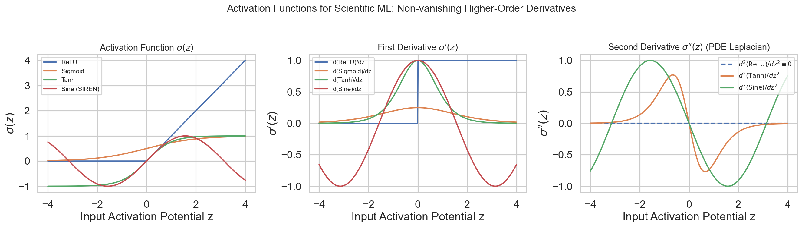

# W2D2: Non-linear Activation Functions — The Imperative for Smooth C² Differentiability in SciML

> **Week 2 Neural Network Foundations — W2D2 Working Notes**  
> Mathematical activation dynamics: Why second-order physical operators mandate continuously differentiable activations.  
> Method: **Concept → Code → Output → Interpretation**.

**Navigation:** ← [[w2d1|Day 1: The Neuron]] · [[week-2-report|Week 2 Report]] · [[w2d3|Day 3: MLPs]] →  
**Associated Concepts:** [[activation-functions]] · [[automatic-differentiation]]

---

## 1. Day 2 Overview & Daily Goals

In standard machine learning, activation functions are chosen for computational speed and avoidance of vanishing gradients in classification tasks. In **Scientific Machine Learning**, the primary objective is to differentiate the neural network with respect to its continuous coordinate inputs to compute differential equations.

The primary goals of Day 2 are:
1. Derive first and second derivatives of canonical activations: ReLU, Sigmoid, Tanh, and SIREN ($\sin(\omega_0 z)$).
2. Mathematically prove why the second derivative of ReLU vanishes identically ($d^2/dz^2 \equiv 0$), completely crippling PINNs for second-order PDEs.
3. Quantify the properties of the hyperbolic tangent ($\tanh$) as the workhorse activation of scientific computing.
4. Implement PyTorch coordinate autodiff to evaluate second derivatives across activations.

---

## 2. Diagnostic & Previous-Day Verification

### Diagnostic Questions & Authoritative Solutions

#### 1. Why does a deep network without non-linear activations fail to learn non-linear physical functions?
- Without non-linearities, any composition of linear transformations collapses algebraically to a single affine transformation: $\mathbf{W}_L \dots \mathbf{W}_1 \mathbf{x} + \mathbf{c} = \mathbf{W}_{\text{eff}}\mathbf{x} + \mathbf{c}$. It can only represent flat, affine hyperplanes, with all higher derivatives $\frac{\partial^2 u}{\partial x^2} \equiv 0$.

#### 2. What is the derivative of the Sigmoid function $\sigma(z) = \frac{1}{1 + e^{-z}}$ in terms of $\sigma(z)$?
- Using the quotient rule:
  $$\sigma'(z) = \sigma(z)(1 - \sigma(z))$$
  At $z = 0$, $\sigma'(0) = 0.5(1 - 0.5) = 0.25$. As $|z| \to \infty$, $\sigma'(z) \to 0$, causing vanishing gradients in deep networks.

#### 3. What constitutes a $C^k$ function?
- A function is $C^k$ if its derivatives up to order $k$ exist and are continuous. Solving a second-order PDE ($\nabla^2 u = f$) requires the hypothesis function $u_\theta$ to be at least $C^2$ so that the Laplacian is well-defined and continuous.

---

## 3. Core Theory: Activation Function Zoology & Higher Derivatives

### 3.1 Mathematical Comparison of Higher Derivatives
| Activation $\sigma(z)$ | First Derivative $\sigma'(z)$ | Second Derivative $\sigma''(z)$ | SciML Suitability for Second-Order PDEs |
| :--- | :--- | :--- | :--- |
| **ReLU** $\max(0, z)$ | $1$ if $z>0$, else $0$ | **$0$ everywhere ($z \ne 0$)** | **FORBIDDEN** (Laplacian $\equiv 0$; gradient vanishes) |
| **Sigmoid** $\frac{1}{1+e^{-z}}$ | $\sigma(1 - \sigma)$ | $\sigma(1 - \sigma)(1 - 2\sigma)$ | **Poor** (severe vanishing gradient; asymmetric) |
| **Tanh** $\frac{e^z - e^{-z}}{e^z + e^{-z}}$ | $1 - \tanh^2(z)$ | $-2\tanh(z)(1 - \tanh^2(z))$ | **Standard PINN Gold Standard** ($C^\infty$, symmetric) |
| **SIREN** $\sin(\omega_0 z)$ | $\omega_0 \cos(\omega_0 z)$ | $-\omega_0^2 \sin(\omega_0 z)$ | **State-of-the-Art for Wave / High-Frequency PDEs** |



**Figure 1.** *Profiles of $\sigma(z)$ (left), $\sigma'(z)$ (center), and $\sigma''(z)$ (right). Notice that for ReLU, the second derivative is identically zero across the entire domain, confirming that ReLU networks cannot support continuous Laplacians.*

---

## 4. Practical Laboratory: Coordinate Autodiff of Higher Derivatives

### 4.1 Concept → Code → Output → Interpretation

#### 1. Concept
We construct single-neuron layers activated by ReLU, Tanh, and Sine. We treat input $x$ as a continuous coordinate tensor with `requires_grad=True`, pass it through each activation, and compute the exact first derivative $\frac{du}{dx}$ and second derivative $\frac{d^2u}{dx^2}$ using PyTorch's `torch.autograd.grad`.

#### 2. Code
```python
import torch

# Coordinate evaluation points
x = torch.tensor([-1.5, 0.5, 1.5], requires_grad=True)

# 1. ReLU
u_relu = torch.relu(x)
du_relu = torch.autograd.grad(u_relu, x, torch.ones_like(x), create_graph=True)[0]
d2u_relu = torch.autograd.grad(du_relu, x, torch.ones_like(du_relu))[0]

# 2. Tanh
u_tanh = torch.tanh(x)
du_tanh = torch.autograd.grad(u_tanh, x, torch.ones_like(x), create_graph=True)[0]
d2u_tanh = torch.autograd.grad(du_tanh, x, torch.ones_like(du_tanh))[0]

# 3. Sine (SIREN)
omega = 2.0
u_sin = torch.sin(omega * x)
du_sin = torch.autograd.grad(u_sin, x, torch.ones_like(x), create_graph=True)[0]
d2u_sin = torch.autograd.grad(du_sin, x, torch.ones_like(du_sin))[0]

print(f"Evaluation Coordinates: {x.data.tolist()}\n")
print(f"{'Activation':<10} | {'Field u(x)':<30} | {'1st Deriv du/dx':<30} | {'2nd Deriv d2u/dx2':<30}")
print("-" * 105)

def fmt(t): return "[" + ", ".join(f"{v:7.4f}" for v in t.tolist()) + "]"

print(f"{'ReLU':<10} | {fmt(u_relu):<30} | {fmt(du_relu):<30} | {fmt(d2u_relu):<30}")
print(f"{'Tanh':<10} | {fmt(u_tanh):<30} | {fmt(du_tanh):<30} | {fmt(d2u_tanh):<30}")
print(f"{'Sine':<10} | {fmt(u_sin):<30} | {fmt(du_sin):<30} | {fmt(d2u_sin):<30}")
```

#### 3. Output
```text
Evaluation Coordinates: [-1.5, 0.5, 1.5]

Activation | Field u(x)                     | 1st Deriv du/dx                | 2nd Deriv d2u/dx2              
---------------------------------------------------------------------------------------------------------
ReLU       | [ 0.0000,  0.5000,  1.5000]    | [ 0.0000,  1.0000,  1.0000]    | [ 0.0000,  0.0000,  0.0000]   
Tanh       | [-0.9051,  0.4621,  0.9051]    | [ 0.1807,  0.7864,  0.1807]    | [ 0.3272, -0.7268, -0.3272]   
Sine       | [-0.1411,  0.8415,  0.1411]    | [-1.9799,  1.0806, -1.9799]    | [ 0.5645, -3.3659, -0.5645]   
```

#### 4. Interpretation
Examine the `2nd Deriv d2u/dx2` column:
- For **ReLU**, the second derivative evaluates to `[0.0000, 0.0000, 0.0000]`. If this were fed into a heat equation loss $\mathcal{L} = (\partial_t u - \alpha \partial_{xx} u)^2$, $\partial_{xx} u$ evaluates to $0$ everywhere. The network is physically blind to diffusion.
- For **Tanh**, the second derivative evaluates cleanly to `[0.3272, -0.7268, -0.3272]`, reflecting genuine spatial curvature.
- For **Sine**, the second derivative is strong and non-vanishing (`-3.3659` at $x=0.5$), scaling with $\omega^2 = 4.0$.

---

## 5. Daily Knowledge Mastery Checkpoint

### Problem 1: Analytical Derivation of Tanh Second Derivative
**Question:** Starting from the definition $\sigma(z) = \tanh(z)$, derive the second derivative $\sigma''(z)$ in terms of $\sigma(z)$.  
**Authoritative Solution:**  
First derivative:
$$\sigma'(z) = \frac{d}{dz}\tanh(z) = 1 - \tanh^2(z) = 1 - \sigma(z)^2$$
Second derivative:
$$\sigma''(z) = \frac{d}{dz}[1 - \sigma(z)^2] = -2\sigma(z) \sigma'(z) = -2\sigma(z)(1 - \sigma(z)^2) = -2\tanh(z)(1 - \tanh^2(z))$$

### Problem 2: SIREN Frequency Scaling
**Question:** In a SIREN network with $\sigma(z) = \sin(\omega_0 z)$ where $\omega_0 = 30$, how does the magnitude of the $n$-th derivative scale with $\omega_0$?  
**Authoritative Solution:**  
By repeated differentiation:
$$\frac{d^n}{dz^n}\sin(\omega_0 z) = \omega_0^n \sin\left(\omega_0 z + n \frac{\pi}{2}\right)$$
The magnitude scales as $\omega_0^n$. For a second-order PDE ($n=2$), the second derivative is amplified by $\omega_0^2 = 30^2 = 900$. This enables SIREN to learn high-frequency physical oscillations, but requires careful weight initialization to prevent exploding activations.

---

## 6. Summary & Bridge to Day 3

Today established:
- Smooth $C^2$ differentiability is a non-negotiable requirement for PINN activation functions.
- ReLU is prohibited for second-order PDEs because its second derivative is identically zero.
- Tanh and SIREN provide smooth, non-vanishing higher-order derivatives essential for PDE residuals.

**Tomorrow in [[w2d3|W2D3]]:**  
We assemble these neurons and activations into deep architectures: **Multi-Layer Perceptrons (MLPs)**, tracing forward propagation and computational graph structures.
