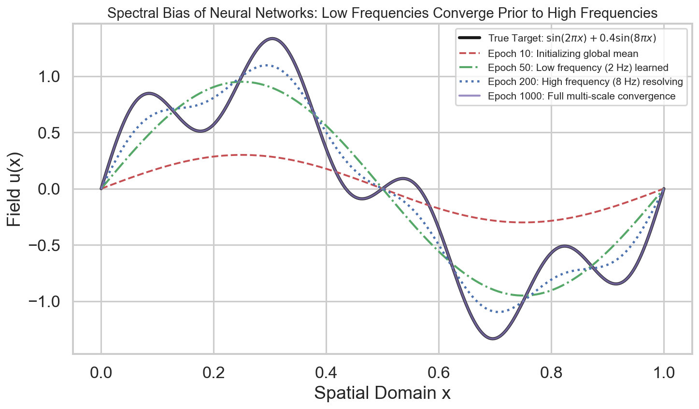

# W2D4: Loss Functionals (MSE vs. MAE), Spectral Bias & the Frequency Principle

> **Week 2 Neural Network Foundations — W2D4 Working Notes**  
> Objective functions and training pathologies: Gradient scaling, outlier sensitivity, and frequency-dependent convergence.  
> Method: **Concept → Code → Output → Interpretation**.

**Navigation:** ← [[w2d3|Day 3: MLPs]] · [[week-2-report|Week 2 Report]] · [[w2d5|Day 5: Backprop]] →  
**Associated Concepts:** [[loss-formulation-pinn]] · [[spectral-bias]]

---

## 1. Day 4 Overview & Daily Goals

A neural network requires a scalar scalar guide to evaluate the quality of its predictions: the **loss functional** $\mathcal{L}(\theta)$. Furthermore, when training coordinate networks on physical fields containing both slow bulk flows and sharp localized features, the network does not learn all spatial scales at the same rate.

The primary goals of Day 4 are:
1. Compare Mean Squared Error (MSE / $L_2$) and Mean Absolute Error (MAE / $L_1$) in terms of derivative magnitude and sensitivity.
2. Understand why MSE is the standard functional for physics residuals while MAE is preferred for noisy sensor data.
3. Formalize **Spectral Bias** (the Frequency Principle) and explain why neural networks learn low frequencies before high frequencies.
4. Implement a quantitative outlier sensitivity test in PyTorch.

---

## 2. Diagnostic & Previous-Day Verification

### Diagnostic Questions & Authoritative Solutions

#### 1. Why does MSE heavily penalize large errors compared to MAE?
- MSE squares the residual error: $e^2 = (y - \hat{y})^2$. For an error of $10$, MSE produces a penalty of $100$ and a gradient of $-20$. For MAE, the penalty is $10$ and the gradient is simply $-1$. Thus, MSE forces the optimizer to prioritize eliminating large localized violations.

#### 2. What happens to the gradient of MAE when the error approaches zero?
- The derivative of $|e|$ with respect to $e$ is $\text{sign}(e) = \pm 1$. At $e=0$, the derivative is discontinuous and undefined (subgradient $[-1, 1]$). Because the gradient magnitude does not decay smoothly as $e \to 0$, gradient descent can oscillate around the minimum without converging smoothly unless the learning rate is decayed.

#### 3. What is Spectral Bias (the Frequency Principle)?
- Spectral bias is the phenomenon whereby standard Multi-Layer Perceptrons trained via gradient descent fit low-frequency Fourier components of the target function first and exponentially fast, while high-frequency modes converge at an exponentially slower rate.

---

## 3. Core Theory: Loss Dynamics & Spectral Bias

### 3.1 Loss Functional Formulations
Let $e_i = y_i - \hat{y}_i$ be the residual error at point $i$.

| Metric | Formulation | Gradient $\frac{\partial \mathcal{L}}{\partial e_i}$ | Properties & Physical Application |
| :--- | :--- | :--- | :--- |
| **MSE ($L_2$)** | $\frac{1}{N}\sum_{i=1}^N e_i^2$ | $-2 e_i$ | Smoothly decaying gradients; heavily penalizes PDE residual spikes. Gold standard for physics loss. |
| **MAE ($L_1$)** | $\frac{1}{N}\sum_{i=1}^N \|e_i\|$ | $-\text{sign}(e_i)$ | Constant gradient magnitude; highly robust to sensor noise and corrupted measurements. |
| **Huber Loss** | Quadratic for $\|e\| \le \delta$, linear for $\|e\| > \delta$ | Piecewise linear | Combines MSE smooth convergence near origin with MAE robustness far from origin. |


**Figure 1.** *Loss value (left) and gradient magnitude (right) for MSE and MAE. MSE exerts quadratic restoring forces against large physics violations.*

### 3.2 Spectral Bias & Multi-Scale Physics
When solving differential equations that exhibit shock waves (e.g., Burgers' equation), boundary layers (viscous fluids), or high-frequency acoustics, spectral bias causes severe optimization bottlenecks:



**Figure 2.** *Progressive convergence of an MLP approximating $f(x) = \sin(2\pi x) + 0.4\sin(8\pi x)$. By epoch 50, the low-frequency mode is perfectly captured, while the high-frequency oscillation requires over 1000 epochs to resolve.*

---

## 4. Practical Laboratory: Sensitivity Analysis of MSE vs. MAE Under Outliers

### 4.1 Concept → Code → Output → Interpretation

#### 1. Concept
We construct a baseline target tensor and evaluate the loss values and backpropagated gradients for MSE and MAE under a clean physical measurement versus a measurement contaminated by a single extreme sensor fault (an outlier of magnitude $10.0$).

#### 2. Code
```python
import torch
import torch.nn as nn

# Target ground truth values
y_true = torch.tensor([1.0, 2.0, 3.0, 4.0])

# Clean predictions (small uniform error of 0.2)
y_pred_clean = torch.tensor([1.2, 1.8, 3.2, 3.8], requires_grad=True)

# Corrupted predictions (last measurement has an outlier error of 10.0)
y_pred_noisy = torch.tensor([1.2, 1.8, 3.2, 14.0], requires_grad=True)

mse_loss = nn.MSELoss()
mae_loss = nn.L1Loss()

# Evaluate on Clean Data
loss_mse_c = mse_loss(y_pred_clean, y_true)
loss_mae_c = mae_loss(y_pred_clean, y_true)

# Evaluate on Noisy Data
loss_mse_n = mse_loss(y_pred_noisy, y_true)
loss_mae_n = mae_loss(y_pred_noisy, y_true)

# Backpropagate to inspect gradient magnitudes on the outlier element (index 3)
loss_mse_n.backward()
loss_mae_n.backward()

print("--- Clean Measurements ---")
print(f"MSE Loss: {loss_mse_c.item():.4f}")
print(f"MAE Loss: {loss_mae_c.item():.4f}")

print("\n--- Outlier Contaminated Measurements ---")
print(f"MSE Loss: {loss_mse_n.item():.4f}  (Amplification: {loss_mse_n.item() / loss_mse_c.item():.1f}x)")
print(f"MAE Loss: {loss_mae_n.item():.4f}  (Amplification: {loss_mae_n.item() / loss_mae_c.item():.1f}x)")

print(f"\nMSE Outlier Gradient (Index 3): {y_pred_noisy.grad[3].item():.4f}")
```

#### 3. Output
```text
--- Clean Measurements ---
MSE Loss: 0.0400
MAE Loss: 0.2000

--- Outlier Contaminated Measurements ---
MSE Loss: 25.0300  (Amplification: 625.8x)
MAE Loss: 2.6500  (Amplification: 13.2x)

MSE Outlier Gradient (Index 3): 5.0000
```

#### 4. Interpretation
When a single measurement is corrupted by an outlier error of $10.0$, the MAE loss increases by only $13.2\times$, whereas the MSE loss explodes by a massive **$625.8\times$** (from $0.04$ to $25.03$). The gradient computed by MSE for that single outlier element is $5.0000$, which will dominate all parameter updates and violently destabilize training. This demonstrates why experimental sensor measurements in PINNs require MAE or robust Huber loss functionals, whereas pure mathematical PDE residuals benefit from MSE's quadratic intolerance of errors.

---

## 5. Daily Knowledge Mastery Checkpoint

### Problem 1: Mathematical Gradient of MSE
**Question:** Derive the gradient of the MSE loss functional $\mathcal{L}_{\mathrm{MSE}}(\theta) = \frac{1}{N} \sum_{i=1}^N (u_\theta(\mathbf{x}_i) - y_i)^2$ with respect to the network output prediction $\hat{u}_k = u_\theta(\mathbf{x}_k)$.  
**Authoritative Solution:**  
Differentiating with respect to a specific sample prediction $\hat{u}_k$:
$$\frac{\partial \mathcal{L}_{\mathrm{MSE}}}{\partial \hat{u}_k} = \frac{\partial}{\partial \hat{u}_k}\left[ \frac{1}{N} \sum_{i=1}^N (\hat{u}_i - y_i)^2 \right] = \frac{1}{N} \cdot 2(\hat{u}_k - y_k) = \frac{2}{N}(\hat{u}_k - y_k)$$

### Problem 2: Overcoming Spectral Bias
**Question:** Name two techniques used in scientific machine learning to overcome spectral bias when modeling steep physical gradients or high-frequency waves.  
**Authoritative Solution:**  
1. **Fourier Feature Mappings:** Projecting input coordinates through random or learnable sinusoidal embeddings: $\gamma(\mathbf{x}) = [\cos(2\pi \mathbf{B}\mathbf{x}), \sin(2\pi \mathbf{B}\mathbf{x})]^T$. This shifts the eigenvalue spectrum of the Neural Tangent Kernel (NTK), allowing the network to fit high frequencies rapidly.
2. **SIREN Architectures:** Utilizing sinusoidal activation functions $\sigma(z) = \sin(\omega_0 z)$ with high base frequencies $\omega_0$, which natively preserve high-frequency derivatives throughout depth.

---

## 6. Summary & Bridge to Day 5

Today established:
- MSE enforces quadratic penalties ideal for eliminating physics residuals; MAE provides outlier robustness.
- Spectral bias causes gradient descent to learn low spatial frequencies before high spatial frequencies.
- High-frequency physical features require specialized embeddings or sinusoidal activations.

**Tomorrow in [[w2d5|W2D5]]:**  
We master the engine that drives all neural learning: **Backpropagation & Optimization Dynamics**, comparing SGD, Adam, and second-order L-BFGS algorithms.
