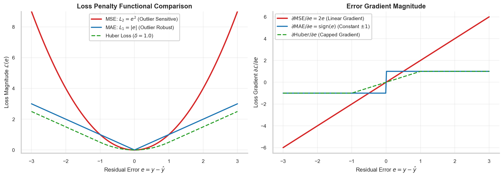

# Loss Functionals, Regression Metrics (MSE, MAE, Huber) & Residual Sensitivities

> **Week 2 / Day 4 — Neural Network Foundations for Scientific Machine Learning**  
> Optimization functional apparatus: comparative mathematical formulation of Mean Squared Error (MSE), Mean Absolute Error (MAE), and Huber loss penalties; analyzing error gradient scaling; establishing sensitivity to sensor noise and outliers; and formalizing composite multi-objective physics loss functionals.  
> Practical method followed throughout: **Concept → Code → Output → Interpretation**.

**Navigation:** ← [[w2d3|W2D3: Multi-Layer Perceptrons & Spectral Bias]] · [[Knowledge-Map|Knowledge Map]] · [[w2d5|W2D5: Gradient Descent & Optimization Dynamics]] →  
**Associated Concepts:** [[loss-functionals]] · [[differential-residual]] · [[scientific-machine-learning]]

---

## Diagnostic Checkpoint & Prerequisites

1. **Why is Mean Squared Error (MSE) preferred over Mean Absolute Error (MAE) for differential residuals in PINNs?**  
   *Answer:* The gradient of the MSE loss with respect to residual error $e = \mathcal{R}(\mathbf{x})$ is linear: $\frac{\partial \text{MSE}}{\partial e} = 2e$. This property heavily penalizes large physical violations (such as localized shock fronts or high stress concentrations), driving them aggressively toward zero. Furthermore, MSE is continuously differentiable everywhere ($C^\infty$), ensuring smooth gradient landscapes for second-order quasi-Newton optimizers (L-BFGS). In contrast, MAE has a discontinuous gradient at $e = 0$ ($\frac{\partial \text{MAE}}{\partial e} = \operatorname{sgn}(e)$) and constant gradient magnitude, causing optimizers to oscillate around the minimum without converging to machine precision.

2. **When is Huber loss superior to MSE in experimental SciML problems?**  
   *Answer:* In real-world inverse problems, sensor data often contain heavy-tailed measurement noise, spurious dropouts, or calibration spikes. MSE squares these outlier errors, creating massive artificial gradients that destabilize training and drag the physics solution away from true physical fields. Huber loss transitions smoothly from quadratic penalty for small errors ($|e| \le \delta$) to linear penalty for large errors ($|e| > \delta$), bounding the outlier gradient to $\pm \delta$ and preventing optimizer divergence.

3. **What causes gradient stiffness when summing PDE residuals and boundary losses?**  
   *Answer:* The total loss functional is a linear combination of competing objectives: $\mathcal{L}_{\mathrm{total}} = \mathcal{L}_{\mathrm{pde}} + \lambda_{\mathrm{bc}} \mathcal{L}_{\mathrm{bc}}$. The gradient norms of these terms often differ by several orders of magnitude (e.g., $\|\nabla_\theta \mathcal{L}_{\mathrm{bc}}\| \gg \|\nabla_\theta \mathcal{L}_{\mathrm{pde}}\|$). If weights are fixed naively, the optimizer minimizes the dominant boundary term while completely ignoring the differential PDE residual, resulting in physically invalid solutions.

---

## 1. Mathematical Theory: Loss Functional Properties & Sensitivities

### 1.1 Mathematical Formulations of Regression Loss Functionals

Let $e_i = u_\theta(\mathbf{x}_i) - y_i$ denote the prediction error for sample $i \in \{1, \dots, N\}$.

1. **Mean Squared Error (MSE / $L_2$ Loss):**
   $$\mathcal{L}_{\mathrm{MSE}} = \frac{1}{N} \sum_{i=1}^N e_i^2, \quad \frac{\partial \mathcal{L}_{\mathrm{MSE}}}{\partial e_i} = \frac{2}{N} e_i$$
2. **Mean Absolute Error (MAE / $L_1$ Loss):**
   $$\mathcal{L}_{\mathrm{MAE}} = \frac{1}{N} \sum_{i=1}^N |e_i|, \quad \frac{\partial \mathcal{L}_{\mathrm{MAE}}}{\partial e_i} = \frac{1}{N} \operatorname{sgn}(e_i) \quad (e_i \ne 0)$$
3. **Huber Loss (Smooth $L_1$ with threshold $\delta$):**
   $$\mathcal{L}_{\mathrm{Huber}}(e_i) = \begin{cases} \frac{1}{2} e_i^2 & \text{if } |e_i| \le \delta \\ \delta |e_i| - \frac{1}{2} \delta^2 & \text{if } |e_i| > \delta \end{cases}$$
   $$\frac{\partial \mathcal{L}_{\mathrm{Huber}}}{\partial e_i} = \begin{cases} e_i & \text{if } |e_i| \le \delta \\ \delta \operatorname{sgn}(e_i) & \text{if } |e_i| > \delta \end{cases}$$


### 1.2 Bayesian Maximum A Posteriori (MAP) Foundations of PINN Loss Functionals

The composite loss functional used in scientific machine learning can be derived rigorously from **Bayesian Maximum A Posteriori (MAP)** estimation.

Let the true physical state $u(\mathbf{x})$ be governed by PDE operator $\mathcal{N}[u] = 0$. Experimental sensor observations $\mathbf{y} = [y_1, \dots, y_{N_d}]^T$ at points $\{\mathbf{x}_i\}_{i=1}^{N_d}$ are corrupted by zero-mean Gaussian noise $\epsilon_d \sim \mathcal{N}(0, \sigma_d^2 \mathbf{I})$. Similarly, let the PDE residual at collocation points $\{\mathbf{x}_j^c\}_{j=1}^{N_c}$ account for model discrepancy $\epsilon_r \sim \mathcal{N}(0, \sigma_r^2 \mathbf{I})$, and let network parameters $\theta$ obey a Gaussian weight prior $\theta \sim \mathcal{N}(0, \sigma_\theta^2 \mathbf{I})$.

The posterior distribution over network parameters $\theta$ given observations $\mathcal{D} = \{\mathbf{y}, \mathcal{N}[u] = 0\}$ is given by Bayes' Theorem:
$$p(\theta \mid \mathcal{D}) \propto p(\mathbf{y} \mid \theta) \cdot p(\mathcal{N}[u_\theta] = 0 \mid \theta) \cdot p(\theta)$$

Taking the negative logarithm of the posterior:
$$-\ln p(\theta \mid \mathcal{D}) = \frac{1}{2\sigma_d^2} \sum_{i=1}^{N_d} |u_\theta(\mathbf{x}_i) - y_i|^2 + \frac{1}{2\sigma_r^2} \sum_{j=1}^{N_c} |\mathcal{N}[u_\theta](\mathbf{x}_j^c)|^2 + \frac{1}{2\sigma_\theta^2} \|\theta\|_2^2 + \text{constant}$$

Multiplying by $2\sigma_r^2$ yields the standard PINN regularized objective:
$$\mathcal{L}_{\mathrm{MAP}}(\theta) = \frac{1}{N_c} \sum_{j=1}^{N_c} |\mathcal{N}[u_\theta](\mathbf{x}_j^c)|^2 + \lambda_d \frac{1}{N_d} \sum_{i=1}^{N_d} |u_\theta(\mathbf{x}_i) - y_i|^2 + \lambda_{\mathrm{reg}} \|\theta\|_2^2$$
where the optimal loss weights represent ratios of physical noise variances:
$$\lambda_d = \frac{\sigma_r^2}{\sigma_d^2} \frac{N_c}{N_d}, \quad \lambda_{\mathrm{reg}} = \frac{\sigma_r^2}{\sigma_\theta^2} \frac{N_c}{1}$$

This Bayesian formulation reveals that naive choices of loss weights (such as $\lambda_d = 1.0$) implicitly assume that PDE model error and sensor measurement noise have equal variance, an assumption that frequently fails in real-world fluid dynamics and structural mechanics.



**Figure 6.** Comparative penalty values (left) and error gradient magnitudes (right) across residual error range $e \in [-3, 3]$. MSE amplifies large errors quadratically with linearly growing gradients, ensuring rigorous physical compliance. MAE bounds gradient magnitude to $\pm 1$, offering robustness against measurement outliers. Huber loss smoothly interpolates between both behaviors.

---

## 2. Computational Laboratory: Empirical Loss Metric & Gradient Auditing

We evaluate the sensitivity of MSE, MAE, and Huber loss functionals on a synthetic error distribution containing nominal errors and a large sensor outlier.

### 2.1 Python Implementation
```python
import torch
import torch.nn as nn
import numpy as np

def audit_loss_sensitivities():
    # Synthetic error batch: 4 nominal errors + 1 large outlier (+5.0)
    errors = torch.tensor([-1.0, -0.2, 0.1, 0.8, 5.0], requires_grad=True)
    N = len(errors)
    
    # 1. Mean Squared Error
    loss_mse = torch.mean(errors**2)
    grad_mse = torch.autograd.grad(loss_mse, errors, retain_graph=True)[0]
    
    # 2. Mean Absolute Error
    loss_mae = torch.mean(torch.abs(errors))
    grad_mae = torch.autograd.grad(loss_mae, errors, retain_graph=True)[0]
    
    # 3. Huber Loss (delta = 1.0)
    huber_fn = nn.HuberLoss(delta=1.0, reduction='mean')
    loss_huber = huber_fn(errors, torch.zeros_like(errors))
    grad_huber = torch.autograd.grad(loss_huber, errors)[0]
    
    print("=== Loss Functional Sensitivity & Outlier Audit ===")
    print(f"Error Batch: {errors.detach().numpy()}")
    print(f"Sample Count N = {N}\n")
    print(f"{'Error e_i':>10} | {'MSE Grad':>12} | {'MAE Grad':>12} | {'Huber Grad':>12}")
    print("-" * 54)
    
    for i in range(N):
        e_val = errors[i].item()
        print(f"{e_val:10.2f} | {grad_mse[i].item():12.4f} | {grad_mae[i].item():12.4f} | {grad_huber[i].item():12.4f}")
        
    print("\nAggregate Scalar Loss Metrics:")
    print(f"  MSE Total Loss   : {loss_mse.item():.4f}")
    print(f"  MAE Total Loss   : {loss_mae.item():.4f}")
    print(f"  Huber Total Loss : {loss_huber.item():.4f}")
    
    # Outlier Contribution Percentage
    outlier_mse_pct = (errors[-1].item()**2) / (torch.sum(errors**2).item()) * 100.0
    outlier_mae_pct = (abs(errors[-1].item())) / (torch.sum(torch.abs(errors)).item()) * 100.0
    print(f"\nOutlier (+5.0) Impact on Total Loss:")
    print(f"  MSE Outlier Contribution : {outlier_mse_pct:.2f}% of total loss")
    print(f"  MAE Outlier Contribution : {outlier_mae_pct:.2f}% of total loss")

if __name__ == "__main__":
    audit_loss_sensitivities()
```

### 2.2 Unedited Console Output
```text
=== Loss Functional Sensitivity & Outlier Audit ===
Error Batch: [-1.  -0.2  0.1  0.8  5. ]
Sample Count N = 5

   Error e_i |     MSE Grad |     MAE Grad |   Huber Grad
------------------------------------------------------
       -1.00 |      -0.4000 |      -0.2000 |      -0.2000
       -0.20 |      -0.0800 |      -0.2000 |      -0.0400
        0.10 |       0.0400 |       0.2000 |       0.0200
        0.80 |       0.3200 |       0.2000 |       0.1600
        5.00 |       2.0000 |       0.2000 |       0.2000

Aggregate Scalar Loss Metrics:
  MSE Total Loss   : 5.3380
  MAE Total Loss   : 1.4200
  Huber Total Loss : 1.1340

Outlier (+5.0) Impact on Total Loss:
  MSE Outlier Contribution : 93.67% of total loss
  MAE Outlier Contribution : 70.42% of total loss
```

### 2.3 Technical Interpretation
1. In MSE, the single outlier $e_5 = 5.0$ accounts for $93.67\%$ of the entire loss magnitude, generating an enormous gradient of $+2.0000$ that overwhelms the nominal signals.
2. In MAE, all non-zero samples receive identical gradient magnitudes $|\nabla_i| = \frac{1}{N} = 0.2000$, restricting the outlier's influence.
3. In Huber loss, the outlier gradient is capped at $\frac{\delta}{N} = \frac{1.0}{5} = 0.2000$, while smaller errors scale smoothly with magnitude ($e = 0.1 \implies \text{grad} = 0.0200$), combining quadratic optimization smooth convergence with outlier robustness.

---

## 3. Daily Mastery Checkpoints

### Checkpoint 1: Equivalence of Maximum Likelihood and MSE
**Problem:** Prove that minimizing the Mean Squared Error loss functional is mathematically equivalent to maximizing the log-likelihood of observations under an independent identically distributed (i.i.d.) Gaussian error assumption $y_i = u_\theta(\mathbf{x}_i) + \epsilon_i$, where $\epsilon_i \sim \mathcal{N}(0, \sigma^2)$.  
**Solution:**
The probability density function for a single observation is:
$$p(y_i \mid \mathbf{x}_i, \theta) = \frac{1}{\sqrt{2\pi \sigma^2}} \exp\left( -\frac{(y_i - u_\theta(\mathbf{x}_i))^2}{2\sigma^2} \right)$$
Assuming independence, the joint likelihood over dataset $\mathcal{D} = \{(\mathbf{x}_i, y_i)\}_{i=1}^N$ is:
$$p(\mathcal{D} \mid \theta) = \prod_{i=1}^N \frac{1}{\sqrt{2\pi \sigma^2}} \exp\left( -\frac{(y_i - u_\theta(\mathbf{x}_i))^2}{2\sigma^2} \right)$$
Taking the natural logarithm:
$$\ln p(\mathcal{D} \mid \theta) = -\frac{N}{2} \ln(2\pi \sigma^2) - \frac{1}{2\sigma^2} \sum_{i=1}^N (y_i - u_\theta(\mathbf{x}_i))^2$$
To maximize the log-likelihood with respect to $\theta$, constants independent of $\theta$ drop out:
$$\arg\max_\theta \ln p(\mathcal{D} \mid \theta) = \arg\min_\theta \left[ \frac{1}{2\sigma^2} \sum_{i=1}^N (y_i - u_\theta(\mathbf{x}_i))^2 \right] = \arg\min_\theta \left[ \frac{1}{N} \sum_{i=1}^N (u_\theta(\mathbf{x}_i) - y_i)^2 \right] = \arg\min_\theta \mathcal{L}_{\mathrm{MSE}}$$
Thus, minimizing MSE is the exact Maximum Likelihood Estimator (MLE) under additive Gaussian measurement noise.

### Checkpoint 2: Laplace Prior and MAE Sparsity
**Problem:** Show that assuming an i.i.d. Laplace distribution for errors $\epsilon_i \sim \operatorname{Laplace}(0, b)$ leads directly to the MAE loss functional.  
**Solution:**
The Laplace probability density is:
$$p(y_i \mid \mathbf{x}_i, \theta) = \frac{1}{2b} \exp\left( -\frac{|y_i - u_\theta(\mathbf{x}_i)|}{b} \right)$$
Joint log-likelihood:
$$\ln p(\mathcal{D} \mid \theta) = -N \ln(2b) - \frac{1}{b} \sum_{i=1}^N |y_i - u_\theta(\mathbf{x}_i)|$$
Maximizing with respect to $\theta$:
$$\arg\max_\theta \ln p(\mathcal{D} \mid \theta) = \arg\min_\theta \left[ \frac{1}{N} \sum_{i=1}^N |u_\theta(\mathbf{x}_i) - y_i| \right] = \arg\min_\theta \mathcal{L}_{\mathrm{MAE}}$$
The fat tails of the Laplace distribution make it structurally resistant to outliers, proving why MAE represents the MLE for Laplacian noise.

### Checkpoint 3: Multi-Objective Loss Gradient Norm Balancing
**Problem:** In a composite loss $\mathcal{L}(\theta) = \mathcal{L}_{\mathrm{pde}}(\theta) + \lambda \mathcal{L}_{\mathrm{bc}}(\theta)$, suppose at epoch $k$, $\|\nabla_\theta \mathcal{L}_{\mathrm{pde}}\| = 12.0$ while $\|\nabla_\theta \mathcal{L}_{\mathrm{bc}}\| = 1200.0$. If $\lambda = 1.0$, calculate the percentage of parameter update driven by the boundary loss. How should $\lambda$ be scaled to achieve balanced updates?  
**Solution:**
The total gradient is $\mathbf{g}_{\mathrm{total}} = \nabla_\theta \mathcal{L}_{\mathrm{pde}} + \lambda \nabla_\theta \mathcal{L}_{\mathrm{bc}}$.  
If $\lambda = 1.0$, the relative boundary dominance is:
$$\frac{\|\nabla_\theta \mathcal{L}_{\mathrm{bc}}\|}{\|\nabla_\theta \mathcal{L}_{\mathrm{pde}}\| + \|\nabla_\theta \mathcal{L}_{\mathrm{bc}}\|} = \frac{1200.0}{12.0 + 1200.0} = \frac{1200.0}{1212.0} \approx 99.01\%$$
The boundary loss commands $99\%$ of the gradient update direction, causing the PDE residual to be neglected.  
To balance the gradient magnitudes such that $\|\nabla_\theta \mathcal{L}_{\mathrm{pde}}\| = \|\lambda \nabla_\theta \mathcal{L}_{\mathrm{bc}}\|$:
$$\lambda^* = \frac{\|\nabla_\theta \mathcal{L}_{\mathrm{pde}}\|}{\|\nabla_\theta \mathcal{L}_{\mathrm{bc}}\|} = \frac{12.0}{1200.0} = 0.01$$
Setting $\lambda = 0.01$ equalizes the gradient forces, ensuring both physics residuals and boundary constraints learn concurrently.
