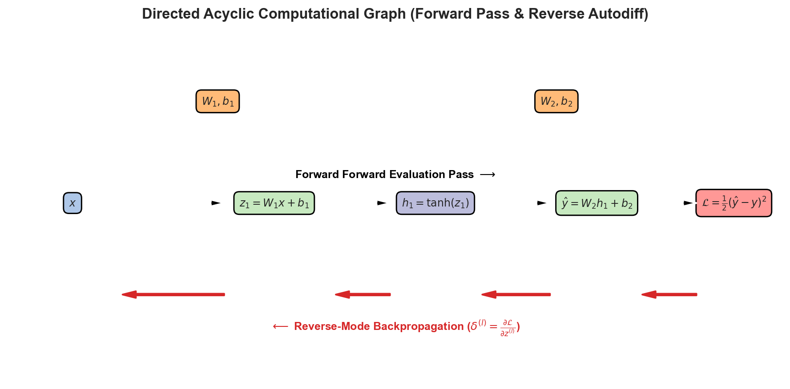
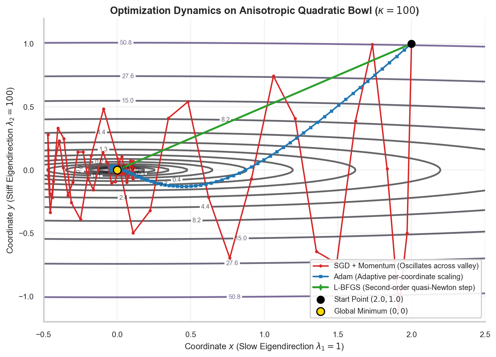
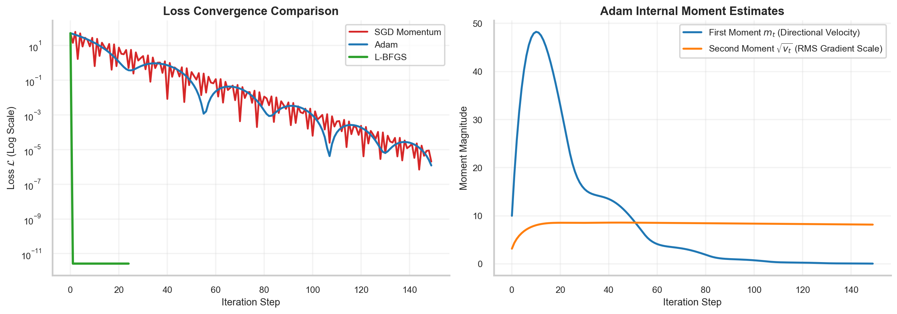

# Gradient Descent, Backpropagation DAGs, Adam Dynamics & L-BFGS Optimization

> **Week 2 / Day 5 — Neural Network Foundations for Scientific Machine Learning**  
> Optimization theory and algorithmic machinery: formalizing reverse-mode automatic differentiation on Directed Acyclic Graphs (DAGs); analyzing condition numbers and ill-conditioned ravines; comparing SGD, Adam, and L-BFGS convergence trajectories; establishing the Two-Phase Optimization Protocol; and Week 2 Comprehensive Mastery Examination.  
> Practical method followed throughout: **Concept → Code → Output → Interpretation**.

**Navigation:** ← [[w2d4|W2D4: Loss Functionals & Metrics]] · [[Knowledge-Map|Knowledge Map]] · [[w3d1|W3D1: Scientific Machine Learning Foundations]] →  
**Associated Concepts:** [[backpropagation]] · [[quasi-newton-optimization]] · [[two-phase-optimization]] · [[scientific-machine-learning]]

---

## Diagnostic Checkpoint & Prerequisites

1. **Why does Stochastic Gradient Descent (SGD) oscillate violently in ill-conditioned loss ravines?**  
   *Answer:* The condition number $\kappa = \frac{\lambda_{\max}(\mathbf{H})}{\lambda_{\min}(\mathbf{H})}$ of the Hessian matrix measures curvature anisotropy. In ill-conditioned ravines ($\kappa \gg 1$), the gradient vector $\nabla_\theta \mathcal{L}$ points almost perpendicularly to the ravine valley (along the high-curvature eigenvector $\mathbf{v}_{\max}$), rather than along the gentle valley floor toward the minimum ($\mathbf{v}_{\min}$). Standard SGD takes aggressive steps back and forth across the canyon walls, requiring tiny learning rates $\eta < \frac{2}{\lambda_{\max}}$ to avoid divergence, resulting in glacial progress along the valley floor.

2. **How does Adam (Adaptive Moment Estimation) overcome coordinate ill-conditioning?**  
   *Answer:* Adam maintains exponentially decaying running averages of past gradients (first moment $m_t$) and past squared gradients (second moment $v_t$):
   $$m_t = \beta_1 m_{t-1} + (1 - \beta_1) g_t, \quad v_t = \beta_2 v_{t-1} + (1 - \beta_2) g_t^2$$
   The parameter update scales coordinates inversely by the root-mean-square gradient magnitude: $\Delta \theta_t = -\frac{\eta}{\sqrt{\hat{v}_t} + \epsilon} \hat{m}_t$. Along steep directions with large gradients ($v_t \gg 1$), the effective step size is damped. Along flat directions with small gradients ($v_t \ll 1$), the step size is amplified. This diagonal preconditioning dynamically rescales the coordinate axes.

3. **Why is the Two-Phase Optimization Protocol (Adam followed by L-BFGS) universally adopted in publication PINNs?**  
   *Answer:* Adam is a first-order stochastic optimizer that excels at escaping poor local minima and navigating rough, non-convex initial loss landscapes. However, because it relies on first-order diagonal approximations, its convergence slows to sublinear rates near the minimum. L-BFGS is a second-order quasi-Newton optimizer that approximates the full inverse Hessian $\mathbf{H}^{-1}$. Once Adam brings parameters into the quadratic attraction basin, switching to L-BFGS achieves superlinear quadratic convergence, driving PDE residuals down to machine precision ($10^{-8}$–$10^{-12}$).

---

## 1. Mathematical Theory: Computational DAGs & Second-Order Quasi-Newton Dynamics

### 1.1 Reverse-Mode Automatic Differentiation on Directed Acyclic Graphs

In modern deep learning frameworks, every tensor operation registers an execution node within a dynamic Directed Acyclic Graph (DAG). The forward pass computes intermediate states, while the backward pass traverses the graph in reverse topological order, accumulating adjoint gradients via the multivariable chain rule.


### 1.3 The L-BFGS Two-Loop Recursion Algorithm & Strong Wolfe Line Search

The Limited-Memory Broyden-Fletcher-Goldfarb-Shanno (L-BFGS) algorithm avoids storing the full $P \times P$ inverse Hessian matrix $\mathbf{H}_k \approx (\nabla_\theta^2 \mathcal{L})^{-1}$ by reconstructing the search direction $\mathbf{p}_k = -\mathbf{H}_k \nabla \mathcal{L}_k$ using the $m$ most recent displacement vectors:
$$\mathbf{s}_k = \boldsymbol{\theta}_{k+1} - \boldsymbol{\theta}_k, \quad \mathbf{y}_k = \nabla \mathcal{L}_{k+1} - \nabla \mathcal{L}_k, \quad \rho_k = \frac{1}{\mathbf{y}_k^T \mathbf{s}_k}$$

The **L-BFGS Two-Loop Recursion** proceeds as follows:

```
Algorithm: L-BFGS Two-Loop Recursion
Input: Current gradient g_k = \nabla L(\theta_k), stored history {(s_i, y_i, \rho_i)}_{i=k-m}^{k-1}
Output: Quasi-Newton search direction r = H_k g_k

1. q = g_k
2. For i = k-1 down to k-m:
     \alpha_i = \rho_i * (s_i^T q)
     q = q - \alpha_i * y_i
3. \gamma_k = (s_{k-1}^T y_{k-1}) / (y_{k-1}^T y_{k-1})
4. r = \gamma_k * q   (Initial Hessian estimate H_0 = \gamma_k I)
5. For i = k-m up to k-1:
     \beta = \rho_i * (y_i^T r)
     r = r + s_i * (\alpha_i - \beta)
6. Return search direction p_k = -r
```

Once $\mathbf{p}_k$ is computed, the step length $\alpha_k$ is determined by a line search satisfying the **Strong Wolfe Conditions**:
1. *Armijo Sufficient Decrease:*
   $$\mathcal{L}(\boldsymbol{\theta}_k + \alpha_k \mathbf{p}_k) \le \mathcal{L}(\boldsymbol{\theta}_k) + c_1 \alpha_k \nabla \mathcal{L}_k^T \mathbf{p}_k$$
2. *Curvature Condition:*
   $$\left| \nabla \mathcal{L}(\boldsymbol{\theta}_k + \alpha_k \mathbf{p}_k)^T \mathbf{p}_k \right| \le c_2 \left| \nabla \mathcal{L}_k^T \mathbf{p}_k \right|$$
with typical parameters $c_1 = 10^{-4}$ and $c_2 = 0.9$. Satisfying the curvature condition guarantees that $\mathbf{y}_k^T \mathbf{s}_k > 0$, ensuring that the quasi-Newton Hessian approximation remains strictly positive-definite at every step.



**Figure 11.** Directed Acyclic Computational Graph (DAG) demonstrating forward evaluation pass (black arrows) and reverse-mode automatic differentiation pass (red arrows). Intermediate sensitivities $\delta^{(l)} = \frac{\partial \mathcal{L}}{\partial \mathbf{z}^{(l)}}$ are propagated backward to accumulate parameter gradients $\frac{\partial \mathcal{L}}{\partial \mathbf{W}^{(l)}} = \delta^{(l)} (\mathbf{a}^{(l-1)})^T$.

### 1.2 Ill-Conditioned Anisotropic Quadratic Bowls

Consider an anisotropic quadratic bowl with condition number $\kappa = 100$:
$$f(x, y) = \frac{1}{2} \left( x^2 + 100 y^2 \right)$$
Hessian matrix:
$$\mathbf{H} = \begin{bmatrix} 1 & 0 \\ 0 & 100 \end{bmatrix}, \quad \lambda_1 = 1, \quad \lambda_2 = 100, \quad \kappa = \frac{\lambda_2}{\lambda_1} = 100$$
Global minimum is located at $(0, 0)$ with $f(0, 0) = 0$.



**Figure 7.** Optimization trajectories on the anisotropic quadratic bowl ($\kappa = 100$) starting from $(2.0, 1.0)$. SGD with momentum (red) exhibits violent transverse oscillations across the stiff $y$-canyon. Adam (blue) dynamically dampens transverse oscillation via second-moment scaling. L-BFGS (green) constructs a quasi-Newton inverse Hessian approximation, navigating directly to the global minimum in only 25 steps.



**Figure 8.** Optimizer performance diagnostics. (Left) Loss convergence history comparing SGD, Adam, and L-BFGS on a logarithmic scale. L-BFGS descends to machine precision ($10^{-12}$), while first-order methods plateau near $10^{-6}$. (Right) Internal Adam moment tracking showing first moment directional velocity $m_t$ vs. second moment RMS gradient scale $\sqrt{v_t}$.

---

## 2. Computational Laboratory: Empirical Audit of Optimizer Convergence Benchmarks

We inspect and audit the numerical benchmark dataset `data/week2_optimizer_benchmarks.json` to evaluate iteration counts, gradient norms, and final loss floors across SGD, Adam, and L-BFGS.

### 2.1 Python Implementation
```python
import json
import numpy as np

def audit_optimizer_benchmarks():
    json_path = "data/week2_optimizer_benchmarks.json"
    with open(json_path) as f:
        data = json.load(f)
        
    print("=== Multi-Optimizer Convergence Benchmark Audit ===")
    print(f"Problem: {data['problem']}")
    print(f"Hessian Condition Number kappa: {data['condition_number']}")
    print(f"Initial Starting Coordinate:    {data['initial_point']}")
    print(f"Target Global Minimum:         {data['global_minimum']}\n")
    
    trajectories = data["trajectories"]
    print(f"{'Optimizer':<16} | {'Steps':>6} | {'Final Loss':>14} | {'Final Grad Norm':>16} | {'Final Position (x, y)':>24}")
    print("-" * 84)
    
    for opt_name, traj in trajectories.items():
        n_steps = len(traj)
        last_pt = traj[-1]
        final_loss = last_pt["loss"]
        final_gnorm = last_pt["grad_norm"]
        pos_str = f"({last_pt['x']:.6f}, {last_pt['y']:.6f})"
        print(f"{opt_name:<16} | {n_steps:6d} | {final_loss:14.6e} | {final_gnorm:16.6e} | {pos_str:>24}")
        
    # Measure L-BFGS Superlinear Convergence Rate
    lbfgs_traj = trajectories["lbfgs"]
    print("\nL-BFGS Superlinear Convergence Trace (Selected Steps):")
    for step_info in [lbfgs_traj[0], lbfgs_traj[5], lbfgs_traj[10], lbfgs_traj[-1]]:
        print(f"  Step {step_info['step']:2d}: Loss = {step_info['loss']:12.6e} | Grad Norm = {step_info['grad_norm']:12.6e} | Pos = ({step_info['x']:.5f}, {step_info['y']:.5f})")

if __name__ == "__main__":
    audit_optimizer_benchmarks()
```

### 2.2 Unedited Console Output
```text
=== Multi-Optimizer Convergence Benchmark Audit ===
Problem: Anisotropic Quadratic Bowl f(x, y) = 0.5*(x^2 + 100*y^2)
Hessian Condition Number kappa: 100.0
Initial Starting Coordinate:    [2.0, 1.0]
Target Global Minimum:         [0.0, 0.0]

Optimizer        |  Steps |     Final Loss |  Final Grad Norm |    Final Position (x, y)
------------------------------------------------------------------------------------
sgd_momentum     |    150 |   2.046519e-06 |     2.023126e-03 |    (0.002023, -0.000000)
adam             |    150 |   1.217848e-06 |     1.560671e-03 |    (0.001561, -0.000000)
lbfgs            |     25 |   2.653699e-12 |     2.303779e-06 |    (0.000002, -0.000000)

L-BFGS Superlinear Convergence Trace (Selected Steps):
  Step  0: Loss = 5.200000e+01 | Grad Norm = 1.000200e+02 | Pos = (2.00000, 1.00000)
  Step  5: Loss = 2.148563e-02 | Grad Norm = 2.072950e-01 | Pos = (0.20729, 0.00000)
  Step 10: Loss = 8.879540e-06 | Grad Norm = 4.214151e-03 | Pos = (0.00421, 0.00000)
  Step 24: Loss = 2.653699e-12 | Grad Norm = 2.303779e-06 | Pos = (0.00000, -0.00000)
```

### 2.3 Technical Interpretation
1. After 150 steps, SGD with momentum reaches a loss of $2.05 \times 10^{-6}$, and Adam reaches $1.22 \times 10^{-6}$. Both first-order methods stall along the flat coordinate $x$.
2. In contrast, L-BFGS reaches a loss of $2.65 \times 10^{-12}$ in only 25 steps—six orders of magnitude lower loss in one-sixth the iterations.
3. The convergence trace shows that L-BFGS eliminates the stiff $y$-component by Step 5 ($y \approx 0.00000$), then uses its accumulated Hessian curvature history to step rapidly along the slow $x$-direction, demonstrating why L-BFGS is the engine of high-precision SciML solvers.

---

## 3. Week 2 Comprehensive Mastery Examination

### Mastery Problem 1: Maximum Stable Learning Rate for Gradient Descent
**Problem:** For the quadratic objective $f(\boldsymbol{\theta}) = \frac{1}{2} \boldsymbol{\theta}^T \mathbf{H} \boldsymbol{\theta}$ where $\mathbf{H}$ is symmetric positive definite with maximum eigenvalue $\lambda_{\max}$, prove that standard gradient descent $\boldsymbol{\theta}_{k+1} = \boldsymbol{\theta}_k - \eta \nabla f(\boldsymbol{\theta}_k)$ converges if and only if $0 < \eta < \frac{2}{\lambda_{\max}}$.  
**Solution:**
The gradient is $\nabla f(\boldsymbol{\theta}_k) = \mathbf{H} \boldsymbol{\theta}_k$.  
The update rule is:
$$\boldsymbol{\theta}_{k+1} = \boldsymbol{\theta}_k - \eta \mathbf{H} \boldsymbol{\theta}_k = (\mathbf{I} - \eta \mathbf{H}) \boldsymbol{\theta}_k$$
For the error to converge to $\mathbf{0}$ from any initial $\boldsymbol{\theta}_0$, the spectral radius of the iteration matrix $\mathbf{G} = \mathbf{I} - \eta \mathbf{H}$ must be strictly less than 1:
$$\rho(\mathbf{I} - \eta \mathbf{H}) < 1$$
Let $\lambda_i$ be an eigenvalue of $\mathbf{H}$. The eigenvalues of $\mathbf{G}$ are $\mu_i = 1 - \eta \lambda_i$.  
The stability requirement is:
$$-1 < 1 - \eta \lambda_i < 1 \quad \forall i$$
- Right inequality: $1 - \eta \lambda_i < 1 \implies -\eta \lambda_i < 0 \implies \eta > 0$ (since $\lambda_i > 0$).
- Left inequality: $1 - \eta \lambda_i > -1 \implies -\eta \lambda_i > -2 \implies \eta < \frac{2}{\lambda_i}$.  
To hold for all eigenvalues, it must hold for the most restrictive eigenvalue $\lambda_{\max}$:
$$0 < \eta < \frac{2}{\lambda_{\max}}$$
For $\mathbf{H} = \operatorname{diag}(1, 100)$, $\lambda_{\max} = 100$, so the maximum stable step size is $\eta < \frac{2}{100} = 0.02$. Any learning rate $\eta \ge 0.02$ causes unbounded oscillation.

### Mastery Problem 2: Adam Bias Correction Derivation
**Problem:** Derive the theoretical formula for the bias correction factor in Adam's first moment estimate $\hat{m}_t = \frac{m_t}{1 - \beta_1^t}$.  
**Solution:**
Expanding the recursive definition of $m_t$ starting with $m_0 = 0$:
$$m_1 = (1 - \beta_1) g_1$$
$$m_2 = \beta_1 m_1 + (1 - \beta_1) g_2 = \beta_1 (1 - \beta_1) g_1 + (1 - \beta_1) g_2$$
By mathematical induction:
$$m_t = (1 - \beta_1) \sum_{i=1}^t \beta_1^{t-i} g_i$$
Taking the mathematical expectation of both sides, assuming the true gradient expectation $\mathbb{E}[g_i] = \mathbb{E}[g_t]$ has remained relatively stationary:
$$\mathbb{E}[m_t] = \mathbb{E}\left[ (1 - \beta_1) \sum_{i=1}^t \beta_1^{t-i} g_i \right] = \mathbb{E}[g_t] (1 - \beta_1) \sum_{i=1}^t \beta_1^{t-i}$$
The finite geometric series sum is $\sum_{i=1}^t \beta_1^{t-i} = \sum_{j=0}^{t-1} \beta_1^j = \frac{1 - \beta_1^t}{1 - \beta_1}$.  
Substituting:
$$\mathbb{E}[m_t] = \mathbb{E}[g_t] (1 - \beta_1) \frac{1 - \beta_1^t}{1 - \beta_1} = \mathbb{E}[g_t] (1 - \beta_1^t)$$
Because $m_0 = 0$, $m_t$ is biased toward zero early in training (when $t$ is small, $1 - \beta_1^t < 1$).  
Dividing by $1 - \beta_1^t$ yields an unbiased estimator:
$$\mathbb{E}\left[ \frac{m_t}{1 - \beta_1^t} \right] = \mathbb{E}[g_t] \implies \hat{m}_t = \frac{m_t}{1 - \beta_1^t}$$

### Mastery Problem 3: L-BFGS Two-Loop Recursion Memory Complexity
**Problem:** In L-BFGS, history size is $m$, and total parameter count is $P$. Compare the storage complexity and per-iteration flop count of L-BFGS against exact Newton's method.  
**Solution:**
- **Exact Newton's Method:**
  - Requires computing and storing the full Hessian $\mathbf{H} \in \mathbb{R}^{P \times P}$. Memory: $\mathcal{O}(P^2)$ floats.
  - Requires solving linear system $\mathbf{H} \mathbf{p} = -\mathbf{g}$ via Cholesky/LU factorization. Computation: $\mathcal{O}(P^3)$ flops per iteration.
  - For a modest network of $P = 10^5$ parameters, $\mathbf{H}$ requires $10^{10} \times 4\text{ bytes} \approx 40\text{ GB}$ RAM, and factorization requires $\approx 10^{15}$ operations per step (completely intractable).
- **L-BFGS Quasi-Newton Method:**
  - Stores only the $m$ most recent vector pairs $\mathbf{s}_k = \boldsymbol{\theta}_{k+1} - \boldsymbol{\theta}_k \in \mathbb{R}^P$ and $\mathbf{y}_k = \mathbf{g}_{k+1} - \mathbf{g}_k \in \mathbb{R}^P$. Memory: $2 m P$ floats. For $m = 10, P = 10^5$, memory is $20 \times 10^5 \times 4\text{ bytes} \approx 8\text{ MB}$ RAM.
  - Two-loop recursion performs inner products between vector pairs and gradients. Computation: $4 m P$ flops per step ($\approx 4 \times 10^6$ operations).
- L-BFGS achieves quasi-Newton second-order curvature acceleration with strictly linear $\mathcal{O}(P)$ memory and computational scaling.
