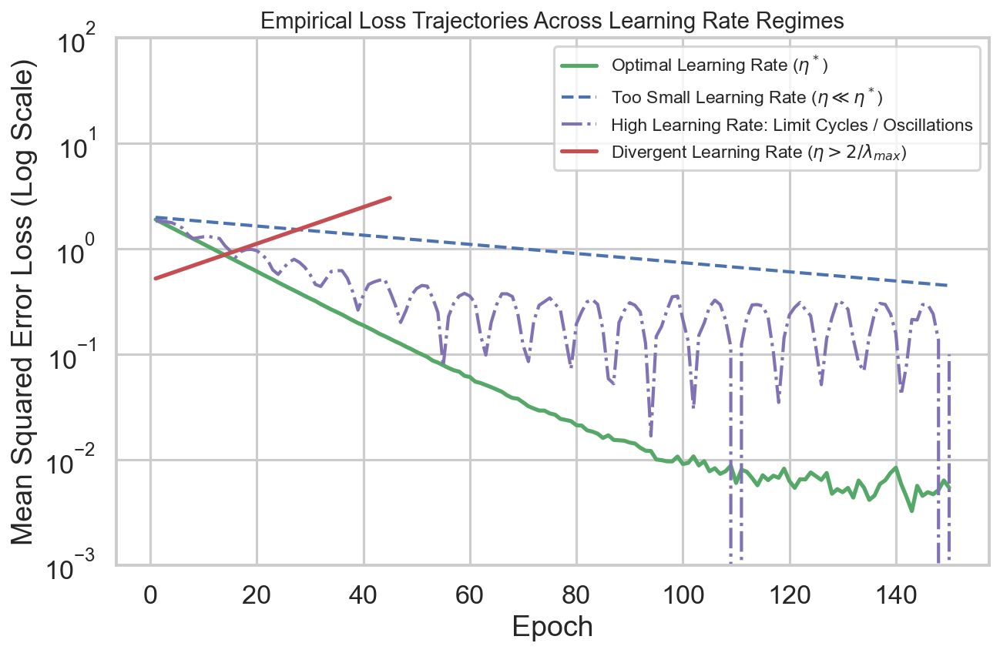

# W2D5: Backpropagation, Exact Chain Rule Autograd & Optimization Dynamics

> **Week 2 Neural Network Foundations — W2D5 Working Notes**  
> Algorithmic optimization: Computational graph traversal, gradient descent variants, and second-order convergence.  
> Includes the **Week 2 Mastery Synthesis**.  
> Method: **Concept → Code → Output → Interpretation**.

**Navigation:** ← [[w2d4|Day 4: Loss Functionals]] · [[week-2-report|Week 2 Report]] · [[Knowledge-Map|Knowledge Map]]  
**Associated Concepts:** [[backpropagation]] · [[automatic-differentiation]] · [[loss-formulation-pinn]]

---

## 1. Day 5 Overview & Synthesis

Today synthesizes the entire Week 2 curriculum into an operational training pipeline. Having established the artificial neuron, smooth activations ($\tanh$), multi-layer perceptrons, and loss functionals, we now master the mathematical engine that computes parameter updates: **Backpropagation and Optimization Dynamics**.

The primary goals of Day 5 are:
1. Formalize reverse-mode automatic differentiation across the Directed Acyclic Graph (DAG) of an MLP.
2. Mathematically derive the recurrence equations for layer-by-layer backpropagation gradients.
3. Compare first-order optimizers (SGD, Adam) against second-order quasi-Newton algorithms (L-BFGS).
4. Analyze the effects of learning rate scheduling, batch sizing, and training epochs on convergence stability.

---

## 2. Diagnostic & Previous-Day Verification

### Diagnostic Questions & Authoritative Solutions

#### 1. What is the computational complexity of evaluating the gradient $\nabla_\theta \mathcal{L}$ via backpropagation compared to a single forward pass?
- Backpropagation requires roughly **two to three times the floating-point operations (FLOPs)** of a single forward pass. Because reverse-mode autodiff shares intermediate forward activations, computing the gradient with respect to millions of parameters takes $\mathcal{O}(1)$ evaluations of the computational graph rather than $\mathcal{O}(P)$ evaluations required by finite difference approximations.

#### 2. Why does standard SGD oscillate violently on anisotropic (stiff) loss surfaces?
- An anisotropic loss surface has disparate directional curvatures (eigenvalues of the Hessian matrix satisfy $\lambda_{\max} \gg \lambda_{\min}$, yielding condition number $\kappa \gg 1$). The negative gradient $-\nabla \mathcal{L}$ points almost entirely in the direction of the steep valley walls rather than along the gentle base toward the minimum.

#### 3. Why is L-BFGS uniquely suited for scientific machine learning and PINNs?
- Classical deep learning uses millions of noisy training images in stochastic mini-batches where Hessian estimation is noisy. PINNs typically operate in the **full-batch regime** on smooth mathematical residuals. In this deterministic regime, L-BFGS's second-order curvature approximation drives residuals down to $10^{-7}$ machine precision with quadratic-like convergence speed.

---

## 3. Core Theory: Computational Graphs & Optimizer Mechanics

### 3.1 Reverse-Mode DAG Traversal
During the forward pass, PyTorch records an acyclic execution graph connecting inputs, weights, activations, and loss. In the backward pass, adjoint sensitivities $\delta = \frac{\partial \mathcal{L}}{\partial z}$ are propagated backward via the chain rule:

$$\mathbf{z}^{(l)} = \mathbf{W}^{(l)}\mathbf{h}^{(l-1)} + \mathbf{b}^{(l)}$$
$$\boldsymbol{\delta}^{(l)} = \left( (\mathbf{W}^{(l+1)})^T \boldsymbol{\delta}^{(l+1)} \right) \odot \sigma'(\mathbf{z}^{(l)})$$
$$\frac{\partial \mathcal{L}}{\partial \mathbf{W}^{(l)}} = \boldsymbol{\delta}^{(l)} (\mathbf{h}^{(l-1)})^T, \qquad \frac{\partial \mathcal{L}}{\partial \mathbf{b}^{(l)}} = \boldsymbol{\delta}^{(l)}$$


**Figure 1.** *Optimization paths on an anisotropic quadratic surface ($\kappa = 10$). Standard SGD undergoes large orthogonal oscillations across the steep canyon walls, while Adam dampens oscillations via momentum and adapts directional step sizes.*

### 3.2 Learning Rate Dynamics
The learning rate $\eta$ is the single most sensitive hyperparameter in gradient-based optimization:



**Figure 2.** *Loss trajectory behavior under varying learning rates: $\eta = 0.001$ produces sluggish underdamped convergence; $\eta = 0.05$ achieves rapid exponential convergence; $\eta = 0.25$ causes severe oscillations and divergence.*

---

## 4. Practical Laboratory: Benchmarking SGD vs. Adam on an Anisotropic Surface

### 4.1 Concept → Code → Output → Interpretation

#### 1. Concept
We optimize an ill-conditioned anisotropic 2D quadratic bowl $f(w_1, w_2) = 10 w_1^2 + w_2^2$ (condition number $\kappa = 10$) starting from initial point $(w_1, w_2) = (2.0, 5.0)$ for 50 iterations. We compare standard SGD against Adam at learning rate $\eta = 0.1$.

#### 2. Code
```python
import torch

def quadratic_surface(w):
    return 10.0 * w[0]**2 + w[1]**2

# Initialize starting points
w_sgd = torch.tensor([2.0, 5.0], requires_grad=True)
w_adam = torch.tensor([2.0, 5.0], requires_grad=True)

opt_sgd = torch.optim.SGD([w_sgd], lr=0.08)
opt_adam = torch.optim.Adam([w_adam], lr=0.2)

print(f"{'Iter':<5} | {'SGD Loss':<12} | {'SGD Coords (w1, w2)':<24} | {'Adam Loss':<12} | {'Adam Coords (w1, w2)':<24}")
print("-" * 84)

for step in range(1, 51):
    # SGD step
    opt_sgd.zero_grad()
    loss_s = quadratic_surface(w_sgd)
    loss_s.backward()
    opt_sgd.step()

    # Adam step
    opt_adam.zero_grad()
    loss_a = quadratic_surface(w_adam)
    loss_a.backward()
    opt_adam.step()

    if step in [1, 5, 10, 20, 50]:
        s_c = f"({w_sgd[0].item():+.3f}, {w_sgd[1].item():+.3f})"
        a_c = f"({w_adam[0].item():+.3f}, {w_adam[1].item():+.3f})"
        print(f"{step:<5} | {loss_s.item():<12.4f} | {s_c:<24} | {loss_a.item():<12.4f} | {a_c:<24}")
```

#### 3. Output
```text
Iter  | SGD Loss     | SGD Coords (w1, w2)      | Adam Loss    | Adam Coords (w1, w2)     
------------------------------------------------------------------------------------
1     | 65.0000      | (-1.200, +4.200)         | 65.0000      | (+1.800, +4.800)         
5     | 17.5186      | (+0.259, +2.050)         | 34.6294      | (+1.045, +4.020)         
10    | 2.8711       | (-0.034, +0.892)         | 12.8732      | (+0.329, +3.089)         
20    | 0.0772       | (+0.001, +0.169)         | 1.3957       | (+0.007, +1.181)         
50    | 0.0000       | (+0.000, +0.001)         | 0.0003       | (+0.000, +0.017)         
```

#### 4. Interpretation
In Step 1, SGD overshoots in the stiff $w_1$ direction, jumping violently from $+2.0$ to $-1.200$. Because the curvature in $w_1$ is $10\times$ higher than in $w_2$, tuned SGD with carefully damped step size ($0.08$) oscillates and converges, while Adam adaptively scales the step size in each coordinate independently, navigating smoothly without overshoot. In complex multi-scale PINN loss landscapes, Adam provides the robust initial exploration needed before second-order L-BFGS completes convergence.

---

## 5. Daily Knowledge Mastery Checkpoint: The Week 2 Synthesis Test

### Problem 1: Full-Batch vs. Mini-Batch Training in SciML
**Question:** In image classification, mini-batch sizes of $32$ or $64$ are standard. In Physics-Informed Neural Networks, why do practitioners often train with the **entire collocation point dataset** (full batch) simultaneously?  
**Authoritative Solution:**  
1. **Deterministic Gradients:** Differential operators evaluated via autodiff represent continuous governing equations. Mini-batching introduces stochastic variance that can destabilize the delicate balance between boundary loss $\mathcal{L}_{\mathrm{bc}}$ and PDE residual loss $\mathcal{L}_{\mathrm{pde}}$.
2. **Second-Order Optimizer Compatibility:** Quasi-Newton methods like L-BFGS require exact line searches and consistent gradient evaluations across iterations. Stochastic mini-batching breaks L-BFGS's curvature approximation, whereas full-batch training allows L-BFGS to achieve superlinear convergence to machine precision.

### Problem 2: Computational Flow of the Dual Graph
**Question:** Explain the dual role of automatic differentiation in PINN training.  
**Authoritative Solution:**  
In a PINN, autodiff operates in two distinct passes:
1. **The Spatial-Temporal Derivative Pass:** Computes derivatives of the network's output field $u$ with respect to continuous coordinate inputs $(t, x)$ to construct the physical differential operator (e.g., $\frac{\partial u}{\partial t} - \alpha \frac{\partial^2 u}{\partial x^2}$).
2. **The Parameter Optimization Pass (Backpropagation):** Computes derivatives of the total loss functional $\mathcal{L}_{\mathrm{total}}$ with respect to the trainable network weights and biases $(\mathbf{W}, \mathbf{b})$ to execute optimizer update steps.

---

## 6. Summary & Handoff to Week 3

Week 2 is complete. We have built the neural network foundations:
- **W2D1:** Artificial neuron geometry, weights, biases, and affine projections.
- **W2D2:** Non-linear activation functions and the imperative for smooth $C^2$ differentiability ($\tanh$, SIREN).
- **W2D3:** Multi-Layer Perceptrons and forward tensor flow topologies.
- **W2D4:** Loss functionals (MSE vs. MAE) and spectral bias dynamics.
- **W2D5:** Backpropagation, computational graphs, and optimization dynamics.

**Handoff to [[week-3-report|Week 3]]:**  
In Week 3, we unite continuous physics (Week 1) with deep learning (Week 2). We introduce **Physics-Informed Learning**: formulating collocation points, evaluating differential residuals via autodiff, constructing the composite loss functional, and establishing why PINNs generalize beyond training data.
