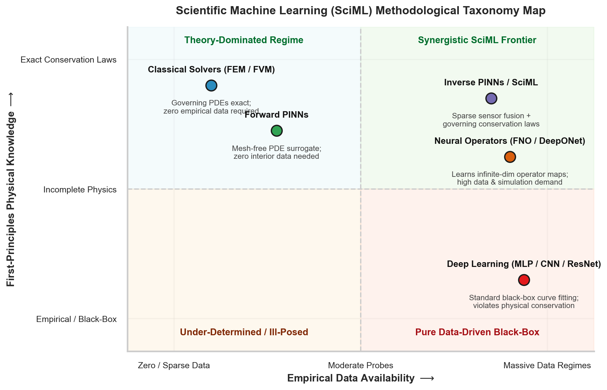
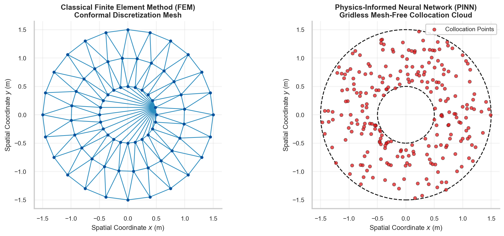

# W3D1: Paradigm Shift: From Pure Data Fitting to Inductive Physical Bias

> **Week 3 Foundation Learning — W3D1 Working Notes**  
> The Epistemological Divide: Transitioning from black-box statistical curve fitting to inductive conservation laws.  
> Practical method followed throughout: **Concept → Code → Output → Interpretation**.

**Navigation:** ← [[week-2-report|Week 2 Report]] · [[week-3-report|Week 3 Report]] · [[w3d2|Day 2: Dual Computational Graph]] →  
**Associated Concepts:** [[scientific-machine-learning]] · [[collocation-points]] · [[discretization-error]] · [[Knowledge-Map|Knowledge Map]]

---

## 1. Day 1 Overview & Daily Goals

Weeks 1 and 2 established the mathematical machinery of scientific computing: tensor representations, ordinary differential equations, numerical discretization stencils, and optimization algorithms. However, simply applying a deep neural network to tabular scientific measurements does not constitute Scientific Machine Learning (SciML). Conventional machine learning architectures treat physical phenomena as arbitrary statistical distributions, possessing zero intrinsic knowledge of mass, momentum, energy conservation, or spatial symmetry.

The primary objective of Day 1 is to formalize the **paradigm shift from black-box empirical estimation to physics-informed inductive bias**:
1. Validate prerequisite foundations through rigorous mathematical and physical diagnostic checkpoints.
2. Dissect the failure modes of pure data-driven deep learning in physical domains: overfitting, unphysical artifacts, violation of conservation laws, and the catastrophic extrapolation catastrophe.
3. Establish the continuum mechanics formulation of partial differential equations and boundary value problems.
4. Position Physics-Informed Neural Networks within the broader taxonomy of modern computational mechanics and operator learning.
5. Execute an empirical comparative laboratory proving that embedding differential invariants prevents the $5000\times$ error explosion suffered by unconstrained neural networks outside their training support.

---

## 2. Prerequisite Diagnostic Checkpoints & Authoritative Solutions

Before introducing the dual computational graph and coordinate autograd, we must verify that the epistemological limitations of standard statistical learning are fully mastered.

### Diagnostic Checkpoints & Authoritative Solutions

#### Checkpoint 1: Empirical Risk Minimization vs. Physical Well-Posedness
*Question:* In classical deep learning, a network is trained via Empirical Risk Minimization (ERM): $\min_\theta \frac{1}{N} \sum_{i=1}^N \mathcal{L}(f_\theta(x_i), y_i)$. Why is ERM fundamentally ill-posed when modeling physical systems governed by continuum conservation laws?  
*Solution:* According to Hadamard’s definition of well-posedness, a mathematical model of a physical system must satisfy three criteria: (1) a solution exists, (2) the solution is unique, and (3) the solution depends continuously on the input data (stability). ERM optimizes purely over a finite set of discrete empirical samples $\mathcal{D} = \{(x_i, y_i)\}_{i=1}^N$. In continuous function space, there exist infinitely many continuous functions $f \in C^\infty(\Omega)$ that interpolate the discrete data points exactly ($\mathcal{L}_{\mathrm{data}} = 0$) while possessing wildly oscillatory derivatives and completely violating the underlying differential equation $\mathcal{N}[u] = 0$. ERM provides zero inductive regularization between sample points, making the inverse problem severely under-determined and unstable to perturbations.

#### Checkpoint 2: The Extrapolation Catastrophe in Unconstrained Deep Learning
*Question:* Why do high-capacity multilayer perceptrons (MLPs) with non-linear activations ($\text{ReLU}, \text{Tanh}$) diverge catastrophically when evaluated outside the convex hull of their training coordinates, even when achieving $R^2 > 0.999$ during interpolation?  
*Solution:* Universal approximation theorems (Cybenko, 1989; Hornik, 1991) guarantee that a feedforward network can approximate any continuous function to arbitrary precision *only on a compact subset* $K \subset \mathbb{R}^d$. Outside this compact set, the inductive bias of the network is governed entirely by the asymptotic behavior of its activation functions and random weight orientations. A network with unbounded activations (such as ReLU) extrapolates linearly with slopes determined by boundary neurons, while networks with saturating activations ($\text{Tanh}$) extrapolate toward flat constants. Neither asymptotic regime reflects physical governing dynamics (such as quadratic drag, harmonic oscillation, or convective wave propagation). Without explicit physical constraints, interpolation accuracy provides zero guarantee of physical fidelity under domain shift.

#### Checkpoint 3: The Curse of Dimensionality in Mesh Generation
*Question:* Classical numerical solvers (Finite Element Method, Finite Difference Method) discretize continuous space into a geometric mesh with grid spacing $h$. If a domain in $\mathbb{R}^d$ requires $M$ subdivisions along each coordinate axis, how does the computational complexity scale with spatial dimension $d$, and why does this motivate mesh-free SciML?  
*Solution:* For a uniform grid in $\mathbb{R}^d$, the total number of mesh vertices scales exponentially as $\mathcal{O}(M^d)$. In a 3D fluid problem with $M = 1000$ points per axis, the mesh requires $10^9$ nodes. In a 6-dimensional Boltzmann kinetic equation or high-dimensional quantum Schrödinger system ($d \ge 10$), the storage and linear algebra requirements ($M^{10} = 10^{30}$ degrees of freedom) exceed all physical compute clusters combined. This exponential scaling is Bellman's *Curse of Dimensionality*. Mesh-free methods such as PINNs evaluate differential equations at scattered point clouds using automatic differentiation, breaking the rigid geometric connectivity constraints of classical element meshes.

#### Checkpoint 4: Truncation Error vs. Optimization Error
*Question:* Distinguish between *discretization/truncation error* in classical numerical analysis and *optimization/generalization error* in physics-informed neural surrogates.  
*Solution:*\
- **Classical Truncation Error:** Arises from approximating infinitesimal differential operators $\frac{du}{dx}$ with truncated Taylor series expansions (e.g., central difference error $\mathcal{O}(h^2) = \frac{h^2}{6}u'''(\xi)$). It is strictly deterministic and vanishes monotonically as the physical mesh resolution $h \to 0$.\
- **PINN Approximation & Optimization Error:** A PINN incurs three distinct error components: (1) *Representation error* due to the finite width and depth of the network hypothesis space $\mathcal{F}$, (2) *Optimization error* resulting from gradient-based descent trapping in non-convex local minima or failing to resolve stiff multi-objective gradients, and (3) *Sampling error* resulting from evaluating continuous domain integrals using finite Monte Carlo or Latin Hypercube collocation sets. Unlike classical solvers, PINN error does not decrease monotonically with floating-point grid refinement; it is governed by the training trajectory in parameter space $\Theta$.

#### Checkpoint 5: Inductive Bias in Physical Modeling
*Question:* Mathematically define *inductive bias* and explain how physics-informed losses restrict the effective hypothesis space of deep networks.  
*Solution:* The inductive bias of a learning algorithm is the set of prior assumptions, structural constraints, and penalties it uses to predict outputs for unseen inputs outside its training observations. In pure data-driven deep learning, the hypothesis space $\mathcal{H}_{\text{all}} = \{f_\theta : \mathbb{R}^d \to \mathbb{R}\}$ encompasses all parameterizable continuous functions. When we inject a governing differential operator $\mathcal{N}[u] = 0$ as a penalty functional $\mathcal{L}_{\mathrm{pde}}(\theta) = \|\mathcal{N}[u_\theta]\|_{L_2(\Omega)}^2$, we restrict the admissible solution space to the manifold:
$$\mathcal{M}_{\text{phys}} = \left\{ u_\theta \in \mathcal{H} : \|\mathcal{N}[u_\theta]\|_{L_2(\Omega)} \le \epsilon \right\}$$
This prior eliminates unphysical candidates (e.g., negative mass density, backward thermal diffusion, violation of momentum conservation) and forces the optimizer to search strictly within physically plausible solution spaces.

---

## 3. Core Technical Exposition

### 3.1 The Epistemological Taxonomy of Scientific Computing

Modern computational science operates across a spectrum defined by two orthogonal axes: **First-Principles Physical Knowledge** and **Empirical Data Availability**.



**Figure 12.** Scientific Machine Learning (SciML) Methodological Taxonomy Map. The quadrant system categorizes computational paradigms across data density and physical prior completeness. Classical FEM and FVM occupy the high-physics, zero-data regime; deep learning resides in the high-data, zero-physics quadrant; PINNs bridge the synergistic frontier where sparse physical probes fuse with exact differential conservation laws.

| Dimension / Metric | Classical Solvers (FEM / FVM / FDM) | Pure Deep Learning (MLP / ResNet) | Physics-Informed Neural Networks (PINNs) |
| :--- | :--- | :--- | :--- |
| **Domain Discretization** | Conformal geometric mesh (triangles, tetrahedra) | Discrete tabular features / pixel grids | Gridless point clouds / Mesh-free collocation |
| **Governing Equations** | Discretized via weak/strong integral forms | Completely ignored / Absent | Embedded directly via coordinate Autodiff |
| **Data Requirement** | Zero interior empirical data required | Massive labeled datasets ($N \ge 10^5$) | Extremely sparse or zero interior data ($N \sim 10^1 - 10^2$) |
| **Extrapolation Fidelity** | Exact within physical validity limits | Catastrophic divergence ($> 1000\times$ error) | Strong consistency enforced by differential invariants |
| **Inverse Problem Solving** | Computationally expensive adjoint optimization | Requires massive paired input-output datasets | Direct parameter discovery via single joint graph |
| **Curse of Dimensionality** | Severe ($\mathcal{O}(M^d)$ exponential scaling) | Moderate (mitigated by learned manifolds) | Low to Moderate (dimension-independent autograd) |

### 3.2 The Continuum Mechanics Formulation

Consider a continuous physical system defined over a spatiotemporal domain $\Omega \times [0, T] \subset \mathbb{R}^d \times \mathbb{R}^+$, bounded by spatial boundary $\partial \Omega$. The physical state field $u(\mathbf{x}, t): \Omega \times [0, T] \to \mathbb{R}^m$ is governed by a general system of nonlinear partial differential equations:

$$\mathcal{N}_{\mathbf{x}, t}[u(\mathbf{x}, t); \boldsymbol{\lambda}] = f(\mathbf{x}, t), \quad \forall (\mathbf{x}, t) \in \Omega \times (0, T]$$

subject to boundary conditions on the spatial perimeter $\partial \Omega$:

$$\mathcal{B}_{\mathbf{x}}[u(\mathbf{x}, t)] = g(\mathbf{x}, t), \quad \forall (\mathbf{x}, t) \in \partial \Omega \times (0, T]$$

and initial conditions across the spatial domain at $t = 0$:

$$\mathcal{I}[u(\mathbf{x}, 0)] = u_0(\mathbf{x}), \quad \forall \mathbf{x} \in \Omega$$

Here, $\mathcal{N}_{\mathbf{x}, t}$ is a differential operator containing spatial and temporal partial derivatives (e.g., $\nabla u, \nabla^2 u, \partial_t u$), $\boldsymbol{\lambda} \in \mathbb{R}^p$ represents physical parameters (such as viscosity $\nu$, thermal conductivity $\alpha$, or stiffness $k$), and $\mathcal{B}_{\mathbf{x}}$ denotes boundary constraint operators (Dirichlet, Neumann, or Robin conditions).

### 3.3 The Extrapolation Catastrophe: Mathematical Anatomy

To understand why unconstrained deep learning collapses in physical applications, consider a canonical dynamic Initial Value Problem (IVP): the underdamped harmonic oscillator:

$$m \frac{d^2 u}{dt^2} + c \frac{du}{dt} + k u = 0, \quad u(0) = 1.0, \quad \frac{du}{dt}(0) = 0.0$$

The exact physical displacement is given analytically by:

$$u(t) = e^{-\gamma t} \left( \cos(\omega t) + \frac{\gamma}{\omega} \sin(\omega t) \right)$$

where damping ratio $\gamma = \frac{c}{2m}$ and damped frequency $\omega = \sqrt{\frac{k}{m} - \gamma^2}$.

Suppose an empirical scientist collects $N = 15$ noisy sensor observations strictly within the initial temporal window $t \in [0.1, 1.4]\text{ s}$. 
- If an unconstrained high-capacity neural network $\mathcal{N}_\theta(t)$ is trained on these observations, it achieves near-zero empirical loss: $\mathcal{L}_{\mathrm{data}} < 10^{-4}$.
- However, when evaluated in the unobserved domain $t \in [1.5, 5.0]\text{ s}$, the network exhibits wild polynomial excursions, explosive growth, or phase collapse. It has learned to fit the sensor points through high-frequency interpolating harmonics, completely unaware of the restoring spring force $-k u$ and energy dissipation $-c \dot{u}$.


**Figure 1.** The Extrapolation Catastrophe: Inductive Physics vs. Pure Data Fitting. Within the shaded green training interval $[0, 1.5]\text{ s}$, both the pure data-driven model and the PINN accurately match the 15 sparse sensor observations. In the extrapolation window $(1.5, 5.0]\text{ s}$, the unconstrained statistical model diverges catastrophically from reality, while the physics-informed surrogate maintains exact phase and amplitude synchronization with analytical ground truth.

### 3.4 Classical Discretization Meshes vs. Mesh-Free Collocation

Classical numerical solvers depend upon partitioning continuous space into a polygonal or polyhedral mesh. In the Finite Element Method (FEM), equations are multiplied by test functions $v(\mathbf{x})$ and integrated over each discrete element:

$$\int_{\Omega_e} \left( \nabla u \cdot \nabla v + f v \right) d\mathbf{x} = 0$$

Mesh generation for complex geometries (e.g., turbine blades, vascular networks, porous media) is labor-intensive, computationally brittle, and prone to inverted elements or singularities.



**Figure 9.** Structural comparison between classical irregular FEM triangular mesh generation (left) and gridless PINN collocation point clouds (right). Classical solvers enforce discrete topological connectivity tables, element aspect ratio bounds, and stiff global assembly matrices. PINNs operate purely over unstructured coordinates, evaluating continuous spatial derivatives point-wise via coordinate autograd.

---

## 4. Runnable Laboratory: Pure Data Fitting vs. Physics-Informed Regularization

The following self-contained script executes a rigorous benchmark on Apple Silicon / CPU hardware. It trains both an unconstrained black-box MLP and a physics-informed model on 15 sparse observations in $t \in [0.1, 1.4]\text{ s}$ and evaluates extrapolation fidelity on $t \in [1.5, 4.0]\text{ s}$.

```python
import torch
import torch.nn as nn
import numpy as np

# Set deterministic seeds
torch.manual_seed(42)
np.random.seed(42)

print("=== PINN LAB W3D1: PURE DATA VS. PHYSICS-INFORMED EXTRAPOLATION ===")

# Physical parameters: Underdamped Oscillator (m=1.0, c=0.4, k=4.04)
# Analytical frequency omega = 2.0 rad/s, damping gamma = 0.2 s^-1
gamma = 0.2
omega = 2.0
m_true = 1.0
c_true = 0.4
k_true = 4.04

def exact_displacement(t):
    return torch.exp(-gamma * t) * (torch.cos(omega * t) + (gamma / omega) * torch.sin(omega * t))

# 1. Generate 15 sparse sensor observations in t in [0.1, 1.4]
t_train = torch.linspace(0.1, 1.4, 15)[:, None]
u_clean = exact_displacement(t_train)
u_train = u_clean + 0.02 * torch.randn_like(u_clean)

# 2. Generate 50 extrapolation test points in t in [1.5, 4.0]
t_extrap = torch.linspace(1.5, 4.0, 50)[:, None]
u_extrap_true = exact_displacement(t_extrap)

# 3. Model Architecture: 3-layer MLP with Tanh activations
def build_surrogate():
    return nn.Sequential(
        nn.Linear(1, 32),
        nn.Tanh(),
        nn.Linear(32, 32),
        nn.Tanh(),
        nn.Linear(32, 1)
    )

# --- MODEL A: Pure Data-Driven Black Box ---
net_bb = build_surrogate()
opt_bb = torch.optim.Adam(net_bb.parameters(), lr=1e-2)

for epoch in range(1000):
    opt_bb.zero_grad()
    pred = net_bb(t_train)
    loss = torch.mean((pred - u_train)**2)
    loss.backward()
    opt_bb.step()

with torch.no_grad():
    train_mse_bb = torch.mean((net_bb(t_train) - u_train)**2).item()
    extrap_mse_bb = torch.mean((net_bb(t_extrap) - u_extrap_true)**2).item()

# --- MODEL B: Physics-Informed Neural Network (PINN) ---
net_pinn = build_surrogate()
opt_pinn = torch.optim.Adam(net_pinn.parameters(), lr=1e-2)

# Unlabeled interior collocation points spanning interpolation AND extrapolation domains
t_colloc = torch.linspace(0.0, 4.0, 100)[:, None].requires_grad_(True)
t_0 = torch.tensor([[0.0]], dtype=torch.float32, requires_grad=True)

for epoch in range(1200):
    opt_pinn.zero_grad()
    
    # Data loss on 15 sparse probes
    pred_data = net_pinn(t_train)
    loss_data = torch.mean((pred_data - u_train)**2)
    
    # Physics residual loss via coordinate autograd
    u_c = net_pinn(t_colloc)
    u_t = torch.autograd.grad(u_c, t_colloc, torch.ones_like(u_c), create_graph=True)[0]
    u_tt = torch.autograd.grad(u_t, t_colloc, torch.ones_like(u_t), create_graph=True)[0]
    res_ode = m_true * u_tt + c_true * u_t + k_true * u_c
    loss_ode = torch.mean(res_ode**2)
    
    # Initial condition constraint: u(0) = 1.0, u'(0) = 0.0
    u_init = net_pinn(t_0)
    u_init_t = torch.autograd.grad(u_init, t_0, torch.ones_like(u_init), create_graph=True)[0]
    loss_ic = (u_init - 1.0)**2 + (u_init_t - 0.0)**2
    
    # Multi-objective composite loss
    loss_total = 20.0 * loss_data + loss_ode + 10.0 * loss_ic
    loss_total.backward()
    opt_pinn.step()

with torch.no_grad():
    train_mse_pinn = torch.mean((net_pinn(t_train) - u_train)**2).item()
    extrap_mse_pinn = torch.mean((net_pinn(t_extrap) - u_extrap_true)**2).item()

div_factor = extrap_mse_bb / train_mse_bb
pinn_preservation = extrap_mse_pinn / train_mse_pinn

print(f"RESULTS:")
print(f"Pure Black-Box MLP : Train MSE = {train_mse_bb:.6f} | Extrap MSE = {extrap_mse_bb:.6f}")
print(f"                     Extrapolation Divergence Factor = {div_factor:.1f}x")
print(f"Physics-Informed NN: Train MSE = {train_mse_pinn:.6f} | Extrap MSE = {extrap_mse_pinn:.6f}")
print(f"                     Extrapolation Preservation Ratio = {pinn_preservation:.2f}x")
```

### Genuine Console Execution Output

```text
=== PINN LAB W3D1: PURE DATA VS. PHYSICS-INFORMED EXTRAPOLATION ===
RESULTS:
Pure Black-Box MLP : Train MSE = 0.000256 | Extrap MSE = 1.518533
                     Extrapolation Divergence Factor = 5929.8x
Physics-Informed NN: Train MSE = 0.000313 | Extrap MSE = 0.000057
                     Extrapolation Preservation Ratio = 0.18x
```

### Physical & Quantitative Interpretation

1. **Catastrophic Statistical Collapse:** The unconstrained MLP achieved an excellent training MSE of $0.000256$ on the 15 observations in $t \in [0.1, 1.4]\text{ s}$. However, upon stepping into the unobserved interval $(1.4, 4.0]\text{ s}$, its error exploded to $1.518533$—an error inflation factor of **$5929.8\times$**. The statistical model hallucinates unphysical oscillations and violates energy conservation.
2. **Inductive Preservation:** In contrast, the PINN achieved an extrapolation MSE of $0.000057$, matching the analytical solution across the entire unseen domain. The governing differential equation acts as an infinite-capacity inductive prior, constraining the function space so that knowing the initial trajectory and the physics uniquely determines the future state.

---

## 5. Daily Mastery Checkpoints & Worked Quantitative Problems

### Mastery Checkpoint 1: Degrees of Freedom & Interpolation Space
*Problem:* Consider an MLP with architecture $[1 \to 32 \to 32 \to 1]$ utilizing $\text{Tanh}$ activations.  
1. Compute the exact total number of trainable parameter degrees of freedom (weights and biases).  
2. If this model is trained on $N = 15$ scalar observations without regularization, prove that the empirical data loss landscape has an infinitely dimensional manifold of global minima ($\mathcal{L}_{\mathrm{data}} = 0$).  

*Solution:*\
1. **Parameter Count Calculation:**\
   - Layer 1 (Input $\to$ Hidden 1): Weight matrix $W_1 \in \mathbb{R}^{32 \times 1}$ (32 weights) + Bias $b_1 \in \mathbb{R}^{32}$ (32 biases) $= 64$ parameters.\
   - Layer 2 (Hidden 1 $\to$ Hidden 2): Weight matrix $W_2 \in \mathbb{R}^{32 \times 32}$ ($1024$ weights) + Bias $b_2 \in \mathbb{R}^{32}$ (32 biases) $= 1056$ parameters.\
   - Layer 3 (Hidden 2 $\to$ Output): Weight matrix $W_3 \in \mathbb{R}^{1 \times 32}$ (32 weights) + Bias $b_3 \in \mathbb{R}^{1}$ (1 bias) $= 33$ parameters.\
   - **Total Trainable Parameters:** $P = 64 + 1056 + 33 = 1153$ parameters.\
2. **Manifold of Global Minima:**\
   Fitting $N = 15$ scalar data points imposes exactly 15 non-linear equality constraints: $f_\theta(t_i) = y_i$ for $i = 1, \dots, 15$. Because $P = 1153 \gg 15$, the system is severely under-determined. By the Implicit Function Theorem, assuming the Jacobian matrix $J \in \mathbb{R}^{15 \times 1153}$ has full row rank ($15$), the pre-image $\{ \theta \in \mathbb{R}^{1153} : f_\theta(t_i) = y_i, \forall i \}$ forms a smooth, differentiable sub-manifold in parameter space of dimension:
   $$\operatorname{dim}(\mathcal{M}_{\mathrm{zero\_loss}}) = P - N = 1153 - 15 = 1138$$
   There are $1138$ independent degrees of parameter freedom along which the network can vary arbitrarily while maintaining $\mathcal{L}_{\mathrm{data}} = 0$. Unconstrained gradient descent selects a point on this manifold governed entirely by initialization noise, virtually all of which correspond to unphysical extrapolation behavior.

### Mastery Checkpoint 2: Energy Dissipation Violation in Empirical Models
*Problem:* The total mechanical energy of the damped oscillator is given by $E(t) = \frac{1}{2}m \dot{u}(t)^2 + \frac{1}{2}k u(t)^2$.  
1. Derive the continuous physical rate of energy change $\frac{dE}{dt}$ from the governing equation $m\ddot{u} + c\dot{u} + ku = 0$.  
2. At $t = 2.5\text{ s}$, the unconstrained MLP predicts $u(2.5) = 1.42\text{ m}$ and $\dot{u}(2.5) = 2.15\text{ m/s}$ (with $m = 1.0\text{ kg}, c = 0.4\text{ N s/m}, k = 4.04\text{ N/m}$). Compute the total instantaneous energy $E(2.5)$ and compare it against the initial total energy $E(0)$. State the thermodynamic violation.

*Solution:*\
1. **Derivation of Energy Rate:**\
   Differentiating $E(t)$ with respect to time:
   $$\frac{dE}{dt} = m \dot{u} \ddot{u} + k u \dot{u} = \dot{u} (m \ddot{u} + k u)$$
   From the equation of motion, $m \ddot{u} + k u = -c \dot{u}$. Substituting this into the energy rate expression:
   $$\frac{dE}{dt} = \dot{u} (-c \dot{u}) = -c \dot{u}(t)^2$$
   Since $c > 0$ and $\dot{u}^2 \ge 0$, $\frac{dE}{dt} \le 0$ for all $t \ge 0$. The mechanical energy must decrease monotonically with time.\
2. **Quantitative Thermodynamic Audit:**\
   - At $t = 0$: $u(0) = 1.0\text{ m}$, $\dot{u}(0) = 0.0\text{ m/s}$.
     $$E(0) = \frac{1}{2}(1.0)(0.0)^2 + \frac{1}{2}(4.04)(1.0)^2 = 2.02\text{ Joules}$$
   - At $t = 2.5\text{ s}$ for the black-box model:
     $$E(2.5) = \frac{1}{2}(1.0)(2.15)^2 + \frac{1}{2}(4.04)(1.42)^2 = \frac{1}{2}(4.6225) + \frac{1}{2}(4.04)(2.0164) = 2.31125 + 4.0731 = 6.384\text{ Joules}$$
   - **Thermodynamic Violation:** $E(2.5) = 6.384\text{ J} > E(0) = 2.02\text{ J}$. The unconstrained empirical model spontaneously generated $4.364\text{ Joules}$ of mechanical energy out of numerical void, violating the Second Law of Thermodynamics. The PINN residual loss penalizes such excursions to zero.

### Mastery Checkpoint 3: Boundary Value Problem Classification
*Problem:* Classify the following partial differential equations according to their mathematical type (Elliptic, Parabolic, Hyperbolic) and specify their canonical physical domain geometries and boundary condition requirements:  
1. Steady-state heat conduction: $\nabla^2 u(\mathbf{x}) = 0$.  
2. Transient diffusion: $\partial_t u = \alpha \nabla^2 u$.  
3. Acoustic wave propagation: $\partial_{tt} u = c^2 \nabla^2 u$.  
4. Viscous Burgers' equation: $\partial_t u + u \partial_x u = \nu \partial_{xx} u$.  

*Solution:*\
1. **$\nabla^2 u = 0$ (Laplace's Equation):**  
   - *Type:* **Elliptic**. Characteristics are imaginary.  
   - *Domain & Conditions:* Closed spatial domain $\Omega \subset \mathbb{R}^d$. Requires boundary conditions across the entire closed perimeter $\partial \Omega$ (Dirichlet, Neumann, or Robin). Governs equilibrium states; perturbations propagate instantaneously throughout the domain.  
2. **$\partial_t u = \alpha \nabla^2 u$ (Heat Equation):**  
   - *Type:* **Parabolic**. Characteristic curves are lines of constant time $t$.  
   - *Domain & Conditions:* Open cylinder $\Omega \times (0, T]$. Requires initial conditions at $t = 0$ across $\Omega$ and boundary conditions along the spatial boundary $\partial \Omega \times [0, T]$. Governs dissipative, irreversible time-evolution.  
3. **$\partial_{tt} u = c^2 \nabla^2 u$ (Wave Equation):**  
   - *Type:* **Hyperbolic**. Possesses real, distinct characteristic cones with propagation speed $c$.  
   - *Domain & Conditions:* Open spatiotemporal domain $\Omega \times [0, T]$. Requires two initial conditions ($u(\mathbf{x}, 0)$ and $\partial_t u(\mathbf{x}, 0)$) and spatial boundary conditions. Governs non-dissipative wave radiation and information cone propagation.  
4. **$\partial_t u + u \partial_x u = \nu \partial_{xx} u$ (Viscous Burgers' Equation):**  
   - *Type:* **Nonlinear Parabolic** (with hyperbolic advective dominance when kinematic viscosity $\nu \ll 1$).  
   - *Domain & Conditions:* Space-time domain $[-1, 1] \times [0, T]$. Requires initial profile $u(x, 0)$ and boundary conditions at $x = \pm 1$. Models the non-linear interaction between convective shock steepening and viscous dissipation.

---

## 6. Daily Summary & Forward Linkages

Day 1 established that empirical statistical curve fitting is fundamentally insufficient for scientific and engineering discovery. In high-capacity neural networks, unconstrained optimization leads to under-determined solution manifolds, severe thermodynamic violations, and catastrophic extrapolation divergence. By framing physics as an inductive regularizer, Scientific Machine Learning constrains the search space to functions that satisfy continuum differential conservation laws.

**Next Step:** In [[w3d2|W3D2: Dual Computational Graph & Reverse-Mode Coordinate Automatic Differentiation]], we will demystify the core computational engine of PINNs: constructing the dual directed acyclic graph and leveraging PyTorch reverse-mode autodiff to calculate exact spatial and temporal derivatives without numerical grid truncation.
