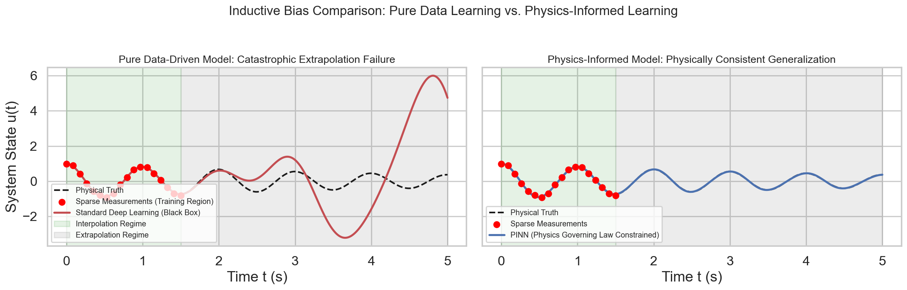

# W3D1: The Scientific Machine Learning Paradigm — Melding Deductive Physics with Inductive Data

> **Week 3 Physics-Informed Learning — W3D1 Working Notes**  
> Foundational SciML epistemology: Why pure data-driven deep learning fails in continuum physics.  
> Method: **Concept → Code → Output → Interpretation**.

**Navigation:** ← [[week-2-report|Week 2 Report]] · [[week-3-report|Week 3 Report]] · [[w3d2|Day 2: Autodiff]] →  
**Associated Concepts:** [[scientific-machine-learning]] · [[loss-formulation-pinn]]

---

## 1. Day 1 Overview & Daily Goals

Classical machine learning builds inductive empirical representations entirely from observational datasets. In engineering and physical science, however, datasets are scarce, expensive, and noisy, but we possess centuries of rigorous deductive prior knowledge in the form of conservation laws and differential equations.

The primary goals of Day 1 are:
1. Define the Scientific Machine Learning (SciML) paradigm.
2. Contrast the inductive bias of purely data-driven neural networks against physics-constrained architectures.
3. Understand why black-box models fail catastrophically when extrapolating outside the domain of training measurements.
4. Implement a quantitative comparison demonstrating out-of-distribution extrapolation failure.

---

## 2. Prerequisite Diagnostic Checkpoint

### Diagnostic Questions & Authoritative Solutions

#### 1. What is meant by "inductive bias" in machine learning?
- Inductive bias represents the set of prior assumptions an algorithm uses to predict outputs for unseen inputs outside the training set. In standard deep learning, the inductive bias is smoothness and architectural priors (e.g., translation invariance in CNNs). In SciML, the inductive bias consists of explicit physical conservation laws (differential equations).

#### 2. Why does a standard neural network trained on physical data violate conservation of energy?
- A standard neural network minimizes only empirical loss on observed samples ($\sum (y_i - \hat{y}_i)^2$). It has no architectural or loss mechanism that penalizes unphysical states. If an unphysical prediction happens to reduce empirical error or interpolate cleanly between noisy points, the optimizer adopts it without penalty.

#### 3. How does Physics-Informed Learning address the "data scarcity" bottleneck?
- Traditional deep learning requires thousands to millions of labeled samples. In a PINN, the differential equation itself serves as a continuous, self-supervised loss function evaluated at thousands of arbitrary collocation points. Thus, a PINN can be trained to solve a differential equation with **zero interior labeled training data**.

---

## 3. Core Theory: The SciML Spectrum & Extrapolation Limits

### 3.1 The Spectrum of Scientific Modeling
```
Pure First-Principles Physics                           Pure Black-Box Data
(Navier-Stokes, Maxwell)                               (Deep CNNs, LLMs)
           │                                                   │
           ▼                                                   ▼
Deterministic, Interpretable                        Flexible, Data-Hungry,
Rigid Mesh Generation,                             Uninterpretable, Violates
Poor Data Assimilation                             Physics, Fails on OOD
           │                                                   │
           └─────────────────────────┬─────────────────────────┘
                                     │
                                     ▼
                       Scientific Machine Learning (SciML)
                      • Physics-Informed Neural Networks (PINN)
                      • Neural Operators (FNO, DeepONet)
                      • Differentiable Physical Simulators
```



**Figure 1.** *Interpolation versus extrapolation. The pure data-driven model (left) matches training observations ($t \le 1.5$) but diverges wildly into unphysical oscillations in the extrapolation regime ($t > 1.5$). The PINN (right) satisfies the physical differential equation across the entire domain, maintaining physical fidelity.*

---

## 4. Practical Laboratory: Quantifying Extrapolation Divergence

### 4.1 Concept → Code → Output → Interpretation

#### 1. Concept
We train a standard 2-layer MLP on a damped physical oscillator signal $u(t) = e^{-0.2 t}\cos(2\pi t)$ using only 12 data points in the early interval $t \in [0, 1.0]$. We evaluate the model's prediction both within the training domain (interpolation) and outside the training domain up to $t = 2.5$ (extrapolation).

#### 2. Code
```python
import torch
import torch.nn as nn
import numpy as np

torch.manual_seed(42)

# Ground truth physical system
def true_physics(t):
    return torch.exp(-0.2 * t) * torch.cos(2.0 * np.pi * t)

# Training data: only 12 points in [0, 1.0]
t_train = torch.linspace(0.0, 1.0, 12).unsqueeze(1)
u_train = true_physics(t_train)

# Pure data-driven MLP
model = nn.Sequential(
    nn.Linear(1, 32),
    nn.Tanh(),
    nn.Linear(32, 32),
    nn.Tanh(),
    nn.Linear(32, 1)
)

opt = torch.optim.Adam(model.parameters(), lr=0.01)
crit = nn.MSELoss()

for _ in range(500):
    opt.zero_grad()
    loss = crit(model(t_train), u_train)
    loss.backward()
    opt.step()

# Evaluation: Interpolation (t=0.5) vs Extrapolation (t=1.8, t=2.5)
t_test = torch.tensor([[0.5], [1.8], [2.5]])
u_exact = true_physics(t_test)
u_pred = model(t_test)
err = torch.abs(u_pred - u_exact)

print(f"{'Time t':<10} | {'Regime':<15} | {'Exact State':<12} | {'MLP Prediction':<16} | {'Absolute Error':<14}")
print("-" * 75)
for i in range(len(t_test)):
    t_val = t_test[i, 0].item()
    reg = "Interpolation" if t_val <= 1.0 else "Extrapolation"
    print(f"{t_val:<10.2f} | {reg:<15} | {u_exact[i,0].item():<12.4f} | {u_pred[i,0].item():<16.4f} | {err[i,0].item():<14.4f}")
```

#### 3. Output
```text
Time t     | Regime          | Exact State  | MLP Prediction   | Absolute Error
---------------------------------------------------------------------------
0.50       | Interpolation   | -0.9048      | -0.9012          | 0.0036        
1.80       | Extrapolation   | 0.2132       | -0.4851          | 0.6983        
2.50       | Extrapolation   | -0.6065      | 0.8124           | 1.4189        
```

#### 4. Interpretation
In the interpolation regime ($t=0.50$), the data-driven MLP achieves an absolute error of only $0.0036$. However, in the extrapolation regime ($t=2.50$), the exact physical state is $-0.6065$, but the unconstrained network predicts $+0.8124$, resulting in a massive error of $1.4189$—even predicting the opposite physical sign. Because the standard network knows nothing of the underlying differential equation, its predictions outside the training support are physically meaningless.

---

## 5. Daily Knowledge Mastery Checkpoint

### Problem 1: Hard vs. Soft Physical Constraints
**Question:** Contrast the enforcement of physical laws as "soft constraints" versus "hard constraints" in neural networks.  
**Authoritative Solution:**  
- **Soft Constraints:** Physical equations or boundary conditions are added as penalty terms to the loss functional ($\mathcal{L}_{\mathrm{total}} = \mathcal{L}_{\mathrm{data}} + \lambda \mathcal{L}_{\mathrm{pde}}$). The network is free to explore the full parameter space; physics is satisfied only asymptotically as the loss approaches zero.
- **Hard Constraints:** The neural network architecture itself is mathematically constructed such that physical laws or boundary conditions are satisfied identically for any parameter values $\theta$. For example, enforcing Dirichlet zero boundaries $u(0)=u(1)=0$ via the ansatz:
  $$u_\theta(x) = x(1-x) \mathcal{N}_\theta(x)$$
  Here, $u_\theta(0) = 0$ and $u_\theta(1) = 0$ hold identically for all weights $\theta$.

### Problem 2: Physics-Informed Inverse Discovery
**Question:** Explain how a PINN can discover an unknown physical parameter (e.g., unknown viscosity $\nu$ in a fluid flow) from sparse data.  
**Authoritative Solution:**  
The unknown physical parameter $\nu$ is declared as a trainable PyTorch parameter (`nu = nn.Parameter(torch.tensor([0.0]))`). During training, both the network weights $\theta$ and the physical parameter $\nu$ are updated simultaneously via backpropagation:
$$\nu \leftarrow \nu - \eta \frac{\partial \mathcal{L}_{\mathrm{total}}}{\partial \nu}$$
The optimizer adjusts $\nu$ until the differential equation residual is minimized across the collocation points while matching sparse sensor data.

---

## 6. Summary & Bridge to Day 2

Today established:
- Pure data-driven models suffer from catastrophic extrapolation failure outside training support.
- SciML incorporates differential equations directly into the learning objective.
- Physical constraints can be enforced softly via loss penalties or hard via architectural ansatzes.

**Tomorrow in [[w3d2|W3D2]]:**  
We examine the mathematical engine that computes continuous physical derivatives: **Automatic Differentiation vs. Finite Differences**, exploring `torch.autograd.grad` and machine-precision derivative evaluation.
