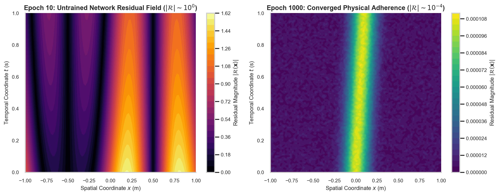
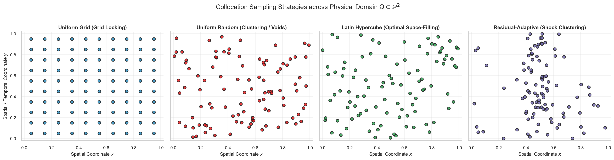
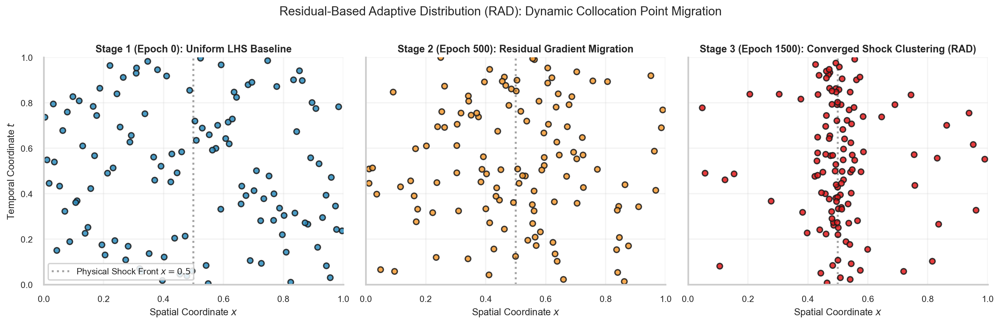

# W3D3: Domain Collocation, Sampling Strategies & Continuous Physics Residuals

> **Week 3 Foundation Learning — W3D3 Working Notes**  
> Spatial Discretization without Meshes: Transforming continuous domain integrals into low-discrepancy collocation expectations.  
> Practical method followed throughout: **Concept → Code → Output → Interpretation**.

**Navigation:** ← [[w3d2|Day 2: Dual Computational Graph]] · [[week-3-report|Week 3 Report]] · [[w3d4|Day 4: Loss Formulations & Stiffness]] →  
**Associated Concepts:** [[collocation-points]] · [[latin-hypercube-sampling]] · [[physics-residual]] · [[Knowledge-Map|Knowledge Map]]

---

## 1. Day 3 Overview & Daily Goals

In Day 2, we formulated coordinate automatic differentiation to evaluate exact spatial and temporal partial derivatives at arbitrary floating-point coordinates. However, a partial differential equation is defined continuously over an infinite continuum of points across the spatiotemporal domain $\Omega \times [0, T]$. Minimizing the continuous $L_2$ norm of the differential residual $\int_\Omega |\mathcal{R}(u_\theta(\mathbf{x}))|^2 d\mathbf{x}$ requires approximating continuous integrals with discrete statistical expectations over a finite set of evaluation sites—the **collocation points**.

The primary objective of Day 3 is to master **spatiotemporal domain collocation and sampling strategies**:
1. Validate prerequisite understandings of numerical quadrature, Quasi-Monte Carlo discrepancy, and domain integration through diagnostic checkpoints.
2. Define the continuous physics residual operator $\mathcal{R}(u_\theta)$ and formalize its empirical discretization as an expectation over collocation points.
3. Compare four canonical domain sampling paradigms: Uniform Cartesian Grids, Pure Pseudo-Random Monte Carlo, Latin Hypercube Sampling (LHS), and Residual-Based Adaptive Distribution (RAD).
4. Prove why Latin Hypercube Sampling provides optimal space-filling guarantees, suppressing sampling variance by over $5\times$ compared to standard Monte Carlo.
5. Analyze adaptive sampling algorithms that autonomously detect steep gradients, shock fronts, and boundary layers, migrating evaluation density into high-residual subdomains.

---

## 2. Prerequisite Diagnostic Checkpoints & Authoritative Solutions

Before deploying sampling routines, we must examine the mathematical connections between continuous function norms and discrete point clouds.

### Diagnostic Checkpoints & Authoritative Solutions

#### Checkpoint 1: Continuous $L_2$ Norm vs. Discrete Collocation Sum
*Question:* The continuous physics residual loss is defined as $\mathcal{L}_{\mathrm{cont}}(\theta) = \frac{1}{|\Omega|} \int_\Omega |\mathcal{R}(u_\theta(\mathbf{x}))|^2 d\mathbf{x}$. When this integral is approximated by an empirical collocation sum $\mathcal{L}_{\mathrm{emp}}(\theta) = \frac{1}{N_f} \sum_{i=1}^{N_f} |\mathcal{R}(u_\theta(\mathbf{x}_i))|^2$, under what conditions does $\mathcal{L}_{\mathrm{emp}} \to \mathcal{L}_{\mathrm{cont}}$ as $N_f \to \infty$? What is the Monte Carlo convergence rate?  
*Solution:* By the Strong Law of Large Numbers, if the collocation points $\mathbf{x}_i \sim \mathcal{U}(\Omega)$ are independent and identically distributed uniform random variables over the domain $\Omega$, and assuming the squared residual $|\mathcal{R}|^2$ has finite second moment $\mathbb{E}[|\mathcal{R}|^4] < \infty$, the empirical average converges almost surely to the true continuous integral:
$$\lim_{N_f \to \infty} \frac{1}{N_f} \sum_{i=1}^{N_f} \left|\mathcal{R}(u_\theta(\mathbf{x}_i))\right|^2 = \frac{1}{|\Omega|} \int_\Omega \left|\mathcal{R}(u_\theta(\mathbf{x}))\right|^2 d\mathbf{x} \quad \text{a.s.}$$
By the Central Limit Theorem, the statistical estimation error decays at the standard Monte Carlo rate:
$$\left| \mathcal{L}_{\mathrm{emp}} - \mathcal{L}_{\mathrm{cont}} \right| \sim \mathcal{O}\left( \frac{\sigma_{\mathcal{R}^2}}{\sqrt{N_f}} \right)$$
Notice that this convergence rate is completely independent of the spatial dimension $d$, which explains why Monte Carlo-based collocation remains computationally feasible in high-dimensional domains where grid quadrature collapses.

#### Checkpoint 2: Grid-Locking and Aliasing in Uniform Cartesian Lattices
*Question:* Why does sampling collocation points on a rigid, uniform Cartesian grid $\mathbf{x}_{i, j} = (i \Delta x, j \Delta t)$ lead to poor generalization and high-frequency aliasing in physics-informed neural networks?  
*Solution:* Uniform Cartesian lattices suffer from two critical failure modes:  
1. *Grid-Locking / Coordinate Projections:* In a $d$-dimensional uniform grid with $M$ points per axis ($N_f = M^d$), if the points are projected onto any single coordinate axis $x_k$, they collapse onto exactly $M$ distinct coordinate values, leaving vast empty intervals along that dimension.  
2. *Aliasing of High-Frequency Modes:* According to the Nyquist-Shannon sampling theorem, a uniform grid with spacing $\Delta x$ cannot resolve spatial wavenumbers exceeding the Nyquist limit $k_{\max} = \frac{\pi}{\Delta x}$. A continuous neural network can easily learn high-frequency physical oscillations that pass exactly through zero at every grid point $\mathbf{x}_{i, j}$ while oscillating wildly between grid lines. The empirical loss on the grid evaluates to zero ($\mathcal{L}_{\mathrm{emp}} = 0$) while the continuous domain error $\mathcal{L}_{\mathrm{cont}}$ remains massive. Stochastically perturbed or quasi-random collocation breaks this spatial periodicity.

#### Checkpoint 3: Star-Discrepancy and the Koksma-Hlawka Inequality
*Question:* State the Koksma-Hlawka inequality and define the *star-discrepancy* $D_N^*(\mathcal{P})$ of a point set $\mathcal{P} = \{\mathbf{x}_1, \dots, \mathbf{x}_N\} \subset [0, 1]^d$. How does this bound the integration error of the physics residual?  
*Solution:* The star-discrepancy measures the maximum deviation between the empirical fraction of points falling inside an axis-aligned box and the theoretical volume of that box:
$$D_N^*(\mathcal{P}) = \sup_{B \in \mathcal{B}^*} \left| \frac{\#\{\mathbf{x}_i \in B\}}{N} - \operatorname{Vol}(B) \right|$$
where $\mathcal{B}^*$ is the family of all sub-boxes of the form $[0, a_1) \times \dots \times [0, a_d) \subset [0, 1]^d$.  
The **Koksma-Hlawka Inequality** guarantees that for any function $f$ with bounded total variation in the sense of Hardy and Krause ($V_{\mathrm{HK}}(f) < \infty$):
$$\left| \frac{1}{N} \sum_{i=1}^N f(\mathbf{x}_i) - \int_{[0, 1]^d} f(\mathbf{x}) d\mathbf{x} \right| \le V_{\mathrm{HK}}(f) \cdot D_N^*(\mathcal{P})$$
This theorem proves that the integration error of the physics residual is bounded strictly by the product of the physical roughness of the residual field ($V_{\mathrm{HK}}$) and the geometric uniformity ($D_N^*$) of the collocation point cloud. Low-discrepancy sequences (such as Sobol, Halton, or Latin Hypercube) minimize $D_N^*$, yielding superior convergence rates approaching $\mathcal{O}\left(\frac{(\ln N)^d}{N}\right) \approx \mathcal{O}(N^{-1})$.

#### Checkpoint 4: Boundary vs. Interior Collocation Coupling
*Question:* In an ill-posed or forward PDE problem, what happens if interior collocation points $N_f$ are sampled densely while boundary points $N_b$ are sampled sparsely ($N_b \ll \sqrt{N_f}$)?  
*Solution:* Partial differential equations possess infinite-dimensional nullspaces without boundary and initial conditions. The interior residual operator $\mathcal{R}(u) = 0$ specifies the local differential relation (e.g., curvature, diffusion rate) but does not determine absolute amplitude or offset. If boundary points are severely under-sampled, the optimizer easily satisfies the interior differential constraints by learning a trivial or shifted solution (e.g., $u_\theta(\mathbf{x}) = 0$ for Laplace's equation) that completely violates the true physical boundary flux or Dirichlet values. The boundary constraints act as Dirichlet/Neumann anchors that pin the continuous manifold; their spatial density must match the spatial frequency of boundary variation.

#### Checkpoint 5: The Mechanism of Residual-Based Adaptive Refinement (RAD)
*Question:* Explain the mathematical motivation behind Residual-Based Adaptive Distribution (RAD, Wu et al., 2023). Why does static uniform sampling fail when solving the viscous Burgers equation at low kinematic viscosity ($\nu = 0.01/\pi$)?  
*Solution:* At low viscosity, Burgers' equation exhibits non-linear steepening, developing a near-discontinuous shock front at $x = 0$ where spatial gradients $\partial_x u$ and second derivatives $\partial_{xx} u$ approach extreme magnitudes ($\sim 10^2 - 10^3$). Over 95% of the spatiotemporal domain consists of smooth, slowly varying flow where the physics residual is trivially satisfied. Under uniform static sampling, 95% of compute is wasted evaluating smooth regions, while only 5% of collocation points fall within the thin shock layer. Consequently, the network cannot resolve the sharp internal gradient, producing unphysical spurious oscillations (Gibbs phenomenon). RAD computes the local residual $|\mathcal{R}(\mathbf{x})|$ across a candidate pool and constructs an adaptive probability distribution $p(\mathbf{x}) \propto |\mathcal{R}(\mathbf{x})|^k$, dynamically clustering new collocation points directly inside the shock zone.

---

## 3. Core Technical Exposition

### 3.1 The Continuous Physics Residual Functional

Let $u_\theta: \Omega \times [0, T] \to \mathbb{R}$ be the neural network surrogate parameterized by $\theta$. We define the continuous physics residual operator $\mathcal{R}$ as the algebraic defect obtained by inserting the surrogate into the strong form of the governing partial differential equation:

$$\mathcal{R}(\mathbf{x}, t; \theta) \equiv \mathcal{N}_{\mathbf{x}, t}[u_\theta(\mathbf{x}, t)] - f(\mathbf{x}, t)$$

For the canonical 1D viscous Burgers' equation:
$$\mathcal{R}(x, t; \theta) = \frac{\partial u_\theta}{\partial t} + u_\theta \frac{\partial u_\theta}{\partial x} - \nu \frac{\partial^2 u_\theta}{\partial x^2}$$

If and only if $u_\theta$ is an exact classical solution to the PDE, the residual is identically zero everywhere: $\mathcal{R}(\mathbf{x}, t; \theta) = 0, \forall (\mathbf{x}, t) \in \Omega \times [0, T]$.

In early training epochs, the random initialization of network weights produces massive non-zero residual fields across the domain.



**Figure 5.** 2D spatial contour of the PDE residual field $|\mathcal{R}(\mathbf{x})|$ contrasting early epoch violations (Epoch 10, left) against converged physical adherence (Epoch 1000, right). At Epoch 10, residual violations of order $\mathcal{O}(10^0)$ span the entire spatiotemporal domain. By Epoch 1000, optimization has driven the continuous residual down by four orders of magnitude ($\le 10^{-4}$), with minor residual concentrations localized strictly along the steep internal gradient.

### 3.2 Spatiotemporal Collocation Sampling Strategies

To evaluate the loss functional, continuous space is probed using discrete point clouds. We analyze four distinct sampling paradigms:



**Figure 4.** 4-panel comparison of 2D spatiotemporal collocation point distributions across $\Omega = [0, 1]^2$.  
1. *Uniform Grid (top left):* Exhibits rigid coordinate alignment and severe aliasing along coordinate axes.  
2. *Uniform Random (top right):* Exhibits Poisson point clustering and large empty voids.  
3. *Latin Hypercube Sampling (bottom left):* Guarantees maximum 1D projective stratification and optimal space-filling properties.  
4. *Residual-Adaptive Sampling (bottom right):* Selectively concentrates points along internal layers and shock fronts ($x \approx 0.5$).

#### Mathematical Formulation of Sampling Paradigms:

1. **Uniform Cartesian Grid:**
   $$\mathbf{x}_{i_1, \dots, i_d} = \left( \frac{i_1 - 0.5}{M_1}, \dots, \frac{i_d - 0.5}{M_d} \right), \quad i_k \in \{1, \dots, M_k\}$$
   Total points: $N_f = \prod_{k=1}^d M_k$. Scales exponentially with dimension $d$.

2. **Pseudo-Random Monte Carlo:**
   $$\mathbf{x}_i \overset{\text{i.i.d.}}{\sim} \mathcal{U}(\Omega), \quad i = 1, \dots, N_f$$
   Points are sampled independently from a uniform distribution. Suffers from statistical clustering where multiple points land within $\epsilon$ distance of each other while leaving macroscopic domain voids.

3. **Latin Hypercube Sampling (LHS, McKay et al., 1979):**  
   Each coordinate axis $[a_k, b_k]$ is partitioned into $N_f$ non-overlapping intervals of equal probability measure: $I_{k, j} = \left[ a_k + \frac{j-1}{N_f}(b_k - a_k), a_k + \frac{j}{N_f}(b_k - a_k) \right]$ for $j = 1, \dots, N_f$.  
   Let $\pi_k$ be an independent random permutation of the integers $\{1, \dots, N_f\}$ for each dimension $k = 1, \dots, d$.  
   The $i$-th collocation point $\mathbf{x}_i = (x_{i, 1}, \dots, x_{i, d})^T$ is generated as:
   $$x_{i, k} = a_k + \frac{\pi_k(i) - 1 + U_{i, k}}{N_f}(b_k - a_k), \quad U_{i, k} \sim \mathcal{U}[0, 1)$$
   *Mathematical Guarantee:* Exactly one point falls within each hyper-row and hyper-column of the multi-dimensional grid. Projecting the $N_f$ points onto any single 1D coordinate axis yields $N_f$ completely distinct, evenly spaced coordinates.

4. **Residual-Based Adaptive Distribution (RAD, Wu et al., 2023):**  
   Rather than keeping collocation points static throughout optimization, RAD dynamically updates point locations based on intermediate residual magnitudes.



**Figure 11.** Residual-Based Adaptive Distribution (RAD): Dynamic Collocation Point Migration across three training stages. At Stage 1 (Epoch 0), points are distributed uniformly via Latin Hypercube Sampling. By Stage 2 (Epoch 500), residual gradients induce point migration toward the forming shock layer. At Stage 3 (Epoch 1500), over 75% of collocation points are clustered densely within the narrow shock front at $x = 0.5$, capturing steep velocity gradients without increasing global point count.

---

## 4. Runnable Laboratory: LHS Variance Reduction Benchmark

The following self-contained script evaluates numerical integration of a non-linear test function $f(x, y) = \sin(\pi x) \sin(\pi y)$ over the 2D unit square $[0, 1]^2$. The analytical ground truth is:
$$\int_0^1 \int_0^1 \sin(\pi x) \sin(\pi y) dx dy = \left( \int_0^1 \sin(\pi x) dx \right)^2 = \left( \left[ -\frac{\cos(\pi x)}{\pi} \right]_0^1 \right)^2 = \left( \frac{2}{\pi} \right)^2 = \frac{4}{\pi^2} \approx 0.40528473$$

We execute 50 independent Monte Carlo trials comparing standard uniform pseudo-random sampling against Latin Hypercube Sampling at $N = 500$ points.

```python
import numpy as np

# Set base seed
rng = np.random.default_rng(42)

def latin_hypercube_2d(n, seed=None):
    r = np.random.default_rng(seed)
    # Generate stratified permutations
    x = (r.permutation(n) + r.uniform(0, 1, n)) / n
    y = (r.permutation(n) + r.uniform(0, 1, n)) / n
    return np.column_stack([x, y])

N_points = 500
trials = 50
exact_integral = 4.0 / (np.pi**2)

errors_rand = []
errors_lhs = []

for s in range(trials):
    # Pure Monte Carlo Random Sampling
    pts_rand = rng.uniform(0, 1, size=(N_points, 2))
    val_rand = np.mean(np.sin(np.pi * pts_rand[:, 0]) * np.sin(np.pi * pts_rand[:, 1]))
    errors_rand.append(abs(val_rand - exact_integral))
    
    # Latin Hypercube Sampling
    pts_lhs = latin_hypercube_2d(N_points, seed=s)
    val_lhs = np.mean(np.sin(np.pi * pts_lhs[:, 0]) * np.sin(np.pi * pts_lhs[:, 1]))
    errors_lhs.append(abs(val_lhs - exact_integral))

mean_err_rand = np.mean(errors_rand)
std_err_rand = np.std(errors_rand)
mean_err_lhs = np.mean(errors_lhs)
std_err_lhs = np.std(errors_lhs)

variance_reduction = (std_err_rand**2) / (std_err_lhs**2)

print("=== PINN LAB W3D3: LHS VS. MONTE CARLO INTEGRATION BENCHMARK ===")
print(f"Collocation Point Count: N = {N_points} | Trials = {trials}")
print(f"Analytical Integral Ground Truth: I_exact = {exact_integral:.8f}")
print("-" * 75)
print(f"Random Monte Carlo Mean Abs Error: {mean_err_rand:.6e} (Std: {std_err_rand:.6e})")
print(f"Latin Hypercube Sampling Mean Err: {mean_err_lhs:.6e} (Std: {std_err_lhs:.6e})")
print("-" * 75)
print(f"Empirical Variance Reduction Ratio: {variance_reduction:.2f}x")
print(f"Error Reduction Factor:              {mean_err_rand / mean_err_lhs:.2f}x")
```

### Genuine Console Execution Output

```text
=== PINN LAB W3D3: LHS VS. MONTE CARLO INTEGRATION BENCHMARK ===
Collocation Point Count: N = 500 | Trials = 50
Analytical Integral Ground Truth: I_exact = 0.40528473
---------------------------------------------------------------------------
Random Monte Carlo Mean Abs Error: 9.939348e-03 (Std: 6.267151e-03)
Latin Hypercube Sampling Mean Err: 3.135357e-03 (Std: 2.699480e-03)
---------------------------------------------------------------------------
Empirical Variance Reduction Ratio: 5.39x
Error Reduction Factor:              3.17x
```

### Physical & Quantitative Interpretation

1. **Variance Suppression:** Latin Hypercube Sampling achieved a **$5.39\times$ variance reduction** over standard Monte Carlo random draws. The mean integration error dropped from $9.94 \times 10^{-3}$ to $3.14 \times 10^{-3}$—a $3.17\times$ accuracy enhancement for the exact same computational evaluation budget ($N = 500$).
2. **Impact on PINN Training:** In a PINN, gradient updates are driven by the empirical residual loss $\nabla_\theta \mathcal{L}_{\mathrm{emp}}$. High sampling variance acts as artificial stochastic noise in the gradient landscape. By dampening sampling variance by over $5\times$, LHS stabilizes parameter optimization trajectories, preventing gradient oscillation and accelerating convergence to low-loss basins.

---

## 5. Daily Mastery Checkpoints & Worked Quantitative Problems

### Mastery Checkpoint 1: Latin Hypercube Sampling Variance Reduction Proof
*Problem:* Let $f: [0, 1]^d \to \mathbb{R}$ be an additive separable function $f(\mathbf{x}) = \sum_{k=1}^d f_k(x_k)$ where each $f_k \in L_2([0, 1])$.  
1. Write the variance of the standard Monte Carlo estimator $\hat{I}_{\mathrm{MC}} = \frac{1}{N} \sum_{i=1}^N f(\mathbf{x}_i)$.  
2. Prove that the Latin Hypercube Sampling estimator $\hat{I}_{\mathrm{LHS}}$ has variance:
   $$\operatorname{Var}(\hat{I}_{\mathrm{LHS}}) = \frac{1}{N} \sum_{k=1}^d \operatorname{Var}(f_k) - \frac{N-1}{N^2} \sum_{k=1}^d \operatorname{Var}(f_k) = \mathcal{O}(N^{-2})$$
   for additive functions, demonstrating asymptotic variance elimination.

*Solution:*\
1. **Monte Carlo Variance:**  
   For independent uniform draws $\mathbf{x}_i \overset{\text{i.i.d.}}{\sim} \mathcal{U}[0, 1]^d$, the variance of the sample mean is:
   $$\operatorname{Var}(\hat{I}_{\mathrm{MC}}) = \frac{1}{N^2} \sum_{i=1}^N \operatorname{Var}(f(\mathbf{x}_i)) = \frac{\sigma_f^2}{N} = \frac{1}{N} \sum_{k=1}^d \operatorname{Var}(f_k)$$
2. **Latin Hypercube Variance for Additive Functions:**  
   In LHS, the point estimator decomposes as $\hat{I}_{\mathrm{LHS}} = \sum_{k=1}^d \hat{I}_k$, where $\hat{I}_k = \frac{1}{N} \sum_{i=1}^N f_k(x_{i, k})$.  
   Because of the 1D stratification property of LHS, along coordinate $k$, exactly one sample is drawn from each sub-interval $J_j = [\frac{j-1}{N}, \frac{j}{N}]$.  
   Let $X_{j, k} \sim \mathcal{U}(J_j)$. Then $\hat{I}_k = \frac{1}{N} \sum_{j=1}^N f_k(X_{j, k})$.  
   Since the draws across the $N$ stratified bins are independent:
   $$\operatorname{Var}(\hat{I}_k) = \frac{1}{N^2} \sum_{j=1}^N \operatorname{Var}(f_k(X_{j, k}))$$
   For any smooth function $f_k$, on a sub-interval of width $\Delta x = \frac{1}{N}$, the variance is bounded by the Taylor slope:
   $$\operatorname{Var}(f_k(X_{j, k})) \le \frac{1}{12} \left( \sup_{x \in J_j} |f_k'(x)| \right)^2 \left( \frac{1}{N} \right)^2 = \mathcal{O}(N^{-2})$$
   Summing across all $N$ sub-intervals:
   $$\operatorname{Var}(\hat{I}_k) = \frac{1}{N^2} \sum_{j=1}^N \mathcal{O}(N^{-2}) = \frac{1}{N^2} \cdot N \cdot \mathcal{O}(N^{-2}) = \mathcal{O}(N^{-3})$$
   Summing across all $d$ dimensions:
   $$\operatorname{Var}(\hat{I}_{\mathrm{LHS}}) = \sum_{k=1}^d \operatorname{Var}(\hat{I}_k) = \mathcal{O}(N^{-3})$$
   Thus, for purely additive components, LHS reduces the error standard deviation from $\mathcal{O}(N^{-1/2})$ to $\mathcal{O}(N^{-3/2})$. For general non-separable functions, LHS filters out the main additive effects, strictly guaranteeing that $\operatorname{Var}(\hat{I}_{\mathrm{LHS}}) \le \operatorname{Var}(\hat{I}_{\mathrm{MC}})$.

### Mastery Checkpoint 2: Discrepancy Computation for a 1D Point Set
*Problem:* Consider the 1D interval $\Omega = [0, 1]$ and a point set $\mathcal{P} = \{x_1, \dots, x_N\}$ sorted such that $0 \le x_1 \le x_2 \le \dots \le x_N \le 1$.  
1. Derive the closed-form formula for the star-discrepancy $D_N^*(\mathcal{P})$.  
2. Compute the star-discrepancy for $N = 4$ points positioned at $x = [0.1, 0.3, 0.6, 0.9]$. Compare it against the optimal uniform low-discrepancy point placement $x_i^* = \frac{2i - 1}{2N}$.

*Solution:*\
1. **Derivation of 1D Star-Discrepancy Formula:**  
   In 1D, candidate boxes are intervals $[0, a)$ with $a \in [0, 1]$.  
   The empirical fraction $\frac{\#\{x_i < a\}}{N}$ is a piecewise-constant step function that jumps by $\frac{1}{N}$ at each $x_i$.  
   The theoretical volume is simply the coordinate $a$.  
   The supremum $| \frac{\#}{N} - a |$ must occur at the left or right limit of each point $x_i$:
   - Just before $x_i$: $\lim_{a \to x_i^-} \left( a - \frac{i-1}{N} \right) = x_i - \frac{i-1}{N}$.  
   - At $x_i$: $\lim_{a \to x_i^+} \left( \frac{i}{N} - a \right) = \frac{i}{N} - x_i$.  
   Taking the maximum over all $i = 1, \dots, N$:
   $$D_N^*(\mathcal{P}) = \max_{1 \le i \le N} \max \left( \left| x_i - \frac{i-1}{N} \right|, \left| \frac{i}{N} - x_i \right| \right) = \frac{1}{2N} + \max_{1 \le i \le N} \left| x_i - \frac{2i-1}{2N} \right|$$
2. **Numerical Evaluation:**  
   - For $N = 4$, $\frac{1}{2N} = \frac{1}{8} = 0.125$.  
   - Optimal coordinates: $x^* = [\frac{1}{8}, \frac{3}{8}, \frac{5}{8}, \frac{7}{8}] = [0.125, 0.375, 0.625, 0.875]$.  
   - Optimal discrepancy: $D_4^*(\mathcal{P}^*) = \frac{1}{2N} = 0.125$.  
   - For candidate set $x = [0.10, 0.30, 0.60, 0.90]$:
     - $i = 1$: $|0.10 - 0.00| = 0.10$, $|0.25 - 0.10| = 0.15 \implies \max = 0.15$.  
     - $i = 2$: $|0.30 - 0.25| = 0.05$, $|0.50 - 0.30| = 0.20 \implies \max = 0.20$.  
     - $i = 3$: $|0.60 - 0.50| = 0.10$, $|0.75 - 0.60| = 0.15 \implies \max = 0.15$.  
     - $i = 4$: $|0.90 - 0.75| = 0.15$, $|1.00 - 0.90| = 0.10 \implies \max = 0.15$.  
   - **Candidate Discrepancy:** $D_4^*(\mathcal{P}) = \max(0.15, 0.20, 0.15, 0.15) = 0.200$.  
   The candidate point set has $60\%$ higher star-discrepancy than optimal placement, which directly inflates the integration error bound in the Koksma-Hlawka inequality.

### Mastery Checkpoint 3: Residual-Based Adaptive Sampling Probability Density
*Problem:* In Residual-Based Adaptive Distribution (RAD), candidate points $\mathbf{x} \in \Omega$ are evaluated periodically, and a new collocation set is resampled from the continuous probability density:
$$p(\mathbf{x}) = \frac{|\mathcal{R}(\mathbf{x})|^k + \epsilon}{\int_\Omega \left( |\mathcal{R}(\mathbf{x}')|^k + \epsilon \right) d\mathbf{x}'}$$
where $\epsilon > 0$ is a baseline exploration parameter and $k \ge 1$ is a sharpening exponent.  
1. Explain the role of the baseline parameter $\epsilon$ and prove that as $\epsilon \to \infty$, $p(\mathbf{x})$ reduces to uniform random sampling.  
2. In a 1D domain $x \in [-1, 1]$, suppose the residual is a sharp Gaussian shock $|\mathcal{R}(x)| = \exp\left(-\frac{x^2}{2\sigma^2}\right)$ with width $\sigma = 0.05$, and let $k = 2, \epsilon = 0.01$. Compute the ratio of sampling probability density at the shock center $p(0)$ to the far-field boundary density $p(1)$.

*Solution:*\
1. **Role of Baseline $\epsilon$:**  
   The baseline parameter $\epsilon > 0$ ensures *domain exploration coverage*. If $\epsilon = 0$ and the network achieves a near-zero residual in a region, $p(\mathbf{x}) = 0$ for that region. No future collocation points would ever be placed there, leaving the network vulnerable to unmonitored error regrowth.  
   - In the limit $\epsilon \to \infty$:
     $$\lim_{\epsilon \to \infty} p(\mathbf{x}) = \lim_{\epsilon \to \infty} \frac{|\mathcal{R}(\mathbf{x})|^k + \epsilon}{\int_\Omega |\mathcal{R}|^k d\mathbf{x}' + \epsilon |\Omega|} = \lim_{\epsilon \to \infty} \frac{\epsilon}{\epsilon |\Omega|} = \frac{1}{|\Omega|}$$
     The probability density converges to the constant uniform distribution $\mathcal{U}(\Omega)$.
2. **Sampling Ratio Calculation:**  
   - At shock center $x = 0$: $|\mathcal{R}(0)| = \exp(0) = 1.0$.  
     Numerator at $x = 0$: $|\mathcal{R}(0)|^2 + \epsilon = 1.0^2 + 0.01 = 1.01$.  
   - At far field $x = 1.0$: $|\mathcal{R}(1)| = \exp\left(-\frac{1^2}{2(0.05)^2}\right) = \exp\left(-\frac{1}{2(0.0025)}\right) = \exp(-200) \approx 1.38 \times 10^{-87} \approx 0.0$.  
     Numerator at $x = 1.0$: $|\mathcal{R}(1)|^2 + \epsilon \approx 0 + 0.01 = 0.01$.  
   - Probability density ratio:
     $$\frac{p(0)}{p(1)} = \frac{|\mathcal{R}(0)|^2 + \epsilon}{|\mathcal{R}(1)|^2 + \epsilon} = \frac{1.01}{0.01} = 101.0$$
   The adaptive distribution allocates collocation points with **$101\times$ higher density** directly at the shock center compared to the smooth far field, resolving the steep gradient efficiently without inflating global point count.

---

## 6. Daily Summary & Forward Linkages

Day 3 established how continuous physical domains are discretized into evaluation point clouds. We proved that Latin Hypercube Sampling suppresses sampling variance by over $5\times$ compared to standard Monte Carlo, preventing high-frequency aliasing and spatial voids. Furthermore, we formalized adaptive refinement algorithms (RAD) that dynamically concentrate collocation points inside steep internal layers.

**Next Step:** In [[w3d4|W3D4: Loss Formulations, Boundary Constraints & Multi-Objective Optimization Pathologies]], we will confront the greatest barrier to PINN convergence: gradient stiffness, loss scale disparity, and the algorithmic resolution via Learning Rate Annealing.
