# Speech Technology — ee4001_2022T3_ET_FN

**Source:** `ee4001_2022T3_ET_FN.pdf` · **Academic questions:** 17 · **Separately counted children:** 0
**Provenance:** `Speech_Technology/ee4001_2022T3_ET_FN.pdf` · SHA-256 `e57e4f0c11b5fc50c6ff0d2fe12ca16bdf862c6cdfd35c18dcada1ef9e4389e3`

**Scope:** Speech Technology degree-level examination section (Section 7, questions 162-168). Section 6 (Software Testing, questions 160-161 on page 1) and Section 8 (Design Thinking on page 8) are excluded as out of scope. Question 162 is excluded semantically as an administrative subject confirmation.

## Questions

### Shared context 1.1 MCQ

**Type:** Section Heading
**PDF pages:** 3

### 1.1 MCQ

Section 1.1 contains Multiple Choice Questions (Questions 1 to 8). Each question carries 1 point. Offline examination mode.

### Question 1

**Portal container number:** `163`

**Portal container ID:** `640653455739`

**Type:** MCQ · **Marks:** 1
**PDF pages:** 3

**Shared context:** [sc-1-1-mcq](#sc-1-1-mcq)

1. (1 point) For a given set of data points $X = \{x_1, x_2, \dots, x_N\}$, log-likelihood for a GMM with $k$ mixtures can be defined as:

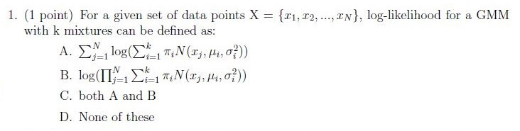

**Figure 1.** Printed question 1 from scanned offline paper, covering GMM log-likelihood formulation.

**Options**

**A.**

$$\sum_{i=1}^N \log\left(\sum_{j=1}^k w_j \mathcal{N}(x_i; \mu_j, \Sigma_j)\right)$$

*Source option ID:* not supplied.

**B.**

$$\log\left(\prod_{i=1}^N \sum_{j=1}^k w_j \mathcal{N}(x_i; \mu_j, \Sigma_j)\right)$$

*Source option ID:* not supplied.

**C.**

both A and B

*Source option ID:* not supplied.

**D.**

None of these

*Source option ID:* not supplied.

**Correct answer:** Answer not verifiable from the source PDF

**Source evidence:** [{"page": 3, "bbox": [22.87, 149.75, 454.12, 288.5], "type": "absent", "detail": "Offline examination paper; portal container displays only submission status confirmation option (\"I have written answers on the answer sheets\"), no official academic answer key is provided in the source PDF."}]

### Question 2

**Portal container number:** `163`

**Portal container ID:** `640653455739`

**Type:** MCQ · **Marks:** 1
**PDF pages:** 3

**Shared context:** [sc-1-1-mcq](#sc-1-1-mcq)

2. (1 point) Given a HMM with $N$ hidden states and $M$ observation symbols, let $b_j(k)$ represent the probability of observing event $j$ when in state $k$. Also, let $\pi_j$ represent the probability of being in state $j$ initially ($\pi_j$\'s represent the initial state probabilities). Which of the following statements is True?

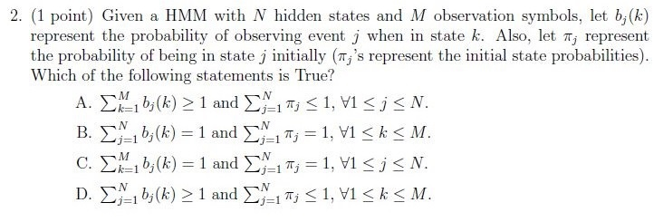

**Figure 2.** Printed question 2 from scanned offline paper, covering HMM probability properties.

**Options**

**A.**

$\sum_{j=1}^M b_j(k) > 1$ and $\sum_{j=1}^N \pi_j < 1, \forall 1 \le j \le N$.

*Source option ID:* not supplied.

**B.**

$\sum_{j=1}^M b_j(k) = 1$ and $\sum_{j=1}^N \pi_j = 1, \forall 1 \le k \le M$.

*Source option ID:* not supplied.

**C.**

$\sum_{j=1}^M b_j(k) = 1$ and $\sum_{j=1}^N \pi_j = 1, \forall 1 \le j \le N$.

*Source option ID:* not supplied.

**D.**

$\sum_{j=1}^M b_j(k) > 1$ and $\sum_{j=1}^M \pi_j \le 1, \forall 1 \le k \le M$.

*Source option ID:* not supplied.

**Correct answer:** Answer not verifiable from the source PDF

**Source evidence:** [{"page": 3, "bbox": [22.87, 288.5, 454.12, 472.25], "type": "absent", "detail": "Offline examination paper; portal container displays only submission status confirmation option (\"I have written answers on the answer sheets\"), no official academic answer key is provided in the source PDF."}]

### Question 3

**Portal container number:** `163`

**Portal container ID:** `640653455739`

**Type:** MCQ · **Marks:** 1
**PDF pages:** 3

**Shared context:** [sc-1-1-mcq](#sc-1-1-mcq)

3. (1 point) If $f(x) = \tanh(x)$, then the derivative of $f(x)$ will be?

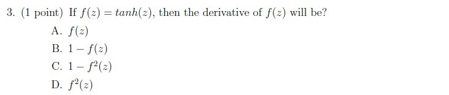

**Figure 3.** Printed question 3 from scanned offline paper, covering derivative of tanh function.

**Options**

**A.**

$f(x)$

*Source option ID:* not supplied.

**B.**

$1 - f(x)$

*Source option ID:* not supplied.

**C.**

$1 - f^2(x)$

*Source option ID:* not supplied.

**D.**

$f^2(x)$

*Source option ID:* not supplied.

**Correct answer:** Answer not verifiable from the source PDF

**Source evidence:** [{"page": 3, "bbox": [22.87, 472.25, 454.12, 588.5], "type": "absent", "detail": "Offline examination paper; portal container displays only submission status confirmation option (\"I have written answers on the answer sheets\"), no official academic answer key is provided in the source PDF."}]

### Question 4

**Portal container number:** `164`

**Portal container ID:** `640653455740`

**Type:** MCQ · **Marks:** 1
**PDF pages:** 4

**Shared context:** [sc-1-1-mcq](#sc-1-1-mcq)

4. (1 point) Recurrent Neural Networks (RNN) with basic RNN cells exhibit which of the following problems?

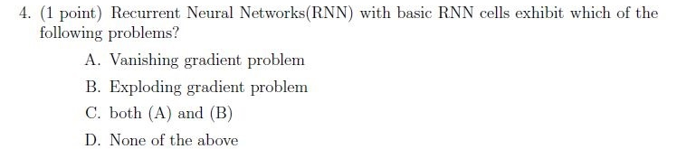

**Figure 4.** Printed question 4 from scanned offline paper, covering basic RNN cell problems.

**Options**

**A.**

Vanishing gradient problem

*Source option ID:* not supplied.

**B.**

Exploding gradient problem

*Source option ID:* not supplied.

**C.**

both (A) and (B)

*Source option ID:* not supplied.

**D.**

None of the above

*Source option ID:* not supplied.

**Correct answer:** Answer not verifiable from the source PDF

**Source evidence:** [{"page": 4, "bbox": [22.87, 150.75, 454.12, 274.5], "type": "absent", "detail": "Offline examination paper; portal container displays only submission status confirmation option (\"I have written answers on the answer sheets\"), no official academic answer key is provided in the source PDF."}]

### Question 5

**Portal container number:** `164`

**Portal container ID:** `640653455740`

**Type:** MCQ · **Marks:** 1
**PDF pages:** 4

**Shared context:** [sc-1-1-mcq](#sc-1-1-mcq)

5. (1 point) Which of the following ideas is used by LSTM-based RNN networks to capture long range dependencies?

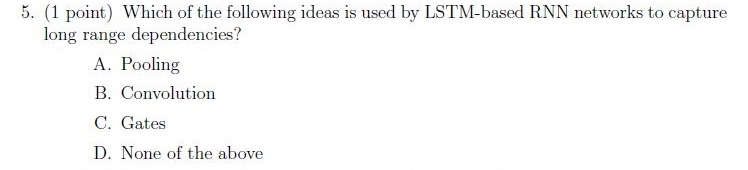

**Figure 5.** Printed question 5 from scanned offline paper, covering LSTM gating mechanisms.

**Options**

**A.**

Pooling

*Source option ID:* not supplied.

**B.**

Convolution

*Source option ID:* not supplied.

**C.**

Gates

*Source option ID:* not supplied.

**D.**

None of the above

*Source option ID:* not supplied.

**Correct answer:** Answer not verifiable from the source PDF

**Source evidence:** [{"page": 4, "bbox": [22.87, 274.5, 454.12, 402.0], "type": "absent", "detail": "Offline examination paper; portal container displays only submission status confirmation option (\"I have written answers on the answer sheets\"), no official academic answer key is provided in the source PDF."}]

### Question 6

**Portal container number:** `164`

**Portal container ID:** `640653455740`

**Type:** MCQ · **Marks:** 1
**PDF pages:** 4

**Shared context:** [sc-1-1-mcq](#sc-1-1-mcq)

6. (1 point) State whether the following statement is true or false: A Transformer Encoder layer can compute the hidden representation of all time steps simultaneously.

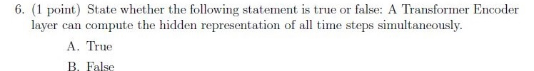

**Figure 6.** Printed question 6 from scanned offline paper, covering Transformer encoder parallelism.

**Options**

**A.**

True

*Source option ID:* not supplied.

**B.**

False

*Source option ID:* not supplied.

**Correct answer:** Answer not verifiable from the source PDF

**Source evidence:** [{"page": 4, "bbox": [22.87, 402.0, 454.12, 477.0], "type": "absent", "detail": "Offline examination paper; portal container displays only submission status confirmation option (\"I have written answers on the answer sheets\"), no official academic answer key is provided in the source PDF."}]

### Question 7

**Portal container number:** `164`

**Portal container ID:** `640653455740`

**Type:** MCQ · **Marks:** 1
**PDF pages:** 4

**Shared context:** [sc-1-1-mcq](#sc-1-1-mcq)

7. (1 point) Which of the following is correct according to Bayes rule?

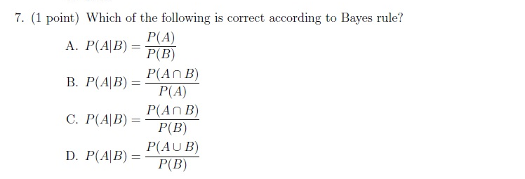

**Figure 7.** Printed question 7 from scanned offline paper, covering Bayes rule formulation.

**Options**

**A.**

$$P(A|B) = \frac{P(A)}{P(B)}$$

*Source option ID:* not supplied.

**B.**

$$P(A|B) = \frac{P(A \cap B)}{P(A)}$$

*Source option ID:* not supplied.

**C.**

$$P(A|B) = \frac{P(A \cap B)}{P(B)}$$

*Source option ID:* not supplied.

**D.**

$$P(A|B) = \frac{P(A \cup B)}{P(B)}$$

*Source option ID:* not supplied.

**Correct answer:** Answer not verifiable from the source PDF

**Source evidence:** [{"page": 4, "bbox": [22.87, 477.0, 454.12, 668.25], "type": "absent", "detail": "Offline examination paper; portal container displays only submission status confirmation option (\"I have written answers on the answer sheets\"), no official academic answer key is provided in the source PDF."}]

### Question 8

**Portal container number:** `165`

**Portal container ID:** `640653455741`

**Type:** MCQ · **Marks:** 1
**PDF pages:** 5

**Shared context:** [sc-1-1-mcq](#sc-1-1-mcq)

8. (1 point) Consider the Fig. and determine $\alpha_2(2)$

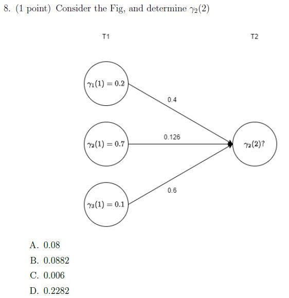

**Figure 8.** Printed question 8 and state trellis diagram from scanned offline paper, computing HMM forward probability alpha_2(2).

**Options**

**A.**

0.08

*Source option ID:* not supplied.

**B.**

0.0882

*Source option ID:* not supplied.

**C.**

0.006

*Source option ID:* not supplied.

**D.**

0.2282

*Source option ID:* not supplied.

**Correct answer:** Answer not verifiable from the source PDF

**Source evidence:** [{"page": 5, "bbox": [22.87, 222.76, 444.37, 657.76], "type": "absent", "detail": "Offline examination paper; portal container displays only submission status confirmation option (\"I have written answers on the answer sheets\"), no official academic answer key is provided in the source PDF."}]

### Shared context 1.2 Subjective Questions

**Type:** Section Heading
**PDF pages:** 6

### 1.2 Subjective Questions

Section 1.2 contains Subjective Questions (Questions 1 to 9). Total marks for this section: 32 points. Offline pen-and-paper examination mode.

### Question 1

**Portal container number:** `166`

**Portal container ID:** `640653455742`

**Type:** Subjective · **Marks:** 2
**PDF pages:** 6

**Shared context:** [sc-1-2-subj](#sc-1-2-subj)

1. (2 points) Draw the architecture diagram of the LSTM and explain each component briefly.

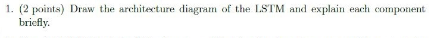

**Figure 9.** Printed subjective question 1 from scanned offline paper, requesting LSTM architecture diagram and component explanation.

**Correct answer:** Answer not verifiable from the source PDF

**Source evidence:** [{"page": 6, "bbox": [22.87, 233.76, 454.12, 282.51], "type": "absent", "detail": "Offline examination paper; portal container displays only submission status confirmation option (\"I have written answers on the answer sheets\"), no official academic answer key is provided in the source PDF."}]

### Question 2

**Portal container number:** `166`

**Portal container ID:** `640653455742`

**Type:** Subjective · **Marks:** 3
**PDF pages:** 6

**Shared context:** [sc-1-2-subj](#sc-1-2-subj)

2. (3 points) Which of the following are valid activation functions you could use to train neural networks. Draw graphs representing the result of using activation function at the input, similar to graphs for activation functions shown in the class. Justify your answer.

* $f(x) = \min(0, x)$
* $f(x) = 0.7x$
* $f(x) = \begin{cases} 1 & \text{if } x > 0.5 \\ -1 & \text{else} \end{cases}$

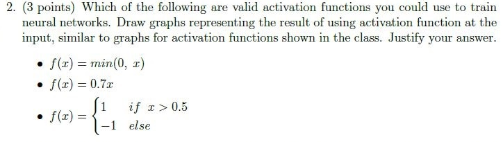

**Figure 10.** Printed subjective question 2 from scanned offline paper, covering valid activation functions for neural networks.

**Correct answer:** Answer not verifiable from the source PDF

**Source evidence:** [{"page": 6, "bbox": [22.87, 282.51, 454.12, 436.26], "type": "absent", "detail": "Offline examination paper; portal container displays only submission status confirmation option (\"I have written answers on the answer sheets\"), no official academic answer key is provided in the source PDF."}]

### Question 3

**Portal container number:** `166`

**Portal container ID:** `640653455742`

**Type:** Subjective · **Marks:** 3
**PDF pages:** 6

**Shared context:** [sc-1-2-subj](#sc-1-2-subj)

3. (3 points) Explain the difference between local and global minima. Discuss the steps suggested in literature to avoid problem of getting stuck at a local minima.

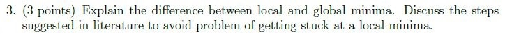

**Figure 11.** Printed subjective question 3 from scanned offline paper, covering local vs global minima.

**Correct answer:** Answer not verifiable from the source PDF

**Source evidence:** [{"page": 6, "bbox": [22.87, 436.26, 454.12, 473.76], "type": "absent", "detail": "Offline examination paper; portal container displays only submission status confirmation option (\"I have written answers on the answer sheets\"), no official academic answer key is provided in the source PDF."}]

### Question 4

**Portal container number:** `167`

**Portal container ID:** `640653455743`

**Type:** Subjective · **Marks:** 3
**PDF pages:** 7

**Shared context:** [sc-1-2-subj](#sc-1-2-subj)

4. (3 points) We discussed a technique (Word2Vec) to obtain word embeddings given a text corpus. We noted that these representations have interesting properties like syntactically similar words are \'closer\' to each other compared to dissimilar words. Say we wish to extend this idea to obtain representations for words across 2 languages (English and French). Further we wish to have similar words across language to have representations that are \'close\'. We are given a corpus of English and French text. We are also given a dictionary $D$ of words that maps words in English to equivalent words in French. Write down the objective function for training a Word2Vec model for the above task. A good language model assigns higher probability for "valid" sentences in a language and low probabilities for sentences which are incorrect (for instance - sentences which do not follow language grammar rules).

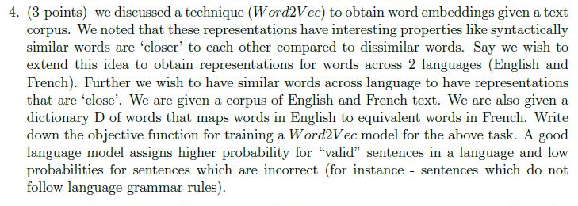

**Figure 12.** Printed subjective question 4 from scanned offline paper, covering cross-lingual Word2Vec objective function.

**Correct answer:** Answer not verifiable from the source PDF

**Source evidence:** [{"page": 7, "bbox": [22.87, 16.75, 454.12, 211.75], "type": "absent", "detail": "Offline examination paper; portal container displays only submission status confirmation option (\"I have written answers on the answer sheets\"), no official academic answer key is provided in the source PDF."}]

### Question 5

**Portal container number:** `167`

**Portal container ID:** `640653455743`

**Type:** Subjective · **Marks:** 3
**PDF pages:** 7

**Shared context:** [sc-1-2-subj](#sc-1-2-subj)

5. (3 points) Describe the RNN encoder-decoder block for machine translation and how the attention mechanism is embedded. List down the three popular techniques for calculating attention.

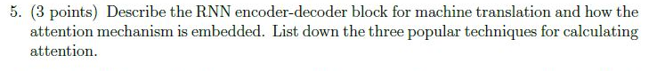

**Figure 13.** Printed subjective question 5 from scanned offline paper, covering RNN encoder-decoder and attention mechanisms.

**Correct answer:** Answer not verifiable from the source PDF

**Source evidence:** [{"page": 7, "bbox": [22.87, 211.75, 454.12, 271.75], "type": "absent", "detail": "Offline examination paper; portal container displays only submission status confirmation option (\"I have written answers on the answer sheets\"), no official academic answer key is provided in the source PDF."}]

### Question 6

**Portal container number:** `167`

**Portal container ID:** `640653455743`

**Type:** Subjective · **Marks:** 3
**PDF pages:** 7

**Shared context:** [sc-1-2-subj](#sc-1-2-subj)

6. (3 points) We saw that for a given decoder timestep $t$, the attention weights over the $S$ encoder states (timesteps) are constrained to sum up to 1 (i.e., $\sum_{s=1}^S \alpha_{ts} = 1$). However, there is no constraint on how the attention weights behave across timesteps. This could result in a situation where the attention weights are always concentrated on the same set of encoder states across different decoder timesteps. This may be undesirable (for example, in the case of translation this might mean that some words in the source sentence never get attention). Suggest a way to tweak the loss function to explicitly prevent this problem?

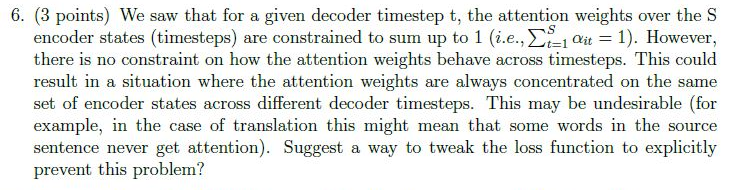

**Figure 14.** Printed subjective question 6 from scanned offline paper, covering decoder attention weight coverage and loss modification.

**Correct answer:** Answer not verifiable from the source PDF

**Source evidence:** [{"page": 7, "bbox": [22.87, 271.75, 454.12, 414.25], "type": "absent", "detail": "Offline examination paper; portal container displays only submission status confirmation option (\"I have written answers on the answer sheets\"), no official academic answer key is provided in the source PDF."}]

### Question 7

**Portal container number:** `167`

**Portal container ID:** `640653455743`

**Type:** Subjective · **Marks:** 5
**PDF pages:** 7

**Shared context:** [sc-1-2-subj](#sc-1-2-subj)

7. (5 points) Draw the block diagram of the Transformer network. Explain all the components in detail.

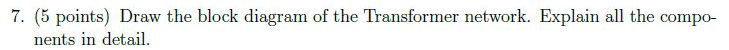

**Figure 15.** Printed subjective question 7 from scanned offline paper, requesting Transformer block diagram and components.

**Correct answer:** Answer not verifiable from the source PDF

**Source evidence:** [{"page": 7, "bbox": [22.87, 414.25, 454.12, 451.75], "type": "absent", "detail": "Offline examination paper; portal container displays only submission status confirmation option (\"I have written answers on the answer sheets\"), no official academic answer key is provided in the source PDF."}]

### Question 8

**Portal container number:** `168`

**Portal container ID:** `640653455744`

**Type:** Subjective · **Marks:** 5
**PDF pages:** 8

**Shared context:** [sc-1-2-subj](#sc-1-2-subj)

8. (5 points) Consider a weather prediction based HMM problem with three hidden states: Sunny, Cloudy and Rainy. There are four different observable states that depend on the hidden states, namely: Dry, Dryish, Damp, and Soggy. The transition and observation probabilities are shown in fig. Given initial Cloudy weather condition on Day0. It was observed that the weather was Dry followed by Damp for the next two days. Compute the best possible weather forecast sequence which best explains these two observations (hint: Use Viterbi Algorithm).

**Observation Probabilities (Grass / Weather):**

| State | Dry | Dryish | Damp | Soggy |
| :--- | :--- | :--- | :--- | :--- |
| Sunny | 0.60 | 0.20 | 0.15 | 0.05 |
| Cloudy | 0.25 | 0.25 | 0.25 | 0.25 |
| Rainy | 0.05 | 0.10 | 0.35 | 0.50 |

**Transition Probabilities (Yesterday \ Today):**

| State | Sunny | Cloudy | Rainy |
| :--- | :--- | :--- | :--- |
| Sunny | 0.5 | 0.375 | 0.125 |
| Cloudy | 0.25 | 0.125 | 0.625 |
| Rainy | 0.25 | 0.075 | 0.675 |

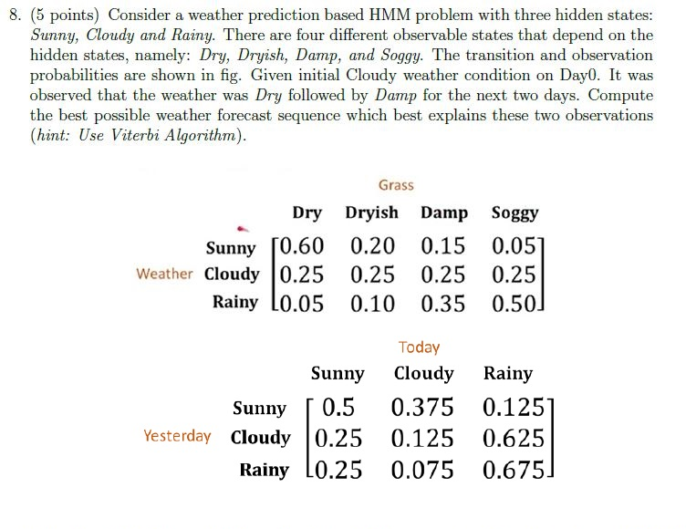

**Figure 16.** Printed subjective question 8 from scanned offline paper, covering weather HMM prediction with Viterbi algorithm and probability tables.

**Correct answer:** Answer not verifiable from the source PDF

**Source evidence:** [{"page": 8, "bbox": [22.87, 16.75, 454.12, 451.75], "type": "absent", "detail": "Offline examination paper; portal container displays only submission status confirmation option (\"I have written answers on the answer sheets\"), no official academic answer key is provided in the source PDF."}]

### Question 9

**Portal container number:** `168`

**Portal container ID:** `640653455744`

**Type:** Subjective · **Marks:** 5
**PDF pages:** 8

**Shared context:** [sc-1-2-subj](#sc-1-2-subj)

9. (5 points) We discussed Bidirectional Encoder Representations from Transformer (BERT) as a way to obtain embeddings, which can be helpful in many NLP tasks. List the mechanism used for training the BERT model and highlight differences with the Word2Vec training.

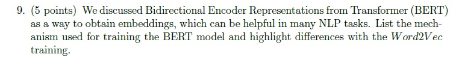

**Figure 17.** Printed subjective question 9 from scanned offline paper, comparing BERT training mechanism with Word2Vec.

**Correct answer:** Answer not verifiable from the source PDF

**Source evidence:** [{"page": 8, "bbox": [22.87, 451.75, 454.12, 523.0], "type": "absent", "detail": "Offline examination paper; portal container displays only submission status confirmation option (\"I have written answers on the answer sheets\"), no official academic answer key is provided in the source PDF."}]

## Answer key

| Source question | Source identity | Correct answer | PDF pages |
| :--- | :--- | :--- | :--- |
| 1 | portal 640653455739 | Answer not verifiable from the source PDF | 3 |
| 2 | portal 640653455739 | Answer not verifiable from the source PDF | 3 |
| 3 | portal 640653455739 | Answer not verifiable from the source PDF | 3 |
| 4 | portal 640653455740 | Answer not verifiable from the source PDF | 4 |
| 5 | portal 640653455740 | Answer not verifiable from the source PDF | 4 |
| 6 | portal 640653455740 | Answer not verifiable from the source PDF | 4 |
| 7 | portal 640653455740 | Answer not verifiable from the source PDF | 4 |
| 8 | portal 640653455741 | Answer not verifiable from the source PDF | 5 |
| 1 | portal 640653455742 | Answer not verifiable from the source PDF | 6 |
| 2 | portal 640653455742 | Answer not verifiable from the source PDF | 6 |
| 3 | portal 640653455742 | Answer not verifiable from the source PDF | 6 |
| 4 | portal 640653455743 | Answer not verifiable from the source PDF | 7 |
| 5 | portal 640653455743 | Answer not verifiable from the source PDF | 7 |
| 6 | portal 640653455743 | Answer not verifiable from the source PDF | 7 |
| 7 | portal 640653455743 | Answer not verifiable from the source PDF | 7 |
| 8 | portal 640653455744 | Answer not verifiable from the source PDF | 8 |
| 9 | portal 640653455744 | Answer not verifiable from the source PDF | 8 |

## Extraction notes

**Status:** verified-source-limitation
**Count reconciliation:** Section 7 declares 7 online portal questions and 40 marks. Portal Question 162 (0 marks) is an administrative subject confirmation and is excluded. The remaining 6 portal containers (Questions 163 to 168) wrap an offline pen-and-paper examination comprising 17 printed academic questions: Section 1.1 contains 8 MCQs (1 mark each = 8 marks) and Section 1.2 contains 9 Subjective questions (2+3+3+3+3+3+5+5+5 = 32 marks). 8 + 32 = 40 marks, perfectly reconciling the declared 40 section marks across 17 printed academic questions.

- All 17 printed questions have been transcribed verbatim with complete mathematical formatting, LaTeX equations, and verbatim preservation of options.
- High-resolution individual crops of every printed question stem, option block, and diagram have been extracted, inspected, and saved under assets/.
- The Speech Technology examination was conducted as a hybrid/offline pen-and-paper test. The online portal interface merely acted as a submission container (offering options "I have written answers on the answer sheets" and "Not applicable"), while the actual academic questions were embedded as raster scans.
- No official answer key, solution markings, or correct answer indicators for any of the 17 printed academic questions are provided in the source PDF. In accordance with extraction contract rules, the answer text is recorded exactly as "Answer not verifiable from the source PDF".

**Excluded source entries:**

- {"classification": "out-of-scope-subject", "page": 1, "bbox": [22.87, 0.0, 527.33, 240.0], "reason": "Preceding section Software Testing (Section 6) branch coverage test cases question 160 continuation", "identity": "portal_question_160"}
- {"classification": "out-of-scope-subject", "page": 1, "bbox": [22.87, 259.77, 527.33, 560.0], "reason": "Preceding section Software Testing (Section 6) multiple condition coverage test cases question 161", "identity": "640653455719"}
- {"classification": "subject-confirmation", "page": 2, "bbox": [22.87, 283.28, 527.33, 640.0], "reason": "Administrative subject confirmation asking if candidate is writing Degree Level: Speech Technology and cross-checking hall ticket", "identity": "640653455738"}
- {"classification": "out-of-scope-subject", "page": 8, "bbox": [20.62, 671.29, 405.42, 820.0], "reason": "Subsequent section Design Thinking (Section 8)", "identity": "section_64065329452"}
