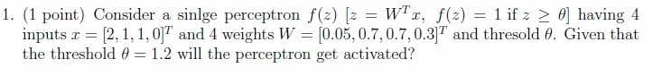
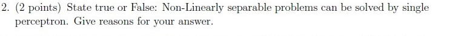
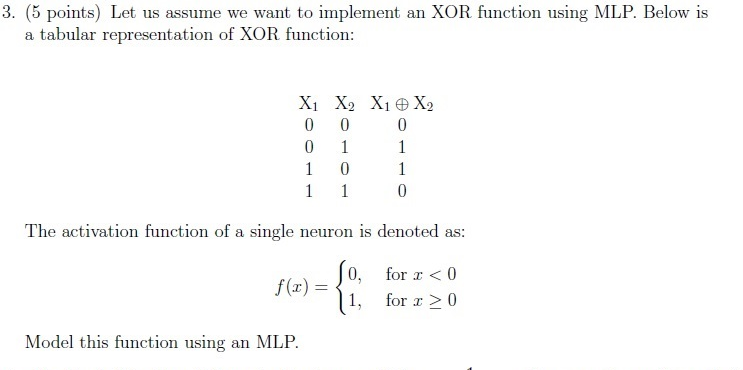
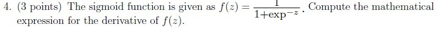
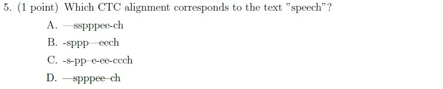
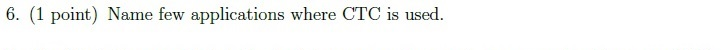
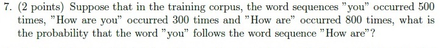
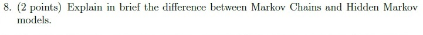
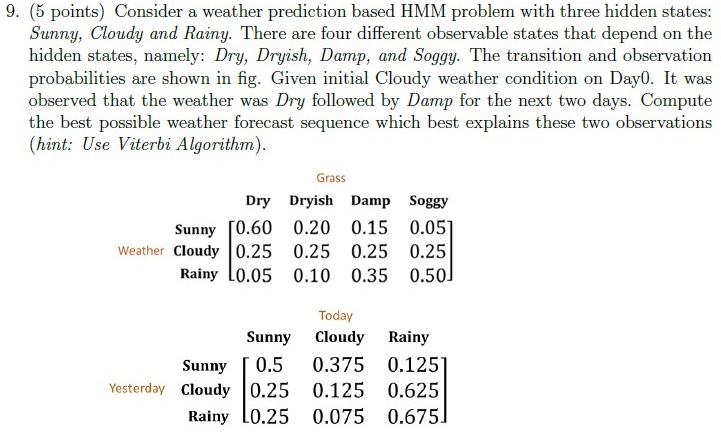
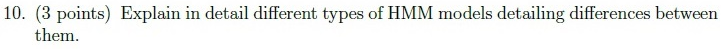

# Speech Technology — ee4001_2022T3_Q2_NA

**Source:** `ee4001_2022T3_Q2_NA.pdf` · **Academic questions:** 10 · **Separately counted children:** 0
**Provenance:** `Speech_Technology/ee4001_2022T3_Q2_NA.pdf` · SHA-256 `34793595a385537e67dc3dcfc64899c9345242896d2cd936dc3822e87e2ca1d7`

**Scope:** Speech Technology degree-level examination section (Section 2: Speech Tech, Section Id: 64065329021, declaring 3 online portal questions and 25 marks). The section contains Question 34 (administrative subject confirmation, 0 marks) and Questions 35 and 36 (portal containers for offline answer submission, 12 and 13 marks respectively). Across Questions 35 and 36, 10 printed scan academic questions covering perceptrons, MLPs, XOR function, sigmoid activation derivative, CTC alignments, CTC applications, language model n-gram probability, and Hidden Markov Models are presented. Preceding Section 1 material (Question 33) and subsequent Section 3 (Industry 4.0) are excluded as out of scope.

## Questions

### Question 1

**Portal container number:** `35`

**Portal container ID:** `640653446375`

**Type:** Subjective · **Marks:** 1
**PDF pages:** 3

1. (1 point) Consider a sinlge perceptron $f(z)$ [$z = W^T x$, $f(z) = 1$ if $z \ge \theta$] having 4 inputs $x = [2, 1, 1, 0]^T$ and 4 weights $W = [0.05, 0.7, 0.7, 0.3]^T$ and thresold $\theta$. Given that the threshold $\theta = 1.2$ will the perceptron get activated?

**Figure 1.** Printed question 1 from scanned offline paper, asking whether a single perceptron with given weights, inputs, and threshold gets activated.

**Correct answer:** Answer not verifiable from the source PDF

**Source evidence:** [{"page": 3, "bbox": [22.87, 69.75, 454.12, 133.5], "type": "absent", "detail": "Offline examination paper; portal container displays only submission status confirmation option (\"I have written answers on the answer sheets\"), no official academic answer key is provided in the source PDF."}]

### Question 2

**Portal container number:** `35`

**Portal container ID:** `640653446375`

**Type:** Subjective · **Marks:** 2
**PDF pages:** 3

2. (2 points) State true or False: Non-Linearly separable problems can be solved by single perceptron. Give reasons for your answer.

**Figure 2.** Printed question 2 from scanned offline paper, asking if non-linearly separable problems can be solved by a single perceptron.

**Correct answer:** Answer not verifiable from the source PDF

**Source evidence:** [{"page": 3, "bbox": [22.87, 133.5, 454.12, 178.5], "type": "absent", "detail": "Offline examination paper; portal container displays only submission status confirmation option (\"I have written answers on the answer sheets\"), no official academic answer key is provided in the source PDF."}]

### Question 3

**Portal container number:** `35`

**Portal container ID:** `640653446375`

**Type:** Subjective · **Marks:** 5
**PDF pages:** 3

3. (5 points) Let us assume we want to implement an XOR function using MLP. Below is a tabular representation of XOR function:

| $X_1$ | $X_2$ | $X_1 \oplus X_2$ |
| :---: | :---: | :---: |
| 0 | 0 | 0 |
| 0 | 1 | 1 |
| 1 | 0 | 1 |
| 1 | 1 | 0 |

The activation function of a single neuron is denoted as:

$$
f(x) = \begin{cases} 0, & \text{for } x < 0 \\ 1, & \text{for } x \ge 0 \end{cases}
$$

Model this function using an MLP.

**Figure 3.** Printed question 3 from scanned offline paper, implementing XOR function using an MLP with a given truth table and activation function.

**Correct answer:** Answer not verifiable from the source PDF

**Source evidence:** [{"page": 3, "bbox": [22.87, 178.5, 454.12, 456.0], "type": "absent", "detail": "Offline examination paper; portal container displays only submission status confirmation option (\"I have written answers on the answer sheets\"), no official academic answer key is provided in the source PDF."}]

### Question 4

**Portal container number:** `35`

**Portal container ID:** `640653446375`

**Type:** Subjective · **Marks:** 3
**PDF pages:** 3

4. (3 points) The sigmoid function is given as $f(z) = \frac{1}{1 + \exp^{-z}}$. Compute the mathematical expression for the derivative of $f(z)$.

**Figure 4.** Printed question 4 from scanned offline paper, requesting the mathematical expression for the derivative of the sigmoid function.

**Correct answer:** Answer not verifiable from the source PDF

**Source evidence:** [{"page": 3, "bbox": [22.87, 456.0, 454.12, 501.0], "type": "absent", "detail": "Offline examination paper; portal container displays only submission status confirmation option (\"I have written answers on the answer sheets\"), no official academic answer key is provided in the source PDF."}]

### Question 5

**Portal container number:** `35`

**Portal container ID:** `640653446375`

**Type:** MCQ · **Marks:** 1
**PDF pages:** 3

5. (1 point) Which CTC alignment corresponds to the text "speech"?

**Figure 5.** Printed question 5 from scanned offline paper, identifying which CTC alignment corresponds to the text "speech".

**Options**

**A.**

—sspppee-ch

*Source option ID:* not supplied.

**B.**

-sppp—eech

*Source option ID:* not supplied.

**C.**

-s-pp—e-ee-ccch

*Source option ID:* not supplied.

**D.**

—spppee—ch

*Source option ID:* not supplied.

**Correct answer:** Answer not verifiable from the source PDF

**Source evidence:** [{"page": 3, "bbox": [22.87, 501.0, 454.12, 613.5], "type": "absent", "detail": "Offline examination paper; portal container displays only submission status confirmation option (\"I have written answers on the answer sheets\"), no official academic answer key is provided in the source PDF."}]

### Question 6

**Portal container number:** `36`

**Portal container ID:** `640653446376`

**Type:** Short Answer · **Marks:** 1
**PDF pages:** 4

6. (1 point) Name few applications where CTC is used.

**Figure 6.** Printed question 6 from scanned offline paper, asking to name applications where CTC is used.

**Correct answer:** Answer not verifiable from the source PDF

**Source evidence:** [{"page": 4, "bbox": [22.87, 143.25, 454.12, 180.75], "type": "absent", "detail": "Offline examination paper; portal container displays only submission status confirmation option (\"I have written answers on the answer sheets\"), no official academic answer key is provided in the source PDF."}]

### Question 7

**Portal container number:** `36`

**Portal container ID:** `640653446376`

**Type:** Numerical · **Marks:** 2
**PDF pages:** 4

7. (2 points) Suppose that in the training corpus, the word sequences "you" occurred 500 times, "How are you" occurred 300 times and "How are" occurred 800 times, what is the probability that the word "you" follows the word sequence "How are"?

**Figure 7.** Printed question 7 from scanned offline paper, calculating conditional probability of word "you" following "How are" given corpus counts.

**Correct answer:** Answer not verifiable from the source PDF

**Source evidence:** [{"page": 4, "bbox": [22.87, 180.75, 454.12, 240.75], "type": "absent", "detail": "Offline examination paper; portal container displays only submission status confirmation option (\"I have written answers on the answer sheets\"), no official academic answer key is provided in the source PDF."}]

### Question 8

**Portal container number:** `36`

**Portal container ID:** `640653446376`

**Type:** Subjective · **Marks:** 2
**PDF pages:** 4

8. (2 points) Explain in brief the difference between Markov Chains and Hidden Markov models.

**Figure 8.** Printed question 8 from scanned offline paper, explaining the difference between Markov Chains and Hidden Markov models.

**Correct answer:** Answer not verifiable from the source PDF

**Source evidence:** [{"page": 4, "bbox": [22.87, 240.75, 454.12, 285.75], "type": "absent", "detail": "Offline examination paper; portal container displays only submission status confirmation option (\"I have written answers on the answer sheets\"), no official academic answer key is provided in the source PDF."}]

### Question 9

**Portal container number:** `36`

**Portal container ID:** `640653446376`

**Type:** Subjective · **Marks:** 5
**PDF pages:** 4

9. (5 points) Consider a weather prediction based HMM problem with three hidden states: Sunny, Cloudy and Rainy. There are four different observable states that depend on the hidden states, namely: Dry, Dryish, Damp, and Soggy. The transition and observation probabilities are shown in fig. Given initial Cloudy weather condition on Day0. It was observed that the weather was Dry followed by Damp for the next two days. Compute the best possible weather forecast sequence which best explains these two observations (hint: Use Viterbi Algorithm).

**Observation Probabilities:**

| Weather | Dry | Dryish | Damp | Soggy |
| :--- | :---: | :---: | :---: | :---: |
| Sunny | 0.60 | 0.20 | 0.15 | 0.05 |
| Cloudy | 0.25 | 0.25 | 0.25 | 0.25 |
| Rainy | 0.05 | 0.10 | 0.35 | 0.50 |

**Transition Probabilities:**

| Yesterday \ Today | Sunny | Cloudy | Rainy |
| :--- | :---: | :---: | :---: |
| Sunny | 0.5 | 0.375 | 0.125 |
| Cloudy | 0.25 | 0.125 | 0.625 |
| Rainy | 0.25 | 0.075 | 0.675 |

**Figure 9.** Printed question 9 from scanned offline paper, weather prediction HMM with Viterbi algorithm and transition/observation probability tables.

**Correct answer:** Answer not verifiable from the source PDF

**Source evidence:** [{"page": 4, "bbox": [22.87, 285.75, 454.12, 619.5], "type": "absent", "detail": "Offline examination paper; portal container displays only submission status confirmation option (\"I have written answers on the answer sheets\"), no official academic answer key is provided in the source PDF."}]

### Question 10

**Portal container number:** `36`

**Portal container ID:** `640653446376`

**Type:** Subjective · **Marks:** 3
**PDF pages:** 4

10. (3 points) Explain in detail different types of HMM models detailing differences between them.

**Figure 10.** Printed question 10 from scanned offline paper, explaining different types of HMM models and differences between them.

**Correct answer:** Answer not verifiable from the source PDF

**Source evidence:** [{"page": 4, "bbox": [22.87, 619.5, 454.12, 656.25], "type": "absent", "detail": "Offline examination paper; portal container displays only submission status confirmation option (\"I have written answers on the answer sheets\"), no official academic answer key is provided in the source PDF."}]

## Answer key

| Source question | Source identity | Correct answer | PDF pages |
| :--- | :--- | :--- | :--- |
| 1 | portal 640653446375 | Answer not verifiable from the source PDF | 3 |
| 2 | portal 640653446375 | Answer not verifiable from the source PDF | 3 |
| 3 | portal 640653446375 | Answer not verifiable from the source PDF | 3 |
| 4 | portal 640653446375 | Answer not verifiable from the source PDF | 3 |
| 5 | portal 640653446375 | Answer not verifiable from the source PDF | 3 |
| 6 | portal 640653446376 | Answer not verifiable from the source PDF | 4 |
| 7 | portal 640653446376 | Answer not verifiable from the source PDF | 4 |
| 8 | portal 640653446376 | Answer not verifiable from the source PDF | 4 |
| 9 | portal 640653446376 | Answer not verifiable from the source PDF | 4 |
| 10 | portal 640653446376 | Answer not verifiable from the source PDF | 4 |

## Extraction notes

**Status:** verified-source-limitation
**Count reconciliation:** Section 2 declares 3 online portal questions and 25 marks. Portal Question 34 (0 marks) is an administrative subject confirmation and is excluded. The remaining 2 portal containers (Question 35 declaring 12 marks and Question 36 declaring 13 marks) wrap an offline pen-and-paper examination comprising 10 printed academic questions: Question 35 contains questions 1 to 5 (1+2+5+3+1 = 12 marks) and Question 36 contains questions 6 to 10 (1+2+2+5+3 = 13 marks). 12 + 13 = 25 marks, perfectly reconciling the declared 25 section marks across 10 printed academic questions.

- Ten printed academic questions extracted from embedded scan images in portal containers Question 35 (pages 2-3) and Question 36 (page 4).
- Portal Question 34 verified as an administrative subject confirmation (0 marks) and excluded.
- Preceding Question 33 on page 1 and subsequent Section 3 (Industry 4.0) on pages 4-5 excluded as out-of-scope.
- Printed question mark allocation (1+2+5+3+1 = 12 marks in Q35; 1+2+2+5+3 = 13 marks in Q36; total 25 marks) precisely reconciles the declared Section 2 marks (25 marks).
- The Speech Technology examination was conducted as a hybrid/offline pen-and-paper test. The online portal interface merely acted as a submission container (offering options "I have written answers on the answer sheets" and "Not applicable"), while the actual academic questions were embedded as raster scans.
- No official answer key, solution markings, or correct answer indicators for any of the 10 printed academic questions are provided in the source PDF. In accordance with extraction contract rules, the answer text is recorded exactly as "Answer not verifiable from the source PDF".

**Excluded source entries:**

- {"classification": "out-of-scope-subject", "page": 1, "bbox": [20.0, 20.0, 580.0, 350.0], "reason": "Preceding section question 33 (SA, 2.25 marks, ID: 640653446373) regarding program improvement suggestions", "identity": "640653446373"}
- {"classification": "confirmation", "page": 2, "bbox": [22.87, 405.26, 454.12, 589.35], "reason": "Administrative subject confirmation question (\"THIS IS QUESTION PAPER FOR THE SUBJECT DEGREE LEVEL: SPEECH TECHNOLOGY... ARE YOU SURE YOU HAVE TO WRITE EXAM FOR THIS SUBJECT?\") with Yes/No options (0 marks)", "identity": "640653446374"}
- {"classification": "portal-container", "page": 3, "bbox": [22.87, 69.75, 454.12, 690.34], "reason": "Online portal MCQ container (ID: 640653446375, Correct Marks: 12) wrapping printed scan questions 1-5 with submission status options (\"I have written answers on the answer sheets\" / \"Not applicable\")", "identity": "640653446375"}
- {"classification": "portal-container", "page": 4, "bbox": [22.87, 143.25, 454.12, 733.09], "reason": "Online portal MCQ container (ID: 640653446376, Correct Marks: 13) wrapping printed scan questions 6-10 with submission status options (\"I have written answers on the answer sheets\" / \"Not applicable\")", "identity": "640653446376"}
- {"classification": "out-of-scope-subject", "page": 5, "bbox": [20.0, 10.0, 580.0, 800.0], "reason": "Subsequent section Section 3 (Industry 4.0, Section Id: 64065329022, 20 marks, 7 questions, Question 37 ID: 640653446377)", "identity": "section_64065329022"}
