# Speech Technology — ee4001_2023T1_ET_AN

**Source:** `ee4001_2023T1_ET_AN.pdf` · **Academic questions:** 17 · **Separately counted children:** 0
**Provenance:** `Speech_Technology/ee4001_2023T1_ET_AN.pdf` · SHA-256 `bc2c81ff0a26245960350056d5a6c1e50897baf10e13fbddf395b51e421e7911`

**Scope:** Speech Technology degree-level examination section (Section 10, Section Id: 64065338437, questions 236-240). Preceding section fragment on page 1 (Option 6406531895289) and Section 11 (Market Research on page 8) are excluded as out of scope. Question 236 is excluded semantically as an administrative subject confirmation. Portal questions 237-240 wrap an offline pen-and-paper examination comprising 17 printed academic questions.

## Questions

### Shared context 1.1 MCQ

**Question ID:** `640653567122`

**Portal container number:** `237`

**Portal container ID:** `640653567122`

**Type:** Section Heading
**PDF pages:** 3

### 1.1 MCQ (Note: Please explain your choice) 8 points

Section 1.1 contains Multiple Choice Questions (Questions 1 to 8). Total marks: 8 points (1 point each). Offline pen-and-paper examination mode.

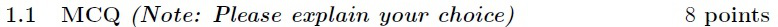

**Figure 1.** Printed section 1.1 header and instructions from scanned offline paper, specifying MCQ points and explanation note.

### Question 1

**Portal container number:** `237`

**Portal container ID:** `640653567122`

**Type:** MCQ · **Marks:** 1
**PDF pages:** 3

**Shared context:** [sc-1-1-mcq](#sc-1-1-mcq)

1. (1 point) For a given set of data points $X = \{x_1, x_2, \dots, x_N\}$, log-likelihood for a GMM with $k$ mixtures can be defined as:

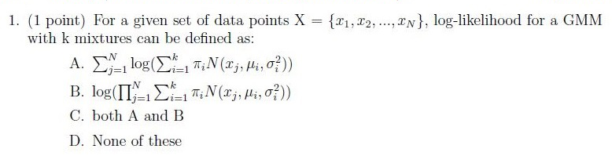

**Figure 2.** Printed question 1 from scanned offline paper, covering GMM log-likelihood formulation.

**Options**

**A.**

$$\sum_{i=1}^N \log\left(\sum_{j=1}^k \pi_j \mathcal{N}(x_i; \mu_j, \sigma_j^2)\right)$$

*Source option ID:* not supplied.

**B.**

$$\log\left(\prod_{i=1}^N \sum_{j=1}^k \pi_j \mathcal{N}(x_i; \mu_j, \sigma_j^2)\right)$$

*Source option ID:* not supplied.

**C.**

both A and B

*Source option ID:* not supplied.

**D.**

None of these

*Source option ID:* not supplied.

**Correct answer:** Answer not verifiable from the source PDF

**Source evidence:** [{"page": 3, "bbox": [22.87, 691.93, 384.2, 744.41], "type": "absent", "detail": "Offline pen-and-paper examination; portal container 237 offers submission status options only (\"I have written answers on the answer sheets\"), no official academic answer key is provided in the source PDF."}]

### Question 2

**Portal container number:** `237`

**Portal container ID:** `640653567122`

**Type:** MCQ · **Marks:** 1
**PDF pages:** 3

**Shared context:** [sc-1-1-mcq](#sc-1-1-mcq)

2. (1 point) Given a HMM with $N$ hidden states and $M$ observation symbols, let $b_j(k)$ represent the probability of observing event $j$ when in state $k$. Also, let $\pi_j$ represent the probability of being in state $j$ initially ($\pi_j$'s represent the initial state probabilities). Which of the following statements is True?

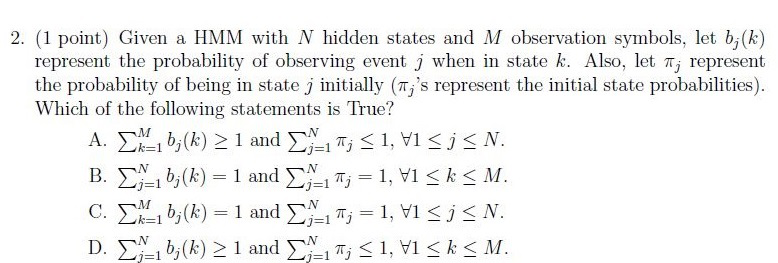

**Figure 3.** Printed question 2 from scanned offline paper, covering HMM probability properties.

**Options**

**A.**

$$\sum_{j=1}^M b_j(k) > 1 \text{ and } \sum_{j=1}^N \pi_j < 1, \forall 1 \le j \le N.$$

*Source option ID:* not supplied.

**B.**

$$\sum_{j=1}^M b_j(k) = 1 \text{ and } \sum_{j=1}^N \pi_j = 1, \forall 1 \le k \le M.$$

*Source option ID:* not supplied.

**C.**

$$\sum_{j=1}^M b_j(k) = 1 \text{ and } \sum_{j=1}^N \pi_j = 1, \forall 1 \le j \le N.$$

*Source option ID:* not supplied.

**D.**

$$\sum_{j=1}^M b_j(k) > 1 \text{ and } \sum_{j=1}^M \pi_j \le 1, \forall 1 \le k \le M.$$

*Source option ID:* not supplied.

**Correct answer:** Answer not verifiable from the source PDF

**Source evidence:** [{"page": 3, "bbox": [22.87, 691.93, 384.2, 744.41], "type": "absent", "detail": "Offline pen-and-paper examination; portal container 237 offers submission status options only (\"I have written answers on the answer sheets\"), no official academic answer key is provided in the source PDF."}]

### Question 3

**Portal container number:** `237`

**Portal container ID:** `640653567122`

**Type:** MCQ · **Marks:** 1
**PDF pages:** 3

**Shared context:** [sc-1-1-mcq](#sc-1-1-mcq)

3. (1 point) If $f(x) = \tanh(x)$, then the derivative of $f(x)$ will be?

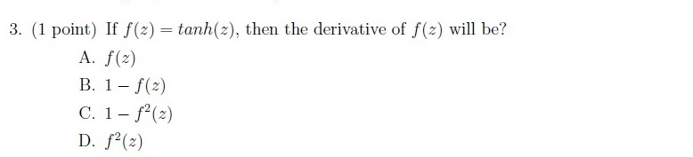

**Figure 4.** Printed question 3 from scanned offline paper, covering derivative of tanh function.

**Options**

**A.**

$f(x)$

*Source option ID:* not supplied.

**B.**

$1 - f(x)$

*Source option ID:* not supplied.

**C.**

$1 - f^2(x)$

*Source option ID:* not supplied.

**D.**

$f^2(x)$

*Source option ID:* not supplied.

**Correct answer:** Answer not verifiable from the source PDF

**Source evidence:** [{"page": 3, "bbox": [22.87, 691.93, 384.2, 744.41], "type": "absent", "detail": "Offline pen-and-paper examination; portal container 237 offers submission status options only (\"I have written answers on the answer sheets\"), no official academic answer key is provided in the source PDF."}]

### Question 4

**Portal container number:** `237`

**Portal container ID:** `640653567122`

**Type:** MCQ · **Marks:** 1
**PDF pages:** 3

**Shared context:** [sc-1-1-mcq](#sc-1-1-mcq)

4. (1 point) Recurrent Neural Networks (RNN) with basic RNN cells exhibit which of the following problems?

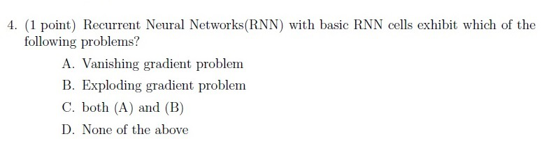

**Figure 5.** Printed question 4 from scanned offline paper, covering basic RNN cell problems.

**Options**

**A.**

Vanishing gradient problem

*Source option ID:* not supplied.

**B.**

Exploding gradient problem

*Source option ID:* not supplied.

**C.**

both (A) and (B)

*Source option ID:* not supplied.

**D.**

None of the above

*Source option ID:* not supplied.

**Correct answer:** Answer not verifiable from the source PDF

**Source evidence:** [{"page": 3, "bbox": [22.87, 691.93, 384.2, 744.41], "type": "absent", "detail": "Offline pen-and-paper examination; portal container 237 offers submission status options only (\"I have written answers on the answer sheets\"), no official academic answer key is provided in the source PDF."}]

### Question 5

**Portal container number:** `238`

**Portal container ID:** `640653567123`

**Type:** MCQ · **Marks:** 1
**PDF pages:** 4

**Shared context:** [sc-1-1-mcq](#sc-1-1-mcq)

5. (1 point) Which of the following ideas is used by LSTM-based RNN networks to capture long range dependencies?

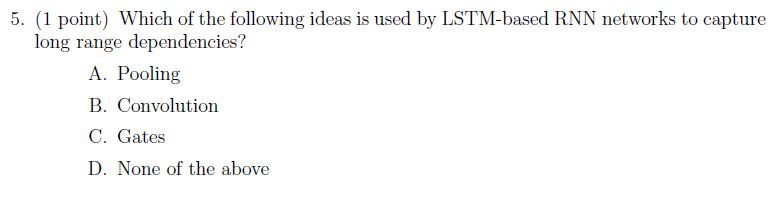

**Figure 6.** Printed question 5 from scanned offline paper, covering LSTM gating mechanisms.

**Options**

**A.**

Pooling

*Source option ID:* not supplied.

**B.**

Convolution

*Source option ID:* not supplied.

**C.**

Gates

*Source option ID:* not supplied.

**D.**

None of the above

*Source option ID:* not supplied.

**Correct answer:** Answer not verifiable from the source PDF

**Source evidence:** [{"page": 4, "bbox": [22.87, 794.93, 384.2, 811.25], "type": "absent", "detail": "Offline pen-and-paper examination; portal container 238 offers submission status options only (\"I have written answers on the answer sheets\"), no official academic answer key is provided in the source PDF."}]

### Question 6

**Portal container number:** `238`

**Portal container ID:** `640653567123`

**Type:** MCQ · **Marks:** 1
**PDF pages:** 4

**Shared context:** [sc-1-1-mcq](#sc-1-1-mcq)

6. (1 point) State whether the following statement is true or false: A Transformer Encoder layer can compute the hidden representation of all time steps simultaneously.

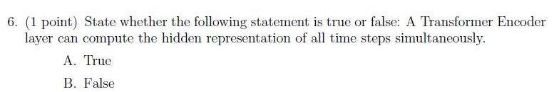

**Figure 7.** Printed question 6 from scanned offline paper, covering Transformer encoder parallelism.

**Options**

**A.**

True

*Source option ID:* not supplied.

**B.**

False

*Source option ID:* not supplied.

**Correct answer:** Answer not verifiable from the source PDF

**Source evidence:** [{"page": 4, "bbox": [22.87, 794.93, 384.2, 811.25], "type": "absent", "detail": "Offline pen-and-paper examination; portal container 238 offers submission status options only (\"I have written answers on the answer sheets\"), no official academic answer key is provided in the source PDF."}]

### Question 7

**Portal container number:** `238`

**Portal container ID:** `640653567123`

**Type:** MCQ · **Marks:** 1
**PDF pages:** 4

**Shared context:** [sc-1-1-mcq](#sc-1-1-mcq)

7. (1 point) Which of the following is correct according to Bayes rule?

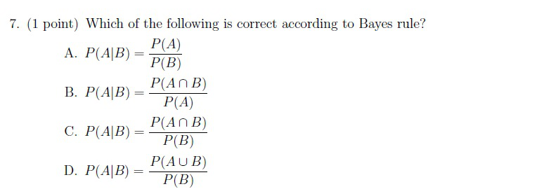

**Figure 8.** Printed question 7 from scanned offline paper, covering Bayes rule formulation.

**Options**

**A.**

$$P(A|B) = \frac{P(A)}{P(B)}$$

*Source option ID:* not supplied.

**B.**

$$P(A|B) = \frac{P(A \cap B)}{P(A)}$$

*Source option ID:* not supplied.

**C.**

$$P(A|B) = \frac{P(A \cap B)}{P(B)}$$

*Source option ID:* not supplied.

**D.**

$$P(A|B) = \frac{P(A \cup B)}{P(B)}$$

*Source option ID:* not supplied.

**Correct answer:** Answer not verifiable from the source PDF

**Source evidence:** [{"page": 4, "bbox": [22.87, 794.93, 384.2, 811.25], "type": "absent", "detail": "Offline pen-and-paper examination; portal container 238 offers submission status options only (\"I have written answers on the answer sheets\"), no official academic answer key is provided in the source PDF."}]

### Question 8

**Portal container number:** `238`

**Portal container ID:** `640653567123`

**Type:** MCQ · **Marks:** 1
**PDF pages:** 4

**Shared context:** [sc-1-1-mcq](#sc-1-1-mcq)

8. (1 point) Consider the Fig. and determine $\alpha_2(2)$

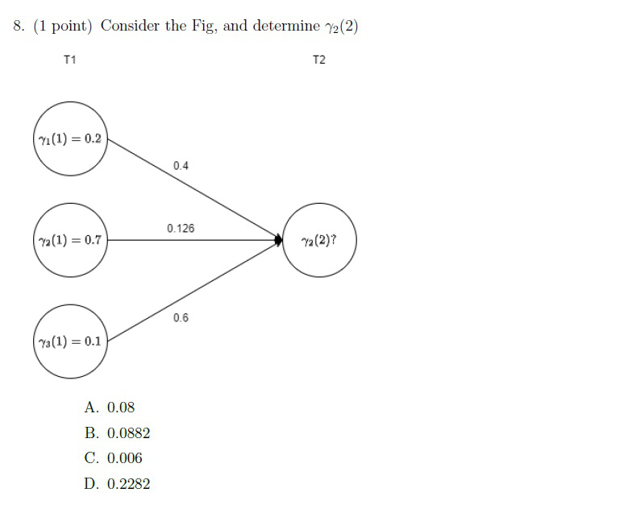

**Figure 9.** Printed question 8 and state trellis diagram from scanned offline paper, computing HMM forward probability alpha_2(2).

**Options**

**A.**

0.08

*Source option ID:* not supplied.

**B.**

0.0882

*Source option ID:* not supplied.

**C.**

0.006

*Source option ID:* not supplied.

**D.**

0.2282

*Source option ID:* not supplied.

**Correct answer:** Answer not verifiable from the source PDF

**Source evidence:** [{"page": 4, "bbox": [22.87, 794.93, 384.2, 811.25], "type": "absent", "detail": "Offline pen-and-paper examination; portal container 238 offers submission status options only (\"I have written answers on the answer sheets\"), no official academic answer key is provided in the source PDF."}]

### Shared context 1.2 Subjective Questions

**Question ID:** `640653567124`

**Portal container number:** `239`

**Portal container ID:** `640653567124`

**Type:** Section Heading
**PDF pages:** 6

### 1.2 Subjective Questions 32 points

Section 1.2 contains Subjective Questions (Questions 1 to 9). Total marks for this section: 32 points. Offline pen-and-paper examination mode.

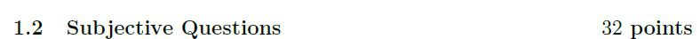

**Figure 10.** Printed section 1.2 header from scanned offline paper, specifying subjective questions and total points.

### Question 1

**Portal container number:** `239`

**Portal container ID:** `640653567124`

**Type:** Subjective · **Marks:** 2
**PDF pages:** 6

**Shared context:** [sc-1-2-subj](#sc-1-2-subj)

1. (2 points) CNN is a popular building block of many state-of-the-art neural networks; Discuss CNNs in detail.

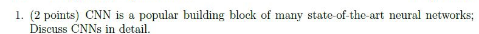

**Figure 11.** Printed subjective question 1 from scanned offline paper, covering CNNs in detail.

**Correct answer:** Answer not verifiable from the source PDF

**Source evidence:** [{"page": 6, "bbox": [22.87, 583.93, 384.2, 636.41], "type": "absent", "detail": "Offline pen-and-paper examination; portal container 239 offers submission status options only (\"I have written answers on the answer sheets\"), no official academic answer key is provided in the source PDF."}]

### Question 2

**Portal container number:** `239`

**Portal container ID:** `640653567124`

**Type:** Subjective · **Marks:** 3
**PDF pages:** 6

**Shared context:** [sc-1-2-subj](#sc-1-2-subj)

2. (3 points) Which of the following are valid activation functions you could use to train neural networks. Draw graphs representing the result of using activation function at the input, similar to graphs for activation functions shown in the class. Justify your answer.

* $f(x) = \max(0, x)$
* $f(x) = 0.2x + 1$
* $f(x) = \begin{cases} x & \text{if } x > 0.5 \\ -1 & \text{else} \end{cases}$

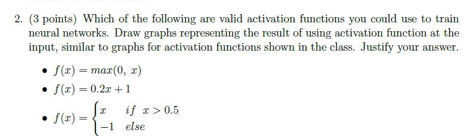

**Figure 12.** Printed subjective question 2 from scanned offline paper, covering valid activation functions for neural networks.

**Correct answer:** Answer not verifiable from the source PDF

**Source evidence:** [{"page": 6, "bbox": [22.87, 583.93, 384.2, 636.41], "type": "absent", "detail": "Offline pen-and-paper examination; portal container 239 offers submission status options only (\"I have written answers on the answer sheets\"), no official academic answer key is provided in the source PDF."}]

### Question 3

**Portal container number:** `239`

**Portal container ID:** `640653567124`

**Type:** Subjective · **Marks:** 3
**PDF pages:** 6

**Shared context:** [sc-1-2-subj](#sc-1-2-subj)

3. (3 points) Explain the difference between local and global minima. Discuss the steps suggested in literature to avoid problem of getting stuck at a local minima.

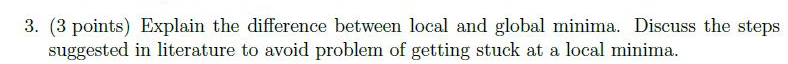

**Figure 13.** Printed subjective question 3 from scanned offline paper, covering local vs global minima.

**Correct answer:** Answer not verifiable from the source PDF

**Source evidence:** [{"page": 6, "bbox": [22.87, 583.93, 384.2, 636.41], "type": "absent", "detail": "Offline pen-and-paper examination; portal container 239 offers submission status options only (\"I have written answers on the answer sheets\"), no official academic answer key is provided in the source PDF."}]

### Question 4

**Portal container number:** `239`

**Portal container ID:** `640653567124`

**Type:** Subjective · **Marks:** 3
**PDF pages:** 6

**Shared context:** [sc-1-2-subj](#sc-1-2-subj)

4. (3 points) In class we discussed a class of models coined as ‘Language Models’, these are useful for capturing the underlying structure of the language. Explain Language Modelling and N-gram model in detail.

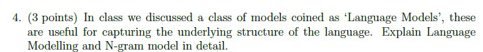

**Figure 14.** Printed subjective question 4 from scanned offline paper, covering Language Modelling and N-gram models.

**Correct answer:** Answer not verifiable from the source PDF

**Source evidence:** [{"page": 6, "bbox": [22.87, 583.93, 384.2, 636.41], "type": "absent", "detail": "Offline pen-and-paper examination; portal container 239 offers submission status options only (\"I have written answers on the answer sheets\"), no official academic answer key is provided in the source PDF."}]

### Question 5

**Portal container number:** `239`

**Portal container ID:** `640653567124`

**Type:** Subjective · **Marks:** 3
**PDF pages:** 6

**Shared context:** [sc-1-2-subj](#sc-1-2-subj)

5. (3 points) We saw that for a given decoder timestep $t$, the attention weights over the $S$ encoder states (timesteps) are constrained to sum up to 1 (i.e., $\sum_{i=1}^S \alpha_{ti} = 1$). However, there is no constraint on how the attention weights behave across timesteps. This could result in a situation where the attention weights are always concentrated on the same set of encoder states across different decoder timesteps. This may be undesirable (for example, in the case of translation this might mean that some words in the source sentence never get attention). Suggest a way to tweak the loss function to explicitly prevent this problem?

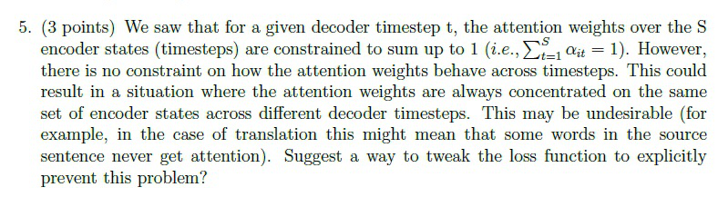

**Figure 15.** Printed subjective question 5 from scanned offline paper, covering decoder attention weight coverage and loss modification.

**Correct answer:** Answer not verifiable from the source PDF

**Source evidence:** [{"page": 6, "bbox": [22.87, 583.93, 384.2, 636.41], "type": "absent", "detail": "Offline pen-and-paper examination; portal container 239 offers submission status options only (\"I have written answers on the answer sheets\"), no official academic answer key is provided in the source PDF."}]

### Question 6

**Portal container number:** `240`

**Portal container ID:** `640653567125`

**Type:** Subjective · **Marks:** 3
**PDF pages:** 7

**Shared context:** [sc-1-2-subj](#sc-1-2-subj)

6. (3 points) To decode the utterance of a speaker, alignment is an important step. Discuss alignment in detail and how CTC helps achieve this.

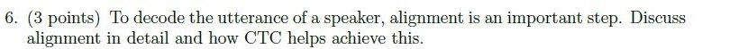

**Figure 16.** Printed subjective question 6 from scanned offline paper, covering speech decoding alignment and CTC.

**Correct answer:** Answer not verifiable from the source PDF

**Source evidence:** [{"page": 7, "bbox": [22.87, 748.93, 384.2, 801.42], "type": "absent", "detail": "Offline pen-and-paper examination; portal container 240 offers submission status options only (\"I have written answers on the answer sheets\"), no official academic answer key is provided in the source PDF."}]

### Question 7

**Portal container number:** `240`

**Portal container ID:** `640653567125`

**Type:** Subjective · **Marks:** 5
**PDF pages:** 7

**Shared context:** [sc-1-2-subj](#sc-1-2-subj)

7. (5 points) We saw that classical encoder-decoder models face the problem of ‘Fixed Encoder Representation’, Discuss how the attention mechanism is used to solve this issue. Also discuss briefly, how the attention mechanism of the LSTM-based encoder- decoder model differs from the attention mechanism introduced in the Transformer.

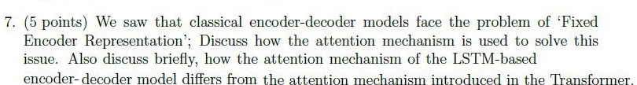

**Figure 17.** Printed subjective question 7 from scanned offline paper, covering attention mechanism in encoder-decoder models and Transformer differences.

**Correct answer:** Answer not verifiable from the source PDF

**Source evidence:** [{"page": 7, "bbox": [22.87, 748.93, 384.2, 801.42], "type": "absent", "detail": "Offline pen-and-paper examination; portal container 240 offers submission status options only (\"I have written answers on the answer sheets\"), no official academic answer key is provided in the source PDF."}]

### Question 8

**Portal container number:** `240`

**Portal container ID:** `640653567125`

**Type:** Subjective · **Marks:** 5
**PDF pages:** 7

**Shared context:** [sc-1-2-subj](#sc-1-2-subj)

8. (5 points) Consider a weather prediction based HMM problem with three hidden states: Sunny, Cloudy and Rainy. There are four different observable states that depend on the hidden states, namely: Dry, Dryish, Damp, and Soggy. The transition and observation probabilities are shown in fig. Given initial Rainy weather condition on Day0. It was observed that the weather was Soggy followed by Dry for the next two days. Compute the best possible weather forecast sequence which best explains these two observations (hint: Use Viterbi Algorithm).

**Observation Probabilities (Grass / Weather):**

| State | Dry | Dryish | Damp | Soggy |
| :--- | :--- | :--- | :--- | :--- |
| Sunny | 0.60 | 0.20 | 0.15 | 0.05 |
| Cloudy | 0.25 | 0.25 | 0.25 | 0.25 |
| Rainy | 0.05 | 0.10 | 0.35 | 0.50 |

**Transition Probabilities (Yesterday \ Today):**

| State | Sunny | Cloudy | Rainy |
| :--- | :--- | :--- | :--- |
| Sunny | 0.5 | 0.375 | 0.125 |
| Cloudy | 0.25 | 0.125 | 0.625 |
| Rainy | 0.25 | 0.075 | 0.675 |

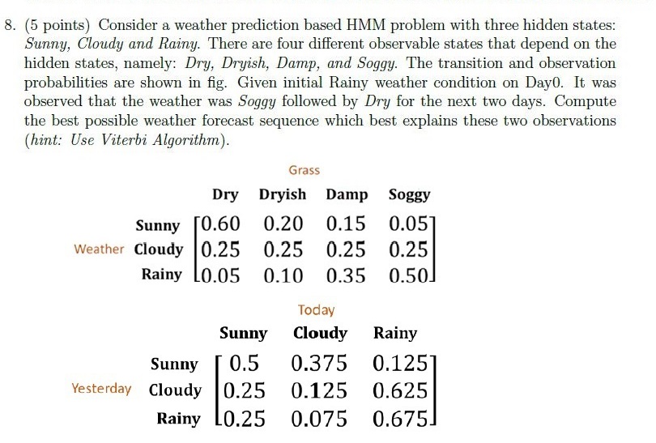

**Figure 18.** Printed subjective question 8 from scanned offline paper, covering weather HMM prediction with Viterbi algorithm and probability tables.

**Correct answer:** Answer not verifiable from the source PDF

**Source evidence:** [{"page": 7, "bbox": [22.87, 748.93, 384.2, 801.42], "type": "absent", "detail": "Offline pen-and-paper examination; portal container 240 offers submission status options only (\"I have written answers on the answer sheets\"), no official academic answer key is provided in the source PDF."}]

### Question 9

**Portal container number:** `240`

**Portal container ID:** `640653567125`

**Type:** Subjective · **Marks:** 5
**PDF pages:** 7

**Shared context:** [sc-1-2-subj](#sc-1-2-subj)

9. (5 points) We discussed Bidirectional Encoder Representations from Transformer (BERT) as a way to obtain embeddings, which can be helpful in many NLP tasks. List the mechanism used for training the BERT model and highlight differences with the Word2Vec training.

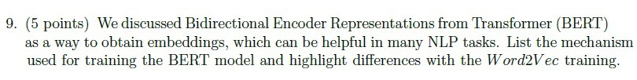

**Figure 19.** Printed subjective question 9 from scanned offline paper, comparing BERT training mechanism with Word2Vec.

**Correct answer:** Answer not verifiable from the source PDF

**Source evidence:** [{"page": 7, "bbox": [22.87, 748.93, 384.2, 801.42], "type": "absent", "detail": "Offline pen-and-paper examination; portal container 240 offers submission status options only (\"I have written answers on the answer sheets\"), no official academic answer key is provided in the source PDF."}]

## Answer key

| Source question | Source identity | Correct answer | PDF pages |
| :--- | :--- | :--- | :--- |
| 1 | portal 640653567122 | Answer not verifiable from the source PDF | 3 |
| 2 | portal 640653567122 | Answer not verifiable from the source PDF | 3 |
| 3 | portal 640653567122 | Answer not verifiable from the source PDF | 3 |
| 4 | portal 640653567122 | Answer not verifiable from the source PDF | 3 |
| 5 | portal 640653567123 | Answer not verifiable from the source PDF | 4 |
| 6 | portal 640653567123 | Answer not verifiable from the source PDF | 4 |
| 7 | portal 640653567123 | Answer not verifiable from the source PDF | 4 |
| 8 | portal 640653567123 | Answer not verifiable from the source PDF | 4 |
| 1 | portal 640653567124 | Answer not verifiable from the source PDF | 6 |
| 2 | portal 640653567124 | Answer not verifiable from the source PDF | 6 |
| 3 | portal 640653567124 | Answer not verifiable from the source PDF | 6 |
| 4 | portal 640653567124 | Answer not verifiable from the source PDF | 6 |
| 5 | portal 640653567124 | Answer not verifiable from the source PDF | 6 |
| 6 | portal 640653567125 | Answer not verifiable from the source PDF | 7 |
| 7 | portal 640653567125 | Answer not verifiable from the source PDF | 7 |
| 8 | portal 640653567125 | Answer not verifiable from the source PDF | 7 |
| 9 | portal 640653567125 | Answer not verifiable from the source PDF | 7 |

## Extraction notes

**Status:** verified-source-limitation
**Count reconciliation:** Section 10 declares 5 online portal questions and 40 section marks. Portal Question 236 (0 marks) is an administrative subject confirmation and is excluded. The remaining 4 portal containers (Questions 237 to 240) wrap an offline pen-and-paper examination comprising 17 printed academic questions: Section 1.1 contains 8 MCQs (1 mark each = 8 marks, split across portal questions 237 and 238 with 4 marks each) and Section 1.2 contains 9 Subjective questions (2+3+3+3+3 = 14 marks in portal question 239, and 3+5+5+5 = 18 marks in portal question 240, totaling 32 marks). 8 + 32 = 40 marks, perfectly reconciling the declared 40 section marks and the 4 portal containers across 17 printed academic questions.

- All 17 printed questions (8 MCQs and 9 Subjective questions) have been transcribed verbatim with complete mathematical formatting, LaTeX equations, and exact preservation of options.
- High-resolution individual crops of every printed question stem, option block, diagram, and section instruction header have been extracted, inspected, and saved under assets/.
- The Speech Technology examination was conducted as a hybrid/offline pen-and-paper test. The online portal interface merely acted as a submission container (offering options "I have written answers on the answer sheets" and "Not applicable"), while the actual academic questions were embedded as raster scans.
- No official answer key, solution markings, or correct answer indicators for any of the 17 printed academic questions are provided in the source PDF. In accordance with extraction contract rules, the answer text is recorded exactly as "Answer not verifiable from the source PDF".

**Excluded source entries:**

- {"classification": "out-of-scope-subject", "page": 1, "bbox": [22.9, 30.9, 337.0, 47.3], "reason": "Preceding section option fragment 6406531895289 (Adds random jitter to feature values)", "identity": "6406531895289"}
- {"classification": "subject-confirmation", "page": 1, "bbox": [22.9, 600.7, 581.2, 814.0], "reason": "Administrative subject confirmation asking candidate to confirm writing Degree Level : Speech Technology (Pen and Paper Exam) and cross check hall ticket", "identity": "640653567121"}
- {"classification": "out-of-scope-subject", "page": 8, "bbox": [20.6, 74.3, 581.2, 820.4], "reason": "Subsequent section Market Research (Section 11, Section Id: 64065338438)", "identity": "64065338438"}
