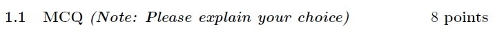
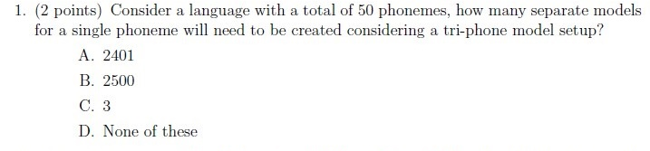
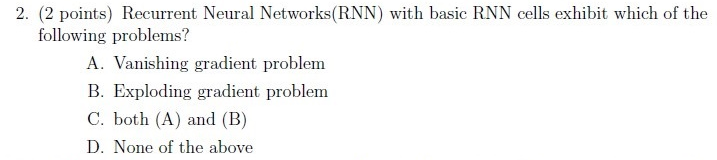
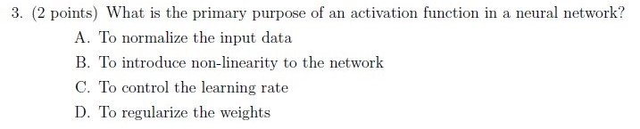
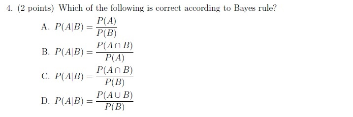
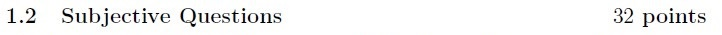
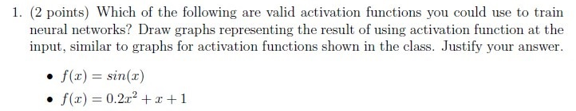
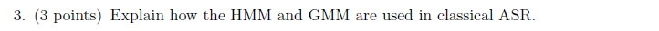
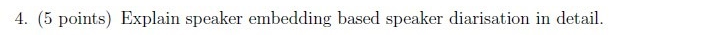
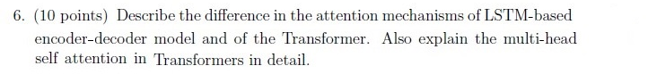

# Speech Technology — ee4001_2023T3_ET_AN

**Source:** `ee4001_2023T3_ET_AN.pdf` · **Academic questions:** 10 · **Separately counted children:** 0
**Provenance:** `Speech_Technology/ee4001_2023T3_ET_AN.pdf` · SHA-256 `487da1e393f852fcd4071a90eb26a88c9a667865e5da71931b823e70ef3d8713`

**Scope:** Degree Level : Speech Technology examination (Section 9, Section Id: 64065349328, questions 204-206). Preceding section fragment on page 1 (Streaming applications question) and Section 10 (SPG on page 4) are excluded as out of scope. Question 204 is excluded semantically as an administrative subject confirmation. Portal questions 205 and 206 wrap an offline pen-and-paper examination comprising 10 printed academic questions (4 MCQs and 6 Subjective questions).

## Questions

### Shared context 1.1 MCQ

**Portal container number:** `205`

**Portal container ID:** `640653699412`

**Type:** Section Heading
**PDF pages:** 3

### 1.1 MCQ (Note: Please explain your choice) 8 points

**Figure 1.** Source section heading for 1.1 MCQ (Note: Please explain your choice) 8 points.

### Question 1

**Portal container number:** `205`

**Portal container ID:** `640653699412`

**Type:** MCQ · **Marks:** 2
**PDF pages:** 3

**Shared context:** [sc-1-1-mcq](#sc-1-1-mcq)

1. (2 points) Consider a language with a total of 50 phonemes, how many separate models for a single phoneme will need to be created considering a tri-phone model setup?

**Figure 2.** Printed question 1 from scanned offline paper, covering number of triphone models for 50 phonemes.

**Options**

**A.**

2401

*Source option ID:* not supplied.

**B.**

2500

*Source option ID:* not supplied.

**C.**

3

*Source option ID:* not supplied.

**D.**

None of these

*Source option ID:* not supplied.

**Correct answer:** Answer not verifiable from the source PDF

**Source evidence:** [{"page": 3, "bbox": [22.87, 79.25, 454.12, 204.5], "type": "absent", "detail": "Offline examination paper; portal container displays only submission status confirmation option (\"I have written answers on the answer sheets\"), no official academic answer key is provided in the source PDF."}]

### Question 2

**Portal container number:** `205`

**Portal container ID:** `640653699412`

**Type:** MCQ · **Marks:** 2
**PDF pages:** 3

**Shared context:** [sc-1-1-mcq](#sc-1-1-mcq)

2. (2 points) Recurrent Neural Networks(RNN) with basic RNN cells exhibit which of the following problems?

**Figure 3.** Printed question 2 from scanned offline paper, covering gradient problems in basic RNN cells.

**Options**

**A.**

Vanishing gradient problem

*Source option ID:* not supplied.

**B.**

Exploding gradient problem

*Source option ID:* not supplied.

**C.**

both (A) and (B)

*Source option ID:* not supplied.

**D.**

None of the above

*Source option ID:* not supplied.

**Correct answer:** Answer not verifiable from the source PDF

**Source evidence:** [{"page": 3, "bbox": [22.87, 204.5, 454.12, 324.5], "type": "absent", "detail": "Offline examination paper; portal container displays only submission status confirmation option (\"I have written answers on the answer sheets\"), no official academic answer key is provided in the source PDF."}]

### Question 3

**Portal container number:** `205`

**Portal container ID:** `640653699412`

**Type:** MCQ · **Marks:** 2
**PDF pages:** 3

**Shared context:** [sc-1-1-mcq](#sc-1-1-mcq)

3. (2 points) What is the primary purpose of an activation function in a neural network?

**Figure 4.** Printed question 3 from scanned offline paper, covering primary purpose of activation function in neural network.

**Options**

**A.**

To normalize the input data

*Source option ID:* not supplied.

**B.**

To introduce non-linearity to the network

*Source option ID:* not supplied.

**C.**

To control the learning rate

*Source option ID:* not supplied.

**D.**

To regularize the weights

*Source option ID:* not supplied.

**Correct answer:** Answer not verifiable from the source PDF

**Source evidence:** [{"page": 3, "bbox": [22.87, 324.5, 454.12, 433.25], "type": "absent", "detail": "Offline examination paper; portal container displays only submission status confirmation option (\"I have written answers on the answer sheets\"), no official academic answer key is provided in the source PDF."}]

### Question 4

**Portal container number:** `205`

**Portal container ID:** `640653699412`

**Type:** MCQ · **Marks:** 2
**PDF pages:** 3

**Shared context:** [sc-1-1-mcq](#sc-1-1-mcq)

4. (2 points) Which of the following is correct according to Bayes rule?

**Figure 5.** Printed question 4 from scanned offline paper, covering Bayes rule formulation.

**Options**

**A.**

$$P(A|B) = \frac{P(A)}{P(B)}$$

*Source option ID:* not supplied.

**B.**

$$P(A|B) = \frac{P(A \cap B)}{P(A)}$$

*Source option ID:* not supplied.

**C.**

$$P(A|B) = \frac{P(A \cap B)}{P(B)}$$

*Source option ID:* not supplied.

**D.**

$$P(A|B) = \frac{P(A \cup B)}{P(B)}$$

*Source option ID:* not supplied.

**Correct answer:** Answer not verifiable from the source PDF

**Source evidence:** [{"page": 3, "bbox": [22.87, 433.25, 454.12, 611.75], "type": "absent", "detail": "Offline examination paper; portal container displays only submission status confirmation option (\"I have written answers on the answer sheets\"), no official academic answer key is provided in the source PDF."}]

### Shared context 1.2 Subjective Questions

**Portal container number:** `206`

**Portal container ID:** `640653699413`

**Type:** Section Heading
**PDF pages:** 4

### 1.2. Subjective Questions 32 points

**Figure 6.** Source section heading for 1.2. Subjective Questions 32 points.

### Question 1

**Portal container number:** `206`

**Portal container ID:** `640653699413`

**Type:** Subjective · **Marks:** 2
**PDF pages:** 4

**Shared context:** [sc-1-2-subj](#sc-1-2-subj)

1. (2 points) Which of the following are valid activation functions you could use to train neural networks? Draw graphs representing the result of using activation function at the input, similar to graphs for activation functions shown in the class. Justify your answer.

* $f(x) = \sin(x)$
* $f(x) = 0.2x^2 + x + 1$

**Figure 7.** Printed subjective question 1 from scanned offline paper, covering valid activation functions for training neural networks.

**Correct answer:** Answer not verifiable from the source PDF

**Source evidence:** [{"page": 4, "bbox": [22.87, 196.0, 454.12, 301.0], "type": "absent", "detail": "Offline examination paper; portal container displays only submission status confirmation option (\"I have written answers on the answer sheets\"), no official academic answer key is provided in the source PDF."}]

### Question 2

**Portal container number:** `206`

**Portal container ID:** `640653699413`

**Type:** Subjective · **Marks:** 2
**PDF pages:** 4

**Shared context:** [sc-1-2-subj](#sc-1-2-subj)

2. (2 points) Recurrent Neural Networks do not need position encoding. Explain.

**Figure 8.** Printed subjective question 2 from scanned offline paper, explaining why RNNs do not need position encoding.

**Correct answer:** Answer not verifiable from the source PDF

**Source evidence:** [{"page": 4, "bbox": [22.87, 301.0, 454.12, 331.0], "type": "absent", "detail": "Offline examination paper; portal container displays only submission status confirmation option (\"I have written answers on the answer sheets\"), no official academic answer key is provided in the source PDF."}]

### Question 3

**Portal container number:** `206`

**Portal container ID:** `640653699413`

**Type:** Subjective · **Marks:** 3
**PDF pages:** 4

**Shared context:** [sc-1-2-subj](#sc-1-2-subj)

3. (3 points) Explain how the HMM and GMM are used in classical ASR.

**Figure 9.** Printed subjective question 3 from scanned offline paper, explaining how HMM and GMM are used in classical ASR.

**Correct answer:** Answer not verifiable from the source PDF

**Source evidence:** [{"page": 4, "bbox": [22.87, 331.0, 454.12, 357.25], "type": "absent", "detail": "Offline examination paper; portal container displays only submission status confirmation option (\"I have written answers on the answer sheets\"), no official academic answer key is provided in the source PDF."}]

### Question 4

**Portal container number:** `206`

**Portal container ID:** `640653699413`

**Type:** Subjective · **Marks:** 5
**PDF pages:** 4

**Shared context:** [sc-1-2-subj](#sc-1-2-subj)

4. (5 points) Explain speaker embedding based speaker diarisation in detail.

**Figure 10.** Printed subjective question 4 from scanned offline paper, explaining speaker embedding based speaker diarisation in detail.

**Correct answer:** Answer not verifiable from the source PDF

**Source evidence:** [{"page": 4, "bbox": [22.87, 357.25, 454.12, 383.5], "type": "absent", "detail": "Offline examination paper; portal container displays only submission status confirmation option (\"I have written answers on the answer sheets\"), no official academic answer key is provided in the source PDF."}]

### Question 5

**Portal container number:** `206`

**Portal container ID:** `640653699413`

**Type:** Subjective · **Marks:** 10
**PDF pages:** 4

**Shared context:** [sc-1-2-subj](#sc-1-2-subj)

5. (10 points) Explain the FastSpeech TTS system in detail.

**Figure 11.** Printed subjective question 5 from scanned offline paper, explaining FastSpeech TTS system in detail.

**Correct answer:** Answer not verifiable from the source PDF

**Source evidence:** [{"page": 4, "bbox": [22.87, 383.5, 454.12, 413.5], "type": "absent", "detail": "Offline examination paper; portal container displays only submission status confirmation option (\"I have written answers on the answer sheets\"), no official academic answer key is provided in the source PDF."}]

### Question 6

**Portal container number:** `206`

**Portal container ID:** `640653699413`

**Type:** Subjective · **Marks:** 10
**PDF pages:** 4

**Shared context:** [sc-1-2-subj](#sc-1-2-subj)

6. (10 points) Describe the difference in the attention mechanisms of LSTM-based encoder-decoder model and of the Transformer. Also explain the multi-head self attention in Transformers in detail.

**Figure 12.** Printed subjective question 6 from scanned offline paper, comparing attention mechanisms of LSTM encoder-decoder and Transformer, and explaining multi-head self attention.

**Correct answer:** Answer not verifiable from the source PDF

**Source evidence:** [{"page": 4, "bbox": [22.87, 413.5, 454.12, 475.75], "type": "absent", "detail": "Offline examination paper; portal container displays only submission status confirmation option (\"I have written answers on the answer sheets\"), no official academic answer key is provided in the source PDF."}]

## Answer key

| Source question | Source identity | Correct answer | PDF pages |
| :--- | :--- | :--- | :--- |
| 1 | portal 640653699412 | Answer not verifiable from the source PDF | 3 |
| 2 | portal 640653699412 | Answer not verifiable from the source PDF | 3 |
| 3 | portal 640653699412 | Answer not verifiable from the source PDF | 3 |
| 4 | portal 640653699412 | Answer not verifiable from the source PDF | 3 |
| 1 | portal 640653699413 | Answer not verifiable from the source PDF | 4 |
| 2 | portal 640653699413 | Answer not verifiable from the source PDF | 4 |
| 3 | portal 640653699413 | Answer not verifiable from the source PDF | 4 |
| 4 | portal 640653699413 | Answer not verifiable from the source PDF | 4 |
| 5 | portal 640653699413 | Answer not verifiable from the source PDF | 4 |
| 6 | portal 640653699413 | Answer not verifiable from the source PDF | 4 |

## Extraction notes

**Status:** verified-source-limitation
**Count reconciliation:** Section 9 declares 3 online portal questions and 40 section marks. Portal Question 204 (0 marks) is an administrative subject confirmation and is excluded. The remaining 2 portal containers (Questions 205 and 206) wrap an offline pen-and-paper examination comprising 10 printed academic questions: Section 1.1 contains 4 MCQs (2 marks each = 8 marks, wrapped in portal question 205 with Correct Marks: 8) and Section 1.2 contains 6 Subjective questions (marks 2 + 2 + 3 + 5 + 10 + 10 = 32 marks, wrapped in portal question 206 with Correct Marks: 32). 8 + 32 = 40 marks, perfectly reconciling the declared 40 section marks and the 2 portal containers across 10 printed academic questions.

- All 10 printed questions (4 MCQs and 6 Subjective questions) have been transcribed verbatim with complete mathematical formatting, LaTeX equations, and exact preservation of options.
- High-resolution individual crops of every printed question stem, option block, and section instruction header have been extracted, inspected, and saved under assets/.
- The Speech Technology examination was conducted as a hybrid/offline pen-and-paper test. The online portal interface merely acted as a submission container (offering options "I have written answers on the answer sheets" and "Not applicable"), while the actual academic questions were embedded as raster scans.
- No official answer key, solution markings, or correct answer indicators for any of the 10 printed academic questions are provided in the source PDF. In accordance with extraction contract rules, the answer text is recorded exactly as "Answer not verifiable from the source PDF".

**Excluded source entries:**

- {"classification": "out-of-scope-subject", "page": 1, "bbox": [22.9, 21.3, 581.3, 394.9], "reason": "Preceding section question regarding Streaming applications (options 6406532335421 - 6406532335425)", "identity": "streaming-applications"}
- {"classification": "subject-confirmation", "page": 2, "bbox": [22.9, 180.3, 581.2, 586.4], "reason": "Administrative subject confirmation asking candidate to confirm writing Degree Level : Speech Technology (Pen and Paper Exam) and cross check hall ticket", "identity": "640653699411"}
- {"classification": "out-of-scope-subject", "page": 4, "bbox": [20.6, 639.6, 405.4, 824.4], "reason": "Subsequent section SPG (Section 10, Section Id: 64065349329)", "identity": "64065349329"}
