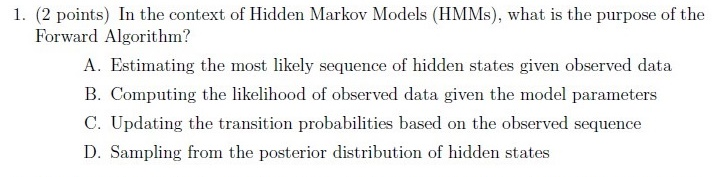
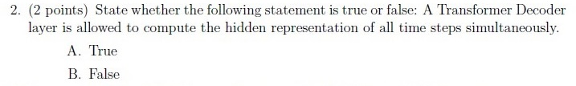
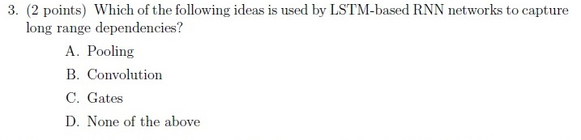
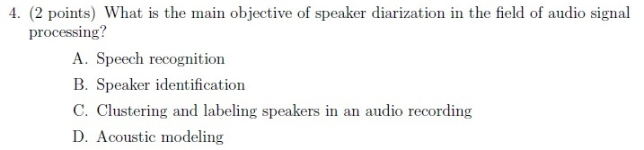
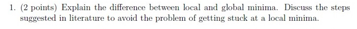
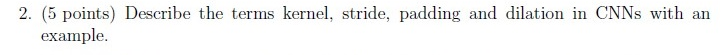
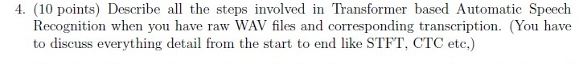
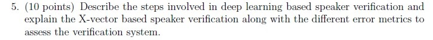

# Speech Technology — ee4001_2023T3_ET_FN

**Source:** `ee4001_2023T3_ET_FN.pdf` · **Academic questions:** 9 · **Separately counted children:** 0
**Provenance:** `Speech_Technology/ee4001_2023T3_ET_FN.pdf` · SHA-256 `44cce6dcdc47f887bc46192e31b3958f0ca05ee751d97dca9700bf545147ea9b`

**Scope:** Speech Technology degree-level pen and paper examination section (questions 46-48 on pages 1-3). Question 46 is an administrative subject confirmation (excluded). Questions 47 and 48 are offline submission containers for Section 1.1 MCQ (4 questions, 8 marks) and Section 1.2 Subjective (5 questions, 32 marks). Subsequent section English2 (Section 4, questions 49-75 on page 3) is excluded as out-of-scope.

## Questions

### Shared context 1.1 MCQ

**Type:** Section Heading
**PDF pages:** 2

### 1.1 MCQ

**Note: Please explain your choice (8 points)**

Section 1.1 contains 4 Multiple Choice Questions (Questions 1 to 4). Each question carries 2 points. Offline pen-and-paper examination mode.

### Question 1

**Portal container number:** `47`

**Portal container ID:** `640653701050`

**Type:** MCQ · **Marks:** 2
**PDF pages:** 2

**Shared context:** [sc-1-1-mcq](#sc-1-1-mcq)

1. (2 points) In the context of Hidden Markov Models (HMMs), what is the purpose of the Forward Algorithm?

**Figure 1.** Printed Question 1 from Section 1.1 MCQ on purpose of Forward Algorithm in HMMs.

**Options**

**A.**

Estimating the most likely sequence of hidden states given observed data

*Source option ID:* not supplied.

**B.**

Computing the likelihood of observed data given the model parameters

*Source option ID:* not supplied.

**C.**

Updating the transition probabilities based on the observed sequence

*Source option ID:* not supplied.

**D.**

Sampling from the posterior distribution of hidden states

*Source option ID:* not supplied.

**Correct answer:** Answer not verifiable from the source PDF

**Source evidence:** [{"page": 2, "bbox": [22.87, 79.25, 454.12, 212.0], "type": "absent", "detail": "Offline examination paper; portal container 47 displays only submission status confirmation option (\"I have written answers on the answer sheets\"), no official academic answer key is provided in the source PDF."}]

### Question 2

**Portal container number:** `47`

**Portal container ID:** `640653701050`

**Type:** MCQ · **Marks:** 2
**PDF pages:** 2

**Shared context:** [sc-1-1-mcq](#sc-1-1-mcq)

2. (2 points) State whether the following statement is true or false: A Transformer Decoder layer is allowed to compute the hidden representation of all time steps simultaneously.

**Figure 2.** Printed Question 2 from Section 1.1 MCQ on Transformer Decoder hidden representation computation.

**Options**

**A.**

True

*Source option ID:* not supplied.

**B.**

False

*Source option ID:* not supplied.

**Correct answer:** Answer not verifiable from the source PDF

**Source evidence:** [{"page": 2, "bbox": [22.87, 212.0, 454.12, 292.25], "type": "absent", "detail": "Offline examination paper; portal container 47 displays only submission status confirmation option (\"I have written answers on the answer sheets\"), no official academic answer key is provided in the source PDF."}]

### Question 3

**Portal container number:** `47`

**Portal container ID:** `640653701050`

**Type:** MCQ · **Marks:** 2
**PDF pages:** 2

**Shared context:** [sc-1-1-mcq](#sc-1-1-mcq)

3. (2 points) Which of the following ideas is used by LSTM-based RNN networks to capture long range dependencies?

**Figure 3.** Printed Question 3 from Section 1.1 MCQ on LSTM-based RNN long range dependencies.

**Options**

**A.**

Pooling

*Source option ID:* not supplied.

**B.**

Convolution

*Source option ID:* not supplied.

**C.**

Gates

*Source option ID:* not supplied.

**D.**

None of the above

*Source option ID:* not supplied.

**Correct answer:** Answer not verifiable from the source PDF

**Source evidence:** [{"page": 2, "bbox": [22.87, 292.25, 454.12, 422.0], "type": "absent", "detail": "Offline examination paper; portal container 47 displays only submission status confirmation option (\"I have written answers on the answer sheets\"), no official academic answer key is provided in the source PDF."}]

### Question 4

**Portal container number:** `47`

**Portal container ID:** `640653701050`

**Type:** MCQ · **Marks:** 2
**PDF pages:** 2

**Shared context:** [sc-1-1-mcq](#sc-1-1-mcq)

4. (2 points) What is the main objective of speaker diarization in the field of audio signal processing?

**Figure 4.** Printed Question 4 from Section 1.1 MCQ on main objective of speaker diarization.

**Options**

**A.**

Speech recognition

*Source option ID:* not supplied.

**B.**

Speaker identification

*Source option ID:* not supplied.

**C.**

Clustering and labeling speakers in an audio recording

*Source option ID:* not supplied.

**D.**

Acoustic modeling

*Source option ID:* not supplied.

**Correct answer:** Answer not verifiable from the source PDF

**Source evidence:** [{"page": 2, "bbox": [22.87, 422.0, 454.12, 549.5], "type": "absent", "detail": "Offline examination paper; portal container 47 displays only submission status confirmation option (\"I have written answers on the answer sheets\"), no official academic answer key is provided in the source PDF."}]

### Shared context 1.2 Subjective Questions

**Type:** Section Heading
**PDF pages:** 3

### 1.2. Subjective Questions

**32 points**

Section 1.2 contains 5 Subjective questions (Questions 1 to 5) carrying 32 points total (2 + 5 + 5 + 10 + 10 = 32 points). Offline pen-and-paper examination mode.

### Question 1

**Portal container number:** `48`

**Portal container ID:** `640653701051`

**Type:** Subjective · **Marks:** 2
**PDF pages:** 3

**Shared context:** [sc-1-2-subj](#sc-1-2-subj)

1. (2 points) Explain the difference between local and global minima. Discuss the steps suggested in literature to avoid the problem of getting stuck at a local minima.

**Figure 5.** Printed Question 1 from Section 1.2 Subjective on local versus global minima.

**Correct answer:** Answer not verifiable from the source PDF

**Source evidence:** [{"page": 3, "bbox": [22.87, 146.0, 454.12, 191.0], "type": "absent", "detail": "Offline examination paper; portal container 48 displays only submission status confirmation option (\"I have written answers on the answer sheets\"), no official academic answer key is provided in the source PDF."}]

### Question 2

**Portal container number:** `48`

**Portal container ID:** `640653701051`

**Type:** Subjective · **Marks:** 5
**PDF pages:** 3

**Shared context:** [sc-1-2-subj](#sc-1-2-subj)

2. (5 points) Describe the terms kernel, stride, padding and dilation in CNNs with an example.

**Figure 6.** Printed Question 2 from Section 1.2 Subjective on CNN kernel, stride, padding, and dilation.

**Correct answer:** Answer not verifiable from the source PDF

**Source evidence:** [{"page": 3, "bbox": [22.87, 191.0, 454.12, 232.25], "type": "absent", "detail": "Offline examination paper; portal container 48 displays only submission status confirmation option (\"I have written answers on the answer sheets\"), no official academic answer key is provided in the source PDF."}]

### Question 3

**Portal container number:** `48`

**Portal container ID:** `640653701051`

**Type:** Subjective · **Marks:** 5
**PDF pages:** 3

**Shared context:** [sc-1-2-subj](#sc-1-2-subj)

3. (5 points) Explain permutation invariant loss in end-to-end speaker diarisation.

**Figure 7.** Printed Question 3 from Section 1.2 Subjective on permutation invariant loss in speaker diarisation.

**Correct answer:** Answer not verifiable from the source PDF

**Source evidence:** [{"page": 3, "bbox": [22.87, 232.25, 454.12, 263.75], "type": "absent", "detail": "Offline examination paper; portal container 48 displays only submission status confirmation option (\"I have written answers on the answer sheets\"), no official academic answer key is provided in the source PDF."}]

### Question 4

**Portal container number:** `48`

**Portal container ID:** `640653701051`

**Type:** Subjective · **Marks:** 10
**PDF pages:** 3

**Shared context:** [sc-1-2-subj](#sc-1-2-subj)

4. (10 points) Describe all the steps involved in Transformer based Automatic Speech Recognition when you have raw WAV files and corresponding transcription. (You have to discuss everything detail from the start to end like STFT, CTC etc.)

**Figure 8.** Printed Question 4 from Section 1.2 Subjective on Transformer based Automatic Speech Recognition pipeline.

**Correct answer:** Answer not verifiable from the source PDF

**Source evidence:** [{"page": 3, "bbox": [22.87, 263.75, 454.12, 323.75], "type": "absent", "detail": "Offline examination paper; portal container 48 displays only submission status confirmation option (\"I have written answers on the answer sheets\"), no official academic answer key is provided in the source PDF."}]

### Question 5

**Portal container number:** `48`

**Portal container ID:** `640653701051`

**Type:** Subjective · **Marks:** 10
**PDF pages:** 3

**Shared context:** [sc-1-2-subj](#sc-1-2-subj)

5. (10 points) Describe the steps involved in deep learning based speaker verification and explain the X-vector based speaker verification along with the different error metrics to assess the verification system.

**Figure 9.** Printed Question 5 from Section 1.2 Subjective on deep learning speaker verification and X-vectors.

**Correct answer:** Answer not verifiable from the source PDF

**Source evidence:** [{"page": 3, "bbox": [22.87, 323.75, 454.12, 376.25], "type": "absent", "detail": "Offline examination paper; portal container 48 displays only submission status confirmation option (\"I have written answers on the answer sheets\"), no official academic answer key is provided in the source PDF."}]

## Answer key

| Source question | Source identity | Correct answer | PDF pages |
| :--- | :--- | :--- | :--- |
| 1 | portal 640653701050 | Answer not verifiable from the source PDF | 2 |
| 2 | portal 640653701050 | Answer not verifiable from the source PDF | 2 |
| 3 | portal 640653701050 | Answer not verifiable from the source PDF | 2 |
| 4 | portal 640653701050 | Answer not verifiable from the source PDF | 2 |
| 1 | portal 640653701051 | Answer not verifiable from the source PDF | 3 |
| 2 | portal 640653701051 | Answer not verifiable from the source PDF | 3 |
| 3 | portal 640653701051 | Answer not verifiable from the source PDF | 3 |
| 4 | portal 640653701051 | Answer not verifiable from the source PDF | 3 |
| 5 | portal 640653701051 | Answer not verifiable from the source PDF | 3 |

## Extraction notes

**Status:** verified-source-limitation
**Count reconciliation:** The PDF contains 3 portal question entries for Degree Level: Speech Technology (Pen and Paper Exam): Question 46 (0 marks), Question 47 (8 marks), and Question 48 (32 marks). Portal Question 46 is an administrative subject confirmation and is excluded semantically. The remaining 2 portal questions (Questions 47 and 48) serve as submission containers for an offline pen-and-paper examination comprising 9 printed academic questions: Section 1.1 contains 4 MCQs (Questions 1-4, 2 marks each = 8 marks, wrapped in portal container 47) and Section 1.2 contains 5 Subjective questions (Questions 1-5, 2+5+5+10+10 = 32 marks, wrapped in portal container 48). Total marks: 8 + 32 = 40 marks, perfectly reconciling the portal container marks and printed points across 9 printed academic questions and 2 portal containers. Following Question 48 on page 3, subsequent section English2 (Section 4, questions 49-75) is excluded as out-of-scope.

- All 9 printed questions have been transcribed verbatim with complete formatting, exact options, and faithful preservation of punctuation and capitalization.
- High-resolution 1:1 original crops of all printed questions are preserved under assets/ with complete inspection metadata.
- Section 1.1 contains 4 MCQs (Questions 1-4, 2 marks each = 8 marks) wrapped by portal Question 47 (Question Id: 640653701050).
- Section 1.2 contains 5 Subjective questions (Questions 1-5, 2+5+5+10+10 = 32 marks) wrapped by portal Question 48 (Question Id: 640653701051).
- Question 46 is excluded as an administrative subject confirmation.
- The Speech Technology examination was conducted as a hybrid/offline pen-and-paper test. The online portal interface merely acted as a submission container (Questions 47 and 48), with candidate options "I have written answers on the answer sheets" and "Not applicable". No official academic answer key was provided in the source PDF.
- All 9 academic questions (4 MCQs in Section 1.1 and 5 Subjective questions in Section 1.2) were embedded as scanned page images within the portal question bodies.
- Official academic answer keys are absent from the source PDF for all 9 printed questions. In accordance with extraction contract instructions, all question answers are faithfully recorded as "Answer not verifiable from the source PDF" with kind "absent" and complete source evidence.

**Excluded source entries:**

- {"classification": "subject-confirmation", "page": 1, "bbox": [22.87, 180.27, 581.19, 586.43], "reason": "Administrative subject confirmation asking if candidate is writing Degree Level: Speech Technology (Pen and Paper Exam) and cross-checking hall ticket", "identity": "640653701049"}
- {"classification": "out-of-scope-subject", "page": 3, "bbox": [20.62, 540.1, 405.42, 820.0], "reason": "Subsequent section English2 (Section Number: 4, Section Id: 64065349389, questions 49 to 75)", "identity": "section_64065349389"}
