# Speech Technology — ee4001_2023T3_Q1_NA

**Source:** `ee4001_2023T3_Q1_NA.pdf` · **Academic questions:** 13 · **Separately counted children:** 0
**Provenance:** `Speech_Technology/ee4001_2023T3_Q1_NA.pdf` · SHA-256 `f157d45681209359211c8074cee5d5d7aed7310eed3d2d58a960b938ba106765`

**Scope:** Speech Technology degree-level examination section (Section 8: Speech Technology, Section Id: 64065345320, Section Marks: 25). Section 8 begins on page 1 with administrative confirmation Question 123 (concluded on page 2) and contains three portal containers: Question 124 (6 marks, spanning pages 2 to 3 wrapping printed questions 1 to 4), Question 125 (11 marks, spanning pages 3 to 4 wrapping printed questions 5 to 7), and Question 126 (8 marks, spanning pages 4 to 6 wrapping printed questions 8 to 13) wrapping an offline pen-and-paper examination comprising 13 printed academic questions. Section 9 (Programming in C, Section Id: 64065345321) begins on page 6 with administrative confirmation Question 127, excluded as out of scope.

## Questions

### Question 1

**Portal container number:** `124`

**Portal container ID:** `640653676904`

**Type:** MCQ · **Marks:** 1
**PDF pages:** 2

1. (1 point) In K-means, the number of clusters (K) changes as the algorithm reaches to convergence.

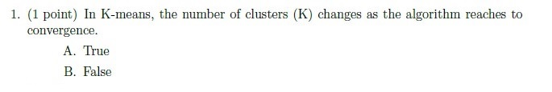

**Figure 1.** Printed question 1 from scanned offline paper, covering K-means cluster number changes during convergence.

**Options**

**A.**

True

*Source option ID:* not supplied.

**B.**

False

*Source option ID:* not supplied.

**Correct answer:** Answer not verifiable from the source PDF

**Source evidence:** [{"page": 2, "bbox": [22.87, 405.59, 454.12, 491.84], "type": "absent", "detail": "Offline examination paper; portal container displays only submission status confirmation option (\"I have written answers on the answer sheets\"), no official academic answer key is provided in the source PDF."}]

### Question 2

**Portal container number:** `124`

**Portal container ID:** `640653676904`

**Type:** MCQ · **Marks:** 1
**PDF pages:** 2

2. (1 point) A uni-variate Gaussian distribution is completely defined by the following parameters.

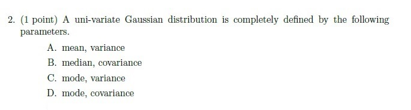

**Figure 2.** Printed question 2 from scanned offline paper, covering parameters defining a univariate Gaussian distribution.

**Options**

**A.**

mean, variance

*Source option ID:* not supplied.

**B.**

median, covariance

*Source option ID:* not supplied.

**C.**

mode, variance

*Source option ID:* not supplied.

**D.**

mode, covariance

*Source option ID:* not supplied.

**Correct answer:** Answer not verifiable from the source PDF

**Source evidence:** [{"page": 2, "bbox": [22.87, 491.84, 454.12, 629.84], "type": "absent", "detail": "Offline examination paper; portal container displays only submission status confirmation option (\"I have written answers on the answer sheets\"), no official academic answer key is provided in the source PDF."}]

### Question 3

**Portal container number:** `124`

**Portal container ID:** `640653676904`

**Type:** MCQ · **Marks:** 1
**PDF pages:** 2

3. (1 point) K-Means will always find the global minimum.

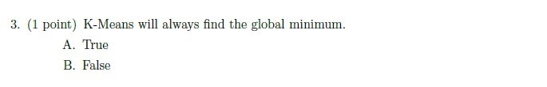

**Figure 3.** Printed question 3 from scanned offline paper, covering whether K-means always finds the global minimum.

**Options**

**A.**

True

*Source option ID:* not supplied.

**B.**

False

*Source option ID:* not supplied.

**Correct answer:** Answer not verifiable from the source PDF

**Source evidence:** [{"page": 2, "bbox": [22.87, 629.84, 454.12, 712.34], "type": "absent", "detail": "Offline examination paper; portal container displays only submission status confirmation option (\"I have written answers on the answer sheets\"), no official academic answer key is provided in the source PDF."}]

### Question 4

**Portal container number:** `124`

**Portal container ID:** `640653676904`

**Type:** Subjective · **Marks:** 3
**PDF pages:** 2

4. (3 points) Consider the set of training data below, and two clustering algorithms:

K-Means and a Gaussian Mixture Model (GMM) trained using EM. Will these two clustering algorithms produce the same cluster centers (means) for this data set?

Explain why or why not.

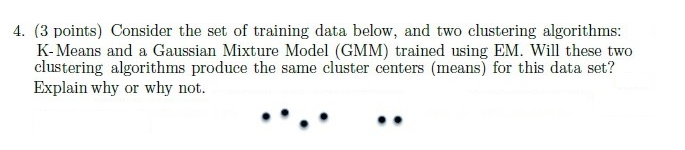

**Figure 4.** Printed question 4 from scanned offline paper, covering cluster centers for K-means vs GMM EM with training data plot.

**Correct answer:** Answer not verifiable from the source PDF

**Source evidence:** [{"page": 2, "bbox": [22.87, 712.34, 454.12, 824.84], "type": "absent", "detail": "Offline examination paper; portal container displays only submission status confirmation option (\"I have written answers on the answer sheets\"), no official academic answer key is provided in the source PDF."}]

### Question 5

**Portal container number:** `125`

**Portal container ID:** `640653676905`

**Type:** Subjective · **Marks:** 3
**PDF pages:** 4

5. (3 points) Assume there are two Gaussian components in the GMM; $\mu_0, \mu_1, \sigma_0$ and $\sigma_1$ define means and variances of these two components, $\pi_0$ and $(1-\pi_0)$ denote the mixture proportions of the two Gaussians (i.e. $p(x) = \pi_0 \mathcal{N}(\mu_0, \sigma_0) + (1-\pi_0) \mathcal{N}(\mu_1, \sigma_1)$).

(a) (1 point) Draw on the figure the directions in which $\mu_0$ and $\mu_1$ will move during the next M-step.

(b) (2 points) Will the estimate of $\pi_0$ increase or decrease on the next EM step? Explain your reasoning in one sentence.

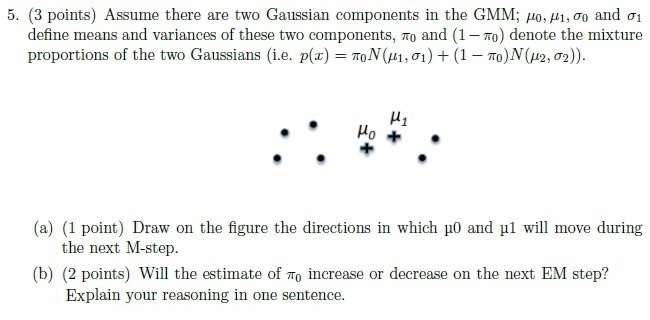

**Figure 5.** Printed question 5 from scanned offline paper, covering two-component GMM M-step mean movement and pi_0 estimate change.

**Correct answer:** Answer not verifiable from the source PDF

**Source evidence:** [{"page": 4, "bbox": [22.87, 16.75, 454.12, 256.75], "type": "absent", "detail": "Offline examination paper; portal container displays only submission status confirmation option (\"I have written answers on the answer sheets\"), no official academic answer key is provided in the source PDF."}]

### Question 6

**Portal container number:** `125`

**Portal container ID:** `640653676905`

**Type:** Subjective · **Marks:** 5
**PDF pages:** 4

6. (5 points) We saw two approaches to solve the sequence prediction problem: greedy and viterbi. Consider a weather sequence prediction problem, assuming first-order markov chain. Given that Sunny weather was observed on Day-0, compute the best possible weather forcast sequence for the next three days using 1) greedy approach, 2) viterbi approach.

Hint: For viterbi keep a track of path taken to calculate $\gamma_A(B)$, where $\gamma_A(B)$ denotes maximum probability of reaching state A at time step B.

| | Today Sunny | Today Cloudy | Today Rainy |
| :--- | :--- | :--- | :--- |
| **Yesterday Sunny** | 0.5 | 0.375 | 0.125 |
| **Yesterday Cloudy** | 0.25 | 0.125 | 0.625 |
| **Yesterday Rainy** | 0.25 | 0.075 | 0.675 |

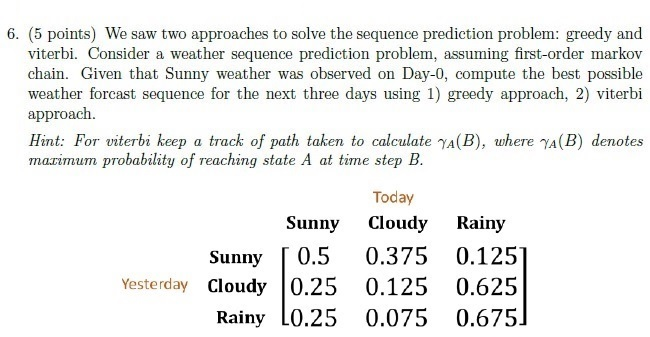

**Figure 6.** Printed question 6 from scanned offline paper, covering weather sequence prediction using greedy and Viterbi approaches with transition matrix table.

**Correct answer:** Answer not verifiable from the source PDF

**Source evidence:** [{"page": 4, "bbox": [22.87, 256.75, 454.12, 509.5], "type": "absent", "detail": "Offline examination paper; portal container displays only submission status confirmation option (\"I have written answers on the answer sheets\"), no official academic answer key is provided in the source PDF."}]

### Question 7

**Portal container number:** `125`

**Portal container ID:** `640653676905`

**Type:** Subjective · **Marks:** 3
**PDF pages:** 4

7. (3 points) We saw two approaches for vector quantization, namely: k-means & Linde-Buzo-Gray Algorithm (LBG). Explain in detail the clustering mechanism used in these two algorithms, highlighting differences in their approach.

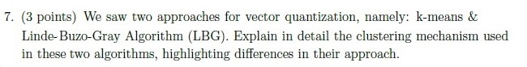

**Figure 7.** Printed question 7 from scanned offline paper, comparing clustering mechanisms between K-means and Linde-Buzo-Gray (LBG) algorithm.

**Correct answer:** Answer not verifiable from the source PDF

**Source evidence:** [{"page": 4, "bbox": [22.87, 509.5, 454.12, 571.75], "type": "absent", "detail": "Offline examination paper; portal container displays only submission status confirmation option (\"I have written answers on the answer sheets\"), no official academic answer key is provided in the source PDF."}]

### Question 8

**Portal container number:** `126`

**Portal container ID:** `640653676906`

**Type:** MCQ · **Marks:** 1
**PDF pages:** 5

8. (1 point) For perfect reconstruction of a bandlimited signal, the sampling frequency must be _______.

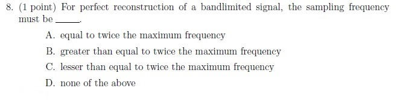

**Figure 8.** Printed question 8 from scanned offline paper, covering Nyquist sampling frequency condition for bandlimited signal reconstruction.

**Options**

**A.**

equal to twice the maximum frequency

*Source option ID:* not supplied.

**B.**

greater than equal to twice the maximum frequency

*Source option ID:* not supplied.

**C.**

lesser than equal to twice the maximum frequency

*Source option ID:* not supplied.

**D.**

none of the above

*Source option ID:* not supplied.

**Correct answer:** Answer not verifiable from the source PDF

**Source evidence:** [{"page": 5, "bbox": [22.87, 143.25, 454.12, 268.5], "type": "absent", "detail": "Offline examination paper; portal container displays only submission status confirmation option (\"I have written answers on the answer sheets\"), no official academic answer key is provided in the source PDF."}]

### Question 9

**Portal container number:** `126`

**Portal container ID:** `640653676906`

**Type:** Subjective · **Marks:** 3
**PDF pages:** 5

9. (3 points) For each of the following discrete time system, comment upon the following system properties (1) linear/non-linear, (2) time-invariant/time-variant, and (3) causal /anti-causal.

(a) (1.5 points) $y[n] = n x[n]$
(b) (1.5 points) $y[n] = e^{x[n]}$

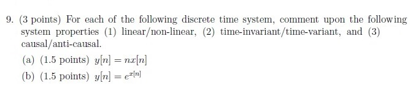

**Figure 9.** Printed question 9 from scanned offline paper, evaluating linearity, time-invariance, and causality for discrete-time systems.

**Correct answer:** Answer not verifiable from the source PDF

**Source evidence:** [{"page": 5, "bbox": [22.87, 268.5, 454.12, 384.0], "type": "absent", "detail": "Offline examination paper; portal container displays only submission status confirmation option (\"I have written answers on the answer sheets\"), no official academic answer key is provided in the source PDF."}]

### Question 10

**Portal container number:** `126`

**Portal container ID:** `640653676906`

**Type:** Fill in the Blanks · **Marks:** 1
**PDF pages:** 5

10. (1 point) Any point in a 3-D space can be represented as a _______ combination of its basis functions.

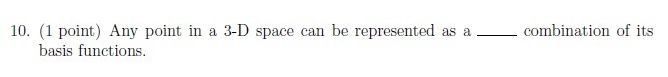

**Figure 10.** Printed question 10 from scanned offline paper, covering representation of 3-D points as a combination of basis functions.

**Correct answer:** Answer not verifiable from the source PDF

**Source evidence:** [{"page": 5, "bbox": [22.87, 384.0, 454.12, 441.75], "type": "absent", "detail": "Offline examination paper; portal container displays only submission status confirmation option (\"I have written answers on the answer sheets\"), no official academic answer key is provided in the source PDF."}]

### Question 11

**Portal container number:** `126`

**Portal container ID:** `640653676906`

**Type:** MCQ · **Marks:** 1
**PDF pages:** 5

11. (1 point) Let $f_X(x)$ be the probability distribution function for random variable X then
$$\int_{-\infty}^{\infty} f_X(x) dx = ?$$

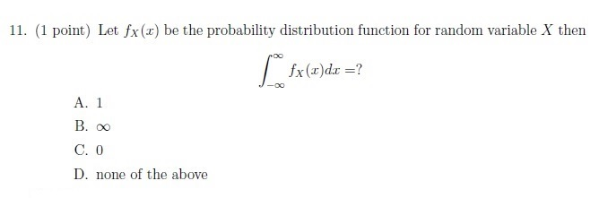

**Figure 11.** Printed question 11 from scanned offline paper, covering total integral of a probability distribution function.

**Options**

**A.**

1

*Source option ID:* not supplied.

**B.**

$\infty$

*Source option ID:* not supplied.

**C.**

0

*Source option ID:* not supplied.

**D.**

none of the above

*Source option ID:* not supplied.

**Correct answer:** Answer not verifiable from the source PDF

**Source evidence:** [{"page": 5, "bbox": [22.87, 441.75, 454.12, 607.5], "type": "absent", "detail": "Offline examination paper; portal container displays only submission status confirmation option (\"I have written answers on the answer sheets\"), no official academic answer key is provided in the source PDF."}]

### Question 12

**Portal container number:** `126`

**Portal container ID:** `640653676906`

**Type:** MCQ · **Marks:** 1
**PDF pages:** 5

12. (1 point) The Gaussian curve is always symmetrical about _______.

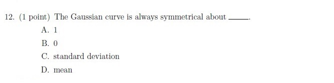

**Figure 12.** Printed question 12 from scanned offline paper, covering symmetry axis of the Gaussian curve.

**Options**

**A.**

1

*Source option ID:* not supplied.

**B.**

0

*Source option ID:* not supplied.

**C.**

standard deviation

*Source option ID:* not supplied.

**D.**

mean

*Source option ID:* not supplied.

**Correct answer:** Answer not verifiable from the source PDF

**Source evidence:** [{"page": 5, "bbox": [22.87, 607.5, 454.12, 732.0], "type": "absent", "detail": "Offline examination paper; portal container displays only submission status confirmation option (\"I have written answers on the answer sheets\"), no official academic answer key is provided in the source PDF."}]

### Question 13

**Portal container number:** `126`

**Portal container ID:** `640653676906`

**Type:** Fill in the Blanks · **Marks:** 1
**PDF pages:** 5

13. (1 point) Psychophysical equivalent of frequency is _______.

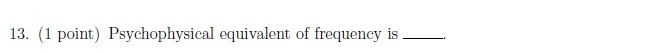

**Figure 13.** Printed question 13 from scanned offline paper, covering psychophysical equivalent of frequency.

**Correct answer:** Answer not verifiable from the source PDF

**Source evidence:** [{"page": 5, "bbox": [22.87, 732.0, 454.12, 771.75], "type": "absent", "detail": "Offline examination paper; portal container displays only submission status confirmation option (\"I have written answers on the answer sheets\"), no official academic answer key is provided in the source PDF."}]

## Answer key

| Source question | Source identity | Correct answer | PDF pages |
| :--- | :--- | :--- | :--- |
| 1 | portal 640653676904 | Answer not verifiable from the source PDF | 2 |
| 2 | portal 640653676904 | Answer not verifiable from the source PDF | 2 |
| 3 | portal 640653676904 | Answer not verifiable from the source PDF | 2 |
| 4 | portal 640653676904 | Answer not verifiable from the source PDF | 2 |
| 5 | portal 640653676905 | Answer not verifiable from the source PDF | 4 |
| 6 | portal 640653676905 | Answer not verifiable from the source PDF | 4 |
| 7 | portal 640653676905 | Answer not verifiable from the source PDF | 4 |
| 8 | portal 640653676906 | Answer not verifiable from the source PDF | 5 |
| 9 | portal 640653676906 | Answer not verifiable from the source PDF | 5 |
| 10 | portal 640653676906 | Answer not verifiable from the source PDF | 5 |
| 11 | portal 640653676906 | Answer not verifiable from the source PDF | 5 |
| 12 | portal 640653676906 | Answer not verifiable from the source PDF | 5 |
| 13 | portal 640653676906 | Answer not verifiable from the source PDF | 5 |

## Extraction notes

**Status:** verified-source-limitation
**Count reconciliation:** Section 8 declares 4 online portal questions and 25 marks. Portal Question 123 (0 marks, Question Id 640653676903) is an administrative subject confirmation and is excluded. The remaining 3 portal containers wrap an offline pen-and-paper examination comprising 13 printed academic questions: Portal Question 124 (6 marks, Question Id 640653676904) wraps printed Questions 1 to 4 on page 2 (1+1+1+3 = 6 marks); Portal Question 125 (11 marks, Question Id 640653676905) wraps printed Questions 5 to 7 on page 4 (3+5+3 = 11 marks); Portal Question 126 (8 marks, Question Id 640653676906) wraps printed Questions 8 to 13 on page 5 (1+3+1+1+1+1 = 8 marks). Total marks sum to 6 + 11 + 8 = 25 marks, perfectly reconciling the declared 25 section marks across 13 printed academic questions and 3 portal containers.

- Examined all 6 source pages visually and programmatically against original PDF and cached renders.
- Section 8 declares 4 portal questions and 25 section marks: portal Question 123 is an administrative confirmation (0 marks), while portal Questions 124, 125, and 126 wrap 13 printed academic questions with marks (6 + 11 + 8) summing to exactly 25.
- Subsequent Section 9 (Programming in C) on page 6 is excluded as out of scope.
- All 13 printed academic questions have individual high-resolution stem crops saved in assets/ and verified.
- The Speech Technology examination was conducted as a hybrid/offline pen-and-paper test. The online portal interface merely acted as submission containers (offering options "I have written answers on the answer sheets" and "Not applicable"), while the actual academic questions were embedded as raster scans across three portal questions (124, 125, 126).
- No official answer key, solution markings, or correct answer indicators for any of the 13 printed academic questions are provided in the source PDF. In accordance with extraction contract rules, the answer text is recorded exactly as "Answer not verifiable from the source PDF".

**Excluded source entries:**

- {"classification": "subject-confirmation", "page": 1, "bbox": [22.87, 395.0, 581.19, 805.61], "reason": "Administrative subject confirmation asking candidate to confirm Degree Level: Speech Technology and cross-check hall ticket", "identity": "640653676903"}
- {"classification": "out-of-scope-subject", "page": 6, "bbox": [20.62, 151.11, 581.19, 820.0], "reason": "Subsequent section Programming in C (Section 9, Section Id 64065345321, Question 127 Question Id 640653676907)", "identity": "section_64065345321"}
