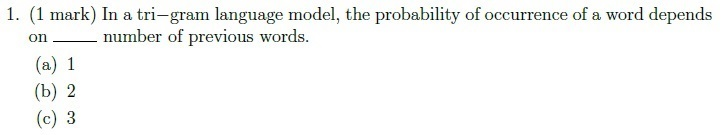
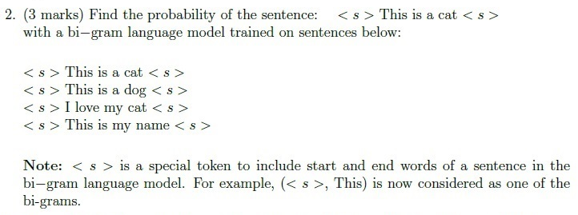
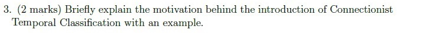
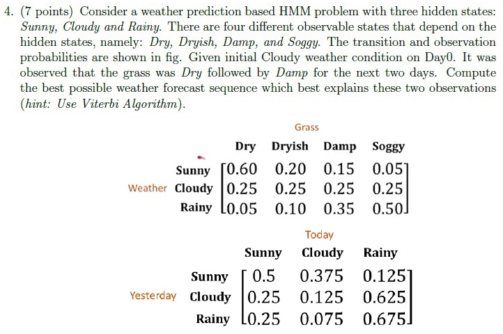
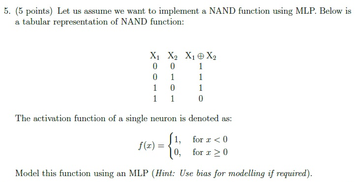
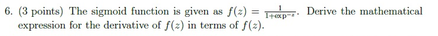
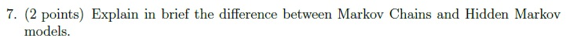
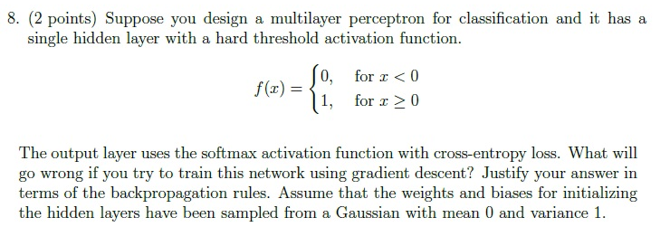

# Speech Technology — ee4001_2023T3_Q2_NA

**Source:** `ee4001_2023T3_Q2_NA.pdf` · **Academic questions:** 8 · **Separately counted children:** 0
**Provenance:** `Speech_Technology/ee4001_2023T3_Q2_NA.pdf` · SHA-256 `59f426478f6c9b7ed37f6f3cbe572fb9a7ee54cad6c441af171998b1f180ddb0`

**Scope:** Speech Technology degree-level examination section (Section 8: Speech Technology, Section Id: 64065348601, declaring 3 online portal questions and 25 marks). The section contains Question 131 (administrative subject confirmation, 0 marks) and Questions 132 and 133 (portal containers for offline answer submission, 13 and 12 marks respectively). Across Questions 132 and 133, 8 printed scan academic questions covering tri-gram language models, bi-gram sentence probability calculation, CTC motivation, weather prediction HMM with Viterbi algorithm, NAND function implementation using MLP, sigmoid function derivative derivation, Markov Chains vs HMMs, and MLP training issues with hard threshold activation are presented. Preceding section material on Page 1 and subsequent Section 9 (Advanced Algorithms) on Page 6 are excluded as out of scope.

## Questions

### Question 1

**Portal container number:** `132`

**Portal container ID:** `640653691311`

**Type:** MCQ · **Marks:** 1
**PDF pages:** 4

1. (1 mark) In a tri-gram language model, the probability of occurrence of a word depends on ______ number of previous words.

**Figure 1.** Printed question 1 from scanned offline paper, asking about word dependence in a tri-gram language model.

**Options**

**a.**

1

*Source option ID:* not supplied.

**b.**

2

*Source option ID:* not supplied.

**c.**

3

*Source option ID:* not supplied.

**Correct answer:** Answer not verifiable from the source PDF

**Source evidence:** [{"page": 4, "bbox": [22.87, 16.75, 454.12, 107.35], "type": "absent", "detail": "Offline examination paper; portal container displays only submission status confirmation option (\"I have written answers on the answer sheets\"), no official academic answer key is provided in the source PDF."}]

### Question 2

**Portal container number:** `132`

**Portal container ID:** `640653691311`

**Type:** Subjective · **Marks:** 3
**PDF pages:** 4

2. (3 marks) Find the probability of the sentence: < s > This is a cat < s > with a bi-gram language model trained on sentences below:

< s > This is a cat < s >
< s > This is a dog < s >
< s > I love my cat < s >
< s > This is my name < s >

Note: < s > is a special token to include start and end words of a sentence in the bi-gram language model. For example, (< s >, This) is now considered as one of the bi-grams.

**Figure 2.** Printed question 2 from scanned offline paper, computing sentence probability using a bi-gram language model.

**Correct answer:** Answer not verifiable from the source PDF

**Source evidence:** [{"page": 4, "bbox": [22.87, 107.35, 454.12, 287.87], "type": "absent", "detail": "Offline examination paper; portal container displays only submission status confirmation option (\"I have written answers on the answer sheets\"), no official academic answer key is provided in the source PDF."}]

### Question 3

**Portal container number:** `132`

**Portal container ID:** `640653691311`

**Type:** Subjective · **Marks:** 2
**PDF pages:** 4

3. (2 marks) Briefly explain the motivation behind the introduction of Connectionist Temporal Classification with an example.

**Figure 3.** Printed question 3 from scanned offline paper, asking motivation behind Connectionist Temporal Classification.

**Correct answer:** Answer not verifiable from the source PDF

**Source evidence:** [{"page": 4, "bbox": [22.87, 287.87, 454.12, 326.12], "type": "absent", "detail": "Offline examination paper; portal container displays only submission status confirmation option (\"I have written answers on the answer sheets\"), no official academic answer key is provided in the source PDF."}]

### Question 4

**Portal container number:** `132`

**Portal container ID:** `640653691311`

**Type:** Subjective · **Marks:** 7
**PDF pages:** 4

4. (7 points) Consider a weather prediction based HMM problem with three hidden states: Sunny, Cloudy and Rainy. There are four different observable states that depend on the hidden states, namely: Dry, Dryish, Damp, and Soggy. The transition and observation probabilities are shown in fig. Given initial Cloudy weather condition on Day0. It was observed that the grass was Dry followed by Damp for the next two days. Compute the best possible weather forecast sequence which best explains these two observations (hint: Use Viterbi Algorithm).

**Observation Probabilities:**

| Weather | Dry | Dryish | Damp | Soggy |
| :--- | :---: | :---: | :---: | :---: |
| Sunny | 0.60 | 0.20 | 0.15 | 0.05 |
| Cloudy | 0.25 | 0.25 | 0.25 | 0.25 |
| Rainy | 0.05 | 0.10 | 0.35 | 0.50 |

**Transition Probabilities:**

| Yesterday \ Today | Sunny | Cloudy | Rainy |
| :--- | :---: | :---: | :---: |
| Sunny | 0.5 | 0.375 | 0.125 |
| Cloudy | 0.25 | 0.125 | 0.625 |
| Rainy | 0.25 | 0.075 | 0.675 |

**Figure 4.** Printed question 4 from scanned offline paper, weather prediction HMM with Viterbi algorithm and probability tables.

**Correct answer:** Answer not verifiable from the source PDF

**Source evidence:** [{"page": 4, "bbox": [22.87, 326.12, 454.12, 648.25], "type": "absent", "detail": "Offline examination paper; portal container displays only submission status confirmation option (\"I have written answers on the answer sheets\"), no official academic answer key is provided in the source PDF."}]

### Question 5

**Portal container number:** `133`

**Portal container ID:** `640653691312`

**Type:** Subjective · **Marks:** 5
**PDF pages:** 5

5. (5 points) Let us assume we want to implement a NAND function using MLP. Below is a tabular representation of NAND function:

| $X_1$ | $X_2$ | $X_1 \oplus X_2$ |
| :---: | :---: | :---: |
| 0 | 0 | 1 |
| 0 | 1 | 1 |
| 1 | 0 | 1 |
| 1 | 1 | 0 |

The activation function of a single neuron is denoted as:

$$
f(x) = \begin{cases} 1, & \text{for } x < 0 \\ 0, & \text{for } x \ge 0 \end{cases}
$$

Model this function using an MLP (Hint: Use bias for modelling if required).

**Figure 5.** Printed question 5 from scanned offline paper, implementing NAND function using an MLP with given truth table and activation function.

**Correct answer:** Answer not verifiable from the source PDF

**Source evidence:** [{"page": 5, "bbox": [22.87, 196.26, 454.12, 474.51], "type": "absent", "detail": "Offline examination paper; portal container displays only submission status confirmation option (\"I have written answers on the answer sheets\"), no official academic answer key is provided in the source PDF."}]

### Question 6

**Portal container number:** `133`

**Portal container ID:** `640653691312`

**Type:** Subjective · **Marks:** 3
**PDF pages:** 5

6. (3 points) The sigmoid function is given as $f(z) = \frac{1}{1 + \exp^{-z}}$. Derive the mathematical expression for the derivative of $f(z)$ in terms of $f(z)$.

**Figure 6.** Printed question 6 from scanned offline paper, deriving derivative of sigmoid function.

**Correct answer:** Answer not verifiable from the source PDF

**Source evidence:** [{"page": 5, "bbox": [22.87, 474.51, 454.12, 521.01], "type": "absent", "detail": "Offline examination paper; portal container displays only submission status confirmation option (\"I have written answers on the answer sheets\"), no official academic answer key is provided in the source PDF."}]

### Question 7

**Portal container number:** `133`

**Portal container ID:** `640653691312`

**Type:** Subjective · **Marks:** 2
**PDF pages:** 5

7. (2 points) Explain in brief the difference between Markov Chains and Hidden Markov models.

**Figure 7.** Printed question 7 from scanned offline paper, explaining difference between Markov Chains and Hidden Markov models.

**Correct answer:** Answer not verifiable from the source PDF

**Source evidence:** [{"page": 5, "bbox": [22.87, 521.01, 454.12, 564.51], "type": "absent", "detail": "Offline examination paper; portal container displays only submission status confirmation option (\"I have written answers on the answer sheets\"), no official academic answer key is provided in the source PDF."}]

### Question 8

**Portal container number:** `133`

**Portal container ID:** `640653691312`

**Type:** Subjective · **Marks:** 2
**PDF pages:** 5

8. (2 points) Suppose you design a multilayer perceptron for classification and it has a single hidden layer with a hard threshold activation function.

$$f(x) = \begin{cases} 0, & \text{for } x < 0 \\ 1, & \text{for } x \ge 0 \end{cases}$$

The output layer uses the softmax activation function with cross-entropy loss. What will go wrong if you try to train this network using gradient descent? Justify your answer in terms of the backpropagation rules. Assume that the weights and biases for initializing the hidden layers have been sampled from a Gaussian with mean 0 and variance 1.

**Figure 8.** Printed question 8 from scanned offline paper, MLP classification training issues with hard threshold activation and backpropagation.

**Correct answer:** Answer not verifiable from the source PDF

**Source evidence:** [{"page": 5, "bbox": [22.87, 564.51, 454.12, 752.76], "type": "absent", "detail": "Offline examination paper; portal container displays only submission status confirmation option (\"I have written answers on the answer sheets\"), no official academic answer key is provided in the source PDF."}]

## Answer key

| Source question | Source identity | Correct answer | PDF pages |
| :--- | :--- | :--- | :--- |
| 1 | portal 640653691311 | Answer not verifiable from the source PDF | 4 |
| 2 | portal 640653691311 | Answer not verifiable from the source PDF | 4 |
| 3 | portal 640653691311 | Answer not verifiable from the source PDF | 4 |
| 4 | portal 640653691311 | Answer not verifiable from the source PDF | 4 |
| 5 | portal 640653691312 | Answer not verifiable from the source PDF | 5 |
| 6 | portal 640653691312 | Answer not verifiable from the source PDF | 5 |
| 7 | portal 640653691312 | Answer not verifiable from the source PDF | 5 |
| 8 | portal 640653691312 | Answer not verifiable from the source PDF | 5 |

## Extraction notes

**Status:** verified-source-limitation
**Count reconciliation:** Section 8 declares 3 online portal questions and 25 marks. Portal Question 131 (0 marks) is an administrative subject confirmation and is excluded. The remaining 2 portal containers (Question 132 declaring 13 marks and Question 133 declaring 12 marks) wrap an offline pen-and-paper examination comprising 8 printed academic questions: Question 132 contains questions 1 to 4 (1+3+2+7 = 13 marks) and Question 133 contains questions 5 to 8 (5+3+2+2 = 12 marks). 13 + 12 = 25 marks, perfectly reconciling the declared 25 section marks across 8 printed academic questions.

- The examination consists of 8 printed academic questions distributed across two portal containers: Question 132 (ID: 640653691311, declaring 13 marks) containing Questions 1-4 (1+3+2+7 = 13 marks), and Question 133 (ID: 640653691312, declaring 12 marks) containing Questions 5-8 (5+3+2+2 = 12 marks).
- Total marks across all 8 printed questions equals 25 marks (13 + 12 = 25), exactly matching the section declared total of 25 marks.
- The Speech Technology examination was conducted as a hybrid/offline pen-and-paper test. The online portal interface merely acted as a submission container (offering options "I have written answers on the answer sheets" and "Not applicable"), while the actual academic questions were embedded as raster scans.
- No official answer key, solution markings, or correct answer indicators for any of the 8 printed academic questions are provided in the source PDF. In accordance with extraction contract rules, the answer text is recorded exactly as "Answer not verifiable from the source PDF".
- Printed Question 5 page 5 describes NAND and supplies NAND truth values but labels output column X_1 ⊕ X_2; source contradiction preserved verbatim, not silently corrected.

**Excluded source entries:**

- {"classification": "out-of-scope-subject", "page": 1, "bbox": [22.87, 16.75, 454.12, 594.41], "reason": "Preceding section question (linear regression model in R) with offline submission options 6406532311818 and 6406532311819", "identity": "preceding_section_question"}
- {"classification": "confirmation", "page": 2, "bbox": [22.87, 74.27, 581.19, 742.43], "reason": "Administrative subject confirmation question 131 (\"THIS IS QUESTION PAPER FOR THE SUBJECT DEGREE LEVEL : SPEECH TECHNOLOGY (PEN AND PAPER EXAM)... ARE YOU SURE YOU HAVE TO WRITE EXAM FOR THIS SUBJECT?\") with Yes/No options (0 marks)", "identity": "640653691310"}
- {"classification": "portal-container", "page": 4, "bbox": [22.87, 16.75, 454.12, 744.41], "reason": "Online portal MCQ container 132 (ID: 640653691311, Correct Marks: 13) wrapping printed scan questions 1-4 with submission status options (\"I have written answers on the answer sheets\" / \"Not applicable\")", "identity": "640653691311"}
- {"classification": "portal-container", "page": 5, "bbox": [22.87, 196.26, 454.12, 812.76], "reason": "Online portal MCQ container 133 (ID: 640653691312, Correct Marks: 12) wrapping printed scan questions 5-8 with submission status options (\"I have written answers on the answer sheets\" / \"Not applicable\")", "identity": "640653691312"}
- {"classification": "out-of-scope-subject", "page": 6, "bbox": [20.62, 114.95, 581.19, 814.02], "reason": "Subsequent section Section 9 (Advanced Algorithms, Section Id: 64065348602, Section Marks: 50, Question 134 ID: 640653691313)", "identity": "section_64065348602"}
