# Speech Technology — ee4001_2025T2_ET_FN

**Source:** `ee4001_2025T2_ET_FN.pdf` · **Academic questions:** 12 · **Separately counted children:** 0
**Provenance:** `Speech_Technology/ee4001_2025T2_ET_FN.pdf` · SHA-256 `5740e68d27568bed8a3270c4789a3a012c03216e4a22fe7f94585171f599f156`

**Scope:** Speech Technology degree-level pen and paper examination section (Section 8: Degree Level : Speech Technology (Pen and Paper Exam), Section Id: 64065399594, 25 marks) on pages 1 to 5. Sub-Section 1 contains administrative subject confirmation Question 188 (0 marks), excluded semantically. Sub-Section 2 contains portal container Question 189 (Question Id: 6406531416774, 25 marks) which encloses an offline pen-and-paper examination comprising 12 printed academic questions (Questions 1 to 12) spanning pages 2 to 5. Subsequent Section 9 (SPG, Section Id: 64065399595, starting on page 5 at y=348.8) is excluded as out-of-scope subject.

## Questions

### Question 1

**Portal container number:** `189`

**Portal container ID:** `6406531416774`

**Type:** MCQ · **Marks:** 1
**PDF pages:** 2

1. (1 point) A speech recognition task has 100 labeled hours and 1000 unlabeled hours of audio. Which approach is most likely to achieve the best generalization in the downstream tasks?

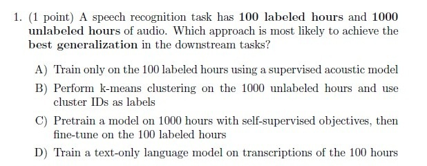

**Figure 1.** Printed Question 1 on audio labeled vs unlabeled hours and best generalization approach.

**Options**

**A.**

Train only on the 100 labeled hours using a supervised acoustic model

*Source option ID:* not supplied.

**B.**

Perform k-means clustering on the 1000 unlabeled hours and use cluster IDs as labels

*Source option ID:* not supplied.

**C.**

Pretrain a model on 1000 hours with self-supervised objectives, then fine-tune on the 100 labeled hours

*Source option ID:* not supplied.

**D.**

Train a text-only language model on transcriptions of the 100 hours

*Source option ID:* not supplied.

**Correct answer:** Answer not verifiable from the source PDF

**Source evidence:** [{"page": 2, "bbox": [22.87, 16.75, 454.12, 196.75], "type": "absent", "detail": "No official academic answer key is provided in the source PDF. Portal Question 189 provides only submission-status choices ('I have written answers on the answer sheets', 'Not applicable')."}]

### Question 2

**Portal container number:** `189`

**Portal container ID:** `6406531416774`

**Type:** MCQ · **Marks:** 1
**PDF pages:** 2

2. (1 point) Imagine that you design a closed-loop system where speech is synthesized from text (TTS) and then transcribed back into text (ASR). Which evaluation measure best captures the accuracy of the text reconstruction at the end of this loop?

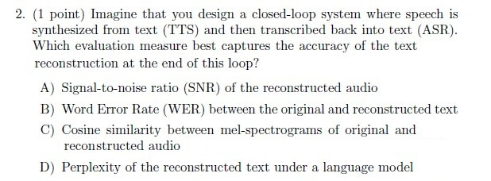

**Figure 2.** Printed Question 2 on TTS and ASR closed-loop system evaluation measure.

**Options**

**A.**

Signal-to-noise ratio (SNR) of the reconstructed audio

*Source option ID:* not supplied.

**B.**

Word Error Rate (WER) between the original and reconstructed text

*Source option ID:* not supplied.

**C.**

Cosine similarity between mel-spectrograms of original and reconstructed audio

*Source option ID:* not supplied.

**D.**

Perplexity of the reconstructed text under a language model

*Source option ID:* not supplied.

**Correct answer:** Answer not verifiable from the source PDF

**Source evidence:** [{"page": 2, "bbox": [22.87, 196.75, 454.12, 367.75], "type": "absent", "detail": "No official academic answer key is provided in the source PDF. Portal Question 189 provides only submission-status choices ('I have written answers on the answer sheets', 'Not applicable')."}]

### Question 3

**Portal container number:** `189`

**Portal container ID:** `6406531416774`

**Type:** MCQ · **Marks:** 1
**PDF pages:** 2

3. (1 point) For an image captioning system, which combination of encoder and decoder is most suitable?

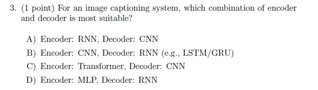

**Figure 3.** Printed Question 3 on encoder-decoder combinations for image captioning.

**Options**

**A.**

Encoder: RNN, Decoder: CNN

*Source option ID:* not supplied.

**B.**

Encoder: CNN, Decoder: RNN (e.g., LSTM/GRU)

*Source option ID:* not supplied.

**C.**

Encoder: Transformer, Decoder: CNN

*Source option ID:* not supplied.

**D.**

Encoder: MLP, Decoder: RNN

*Source option ID:* not supplied.

**Correct answer:** Answer not verifiable from the source PDF

**Source evidence:** [{"page": 2, "bbox": [22.87, 367.75, 454.12, 499.75], "type": "absent", "detail": "No official academic answer key is provided in the source PDF. Portal Question 189 provides only submission-status choices ('I have written answers on the answer sheets', 'Not applicable')."}]

### Question 4

**Portal container number:** `189`

**Portal container ID:** `6406531416774`

**Type:** MCQ · **Marks:** 1
**PDF pages:** 3

4. (1 point) Which system is most likely to fail if the same sentence is spoken by two different speakers with identical accents?

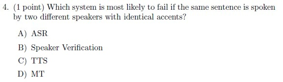

**Figure 4.** Printed Question 4 on system failure with two speakers having identical accents.

**Options**

**A.**

ASR

*Source option ID:* not supplied.

**B.**

Speaker Verification

*Source option ID:* not supplied.

**C.**

TTS

*Source option ID:* not supplied.

**D.**

MT

*Source option ID:* not supplied.

**Correct answer:** Answer not verifiable from the source PDF

**Source evidence:** [{"page": 3, "bbox": [22.87, 16.75, 454.12, 142.75], "type": "absent", "detail": "No official academic answer key is provided in the source PDF. Portal Question 189 provides only submission-status choices ('I have written answers on the answer sheets', 'Not applicable')."}]

### Question 5

**Portal container number:** `189`

**Portal container ID:** `6406531416774`

**Type:** MCQ · **Marks:** 1
**PDF pages:** 3

5. (1 point) Which of the following is shared across different positions in a Transformer's self-attention mechanism?

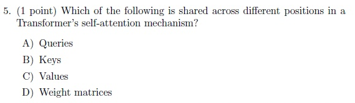

**Figure 5.** Printed Question 5 on components shared across positions in Transformer self-attention.

**Options**

**A.**

Queries

*Source option ID:* not supplied.

**B.**

Keys

*Source option ID:* not supplied.

**C.**

Values

*Source option ID:* not supplied.

**D.**

Weight matrices

*Source option ID:* not supplied.

**Correct answer:** Answer not verifiable from the source PDF

**Source evidence:** [{"page": 3, "bbox": [22.87, 142.75, 454.12, 268.75], "type": "absent", "detail": "No official academic answer key is provided in the source PDF. Portal Question 189 provides only submission-status choices ('I have written answers on the answer sheets', 'Not applicable')."}]

### Question 6

**Portal container number:** `189`

**Portal container ID:** `6406531416774`

**Type:** MCQ · **Marks:** 1
**PDF pages:** 3

6. (1 point) Which mechanism in Transformers is responsible for transferring source sequence information into target generation?

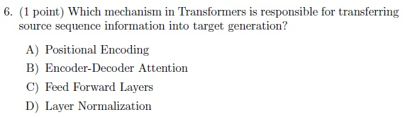

**Figure 6.** Printed Question 6 on mechanism responsible for transferring source sequence information into target generation.

**Options**

**A.**

Positional Encoding

*Source option ID:* not supplied.

**B.**

Encoder-Decoder Attention

*Source option ID:* not supplied.

**C.**

Feed Forward Layers

*Source option ID:* not supplied.

**D.**

Layer Normalization

*Source option ID:* not supplied.

**Correct answer:** Answer not verifiable from the source PDF

**Source evidence:** [{"page": 3, "bbox": [22.87, 268.75, 454.12, 393.25], "type": "absent", "detail": "No official academic answer key is provided in the source PDF. Portal Question 189 provides only submission-status choices ('I have written answers on the answer sheets', 'Not applicable')."}]

### Question 7

**Portal container number:** `189`

**Portal container ID:** `6406531416774`

**Type:** MCQ · **Marks:** 1
**PDF pages:** 3

7. (1 point) In seq2seq with RNNs, attention was introduced mainly because:

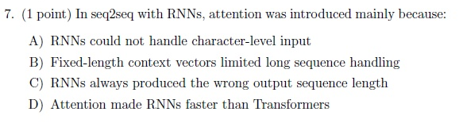

**Figure 7.** Printed Question 7 on reason for introducing attention in RNN seq2seq models.

**Options**

**A.**

RNNs could not handle character-level input

*Source option ID:* not supplied.

**B.**

Fixed-length context vectors limited long sequence handling

*Source option ID:* not supplied.

**C.**

RNNs always produced the wrong output sequence length

*Source option ID:* not supplied.

**D.**

Attention made RNNs faster than Transformers

*Source option ID:* not supplied.

**Correct answer:** Answer not verifiable from the source PDF

**Source evidence:** [{"page": 3, "bbox": [22.87, 393.25, 454.12, 513.25], "type": "absent", "detail": "No official academic answer key is provided in the source PDF. Portal Question 189 provides only submission-status choices ('I have written answers on the answer sheets', 'Not applicable')."}]

### Question 8

**Portal container number:** `189`

**Portal container ID:** `6406531416774`

**Type:** MCQ · **Marks:** 2
**PDF pages:** 4

8. (2 point) You trained Word2Vec on a legal corpus, but the new word "cybercrime" appears rarely. Consider the following statements:

(a) Word2Vec will directly generate a reliable embedding for "cybercrime".

(b) Subword-based models (e.g., FastText) can form embeddings from character n-grams like "cyber" and "crime".

(c) Contextual models such as BERT can still assign meaningful embeddings to "cybercrime" by leveraging surrounding context and subword tokenization.

Which of the above statements are correct?

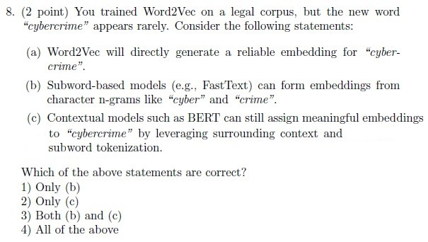

**Figure 8.** Printed Question 8 on Word2Vec, FastText, and BERT embeddings for rare legal corpus word cybercrime.

**Options**

**1.**

Only (b)

*Source option ID:* not supplied.

**2.**

Only (c)

*Source option ID:* not supplied.

**3.**

Both (b) and (c)

*Source option ID:* not supplied.

**4.**

All of the above

*Source option ID:* not supplied.

**Correct answer:** Answer not verifiable from the source PDF

**Source evidence:** [{"page": 4, "bbox": [22.87, 16.75, 454.12, 265.85], "type": "absent", "detail": "No official academic answer key is provided in the source PDF. Portal Question 189 provides only submission-status choices ('I have written answers on the answer sheets', 'Not applicable')."}]

### Question 9

**Portal container number:** `189`

**Portal container ID:** `6406531416774`

**Type:** Subjective · **Marks:** 3
**PDF pages:** 4

9. (3 points) CNN Kernels

You have a 7 x 7 input image and apply two successive convolutions with 3 x 3 kernels, stride = 2, padding = 1. What is the final output size?

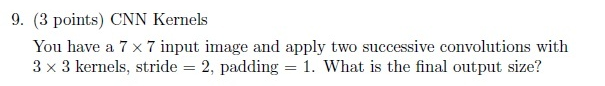

**Figure 9.** Printed Question 9 on CNN kernel convolutions, stride, padding, and output size.

**Correct answer:** Answer not verifiable from the source PDF

**Source evidence:** [{"page": 4, "bbox": [22.87, 265.85, 454.12, 328.5], "type": "absent", "detail": "No official academic answer key is provided in the source PDF. Portal Question 189 provides only submission-status choices ('I have written answers on the answer sheets', 'Not applicable')."}]

### Question 10

**Portal container number:** `189`

**Portal container ID:** `6406531416774`

**Type:** Subjective · **Marks:** 3
**PDF pages:** 4

10. (3 points) BERT applies the Masked Language Modeling (MLM) strategy by randomly masking 15% of tokens in a sequence. Consider a sentence of length 20 tokens. Answer the following:

A) Calculate the expected number of tokens selected for masking. (1 point)

B) Among these masked positions: 80% are replaced by [MASK], 10% by a random token, and 10% are left unchanged. Derive the expected counts for each case (round suitably). (1 point)

C) Why does BERT deliberately keep some tokens unchanged during MLM training, instead of masking all? (1 point)

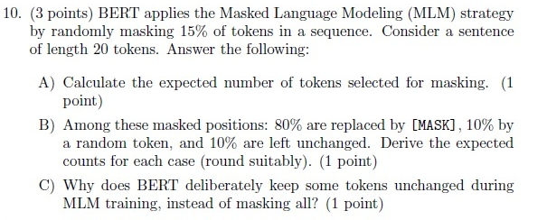

**Figure 10.** Printed Question 10 on BERT Masked Language Modeling masking rate and token distribution.

**Correct answer:** Answer not verifiable from the source PDF

**Source evidence:** [{"page": 4, "bbox": [22.87, 328.5, 454.12, 506.22], "type": "absent", "detail": "No official academic answer key is provided in the source PDF. Portal Question 189 provides only submission-status choices ('I have written answers on the answer sheets', 'Not applicable')."}]

### Question 11

**Portal container number:** `189`

**Portal container ID:** `6406531416774`

**Type:** Subjective · **Marks:** 5
**PDF pages:** 4

11. (5 points) You are designing a CNN for medical imaging. Compare the effects of increasing the kernel size from 3 x 3 to 7 x 7.

(a) Derive an effective receptive field after 3 layers of 3 x 3 vs 1 layer of 7 x 7. (2 marks)

(b) Which captures more local context vs global context? (1 mark)

(c) Why might stacking smaller kernels be preferred despite same receptive field? (2 marks)

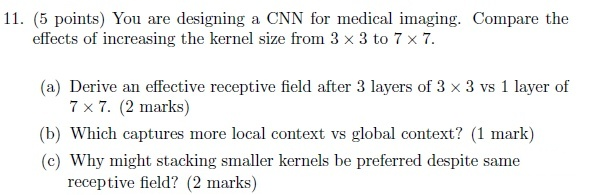

**Figure 11.** Printed Question 11 on CNN receptive field comparing 3 layers of 3x3 vs 1 layer of 7x7.

**Correct answer:** Answer not verifiable from the source PDF

**Source evidence:** [{"page": 4, "bbox": [22.87, 506.22, 454.12, 648.25], "type": "absent", "detail": "No official academic answer key is provided in the source PDF. Portal Question 189 provides only submission-status choices ('I have written answers on the answer sheets', 'Not applicable')."}]

### Question 12

**Portal container number:** `189`

**Portal container ID:** `6406531416774`

**Type:** Subjective · **Marks:** 5
**PDF pages:** 5

12. (5 points) Transformers

(a) (2 points) Explain the self-attention mechanism in Transformers. Specifically describe the role of the Query (Q), Key (K), and Value (V) matrices in computing attention weights.

(b) (3 points) Given:
$$Q = \begin{bmatrix} 2 & 1 \end{bmatrix}, \quad K = \begin{bmatrix} 1 & 0 \\ 2 & 0 \\ 0 & 2 \end{bmatrix}, \quad V = \begin{bmatrix} 1 & 0 \\ 0 & 1 \\ 1 & 1 \end{bmatrix}$$

(a) Compute raw attention scores $QK^T$. (1 point)

(b) Apply softmax. (1 point)

(c) Compute output = weights $\cdot$ V and Interpret which key the query attends most. (1 point)

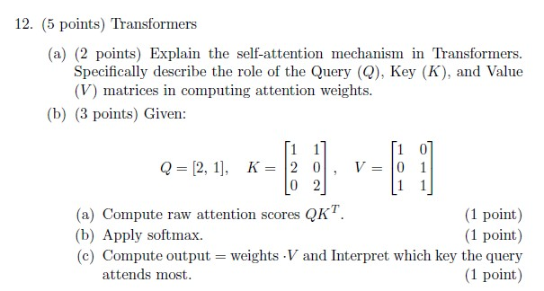

**Figure 12.** Printed Question 12 on Transformer self-attention Query, Key, Value computation with numerical matrices.

**Correct answer:** Answer not verifiable from the source PDF

**Source evidence:** [{"page": 5, "bbox": [22.87, 16.75, 454.12, 259.75], "type": "absent", "detail": "No official academic answer key is provided in the source PDF. Portal Question 189 provides only submission-status choices ('I have written answers on the answer sheets', 'Not applicable')."}]

## Answer key

| Source question | Source identity | Correct answer | PDF pages |
| :--- | :--- | :--- | :--- |
| 1 | portal 6406531416774 | Answer not verifiable from the source PDF | 2 |
| 2 | portal 6406531416774 | Answer not verifiable from the source PDF | 2 |
| 3 | portal 6406531416774 | Answer not verifiable from the source PDF | 2 |
| 4 | portal 6406531416774 | Answer not verifiable from the source PDF | 3 |
| 5 | portal 6406531416774 | Answer not verifiable from the source PDF | 3 |
| 6 | portal 6406531416774 | Answer not verifiable from the source PDF | 3 |
| 7 | portal 6406531416774 | Answer not verifiable from the source PDF | 3 |
| 8 | portal 6406531416774 | Answer not verifiable from the source PDF | 4 |
| 9 | portal 6406531416774 | Answer not verifiable from the source PDF | 4 |
| 10 | portal 6406531416774 | Answer not verifiable from the source PDF | 4 |
| 11 | portal 6406531416774 | Answer not verifiable from the source PDF | 4 |
| 12 | portal 6406531416774 | Answer not verifiable from the source PDF | 5 |

## Extraction notes

**Status:** verified-source-limitation
**Count reconciliation:** Section 8 'Degree Level : Speech Technology (Pen and Paper Exam)' declares 25 marks across 2 portal questions: Question 188 (0 marks) and Question 189 (25 marks). Question 188 is an administrative subject confirmation and is excluded semantically. Question 189 serves as a submission container for the offline pen-and-paper exam. The enclosed exam contains 12 printed academic questions: Questions 1-7 (MCQs, 1 mark each = 7 marks), Question 8 (MCQ, 2 marks), Question 9 (Subjective, 3 marks), Question 10 (Subjective, 3 marks), Question 11 (Subjective, 5 marks), and Question 12 (Subjective, 5 marks). Total printed marks = 1+1+1+1+1+1+1 + 2 + 3 + 3 + 5 + 5 = 25 marks, which reconciles with the declared 25 marks for Question 189 and Section 8. Subsequent Section 9 ('SPG', Section Id: 64065399595, starting on page 5 at y=348.8) is excluded as an out-of-scope subject.

- All 12 printed questions have been transcribed verbatim with complete mathematical expressions, matrix values, and formatting.
- High-resolution 1:1 original crops of all 12 printed questions are preserved under assets/ with complete inspection metadata.
- Questions 1-7 are single-mark MCQs (1 point each). Question 8 is a 2-point MCQ. Questions 9 and 10 are 3-point questions. Questions 11 and 12 are 5-point questions.
- Portal Question 188 is excluded as an administrative subject confirmation.
- Section 9 (SPG) starting on page 5 is excluded as out-of-scope.
- The Speech Technology examination was administered as an offline pen-and-paper test wrapped within an online portal container (Question 189). The online portal offered only administrative submission-status choices ('I have written answers on the answer sheets' and 'Not applicable'). No official academic answer key was provided in the source PDF.
- All 12 academic questions were embedded as scanned page images across pages 2 to 5 within portal Question 189.
- Official academic answer keys are absent from the source PDF for all 12 printed questions. In accordance with extraction contract instructions, all question answers are faithfully recorded as 'Answer not verifiable from the source PDF' with kind 'absent' and complete source evidence.

**Excluded source entries:**

- {"classification": "subject-confirmation", "page": 1, "bbox": [20.62, 400.2, 572.78, 648.9], "reason": "Administrative subject confirmation asking if candidate is writing Degree Level : Speech Technology (Pen and Paper Exam) and cross-checking hall ticket", "identity": "6406531416773"}
- {"classification": "out-of-scope-subject", "page": 5, "bbox": [20.62, 348.8, 459.6, 816.9], "reason": "Subsequent section SPG (Section Number: 9, Section Id: 64065399595, questions 190 onwards)", "identity": "section_64065399595"}
