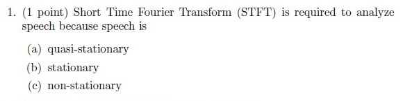
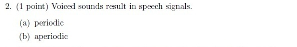
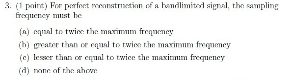
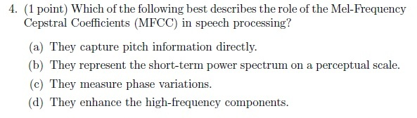
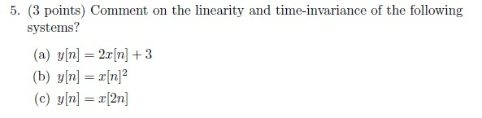
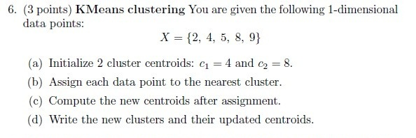
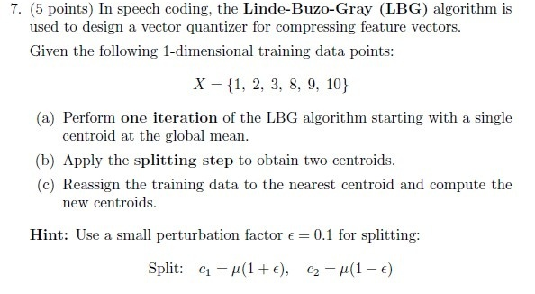
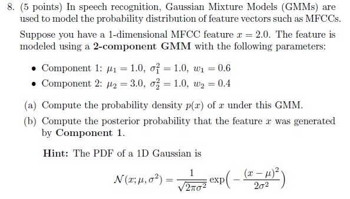
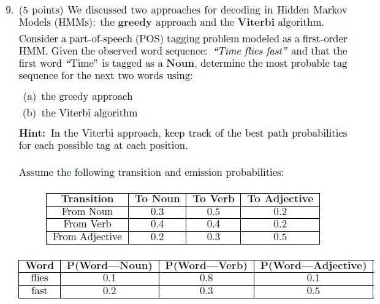

# Speech Technology — ee4001_2025T2_Q1_NA

**Source:** `ee4001_2025T2_Q1_NA.pdf` · **Academic questions:** 9 · **Separately counted children:** 0
**Provenance:** `Speech_Technology/ee4001_2025T2_Q1_NA.pdf` · SHA-256 `cda794c2b18fd9e3ebec4f27cc9a82caaa30acb21241686cc585cff1cdeac8e5`

**Scope:** Degree Level : Speech Technology pen-and-paper examination section (Section 9: Degree Level : Speech Technology (Pen and Paper Exam), Section Id: 64065391717, Section Marks: 25) on pages 1 to 5. Sub-Section 1 contains administrative subject confirmation Question 168 (0 marks), excluded semantically. Sub-Section 2 contains offline portal container Question 169 (Question Id: 6406531279879, 25 marks) enclosing 9 printed academic questions (Questions 1 to 9) from a scanned offline test paper across pages 3 to 5. Subsequent Section 10 (Maths2, Section Id: 64065391718, starting on page 5 at y=497.1) and all following sections up to page 28 are excluded as out-of-scope subjects.

## Questions

### Question 1

**Portal container number:** `169`

**Portal container ID:** `6406531279879`

**Type:** MCQ · **Marks:** 1
**PDF pages:** 3

Short Time Fourier Transform (STFT) is required to analyze speech because speech is

**Figure 1.** Printed Question 1 from scanned offline paper, covering why Short Time Fourier Transform (STFT) is required to analyze speech.

**Options**

**A.**

quasi-stationary

*Source option ID:* not supplied.

**B.**

stationary

*Source option ID:* not supplied.

**C.**

non-stationary

*Source option ID:* not supplied.

**Correct answer:** Answer not verifiable from the source PDF

**Source evidence:** [{"page": 5, "bbox": [22.87, 415.3, 454.12, 452.5], "type": "absent", "detail": "Offline examination paper; portal container displays only submission status confirmation option (\"I have written answers on the answer sheets\"), no official academic answer key is provided in the source PDF."}]

### Question 2

**Portal container number:** `169`

**Portal container ID:** `6406531279879`

**Type:** MCQ · **Marks:** 1
**PDF pages:** 3

Voiced sounds result in speech signals.

**Figure 2.** Printed Question 2 from scanned offline paper, covering whether voiced sounds result in periodic or aperiodic speech signals.

**Options**

**A.**

periodic

*Source option ID:* not supplied.

**B.**

aperiodic

*Source option ID:* not supplied.

**Correct answer:** Answer not verifiable from the source PDF

**Source evidence:** [{"page": 5, "bbox": [22.87, 415.3, 454.12, 452.5], "type": "absent", "detail": "Offline examination paper; portal container displays only submission status confirmation option (\"I have written answers on the answer sheets\"), no official academic answer key is provided in the source PDF."}]

### Question 3

**Portal container number:** `169`

**Portal container ID:** `6406531279879`

**Type:** MCQ · **Marks:** 1
**PDF pages:** 3

For perfect reconstruction of a bandlimited signal, the sampling frequency must be

**Figure 3.** Printed Question 3 from scanned offline paper, covering sampling frequency condition for perfect reconstruction of a bandlimited signal.

**Options**

**A.**

equal to twice the maximum frequency

*Source option ID:* not supplied.

**B.**

greater than or equal to twice the maximum frequency

*Source option ID:* not supplied.

**C.**

lesser than or equal to twice the maximum frequency

*Source option ID:* not supplied.

**D.**

none of the above

*Source option ID:* not supplied.

**Correct answer:** Answer not verifiable from the source PDF

**Source evidence:** [{"page": 5, "bbox": [22.87, 415.3, 454.12, 452.5], "type": "absent", "detail": "Offline examination paper; portal container displays only submission status confirmation option (\"I have written answers on the answer sheets\"), no official academic answer key is provided in the source PDF."}]

### Question 4

**Portal container number:** `169`

**Portal container ID:** `6406531279879`

**Type:** MCQ · **Marks:** 1
**PDF pages:** 3

Which of the following best describes the role of the Mel-Frequency Cepstral Coefficients (MFCC) in speech processing?

**Figure 4.** Printed Question 4 from scanned offline paper, covering the role of Mel-Frequency Cepstral Coefficients (MFCC) in speech processing.

**Options**

**A.**

They capture pitch information directly.

*Source option ID:* not supplied.

**B.**

They represent the short-term power spectrum on a perceptual scale.

*Source option ID:* not supplied.

**C.**

They measure phase variations.

*Source option ID:* not supplied.

**D.**

They enhance the high-frequency components.

*Source option ID:* not supplied.

**Correct answer:** Answer not verifiable from the source PDF

**Source evidence:** [{"page": 5, "bbox": [22.87, 415.3, 454.12, 452.5], "type": "absent", "detail": "Offline examination paper; portal container displays only submission status confirmation option (\"I have written answers on the answer sheets\"), no official academic answer key is provided in the source PDF."}]

### Question 5

**Portal container number:** `169`

**Portal container ID:** `6406531279879`

**Type:** Subjective · **Marks:** 3
**PDF pages:** 3

Comment on the linearity and time-invariance of the following systems?

(a) $y[n] = 2x[n] + 3$

(b) $y[n] = x[n]^2$

(c) $y[n] = x[2n]$

**Figure 5.** Printed Question 5 from scanned offline paper, covering linearity and time-invariance of three discrete-time systems.

**Correct answer:** Answer not verifiable from the source PDF

**Source evidence:** [{"page": 5, "bbox": [22.87, 415.3, 454.12, 452.5], "type": "absent", "detail": "Offline examination paper; portal container displays only submission status confirmation option (\"I have written answers on the answer sheets\"), no official academic answer key is provided in the source PDF."}]

### Question 6

**Portal container number:** `169`

**Portal container ID:** `6406531279879`

**Type:** Subjective · **Marks:** 3
**PDF pages:** 4

KMeans clustering You are given the following 1-dimensional data points:

$$X = \{2, 4, 5, 8, 9\}$$

(a) Initialize 2 cluster centroids: $c_1 = 4$ and $c_2 = 8$.

(b) Assign each data point to the nearest cluster.

(c) Compute the new centroids after assignment.

(d) Write the new clusters and their updated centroids.

**Figure 6.** Printed Question 6 from scanned offline paper, covering KMeans clustering with 1-dimensional data points and two centroids.

**Correct answer:** Answer not verifiable from the source PDF

**Source evidence:** [{"page": 5, "bbox": [22.87, 415.3, 454.12, 452.5], "type": "absent", "detail": "Offline examination paper; portal container displays only submission status confirmation option (\"I have written answers on the answer sheets\"), no official academic answer key is provided in the source PDF."}]

### Question 7

**Portal container number:** `169`

**Portal container ID:** `6406531279879`

**Type:** Subjective · **Marks:** 5
**PDF pages:** 4

In speech coding, the Linde-Buzo-Gray (LBG) algorithm is used to design a vector quantizer for compressing feature vectors.

Given the following 1-dimensional training data points:

$$X = \{1, 2, 3, 8, 9, 10\}$$

(a) Perform one iteration of the LBG algorithm starting with a single centroid at the global mean.

(b) Apply the splitting step to obtain two centroids.

(c) Reassign the training data to the nearest centroid and compute the new centroids.

*Hint:* Use a small perturbation factor $\epsilon = 0.1$ for splitting:
$$\text{Split: } c_1 = \mu(1 + \epsilon), \quad c_2 = \mu(1 - \epsilon)$$

**Figure 7.** Printed Question 7 from scanned offline paper, covering Linde-Buzo-Gray (LBG) vector quantization algorithm iteration and splitting.

**Correct answer:** Answer not verifiable from the source PDF

**Source evidence:** [{"page": 5, "bbox": [22.87, 415.3, 454.12, 452.5], "type": "absent", "detail": "Offline examination paper; portal container displays only submission status confirmation option (\"I have written answers on the answer sheets\"), no official academic answer key is provided in the source PDF."}]

### Question 8

**Portal container number:** `169`

**Portal container ID:** `6406531279879`

**Type:** Subjective · **Marks:** 5
**PDF pages:** 4

In speech recognition, Gaussian Mixture Models (GMMs) are used to model the probability distribution of feature vectors such as MFCCs.

Suppose you have a 1-dimensional MFCC feature $x = 2.0$. The feature is modeled using a 2-component GMM with the following parameters:

- Component 1: $\mu_1 = 1.0, \sigma_1^2 = 1.0, w_1 = 0.6$
- Component 2: $\mu_2 = 3.0, \sigma_2^2 = 1.0, w_2 = 0.4$

(a) Compute the probability density $p(x)$ of $x$ under this GMM.

(b) Compute the posterior probability that the feature $x$ was generated by Component 1.

*Hint:* The PDF of a 1D Gaussian is
$$\mathcal{N}(x; \mu, \sigma^2) = \frac{1}{\sqrt{2\pi\sigma^2}} \exp\left( - \frac{(x - \mu)^2}{2\sigma^2} \right)$$

**Figure 8.** Printed Question 8 from scanned offline paper, covering 2-component Gaussian Mixture Model (GMM) probability density and posterior calculation.

**Correct answer:** Answer not verifiable from the source PDF

**Source evidence:** [{"page": 5, "bbox": [22.87, 415.3, 454.12, 452.5], "type": "absent", "detail": "Offline examination paper; portal container displays only submission status confirmation option (\"I have written answers on the answer sheets\"), no official academic answer key is provided in the source PDF."}]

### Question 9

**Portal container number:** `169`

**Portal container ID:** `6406531279879`

**Type:** Subjective · **Marks:** 5
**PDF pages:** 5

We discussed two approaches for decoding in Hidden Markov Models (HMMs): the greedy approach and the Viterbi algorithm.

Consider a part-of-speech (POS) tagging problem modeled as a first-order HMM. Given the observed word sequence: “Time flies fast” and that the first word “Time” is tagged as a Noun, determine the most probable tag sequence for the next two words using:

(a) the greedy approach

(b) the Viterbi algorithm

*Hint:* In the Viterbi approach, keep track of the best path probabilities for each possible tag at each position.

Assume the following transition and emission probabilities:

**Transition Probabilities:**

| Transition | To Noun | To Verb | To Adjective |
| :--- | :---: | :---: | :---: |
| **From Noun** | 0.3 | 0.5 | 0.2 |
| **From Verb** | 0.4 | 0.4 | 0.2 |
| **From Adjective** | 0.2 | 0.3 | 0.5 |

**Emission Probabilities:**

| Word | $P(\text{Word} \mid \text{Noun})$ | $P(\text{Word} \mid \text{Verb})$ | $P(\text{Word} \mid \text{Adjective})$ |
| :--- | :---: | :---: | :---: |
| **flies** | 0.1 | 0.8 | 0.1 |
| **fast** | 0.2 | 0.3 | 0.5 |

**Figure 9.** Printed Question 9 from scanned offline paper, covering greedy approach and Viterbi algorithm decoding for POS tagging in first-order HMM with transition and emission tables.

**Correct answer:** Answer not verifiable from the source PDF

**Source evidence:** [{"page": 5, "bbox": [22.87, 415.3, 454.12, 452.5], "type": "absent", "detail": "Offline examination paper; portal container displays only submission status confirmation option (\"I have written answers on the answer sheets\"), no official academic answer key is provided in the source PDF."}]

## Answer key

| Source question | Source identity | Correct answer | PDF pages |
| :--- | :--- | :--- | :--- |
| 1 | portal 6406531279879 | Answer not verifiable from the source PDF | 3 |
| 2 | portal 6406531279879 | Answer not verifiable from the source PDF | 3 |
| 3 | portal 6406531279879 | Answer not verifiable from the source PDF | 3 |
| 4 | portal 6406531279879 | Answer not verifiable from the source PDF | 3 |
| 5 | portal 6406531279879 | Answer not verifiable from the source PDF | 3 |
| 6 | portal 6406531279879 | Answer not verifiable from the source PDF | 4 |
| 7 | portal 6406531279879 | Answer not verifiable from the source PDF | 4 |
| 8 | portal 6406531279879 | Answer not verifiable from the source PDF | 4 |
| 9 | portal 6406531279879 | Answer not verifiable from the source PDF | 5 |

## Extraction notes

**Status:** verified-source-limitation
**Count reconciliation:** Section 9 declares 2 online portal questions and 25 section marks. Portal Question 168 (0 marks) is an administrative subject confirmation and is excluded. Portal Question 169 (25 marks) is an offline portal container enclosing 9 printed academic questions (Questions 1 to 9) across pages 3-5 totaling exactly 25 marks (4 1-mark questions, 2 3-mark questions, and 3 5-mark questions). 4*1 + 2*3 + 3*5 = 4 + 6 + 15 = 25 marks, perfectly reconciling the declared 25 section marks across 9 printed academic questions.

- All 9 printed questions have been transcribed verbatim with complete mathematical expressions, formulas, and formatting.
- High-resolution 1:1 original crops of all 9 printed questions are preserved under assets/ with complete inspection metadata.
- Questions 1-4 are single-mark MCQs (1 point each). Questions 5 and 6 are 3-point questions. Questions 7, 8, and 9 are 5-point questions. Total: 4*1 + 2*3 + 3*5 = 25 marks.
- Portal Question 168 is excluded as an administrative subject confirmation.
- Subsequent sections (Maths2 starting on page 5 at y=497.1, Stats2 on page 16, and Section 12 on page 28) are excluded as out-of-scope subjects.
- The Speech Technology examination was administered as an offline pen-and-paper test wrapped within an online portal container (Question 169). The online portal offered only administrative submission-status choices ('I have written answers on the answer sheets' and 'Not applicable'). No official academic answer key was provided in the source PDF.
- All 9 academic questions were embedded as scanned page images across pages 3 to 5 within portal Question 169.
- Official academic answer keys are absent from the source PDF for all 9 printed questions. In accordance with extraction contract instructions, all question answers are faithfully recorded as 'Answer not verifiable from the source PDF' with kind 'absent' and complete source evidence.

**Excluded source entries:**

- {"classification": "subject-confirmation", "page": 1, "bbox": [20.62, 400.2, 572.78, 648.9], "reason": "Administrative subject confirmation asking if candidate is writing Degree Level : Speech Technology (Pen and Paper Exam) and cross-checking hall ticket", "identity": "6406531279878"}
- {"classification": "out-of-scope-subject", "page": 5, "bbox": [20.62, 497.1, 459.6, 816.9], "reason": "Subsequent section Maths2 (Section Number: 10, Section Id: 64065391718, questions 170 to 186) and all following sections up to page 28", "identity": "section_64065391718"}
