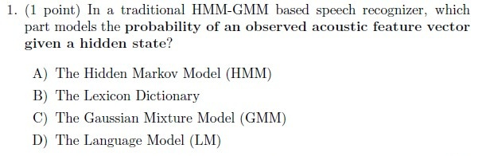
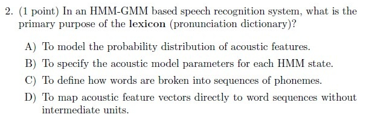
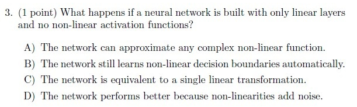
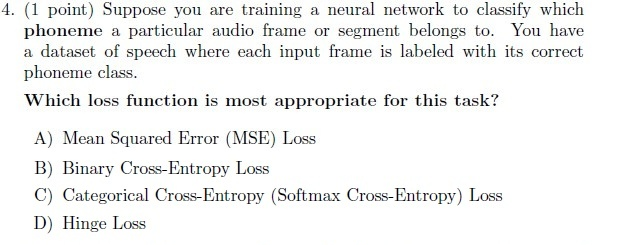
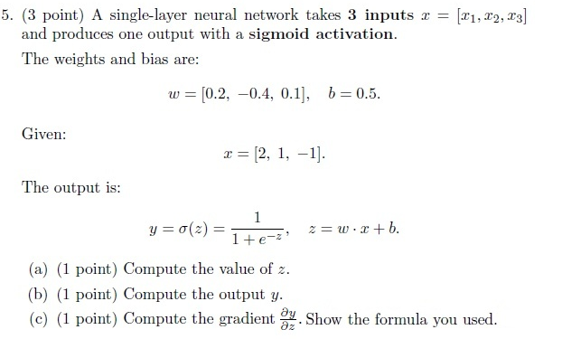
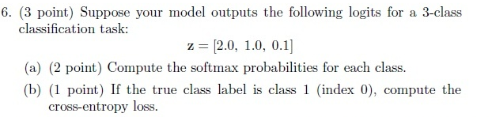
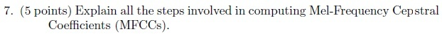
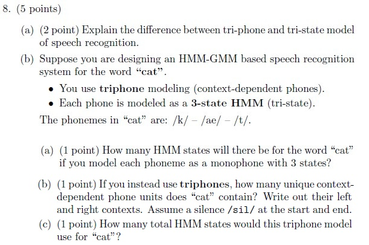
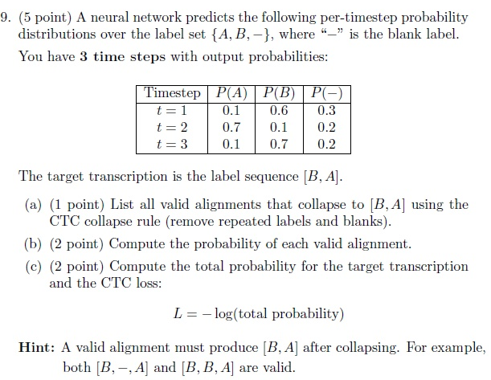

# Speech Technology — ee4001_2025T2_Q2_NA

**Source:** `ee4001_2025T2_Q2_NA.pdf` · **Academic questions:** 9 · **Separately counted children:** 0
**Provenance:** `Speech_Technology/ee4001_2025T2_Q2_NA.pdf` · SHA-256 `3cbe5513c27c2f64b1cf16b83059056109eeab00a8f9cd27648d5f3dd6c5637c`

**Scope:** Speech Technology degree-level pen and paper examination (Pen and Paper Exam). Sub-Section 1 contains administrative subject confirmation Question 312 (0 marks), excluded semantically. Sub-Section 2 contains portal container Question 313 (Question Id: 6406531326620, 25 marks) which encloses an offline pen-and-paper examination comprising 9 printed academic questions (Questions 1 to 9) spanning pages 2 to 4. Zero out-of-scope subjects.

## Questions

### Question 1

**Portal container number:** `313`

**Portal container ID:** `6406531326620`

**Type:** MCQ · **Marks:** 1
**PDF pages:** 2

1. (1 point) In a traditional HMM-GMM based speech recognizer, which part models the probability of an observed acoustic feature vector given a hidden state?

**Figure 1.** Printed question 1 from scanned offline paper, covering HMM-GMM acoustic feature vector probability modeling.

**Options**

**A.**

The Hidden Markov Model (HMM)

*Source option ID:* not supplied.

**B.**

The Lexicon Dictionary

*Source option ID:* not supplied.

**C.**

The Gaussian Mixture Model (GMM)

*Source option ID:* not supplied.

**D.**

The Language Model (LM)

*Source option ID:* not supplied.

**Correct answer:** Answer not verifiable from the source PDF

**Source evidence:** [{"page": 2, "bbox": [22.87, 16.75, 454.12, 163.75], "type": "absent", "detail": "No official academic answer key is provided in the source PDF. Portal Question 313 provides only submission-status choices ('I have written answers on the answer sheets', 'Not applicable')."}]

### Question 2

**Portal container number:** `313`

**Portal container ID:** `6406531326620`

**Type:** MCQ · **Marks:** 1
**PDF pages:** 2

2. (1 point) In an HMM-GMM based speech recognition system, what is the primary purpose of the lexicon (pronunciation dictionary)?

**Figure 2.** Printed question 2 from scanned offline paper, covering the purpose of the lexicon in HMM-GMM speech recognition.

**Options**

**A.**

To model the probability distribution of acoustic features.

*Source option ID:* not supplied.

**B.**

To specify the acoustic model parameters for each HMM state.

*Source option ID:* not supplied.

**C.**

To define how words are broken into sequences of phonemes.

*Source option ID:* not supplied.

**D.**

To map acoustic feature vectors directly to word sequences without intermediate units.

*Source option ID:* not supplied.

**Correct answer:** Answer not verifiable from the source PDF

**Source evidence:** [{"page": 2, "bbox": [22.87, 163.75, 454.12, 313.0], "type": "absent", "detail": "No official academic answer key is provided in the source PDF. Portal Question 313 provides only submission-status choices ('I have written answers on the answer sheets', 'Not applicable')."}]

### Question 3

**Portal container number:** `313`

**Portal container ID:** `6406531326620`

**Type:** MCQ · **Marks:** 1
**PDF pages:** 2

3. (1 point) What happens if a neural network is built with only linear layers and no non-linear activation functions?

**Figure 3.** Printed question 3 from scanned offline paper, covering linear layers without non-linear activation functions.

**Options**

**A.**

The network can approximate any complex non-linear function.

*Source option ID:* not supplied.

**B.**

The network still learns non-linear decision boundaries automatically.

*Source option ID:* not supplied.

**C.**

The network is equivalent to a single linear transformation.

*Source option ID:* not supplied.

**D.**

The network performs better because non-linearities add noise.

*Source option ID:* not supplied.

**Correct answer:** Answer not verifiable from the source PDF

**Source evidence:** [{"page": 2, "bbox": [22.87, 313.0, 454.12, 450.25], "type": "absent", "detail": "No official academic answer key is provided in the source PDF. Portal Question 313 provides only submission-status choices ('I have written answers on the answer sheets', 'Not applicable')."}]

### Question 4

**Portal container number:** `313`

**Portal container ID:** `6406531326620`

**Type:** MCQ · **Marks:** 1
**PDF pages:** 3

4. (1 point) Suppose you are training a neural network to classify which phoneme a particular audio frame or segment belongs to. You have a dataset of speech where each input frame is labeled with its correct phoneme class.

Which loss function is most appropriate for this task?

**Figure 4.** Printed question 4 from scanned offline paper, covering loss function selection for phoneme frame classification.

**Options**

**A.**

Mean Squared Error (MSE) Loss

*Source option ID:* not supplied.

**B.**

Binary Cross-Entropy Loss

*Source option ID:* not supplied.

**C.**

Categorical Cross-Entropy (Softmax Cross-Entropy) Loss

*Source option ID:* not supplied.

**D.**

Hinge Loss

*Source option ID:* not supplied.

**Correct answer:** Answer not verifiable from the source PDF

**Source evidence:** [{"page": 3, "bbox": [22.87, 16.75, 454.12, 200.5], "type": "absent", "detail": "No official academic answer key is provided in the source PDF. Portal Question 313 provides only submission-status choices ('I have written answers on the answer sheets', 'Not applicable')."}]

### Question 5

**Portal container number:** `313`

**Portal container ID:** `6406531326620`

**Type:** Subjective · **Marks:** 3
**PDF pages:** 3

5. (3 point) A single-layer neural network takes 3 inputs $x = [x_1, x_2, x_3]$ and produces one output with a sigmoid activation.

The weights and bias are:
$$w = [0.2, -0.4, 0.1], \quad b = 0.5.$$

Given:
$$x = [2, 1, -1].$$

The output is:
$$y = \sigma(z) = \frac{1}{1 + e^{-z}}, \quad \text{where } z = w \cdot x + b.$$

(a) (1 point) Compute the value of $z$.
(b) (1 point) Compute the output $y$.
(c) (1 point) Compute the gradient $\frac{\partial y}{\partial z}$. Show the formula you used.

**Figure 5.** Printed question 5 from scanned offline paper, covering forward pass and gradient calculation in a single-layer neural network with sigmoid activation.

**Correct answer:** Answer not verifiable from the source PDF

**Source evidence:** [{"page": 3, "bbox": [22.87, 200.5, 454.12, 481.75], "type": "absent", "detail": "No official academic answer key is provided in the source PDF. Portal Question 313 provides only submission-status choices ('I have written answers on the answer sheets', 'Not applicable')."}]

### Question 6

**Portal container number:** `313`

**Portal container ID:** `6406531326620`

**Type:** Subjective · **Marks:** 3
**PDF pages:** 3

6. (3 point) Suppose your model outputs the following logits for a 3-class classification task:
$$z = [2.0, 1.0, 0.1]$$

(a) (2 point) Compute the softmax probabilities for each class.

(b) (1 point) If the true class label is class 1 (index 0), compute the cross-entropy loss.

**Figure 6.** Printed question 6 from scanned offline paper, covering softmax probabilities and cross-entropy loss computation.

**Correct answer:** Answer not verifiable from the source PDF

**Source evidence:** [{"page": 3, "bbox": [22.87, 481.75, 454.12, 592.75], "type": "absent", "detail": "No official academic answer key is provided in the source PDF. Portal Question 313 provides only submission-status choices ('I have written answers on the answer sheets', 'Not applicable')."}]

### Question 7

**Portal container number:** `313`

**Portal container ID:** `6406531326620`

**Type:** Subjective · **Marks:** 5
**PDF pages:** 3

7. (5 points) Explain all the steps involved in computing Mel-Frequency Cepstral Coefficients (MFCCs).

**Figure 7.** Printed question 7 from scanned offline paper, asking for explanation of steps involved in computing MFCCs.

**Correct answer:** Answer not verifiable from the source PDF

**Source evidence:** [{"page": 3, "bbox": [22.87, 592.75, 454.12, 629.5], "type": "absent", "detail": "No official academic answer key is provided in the source PDF. Portal Question 313 provides only submission-status choices ('I have written answers on the answer sheets', 'Not applicable')."}]

### Question 8

**Portal container number:** `313`

**Portal container ID:** `6406531326620`

**Type:** Subjective · **Marks:** 5
**PDF pages:** 4

8. (5 points)
(a) (2 point) Explain the difference between tri-phone and tri-state model of speech recognition.
(b) Suppose you are designing an HMM-GMM based speech recognition system for the word “cat”.
• You use triphone modeling (context-dependent phones).
• Each phone is modeled as a 3-state HMM (tri-state).

The phonemes in “cat” are: /k/ — /ae/ — /t/.

(a) (1 point) How many HMM states will there be for the word “cat” if you model each phoneme as a monophone with 3 states?

(b) (1 point) If you instead use triphones, how many unique context-dependent phone units does “cat” contain? Write out their left and right contexts. Assume a silence /sil/ at the start and end.

(c) (1 point) How many total HMM states would this triphone model use for “cat”?

**Figure 8.** Printed question 8 from scanned offline paper, covering triphone vs tri-state models and HMM state counting for the word 'cat'.

**Correct answer:** Answer not verifiable from the source PDF

**Source evidence:** [{"page": 4, "bbox": [22.87, 16.75, 454.12, 307.97], "type": "absent", "detail": "No official academic answer key is provided in the source PDF. Portal Question 313 provides only submission-status choices ('I have written answers on the answer sheets', 'Not applicable')."}]

### Question 9

**Portal container number:** `313`

**Portal container ID:** `6406531326620`

**Type:** Subjective · **Marks:** 5
**PDF pages:** 4

9. (5 point) A neural network predicts the following per-timestep probability distributions over the label set {A, B, —}, where “—” is the blank label.

You have 3 time steps with output probabilities:

| Timestep | P(A) | P(B) | P(—) |
| :--- | :--- | :--- | :--- |
| t = 1 | 0.1 | 0.6 | 0.3 |
| t = 2 | 0.7 | 0.1 | 0.2 |
| t = 3 | 0.1 | 0.7 | 0.2 |

The target transcription is the label sequence [B, A].
(a) (1 point) List all valid alignments that collapse to [B, A] using the CTC collapse rule (remove repeated labels and blanks).
(b) (2 point) Compute the probability of each valid alignment.
(c) (2 point) Compute the total probability for the target transcription and the CTC loss:
$$L = -\log(\text{total probability})$$
Hint: A valid alignment must produce [B, A] after collapsing. For example, both [B, —, A] and [B, B, A] are valid.

**Figure 9.** Printed question 9 from scanned offline paper, covering CTC alignments, probabilities, and CTC loss computation.

**Correct answer:** Answer not verifiable from the source PDF

**Source evidence:** [{"page": 4, "bbox": [22.87, 307.97, 454.12, 648.25], "type": "absent", "detail": "No official academic answer key is provided in the source PDF. Portal Question 313 provides only submission-status choices ('I have written answers on the answer sheets', 'Not applicable')."}]

## Answer key

| Source question | Source identity | Correct answer | PDF pages |
| :--- | :--- | :--- | :--- |
| 1 | portal 6406531326620 | Answer not verifiable from the source PDF | 2 |
| 2 | portal 6406531326620 | Answer not verifiable from the source PDF | 2 |
| 3 | portal 6406531326620 | Answer not verifiable from the source PDF | 2 |
| 4 | portal 6406531326620 | Answer not verifiable from the source PDF | 3 |
| 5 | portal 6406531326620 | Answer not verifiable from the source PDF | 3 |
| 6 | portal 6406531326620 | Answer not verifiable from the source PDF | 3 |
| 7 | portal 6406531326620 | Answer not verifiable from the source PDF | 3 |
| 8 | portal 6406531326620 | Answer not verifiable from the source PDF | 4 |
| 9 | portal 6406531326620 | Answer not verifiable from the source PDF | 4 |

## Extraction notes

**Status:** verified-source-limitation
**Count reconciliation:** The PDF contains 2 online portal questions: Question 312 (0 marks) and Question 313 (25 marks). Question 312 is an administrative subject confirmation and is excluded semantically. Question 313 is an offline portal container enclosing a 25-mark pen-and-paper examination. The enclosed examination contains 9 printed academic questions: Questions 1 to 4 (MCQs, 1 point each = 4 marks), Question 5 (Subjective, 3 points), Question 6 (Subjective, 3 points), Question 7 (Subjective, 5 points), Question 8 (Subjective, 5 points), and Question 9 (Subjective, 5 points). Total printed academic marks = 1+1+1+1 + 3 + 3 + 5 + 5 + 5 = 25 marks, which reconciles with the declared 25 marks for portal container Question 313. Zero out-of-scope subjects are present.

- Speech Technology offline examination (Pen and Paper Exam) enclosed within portal container Question 313.
- Question 312 (Question Id: 6406531326619, 0 marks) on page 1 is an administrative subject confirmation and is excluded semantically.
- Question 313 (Question Id: 6406531326620, 25 marks) acts as a portal submission wrapper for 9 printed questions spanning pages 2 to 4.
- All 9 printed questions are faithfully transcribed from high-resolution crops of the embedded scanned pages; original crops are retained as assets.
- The 9 printed questions total exactly 25 marks (4x1 + 2x3 + 3x5 = 25 marks), perfectly reconciling with the declared 25 marks for Question 313.
- No official academic answer key is provided in the source PDF for the offline pen-and-paper examination questions (Questions 1 to 9). Portal Question 313 provides only submission-status choices ('I have written answers on the answer sheets', 'Not applicable'). All academic questions are faithfully recorded with answer kind 'absent' and text exactly 'Answer not verifiable from the source PDF'.

**Excluded source entries:**

- {"classification": "subject-confirmation", "page": 1, "bbox": [22.87, 94.03, 572.78, 342.76], "reason": "Administrative subject confirmation (Question 312, Question Id: 6406531326619, 0 marks) asking candidate to confirm subject 'DEGREE LEVEL : SPEECH TECHNOLOGY (PEN AND PAPER EXAM)' and cross check hall ticket", "identity": "6406531326619"}
