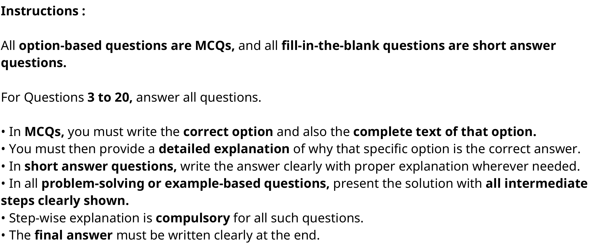
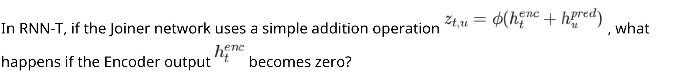

# Speech Technology — ee4001_2026T1_ET_FN

**Source:** `ee4001_2026T1_ET_FN.pdf` · **Academic questions:** 18 · **Separately counted children:** 0
**Provenance:** `Speech_Technology/ee4001_2026T1_ET_FN.pdf` · SHA-256 `3ccef696db85a344b041f9baa951ad7861309a1abd1ac3243c424cc75db1b654`

**Scope:** Section 1: Speech Technology (Section Id: 640653139209) consisting of administrative subject confirmation (Question 1, excluded semantically), shared-context section instructions (Question 2, 0 marks), and 18 academic examination questions (Questions 3 to 20, totaling 25 marks across Sub-Sections 2, 3, and 4).

## Questions

### Shared context 2

**Question ID:** `6406532135838`

**Portal container number:** `2`

**Portal container ID:** `6406532135838`

**Type:** Section instructions · **Marks:** 0
**PDF pages:** 2

Instructions :

All option-based questions are MCQs, and all fill-in-the-blank questions are short answer questions.

For Questions 3 to 20, answer all questions.

• In MCQs, you must write the correct option and also the complete text of that option.
• You must then provide a detailed explanation of why that specific option is the correct answer.
• In short answer questions, write the answer clearly with proper explanation wherever needed.
• In all problem-solving or example-based questions, present the solution with all intermediate steps clearly shown.
• Step-wise explanation is compulsory for all such questions.
• The final answer must be written clearly at the end.

**Figure 1.** General examination instructions specifying answer requirements for MCQs, short answer, and problem-solving questions

### Question 3

**Question ID:** `6406532135839`

**Portal container number:** `3`

**Portal container ID:** `6406532135839`

**Type:** Short Answer · **Marks:** 1
**PDF pages:** 2

**Shared context:** [ctx-instructions](#ctx-instructions)

If a speech signal is sampled at 16,000 samples per second, how many samples are contained in a 10-millisecond frame?

**Correct answer:** Answer not verifiable from the source PDF

**Source evidence:** [{"page": 2, "bbox": [22.87, 744.55, 454.12, 815.0], "type": "absent", "detail": "Offline examination paper; portal container displays only submission status confirmation option (\"I have answered this question in the offline paper\"), no official academic answer key is provided in the source PDF."}]

### Question 4

**Question ID:** `6406532135840`

**Portal container number:** `4`

**Portal container ID:** `6406532135840`

**Type:** MCQ · **Marks:** 1
**PDF pages:** 3

**Shared context:** [ctx-instructions](#ctx-instructions)

How does HuBERT differ from Wav2Vec 2.0 in target generation?

**Options**

**A.**

Uses labeled phonemes

*Source option ID:* not supplied.

**B.**

Uses online quantization only.

*Source option ID:* not supplied.

**C.**

Uses offline clustering (e.g., k-means).

*Source option ID:* not supplied.

**D.**

Does not use masking.

*Source option ID:* not supplied.

**Correct answer:** Answer not verifiable from the source PDF

**Source evidence:** [{"page": 3, "bbox": [22.87, 194.95, 454.12, 275.0], "type": "absent", "detail": "Offline examination paper; portal container displays only submission status confirmation option (\"I have answered this question in the offline paper\"), no official academic answer key is provided in the source PDF."}]

### Question 5

**Question ID:** `6406532135841`

**Portal container number:** `5`

**Portal container ID:** `6406532135841`

**Type:** MCQ · **Marks:** 1
**PDF pages:** 3

**Shared context:** [ctx-instructions](#ctx-instructions)

Why is ”deduplication” a common step when tokenizing speech signals into phonetic tokens?

**Options**

**A.**

To remove noise from the original audio recording.

*Source option ID:* not supplied.

**B.**

To account for the fact that speech units (like vowels) exist for multiple time frames (e.g., 70-100ms) and map to the same cluster ID.

*Source option ID:* not supplied.

**C.**

To increase the vocabulary size of the LLM.

*Source option ID:* not supplied.

**D.**

To convert continuous SSL embeddings into discrete vectors.

*Source option ID:* not supplied.

**Correct answer:** Answer not verifiable from the source PDF

**Source evidence:** [{"page": 3, "bbox": [22.87, 475.75, 454.12, 555.0], "type": "absent", "detail": "Offline examination paper; portal container displays only submission status confirmation option (\"I have answered this question in the offline paper\"), no official academic answer key is provided in the source PDF."}]

### Question 6

**Question ID:** `6406532135842`

**Portal container number:** `6`

**Portal container ID:** `6406532135842`

**Type:** MCQ · **Marks:** 1
**PDF pages:** 3, 4

**Shared context:** [ctx-instructions](#ctx-instructions)

In a neural codec framework using Residual Vector Quantization (RVQ),how many codewords are typically generated per vector?

**Options**

**A.**

Number of RVQ layers

*Source option ID:* not supplied.

**B.**

Size of each codebook

*Source option ID:* not supplied.

**C.**

Number of encoder layers

*Source option ID:* not supplied.

**D.**

Sampling rate of the audio

*Source option ID:* not supplied.

**Correct answer:** Answer not verifiable from the source PDF

**Source evidence:** [{"page": 3, "bbox": [22.87, 756.55, 454.12, 825.0], "type": "absent", "detail": "Offline examination paper; portal container displays only submission status confirmation option (\"I have answered this question in the offline paper\"), no official academic answer key is provided in the source PDF."}]

### Question 7

**Question ID:** `6406532135843`

**Portal container number:** `7`

**Portal container ID:** `6406532135843`

**Type:** MCQ · **Marks:** 1
**PDF pages:** 4

**Shared context:** [ctx-instructions](#ctx-instructions)

You are training a Speech LLM. Your audio codec outputs 4 RVQ codebooks.The frame rate is 50 Hz. If you choose a strictly flattened Autoregressive (AR) decoding strategy (predicting layer 1, then layer 2, then layer 3, then layer 4 for frame 1, before moving to frame 2), what is the total sequence length of tokens the LLM must process for a 5-second audio clip?

**Options**

**A.**

250 tokens

*Source option ID:* not supplied.

**B.**

1000 tokens

*Source option ID:* not supplied.

**C.**

1250 tokens

*Source option ID:* not supplied.

**D.**

5000 tokens

*Source option ID:* not supplied.

**Correct answer:** Answer not verifiable from the source PDF

**Source evidence:** [{"page": 4, "bbox": [22.87, 269.23, 454.12, 350.0], "type": "absent", "detail": "Offline examination paper; portal container displays only submission status confirmation option (\"I have answered this question in the offline paper\"), no official academic answer key is provided in the source PDF."}]

### Question 8

**Question ID:** `6406532135844`

**Portal container number:** `8`

**Portal container ID:** `6406532135844`

**Type:** MCQ · **Marks:** 1
**PDF pages:** 4

**Shared context:** [ctx-instructions](#ctx-instructions)

Imagine that you design a closed-loop system where speech is synthesized from text (TTS) and then transcribed back into text (ASR). Which evaluation measure best captures the accuracy of the text reconstruction at the end of this loop?

**Options**

**A.**

Signal-to-noise ratio (SNR) of the reconstructed audio

*Source option ID:* not supplied.

**B.**

Cosine similarity between mel-spectrograms of original and reconstructed audio

*Source option ID:* not supplied.

**C.**

Perplexity of the reconstructed text under a language model

*Source option ID:* not supplied.

**D.**

Word Error Rate (WER) between the original and reconstructed text

*Source option ID:* not supplied.

**Correct answer:** Answer not verifiable from the source PDF

**Source evidence:** [{"page": 4, "bbox": [22.87, 566.35, 454.12, 645.0], "type": "absent", "detail": "Offline examination paper; portal container displays only submission status confirmation option (\"I have answered this question in the offline paper\"), no official academic answer key is provided in the source PDF."}]

### Question 9

**Question ID:** `6406532135845`

**Portal container number:** `9`

**Portal container ID:** `6406532135845`

**Type:** MCQ · **Marks:** 1
**PDF pages:** 4, 5

**Shared context:** [ctx-instructions](#ctx-instructions)

In the CELP algorithm, what does the ”Codebook index” specifically represent?

**Options**

**A.**

The shape of the vocal tract

*Source option ID:* not supplied.

**B.**

The index of a pre-defined excitation signal that best matches the residual

*Source option ID:* not supplied.

**C.**

The volume level of the speaker

*Source option ID:* not supplied.

**D.**

The duration of the phoneme

*Source option ID:* not supplied.

**Correct answer:** Answer not verifiable from the source PDF

**Source evidence:** [{"page": 5, "bbox": [22.87, 36.07, 454.12, 115.0], "type": "absent", "detail": "Offline examination paper; portal container displays only submission status confirmation option (\"I have answered this question in the offline paper\"), no official academic answer key is provided in the source PDF."}]

### Question 10

**Question ID:** `6406532135846`

**Portal container number:** `10`

**Portal container ID:** `6406532135846`

**Type:** MCQ · **Marks:** 1
**PDF pages:** 5

**Shared context:** [ctx-instructions](#ctx-instructions)

What is the mathematical advantage of RVQ over standard VQ for a high-dimensional vector space?

**Options**

**A.**

RVQ eliminates the search time for the closest centroid

*Source option ID:* not supplied.

**B.**

VQ requires KN codebook entries for the same precision that RVQ achieves with K × N entries

*Source option ID:* not supplied.

**C.**

RVQ ensures the reconstructed vector is always mathematically identical to the original

*Source option ID:* not supplied.

**D.**

RVQ works better with non-linear activation functions in the encoder

*Source option ID:* not supplied.

**Correct answer:** Answer not verifiable from the source PDF

**Source evidence:** [{"page": 5, "bbox": [22.87, 316.89, 454.12, 395.0], "type": "absent", "detail": "Offline examination paper; portal container displays only submission status confirmation option (\"I have answered this question in the offline paper\"), no official academic answer key is provided in the source PDF."}]

### Question 11

**Question ID:** `6406532135847`

**Portal container number:** `11`

**Portal container ID:** `6406532135847`

**Type:** MCQ · **Marks:** 1
**PDF pages:** 5

**Shared context:** [ctx-instructions](#ctx-instructions)

Which system is most likely to fail if the same sentence is spoken by two different speakers with identical accents?

**Options**

**A.**

ASR

*Source option ID:* not supplied.

**B.**

Speaker Verification

*Source option ID:* not supplied.

**C.**

TTS

*Source option ID:* not supplied.

**D.**

MT

*Source option ID:* not supplied.

**Correct answer:** Answer not verifiable from the source PDF

**Source evidence:** [{"page": 5, "bbox": [22.87, 597.69, 454.12, 675.0], "type": "absent", "detail": "Offline examination paper; portal container displays only submission status confirmation option (\"I have answered this question in the offline paper\"), no official academic answer key is provided in the source PDF."}]

### Question 12

**Question ID:** `6406532135848`

**Portal container number:** `12`

**Portal container ID:** `6406532135848`

**Type:** MCQ · **Marks:** 1
**PDF pages:** 5, 6

**Shared context:** [ctx-instructions](#ctx-instructions)

Why is predicting the immediate next frame (e.g., at t+1) often considered a ”trivial” task in speech processing?

**Options**

**A.**

Speech signals are completely random.

*Source option ID:* not supplied.

**B.**

Digital speech has very low sample rates.

*Source option ID:* not supplied.

**C.**

Closely occurring frames (10ms apart) in speech are highly correlated.

*Source option ID:* not supplied.

**D.**

Next-token prediction is only effective for text, not audio.

*Source option ID:* not supplied.

**Correct answer:** Answer not verifiable from the source PDF

**Source evidence:** [{"page": 6, "bbox": [22.87, 85.03, 454.12, 165.0], "type": "absent", "detail": "Offline examination paper; portal container displays only submission status confirmation option (\"I have answered this question in the offline paper\"), no official academic answer key is provided in the source PDF."}]

### Question 13

**Question ID:** `6406532135849`

**Portal container number:** `13`

**Portal container ID:** `6406532135849`

**Type:** MCQ · **Marks:** 1
**PDF pages:** 6

**Shared context:** [ctx-instructions](#ctx-instructions)

In RNN-T, if the Joiner network uses a simple addition operation $z_{t,u} = \phi(h_t^{enc} + h_u^{pred})$, what happens if the Encoder output $h_t^{enc}$ becomes zero?

**Figure 2.** Question 13 RNN-T Joiner addition formulation z_{t,u} = \phi(h_t^{enc} + h_u^{pred}) and encoder representation h_t^{enc}

**Options**

**A.**

The model becomes a pure CTC model.

*Source option ID:* not supplied.

**B.**

The model behaves like a pure unconditional Language Model.

*Source option ID:* not supplied.

**C.**

The model fails to converge.

*Source option ID:* not supplied.

**D.**

The output becomes random.

*Source option ID:* not supplied.

**Correct answer:** Answer not verifiable from the source PDF

**Source evidence:** [{"page": 6, "bbox": [22.87, 388.19, 454.12, 465.0], "type": "absent", "detail": "Offline examination paper; portal container displays only submission status confirmation option (\"I have answered this question in the offline paper\"), no official academic answer key is provided in the source PDF."}]

### Question 14

**Question ID:** `6406532135850`

**Portal container number:** `14`

**Portal container ID:** `6406532135850`

**Type:** MCQ · **Marks:** 1
**PDF pages:** 6

**Shared context:** [ctx-instructions](#ctx-instructions)

If we convert speech to pure text, what information is primarily lost?

**Options**

**A.**

The literal words spoken

*Source option ID:* not supplied.

**B.**

The grammatical structure

*Source option ID:* not supplied.

**C.**

Speaker identity and emotion

*Source option ID:* not supplied.

**D.**

The language of the speaker

*Source option ID:* not supplied.

**Correct answer:** Answer not verifiable from the source PDF

**Source evidence:** [{"page": 6, "bbox": [22.87, 652.67, 454.12, 730.0], "type": "absent", "detail": "Offline examination paper; portal container displays only submission status confirmation option (\"I have answered this question in the offline paper\"), no official academic answer key is provided in the source PDF."}]

### Question 15

**Question ID:** `6406532135851`

**Portal container number:** `15`

**Portal container ID:** `6406532135851`

**Type:** MCQ · **Marks:** 1
**PDF pages:** 6, 7

**Shared context:** [ctx-instructions](#ctx-instructions)

The SUPERB challenge is a benchmark specifically designed to evaluate:

**Options**

**A.**

Only Automatic Speech Recognition (ASR) models

*Source option ID:* not supplied.

**B.**

Self-supervised models across multiple speech tasks

*Source option ID:* not supplied.

**C.**

The physical hardware used for training

*Source option ID:* not supplied.

**D.**

Text-only LLM performance

*Source option ID:* not supplied.

**Correct answer:** Answer not verifiable from the source PDF

**Source evidence:** [{"page": 7, "bbox": [22.87, 117.67, 454.12, 195.0], "type": "absent", "detail": "Offline examination paper; portal container displays only submission status confirmation option (\"I have answered this question in the offline paper\"), no official academic answer key is provided in the source PDF."}]

### Question 16

**Question ID:** `6406532135852`

**Portal container number:** `16`

**Portal container ID:** `6406532135852`

**Type:** Subjective · **Marks:** 2
**PDF pages:** 7

**Shared context:** [ctx-instructions](#ctx-instructions)

Contrast the architectural paradigms of Wav2Vec 1.0 and Wav2Vec 2.0. How does the shift from a strictly autoregressive approach (Wav2Vec 1.0) to a bidirectional masked approach (Wav2Vec 2.0) impact the contextual representations learned?

**Correct answer:** Answer not verifiable from the source PDF

**Source evidence:** [{"page": 7, "bbox": [22.87, 391.15, 454.12, 470.0], "type": "absent", "detail": "Offline examination paper; portal container displays only submission status confirmation option (\"I have answered this question in the offline paper\"), no official academic answer key is provided in the source PDF."}]

### Question 17

**Question ID:** `6406532135853`

**Portal container number:** `17`

**Portal container ID:** `6406532135853`

**Type:** Subjective · **Marks:** 2
**PDF pages:** 7

**Shared context:** [ctx-instructions](#ctx-instructions)

When applying K-Means clustering for speech discretization, a specific vocabulary size (number of clusters, K) must be defined. Discuss the trade-offs between choosing a very small vocabulary (e.g., K=50) versus a very large vocabulary (e.g., K=2000). How does this choice impact phonetic discriminability and token sequence bit-rate?

**Correct answer:** Answer not verifiable from the source PDF

**Source evidence:** [{"page": 7, "bbox": [22.87, 622.99, 454.12, 700.0], "type": "absent", "detail": "Offline examination paper; portal container displays only submission status confirmation option (\"I have answered this question in the offline paper\"), no official academic answer key is provided in the source PDF."}]

### Question 18

**Question ID:** `6406532135854`

**Portal container number:** `18`

**Portal container ID:** `6406532135854`

**Type:** Subjective · **Marks:** 2
**PDF pages:** 7, 8

**Shared context:** [ctx-instructions](#ctx-instructions)

Given a latent vector: z=[1.2,0.8] and codebook vectors: c1=[1,1], c2=[0,0]

(a) Find the closest codebook vector.
(b) Compute the quantized output.

**Correct answer:** Answer not verifiable from the source PDF

**Source evidence:** [{"page": 8, "bbox": [22.87, 52.39, 454.12, 130.0], "type": "absent", "detail": "Offline examination paper; portal container displays only submission status confirmation option (\"I have answered this question in the offline paper\"), no official academic answer key is provided in the source PDF."}]

### Question 19

**Question ID:** `6406532135855`

**Portal container number:** `19`

**Portal container ID:** `6406532135855`

**Type:** Subjective · **Marks:** 3
**PDF pages:** 8

**Shared context:** [ctx-instructions](#ctx-instructions)

Describe the process of modality alignment in a SpeechLLM incase of:

(a) SpeechGPT
(b) SLAM-ASR

Explain with a simple architecture diagram.

**Correct answer:** Answer not verifiable from the source PDF

**Source evidence:** [{"page": 8, "bbox": [22.87, 374.83, 454.12, 455.0], "type": "absent", "detail": "Offline examination paper; portal container displays only submission status confirmation option (\"I have answered this question in the offline paper\"), no official academic answer key is provided in the source PDF."}]

### Question 20

**Question ID:** `6406532135856`

**Portal container number:** `20`

**Portal container ID:** `6406532135856`

**Type:** Subjective · **Marks:** 3
**PDF pages:** 8

**Shared context:** [ctx-instructions](#ctx-instructions)

Describe the process of how a multi-layer 1D CNN block reduces the sequence length of high-frequency raw audio (e.g., 16 kHz) into a manageable sequence of latent representations. A single 1D CNN layer in a feature extractor has a kernel size of K=10, a stride of S=5, and zero padding P=0. If the input raw audio segment consists of I=400 samples, calculate the temporal dimension, O of the output feature map using the standard convolution formula.

**Correct answer:** Answer not verifiable from the source PDF

**Source evidence:** [{"page": 8, "bbox": [22.87, 622.99, 454.12, 700.0], "type": "absent", "detail": "Offline examination paper; portal container displays only submission status confirmation option (\"I have answered this question in the offline paper\"), no official academic answer key is provided in the source PDF."}]

## Answer key

| Source question | Source identity | Correct answer | PDF pages |
| :--- | :--- | :--- | :--- |
| 3 | 6406532135839 | Answer not verifiable from the source PDF | 2 |
| 4 | 6406532135840 | Answer not verifiable from the source PDF | 3 |
| 5 | 6406532135841 | Answer not verifiable from the source PDF | 3 |
| 6 | 6406532135842 | Answer not verifiable from the source PDF | 3, 4 |
| 7 | 6406532135843 | Answer not verifiable from the source PDF | 4 |
| 8 | 6406532135844 | Answer not verifiable from the source PDF | 4 |
| 9 | 6406532135845 | Answer not verifiable from the source PDF | 4, 5 |
| 10 | 6406532135846 | Answer not verifiable from the source PDF | 5 |
| 11 | 6406532135847 | Answer not verifiable from the source PDF | 5 |
| 12 | 6406532135848 | Answer not verifiable from the source PDF | 5, 6 |
| 13 | 6406532135849 | Answer not verifiable from the source PDF | 6 |
| 14 | 6406532135850 | Answer not verifiable from the source PDF | 6 |
| 15 | 6406532135851 | Answer not verifiable from the source PDF | 6, 7 |
| 16 | 6406532135852 | Answer not verifiable from the source PDF | 7 |
| 17 | 6406532135853 | Answer not verifiable from the source PDF | 7 |
| 18 | 6406532135854 | Answer not verifiable from the source PDF | 7, 8 |
| 19 | 6406532135855 | Answer not verifiable from the source PDF | 8 |
| 20 | 6406532135856 | Answer not verifiable from the source PDF | 8 |

## Extraction notes

**Status:** verified-source-limitation
**Count reconciliation:** Section 1 'Speech Technology' (Section Id: 640653139209) declares 20 questions and 25 section marks. The 20 portal questions comprise: Question 1 (0 marks, Sub-Section 1, an administrative subject confirmation asking candidate to confirm subject and cross-check hall ticket, excluded semantically); Question 2 (0 marks, Sub-Section 2, section instructions retained as shared context ctx-instructions with administrative acknowledgment choices excluded); Questions 3 to 15 (13 questions, Sub-Section 2, 1 mark each = 13 marks); Questions 16 to 18 (3 questions, Sub-Section 3, 2 marks each = 6 marks); and Questions 19 to 20 (2 questions, Sub-Section 4, 3 marks each = 6 marks). Total academic questions = 18. Total marks: 13 + 6 + 6 = 25 marks, perfectly reconciling the declared 20 questions (1 confirmation + 1 shared context + 18 academic questions = 20) and 25 section marks.

- In Question 13, two inline mathematical expressions were embedded as raster images in the PDF: the RNN-T Joiner addition formulation z_{t,u} = \phi(h_t^{enc} + h_u^{pred}) and the encoder representation h_t^{enc}. A high-resolution crop (288 DPI) has been preserved under assets/ as Figure 2, and the stem transcription renders the mathematical equations in LaTeX.
- In Question 2, a high-resolution source crop (288 DPI) has been preserved under assets/ as Figure 1 for the examination instructions.
- The Speech Technology examination was conducted as a hybrid/offline pen-and-paper examination administered through the online portal interface. Candidates were instructed in Question 2 to write solutions and step-wise explanations on offline answer papers, while marking submission status options in the portal ("I have answered this question in the offline paper", "I have skipped this question", "This question does not apply to me").
- The source PDF does not contain an official academic answer key or evaluation rubric for any of the 18 academic questions. In accordance with extraction contract requirements, the green portal submission-status choices are not interpreted as academic answers, and the answer text for all academic questions is recorded exactly as 'Answer not verifiable from the source PDF'.

**Excluded source entries:**

- {"classification": "subject-confirmation", "page": 1, "bbox": [22.87, 738.25, 572.78, 812.5], "reason": "Administrative subject confirmation asking candidate to confirm subject and cross-check hall ticket", "identity": "6406532135837"}
- {"classification": "portal-acknowledgment", "page": 2, "bbox": [22.87, 508.21, 485.73, 565.42], "reason": "Only administrative acknowledgment choices 6406536956544 and 6406536956545 excluded; academic instructions retained as shared context ctx-instructions.", "identity": "6406532135838"}
