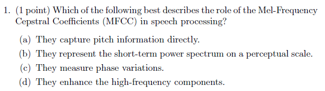
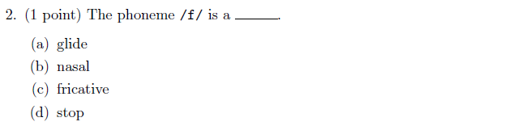
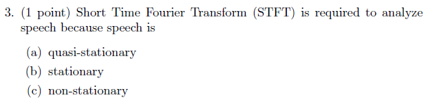
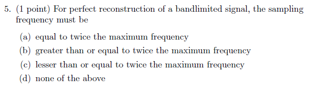
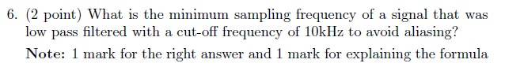
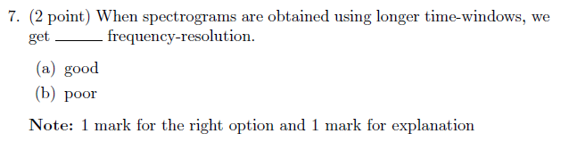
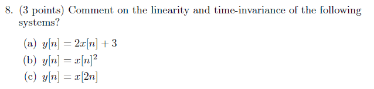
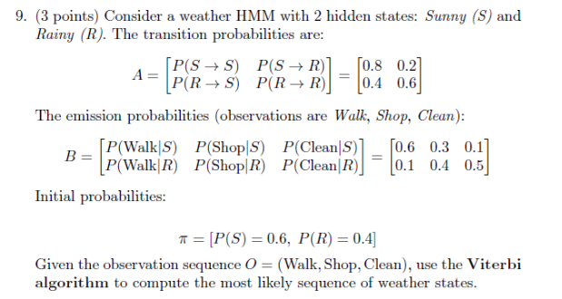
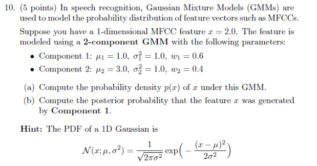
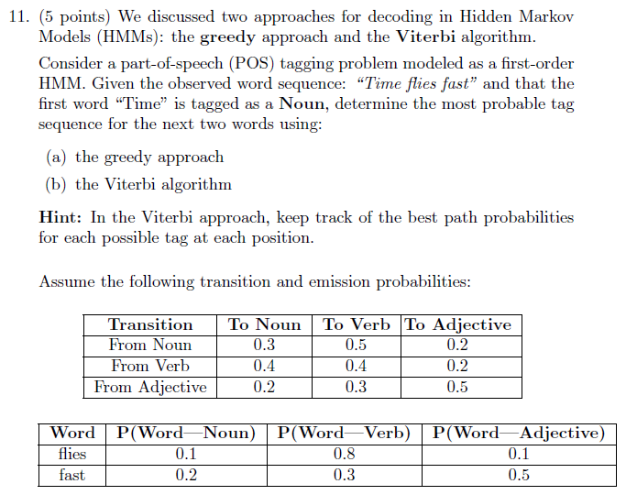

# Speech Technology — ee4001_2026T1_Q1_NA

**Source:** `ee4001_2026T1_Q1_NA.pdf` · **Academic questions:** 11 · **Separately counted children:** 0
**Provenance:** `Speech_Technology/ee4001_2026T1_Q1_NA.pdf` · SHA-256 `5c9b5a03f7213cd7c987b880fd123bd08ca54e1f6befb38be85cc1361c2fd30a`

**Scope:** Degree Level : Speech Technology examination (Section 1, Section Id: 640653129732, questions 1-3). Question 1 is an administrative subject confirmation and is excluded. Question 2 is an offline portal container enclosing printed questions 1 to 8 (12 marks total). Question 3 is an offline portal container enclosing printed questions 9 to 11 (13 marks total) from a scanned offline test paper across pages 4-5.

## Questions

### Question 1

**Portal container number:** `2`

**Portal container ID:** `6406531961551`

**Type:** MCQ · **Marks:** 1
**PDF pages:** 4

Which of the following best describes the role of the Mel-Frequency Cepstral Coefficients (MFCC) in speech processing?

**Figure 1.** Printed question 1 from scanned offline paper, covering the role of Mel-Frequency Cepstral Coefficients (MFCC) in speech processing.

**Options**

**A.**

They capture pitch information directly.

*Source option ID:* not supplied.

**B.**

They represent the short-term power spectrum on a perceptual scale.

*Source option ID:* not supplied.

**C.**

They measure phase variations.

*Source option ID:* not supplied.

**D.**

They enhance the high-frequency components.

*Source option ID:* not supplied.

**Correct answer:** Answer not verifiable from the source PDF

**Source evidence:** [{"page": 4, "bbox": [23.62, 674.82, 450.0, 740.0], "type": "absent", "detail": "Offline examination paper; online portal container presents only candidate submission status choices (\"I have answered this question in the offline paper\"), and no official academic answer key is provided in the source PDF."}]

### Question 2

**Portal container number:** `2`

**Portal container ID:** `6406531961551`

**Type:** MCQ · **Marks:** 1
**PDF pages:** 4

The phoneme /f/ is a ___.

**Figure 2.** Printed question 2 from scanned offline paper, identifying the phonetic classification of the phoneme /f/.

**Options**

**A.**

glide

*Source option ID:* not supplied.

**B.**

nasal

*Source option ID:* not supplied.

**C.**

fricative

*Source option ID:* not supplied.

**D.**

stop

*Source option ID:* not supplied.

**Correct answer:** Answer not verifiable from the source PDF

**Source evidence:** [{"page": 4, "bbox": [23.62, 674.82, 450.0, 740.0], "type": "absent", "detail": "Offline examination paper; online portal container presents only candidate submission status choices (\"I have answered this question in the offline paper\"), and no official academic answer key is provided in the source PDF."}]

### Question 3

**Portal container number:** `2`

**Portal container ID:** `6406531961551`

**Type:** MCQ · **Marks:** 1
**PDF pages:** 4

Short Time Fourier Transform (STFT) is required to analyze speech because speech is

**Figure 3.** Printed question 3 from scanned offline paper, analyzing the requirement of Short Time Fourier Transform (STFT) for speech signals.

**Options**

**A.**

quasi-stationary

*Source option ID:* not supplied.

**B.**

stationary

*Source option ID:* not supplied.

**C.**

non-stationary

*Source option ID:* not supplied.

**Correct answer:** Answer not verifiable from the source PDF

**Source evidence:** [{"page": 4, "bbox": [23.62, 674.82, 450.0, 740.0], "type": "absent", "detail": "Offline examination paper; online portal container presents only candidate submission status choices (\"I have answered this question in the offline paper\"), and no official academic answer key is provided in the source PDF."}]

### Question 4

**Portal container number:** `2`

**Portal container ID:** `6406531961551`

**Type:** Fill in the Blank · **Marks:** 1
**PDF pages:** 4

____ membrane in the ear acts as a frequency analyzer.

**Figure 4.** Printed question 4 from scanned offline paper, fill-in-the-blank question regarding the auditory membrane acting as a frequency analyzer.

**Correct answer:** Answer not verifiable from the source PDF

**Source evidence:** [{"page": 4, "bbox": [23.62, 674.82, 450.0, 740.0], "type": "absent", "detail": "Offline examination paper; online portal container presents only candidate submission status choices (\"I have answered this question in the offline paper\"), and no official academic answer key is provided in the source PDF."}]

### Question 5

**Portal container number:** `2`

**Portal container ID:** `6406531961551`

**Type:** MCQ · **Marks:** 1
**PDF pages:** 4

For perfect reconstruction of a bandlimited signal, the sampling frequency must be

**Figure 5.** Printed question 5 from scanned offline paper, evaluating the sampling frequency condition for perfect reconstruction of a bandlimited signal.

**Options**

**A.**

equal to twice the maximum frequency

*Source option ID:* not supplied.

**B.**

greater than or equal to twice the maximum frequency

*Source option ID:* not supplied.

**C.**

lesser than or equal to twice the maximum frequency

*Source option ID:* not supplied.

**D.**

none of the above

*Source option ID:* not supplied.

**Correct answer:** Answer not verifiable from the source PDF

**Source evidence:** [{"page": 4, "bbox": [23.62, 674.82, 450.0, 740.0], "type": "absent", "detail": "Offline examination paper; online portal container presents only candidate submission status choices (\"I have answered this question in the offline paper\"), and no official academic answer key is provided in the source PDF."}]

### Question 6

**Portal container number:** `2`

**Portal container ID:** `6406531961551`

**Type:** Subjective · **Marks:** 2
**PDF pages:** 4

What is the minimum sampling frequency of a signal that was low pass filtered with a cut-off frequency of 10kHz to avoid aliasing?

Note: 1 mark for the right answer and 1 mark for explaining the formula

**Figure 6.** Printed question 6 from scanned offline paper, calculating the minimum sampling frequency to avoid aliasing for a 10kHz low-pass filtered signal.

**Correct answer:** Answer not verifiable from the source PDF

**Source evidence:** [{"page": 4, "bbox": [23.62, 674.82, 450.0, 740.0], "type": "absent", "detail": "Offline examination paper; online portal container presents only candidate submission status choices (\"I have answered this question in the offline paper\"), and no official academic answer key is provided in the source PDF."}]

### Question 7

**Portal container number:** `2`

**Portal container ID:** `6406531961551`

**Type:** MCQ · **Marks:** 2
**PDF pages:** 4

When spectrograms are obtained using longer time-windows, we get ____ frequency-resolution.

Note: 1 mark for the right option and 1 mark for explanation

**Figure 7.** Printed question 7 from scanned offline paper, assessing frequency resolution of spectrograms obtained using longer time-windows.

**Options**

**A.**

good

*Source option ID:* not supplied.

**B.**

poor

*Source option ID:* not supplied.

**Correct answer:** Answer not verifiable from the source PDF

**Source evidence:** [{"page": 4, "bbox": [23.62, 674.82, 450.0, 740.0], "type": "absent", "detail": "Offline examination paper; online portal container presents only candidate submission status choices (\"I have answered this question in the offline paper\"), and no official academic answer key is provided in the source PDF."}]

### Question 8

**Portal container number:** `2`

**Portal container ID:** `6406531961551`

**Type:** Subjective · **Marks:** 3
**PDF pages:** 4

Comment on the linearity and time-invariance of the following systems?

(a) $y[n] = 2x[n] + 3$

(b) $y[n] = x[n]^2$

(c) $y[n] = x[2n]$

**Figure 8.** Printed question 8 from scanned offline paper, evaluating linearity and time-invariance of three discrete-time systems.

**Correct answer:** Answer not verifiable from the source PDF

**Source evidence:** [{"page": 4, "bbox": [23.62, 674.82, 450.0, 740.0], "type": "absent", "detail": "Offline examination paper; online portal container presents only candidate submission status choices (\"I have answered this question in the offline paper\"), and no official academic answer key is provided in the source PDF."}]

### Question 9

**Portal container number:** `3`

**Portal container ID:** `6406531961552`

**Type:** Subjective · **Marks:** 3
**PDF pages:** 5

Consider a weather HMM with 2 hidden states: Sunny (S) and Rainy (R). The transition probabilities are:

$$A = \begin{bmatrix} P(S \to S) & P(S \to R) \\ P(R \to S) & P(R \to R) \end{bmatrix} = \begin{bmatrix} 0.8 & 0.2 \\ 0.4 & 0.6 \end{bmatrix}$$

The emission probabilities (observations are Walk, Shop, Clean):

$$B = \begin{bmatrix} P(\text{Walk} \mid S) & P(\text{Shop} \mid S) & P(\text{Clean} \mid S) \\ P(\text{Walk} \mid R) & P(\text{Shop} \mid R) & P(\text{Clean} \mid R) \end{bmatrix} = \begin{bmatrix} 0.6 & 0.3 & 0.1 \\ 0.1 & 0.4 & 0.5 \end{bmatrix}$$

Initial probabilities:

$$\pi = [P(S) = 0.6, P(R) = 0.4]$$

Given the observation sequence $O = (\text{Walk}, \text{Shop}, \text{Clean})$, use the Viterbi algorithm to compute the most likely sequence of weather states.

**Figure 9.** Printed question 9 from scanned offline paper, computing the most likely weather state sequence using the Viterbi algorithm for an HMM.

**Correct answer:** Answer not verifiable from the source PDF

**Source evidence:** [{"page": 5, "bbox": [23.62, 732.78, 450.0, 800.0], "type": "absent", "detail": "Offline examination paper; online portal container presents only candidate submission status choices (\"I have answered this question in the offline paper\"), and no official academic answer key is provided in the source PDF."}]

### Question 10

**Portal container number:** `3`

**Portal container ID:** `6406531961552`

**Type:** Subjective · **Marks:** 5
**PDF pages:** 5

In speech recognition, Gaussian Mixture Models (GMMs) are used to model the probability distribution of feature vectors such as MFCCs.

Suppose you have a 1-dimensional MFCC feature $x = 2.0$. The feature is modeled using a 2-component GMM with the following parameters:

- Component 1: $\mu_1 = 1.0$, $\sigma_1^2 = 1.0$, $w_1 = 0.6$
- Component 2: $\mu_2 = 3.0$, $\sigma_2^2 = 1.0$, $w_2 = 0.4$

(a) Compute the probability density $p(x)$ of $x$ under this GMM.

(b) Compute the posterior probability that the feature $x$ was generated by Component 1.

Hint: The PDF of a 1D Gaussian is

$$\mathcal{N}(x; \mu, \sigma^2) = \frac{1}{\sqrt{2\pi\sigma^2}} \exp\left(-\frac{(x - \mu)^2}{2\sigma^2}\right)$$

**Figure 10.** Printed question 10 from scanned offline paper, calculating probability density and posterior component probability for a 2-component GMM.

**Correct answer:** Answer not verifiable from the source PDF

**Source evidence:** [{"page": 5, "bbox": [23.62, 732.78, 450.0, 800.0], "type": "absent", "detail": "Offline examination paper; online portal container presents only candidate submission status choices (\"I have answered this question in the offline paper\"), and no official academic answer key is provided in the source PDF."}]

### Question 11

**Portal container number:** `3`

**Portal container ID:** `6406531961552`

**Type:** Subjective · **Marks:** 5
**PDF pages:** 5

We discussed two approaches for decoding in Hidden Markov Models (HMMs): the greedy approach and the Viterbi algorithm.

Consider a part-of-speech (POS) tagging problem modeled as a first-order HMM. Given the observed word sequence: "Time flies fast" and that the first word "Time" is tagged as a Noun, determine the most probable tag sequence for the next two words using:

(a) the greedy approach

(b) the Viterbi algorithm

Hint: In the Viterbi approach, keep track of the best path probabilities for each possible tag at each position.

Assume the following transition and emission probabilities:

| Transition | To Noun | To Verb | To Adjective |
| :--- | :--- | :--- | :--- |
| From Noun | 0.3 | 0.5 | 0.2 |
| From Verb | 0.4 | 0.4 | 0.2 |
| From Adjective | 0.2 | 0.3 | 0.5 |

| Word | P(Word \| Noun) | P(Word \| Verb) | P(Word \| Adjective) |
| :--- | :--- | :--- | :--- |
| flies | 0.1 | 0.8 | 0.1 |
| fast | 0.2 | 0.3 | 0.5 |

**Figure 11.** Printed question 11 from scanned offline paper, decoding part-of-speech tag sequence using greedy and Viterbi approaches in an HMM.

**Correct answer:** Answer not verifiable from the source PDF

**Source evidence:** [{"page": 5, "bbox": [23.62, 732.78, 450.0, 800.0], "type": "absent", "detail": "Offline examination paper; online portal container presents only candidate submission status choices (\"I have answered this question in the offline paper\"), and no official academic answer key is provided in the source PDF."}]

## Answer key

| Source question | Source identity | Correct answer | PDF pages |
| :--- | :--- | :--- | :--- |
| 1 | portal 6406531961551 | Answer not verifiable from the source PDF | 4 |
| 2 | portal 6406531961551 | Answer not verifiable from the source PDF | 4 |
| 3 | portal 6406531961551 | Answer not verifiable from the source PDF | 4 |
| 4 | portal 6406531961551 | Answer not verifiable from the source PDF | 4 |
| 5 | portal 6406531961551 | Answer not verifiable from the source PDF | 4 |
| 6 | portal 6406531961551 | Answer not verifiable from the source PDF | 4 |
| 7 | portal 6406531961551 | Answer not verifiable from the source PDF | 4 |
| 8 | portal 6406531961551 | Answer not verifiable from the source PDF | 4 |
| 9 | portal 6406531961552 | Answer not verifiable from the source PDF | 5 |
| 10 | portal 6406531961552 | Answer not verifiable from the source PDF | 5 |
| 11 | portal 6406531961552 | Answer not verifiable from the source PDF | 5 |

## Extraction notes

**Status:** verified-source-limitation
**Count reconciliation:** Section 1 declares 3 online portal questions and 25 section marks. Portal Question 1 (0 marks) is an administrative subject confirmation and is excluded. Portal Question 2 (12 marks) is an offline portal container enclosing 8 printed academic questions (Questions 1 to 8) totaling exactly 12 marks (5 1-mark questions, 2 2-mark questions, 1 3-mark question: 5*1 + 2*2 + 1*3 = 12 marks). Portal Question 3 (13 marks) is an offline portal container enclosing 3 printed academic questions (Questions 9 to 11) totaling exactly 13 marks (1 3-mark question, 2 5-mark questions: 1*3 + 2*5 = 13 marks). 12 + 13 = 25 marks, perfectly reconciling the declared 25 section marks across 11 printed academic questions.

- All 11 printed questions have been transcribed verbatim with complete mathematical formatting, LaTeX equations, and verbatim preservation of options and subparts.
- High-resolution individual crops of every printed question stem, option block, and diagram have been extracted, inspected, and saved under assets/.
- The Speech Technology examination was conducted as a hybrid/offline pen-and-paper test. The online portal interface merely acted as a submission container (offering options "I have answered this question in the offline paper", "I have skipped this question", and "This question does not apply to me"), while the actual academic questions were embedded as raster scans.
- No official answer key, solution markings, or correct answer indicators for any of the 11 printed academic questions are provided in the source PDF. In accordance with extraction contract rules, the answer text is recorded exactly as "Answer not verifiable from the source PDF".

**Excluded source entries:**

- {"classification": "subject-confirmation", "page": 3, "bbox": [22.9, 16.8, 572.8, 260.0], "reason": "Administrative subject confirmation asking candidate to confirm subject and cross check hall ticket", "identity": "6406531961550"}
- {"classification": "portal-offline-wrapper", "page": 4, "bbox": [23.62, 674.82, 450.0, 740.0], "reason": "Portal offline submission choices 6406536373787, 6406536373788, 6406536373789 excluded from academic entries", "identity": "6406531961551"}
- {"classification": "portal-offline-wrapper", "page": 5, "bbox": [23.62, 732.78, 450.0, 800.0], "reason": "Portal offline submission choices 6406536373790, 6406536373791, 6406536373792 excluded from academic entries", "identity": "6406531961552"}
