# Speech Technology — ee4001_2026T1_Q2_NA

**Source:** `ee4001_2026T1_Q2_NA.pdf` · **Academic questions:** 14 · **Separately counted children:** 0
**Provenance:** `Speech_Technology/ee4001_2026T1_Q2_NA.pdf` · SHA-256 `719ea63b4a327d3021673275d416f8b644523de5dedefdbfd01bd29f1181aaec`

**Scope:** Degree Level : Speech Technology examination (Section 1, Section Id: 640653134553, questions 1-3). Question 1 is an administrative subject confirmation and is excluded. Question 2 is an administrative instructions container and is excluded. Question 3 is an offline portal container enclosing 14 printed academic questions from a scanned offline test paper across pages 3-6.

## Questions

### Shared context 2

**Question ID:** `6406532040138`

**Portal container number:** `2`

**Portal container ID:** `6406532040138`

**Type:** Section instructions · **Marks:** 0
**PDF pages:** 2

Instructions:

All option-based questions are MCQs, and all fill-in-the-blank questions are short answer questions.

For Questions 3 (1 to 14), answer all questions.

• In MCQs, you must write the correct option and also the complete text of that option.
• You must then provide a detailed explanation of why that specific option is the correct answer.
• In short answer questions, write the answer clearly with proper explanation wherever needed.
• In all problem-solving or example-based questions, present the solution with all intermediate steps clearly shown.
• Step-wise explanation is compulsory for all such questions.
• The final answer must be written clearly at the end.

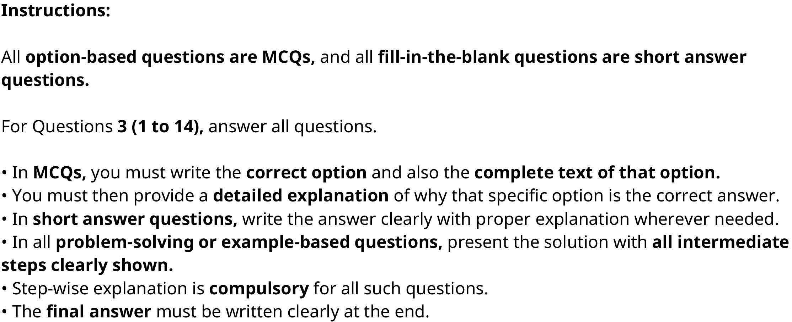

**Figure 1.** Source instructions for all fourteen printed Speech Technology questions.

### Question 1

**Portal container number:** `3`

**Portal container ID:** `6406532040139`

**Type:** MCQ · **Marks:** 1
**PDF pages:** 3

**Shared context:** [ctx-instructions](#ctx-instructions)

A key advantage of continuous HMM over discrete HMM in speech recognition is:

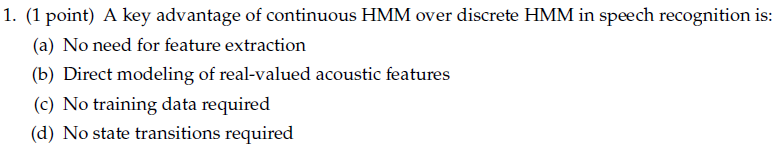

**Figure 2.** Printed question 1 from scanned offline paper, covering advantage of continuous HMM over discrete HMM.

**Options**

**A.**

No need for feature extraction

*Source option ID:* not supplied.

**B.**

Direct modeling of real-valued acoustic features

*Source option ID:* not supplied.

**C.**

No training data required

*Source option ID:* not supplied.

**D.**

No state transitions required

*Source option ID:* not supplied.

**Correct answer:** Answer not verifiable from the source PDF

**Source evidence:** [{"page": 6, "bbox": [22.87, 642.0, 413.2, 720.0], "type": "absent", "detail": "Offline examination paper; portal container displays only submission status confirmation option (\"I have answered this question in the offline paper\"), no official academic answer key is provided in the source PDF."}]

### Question 2

**Portal container number:** `3`

**Portal container ID:** `6406532040139`

**Type:** MCQ · **Marks:** 1
**PDF pages:** 3

**Shared context:** [ctx-instructions](#ctx-instructions)

In a typical 3-state phoneme HMM, self-loops are mainly used to model:

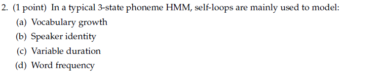

**Figure 3.** Printed question 2 from scanned offline paper, covering role of self-loops in 3-state phoneme HMM.

**Options**

**A.**

Vocabulary growth

*Source option ID:* not supplied.

**B.**

Speaker identity

*Source option ID:* not supplied.

**C.**

Variable duration

*Source option ID:* not supplied.

**D.**

Word frequency

*Source option ID:* not supplied.

**Correct answer:** Answer not verifiable from the source PDF

**Source evidence:** [{"page": 6, "bbox": [22.87, 642.0, 413.2, 720.0], "type": "absent", "detail": "Offline examination paper; portal container displays only submission status confirmation option (\"I have answered this question in the offline paper\"), no official academic answer key is provided in the source PDF."}]

### Question 3

**Portal container number:** `3`

**Portal container ID:** `6406532040139`

**Type:** MCQ · **Marks:** 1
**PDF pages:** 3

**Shared context:** [ctx-instructions](#ctx-instructions)

If attention weights shift backward in time during decoding, what does it violate?

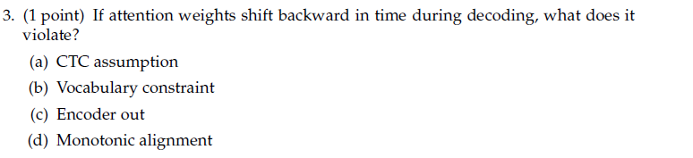

**Figure 4.** Printed question 3 from scanned offline paper, covering monotonic alignment violation in attention mechanisms.

**Options**

**A.**

CTC assumption

*Source option ID:* not supplied.

**B.**

Vocabulary constraint

*Source option ID:* not supplied.

**C.**

Encoder out

*Source option ID:* not supplied.

**D.**

Monotonic alignment

*Source option ID:* not supplied.

**Correct answer:** Answer not verifiable from the source PDF

**Source evidence:** [{"page": 6, "bbox": [22.87, 642.0, 413.2, 720.0], "type": "absent", "detail": "Offline examination paper; portal container displays only submission status confirmation option (\"I have answered this question in the offline paper\"), no official academic answer key is provided in the source PDF."}]

### Question 4

**Portal container number:** `3`

**Portal container ID:** `6406532040139`

**Type:** Short Answer · **Marks:** 1
**PDF pages:** 3

**Shared context:** [ctx-instructions](#ctx-instructions)

Fill in the blank: The predictor in RNN-T is similar to a language model, since it conditions on ________.

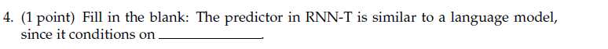

**Figure 5.** Printed question 4 from scanned offline paper, covering RNN-T predictor conditioning.

**Correct answer:** Answer not verifiable from the source PDF

**Source evidence:** [{"page": 6, "bbox": [22.87, 642.0, 413.2, 720.0], "type": "absent", "detail": "Offline examination paper; portal container displays only submission status confirmation option (\"I have answered this question in the offline paper\"), no official academic answer key is provided in the source PDF."}]

### Question 5

**Portal container number:** `3`

**Portal container ID:** `6406532040139`

**Type:** MCQ · **Marks:** 1
**PDF pages:** 3

**Shared context:** [ctx-instructions](#ctx-instructions)

The fine-tuning step of wav2vec 2.0/HuBERT using a simple linear layer for ASR typically uses:

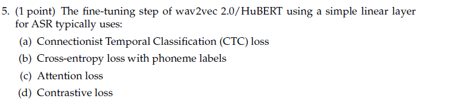

**Figure 6.** Printed question 5 from scanned offline paper, covering wav2vec 2.0/HuBERT fine-tuning loss.

**Options**

**A.**

Connectionist Temporal Classification (CTC) loss

*Source option ID:* not supplied.

**B.**

Cross-entropy loss with phoneme labels

*Source option ID:* not supplied.

**C.**

Attention loss

*Source option ID:* not supplied.

**D.**

Contrastive loss

*Source option ID:* not supplied.

**Correct answer:** Answer not verifiable from the source PDF

**Source evidence:** [{"page": 6, "bbox": [22.87, 642.0, 413.2, 720.0], "type": "absent", "detail": "Offline examination paper; portal container displays only submission status confirmation option (\"I have answered this question in the offline paper\"), no official academic answer key is provided in the source PDF."}]

### Question 6

**Portal container number:** `3`

**Portal container ID:** `6406532040139`

**Type:** MCQ · **Marks:** 1
**PDF pages:** 4

**Shared context:** [ctx-instructions](#ctx-instructions)

Which statement is false about CTC?

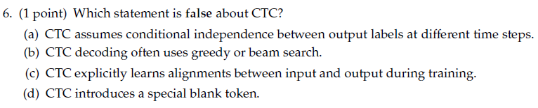

**Figure 7.** Printed question 6 from scanned offline paper, identifying false statement regarding CTC properties.

**Options**

**A.**

CTC assumes conditional independence between output labels at different time steps.

*Source option ID:* not supplied.

**B.**

CTC decoding often uses greedy or beam search.

*Source option ID:* not supplied.

**C.**

CTC explicitly learns alignments between input and output during training.

*Source option ID:* not supplied.

**D.**

CTC introduces a special blank token.

*Source option ID:* not supplied.

**Correct answer:** Answer not verifiable from the source PDF

**Source evidence:** [{"page": 6, "bbox": [22.87, 642.0, 413.2, 720.0], "type": "absent", "detail": "Offline examination paper; portal container displays only submission status confirmation option (\"I have answered this question in the offline paper\"), no official academic answer key is provided in the source PDF."}]

### Question 7

**Portal container number:** `3`

**Portal container ID:** `6406532040139`

**Type:** MCQ · **Marks:** 1
**PDF pages:** 4

**Shared context:** [ctx-instructions](#ctx-instructions)

A CNN has 3 layers with strides:

Layer 1: stride = 4
Layer 2: stride = 4
Layer 3: stride = 5

What is the total downsampling factor?

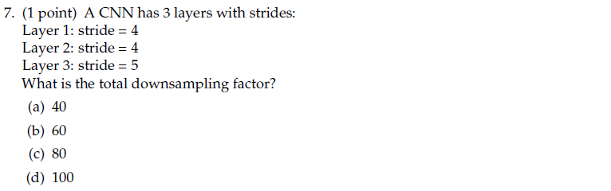

**Figure 8.** Printed question 7 from scanned offline paper, calculating total downsampling factor across CNN strided layers.

**Options**

**A.**

40

*Source option ID:* not supplied.

**B.**

60

*Source option ID:* not supplied.

**C.**

80

*Source option ID:* not supplied.

**D.**

100

*Source option ID:* not supplied.

**Correct answer:** Answer not verifiable from the source PDF

**Source evidence:** [{"page": 6, "bbox": [22.87, 642.0, 413.2, 720.0], "type": "absent", "detail": "Offline examination paper; portal container displays only submission status confirmation option (\"I have answered this question in the offline paper\"), no official academic answer key is provided in the source PDF."}]

### Question 8

**Portal container number:** `3`

**Portal container ID:** `6406532040139`

**Type:** MCQ · **Marks:** 1
**PDF pages:** 4

**Shared context:** [ctx-instructions](#ctx-instructions)

At a specific node $(t, u)$ in the RNN-T lattice, the Joiner network receives $h_t^{enc}$ and $h_u^{pred}$. If the Joiner outputs a probability for the "blank" symbol, what does a transition to the next state represent?

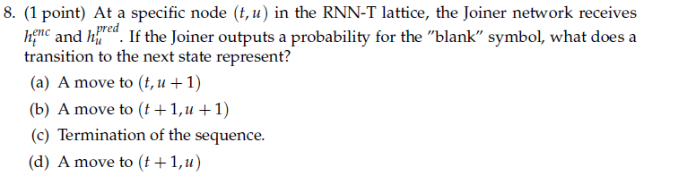

**Figure 9.** Printed question 8 from scanned offline paper, covering state transition for blank output in RNN-T lattice.

**Options**

**A.**

A move to $(t, u + 1)$

*Source option ID:* not supplied.

**B.**

A move to $(t + 1, u + 1)$

*Source option ID:* not supplied.

**C.**

Termination of the sequence.

*Source option ID:* not supplied.

**D.**

A move to $(t + 1, u)$

*Source option ID:* not supplied.

**Correct answer:** Answer not verifiable from the source PDF

**Source evidence:** [{"page": 6, "bbox": [22.87, 642.0, 413.2, 720.0], "type": "absent", "detail": "Offline examination paper; portal container displays only submission status confirmation option (\"I have answered this question in the offline paper\"), no official academic answer key is provided in the source PDF."}]

### Question 9

**Portal container number:** `3`

**Portal container ID:** `6406532040139`

**Type:** MCQ · **Marks:** 1
**PDF pages:** 5

**Shared context:** [ctx-instructions](#ctx-instructions)

In an attention-based ASR system, suppose the attention weights are uniform across all encoder time steps. What effect does this have on the alignment between input speech frames and output tokens?

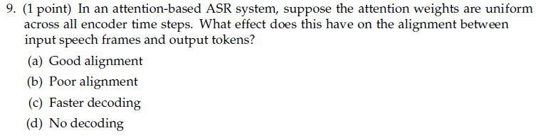

**Figure 10.** Printed question 9 from scanned offline paper, analyzing effect of uniform attention weights on alignment.

**Options**

**A.**

Good alignment

*Source option ID:* not supplied.

**B.**

Poor alignment

*Source option ID:* not supplied.

**C.**

Faster decoding

*Source option ID:* not supplied.

**D.**

No decoding

*Source option ID:* not supplied.

**Correct answer:** Answer not verifiable from the source PDF

**Source evidence:** [{"page": 6, "bbox": [22.87, 642.0, 413.2, 720.0], "type": "absent", "detail": "Offline examination paper; portal container displays only submission status confirmation option (\"I have answered this question in the offline paper\"), no official academic answer key is provided in the source PDF."}]

### Question 10

**Portal container number:** `3`

**Portal container ID:** `6406532040139`

**Type:** MCQ · **Marks:** 1
**PDF pages:** 5

**Shared context:** [ctx-instructions](#ctx-instructions)

Suppose GPT predicts probabilities for the next token:

“cat” $\rightarrow$ 0.7,
“dog” $\rightarrow$ 0.2,
“car” $\rightarrow$ 0.1

If the true token is “cat”, what is the cross-entropy loss?

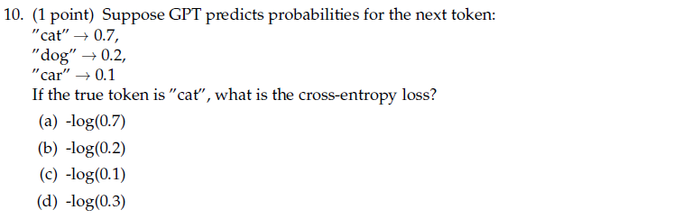

**Figure 11.** Printed question 10 from scanned offline paper, computing cross-entropy loss for token prediction.

**Options**

**A.**

$-\log(0.7)$

*Source option ID:* not supplied.

**B.**

$-\log(0.2)$

*Source option ID:* not supplied.

**C.**

$-\log(0.1)$

*Source option ID:* not supplied.

**D.**

$-\log(0.3)$

*Source option ID:* not supplied.

**Correct answer:** Answer not verifiable from the source PDF

**Source evidence:** [{"page": 6, "bbox": [22.87, 642.0, 413.2, 720.0], "type": "absent", "detail": "Offline examination paper; portal container displays only submission status confirmation option (\"I have answered this question in the offline paper\"), no official academic answer key is provided in the source PDF."}]

### Question 11

**Portal container number:** `3`

**Portal container ID:** `6406532040139`

**Type:** MCQ · **Marks:** 2
**PDF pages:** 5

**Shared context:** [ctx-instructions](#ctx-instructions)

In automatic speech recognition (ASR), how does the Word Error Rate (WER) typically vary across CTC, RNN-T, and AED (Attention-based Encoder-Decoder) models, assuming similar training data and model capacity?

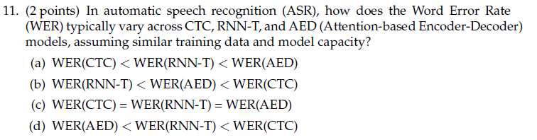

**Figure 12.** Printed question 11 from scanned offline paper, comparing typical WER across CTC, RNN-T, and AED architectures.

**Options**

**A.**

WER(CTC) < WER(RNN-T) < WER(AED)

*Source option ID:* not supplied.

**B.**

WER(RNN-T) < WER(AED) < WER(CTC)

*Source option ID:* not supplied.

**C.**

WER(CTC) = WER(RNN-T) = WER(AED)

*Source option ID:* not supplied.

**D.**

WER(AED) < WER(RNN-T) < WER(CTC)

*Source option ID:* not supplied.

**Correct answer:** Answer not verifiable from the source PDF

**Source evidence:** [{"page": 6, "bbox": [22.87, 642.0, 413.2, 720.0], "type": "absent", "detail": "Offline examination paper; portal container displays only submission status confirmation option (\"I have answered this question in the offline paper\"), no official academic answer key is provided in the source PDF."}]

### Question 12

**Portal container number:** `3`

**Portal container ID:** `6406532040139`

**Type:** Subjective · **Marks:** 3
**PDF pages:** 6

**Shared context:** [ctx-instructions](#ctx-instructions)

Find the probability of the sentence

`<s>` She likes bananas `<s>`

with a bigram language model trained on the following corpus:

* `<s>` She likes apples `<s>`
* `<s>` He likes oranges `<s>`
* `<s>` She eats apples `<s>`
* `<s>` Ram likes bananas `<s>`

Note: `<s>` is a special word to include start and end words of a sentence. For example, (`<s>`, That) is a valid bi-gram. Bi-gram means two consecutive words considered at a time.

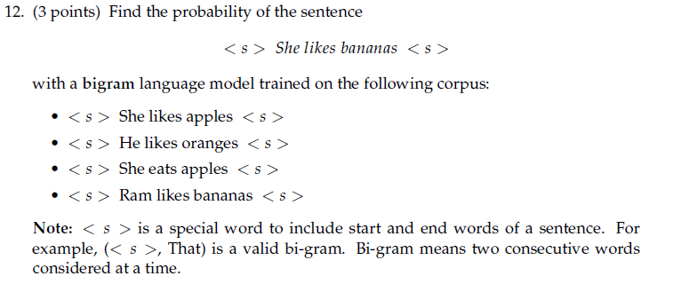

**Figure 13.** Printed question 12 from scanned offline paper, calculating bigram language model probability of a given sentence.

**Correct answer:** Answer not verifiable from the source PDF

**Source evidence:** [{"page": 6, "bbox": [22.87, 642.0, 413.2, 720.0], "type": "absent", "detail": "Offline examination paper; portal container displays only submission status confirmation option (\"I have answered this question in the offline paper\"), no official academic answer key is provided in the source PDF."}]

### Question 13

**Portal container number:** `3`

**Portal container ID:** `6406532040139`

**Type:** Subjective · **Marks:** 5
**PDF pages:** 6

**Shared context:** [ctx-instructions](#ctx-instructions)

Consider an RNN-T model with input length $T = 2$ (two acoustic frames) and target sequence $Y = (A, B)$ of length $U = 2$. An alignment corresponds to a path in the $(t, u)$ lattice starting from $(0,0)$ and ending at $(T, U) = (2,2)$, where:

Task: List all possible valid alignments that produce the output sequence “A B”. For each alignment, write down the sequence of actions (blanks and symbols) along the path.

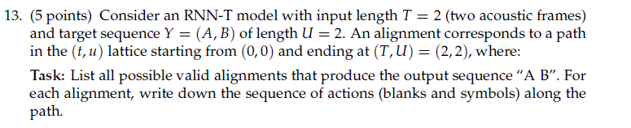

**Figure 14.** Printed question 13 from scanned offline paper, listing valid RNN-T alignment paths and action sequences.

**Correct answer:** Answer not verifiable from the source PDF

**Source evidence:** [{"page": 6, "bbox": [22.87, 642.0, 413.2, 720.0], "type": "absent", "detail": "Offline examination paper; portal container displays only submission status confirmation option (\"I have answered this question in the offline paper\"), no official academic answer key is provided in the source PDF."}]

### Question 14

**Portal container number:** `3`

**Portal container ID:** `6406532040139`

**Type:** MCQ · **Marks:** 5
**PDF pages:** 6

**Shared context:** [ctx-instructions](#ctx-instructions)

Suppose the target sequence is AB. The input has 3 time steps, and the alphabet is $\{A, B, \_\}$ (where $\_ = \text{blank}$). The model outputs the following frame-level probabilities:

| Time step | P(A) | P(B) | P(_) |
| :--- | :--- | :--- | :--- |
| t1 | 0.6 | 0.2 | 0.2 |
| t2 | 0.1 | 0.7 | 0.2 |
| t3 | 0.1 | 0.6 | 0.3 |

List all valid CTC alignment paths of length 3 that collapse to AB, compute their probabilities, and then compute the total probability of the sequence AB under CTC.

Note: Alignments can include blank at start and end

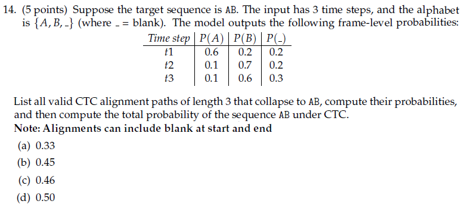

**Figure 15.** Printed question 14 from scanned offline paper, computing CTC alignment paths and total probability.

**Options**

**A.**

0.33

*Source option ID:* not supplied.

**B.**

0.45

*Source option ID:* not supplied.

**C.**

0.46

*Source option ID:* not supplied.

**D.**

0.50

*Source option ID:* not supplied.

**Correct answer:** Answer not verifiable from the source PDF

**Source evidence:** [{"page": 6, "bbox": [22.87, 642.0, 413.2, 720.0], "type": "absent", "detail": "Offline examination paper; portal container displays only submission status confirmation option (\"I have answered this question in the offline paper\"), no official academic answer key is provided in the source PDF."}]

## Answer key

| Source question | Source identity | Correct answer | PDF pages |
| :--- | :--- | :--- | :--- |
| 1 | portal 6406532040139 | Answer not verifiable from the source PDF | 3 |
| 2 | portal 6406532040139 | Answer not verifiable from the source PDF | 3 |
| 3 | portal 6406532040139 | Answer not verifiable from the source PDF | 3 |
| 4 | portal 6406532040139 | Answer not verifiable from the source PDF | 3 |
| 5 | portal 6406532040139 | Answer not verifiable from the source PDF | 3 |
| 6 | portal 6406532040139 | Answer not verifiable from the source PDF | 4 |
| 7 | portal 6406532040139 | Answer not verifiable from the source PDF | 4 |
| 8 | portal 6406532040139 | Answer not verifiable from the source PDF | 4 |
| 9 | portal 6406532040139 | Answer not verifiable from the source PDF | 5 |
| 10 | portal 6406532040139 | Answer not verifiable from the source PDF | 5 |
| 11 | portal 6406532040139 | Answer not verifiable from the source PDF | 5 |
| 12 | portal 6406532040139 | Answer not verifiable from the source PDF | 6 |
| 13 | portal 6406532040139 | Answer not verifiable from the source PDF | 6 |
| 14 | portal 6406532040139 | Answer not verifiable from the source PDF | 6 |

## Extraction notes

**Status:** verified-source-limitation
**Count reconciliation:** Section 1 declares 3 online portal questions and 25 section marks. Portal Question 1 (0 marks) is an administrative subject confirmation and is excluded. Portal Question 2 (0 marks) supplies academic instructions for Question 3 (1 to 14), retained as shared context; only its acknowledgment choices are excluded. Portal Question 3 (25 marks) is an offline portal container enclosing 14 printed academic questions (Questions 1 to 14) totaling exactly 25 marks (10 1-mark questions, 1 2-mark question, 1 3-mark question, and 2 5-mark questions). 10*1 + 2 + 3 + 2*5 = 25 marks, perfectly reconciling the declared 25 section marks across 14 printed academic questions.

- All 14 printed questions have been transcribed verbatim with complete mathematical formatting, LaTeX equations, and verbatim preservation of options.
- High-resolution individual crops of every printed question stem, option block, and diagram have been extracted, inspected, and saved under assets/.
- The Speech Technology examination was conducted as a hybrid/offline pen-and-paper test. The online portal interface merely acted as a submission container (offering options "I have answered this question in the offline paper", "I have skipped this question", and "This question does not apply to me"), while the actual academic questions were embedded as raster scans.
- No official answer key, solution markings, or correct answer indicators for any of the 14 printed academic questions are provided in the source PDF. In accordance with extraction contract rules, the answer text is recorded exactly as "Answer not verifiable from the source PDF".

**Excluded source entries:**

- {"classification": "subject-confirmation", "page": 1, "bbox": [22.9, 738.3, 572.8, 812.5], "reason": "Administrative subject confirmation asking candidate to confirm subject and cross check hall ticket", "identity": "6406532040137"}
- {"classification": "portal-acknowledgment", "page": 2, "bbox": [22.9, 218.8, 580.3, 565.4], "reason": "Only administrative acknowledgment choices 6406536642609 and 6406536642610 excluded; academic instructions retained as shared context ctx-instructions.", "identity": "6406532040138"}
