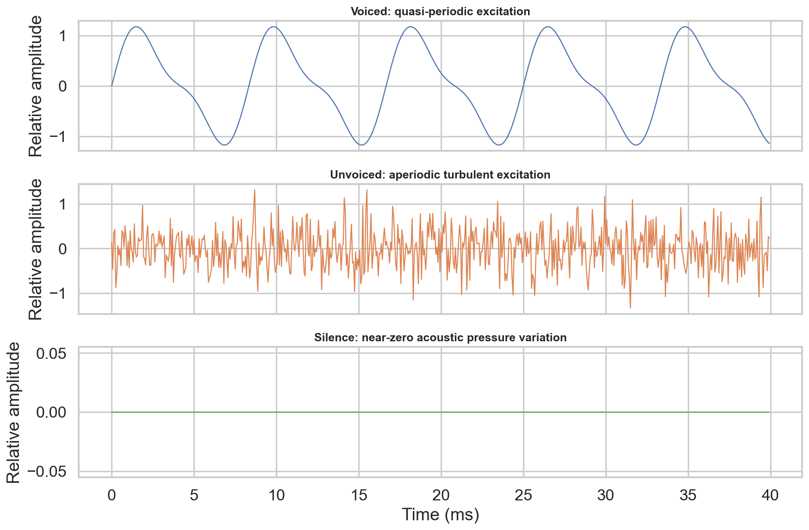
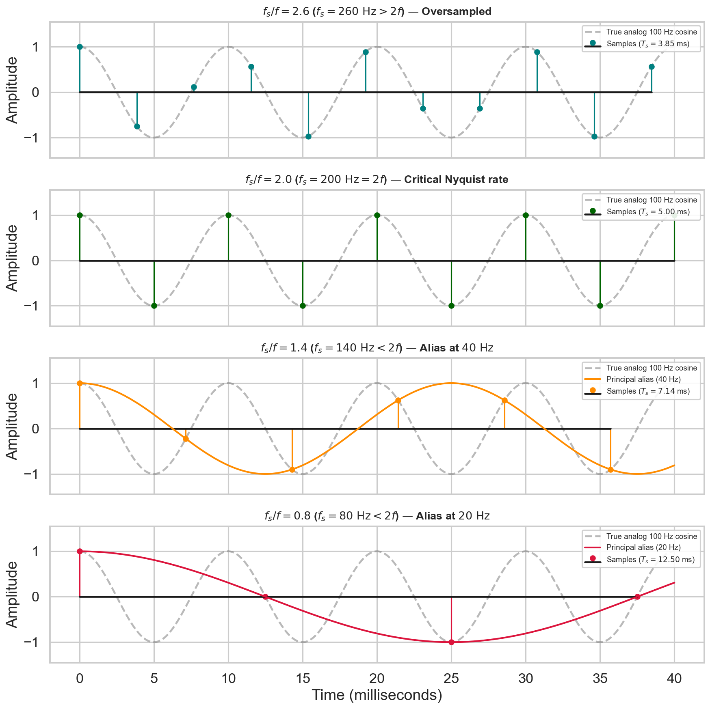
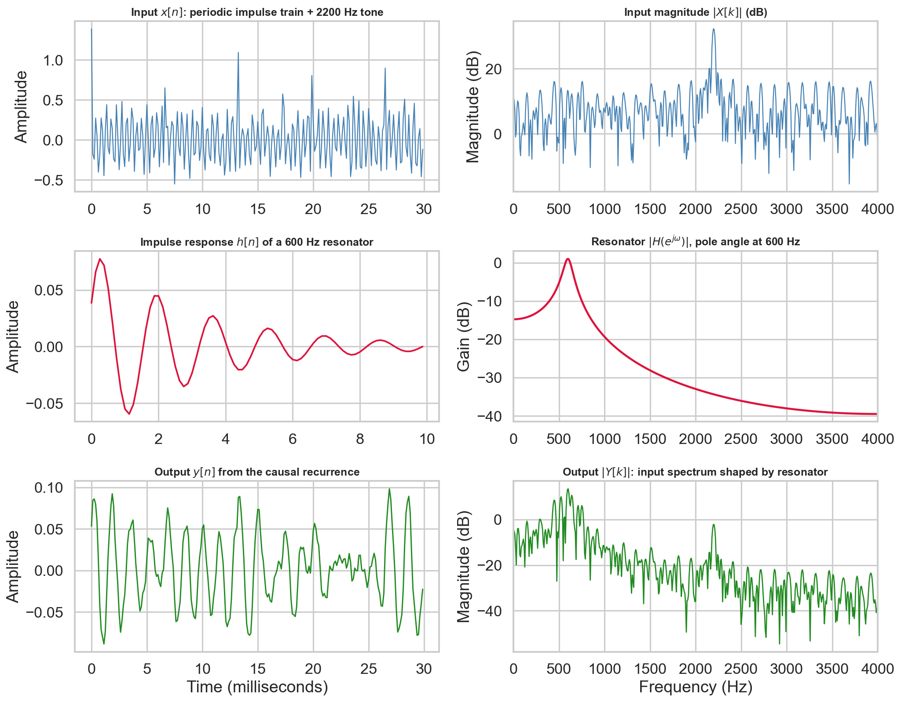

# Week 1 — Learn the Foundations and Prepare for the Exam

**Navigation:** [[exam-study-guide|Study route and priority system]] · [[week-1-notes|Full Week 1 reference]] · [[week-1-exam-questions|Authentic questions and worked answers]] · [[week-2-exam-focused-notes|Continue to Week 2]]

## 1. What to study more, and why

**The main exam skills are sampling calculations and proving system properties.** Learn the speech-production and Fourier ideas around them: they explain what the numbers and operations represent.

**P1** means extra explanation and repeated closed-book practice. **P2** means learn fully and rehearse a concise answer. **P3** means syllabus coverage without a direct standalone question found in these papers; it remains required learning. Priorities describe evidence and prerequisite value, not predicted marks or a future-paper guarantee.

<!-- evidence:start -->
| Study priority | Topic family | Question occurrences: Q1 / Q2 / ET | Distinct exam–terms |
| :--- | :--- | :--- | ---: |
| P1 — practise calculations | Sampling, aliasing and sample counts | 6 / 0 / 1 = **7** | 6 |
| P1 — practise proofs | Linearity, time invariance and causality | 5 / 0 / 0 = **5** | 5 |
| P2 — rehearse concise answers | Basis / linear-combination idea | 3 / 0 / 0 = **3** | 3 |
| P2 — rehearse concise answers | Voicing, articulation and information in speech | 2 / 0 / 1 = **3** | 3 |
<!-- evidence:end -->

**How to read the evidence.** These are 18 question occurrences, not 18 different templates. “Distinct exam–terms” merges FN/AN variants of the same year, term and exam type; it still does not make repeated wording independent evidence. Sampling's seven entries include the 2026 Q1 conceptual and numerical items and the 2026 ET frame-count item. The three basis questions repeat an elementary linear-combination prompt; they do not establish frequent testing of every Fourier derivation.

**P3 coverage:** quantization; the complete Fourier-transform taxonomy; DFT calculations beyond the basis idea; convolution; z-transform; poles, zeros and stability. Study these after acquiring the basic signal vocabulary, before the final mixed practice.

## 2. Start here: what speech technology receives

A sound is a pressure variation over time. A microphone converts it into an electrical signal; an analog-to-digital converter produces numbers a computer can process. The **speech chain** is message formation → articulatory movement → acoustic transmission → hearing → interpretation. A recognizer attempts to recover linguistic content from the acoustic part of that chain.

Write $x(t)$ for the continuous signal, where $t$ is time in seconds. Write $x[n]$ for sample number $n$, where $n$ is an integer. Square brackets do not denote a different physical sound: they indicate that we now inspect only discrete time instants.

**What the waveform contains:** words, speaker characteristics, intonation, emotion, channel effects and noise. A plain transcript preserves words but loses much of the timing, pitch contour and voice quality. This explains [2026 ET Q14](week-1-exam-questions.md#ee4001_2026T1_ET_FN--q14): speaker identity and emotion are acoustic information that ordinary text does not fully retain.

### Speech production and waveform classes — P2

Airflow from the lungs drives sound production. Vocal-fold vibration supplies voiced excitation; the tongue, lips, jaw, velum and vocal-tract cavities shape that sound. **Place of articulation** identifies where a constriction occurs; **manner** identifies how airflow is modified. Voicing is another, separate property.

| Class / example | Production mechanism | Typical waveform cue |
| :--- | :--- | :--- |
| Voiced vowel | Vocal folds vibrate; tract shapes resonances | Approximately repeating cycles |
| Unvoiced fricative /f/ | Turbulent airflow at a constriction | Noise-like, without clear regular cycles |
| Stop | Closure followed by release | Closure interval and a transient burst |
| Silence | No intended speech excitation | Low energy, possibly background noise |

/f/ is a **voiceless labiodental fricative**: lower lip against upper teeth, with friction rather than a complete stop. “Labiodental” is its place; “fricative” is its manner. A **phone** is a realized speech sound; a **phoneme** is a contrastive category in a language. A letter is a writing symbol and need not correspond one-to-one with a phoneme.



**Figure 1.** *The synthetic waveform classes illustrate periodicity and energy cues. They do not imply that every real voiced segment is exactly periodic or that silence is always numerically zero.*

**Check before continuing.** Why is “voiced means periodic” an approximation? Vocal-fold cycles vary and speech changes over time; “quasi-periodic” is more precise. For the source MCQ's periodic-versus-aperiodic choice, periodic is the intended class. Practise [2025 Q1 Q2](week-1-exam-questions.md#ee4001_2025T2_Q1_NA--q2) and [2026 Q1 Q2](week-1-exam-questions.md#ee4001_2026T1_Q1_NA--q2).

## 3. Sampling and aliasing — P1: practise until automatic

### 3.1 What sampling does

Sampling measures amplitude every $T_s$ seconds:

$$x[n]=x(nT_s),\qquad f_s=\frac{1}{T_s}.$$

$f_s$ is samples per second, also written Hz. Sampling at 16 kHz produces 16,000 samples in one second. It does not mean the original signal has a frequency of 16 kHz.

A sinusoid of frequency $f$ completes $f$ cycles each second. If too few samples are taken, different sinusoids become indistinguishable: **aliasing**. For a bandlimited signal whose largest frequency is $f_{\max}$, the course's ideal sampling condition is

$$f_s\ge2f_{\max}.$$

| Quantity | Meaning | Example |
| :--- | :--- | :--- |
| Maximum signal frequency $f_{\max}$ | Highest frequency retained in the analog input | 10 kHz |
| Nyquist rate $2f_{\max}$ | Ideal minimum sampling rate for that bandwidth | 20 kHz |
| Nyquist frequency $f_s/2$ | Upper unaliased baseband boundary for a chosen sampling rate | 8 kHz at $f_s=16$ kHz |

**Boundary precision:** equality is the course MCQ convention. Sampling a component exactly at half the sampling rate can be phase-sensitive; practical acquisition uses a strict margin and an anti-alias filter with a realizable transition band.

### 3.2 Worked source problem

**Question:** a signal was low-pass filtered with cutoff 10 kHz. Find the minimum sampling frequency. [2026 Q1 Q6](week-1-exam-questions.md#ee4001_2026T1_Q1_NA--q6).

1. Interpret the ideal cutoff as $f_{\max}=10$ kHz.
2. State the rule $f_s\ge2f_{\max}$.
3. Substitute: $f_s\ge2(10)=20$ kHz.
4. State **minimum ideal sampling rate: 20 kHz**.

**Answer-writing rule:** include the formula, substitution and units. “20” alone does not identify whether the answer is samples, Hz or kHz.

### 3.3 Convert durations into sample counts

$$N=f_sT,\qquad T=\frac{\text{milliseconds}}{1000}.$$

At 16,000 samples/s, a 10 ms interval contains $16000(0.010)=160$ samples. A 25 ms interval contains 400. The first is an authentic ET question; the second is a useful preparation example for Week 2. Overlap changes the placement of frames, not the number of samples within one frame.

### 3.4 Recognize an alias

A 5 kHz cosine sampled at 8 kHz appears as a 3 kHz cosine because frequencies differing by multiples of the sampling rate give the same samples, and real cosines also identify positive and negative frequencies. Here $|5000-8000|=3000$ Hz lies within `[0, 4000]` Hz. Anti-alias filtering must occur **before** sampling; the lost distinction cannot generally be recovered by later filtering.



**Figure 2.** *When the sampling rate is too low, samples are consistent with a lower-frequency signal. This is an ambiguity of representation, rather than simply a waveform looking less smooth.*

**Try first, then check.** At 12 kHz sampling, what is the Nyquist frequency? How many samples occur in 20 ms? **Answers:** 6 kHz and $12000(0.020)=240$ samples. If the input contains 7 kHz, a real sinusoid can alias to 5 kHz.

## 4. Quantization — P3, required to distinguish two operations

Sampling discretizes **time**. Quantization discretizes **amplitude** into a finite number of levels. With $B$ bits per sample, $L=2^B$ levels are available. For a uniform quantizer spanning a range of width $R$, a common bin-width convention is

$$\Delta=\frac{R}{2^B},\qquad |e|\le\frac{\Delta}{2}$$

for in-range nearest-level rounding under the stated reconstruction convention. Endpoint conventions vary; clipping invalidates the simple error bound. A full-scale sinusoid with a sufficiently fine ideal uniform quantizer has approximately $\mathrm{SQNR}=6.02B+1.76$ dB. This is not a universal formula for arbitrary input distributions or overloaded quantizers.

**Solved check:** range `[-1,1)` and 8-bit mid-rise quantization give $R=2$, 256 levels, $\Delta=2/256=0.0078125$, and maximum in-bin error 0.00390625. More samples per second improve temporal representation; more bits per sample refine amplitude resolution. Neither operation substitutes for the other.

## 5. System properties — P1: learn the tests, not a label list

A system is a rule $T$ that maps an input sequence to an output. To classify a rule, compare its mathematical behavior under controlled changes.

### 5.1 Linearity: does superposition hold?

A linear system satisfies, for arbitrary inputs and constants,

$$T[a x_1+b x_2]=aT[x_1]+bT[x_2].$$

A necessary quick test is $T[0]=0$. Failing this disproves linearity; passing it does not prove linearity. Squaring passes the zero-input test but still fails superposition.

### 5.2 Time invariance: does a delay pass through unchanged?

Let $y[n]=T[x][n]$. Delay the input by $n_0$ and compute the new output. Separately delay the original output. Compare

$$T[x[n-n_0]]\quad\text{with}\quad y[n-n_0].$$

They must match for **every** input and integer delay. “The formula contains $n$” is not a sufficient test by itself.

### 5.3 Causality: what input times are required?

A causal output at time $n$ depends only on inputs at times $k\le n$. A future term such as $x[n+1]$ disproves causality. Memoryless systems use just $x[n]$ and are causal. Causality and time invariance are separate properties.

### 5.4 Work the authentic families

| Rule | Linearity | Time invariance | Causality if asked | Proof idea |
| :--- | :--- | :--- | :--- | :--- |
| $n x[n]$ | Linear | Time-varying | Causal | Delay gives $n x[n-n_0]$ versus $(n-n_0)x[n-n_0]$ |
| $e^{x[n]}$ | Nonlinear | Time-invariant | Causal | Zero input produces 1; shifts commute with pointwise exponentiation |
| $2x[n]+3$ | Nonlinear | Time-invariant | Causal | Zero input produces 3 |
| $x[n]^2$ | Nonlinear | Time-invariant | Causal | Doubling input quadruples output |
| $x[2n]$ | Linear | Time-varying | Noncausal on a two-sided time axis | Delay comparison: $x[2n-n_0]$ versus $x[2n-2n_0]$; at positive $n$, $2n>n$ |

The old papers ask about the first two rules; the recent papers ask about the last three. They are different questions. Compare [2022 Q1 Q9](week-1-exam-questions.md#ee4001_2022T3_Q1_AN--q9) with [2026 Q1 Q8](week-1-exam-questions.md#ee4001_2026T1_Q1_NA--q8).

**Model answer for $x[2n]$.** For superposition, $T[a x_1+b x_2][n]=a x_1[2n]+b x_2[2n]$, so it is linear. The two delay expressions above differ in general, so it is time-varying. This proof earns credit even if the wording changes to another resampling factor.

**Independent check:** classify $T[x][n]=x[n]+x[n-1]$. **Solution:** linear by distributivity, time-invariant because a common delay shifts both terms, and causal because it uses current and past samples.

## 6. Fourier representations and basis functions — P2 core idea; P3 full machinery

A basis is a set of building blocks. A 3-D vector can be written $v=a_1e_1+a_2e_2+a_3e_3$: a **linear combination**. The repeated [basis question](week-1-exam-questions.md#ee4001_2023T3_Q1_NA--q10) tests this word. Fourier analysis uses sinusoidal building blocks to describe signals by frequency content.

A periodic signal repeats after a period $T_0$. Its fundamental frequency is $f_0=1/T_0$; harmonic $k$ has frequency $k f_0$. A Fourier series writes a periodic signal as a sum of harmonics, with coefficients indicating their amplitudes and phases.

| Time domain | Periodic signal | Aperiodic signal |
| :--- | :--- | :--- |
| Continuous time | Continuous-time Fourier series (CTFS) | Continuous-time Fourier transform (CTFT) |
| Discrete time | Discrete-time Fourier series (DTFS) | Discrete-time Fourier transform (DTFT) |

The DFT represents a finite vector of $N$ samples using $N$ frequency coefficients:

$$X[k]=\sum_{n=0}^{N-1}x[n]e^{-j2\pi kn/N},\qquad k=0,\ldots,N-1.$$

$j^2=-1$; the exponential compactly represents cosine and sine. DFT bin $k$ corresponds to $k f_s/N$, interpreted with negative-frequency wrapping. Frequency spacing is $f_s/N$. The **FFT** is a fast algorithm for calculating the DFT, rather than a different transform.

**Small calculation:** for $x=[1,1,1,1]$, the DC coefficient is $X[0]=4$ and the other three coefficients cancel to zero. DC measures the constant component. A phase-sensitive complex coefficient carries more information than magnitude alone.

## 7. LTI convolution, z-transform and rational filters — P3 foundation

A system that is both linear and time-invariant is determined by its **impulse response** $h[n]$, its output to a unit impulse. Any sequence can be decomposed into shifted, weighted impulses. Superposition then gives convolution:

$$y[n]=\sum_k x[k]h[n-k].$$

For $x=[1,2]$ and $h=[1,1]$, the output is $[1,3,2]$: first $1$, then $1+2$, then $2$. Finite sequences of lengths $L_x,L_h$ have full linear-convolution length $L_x+L_h-1$. Correlation is a different operation; do not replace $h[n-k]$ with an arbitrary same-direction product.



**Figure 3.** *The existing Week 1 filtering demonstration connects an impulse response to a changed output waveform. Convolution combines delayed contributions; it is not pointwise multiplication of the input and impulse-response arrays.*

The z-transform encodes a sequence as $X(z)=\sum_n x[n]z^{-n}$. Under zero initial conditions, a linear difference equation becomes an algebraic transfer function $H(z)=Y(z)/X(z)$. For example,

$$y[n]-a y[n-1]=x[n]\quad\Longrightarrow\quad H(z)=\frac{1}{1-a z^{-1}}.$$

A **pole** is a singularity of the transfer function; a **zero** is a location where the transfer function vanishes after cancellations are handled. A causal first-order realization here has impulse response $h[n]=a^n u[n]$, which is absolutely summable and BIBO stable if $|a|<1$. BIBO means bounded input gives bounded output. For a general rational system, stability requires the region of convergence to contain the unit circle; “all poles inside” applies to the causal rational case, not every possible realization.

**Solved check:** $a=0.8$ yields decaying memory and a stable causal filter; $a=1.1$ yields growing impulse response and an unstable causal filter. The unit circle is $z=e^{j\omega}$; evaluating there yields frequency response when it lies in the region of convergence.

## 8. Closed-book practice and answer checks

These are **new retrieval exercises**, not additional PYQs.

1. **An input has bandwidth 3.4 kHz; what ideal sampling rate is required?** At least 6.8 kHz. Practical sampling needs filtering margin. Do not answer 1.7 kHz by reversing the Nyquist relation.
2. **What fails if you call $2x+3$ linear?** Additive offset: $T[0]=3$, and superposition accumulates offsets incorrectly.
3. **Can a linear system be time-varying?** Yes; $n x[n]$ is the source example.
4. **Why is /f/ not a stop?** Air passes through a narrow constriction continuously; a stop requires closure and release.
5. **What distinction separates sampling from quantization?** Discrete time versus finite amplitude levels.
6. **What does the DFT of a constant vector concentrate at?** DC, because nonzero-bin sinusoidal basis functions sum to zero over the record.
7. **Compute $[1,2]*[1,-1]$.** $[1,1,-2]$, by summing overlapping shifted products.
8. **What makes the one-pole causal filter stable?** A decaying, absolutely summable impulse response, equivalently $|a|<1$ in this example.

**Practice sequence:** read §§2–3 → solve the 2026 sampling questions without help → learn §5 → solve one old and one recent systems question → learn §§4,6–7 → answer all eight checks → revisit the source question bank. Spend extra repetitions on any P1 item for which you can name the answer but cannot explain the test.

## 9. Last-pass formula and readiness sheet

| Trigger                               | Recall / action                                                                 |
| :------------------------------------ | :------------------------------------------------------------------------------ |
| Minimum sampling rate                 | $f_s\ge2f_{\max}$ under the course convention                                   |
| Highest unaliased frequency           | $f_s/2$                                                                         |
| Samples in a duration                 | $N=f_sT$, with seconds                                                          |
| $B$ bits, uniform amplitude range $R$ | $2^B$ levels; $\Delta=R/2^B$ under stated convention                            |
| Is a rule linear?                     | Test superposition; use $T[0]$ only to disprove                                 |
| Is a rule time-invariant?             | Compute and compare both delayed expressions                                    |
| Is a rule causal?                     | Check whether any future sample is required                                     |
| LTI output                            | $y=x*h$                                                                         |
| Periodic harmonic frequencies         | $k/T_0$                                                                         |
| Causal rational stability             | Poles inside the unit circle, after appropriate realization/cancellation checks |

- [ ] I can show the shift test for $x[2n]$ without copying a result.
- [ ] I can solve sampling and duration questions with correct units.
- [ ] I can distinguish voiced, unvoiced, articulation place and articulation manner.
- [ ] I can explain the basis idea and locate CTFS/CTFT/DTFS/DTFT/DFT.
- [ ] I can perform a short convolution and interpret a simple pole.

## 10. Optional computational confirmation — Concept → Code → Output → Interpretation

**Concept:** verify two numerical building blocks used above. This is a check of arithmetic, not a replacement for the proofs.

**Code:**

```python
fs = 16000
x, h = [1, 2], [1, 1]
y = [sum(x[k] * h[n-k] for k in range(len(x))
         if 0 <= n-k < len(h)) for n in range(len(x)+len(h)-1)]
print(f"10 ms samples: {round(fs * 0.010)}")
print(f"10 kHz input minimum sampling rate: {2 * 10000} Hz")
print(f"Convolution: {y}")
```

**Output:**

<!-- lab-output:start -->
```text
10 ms samples: 160
10 kHz input minimum sampling rate: 20000 Hz
Convolution: [1, 3, 2]
```
<!-- lab-output:end -->

**Interpretation:** 10 ms must first become 0.010 seconds. The middle convolution value includes two contributions, which distinguishes convolution from multiplying aligned entries.

**References:** supplied Week 1 curriculum and slide map in [[week-1-notes]]; authentic evidence in [[week-1-exam-questions]]. For mathematical background: Oppenheim, A. V., and Schafer, R. W. (2010), *Discrete-Time Signal Processing*, 3rd ed., Pearson. Continue with [[week-2-exam-focused-notes]] for local frequency analysis and acoustic features.
