# Week 1 — Authentic Exam Questions and Worked Answers

**Navigation:** [[week-1-notes|Study notes]] · [[week-1-exam-focused-notes|Exam-focused learning guide]] · [[exam-question-index|All weeks and source audit]]

**Coverage:** 18 source question occurrences. Repeated questions are retained for each paper/session. Questions come from Q1, Q2 and ET whenever their tested content falls in this week's confirmed scope. These are authentic paper extractions, separate from generated practice in the study notes.

**Answer provenance:** The supplied PDFs do not provide verifiable academic answer keys. All solutions below are independently derived, with source ambiguities stated explicitly. Read the question and source figure before checking the worked answer. Physical PDF page numbers include cover/portal pages. FN/AN/NA are retained exactly from filenames; NA means no session specified in the filename.

## Topic checklist and evidence

The topic list follows the confirmed weekly notes. “No direct question found” describes these supplied papers, not permission to skip the topic. A question can support several rows.

| Topic                                                                 | Matching source questions                                                                                                                                                                                                                                                                                                 |
| :-------------------------------------------------------------------- | :------------------------------------------------------------------------------------------------------------------------------------------------------------------------------------------------------------------------------------------------------------------------------------------------------------------------ |
| Communication, speech chain and information in waveforms              | [2026T1_ET_FN q14](#ee4001_2026T1_ET_FN--q14)                                                                                                                                                                                                                                                                             |
|                                                                       | [2022T3_Q1_AN q8](#ee4001_2022T3_Q1_AN--q8), [2023T1_Q1_NA q8](#ee4001_2023T1_Q1_NA--q8), [2023T3_Q1_NA q8](#ee4001_2023T3_Q1_NA--q8), [2025T2_Q1_NA q3](#ee4001_2025T2_Q1_NA--q3), [2026T1_ET_FN q3](#ee4001_2026T1_ET_FN--q3), [2026T1_Q1_NA q5](#ee4001_2026T1_Q1_NA--q5), [2026T1_Q1_NA q6](#ee4001_2026T1_Q1_NA--q6) |
| Quantization and digital amplitude representation                     | No direct question found; revise the linked study notes.                                                                                                                                                                                                                                                                  |
| Fourier series, transform taxonomy and DFT/basis representation       | [2022T3_Q1_AN q10](#ee4001_2022T3_Q1_AN--q10), [2023T1_Q1_NA q10](#ee4001_2023T1_Q1_NA--q10), [2023T3_Q1_NA q10](#ee4001_2023T3_Q1_NA--q10)                                                                                                                                                                               |
| System linearity, invariance and causality                            | [2022T3_Q1_AN q9](#ee4001_2022T3_Q1_AN--q9), [2023T1_Q1_NA q9](#ee4001_2023T1_Q1_NA--q9), [2023T3_Q1_NA q9](#ee4001_2023T3_Q1_NA--q9), [2025T2_Q1_NA q5](#ee4001_2025T2_Q1_NA--q5), [2026T1_Q1_NA q8](#ee4001_2026T1_Q1_NA--q8)                                                                                           |
| Convolution, z-transform, poles and zeros                             | No direct question found; revise the linked study notes.                                                                                                                                                                                                                                                                  |
| Speech production, phonemes, articulation and voiced/unvoiced/silence | [2025T2_Q1_NA q2](#ee4001_2025T2_Q1_NA--q2), [2026T1_Q1_NA q2](#ee4001_2026T1_Q1_NA--q2)                                                                                                                                                                                                                                  |

## Question navigator

| Paper | Question | Topic | Answer status |
| :--- | :--- | :--- | :--- |
| 2022T3_Q1_AN | [Question 8 (MCQ)](#ee4001_2022T3_Q1_AN--q8) | Sampling theorem | derived |
| 2022T3_Q1_AN | [Question 9 (Subjective)](#ee4001_2022T3_Q1_AN--q9) | System linearity, invariance and causality | derived |
| 2022T3_Q1_AN | [Question 10 (Fill in the Blanks)](#ee4001_2022T3_Q1_AN--q10) | Linear basis representation | derived |
| 2023T1_Q1_NA | [Question 8 (MCQ)](#ee4001_2023T1_Q1_NA--q8) | Sampling theorem | derived |
| 2023T1_Q1_NA | [Question 9 (Subjective)](#ee4001_2023T1_Q1_NA--q9) | System linearity, invariance and causality | derived |
| 2023T1_Q1_NA | [Question 10 (Fill in the Blanks)](#ee4001_2023T1_Q1_NA--q10) | Linear basis representation | derived |
| 2023T3_Q1_NA | [Question 8 (MCQ)](#ee4001_2023T3_Q1_NA--q8) | Sampling theorem | derived |
| 2023T3_Q1_NA | [Question 9 (Subjective)](#ee4001_2023T3_Q1_NA--q9) | System linearity, invariance and causality | derived |
| 2023T3_Q1_NA | [Question 10 (Fill in the Blanks)](#ee4001_2023T3_Q1_NA--q10) | Linear basis representation | derived |
| 2025T2_Q1_NA | [Question 2 (MCQ)](#ee4001_2025T2_Q1_NA--q2) | Voiced speech periodicity | derived |
| 2025T2_Q1_NA | [Question 3 (MCQ)](#ee4001_2025T2_Q1_NA--q3) | Sampling theorem | derived |
| 2025T2_Q1_NA | [Question 5 (Subjective)](#ee4001_2025T2_Q1_NA--q5) | System linearity and time invariance | derived |
| 2026T1_ET_FN | [Question 3 (Short Answer)](#ee4001_2026T1_ET_FN--q3) | sampling | derived |
| 2026T1_ET_FN | [Question 14 (MCQ)](#ee4001_2026T1_ET_FN--q14) | Linguistic and paralinguistic information | derived |
| 2026T1_Q1_NA | [Question 2 (MCQ)](#ee4001_2026T1_Q1_NA--q2) | Phoneme manner and place of articulation | derived |
| 2026T1_Q1_NA | [Question 5 (MCQ)](#ee4001_2026T1_Q1_NA--q5) | Sampling theorem | derived |
| 2026T1_Q1_NA | [Question 6 (Subjective)](#ee4001_2026T1_Q1_NA--q6) | sampling/systems/speech fundamentals | derived |
| 2026T1_Q1_NA | [Question 8 (Subjective)](#ee4001_2026T1_Q1_NA--q8) | System linearity and time invariance | derived |

## Quiz 1 questions

### 2022 Term 3 · Quiz 1 · AN — Question 8 (MCQ)

**Source:** [Original PDF, p. 6](../sources/exam-papers/pdfs/ee4001_2022T3_Q1_AN.pdf#page=6) · [Archived extraction](../sources/exam-papers/extractions/ee4001_2022T3_Q1_AN.md#q8)  
**Topics:** Sampling theorem. **Marks:** 1.

8. (1 point) For perfect reconstruction of a bandlimited signal, the sampling frequency must be ___.

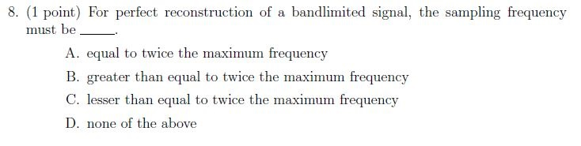

**Figure 1.** Printed question 8 from scanned offline paper, covering Nyquist sampling frequency condition for bandlimited signal reconstruction.

**Options**

**A.**

equal to twice the maximum frequency

**B.**

greater than equal to twice the maximum frequency

**C.**

lesser than equal to twice the maximum frequency

**D.**

none of the above

#### Worked answer — independently derived

**Answer: B — greater than or equal to twice the maximum frequency.** The course convention is $f_s\ge2f_{\max}$. The Nyquist rate is $2f_{\max}$, while the Nyquist frequency is $f_s/2$. Practical sampling uses a strict margin for anti-alias filtering; equality at a band-edge sinusoid requires care about phase and endpoint assumptions.

---

### 2022 Term 3 · Quiz 1 · AN — Question 9 (Subjective)

**Source:** [Original PDF, p. 6](../sources/exam-papers/pdfs/ee4001_2022T3_Q1_AN.pdf#page=6) · [Archived extraction](../sources/exam-papers/extractions/ee4001_2022T3_Q1_AN.md#q9)  
**Topics:** System linearity, invariance and causality. **Marks:** 3.

9. (3 points) For each of the following discrete time system, comment upon the following system properties (1) linear/non-linear, (2) time-invariant/time-variant, and (3) causal /anti-causal.

(a) (1.5 points) $y[n] = n x[n]$
(b) (1.5 points) $y[n] = e^{x[n]}$

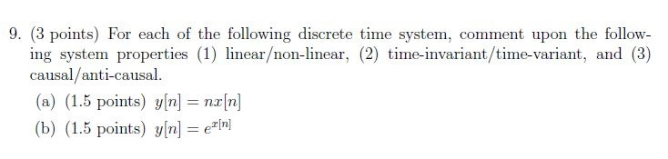

**Figure 2.** Printed question 9 from scanned offline paper, evaluating linearity, time-invariance, and causality for discrete-time systems.

#### Worked answer — independently derived

**(a) $y[n]=n x[n]$: linear, time-varying, causal.** Multiplication by the fixed sequence $n$ preserves superposition. A shifted input yields $n x[n-n_0]$, whereas a shifted output is $(n-n_0)x[n-n_0]$; they generally differ. Only the current input is used.

**(b) $y[n]=e^{x[n]}$: nonlinear, time-invariant, causal.** Zero input gives output 1, violating linearity. Shifting the input gives $e^{x[n-n_0]}$, exactly the shifted output. Only the current input is used. Neither system requires future samples; neither is strictly anti-causal.

---

### 2022 Term 3 · Quiz 1 · AN — Question 10 (Fill in the Blanks)

**Source:** [Original PDF, p. 6](../sources/exam-papers/pdfs/ee4001_2022T3_Q1_AN.pdf#page=6) · [Archived extraction](../sources/exam-papers/extractions/ee4001_2022T3_Q1_AN.md#q10)  
**Topics:** Linear basis representation. **Marks:** 1.

10. (1 point) Any point in a 3-D space can be represented as a _______ combination of its basis functions.

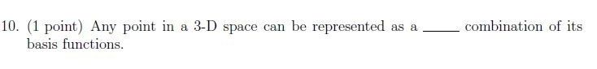

**Figure 3.** Printed question 10 from scanned offline paper, covering representation of 3-D points as a combination of basis functions.

#### Worked answer — independently derived

**Linear** combination. A vector in a 3D basis is expressed as a weighted sum of the three basis vectors.

---

### 2023 Term 1 · Quiz 1 · NA — Question 8 (MCQ)

**Source:** [Original PDF, p. 4](../sources/exam-papers/pdfs/ee4001_2023T1_Q1_NA.pdf#page=4) · [Archived extraction](../sources/exam-papers/extractions/ee4001_2023T1_Q1_NA.md#q8)  
**Topics:** Sampling theorem. **Marks:** 1.

8. (1 point) For perfect reconstruction of a bandlimited signal, the sampling frequency must be ___.

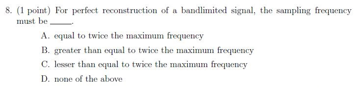

**Figure 4.** Printed question 8 from scanned offline paper, covering Nyquist sampling frequency condition for bandlimited signal reconstruction.

**Options**

**A.**

equal to twice the maximum frequency

**B.**

greater than equal to twice the maximum frequency

**C.**

lesser than equal to twice the maximum frequency

**D.**

none of the above

#### Worked answer — independently derived

**Answer: B — greater than or equal to twice the maximum frequency.** The course convention is $f_s\ge2f_{\max}$. The Nyquist rate is $2f_{\max}$, while the Nyquist frequency is $f_s/2$. Practical sampling uses a strict margin for anti-alias filtering; equality at a band-edge sinusoid requires care about phase and endpoint assumptions.

---

### 2023 Term 1 · Quiz 1 · NA — Question 9 (Subjective)

**Source:** [Original PDF, p. 4](../sources/exam-papers/pdfs/ee4001_2023T1_Q1_NA.pdf#page=4) · [Archived extraction](../sources/exam-papers/extractions/ee4001_2023T1_Q1_NA.md#q9)  
**Topics:** System linearity, invariance and causality. **Marks:** 3.

9. (3 points) For each of the following discrete time system, comment upon the following system properties (1) linear/non-linear, (2) time-invariant/time-variant, and (3) causal /anti-causal.

(a) (1.5 points) $y[n] = n x[n]$
(b) (1.5 points) $y[n] = e^{x[n]}$

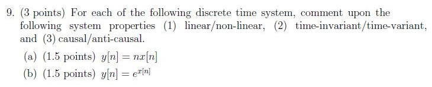

**Figure 5.** Printed question 9 from scanned offline paper, evaluating linearity, time-invariance, and causality for discrete-time systems.

#### Worked answer — independently derived

**(a) $y[n]=n x[n]$: linear, time-varying, causal.** Multiplication by the fixed sequence $n$ preserves superposition. A shifted input yields $n x[n-n_0]$, whereas a shifted output is $(n-n_0)x[n-n_0]$; they generally differ. Only the current input is used.

**(b) $y[n]=e^{x[n]}$: nonlinear, time-invariant, causal.** Zero input gives output 1, violating linearity. Shifting the input gives $e^{x[n-n_0]}$, exactly the shifted output. Only the current input is used. Neither system requires future samples; neither is strictly anti-causal.

---

### 2023 Term 1 · Quiz 1 · NA — Question 10 (Fill in the Blanks)

**Source:** [Original PDF, p. 4](../sources/exam-papers/pdfs/ee4001_2023T1_Q1_NA.pdf#page=4) · [Archived extraction](../sources/exam-papers/extractions/ee4001_2023T1_Q1_NA.md#q10)  
**Topics:** Linear basis representation. **Marks:** 1.

10. (1 point) Any point in a 3-D space can be represented as a _______ combination of its basis functions.

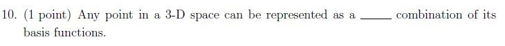

**Figure 6.** Printed question 10 from scanned offline paper, covering representation of 3-D points as a combination of basis functions.

#### Worked answer — independently derived

**Linear** combination. A vector in a 3D basis is expressed as a weighted sum of the three basis vectors.

---

### 2023 Term 3 · Quiz 1 · NA — Question 8 (MCQ)

**Source:** [Original PDF, p. 5](../sources/exam-papers/pdfs/ee4001_2023T3_Q1_NA.pdf#page=5) · [Archived extraction](../sources/exam-papers/extractions/ee4001_2023T3_Q1_NA.md#q8)  
**Topics:** Sampling theorem. **Marks:** 1.

8. (1 point) For perfect reconstruction of a bandlimited signal, the sampling frequency must be _______.

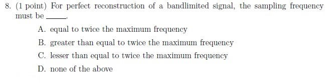

**Figure 7.** Printed question 8 from scanned offline paper, covering Nyquist sampling frequency condition for bandlimited signal reconstruction.

**Options**

**A.**

equal to twice the maximum frequency

**B.**

greater than equal to twice the maximum frequency

**C.**

lesser than equal to twice the maximum frequency

**D.**

none of the above

#### Worked answer — independently derived

**Answer: B — greater than or equal to twice the maximum frequency.** The course convention is $f_s\ge2f_{\max}$. The Nyquist rate is $2f_{\max}$, while the Nyquist frequency is $f_s/2$. Practical sampling uses a strict margin for anti-alias filtering; equality at a band-edge sinusoid requires care about phase and endpoint assumptions.

---

### 2023 Term 3 · Quiz 1 · NA — Question 9 (Subjective)

**Source:** [Original PDF, p. 5](../sources/exam-papers/pdfs/ee4001_2023T3_Q1_NA.pdf#page=5) · [Archived extraction](../sources/exam-papers/extractions/ee4001_2023T3_Q1_NA.md#q9)  
**Topics:** System linearity, invariance and causality. **Marks:** 3.

9. (3 points) For each of the following discrete time system, comment upon the following system properties (1) linear/non-linear, (2) time-invariant/time-variant, and (3) causal /anti-causal.

(a) (1.5 points) $y[n] = n x[n]$
(b) (1.5 points) $y[n] = e^{x[n]}$

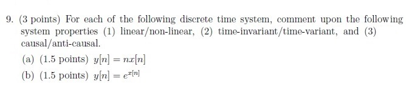

**Figure 8.** Printed question 9 from scanned offline paper, evaluating linearity, time-invariance, and causality for discrete-time systems.

#### Worked answer — independently derived

**(a) $y[n]=n x[n]$: linear, time-varying, causal.** Multiplication by the fixed sequence $n$ preserves superposition. A shifted input yields $n x[n-n_0]$, whereas a shifted output is $(n-n_0)x[n-n_0]$; they generally differ. Only the current input is used.

**(b) $y[n]=e^{x[n]}$: nonlinear, time-invariant, causal.** Zero input gives output 1, violating linearity. Shifting the input gives $e^{x[n-n_0]}$, exactly the shifted output. Only the current input is used. Neither system requires future samples; neither is strictly anti-causal.

---

### 2023 Term 3 · Quiz 1 · NA — Question 10 (Fill in the Blanks)

**Source:** [Original PDF, p. 5](../sources/exam-papers/pdfs/ee4001_2023T3_Q1_NA.pdf#page=5) · [Archived extraction](../sources/exam-papers/extractions/ee4001_2023T3_Q1_NA.md#q10)  
**Topics:** Linear basis representation. **Marks:** 1.

10. (1 point) Any point in a 3-D space can be represented as a _______ combination of its basis functions.

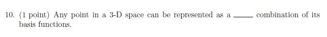

**Figure 9.** Printed question 10 from scanned offline paper, covering representation of 3-D points as a combination of basis functions.

#### Worked answer — independently derived

**Linear** combination. A vector in a 3D basis is expressed as a weighted sum of the three basis vectors.

---

### 2025 Term 2 · Quiz 1 · NA — Question 2 (MCQ)

**Source:** [Original PDF, p. 3](../sources/exam-papers/pdfs/ee4001_2025T2_Q1_NA.pdf#page=3) · [Archived extraction](../sources/exam-papers/extractions/ee4001_2025T2_Q1_NA.md#q2)  
**Topics:** Voiced speech periodicity. **Marks:** 1.

Voiced sounds result in speech signals.

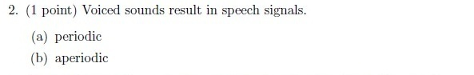

**Figure 10.** Printed Question 2 from scanned offline paper, covering whether voiced sounds result in periodic or aperiodic speech signals.

**Options**

**A.**

periodic

**B.**

aperiodic

#### Worked answer — independently derived

**A. periodic.** Voicing arises from quasi-periodic vocal-fold vibration, though real voiced waveforms are not perfectly periodic.

---

### 2025 Term 2 · Quiz 1 · NA — Question 3 (MCQ)

**Source:** [Original PDF, p. 3](../sources/exam-papers/pdfs/ee4001_2025T2_Q1_NA.pdf#page=3) · [Archived extraction](../sources/exam-papers/extractions/ee4001_2025T2_Q1_NA.md#q3)  
**Topics:** Sampling theorem. **Marks:** 1.

For perfect reconstruction of a bandlimited signal, the sampling frequency must be

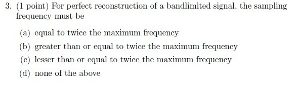

**Figure 11.** Printed Question 3 from scanned offline paper, covering sampling frequency condition for perfect reconstruction of a bandlimited signal.

**Options**

**A.**

equal to twice the maximum frequency

**B.**

greater than or equal to twice the maximum frequency

**C.**

lesser than or equal to twice the maximum frequency

**D.**

none of the above

#### Worked answer — independently derived

**Answer: B — greater than or equal to twice the maximum frequency.** The course convention is $f_s\ge2f_{\max}$. The Nyquist rate is $2f_{\max}$, while the Nyquist frequency is $f_s/2$. Practical sampling uses a strict margin for anti-alias filtering; equality at a band-edge sinusoid requires care about phase and endpoint assumptions.

---

### 2025 Term 2 · Quiz 1 · NA — Question 5 (Subjective)

**Source:** [Original PDF, p. 3](../sources/exam-papers/pdfs/ee4001_2025T2_Q1_NA.pdf#page=3) · [Archived extraction](../sources/exam-papers/extractions/ee4001_2025T2_Q1_NA.md#q5)  
**Topics:** System linearity and time invariance. **Marks:** 3.

Comment on the linearity and time-invariance of the following systems?

(a) $y[n] = 2x[n] + 3$

(b) $y[n] = x[n]^2$

(c) $y[n] = x[2n]$

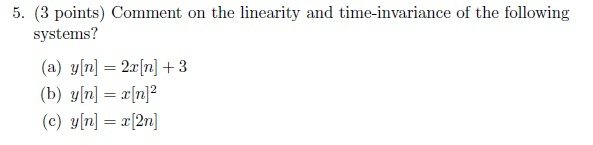

**Figure 12.** Printed Question 5 from scanned offline paper, covering linearity and time-invariance of three discrete-time systems.

#### Worked answer — independently derived

**(a) $2x[n]+3$: nonlinear, time-invariant.** $T[0]=3\ne0$ rules out linearity; shifting the input simply shifts $2x[n]+3$.

**(b) $x[n]^2$: nonlinear, time-invariant.** $T[2x]=4x^2\ne2T[x]$ generally; a shift produces $x[n-n_0]^2$, the shifted original output.

**(c) $x[2n]$: linear, time-varying.** Resampling preserves superposition. An input shift yields $x[2n-n_0]$, while an output shift yields $x[2n-2n_0]$; they differ generally.

---

### 2026 Term 1 · Quiz 1 · NA — Question 2 (MCQ)

**Source:** [Original PDF, p. 4](../sources/exam-papers/pdfs/ee4001_2026T1_Q1_NA.pdf#page=4) · [Archived extraction](../sources/exam-papers/extractions/ee4001_2026T1_Q1_NA.md#q2)  
**Topics:** Phoneme manner and place of articulation. **Marks:** 1.

The phoneme /f/ is a ___.

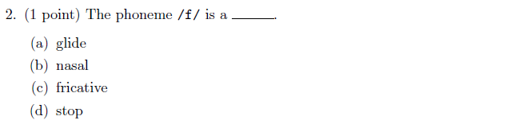

**Figure 13.** Printed question 2 from scanned offline paper, identifying the phonetic classification of the phoneme /f/.

**Options**

**A.**

glide

**B.**

nasal

**C.**

fricative

**D.**

stop

#### Worked answer — independently derived

**C. fricative.** /f/ is a voiceless labiodental fricative, produced by turbulent airflow through a narrow constriction.

---

### 2026 Term 1 · Quiz 1 · NA — Question 5 (MCQ)

**Source:** [Original PDF, p. 4](../sources/exam-papers/pdfs/ee4001_2026T1_Q1_NA.pdf#page=4) · [Archived extraction](../sources/exam-papers/extractions/ee4001_2026T1_Q1_NA.md#q5)  
**Topics:** Sampling theorem. **Marks:** 1.

For perfect reconstruction of a bandlimited signal, the sampling frequency must be

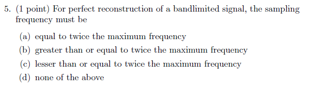

**Figure 14.** Printed question 5 from scanned offline paper, evaluating the sampling frequency condition for perfect reconstruction of a bandlimited signal.

**Options**

**A.**

equal to twice the maximum frequency

**B.**

greater than or equal to twice the maximum frequency

**C.**

lesser than or equal to twice the maximum frequency

**D.**

none of the above

#### Worked answer — independently derived

**Answer: B — greater than or equal to twice the maximum frequency.** The course convention is $f_s\ge2f_{\max}$. The Nyquist rate is $2f_{\max}$, while the Nyquist frequency is $f_s/2$. Practical sampling uses a strict margin for anti-alias filtering; equality at a band-edge sinusoid requires care about phase and endpoint assumptions.

---

### 2026 Term 1 · Quiz 1 · NA — Question 6 (Subjective)

**Source:** [Original PDF, p. 4](../sources/exam-papers/pdfs/ee4001_2026T1_Q1_NA.pdf#page=4) · [Archived extraction](../sources/exam-papers/extractions/ee4001_2026T1_Q1_NA.md#q6)  
**Topics:** sampling/systems/speech fundamentals. **Marks:** 2.

What is the minimum sampling frequency of a signal that was low pass filtered with a cut-off frequency of 10kHz to avoid aliasing?

Note: 1 mark for the right answer and 1 mark for explaining the formula

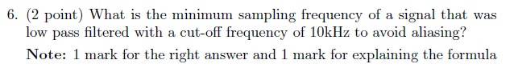

**Figure 15.** Printed question 6 from scanned offline paper, calculating the minimum sampling frequency to avoid aliasing for a 10kHz low-pass filtered signal.

#### Worked answer — independently derived

The highest retained frequency is $f_{max}=10$ kHz. By the Nyquist criterion, $f_s\ge2f_{max}=20$ kHz; therefore the minimum ideal sampling frequency is **20 kHz** (a practical system uses some margin and a realizable anti-alias filter).

---

### 2026 Term 1 · Quiz 1 · NA — Question 8 (Subjective)

**Source:** [Original PDF, p. 4](../sources/exam-papers/pdfs/ee4001_2026T1_Q1_NA.pdf#page=4) · [Archived extraction](../sources/exam-papers/extractions/ee4001_2026T1_Q1_NA.md#q8)  
**Topics:** System linearity and time invariance. **Marks:** 3.

Comment on the linearity and time-invariance of the following systems?

(a) $y[n] = 2x[n] + 3$

(b) $y[n] = x[n]^2$

(c) $y[n] = x[2n]$

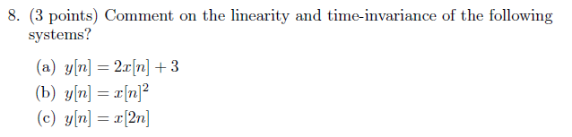

**Figure 16.** Printed question 8 from scanned offline paper, evaluating linearity and time-invariance of three discrete-time systems.

#### Worked answer — independently derived

**(a) $2x[n]+3$: nonlinear, time-invariant.** $T[0]=3\ne0$ rules out linearity; shifting the input simply shifts $2x[n]+3$.

**(b) $x[n]^2$: nonlinear, time-invariant.** $T[2x]=4x^2\ne2T[x]$ generally; a shift produces $x[n-n_0]^2$, the shifted original output.

**(c) $x[2n]$: linear, time-varying.** Resampling preserves superposition. An input shift yields $x[2n-n_0]$, while an output shift yields $x[2n-2n_0]$; they differ generally.

---

## End Term questions

### 2026 Term 1 · End Term · FN — Question 3 (Short Answer)

**Source:** [Original PDF, p. 2](../sources/exam-papers/pdfs/ee4001_2026T1_ET_FN.pdf#page=2) · [Archived extraction](../sources/exam-papers/extractions/ee4001_2026T1_ET_FN.md#q3)  
**Topics:** sampling. **Marks:** 1.

**Shared source instructions:**

Instructions :

All option-based questions are MCQs, and all fill-in-the-blank questions are short answer questions.

For Questions 3 to 20, answer all questions.

• In MCQs, you must write the correct option and also the complete text of that option.
• You must then provide a detailed explanation of why that specific option is the correct answer.
• In short answer questions, write the answer clearly with proper explanation wherever needed.
• In all problem-solving or example-based questions, present the solution with all intermediate steps clearly shown.
• Step-wise explanation is compulsory for all such questions.
• The final answer must be written clearly at the end.

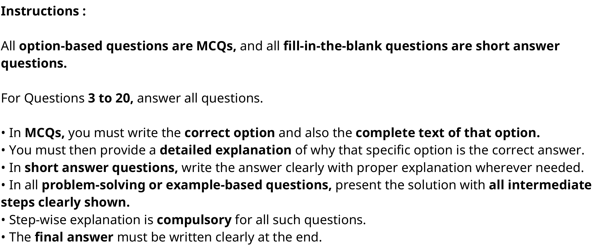

**Figure 17.** General examination instructions specifying answer requirements for MCQs, short answer, and problem-solving questions

If a speech signal is sampled at 16,000 samples per second, how many samples are contained in a 10-millisecond frame?

#### Worked answer — independently derived

16,000 samples/s × 0.010 s = **160 samples**.

---

### 2026 Term 1 · End Term · FN — Question 14 (MCQ)

**Source:** [Original PDF, p. 6](../sources/exam-papers/pdfs/ee4001_2026T1_ET_FN.pdf#page=6) · [Archived extraction](../sources/exam-papers/extractions/ee4001_2026T1_ET_FN.md#q14)  
**Topics:** Linguistic and paralinguistic information. **Marks:** 1.

**Overlap:** [[week-2-notes|Week 2]]. Primary placement follows the earliest substantive mechanism.

**Shared source instructions:**

Instructions :

All option-based questions are MCQs, and all fill-in-the-blank questions are short answer questions.

For Questions 3 to 20, answer all questions.

• In MCQs, you must write the correct option and also the complete text of that option.
• You must then provide a detailed explanation of why that specific option is the correct answer.
• In short answer questions, write the answer clearly with proper explanation wherever needed.
• In all problem-solving or example-based questions, present the solution with all intermediate steps clearly shown.
• Step-wise explanation is compulsory for all such questions.
• The final answer must be written clearly at the end.

**Figure 18.** General examination instructions specifying answer requirements for MCQs, short answer, and problem-solving questions

If we convert speech to pure text, what information is primarily lost?

**Options**

**A.**

The literal words spoken

**B.**

The grammatical structure

**C.**

Speaker identity and emotion

**D.**

The language of the speaker

#### Worked answer — independently derived

**Answer: C — speaker identity and emotion.** Ordinary text preserves the lexical sequence but omits much of the pitch contour, timing, voice quality and timbre that carry speaker and affective cues. Some emotion can be inferred from word choice, but pure transcription does not preserve those acoustic cues.

---

## Reproducibility and source integrity

Source PDFs, original extracted text and crops are archived under `sources/exam-papers/`. The inventory records PDF SHA-256 hashes. Rebuild with `uv run python build_exam_question_banks.py`; verify numerical examples and generated links with `uv run python verify_exam_question_banks.py`. The reviewed routing manifest includes every source question, including excluded later material.
