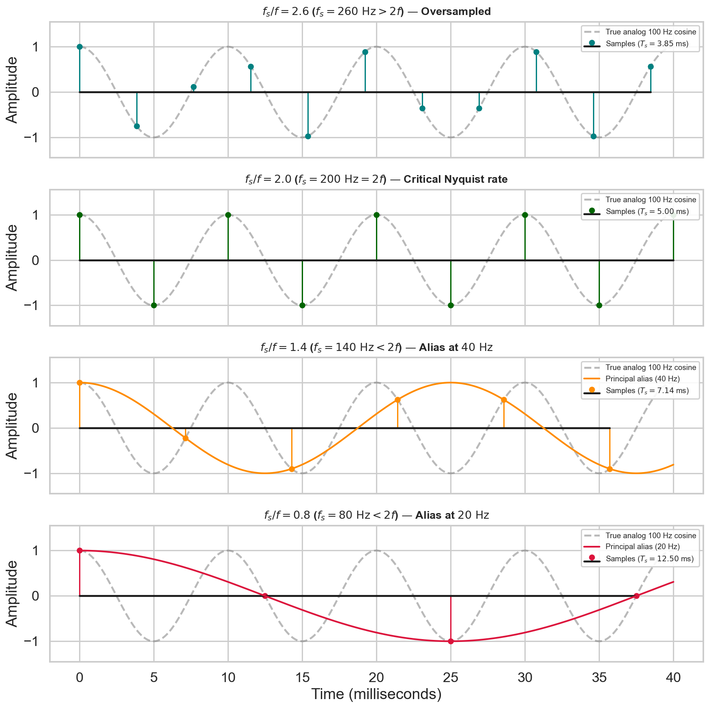
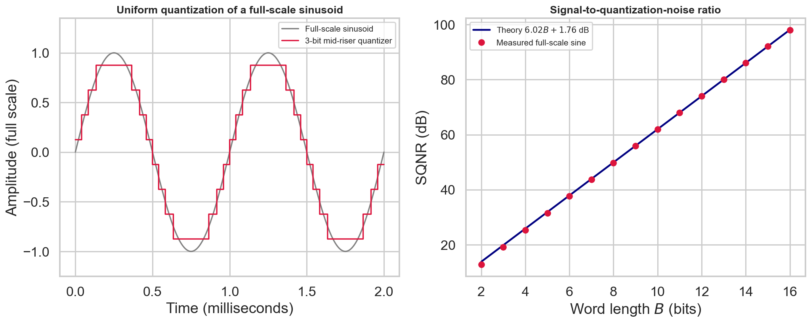
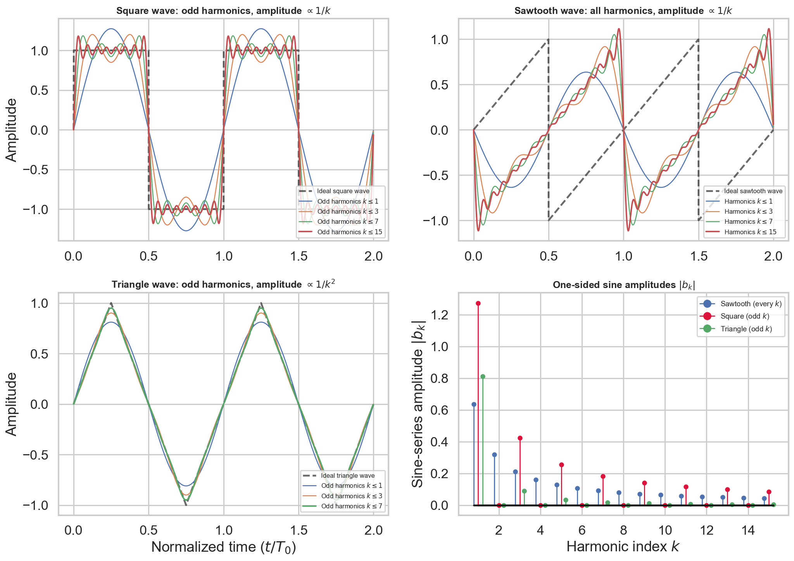
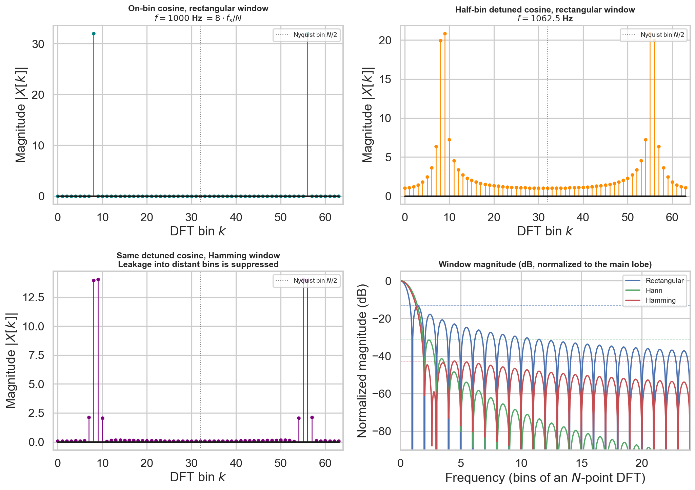
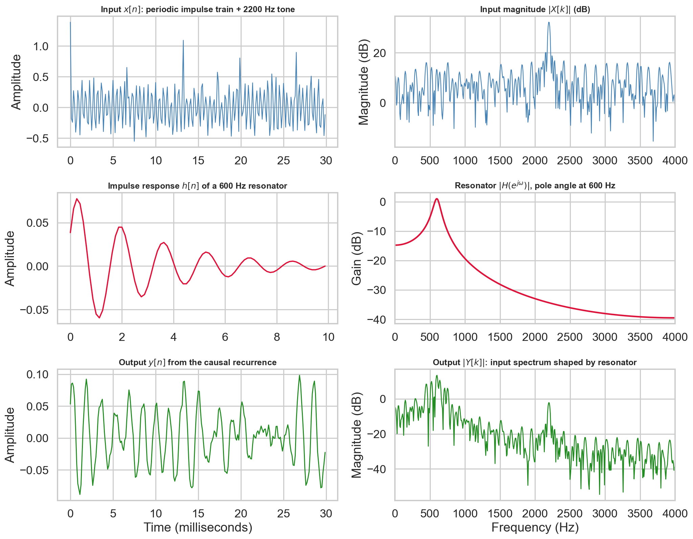
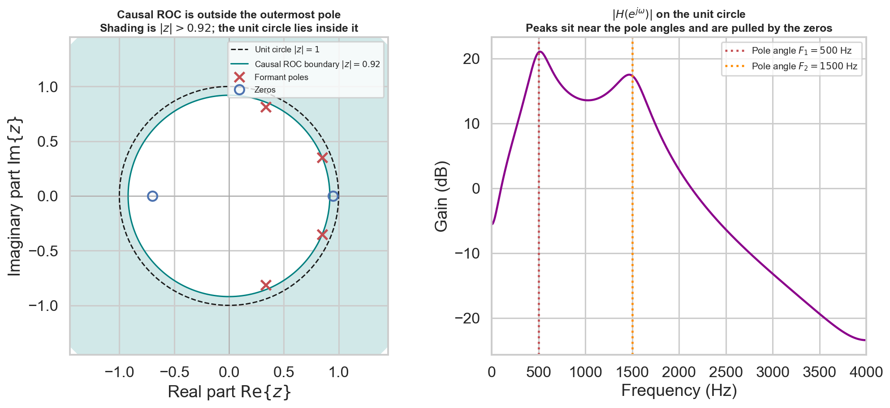
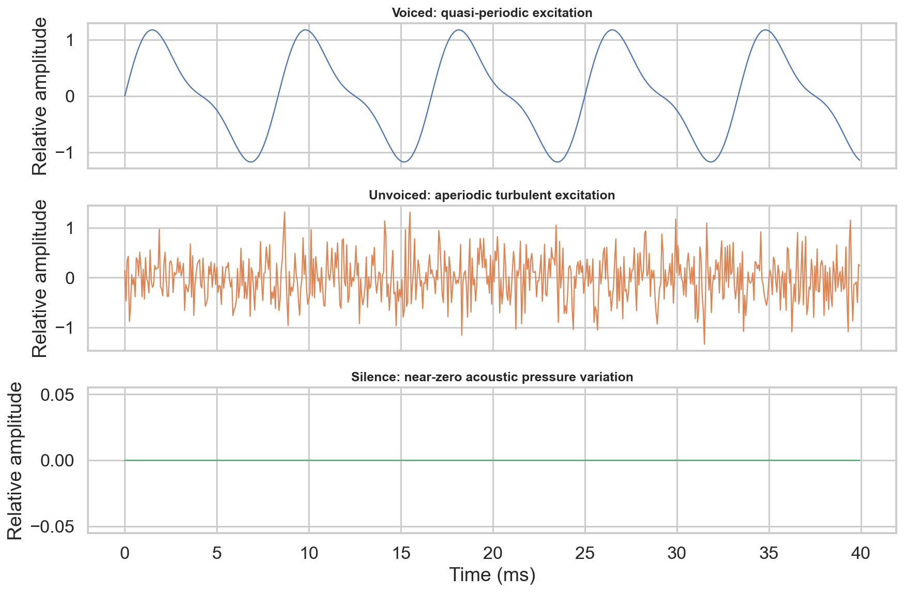

# Week 1: Speech Communication, Digital Signal Processing, and Speech Production

**Learn and revise for the exam:** [[week-1-exam-focused-notes|Week 1 beginner-friendly exam guide]] · [[exam-study-guide|Study route and priorities]]


**Authentic past papers:** [[week-1-exam-questions|Week 1 questions and worked answers]] · [[exam-question-index|Paper coverage and routing audit]]


**Navigation:** [[Knowledge-Map|Knowledge Map]] · [[week 2/week-2-notes|Week 2 Notes]] → · [[source-catalog|Sources and scope]]

> **Scope:** The six lecture headings visible in the course-curriculum screenshot: Course Introduction; Digital Signal Processing Fundamentals; Fourier Series; Speech Production; Revision; Waveforms. The technical scope below follows the corresponding lecture material, slides 1–43 of `../sources/Speech_course_slides-revamp.pdf`. The later speech-production-model overview on slide 44 is outside this week's boundary.

## Abstract

This note establishes how speech is represented as a communicative acoustic signal, how continuous-time signals enter digital systems, how periodic signals admit Fourier representations, and how vocal production yields distinguishable waveform classes. Sampling is derived as uniform time discretization, while finite-word quantization is treated separately as amplitude discretization; a deterministic eight-bit example yields a step of `0.0078125` and a worst-case rounding error of `0.00390625` for a full-scale mid-rise quantizer. The four Fourier representations are organized by continuous or discrete time and periodic or aperiodic signals, with the finite DFT interpreted as a set of projections onto orthogonal complex sinusoids. LTI systems, convolution, rational transfer functions, and pole-zero geometry provide the mathematical bridge between excitation and frequency-selective response. The final synthesis connects articulators, voiced and unvoiced excitation, phones and phonemes, and silence to the observable acoustic waveform, without extending into later feature extraction or speech-perception topics.

## Lecture map and boundaries

| Screenshot lecture | Material covered here | Source slides |
|---|---|---:|
| Course Introduction | Communication purpose, course map, speech chain, compression, TTS and recognition as applications | 1–9 |
| Digital Signal Processing Fundamentals | Sampling, quantization, Fourier-transform taxonomy, DFT, systems, LTI convolution, rational filters | 10–16, 19–32 |
| Fourier Series | Periodic-signal expansion in harmonic basis functions; CTFS and DTFS distinction | 15–18 |
| Speech Production | Vocal tract, vocal-fold vibration, mouth configurations, vowel/phoneme inventory, articulation manner/place | 33–41 |
| Revision | Organizing recap of the named foundations above | 10–32 |
| Waveforms | Speech, unvoiced, silence examples; waveform cues for speaker/age questions posed in the lecture | 42–43 |

**Assignment labels shown in the screenshot:** AQ1.1, AQ1.2, AQ1.3, AQ1.4, AQ1.6, and Graded Assignment 1. The source supplied for this task contains labels only, not question text. No assignment problems or official solutions are reconstructed here.

**Boundary rule:** Sampling, quantization, CTFS/DTFS/CTFT/DTFT/DFT, system properties, convolution, z-transform framing, rational filters and pole-zero interpretation are in scope. The source's later slides about STFT, spectrograms, auditory perception, pitch, masking, mel, cepstrum, liftering, and MFCC are outside Week 1. The full source-filter production-model derivation begins after slide 43 and is also reserved for its assigned later week. $F_0$ and formants are used only as production concepts here; no estimation algorithm is introduced.

## 1. Communication and the speech chain

Speech is an acoustic realization of a message. A speaker selects linguistic content, coordinates articulators, and produces pressure variations that travel through a medium; a listener's auditory system transduces those variations into a linguistic interpretation. The course slides depict this as linguistic, physiological, acoustic, physiological, and linguistic stages. The chain matters because an observed waveform is the outcome of several transformations: different wordings can encode a similar intent, and similar articulatory targets can be altered by speaker, channel, or environment.

Speech technology tasks operate at different points in this chain. Automatic recognition maps an acoustic input toward symbolic output. Speech synthesis maps a text or linguistic specification toward an acoustic output, ultimately requiring digital-to-analog conversion for playback. Coding and compression seek a representation that can be stored or transmitted and later reconstructed. These are application motivations, not a claim that the week develops a complete recognizer, synthesizer, or codec.

## 2. Continuous-time signals become digital sequences

### 2.1 Uniform sampling

Let $x(t)$ be a continuous-time signal and let the sampling interval be $T_s$. The sampled sequence is

$$x[n] = x(nT_s), \qquad n\in\mathbb{Z}, \qquad f_s = T_s^{-1}.$$

For a bandlimited signal with maximum frequency $f_max$, ideal reconstruction is possible when the sampling rate exceeds twice that highest frequency (with additional practical care at the boundary):

$$f_s > 2f_{\max}, \qquad f_{\mathrm{Nyquist}}=\frac{f_s}{2}.$$

The sampling rate is a property of the acquisition process; the Nyquist frequency is the upper edge of the unaliased baseband. They are related but are not interchangeable terms. If spectral replicas overlap because $f_s$ is too low, distinct analog frequencies produce the same samples. For a sampled sinusoid, frequencies separated by integer multiples of $f_s$ are indistinguishable; folding into `[0, f_s/2]` gives the principal alias. A real acquisition system therefore applies an anti-alias filter before sampling, although the ideal theorem abstracts away that implementation.

**Worked calculation.** A `1 kHz` sinusoid sampled at `8 kHz` has eight samples per cycle and lies below the `4 kHz` Nyquist frequency. A `5 kHz` sinusoid sampled at the same rate aliases to `3 kHz`, since the samples of `cos(2π·5000 n/8000)` equal those of `cos(2π·3000 n/8000)`.



**Figure 1.** *A 100 Hz cosine observed at four sampling-rate ratios. Below twice the signal frequency, the discrete samples are consistent with a lower-frequency sinusoid, demonstrating ambiguity from aliasing.*

### 2.2 Quantization is a second operation

Sampling discretizes time. Quantization maps each sampled amplitude to a finite set of representable levels. For a uniform mid-rise quantizer covering `[-A,A]` with `B` bits, the nominal step is

$$\Delta=\frac{2A}{2^B}.$$

Under the common high-resolution model, the quantization error is approximated as uniformly distributed over $[-\Delta/2,\Delta/2]$, with variance $\Delta^2/12$. For a full-scale sinusoid, the familiar approximation is

$$\mathrm{SQNR}\approx 6.02B+1.76\ \mathrm{dB}.$$

This estimate assumes no overload and a sufficiently decorrelated quantization error. It is not a guarantee for arbitrary signals, low-level tones, or companded coding. The lecture cites 16 kHz, 16-bit PCM as a preferred speech-processing representation and identifies A-law/μ-law telephone coding as standards examples; those are contextual standards rather than universal optimal settings.



**Figure 2.** *A finite-level quantizer introduces bounded amplitude error. The measured full-scale sinusoid SQNR approaches the high-resolution `6.02B + 1.76 dB` approximation as word length increases.*

## 3. Fourier series and the transform family

### 3.1 Periodic signals and Fourier series

A periodic signal of period $T_0$ can be represented, under standard convergence conditions, as a sum of harmonically related complex exponentials:

$$x(t)=\sum_{k=-\infty}^{\infty} c_k e^{jk\omega_0t},\qquad \omega_0=\frac{2\pi}{T_0},$$

$$c_k=\frac{1}{T_0}\int_{t_0}^{t_0+T_0}x(t)e^{-jk\omega_0t}\,dt.$$

The harmonics are basis functions; coefficients encode the contribution of each basis component. A periodic square wave with zero mean contains odd harmonics whose amplitudes decay in proportion to $1/k$; a triangle wave's odd-harmonic amplitudes decay as $1/k^2$. The slower square-wave decay explains its sharper transitions and slower partial-sum convergence. At discontinuities, Fourier partial sums converge to the midpoint of the jump and exhibit the Gibbs phenomenon near the jump; adding terms narrows the oscillatory region but does not eliminate its limiting overshoot.

For a discrete periodic sequence with period $N$, the DTFS uses $N$ distinct harmonics and periodic coefficient indexing. The continuous/discrete distinction concerns the signal's independent variable, not whether coefficients happen to be stored numerically.



**Figure 3.** *Finite harmonic sums approximate square, sawtooth, and triangle waves. Their different coefficient-decay rates explain the relative sharpness of transitions and convergence behavior.*

### 3.2 Four transforms by signal domain

| Representation | Signal | Transform variable | Typical role |
|---|---|---|---|
| CTFS | Continuous-time, periodic | Discrete harmonic index | Harmonic coefficients of a periodic waveform |
| CTFT | Continuous-time, aperiodic | Continuous frequency | Frequency representation of finite-energy signals |
| DTFS | Discrete-time, periodic | Discrete harmonic index | One period's coefficient representation |
| DTFT | Discrete-time, aperiodic | Continuous normalized frequency, periodic in $\omega$ | Frequency response of discrete sequences/systems |

This classification follows the lecture's input-domain distinction. The CTFT convention used here is `X(Ω)=∫x(t)e^{-jΩt}dt`; the DTFT is `X(e^{jω})=Σ_n x[n]e^{-jωn}`. Since discrete time implies periodicity in normalized frequency with period $2\pi$, the DTFT is continuous in $\omega$ but periodic. The DFT then samples one period of that spectrum at $N$ equally spaced frequencies for a finite $N$-sample record.

### 3.3 DFT as orthogonal projection

For $x[n]$, $0\le n<N$, the DFT and inverse DFT are

$$X[k]=\sum_{n=0}^{N-1}x[n]e^{-j2\pi kn/N},\qquad
x[n]=\frac{1}{N}\sum_{k=0}^{N-1}X[k]e^{j2\pi kn/N}.$$

The basis vectors are orthogonal over the length-$N$ observation interval. Bin `k` corresponds to frequency $f_k=kf_s/N$ for the nonnegative-frequency half of a real-signal spectrum, so bin spacing is $f_s/N$. This grid spacing is not identical to the ability to resolve two nearby tones: leakage, window main-lobe width, record length, signal-to-noise ratio, and estimator assumptions matter. A sinusoid completing an integer number of cycles in the record concentrates energy in its matching DFT bins; a detuned sinusoid spreads energy across bins because truncation multiplies the infinite signal by a finite observation window. Windowing trades main-lobe width for sidelobe suppression.



**Figure 4.** *A bin-centered tone concentrates in its conjugate-symmetric DFT bins. Detuning spreads energy; taper windows reduce distant sidelobes while broadening the main lobe.*

## 4. Systems, convolution, and rational filters

### 4.1 System properties and LTI representation

A discrete-time system maps input $x[n]$ to output $y[n]$. Linearity requires superposition, `T{a x_1+b x_2}=aT{x_1}+bT{x_2}`. Time invariance requires a shift in input to produce the same shift in output. Other classifications include memoryless versus memory-bearing, causal versus noncausal, and BIBO stable versus unstable. These are logically separate properties: for example, causality alone does not imply stability.

For an LTI system, the response to the unit impulse $\delta[n]$ is $h[n]$; every input can be decomposed into shifted impulses, giving

$$y[n]=(x*h)[n]=\sum_{k=-\infty}^{\infty}x[k]h[n-k].$$

The time reversal in `h[n-k]` is essential to convolution. In frequency, convolution becomes multiplication, `Y(e^{jω})=X(e^{jω})H(e^{jω})`, when the relevant transforms exist. A finite sequence calculation below demonstrates the indexing directly.

### 4.2 Difference equations, z-transform, and pole geometry

A constant-coefficient linear difference equation

$$y[n]+\sum_{k=1}^{P}a_k y[n-k]=\sum_{m=0}^{Q}b_m x[n-m]$$

has transfer function, under zero initial conditions,

$$H(z)=\frac{Y(z)}{X(z)}=\frac{\sum_{m=0}^{Q}b_mz^{-m}}{1+\sum_{k=1}^{P}a_kz^{-k}}.$$

Roots of the numerator are zeros; roots of the denominator are poles. Pole angles set resonant frequencies and pole radii set decay rates. For a causal rational system the region of convergence lies outside the outermost pole; BIBO stability additionally requires the unit circle to lie in the region of convergence. A pole close to the unit circle creates a sharper, longer-lived resonance. In speech acoustics, resonances of vocal-tract cavities are called formants, but interpreting poles as approximate formant locations is a model-level connection, not direct measurement of a speaker's anatomy.



**Figure 5.** *A deterministic input passed through a second-order resonator illustrates the impulse-response and frequency-selective views of an LTI system. The output is calculated by a causal recurrence.*



**Figure 6.** *Conjugate pole pairs produce resonant peaks near their angles. The causal region of convergence is exterior to the outermost pole; stability requires inclusion of the unit circle.*

## 5. Speech production and waveform classes

### 5.1 Articulatory production

The vocal tract comprises the respiratory source, larynx and vocal folds, pharyngeal and oral cavities, and articulators including tongue, lips, jaw, and velum. In voiced production, airflow drives vocal-fold vibration, producing quasi-periodic excitation. Its repetition rate is the fundamental frequency $F_0$; perceived pitch is related to this rate but is not identical to every component of the acoustic spectrum. The vocal tract's changing shape filters that excitation and creates resonances associated with vowel quality. Unvoiced sounds arise from turbulent airflow at a constriction without periodic vocal-fold vibration. Many speech sounds combine or transition between these mechanisms.

A **phone** is a concrete speech sound; a **phoneme** is a language-specific contrastive category that can distinguish meaning. One phoneme can have multiple context-dependent phone realizations. Vowels are produced with an open vocal tract and are distinguished in part by tongue and lip configuration. Consonants involve constriction or closure and can be classified by manner (for example, stop, fricative, nasal, glide) and place (for example, bilabial, labiodental, alveolar, velar). The source lecture's mouth configurations, vowel examples, phoneme inventory, and manner/place slides support this articulatory vocabulary.

### 5.2 What waveform shape supports

The lecture's waveform examples distinguish silence, unvoiced speech, and voiced speech. Periodicity is evidence of voiced excitation; irregular broadband-like fluctuation is consistent with turbulent unvoiced excitation; silence has very low signal energy. These cues are not perfect classifiers: background noise makes silence nonzero, voiced fricatives mix periodic and noisy components, and a waveform alone does not uniquely identify a phoneme or speaker. The lecture poses gender and adult/child identification as questions from waveform examples, but these are not uniquely solvable from a single short waveform without controlled conditions and validated features. $F_0$ and vocal-tract resonances vary across people and phonetic context; neither is a categorical label by itself.



**Figure 7.** *Synthetic voiced, noise-like unvoiced, and zero-valued silence sequences illustrate broad time-domain differences. These examples teach signal categories and do not represent recorded speech or a validated demographic classifier.*

## 6. Reproducible computational lab

### Concept

The lab combines discrete sampling, finite precision, a Fourier-series approximation, a bin-centered DFT, finite convolution, and elementary waveform-class statistics. It deliberately ends at the waveform and system foundations introduced in the named lectures.

### Code

The exact runnable file is [week1_lab.py](../week1_lab.py). Its complete source is reproduced here for a standalone reading copy:

```python
"""Reproducible Week 1 lab: sampled signals, transforms, systems, speech classes."""
import numpy as np


def main():
    # Sampling of a 1 kHz sinusoid at 8 kHz: no aliasing, 8 samples/cycle.
    fs, f0 = 8000, 1000
    n = np.arange(16)
    x = np.cos(2 * np.pi * f0 * n / fs)
    print(f"[Sampling] fs={fs} Hz, f0={f0} Hz, samples/cycle={fs // f0}")

    # Mid-rise uniform quantizer on [-1, 1), 8 bits.
    bits, xmax = 8, 1.0
    delta = 2 * xmax / (2**bits)
    q = -xmax + (np.floor((x + xmax) / delta) + 0.5) * delta
    q = np.clip(q, -xmax + delta / 2, xmax - delta / 2)
    print(f"[Quantization] bits={bits}, step={delta:.6f}, max_abs_error={np.max(np.abs(x-q)):.6f}")

    # Complex Fourier series of a periodic unit-amplitude square wave; first five odd terms.
    t = np.arange(4000) / 4000
    approx = np.zeros_like(t)
    for k in (1, 3, 5, 7, 9):
        approx += 4 / (np.pi * k) * np.sin(2 * np.pi * k * t)
    target = np.where(np.sin(2*np.pi*t) >= 0, 1.0, -1.0)
    print(f"[Fourier series] terms=5 odd harmonics, RMS_error={np.sqrt(np.mean((target-approx)**2)):.6f}")

    # DFT bin spacing and reconstruction via inverse DFT for a bin-centered tone.
    N, fs_dft = 64, 8000
    nd = np.arange(N)
    tone = np.cos(2*np.pi*8*nd/N)
    X = np.fft.fft(tone)
    rec_error = np.max(np.abs(np.fft.ifft(X).real - tone))
    print(f"[DFT] N={N}, bin_spacing={fs_dft/N:.1f} Hz, peak_bins=8,56, inverse_max_error={rec_error:.2e}")

    # Finite discrete convolution demonstrates LTI superposition mechanism.
    a = np.array([1., 2., 0.])
    h = np.array([1., -0.5])
    y = np.convolve(a, h)
    print(f"[Convolution] x={a.tolist()}, h={h.tolist()}, y={y.tolist()}")

    # Basic acoustic labels: periodic voiced, noise-like unvoiced, silence.
    rng = np.random.default_rng(42)
    t = np.arange(320) / 16000
    voiced = np.sin(2*np.pi*120*t) + 0.35*np.sin(2*np.pi*240*t)
    unvoiced = 0.45*rng.standard_normal(t.size)
    silence = np.zeros_like(t)
    for name, signal in (("voiced", voiced), ("unvoiced", unvoiced), ("silence", silence)):
        print(f"[Waveform] {name}: rms={np.sqrt(np.mean(signal**2)):.6f}")


if __name__ == "__main__":
    main()
```

### Output

```text
[Sampling] fs=8000 Hz, f0=1000 Hz, samples/cycle=8
[Quantization] bits=8, step=0.007812, max_abs_error=0.003906
[Fourier series] terms=5 odd harmonics, RMS_error=0.200990
[DFT] N=64, bin_spacing=125.0 Hz, peak_bins=8,56, inverse_max_error=4.44e-16
[Convolution] x=[1.0, 2.0, 0.0], h=[1.0, -0.5], y=[1.0, 1.5, -1.0, 0.0]
[Waveform] voiced: rms=0.764064
[Waveform] unvoiced: rms=0.421051
[Waveform] silence: rms=0.000000
```

### Interpretation

The sampling example has eight samples per cycle, while the quantizer's measured maximum error equals half its step because the non-overloaded mid-rise reconstruction level is centered in each bin. The square-wave approximation has finite RMS error because five harmonics cannot reproduce its discontinuities; the exact value depends on the explicitly chosen sampling grid and harmonic count. The DFT's conjugate-symmetric bins 8 and 56 correspond to the positive and negative frequency components of a real cosine; inverse transformation recovers the finite input to floating-point precision. Convolution returns four samples, consistent with lengths three and two. The waveform RMS values summarize these constructed sequences only and are not empirical speech measurements.

## 7. Worked revision problems and mastery check

These are generated revision problems, not reconstructed activity-assignment questions.

1. **Sampling versus quantization.** A 3 kHz sinusoid is sampled at 8 kHz with a 10-bit uniform quantizer spanning $[-1,1]$. What is the Nyquist frequency and quantizer step? **Solution:** $f_s/2=4$ kHz, so this tone is below the Nyquist frequency. The amplitude step is $\Delta=2/2^{10}=0.001953125$. Increasing the bit depth reduces amplitude error; it does not correct aliasing caused by an insufficient sampling rate.
2. **DFT bins.** A 64-sample record at 8 kHz contains a 1 kHz real cosine. Which bins contain its ideal bin-centered components? **Solution:** $\Delta f=8000/64=125$ Hz, so the positive-frequency bin is $k=1000/125=8$ and its conjugate partner is $N-k=56$. The latter represents $-1$ kHz under signed-frequency indexing.
3. **Convolution indexing.** For $x=[1,2,0]$ and $h=[1,-0.5]$, calculate the finite convolution. **Solution:** $y[0]=1$, $y[1]=2-0.5=1.5$, $y[2]=0-1=-1$, and $y[3]=0$. Thus $y=[1,1.5,-1,0]$, matching the executed lab. The output length is $3+2-1=4$.
4. **System properties.** Classify $y[n]=x[n-1]$ and $y[n]=x[n]^2$. **Solution:** A unit delay is linear, time invariant, causal, has memory, and is BIBO stable. Squaring is nonlinear, time invariant, causal, memoryless, and BIBO stable: bounded input magnitude $M$ gives output at most $M^2$.
5. **Harmonics and phonetic identity.** Does increasing a vowel's fundamental frequency imply a different phoneme? **Solution:** No. Fundamental frequency primarily describes excitation periodicity. Vowel identity depends strongly on vocal-tract resonances and linguistic context. A waveform can change its repetition rate while retaining broadly similar articulatory targets; waveform periodicity alone cannot establish phoneme identity or demographic category.

**Master formula sheet.** $x[n]=x(n/f_s)$; $f_{\mathrm{Nyquist}}=f_s/2$; $\Delta=2A/2^B$; $\Delta f=f_s/N$; $X[k]=\sum_{n=0}^{N-1}x[n]e^{-j2\pi kn/N}$; $(x*h)[n]=\sum_kx[k]h[n-k]$. The ideal sampling criterion concerns bandwidth, while finite-record DFT spacing concerns the observation duration.

**Self-check:** Explain the speech chain; separate sampling from amplitude quantization; distinguish Fourier series from a Fourier transform; compute a DFT-bin frequency and a short convolution; distinguish voiced, unvoiced, and low-energy waveform regions without treating these cues as perfect classifiers.

## 8. Numerical cautions and common errors

- **Sampling versus quantization:** A sequence can have finely resolved amplitudes but still be aliased; amplitude precision cannot recover information lost in time sampling.
- **Rate versus frequency:** $f_s$ is the sample rate; `f_s/2` is the Nyquist frequency. The Nyquist rate for a particular bandlimit is twice that bandlimit.
- **DFT grid versus resolving power:** $f_s/N$ is bin spacing, not a universal two-tone resolution guarantee.
- **Convolution indexing:** Replacing `h[n-k]` with `h[n+k]` changes the operation. Correlation uses a different shift convention.
- **Pole angle versus exact resonance:** Pole angle predicts a resonance location, but numerator zeros and damping can shift the maximum of `|H(e^{jω})|`.
- **Waveform interpretation:** Periodicity and energy are useful cues, not sufficient proof of a phonetic identity or demographic attribute.

## 9. Summary and handoff

1. Speech is a message-bearing acoustic event produced through coordinated linguistic and physiological stages.
2. Digital representation requires separate time sampling and amplitude quantization; undersampling creates alias ambiguity.
3. Fourier series represent periodic signals in harmonically related basis functions; the CTFS/CTFT/DTFS/DTFT distinction follows time-domain continuity and periodicity.
4. The DFT computes finite-record frequency projections; finite observation and window choice govern leakage behavior.
5. LTI systems are characterized by impulse response and convolution; rational transfer functions connect difference equations to poles, zeros, and resonant behavior.
6. Vocal-fold vibration, turbulent airflow, articulatory configuration, and silence create waveform classes that motivate subsequent speech analysis.

The next assigned material should build on this signal-and-production foundation according to the course's actual screenshot curriculum. Week 1 does not pre-teach later feature extraction or auditory-analysis lectures.

## 10. References

1. Umesh, S. *Introduction to Speech Signal Processing*, course lecture slides, Speech Lab, Department of Electrical Engineering, IIT Madras, file `../sources/Speech_course_slides-revamp.pdf`, slides 1–43. Stable local source pointer: `[[source-catalog]]`. Contribution: primary source for the lecture sequence, sampling, transform taxonomy, systems, speech production, and waveform examples summarized here.
2. Oppenheim, A. V., and R. W. Schafer. *Discrete-Time Signal Processing*, 3rd ed. Pearson, 2010. Contribution: standard reference for discrete-time systems, transforms, and Fourier analysis.
3. Rabiner, L. R., and R. W. Schafer. *Theory and Applications of Digital Speech Processing*. Pearson, 2011. Contribution: speech-specific grounding for acoustic production and digital speech signal representations.

## Appendix A — Reproduction

From the `Speech Technology/` directory:

```bash
uv run python week1_lab.py
uv run python generate_week1_plots.py
shasum -a 256 'week 1/assets/'*.png
```

The plot generator writes seven in-scope PNGs and prints deterministic diagnostic lines. Pre-existing assets for later speech-analysis topics have been left on disk but are not generated or referenced by this Week 1 note.

## Appendix B — Knowledge graph connections

**Upstream:** [[Knowledge-Map]]  
**Core concepts:** [[speech-chain]] · [[nyquist-sampling-theorem]] · [[discrete-fourier-transform]] · [[linear-time-invariant-systems]] · [[rational-filters-poles-zeros]]  
**Downstream:** [[week 2/week-2-notes|Week 2 Notes]]  
**Source:** [[source-catalog]]
