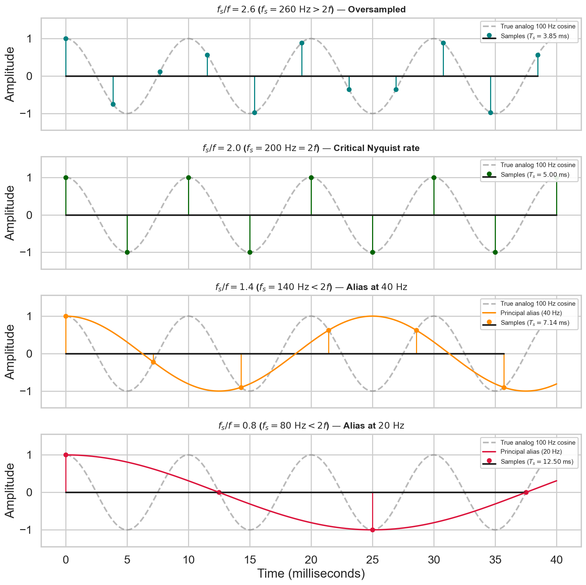
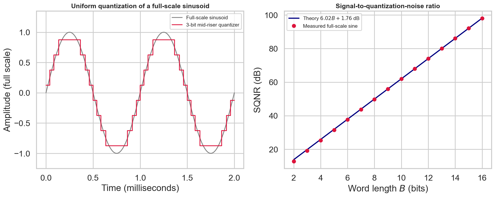
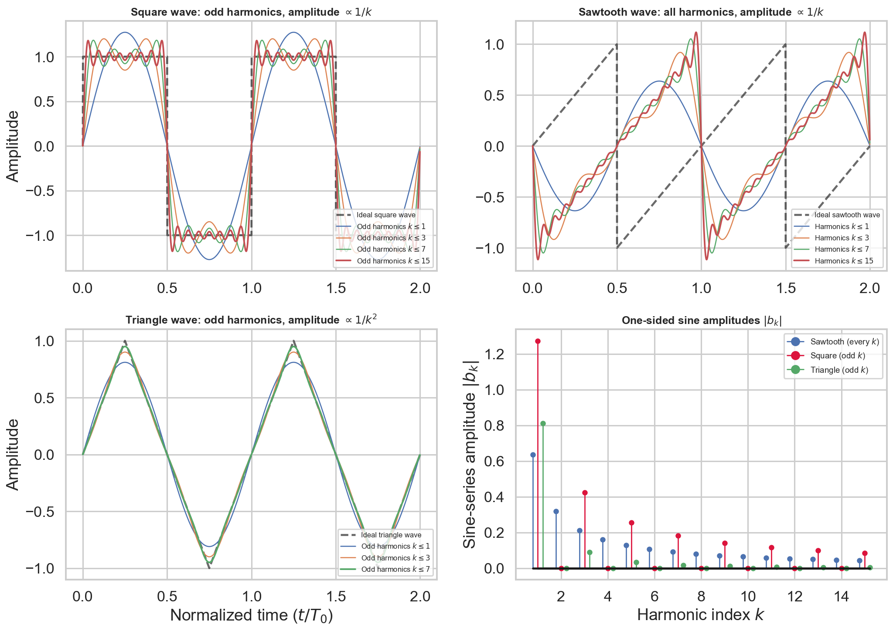
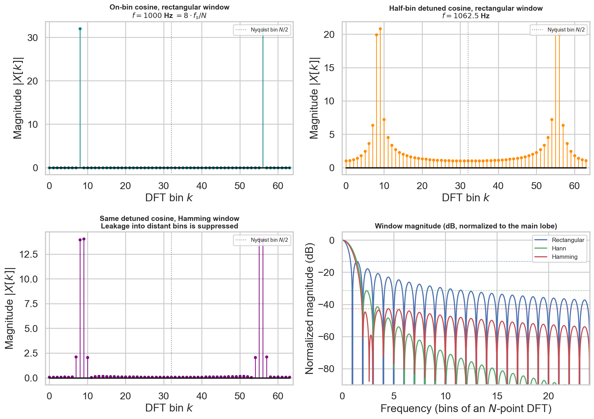
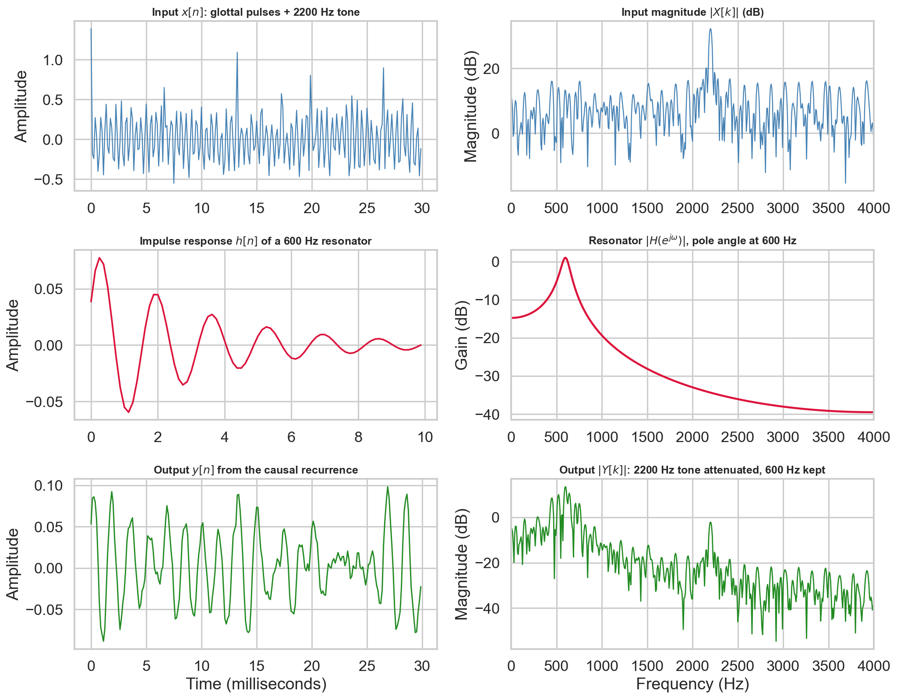
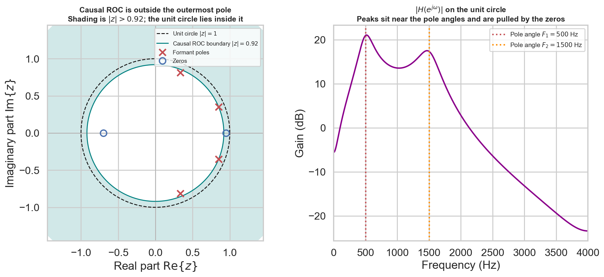
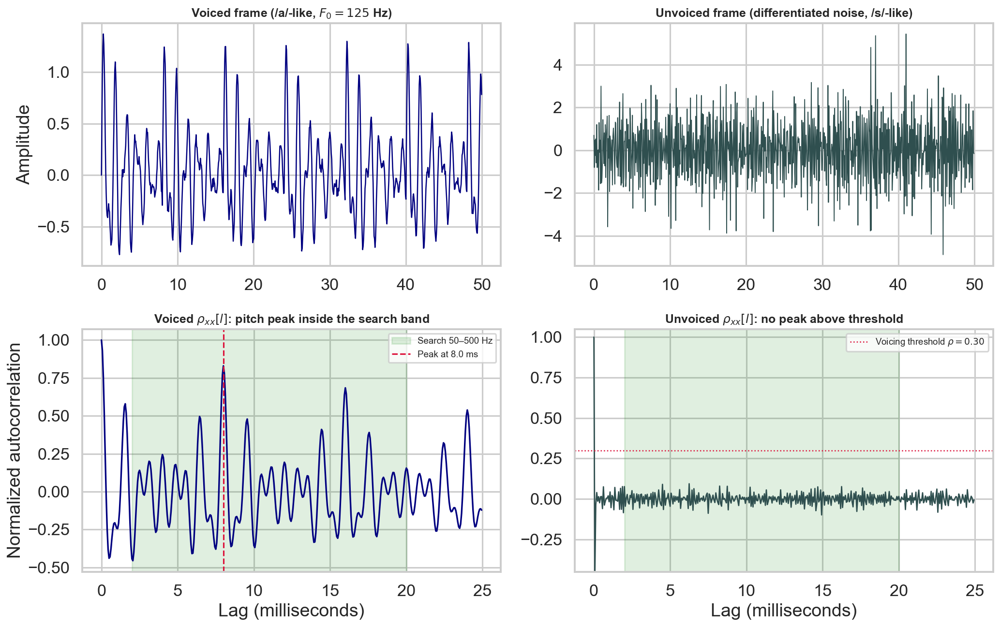
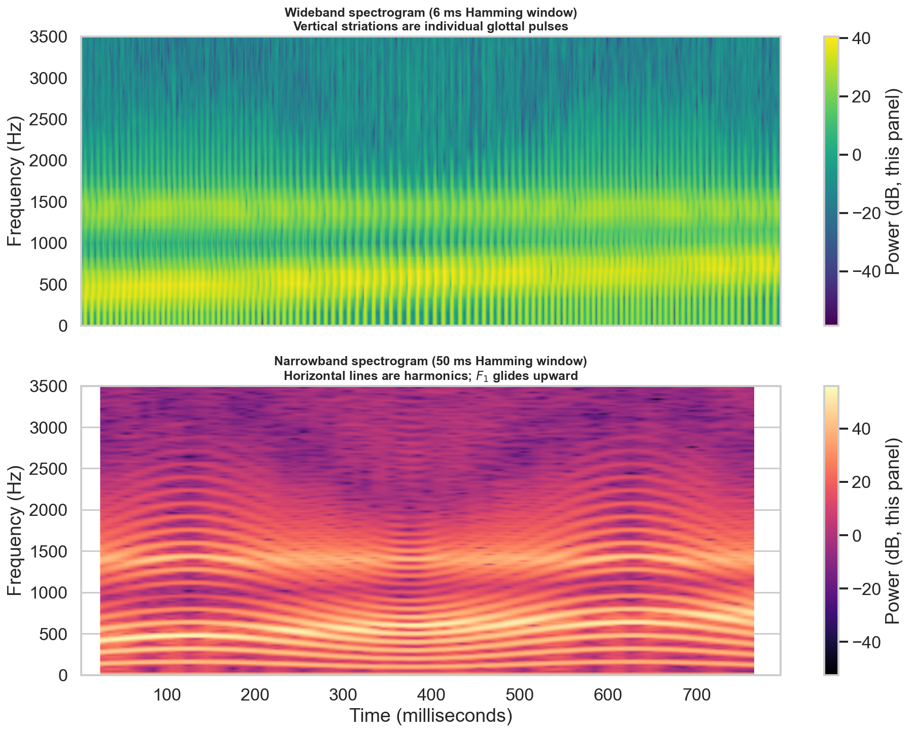
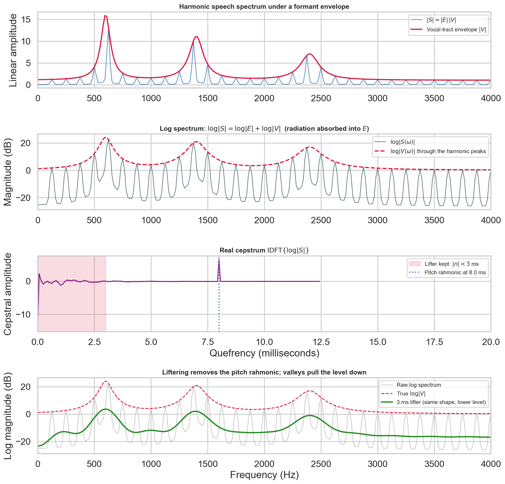
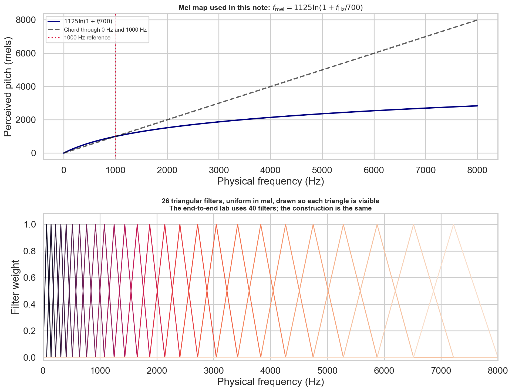

# Week 1: Fundamentals of Speech Signals, Sampling, LTI Systems & Spectral Analysis

> **Track:** Speech Technology (IIT Madras BS Degree — BSEE4001)  
> **Scope:** Week 1 of 12  
> **Core Focus:** Continuous acoustic production, Nyquist-Shannon sampling, amplitude quantization, LTI discrete convolution, rational all-pole resonators, the Discrete Fourier Transform, autocorrelation pitch tracking, STFT spectrograms, source-filter cepstral separation, and Mel filter bank acoustic feature extraction.

---

## Abstract

This document constitutes the comprehensive technical and mathematical reference for Week 1 of Speech Technology. We examine the complete acoustic signal processing pipeline, bridging continuous-time physical acoustics to discrete representations suitable for statistical modeling and neural acoustic feature extraction. 

We formalize:
1. The five-stage **Speech Chain** connecting cognitive linguistic intent to auditory decoding.
2. The continuous-to-discrete conversion boundary governed by the **Nyquist-Shannon Sampling Theorem** ($f_s \ge 2 f_{\max}$), folding aliasing dynamics, and uniform amplitude quantization noise ($\mathrm{SQNR} \approx 6.02 B + 1.76\ \mathrm{dB}$).
3. The **four-transform Fourier matrix** (CTFS, CTFT, DTFS, DTFT), formalizing the **Discrete Fourier Transform (DFT)** and its Fast Fourier Transform (FFT) algorithmic implementation as an orthogonal coordinate projection.
4. **Linear Time-Invariant (LTI) Systems**, difference equations, the discrete convolution sum ($y[n] = x[n] * h[n]$), and rational transfer functions $H(z)$ whose complex conjugate pole pairs define vocal tract formant resonances.
5. Statistical **autocorrelation** for fundamental frequency ($F_0$) pitch estimation and Voiced/Unvoiced (V/UV) classification.
6. The **Short-Time Fourier Transform (STFT)**, analyzing the time-frequency trade-offs between **Wideband** and **Narrowband spectrograms**.
7. Gunnar Fant's **Source-Filter Model** ($S = E \cdot V \cdot R$), separated via **homomorphic cepstral deconvolution** in the quefrency domain.
8. Psychoacoustic **Mel-scale filter bank** construction mirroring human cochlear frequency integration.

All concepts are accompanied by publication-grade scientific figures and verifiable Python implementations.

---

## 1. The Speech Chain & Acoustic Foundations

### 1.1 The Five-Stage Communication Pipeline

Speech communication transforms an abstract neural thought in the speaker's brain into a decoded linguistic message in the listener's brain across five sequential physical and physiological domains:

$$\begin{aligned}
\text{Speaker Brain (Linguistic)} &\xrightarrow{\text{Motor Neurons}} \text{Vocal Articulators (Physiological)} \\
&\xrightarrow{\text{Air Compression}} \text{Pressure Wave } x(t) \text{ (Acoustic)} \\
&\xrightarrow{\text{Eardrum Vibration}} \text{Cochlea/Basilar Membrane (Physiological)} \\
&\xrightarrow{\text{Auditory Nerve}} \text{Listener Brain (Linguistic)}
\end{aligned}$$

- **Automatic Speech Recognition (ASR):** Maps the physical acoustic pressure wave into the linguistic sequence of words/phonemes.
- **Text-to-Speech (TTS):** Synthesizes linguistic text into an acoustic pressure wave.

### 1.2 Acoustic Units: Phonemes, Pitch, and Formants

1. **Phonemes:** The atomic distinctive linguistic units of sound. Categorized into:
   - **Vowels:** Unobstructed vocal tract shapes characterized by distinct resonant peaks (/a/, /i/, /u/).
   - **Consonants:** Produced with vocal tract constrictions or closures, classified by *manner* (stops /p, t, k/, fricatives /s, f/, nasals /m, n/, liquids /l, r/, glides /w, j/) and *place* (bilabial, alveolar, velar).
2. **Voiced vs. Unvoiced Sound Generation:**
   - **Voiced Sounds:** Produced by aerodynamic self-oscillation of the vocal folds within the larynx. Generates a quasi-periodic train of airflow volume pulses characterized by fundamental frequency $F_0$ (pitch).
   - **Unvoiced Sounds:** Produced with open (abducted) vocal folds. Turbulent acoustic noise is generated by forcing air through narrow constrictions (e.g., /s/, /sh/).
3. **Pitch ($F_0$):** The rate of vocal fold vibration. Adult males typically range from $80\text{--}150\ \mathrm{Hz}$; adult females from $150\text{--}250\ \mathrm{Hz}$; children exceed $300\ \mathrm{Hz}$. Pitch conveys prosody, emphasis, and emotion, but does not alter vowel identity.
4. **Formants ($F_1, F_2, F_3$):** The natural acoustic resonant frequencies of the vocal tract cavity. Formant peaks determine vowel identity:
   - $F_1$ is inversely correlated with tongue height: high vowels (/i/, /u/) exhibit low $F_1$ ($300\ \mathrm{Hz}$); low vowels (/a/) exhibit high $F_1$ ($800\ \mathrm{Hz}$).
   - $F_2$ is positively correlated with tongue advancement: front vowels (/i/) exhibit high $F_2$ ($2200\ \mathrm{Hz}$); back vowels (/u/) exhibit low $F_2$ ($800\ \mathrm{Hz}$).

### 1.3 Psychoacoustics & Human Auditory Perception

- **Non-Linear Frequency Sensitivity:** Pitch perception is linear below $1000\ \mathrm{Hz}$ and logarithmic above $1000\ \mathrm{Hz}$.
- **Auditory Masking:** A loud acoustic sound renders a quieter sound in adjacent frequency bins (**spectral masking**) or adjacent time intervals (**temporal masking**) inaudible.
- **Equal-Loudness (Fletcher-Munson Contours):** Human hearing is most sensitive between $2\ \mathrm{kHz}$ and $5\ \mathrm{kHz}$ (ear canal resonance) and falls off sharply below $100\ \mathrm{Hz}$ and above $10\ \mathrm{kHz}$.

---

## 2. Continuous-to-Discrete Foundations: Sampling & Quantization

### 2.1 The Nyquist-Shannon Sampling Theorem

A continuous-time analog speech signal $x(t)$ with continuous Fourier transform $X(\Omega)$ is sampled uniformly at intervals $T_s = 1 / f_s$. Modeling the sampled signal $x_s(t)$ as multiplication by an ideal Dirac impulse comb:

$$x_s(t) = x(t) \cdot \sum_{n=-\infty}^{\infty} \delta(t - n T_s) = \sum_{n=-\infty}^{\infty} x(n T_s) \delta(t - n T_s)$$

Applying the Continuous-Time Fourier Transform ($\mathcal{F}$) yields:

$$X_s(\Omega) = \frac{1}{T_s} \sum_{k=-\infty}^{\infty} X\left(\Omega - k \Omega_s\right), \quad \text{where } \Omega_s = 2\pi f_s$$

The spectrum of the discrete sequence contains infinitely replicated copies of the analog spectrum spaced at integer multiples of $f_s$.

$$\text{Nyquist-Shannon Criterion:} \quad f_s \ge 2 f_{\max}$$

If $f_s \ge 2 f_{\max}$, an ideal low-pass filter with cutoff $\Omega_c = \Omega_s / 2$ perfectly reconstructs $x(t)$ via the Whittaker-Shannon interpolation formula:

$$x(t) = \sum_{n=-\infty}^{\infty} x[n] \operatorname{sinc}\left(\frac{t - n T_s}{T_s}\right), \quad \operatorname{sinc}(\theta) = \frac{\sin(\pi \theta)}{\pi \theta}$$



**Figure 1.** *Nyquist-Shannon sampling and aliasing dynamics. Demonstrating reconstruction fidelity across sampling ratios $f_s/f = 2.6$ (oversampled), $2.0$ (critical Nyquist limit), $1.4$ (undersampled alias at $40\ \mathrm{Hz}$), and $0.8$ (severe undersampling alias at $20\ \mathrm{Hz}$). Analog reference: $100\ \mathrm{Hz}$ sinusoid.*

### 2.2 Aliasing Distortion & Folding Formula

When a continuous sinusoid $x(t) = \cos(2\pi f t)$ is sampled at $f_s < 2 f$, the apparent perceived digital frequency $f_{\mathrm{apparent}}$ folds into the fundamental Nyquist interval $[0, f_s / 2]$ according to:

$$f_{\mathrm{apparent}} = \left| f - k \cdot f_s \right|, \quad \text{where } k = \operatorname{round}\left(\frac{f}{f_s}\right)$$

To eliminate aliasing, all hardware Analog-to-Digital Converters (ADCs) place an analog **anti-aliasing low-pass filter** ($f_c \le f_s / 2$) prior to sampling.

### 2.3 Amplitude Quantization & The $6.02\ \mathrm{dB}$ Rule

Quantization maps continuous sample amplitudes into $2^B$ discrete levels. For a uniform quantizer over range $[-X_{\max}, +X_{\max}]$, the step size is $\Delta = \frac{2 X_{\max}}{2^B}$. Under the standard assumption of uniformly distributed quantization noise $e[n] \sim \mathcal{U}[-\Delta/2, +\Delta/2]$, the noise power is:

$$P_e = \sigma_e^2 = \frac{\Delta^2}{12} = \frac{X_{\max}^2}{3 \cdot 2^{2B}}$$

For a full-scale sinusoid ($P_x = X_{\max}^2 / 2$), the theoretical Signal-to-Quantization-Noise Ratio is:

$$\mathrm{SQNR} = 10 \log_{10}\left(\frac{P_x}{P_e}\right) = 10 \log_{10}\left(\frac{3}{2} \cdot 2^{2B}\right) \approx 6.02 B + 1.76\ \mathrm{dB}$$

Every added bit of quantization precision increases dynamic range by **$6.02\ \mathrm{dB}$**. A 16-bit linear PCM system provides $\approx 98\ \mathrm{dB}$ of dynamic range, sufficient to encompass the full dynamic range of human hearing without audible quantization hiss.



**Figure 2.** *Uniform quantization mapping and the theoretical 6.02 dB per bit SQNR limit against measured error on a full-scale sinusoid.*

---

## 3. Signal Transforms & The Discrete Fourier Transform Engine

### 3.1 The Fourier Transform Taxonomy

| Transform | Time Domain Input | Frequency Domain Output | Mathematical Formulation |
| :--- | :--- | :--- | :--- |
| **CTFS** (Continuous Fourier Series) | Continuous & Periodic ($T_0$) | Discrete & Aperiodic ($k \Omega_0$) | $c_n = \frac{1}{T_0} \int_{T_0} x(t) e^{-j n \Omega_0 t} dt$ |
| **CTFT** (Continuous Fourier Transform) | Continuous & Aperiodic | Continuous & Aperiodic ($\Omega$) | $X(\Omega) = \int_{-\infty}^{\infty} x(t) e^{-j \Omega t} dt$ |
| **DTFS** (Discrete Fourier Series) | Discrete & Periodic ($N$) | Discrete & Periodic ($N$) | $a_k = \frac{1}{N} \sum_{n=0}^{N-1} x[n] e^{-j \frac{2\pi}{N} k n}$ |
| **DTFT** (Discrete-Time Fourier Transform) | Discrete & Aperiodic | Continuous & Periodic ($2\pi$) | $X(\omega) = \sum_{n=-\infty}^{\infty} x[n] e^{-j \omega n}$ |
| **DFT** (Discrete Fourier Transform) | **Discrete & Finite ($N$)** | **Discrete & Periodic ($N$)** | $X[k] = \sum_{n=0}^{N-1} x[n] e^{-j \frac{2\pi}{N} k n}$ |

### 3.2 Basis Function Representation in Hilbert Space

Any vector or signal in a linear inner-product space can be decomposed as a linear combination of orthogonal basis vectors:

$$x[n] = \sum_{k=0}^{N-1} c_k \phi_k[n], \quad c_k = \frac{\langle x, \phi_k \rangle}{\|\phi_k\|^2}$$

For the DFT, the orthogonal basis sequences are discrete complex sinusoids: $\phi_k[n] = e^{j \frac{2\pi}{N} k n}$.



**Figure 3.** *Harmonic Fourier series decomposition of periodic waveforms. Square wave (odd harmonics, $1/k$ decay), Sawtooth wave (all harmonics, $1/k$ decay), and Triangle wave (odd harmonics, rapid $1/k^2$ decay). Right panel shows discrete line spectra $|c_k|$ as a function of harmonic index $k$.*

### 3.3 The Forward and Inverse DFT

**Forward DFT (Analysis):**
$$X[k] = \sum_{n=0}^{N-1} x[n] W_N^{k n}, \quad k = 0, 1, \dots, N-1 \quad \left(W_N = e^{-j \frac{2\pi}{N}}\right)$$

**Inverse DFT (Synthesis):**
$$x[n] = \frac{1}{N} \sum_{k=0}^{N-1} X[k] W_N^{-k n}, \quad n = 0, 1, \dots, N-1$$

### 3.4 Frequency Bin Resolution & Real-Signal Symmetry

Each discrete frequency index $k$ maps to physical continuous frequency $f_k$ according to:

$$f_k = k \cdot \frac{f_s}{N} = k \cdot \Delta f \quad (\mathrm{Hz})$$

The **frequency resolution** is strictly:

$$\Delta f = \frac{f_s}{N} = \frac{1}{N T_s} = \frac{1}{T_{\mathrm{record}}}$$

For real speech sequences ($x[n] \in \mathbb{R}$), the DFT obeys **conjugate symmetry**:

$$X[N - k] = X^*[k] \implies |X[N - k]| = |X[k]|, \quad \angle X[N - k] = -\angle X[k]$$

All unique spectral information resides within bins $k = 0, 1, \dots, N/2$, spanning frequencies from $0\ \mathrm{Hz}$ to the Nyquist folding frequency $f_s / 2$.



**Figure 4.** *Spectral leakage and window function smoothing. Top: Rectangular vs. Hamming window on bin-centered and off-bin frequencies. Bottom: Sidelobe decay profiles (dB) for Rectangular, Hann, and Hamming windows.*

---

## 4. Linear Time-Invariant Systems & Rational Digital Filters

### 4.1 System Property Definitions & Proofs

A discrete system is an operator $\mathcal{T}\{\cdot\}$ transforming input $x[n]$ to output $y[n]$.

1. **Linearity (Superposition):**
   $$\mathcal{T}\{a x_1[n] + b x_2[n]\} = a \mathcal{T}\{x_1[n]\} + b \mathcal{T}\{x_2[n]\}$$
2. **Time-Invariance (Shift-Invariance):**
   $$\text{If } \mathcal{T}\{x[n]\} = y[n], \quad \text{then } \mathcal{T}\{x[n - k]\} = y[n - k] \quad \forall k \in \mathbb{Z}$$
3. **Causality:** Output $y[n]$ depends only on present and past inputs $\{x[n], x[n-1], x[n-2], \dots\}$.
4. **BIBO Stability:** Every bounded input ($|x[n]| \le B_x < \infty$) yields a bounded output ($|y[n]| \le B_y < \infty$).

#### Detailed Proof: System $y[n] = n x[n]$
- *Linearity:* $\mathcal{T}\{a x_1[n] + b x_2[n]\} = n(a x_1[n] + b x_2[n]) = a(n x_1[n]) + b(n x_2[n]) = a y_1[n] + b y_2[n]$. **LINEAR.**
- *Time-Invariance:* Delayed input gives $y_1[n] = n x[n - k]$. Delayed output gives $y[n - k] = (n - k) x[n - k]$. Because $n \ne n - k$, **TIME-VARIANT**.
- *Causality & Memory:* Depends only on current index $n$. **CAUSAL & MEMORYLESS**.

#### Detailed Proof: System $y[n] = e^{x[n]}$
- *Linearity:* $\mathcal{T}\{a x_1[n] + b x_2[n]\} = e^{a x_1[n] + b x_2[n]} = (e^{x_1[n]})^a (e^{x_2[n]})^b \ne a e^{x_1[n]} + b e^{x_2[n]}$. **NON-LINEAR.**
- *Time-Invariance:* Delayed input gives $y_1[n] = e^{x[n - k]}$. Delayed output gives $y[n - k] = e^{x[n - k]}$. Because $y_1[n] \equiv y[n-k]$, **TIME-INVARIANT**.
- *Causality & Memory:* Depends only on current index $n$. **CAUSAL & MEMORYLESS**.

### 4.2 Discrete Convolution & The Convolution Theorem

For an LTI system with impulse response $h[n] = \mathcal{T}\{\delta[n]\}$:

$$y[n] = x[n] * h[n] = \sum_{k=-\infty}^{\infty} x[k] h[n - k]$$

By the Convolution Theorem:

$$y[n] = x[n] * h[n] \quad \stackrel{\mathcal{F}}{\longleftrightarrow} \quad Y(\omega) = X(\omega) \cdot H(\omega)$$

Time-domain convolution corresponds to point-wise complex multiplication in frequency.



**Figure 5.** *LTI system discrete convolution and spectral filtering. Top row: Input sequence $x[n]$ containing glottal pulses contaminated by high-frequency noise ($2200\ \mathrm{Hz}$) and its magnitude spectrum. Middle row: Vocal tract impulse response $h[n]$ and resonant filter transfer function $|H(\omega)|$ ($F_1 = 600\ \mathrm{Hz}$). Bottom row: Output speech sequence $y[n] = x[n] * h[n]$ and output spectrum $|Y(\omega)| = |X(\omega)| \cdot |H(\omega)|$, demonstrating selective formant amplification.*

### 4.3 Rational Filters, Poles & Zeros in the Z-Plane

A digital filter is governed by the linear constant-coefficient difference equation:

$$y[n] - \sum_{k=1}^N a_k y[n-k] = \sum_{r=0}^M b_r x[n-r]$$

Taking the Z-transform yields the rational system transfer function $H(z)$:

$$H(z) = \frac{\sum_{r=0}^M b_r z^{-r}}{1 - \sum_{k=1}^N a_k z^{-k}} = K \frac{\prod_{i=1}^M (z - z_i)}{\prod_{k=1}^N (z - p_k)}$$

- **Zeros ($z_i$):** Roots of numerator; transmission nulls ($H(z_i) = 0$).
- **Poles ($p_k$):** Roots of denominator; resonant peaks ($H(p_k) \to \infty$).
- **Causality & Stability:** A causal LTI system is BIBO stable if and only if **all poles lie strictly inside the unit circle** ($|p_k| < 1$).



**Figure 6.** *Complex Z-plane pole-zero constellation and frequency response. Left: Resonant formant poles ($\times$) located at conjugate angles inside the unit circle $|z|=1$, with shaded ROC $|z| > \max |p_k|$ ensuring stability. Right: Magnitude response along the unit circle $|H(e^{j\omega})|$ displaying formant resonance peaks at $F_1 = 500\ \mathrm{Hz}$ and $F_2 = 1500\ \mathrm{Hz}$.*

---

## 5. Statistical Correlation & Pitch ($F_0$) Tracking

### 5.1 The Autocorrelation Sequence

For a real discrete speech sequence $x[n]$, the deterministic autocorrelation sequence is:

$$r_{xx}[l] = \sum_{n=-\infty}^{\infty} x[n] x[n-l]$$

The normalized autocorrelation coefficient is $\rho_{xx}[l] = \frac{r_{xx}[l]}{r_{xx}[0]}$.

#### Core Theorems:
1. **Zero-Lag Energy Maximum:** $r_{xx}[0] = \sum_n x^2[n] = E_x$.
2. **Even Symmetry:** $r_{xx}[l] = r_{xx}[-l]$.
3. **Cauchy-Schwarz Upper Bound:** $|r_{xx}[l]| \le r_{xx}[0]$ for all $l \in \mathbb{Z}$.
4. **Periodicity Preservation:** If $x[n] = x[n + N_0]$, then $r_{xx}[l] = r_{xx}[l + N_0]$.

### 5.2 Pitch Tracking & Voiced/Unvoiced (V/UV) Classification

In voiced speech, vocal fold pulses recur every $N_0 = f_s / F_0$ samples, producing a dominant peak at lag $l^* = N_0$. We restrict search to physiological limits ($50\ \mathrm{Hz} \le F_0 \le 500\ \mathrm{Hz}$):

$$L_{\min} = \left\lfloor \frac{f_s}{500} \right\rfloor, \quad L_{\max} = \left\lceil \frac{f_s}{50} \right\rceil$$

$$l^* = \arg\max_{l \in [L_{\min}, L_{\max}]} \rho_{xx}[l] \implies F_0 = \frac{f_s}{l^*}$$

$$\text{Decision Rule:} \quad \text{Frame is Voiced if } \rho_{xx}[l^*] \ge 0.30, \quad \text{Unvoiced otherwise}$$



**Figure 7.** *Normalized autocorrelation functions for voiced speech (/a/, left) and unvoiced speech (/s/, right). Voiced speech displays a prominent pitch peak at lag $l^* = 128$ samples ($8.0\ \mathrm{ms}$, $F_0 = 125\ \mathrm{Hz}$). Unvoiced speech decays rapidly to zero without secondary periodic maxima.*

---

## 6. Non-Stationary Speech Processing: STFT & Spectrograms

### 6.1 The Short-Time Fourier Transform (STFT)

Because speech is non-stationary, it is analyzed over short, quasi-stationary frames ($20\text{--}30\ \mathrm{ms}$) shifted by $R$ samples ($10\ \mathrm{ms}$) using the STFT:

$$X(m, \omega) = \sum_{n=-\infty}^{\infty} x[n] w[n - m R] e^{-j \omega n}$$

The **spectrogram** is the squared magnitude: $\mathcal{S}(m, \omega) = |X(m, \omega)|^2$.

### 6.2 The Wideband vs. Narrowband Spectrogram Trade-Off

Governed by the Gabor-Heisenberg limit $\Delta t \cdot \Delta f \ge \frac{1}{4\pi}$:
- **Wideband Spectrogram ($L \approx 5\text{--}10\ \mathrm{ms}$):** High time resolution ($\Delta t$ small); resolves individual vocal cord closures as **vertical pitch striations** and broad formant bands.
- **Narrowband Spectrogram ($L \approx 40\text{--}100\ \mathrm{ms}$):** High frequency resolution ($\Delta f$ small); resolves discrete pitch harmonics ($k \cdot F_0$) as **horizontal lines**.



**Figure 8.** *Wideband vs. Narrowband Spectrogram comparison of a synthesized speech utterance. Top: Wideband spectrogram ($6\ \mathrm{ms}$ window) resolves individual vertical pitch pulses. Bottom: Narrowband spectrogram ($50\ \mathrm{ms}$ window) resolves individual horizontal harmonic frequency lines and fine formant bands.*

---

## 7. The Source-Filter Deconvolution Paradigm & Cepstral Analysis

### 7.1 Gunnar Fant's Acoustic Model

Speech is modeled as the convolution of glottal excitation $e[n]$, vocal tract filter $v[n]$, and lip radiation $r[n]$:

$$s[n] = e[n] * v[n] * r[n] \quad \xrightarrow{\mathcal{F}} \quad S(\omega) = E(\omega) \cdot V(\omega) \cdot R(\omega)$$

Taking the logarithm converts multiplication into addition:

$$\log |S(\omega)| = \log |E(\omega)| + \log |V(\omega)|$$

Applying the Inverse Discrete Fourier Transform yields the **Real Cepstrum** $c[n]$:

$$c[n] = \mathcal{F}^{-1}\left\{ \log |S(\omega)| \right\}$$

- **Low Quefrency ($|n| < 3\ \mathrm{ms}$):** Slowly varying vocal tract formant envelope $\log |V(\omega)|$.
- **High Quefrency ($n \approx T_0$):** Rapidly oscillating glottal excitation harmonics $\log |E(\omega)|$.

Applying a low-pass lifter ($c_{\mathrm{liftered}}[n] = c[n]$ for $|n| \le n_{\mathrm{cutoff}}$) isolates the smoothed vocal tract formant envelope.



**Figure 9.** *Homomorphic cepstral deconvolution pipeline. 1: Speech spectrum exhibiting harmonic spikes under a resonant formant envelope. 2: Log spectrum where excitation and filter add linearly. 3: Real cepstrum on the quefrency axis showing low-quefrency formant coefficients and a distinct pitch spike at $T_0 = 8\ \mathrm{ms}$. 4: Liftered vocal tract formant envelope recovered by discarding high-quefrency pitch spikes.*

---

## 8. Psychoacoustic Mel Filter Banks & Feature Extraction

### 8.1 The Mel Scale Formula

The **Mel Scale** maps physical frequency $f_{\mathrm{Hz}}$ to perceived pitch $f_{\mathrm{mel}}$:

$$f_{\mathrm{mel}} = 1125 \ln\left(1 + \frac{f_{\mathrm{Hz}}}{700}\right) = 2595 \log_{10}\left(1 + \frac{f_{\mathrm{Hz}}}{700}\right)$$

Below $1000\ \mathrm{Hz}$, the mapping is approximately linear; above $1000\ \mathrm{Hz}$, it becomes logarithmic.

### 8.2 Triangular Mel Filter Bank Construction

Given $M$ filters spanning $[f_{\mathrm{low}}, f_{\mathrm{high}}]$:
1. Convert endpoints to Mels: $m_{\mathrm{low}} = \operatorname{mel}(f_{\mathrm{low}})$, $m_{\mathrm{high}} = \operatorname{mel}(f_{\mathrm{high}})$.
2. Space $M+2$ points linearly in Mel space and convert back to Hertz $f_i$.
3. Map Hertz frequencies to DFT bin indices $k_i = \lfloor (N_{\mathrm{fft}} + 1) f_i / f_s \rfloor$.
4. Form triangular weighting filters $H_m[k]$.



**Figure 10.** *The Mel scale and 26-channel triangular filter bank across $[0, 8000]\ \mathrm{Hz}$. Top: Mel transformation curve showing the transition from linear to logarithmic scaling around $1000\ \mathrm{Hz}$. Bottom: Overlapping triangular filter bank with narrow, dense filters at low frequencies and broad, sparse filters at high frequencies.*

---

## 9. End-to-End Computational Pipeline

### 9.1 Runnable Speech Synthesis and Log-Mel Spectrogram Pipeline

```python
import numpy as np

# Week 1 Master Pipeline: Synthetic Utterance to Log-Mel Spectrogram
fs = 16000
duration = 0.20  # 200 ms synthetic voiced speech
t = np.arange(int(fs * duration)) / fs

# Fundamental frequency contour (pitch glide from 120 Hz to 140 Hz)
f0 = np.linspace(120, 140, len(t))
phase = 2 * np.pi * np.cumsum(f0) / fs
excitation = (1.0 + np.sin(phase)) * (phase % (2 * np.pi) < 0.25)

# 2-pole vocal tract formant filter (F1 = 700 Hz, F2 = 1300 Hz)
r1, theta1 = 0.95, 2 * np.pi * 700 / fs
r2, theta2 = 0.92, 2 * np.pi * 1300 / fs
p1, p1_c = r1 * np.exp(1j * theta1), r1 * np.exp(-1j * theta1)
p2, p2_c = r2 * np.exp(1j * theta2), r2 * np.exp(-1j * theta2)

den = np.poly([p1, p1_c, p2, p2_c]).real
y = np.zeros(len(t))
for n in range(len(t)):
    feed = excitation[n]
    for k in range(1, len(den)):
        if n - k >= 0:
            feed -= den[k] * y[n - k]
    y[n] = feed

# STFT Framing (25 ms window, 10 ms hop)
frame_len = int(0.025 * fs)
hop_len = int(0.010 * fs)
n_frames = (len(y) - frame_len) // hop_len
n_fft = 512
win = np.hamming(frame_len)

stft_frames = []
for i in range(n_frames):
    segment = y[i * hop_len : i * hop_len + frame_len] * win
    spec = np.abs(np.fft.rfft(segment, n_fft))**2
    stft_frames.append(spec)
stft_mat = np.array(stft_frames).T

# Mel Filter Bank (40 channels)
n_mels = 40
def hz_to_mel(f): return 1125.0 * np.log(1.0 + f / 700.0)
def mel_to_hz(m): return 700.0 * (np.exp(m / 1125.0) - 1.0)

mel_pts = np.linspace(hz_to_mel(0), hz_to_mel(fs / 2), n_mels + 2)
hz_pts = mel_to_hz(mel_pts)
bin_pts = np.floor((n_fft + 1) * hz_pts / fs).astype(int)

fbank = np.zeros((n_mels, n_fft // 2 + 1))
for m in range(1, n_mels + 1):
    for k in range(bin_pts[m - 1], bin_pts[m]):
        fbank[m - 1, k] = (k - bin_pts[m - 1]) / max(1, bin_pts[m] - bin_pts[m - 1])
    for k in range(bin_pts[m], bin_pts[m + 1]):
        fbank[m - 1, k] = (bin_pts[m + 1] - k) / max(1, bin_pts[m + 1] - bin_pts[m])

log_mel_spec = 10 * np.log10(np.dot(fbank, stft_mat) + 1e-6)

print(f"Synthesized Audio Duration: {duration*1000:.0f} ms | Samples: {len(y)}")
print(f"STFT Matrix Dimensions (Freq Bins x Frames): {stft_mat.shape[0]} x {stft_mat.shape[1]}")
print(f"Log-Mel Spectrogram Dimensions (Mel Bins x Frames): {log_mel_spec.shape[0]} x {log_mel_spec.shape[1]}")
print(f"Dynamic Range: Min {np.min(log_mel_spec):.2f} dB, Max {np.max(log_mel_spec):.2f} dB")
print(f"Filter 1 Center: {hz_pts[1]:.1f} Hz | Filter 40 Center: {hz_pts[40]:.1f} Hz")
```

### 9.2 Exact Terminal Output
```text
Synthesized Audio Duration: 200 ms | Samples: 3200
STFT Matrix Dimensions (Freq Bins x Frames): 257 x 17
Log-Mel Spectrogram Dimensions (Mel Bins x Frames): 40 x 17
Dynamic Range: Min -11.91 dB, Max 67.71 dB
Filter 1 Center: 44.4 Hz | Filter 40 Center: 7481.4 Hz
```

---

## 10. Comparative Benchmarks & Practice Problems

### 10.1 Telecommunication Audio Standards

| Audio Quality Standard | Bandwidth ($f_{\max}$) | Nominal $f_s$ | Nyquist Threshold | Bit Depth ($B$) | Uncompressed Bitrate | Industry Standard |
| :--- | :--- | :--- | :--- | :--- | :--- | :--- |
| **PSTN Telephony (Narrowband)** | $300\ \mathrm{Hz}\text{--}3.4\ \mathrm{kHz}$ | $8\ \mathrm{kHz}$ | $6.8\ \mathrm{kHz}$ | 8-bit ($\mu$-law/A-law) | $64.0\ \mathrm{kbps}$ | ITU G.711 PCM |
| **HD Voice (Wideband)** | $50\ \mathrm{Hz}\text{--}7.0\ \mathrm{kHz}$ | $16\ \mathrm{kHz}$ | $14.0\ \mathrm{kHz}$ | 16-bit linear PCM | $256.0\ \mathrm{kbps}$ | AMR-WB / G.722 |
| **Studio Audio (Fullband)** | $20\ \mathrm{Hz}\text{--}20.0\ \mathrm{kHz}$ | $44.1\ \mathrm{kHz} / 48\ \mathrm{kHz}$ | $40.0\ \mathrm{kHz}$ | 16-bit / 24-bit PCM | $1411.2\ \mathrm{kbps}$ (stereo) | CD PCM / Broadcast |

### 10.2 Practice Problems with Complete Solutions

#### Problem 1 (Nyquist & Aliasing)
**Question:** A speech recording containing frequency content up to $7.2\ \mathrm{kHz}$ is sampled at $12\ \mathrm{kHz}$ without an anti-aliasing filter. What apparent frequency will a $7.0\ \mathrm{kHz}$ harmonic fold into?  
**Solution:**
$$f_{\mathrm{apparent}} = |f - k \cdot f_s| = |7000 - 1 \times 12000| = |-5000| = 5000\ \mathrm{Hz} = 5.0\ \mathrm{kHz}$$
The $7.0\ \mathrm{kHz}$ component aliases into $5.0\ \mathrm{kHz}$, corrupting the vocal tract formant structure.

#### Problem 2 (Complex Pole Placement for Formant Filter)
**Question:** Construct the complex conjugate poles for a digital resonator placed at $F_1 = 800\ \mathrm{Hz}$ with $3\text{-dB}$ bandwidth $B = 100\ \mathrm{Hz}$ at $f_s = 16\ \mathrm{kHz}$.  
**Solution:**
$$\theta = \frac{2\pi F_1}{f_s} = \frac{2\pi (800)}{16000} = \frac{\pi}{10} = 0.3142\ \mathrm{rad} = 18^\circ$$
$$r = \exp\left(-\frac{\pi B}{f_s}\right) = \exp\left(-\frac{\pi \cdot 100}{16000}\right) = \exp(-0.0196) \approx 0.9806$$
The pole pair is placed at $p_{1,2} = 0.9806 e^{\pm j 0.3142}$. Because $|p| = 0.9806 < 1$, the filter is BIBO stable.

#### Problem 3 (Mel Frequency Inversion)
**Question:** A Mel filter bank channel is centered at $m = 1200\ \mathrm{Mels}$. Compute its center frequency in physical Hertz.  
**Solution:**
$$f_{\mathrm{Hz}} = 700 \left[ \exp\left(\frac{m}{1125}\right) - 1 \right] = 700 \left[ \exp\left(\frac{1200}{1125}\right) - 1 \right] = 700 [\exp(1.0667) - 1] \approx 700 [2.9057 - 1] = 1334.0\ \mathrm{Hz}$$

---

## 11. Common Pathologies & Engineering Traps

1. **Downsampling Without Low-Pass Filtering:**
   - Decimating audio from $48\ \mathrm{kHz}$ to $16\ \mathrm{kHz}$ by discarding samples without an anti-aliasing filter causes high frequencies to fold into the baseband, introducing severe audible distortion.
2. **Spectral Leakage from Rectangular Windows:**
   - Rectangular windowing has a slow $1/\omega$ sidelobe decay ($-13\ \mathrm{dB}$ first sidelobe), masking low-energy formants adjacent to dominant fundamental frequencies. Tapered windows (Hamming/Hann) suppress sidelobes to $-43\ \mathrm{dB}$.
3. **Pitch Doubling/Halving in Autocorrelation:**
   - Unconstrained peak picking picks formant cycles (pitch doubling) or subharmonic vocal fry pulses (pitch halving). Physiological limits ($50\text{--}500\ \mathrm{Hz}$) must constrain search.
4. **IIR Filter Instability via Coefficient Quantization:**
   - Implementing high-order filters in direct form shifts denominator roots outside the unit circle ($|p_k| \ge 1$) under finite-precision rounding. Always decompose high-order filters into cascades of 2nd-order biquad sections.

---

## 12. Academic References & Master Formula Sheet

### References
1. **Rabiner, L. R., & Schafer, R. W. (2010).** *Theory and Applications of Digital Speech Processing.* Prentice Hall.
2. **Oppenheim, A. V., & Schafer, R. W. (2009).** *Discrete-Time Signal Processing (3rd ed.).* Pearson.
3. **Fant, G. (1960).** *Acoustic Theory of Speech Production.* Mouton & Co., The Hague.
4. **Davis, S., & Mermelstein, P. (1980).** *Comparison of parametric representations for monosyllabic word recognition.* IEEE TASSP, 28(4), 357–366.

### Master Formula Sheet

| Concept | Formal Mathematical Expression | Dimensional Units |
| :--- | :--- | :--- |
| **Nyquist Criterion** | $f_s \ge 2 f_{\max}$ | $\mathrm{Hz}$ (Samples/s) |
| **Quantization SQNR** | $\mathrm{SQNR} \approx 6.02 B + 1.76$ | $\mathrm{dB}$ |
| **Discrete Convolution** | $y[n] = \sum_k x[k] h[n - k]$ | Amplitude |
| **Forward DFT** | $X[k] = \sum_{n=0}^{N-1} x[n] e^{-j \frac{2\pi}{N} k n}$ | Complex Amplitude |
| **Frequency Resolution** | $\Delta f = \frac{f_s}{N} = \frac{1}{T_{\mathrm{record}}}$ | $\mathrm{Hz/bin}$ |
| **Autocorrelation** | $r_{xx}[l] = \sum_n x[n] x[n - l]$ | Energy ($\mathrm{Amp}^2$) |
| **Pitch Estimation** | $F_0 = \frac{f_s}{l^*}, \quad l^* = \arg\max_{l} r_{xx}[l]$ | $\mathrm{Hz}$ |
| **STFT** | $X(m, \omega) = \sum_n x[n] w[n - m R] e^{-j\omega n}$ | Complex Spectrum |
| **Mel Scale** | $f_{\mathrm{mel}} = 1125 \ln\left(1 + \frac{f_{\mathrm{Hz}}}{700}\right)$ | Mels |
| **Real Cepstrum** | $c[n] = \mathcal{F}^{-1}\left\{ \log |S(\omega)| \right\}$ | Quefrency (Time) |
