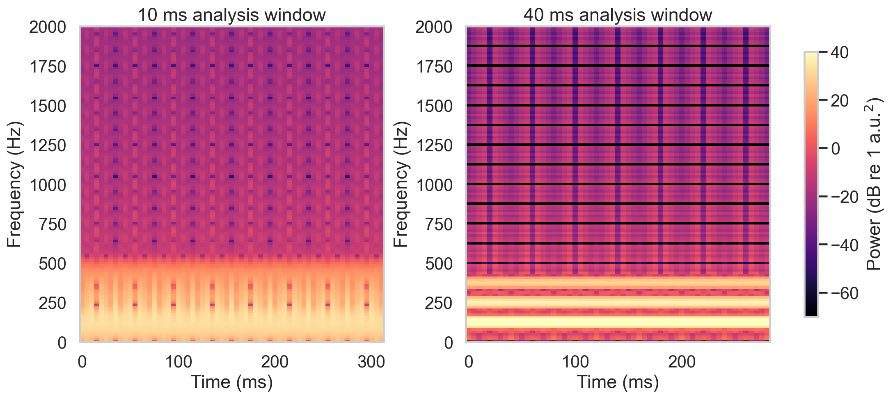
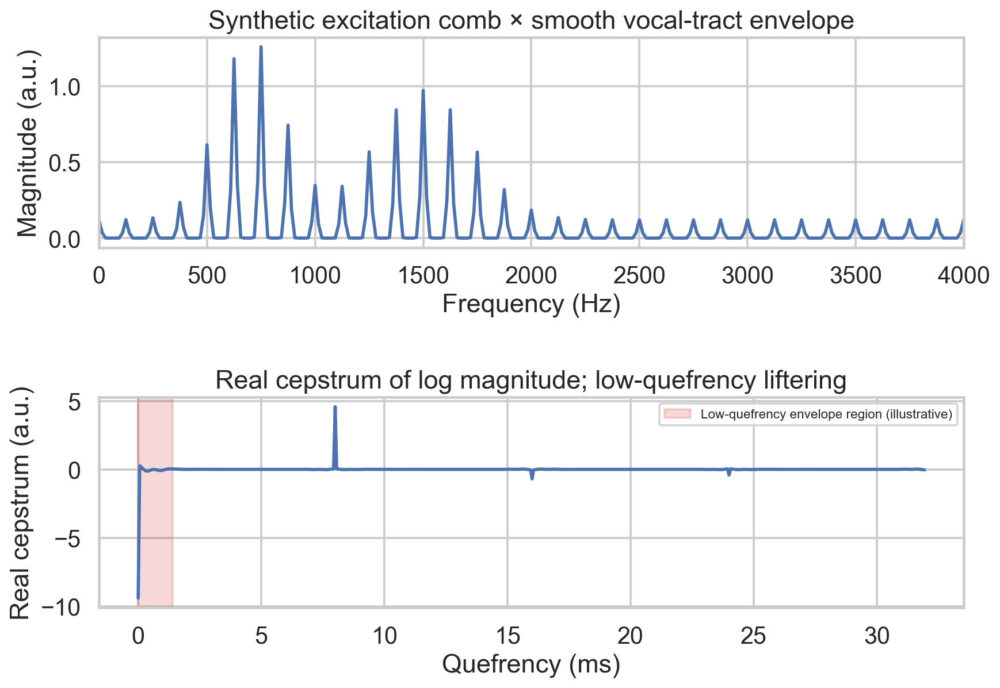
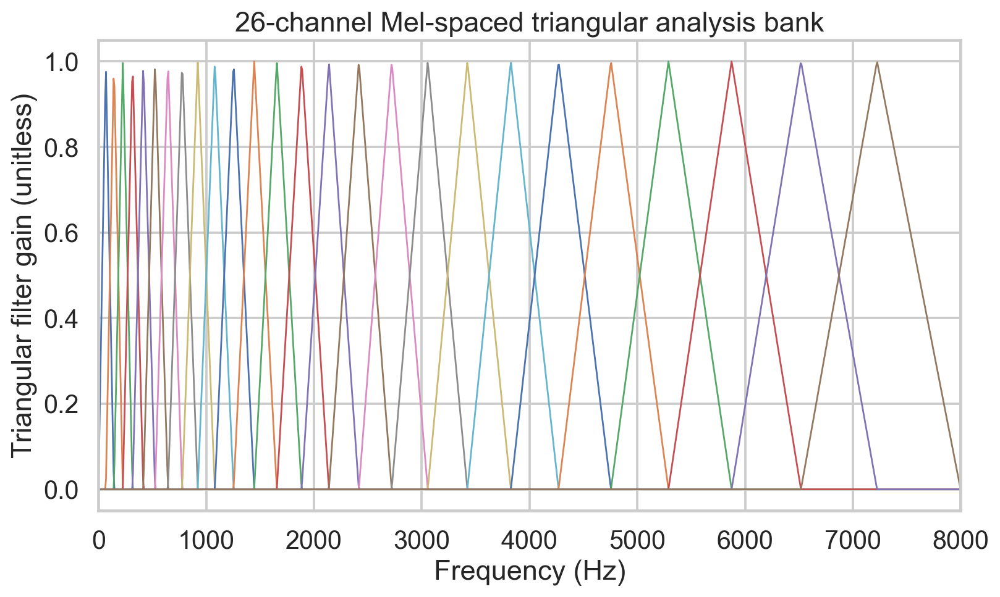

# Week 2 — Speech Features, Perception and Gaussian Basics for the Exam

**Navigation:** [[exam-study-guide|Study route and priority system]] · [[week-1-exam-focused-notes|Prerequisite Week 1]] · [[week-2-notes|Full reference]] · [[week-2-exam-questions|Authentic questions and answers]] · [[week-3-exam-focused-notes|Next week]]

## 1. What deserves more study

**Be able to explain every MFCC stage, reason about analysis-window length, and recognize what a Gaussian density means.** A memorized pipeline is insufficient for a “why” question; understanding why each operation is present also helps reject misleading MCQ options.

**P1:** additional explanation and closed-book practice. **P2:** complete learning with concise-answer rehearsal. **P3:** covered syllabus without a direct standalone question located; retain it, especially when it explains a P1 mechanism.

<!-- evidence:start -->
| Study priority | Topic family | Question occurrences: Q1 / Q2 / ET | Distinct exam–terms |
| :--- | :--- | :--- | ---: |
| P1 — master repeated fundamentals | Gaussian parameters, density normalization and symmetry | 9 / 0 / 0 = **9** | 3 |
| P2 — rehearse concise answers | Pitch and basilar membrane | 4 / 0 / 0 = **4** | 4 |
| P1 — explain and calculate | STFT, window trade-offs and frame correlation | 3 / 0 / 2 = **5** | 4 |
| P1 — reconstruct the pipeline | MFCC role and extraction steps | 2 / 1 / 0 = **3** | 3 |
<!-- evidence:end -->

There are 21 occurrences. The nine Gaussian entries repeat three elementary prompts across three older Q1 terms. The MFCC family has only three occurrences but includes a **5-mark extraction explanation** in 2025 Q2, making it a substantial preparation target. One STFT occurrence is just the explicitly requested front-end portion of a 10-mark Transformer-ASR question: the full ten marks cannot be assigned to Week 2. Counts are descriptive, not future probabilities.

**P3 coverage that still needs understanding:** frequency masking; source–filter algebra; real cepstrum and liftering; single-Gaussian estimation/covariance beyond the simple MCQs; optional dynamic features. These form the explanations behind the directly tested material.

## 2. Prerequisites and the week's purpose

**Three facts from Week 1:** a sample is an amplitude measurement; a Fourier transform expresses frequency content; speech changes as the articulators move. A feature vector is a short list of numbers describing one segment of sound. For example, a 13-coefficient MFCC vector has shape `[13]`; $T$ such frames form an array `[T, 13]`.

The goal is to keep useful spectral structure while reducing irrelevant detail. A single Fourier transform of an entire sentence says what frequencies occurred overall, but not when. Short-time analysis addresses timing. Perceptually spaced filters and cepstral processing then turn a detailed spectrum into compact features. Gaussian review supplies a first model for the cloud of feature vectors that results.

## 3. Production, hearing and perception — P2 with P3 foundations

### 3.1 Source versus filter

For voiced speech, vocal-fold vibration provides an excitation with approximately regularly spaced harmonics. The vocal tract changes their overall amplitude envelope through resonances called **formants**. A simplified linear model is

$$s[n]=e[n]*v[n],\qquad S(\omega)=E(\omega)V(\omega).$$

The asterisk denotes convolution, while multiplication of spectra follows the convolution theorem. Radiation may be included as an additional factor. Real speech also involves turbulence, nasal coupling and time-varying articulation, so this is an approximation over suitable short intervals.

**Distinguish:** $F_0$ concerns repetition rate of excitation; formants concern resonances of the tract. Changing tract shape can move formants without changing $F_0$. Changing vocal-fold vibration can change $F_0$ without requiring the same formant shift.

### 3.2 Frequency versus pitch; intensity versus loudness

Frequency is measured in Hz. **Pitch** is its perceptual correlate. Intensity is a physical measure of sound power per area; **loudness** is a percept. The same physical change need not produce an equal perceived change at every frequency or level.

The **basilar membrane** in the cochlea responds differently at different locations: high frequencies preferentially excite the base; lower frequencies peak nearer the apex. It acts as a biological frequency analyzer, although real hearing is richer than an ideal bank of fixed filters.

Authentic checks: [psychophysical equivalent of frequency](week-2-exam-questions.md#ee4001_2023T3_Q1_NA--q13) → **pitch**; [ear membrane](week-2-exam-questions.md#ee4001_2026T1_Q1_NA--q4) → **basilar membrane**. “Mel” names a perceptual pitch scale, not the general name of the percept.

### 3.3 Masking — P3

A strong component can make a weaker nearby-frequency component less detectable. This changes the listener's effective detection threshold; it does not mean the weak component has physically vanished from the waveform. Masking depends on level, frequency separation and temporal context. Perception therefore motivates representations that do not allocate identical importance to every frequency bin. A Mel filter bank is a useful engineering approximation, not a complete model of masking or cochlear mechanics.

**Explain aloud:** why can an acoustic component exist in a recording yet be hard to hear? Its physical presence and its detectability in the presence of another sound are separate questions.

## 4. Short-time Fourier analysis — P1

### 4.1 Why frame the signal?

Speech is **globally non-stationary**: its statistical and spectral characteristics change through an utterance. Over a short frame, the tract configuration often changes slowly enough to permit a **local quasi-stationary approximation**. These two descriptions are compatible.

**Procedure:** take a short segment → multiply by a window → compute a DFT → slide the window → repeat. A compact expression is

$$X_t[k]=\sum_{n=0}^{L-1}x[n+tH]w[n]e^{-j2\pi kn/N},$$

where $t$ is the frame index, $L$ the window length, $H$ the hop in samples, and $N\ge L$ the DFT size. The window tapers the segment to reduce abrupt-edge leakage, usually at the cost of a wider main lobe. A **spectrogram** displays squared magnitude $|X_t[k]|^2$ or a log-scaled version against time and frequency; it omits phase.

**Source caution:** the STFT MCQ offers both quasi-stationary and non-stationary. Global non-stationarity motivates tracking change; local quasi-stationarity justifies short-window analysis. The bank explains why the stem's lack of qualification makes intended-option certainty unsafe. Learn the full sentence rather than an unsupported answer letter. See [2026 Q1 Q3](week-2-exam-questions.md#ee4001_2026T1_Q1_NA--q3).

### 4.2 Window length: trade frequency detail against timing

| Choice | What improves | What worsens |
| :--- | :--- | :--- |
| Longer window | Separating nearby frequencies / harmonics | Localizing rapid changes in time |
| Shorter window | Localizing transients and boundaries | Separating nearby frequencies |

A useful scale is $\Delta f\sim1/T_w$, with exact resolution depending on the window's main-lobe shape. A 25 ms observation gives a characteristic scale near 40 Hz; 50 ms gives about 20 Hz. This is not a universal sharp cutoff for resolving two tones. Zero-padding creates more DFT sample locations but does not replace a longer observation or narrow the window's main lobe.

Long windows give a **narrowband** spectrogram: fine frequency structure and horizontal harmonics. Short windows give a **wideband** spectrogram: coarse frequency structure but clearer timing and often vertical pitch striations. “Wideband” here refers to analysis-filter bandwidth, not the overall recording's sample rate.



**Figure 1.** *Short and long windows reveal different aspects of the same synthetic signal. The frequency–time trade-off explains the authentic “longer time-window → good frequency resolution” question.*

### 4.3 Frame arithmetic and correlation

At 16 kHz, a 25 ms frame has $L=400$ samples and a 10 ms hop has $H=160$. Adjacent frames share $400-160=240$ samples. This overlap and slowly changing articulation help make adjacent features correlated; [2026 ET Q12](week-2-exam-questions.md#ee4001_2026T1_ET_FN--q12) directly tests that observation.

With no padding and a signal of $N_s\ge L$ samples, the number of complete frames is

$$1+\left\lfloor\frac{N_s-L}{H}\right\rfloor.$$

For one second at 16 kHz: $1+\lfloor15600/160\rfloor=98$ complete frames. Centering or padding conventions can produce a different frame count; state the convention.

**Solved check:** doubling only the FFT size while keeping the same 25 ms window samples the same windowed spectrum more densely. It does not double the observation time or genuinely resolve twice as closely spaced tones.

## 5. Cepstrum and liftering — P3 that explains the pipeline

Multiplication is difficult to separate directly. A logarithm turns a product into a sum:

$$\log|S(\omega)|=\log|E(\omega)|+\log|V(\omega)|.$$

A **real cepstrum** transforms this log-magnitude spectrum back using an inverse Fourier transform:

$$c[q]=\operatorname{IDFT}\{\log(|S[k]|+\varepsilon)\},$$

with a small positive floor to handle zeros. The index $q$ is called **quefrency**; $q/f_s$ has units of seconds under the usual DFT construction. Slowly changing spectral-envelope structure tends to appear at low quefrencies, while periodic harmonic structure can produce higher-quefrency peaks associated with the pitch period.

**Liftering** weights or selects cepstral coefficients, analogous to filtering in another domain. Keeping low quefrencies can emphasize a smoothed envelope; examining other regions can expose excitation periodicity. Source and envelope components can overlap, especially at high pitch or short frames; liftering is not exact universal separation.



**Figure 2.** *The log-spectrum/cepstrum transformation exposes different scales of spectral variation. Low-quefrency retention can reconstruct a smoother envelope, under the assumptions of the source–filter approximation.*

**Connection to MFCCs:** both use a logarithm and a cepstral-style transform, but MFCCs use **Mel-band energies followed by a DCT**. They are not simply the unmodified real cepstrum of the original waveform.

## 6. MFCCs — P1: learn the reason for every arrow

### 6.1 The full construction

| Stage | Calculation / output | Why it is used |
| :--- | :--- | :--- |
| Optional pre-emphasis | For example $y[n]=x[n]-a x[n-1]$ | Changes spectral tilt; implementation-dependent |
| Frame and window | Short overlapping tapered segments | Track local speech characteristics and manage leakage |
| DFT and power | $P_t[k]=|X_t[k]|^2/N$ | Express frame energy distribution by frequency |
| Mel filter bank | $E_t[m]=\sum_k H_m[k]P_t[k]$ | Pool bins on a perceptually motivated frequency scale |
| Log | $L_t[m]=\log\max(E_t[m],\varepsilon)$ | Compress dynamic range; relate multiplicative factors to additive structure |
| DCT | Cosine-weighted combinations of $L_t[m]$ | Compact and approximately decorrelate neighboring band features |
| Optional postprocessing | Coefficient selection, liftering, normalization, deltas | Control representation size, scale and temporal descriptors |

The Mel mapping is commonly written

$$m(f)=2595\log_{10}(1+f/700)\approx1127\ln(1+f/700).$$

Nearby conventions use 1125; retain the supplied convention in a numerical question. Mel-spaced points are closer in Hz at lower frequencies and farther apart at higher frequencies. Triangular filters overlap; each sums weighted power over a band.

**Numerical micro-example:** one filter covers powers $[1,4,1]$ with weights $[0.5,1,0.5]$. Its energy is $0.5(1)+1(4)+0.5(1)=5$. Its log-energy is $\ln5\approx1.60944$. Do this for every filter before the DCT; do not take a separate log of each weighted term and then sum those logs.

For $M$ log-band values, a DCT-II has the form

$$c_t[r]=\sum_{m=0}^{M-1}L_t[m]\cos\left[\frac{\pi r}{M}\left(m+\frac12\right)\right],$$

up to normalization. Low-order coefficients summarize broad envelope patterns. Retaining all coefficients of an invertible DCT does not itself discard information; truncation discards some. Treatment of $c_0$ and log-energy varies by system.



**Figure 3.** *Overlapping filters pool neighboring DFT bins. Their overlap helps explain correlation between adjacent band energies and why a subsequent DCT can be useful.*

### 6.2 What MFCCs do and do not mean

The authentic best-description answer is **short-term spectral representation on a perceptual scale**. MFCCs are not direct phase measurements or a direct pitch estimate. They emphasize envelope structure but do not guarantee erasure of pitch, speaker identity or noise.

**Why the DCT helps statistical models:** approximately decorrelated features can make diagonal-covariance Gaussians more economical. A GMM can also use full covariance on correlated features; uncorrelated inputs are not a requirement of every GMM. DCT decorrelation is approximate and does not prove statistical independence.

**Log-Mel versus MFCC:** Log-Mel stops before the DCT. MFCC applies it and usually selects coefficients. Neural models can use either or other front ends; “modern means MFCC is forbidden” is false.

### 6.3 Temporal deltas — P3

A static vector describes one frame. A delta estimates change across neighboring frames, for example

$$\Delta c_t=\frac{\sum_{r=1}^{R}r(c_{t+r}-c_{t-r})}{2\sum_{r=1}^{R}r^2}.$$

Delta-delta applies a similar operation to deltas. Thirteen static coefficients plus thirteen deltas plus thirteen delta-deltas give 39 values per frame under that configuration. Boundary padding and coefficient-count conventions must be stated.

**Answer blueprint for the 5-mark [2025 Q2 Q7](week-2-exam-questions.md#ee4001_2025T2_Q2_NA--q7):** draw or state the ordered pipeline; name what each stage produces; explain local stationarity, Mel pooling, logarithm and DCT; separate optional stages. Do not replace the explanation with only “FFT → Mel → DCT.”

## 7. Gaussian review — P1 repeated fundamentals

### 7.1 A density describes a cloud of measurements

Repeated values such as a feature coefficient differ across observations. A univariate Gaussian is a bell-shaped **probability density** controlled by mean $\mu$ and variance $\sigma^2>0$:

$$f(x)=\frac{1}{\sqrt{2\pi\sigma^2}}\exp\left[-\frac{(x-\mu)^2}{2\sigma^2}\right].$$

The mean locates the center; standard deviation $\sigma$ measures spread in the same units as $x$; variance is its square. A density's height is not probability at an exact point. For a continuous variable $P(X=x)=0$, while $P(a\le X\le b)=\int_a^bf(x)\,dx$.

**Three repeatedly tested facts:** total area is 1; the curve is symmetric around its mean; the conventional parameter pair is mean and variance. The Gaussian's mean, median and mode coincide. Therefore the source parameter MCQ's alternative combinations with scalar “covariance” are also mathematically sufficient; the bank flags this ambiguity. Similarly, integrating a **PDF**, not a CDF, over the real line gives 1.

At $x=\mu$, the exponent is zero. At $x=\mu+\sigma$, the exponent is $-1/2$ and the density is $e^{-1/2}$ times the peak. This makes the Gaussian formula easier to reconstruct than to memorize as disconnected symbols.

### 7.2 Fit a single Gaussian

For independent scalar data $x_1,\ldots,x_N$, maximum-likelihood estimates are

$$\hat\mu=\frac1N\sum_i x_i,\qquad\hat\sigma^2=\frac1N\sum_i(x_i-\hat\mu)^2.$$

**Worked example:** data $[1,2,3]$ give mean 2, squared deviations $[1,0,1]$, and MLE variance $2/3$. The unbiased sample-variance estimator uses $N-1$ and gives 1; it answers a different estimation question.

For a vector with $d$ features, $\mu$ becomes a vector `[d]` and covariance $\Sigma$ has shape `[d, d]`. Its diagonal entries are variances and off-diagonal entries are covariances. A Gaussian class density can be compared with another class density for a simple classifier. Priors change a likelihood comparison into a posterior-based decision; Week 3 develops that distinction and error analysis.

## 8. Retrieval practice with explanations

These are **new learning checks**. Attempt the question before reading its answer.

1. **Which stationarity statements are compatible?** Global non-stationarity and local quasi-stationarity. Their time scales differ.
2. **At 16 kHz, what are 25 ms and 10 ms in samples?** 400 and 160; adjacent frames then overlap by 240 samples.
3. **Why does a longer window help distinguish nearby harmonics?** It observes more oscillation cycles and narrows the characteristic spectral main lobe; temporal precision worsens.
4. **What changes if DCT is omitted?** Log-Mel features remain. They are valid features and generally retain correlation among nearby bands.
5. **Why does log help source–filter analysis?** A product of magnitudes becomes a sum of log magnitudes. Smoothing into Mel bands makes exact source separation only approximate.
6. **Can MFCCs be negative?** Yes. Log-energies and signed cosine combinations can be negative; an MFCC coefficient is not itself a probability.
7. **Can a Gaussian density exceed 1?** Yes, for a sufficiently small spread. The total integral must be 1; a density height is not a probability mass.
8. **Does zero covariance always mean independence?** Not in general. For a jointly Gaussian distribution, zero cross-covariance does imply independence between the corresponding scalar components.

## 9. Exam practice route and final sheet

**First pass:** learn §§2–5, even when labeled P3, to understand the physical reasons. **Second pass:** reconstruct the MFCC table from memory and solve the authentic 5-mark explanation. **Third pass:** answer STFT/window and Gaussian MCQs with reasons. **Fourth pass:** change the sample rate, frame duration and Gaussian data and calculate again.

| Question trigger | Required distinction |
| :--- | :--- |
| Pitch / frequency | Perceptual attribute / physical Hz |
| Ear frequency analyzer | Basilar membrane |
| Window length | Longer → finer frequency detail, poorer timing |
| Real cepstrum | IDFT of log magnitude |
| MFCC | Power → Mel energy → log → DCT, after frame/window |
| Gaussian curve | Mean center; variance spread; total area 1 |
| MLE variance | Divide by $N$; do not silently substitute $N-1$ |

- [ ] I can explain each MFCC arrow without saying only “it extracts features.”
- [ ] I can distinguish source harmonics, tract formants, pitch and Mel scale.
- [ ] I can explain cepstrum/liftering and their limitations.
- [ ] I can calculate frame sizes and defend the frequency/time trade-off.
- [ ] I can distinguish a density, a point probability and an interval probability.

## 10. Optional computation — Concept → Code → Output → Interpretation

**Concept:** confirm a Mel-band energy, its log and a Gaussian value one standard deviation from the mean.

**Code:**

```python
import math
power, weights = [1, 4, 1], [0.5, 1, 0.5]
energy = sum(p * w for p, w in zip(power, weights))
density = math.exp(-0.5) / math.sqrt(2 * math.pi)
print(f"Filter energy: {energy:.6f}")
print(f"Log energy: {math.log(energy):.6f}")
print(f"Unit-variance Gaussian, one SD from mean: {density:.6f}")
print(f"Complete unpadded frames in 1 s: {1 + (16000-400)//160}")
```

**Output:**

<!-- lab-output:start -->
```text
Filter energy: 5.000000
Log energy: 1.609438
Unit-variance Gaussian, one SD from mean: 0.241971
Complete unpadded frames in 1 s: 98
```
<!-- lab-output:end -->

**Interpretation:** Mel-band pooling sums weighted powers before taking the log. The Gaussian calculation yields a density height; the frame count uses the explicitly unpadded convention.

**References:** supplied lesson/slides map in [[week-2-notes]] and original evidence in [[week-2-exam-questions]]. Davis, S. B., and Mermelstein, P. (1980), “Comparison of parametric representations for monosyllabic word recognition in continuously spoken sentences,” *IEEE Transactions on Acoustics, Speech, and Signal Processing*, 28(4), 357–366, [doi:10.1109/TASSP.1980.1163420](https://doi.org/10.1109/TASSP.1980.1163420). Continue to [[week-3-exam-focused-notes]] for mixtures and sequences.
