# Week 2 — Authentic Exam Questions and Worked Answers

**Navigation:** [[week-2-notes|Study notes]] · [[week-2-exam-focused-notes|Exam-focused learning guide]] · [[exam-question-index|All weeks and source audit]]

**Coverage:** 21 source question occurrences. Repeated questions are retained for each paper/session. Questions come from Q1, Q2 and ET whenever their tested content falls in this week's confirmed scope. These are authentic paper extractions, separate from generated practice in the study notes.

**Answer provenance:** The supplied PDFs do not provide verifiable academic answer keys. All solutions below are independently derived, with source ambiguities stated explicitly. Read the question and source figure before checking the worked answer. Physical PDF page numbers include cover/portal pages. FN/AN/NA are retained exactly from filenames; NA means no session specified in the filename.

## Topic checklist and evidence

The topic list follows the confirmed weekly notes. “No direct question found” describes these supplied papers, not permission to skip the topic. A question can support several rows.

| Topic | Matching source questions |
| :--- | :--- |
| Production/perception: pitch, loudness, basilar membrane and masking | [2022T3_Q1_AN q13](#ee4001_2022T3_Q1_AN--q13), [2023T1_Q1_NA q13](#ee4001_2023T1_Q1_NA--q13), [2023T3_Q1_NA q13](#ee4001_2023T3_Q1_NA--q13), [2026T1_Q1_NA q4](#ee4001_2026T1_Q1_NA--q4) |
| Source–filter model, cepstrum and liftering | No direct question found; revise the linked study notes. |
| STFT, stationarity, frame duration, correlation and spectral resolution | [2023T3_ET_FN q-subj-4](#ee4001_2023T3_ET_FN--q-subj-4), [2025T2_Q1_NA q1](#ee4001_2025T2_Q1_NA--q1), [2026T1_ET_FN q12](#ee4001_2026T1_ET_FN--q12), [2026T1_Q1_NA q3](#ee4001_2026T1_Q1_NA--q3), [2026T1_Q1_NA q7](#ee4001_2026T1_Q1_NA--q7) |
| Mel banks, logarithm, DCT, MFCCs and optional dynamic features | [2025T2_Q1_NA q4](#ee4001_2025T2_Q1_NA--q4), [2025T2_Q2_NA q7](#ee4001_2025T2_Q2_NA--q7), [2026T1_Q1_NA q1](#ee4001_2026T1_Q1_NA--q1) |
| Single-Gaussian review: density, normalization, parameters, symmetry and covariance | [2022T3_Q1_AN q2](#ee4001_2022T3_Q1_AN--q2), [2022T3_Q1_AN q11](#ee4001_2022T3_Q1_AN--q11), [2022T3_Q1_AN q12](#ee4001_2022T3_Q1_AN--q12), [2023T1_Q1_NA q2](#ee4001_2023T1_Q1_NA--q2), [2023T1_Q1_NA q11](#ee4001_2023T1_Q1_NA--q11), [2023T1_Q1_NA q12](#ee4001_2023T1_Q1_NA--q12), [2023T3_Q1_NA q2](#ee4001_2023T3_Q1_NA--q2), [2023T3_Q1_NA q11](#ee4001_2023T3_Q1_NA--q11), [2023T3_Q1_NA q12](#ee4001_2023T3_Q1_NA--q12) |

## Question navigator

| Paper | Question | Topic | Answer status |
| :--- | :--- | :--- | :--- |
| 2022T3_Q1_AN | [Question 2 (MCQ)](#ee4001_2022T3_Q1_AN--q2) | Univariate Gaussian parameters | needs-review |
| 2022T3_Q1_AN | [Question 11 (MCQ)](#ee4001_2022T3_Q1_AN--q11) | Density normalization | derived |
| 2022T3_Q1_AN | [Question 12 (MCQ)](#ee4001_2022T3_Q1_AN--q12) | Gaussian symmetry | derived |
| 2022T3_Q1_AN | [Question 13 (Fill in the Blanks)](#ee4001_2022T3_Q1_AN--q13) | Perception: frequency and pitch | derived |
| 2023T1_Q1_NA | [Question 2 (MCQ)](#ee4001_2023T1_Q1_NA--q2) | Univariate Gaussian parameters | needs-review |
| 2023T1_Q1_NA | [Question 11 (MCQ)](#ee4001_2023T1_Q1_NA--q11) | Density normalization | derived |
| 2023T1_Q1_NA | [Question 12 (MCQ)](#ee4001_2023T1_Q1_NA--q12) | Gaussian symmetry | derived |
| 2023T1_Q1_NA | [Question 13 (Fill in the Blanks)](#ee4001_2023T1_Q1_NA--q13) | Perception: frequency and pitch | derived |
| 2023T3_ET_FN | [Question 4 (Subjective)](#ee4001_2023T3_ET_FN--q-subj-4) | speech framing; STFT; spectrogram | derived |
| 2023T3_Q1_NA | [Question 2 (MCQ)](#ee4001_2023T3_Q1_NA--q2) | Univariate Gaussian parameters | needs-review |
| 2023T3_Q1_NA | [Question 11 (MCQ)](#ee4001_2023T3_Q1_NA--q11) | Density normalization | derived |
| 2023T3_Q1_NA | [Question 12 (MCQ)](#ee4001_2023T3_Q1_NA--q12) | Gaussian symmetry | derived |
| 2023T3_Q1_NA | [Question 13 (Fill in the Blanks)](#ee4001_2023T3_Q1_NA--q13) | Perception: frequency and pitch | derived |
| 2025T2_Q1_NA | [Question 1 (MCQ)](#ee4001_2025T2_Q1_NA--q1) | STFT and local stationarity | needs-review |
| 2025T2_Q1_NA | [Question 4 (MCQ)](#ee4001_2025T2_Q1_NA--q4) | speech perception and spectral features | derived |
| 2025T2_Q2_NA | [Question 7 (Subjective)](#ee4001_2025T2_Q2_NA--q7) | MFCC extraction pipeline | derived |
| 2026T1_ET_FN | [Question 12 (MCQ)](#ee4001_2026T1_ET_FN--q12) | Short-time frame correlation | derived |
| 2026T1_Q1_NA | [Question 1 (MCQ)](#ee4001_2026T1_Q1_NA--q1) | speech perception and spectral features | derived |
| 2026T1_Q1_NA | [Question 3 (MCQ)](#ee4001_2026T1_Q1_NA--q3) | STFT and local stationarity | needs-review |
| 2026T1_Q1_NA | [Question 4 (Fill in the Blank)](#ee4001_2026T1_Q1_NA--q4) | speech perception and spectral features | derived |
| 2026T1_Q1_NA | [Question 7 (MCQ)](#ee4001_2026T1_Q1_NA--q7) | speech perception and spectral features | derived |

## Quiz 1 questions

### 2022 Term 3 · Quiz 1 · AN — Question 2 (MCQ)

**Source:** [Original PDF, p. 3](../sources/exam-papers/pdfs/ee4001_2022T3_Q1_AN.pdf#page=3) · [Archived extraction](../sources/exam-papers/extractions/ee4001_2022T3_Q1_AN.md#q2)  
**Topics:** Univariate Gaussian parameters. **Marks:** 1.

2. (1 point) A uni-variate Gaussian distribution is completely defined by the following parameters.

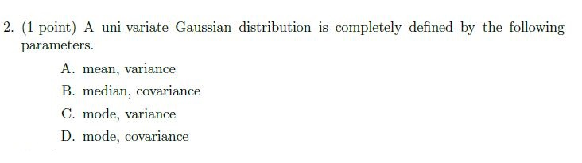

**Figure 1.** Printed question 2 from scanned offline paper, covering parameters defining a univariate Gaussian distribution.

**Options**

**A.**

mean, variance

**B.**

median, covariance

**C.**

mode, variance

**D.**

mode, covariance

#### Worked answer — independently derived

**Conventional answer: A — mean, variance. The options are not mathematically unique.** A nondegenerate univariate Gaussian is determined by $\mu$ and $\sigma^2>0$. Its mean, median and mode coincide, and its scalar covariance is its variance. Consequently **A, B, C and D** all specify sufficient parameters if “covariance” means the univariate covariance. A is the standard notation; the supplied source has no academic key to resolve the intended choice.

> [!warning] Source ambiguity
> The answer above identifies the precise defect or missing assumption. No official key was available to settle it.

---

### 2022 Term 3 · Quiz 1 · AN — Question 11 (MCQ)

**Source:** [Original PDF, p. 6](../sources/exam-papers/pdfs/ee4001_2022T3_Q1_AN.pdf#page=6) · [Archived extraction](../sources/exam-papers/extractions/ee4001_2022T3_Q1_AN.md#q11)  
**Topics:** Density normalization. **Marks:** 1.

11. (1 point) Let $f_X(x)$ be the probability distribution function for random variable X then
$$\int_{-\infty}^{\infty} f_X(x) dx = ?$$

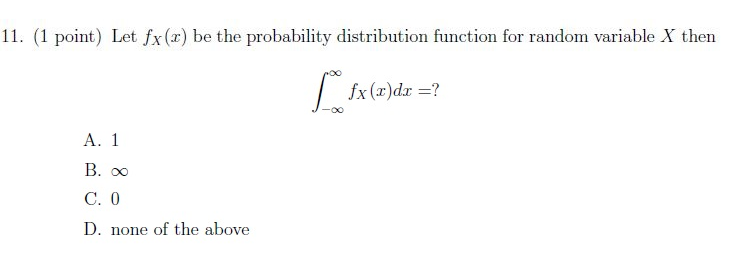

**Figure 2.** Printed question 11 from scanned offline paper, covering total integral of a probability distribution function.

**Options**

**A.**

1

**B.**

$\infty$

**C.**

0

**D.**

none of the above

#### Worked answer — independently derived

**Answer: A — 1**, interpreting $f_X$ as a probability **density** function. Normalization requires $\int_{-\infty}^{\infty}f_X(x)\,dx=1$. The source says “probability distribution function”; if that meant a CDF, this normalization integral would not apply. The notation and options indicate a PDF.

---

### 2022 Term 3 · Quiz 1 · AN — Question 12 (MCQ)

**Source:** [Original PDF, p. 6](../sources/exam-papers/pdfs/ee4001_2022T3_Q1_AN.pdf#page=6) · [Archived extraction](../sources/exam-papers/extractions/ee4001_2022T3_Q1_AN.md#q12)  
**Topics:** Gaussian symmetry. **Marks:** 1.

12. (1 point) The Gaussian curve is always symmetrical about _______.

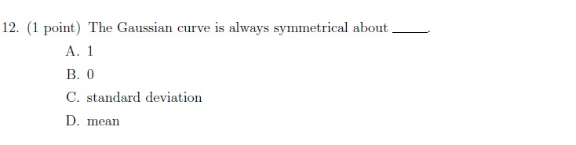

**Figure 3.** Printed question 12 from scanned offline paper, covering symmetry axis of the Gaussian curve.

**Options**

**A.**

1

**B.**

0

**C.**

standard deviation

**D.**

mean

#### Worked answer — independently derived

**Answer: D — mean.** A Gaussian satisfies $f(\mu+d)=f(\mu-d)$, so its symmetry axis is $x=\mu$.

---

### 2022 Term 3 · Quiz 1 · AN — Question 13 (Fill in the Blanks)

**Source:** [Original PDF, p. 6](../sources/exam-papers/pdfs/ee4001_2022T3_Q1_AN.pdf#page=6) · [Archived extraction](../sources/exam-papers/extractions/ee4001_2022T3_Q1_AN.md#q13)  
**Topics:** Perception: frequency and pitch. **Marks:** 1.

13. (1 point) Psychophysical equivalent of frequency is _______.

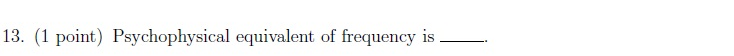

**Figure 4.** Printed question 13 from scanned offline paper, covering psychophysical equivalent of frequency.

#### Worked answer — independently derived

**Answer: pitch.** Frequency is a physical quantity in Hz; pitch is its perceptual correlate. The Mel scale measures perceived pitch, rather than being the name of the percept itself.

---

### 2023 Term 1 · Quiz 1 · NA — Question 2 (MCQ)

**Source:** [Original PDF, p. 2](../sources/exam-papers/pdfs/ee4001_2023T1_Q1_NA.pdf#page=2) · [Archived extraction](../sources/exam-papers/extractions/ee4001_2023T1_Q1_NA.md#q2)  
**Topics:** Univariate Gaussian parameters. **Marks:** 1.

2. (1 point) A uni-variate Gaussian distribution is completely defined by the following parameters.

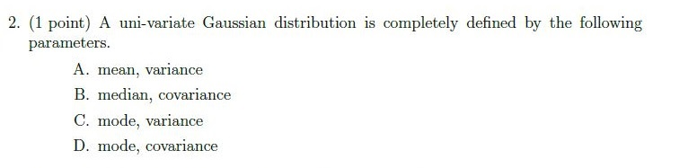

**Figure 5.** Printed question 2 from scanned offline paper, covering parameters defining a univariate Gaussian distribution.

**Options**

**A.**

mean, variance

**B.**

median, covariance

**C.**

mode, variance

**D.**

mode, covariance

#### Worked answer — independently derived

**Conventional answer: A — mean, variance. The options are not mathematically unique.** A nondegenerate univariate Gaussian is determined by $\mu$ and $\sigma^2>0$. Its mean, median and mode coincide, and its scalar covariance is its variance. Consequently **A, B, C and D** all specify sufficient parameters if “covariance” means the univariate covariance. A is the standard notation; the supplied source has no academic key to resolve the intended choice.

> [!warning] Source ambiguity
> The answer above identifies the precise defect or missing assumption. No official key was available to settle it.

---

### 2023 Term 1 · Quiz 1 · NA — Question 11 (MCQ)

**Source:** [Original PDF, p. 4](../sources/exam-papers/pdfs/ee4001_2023T1_Q1_NA.pdf#page=4) · [Archived extraction](../sources/exam-papers/extractions/ee4001_2023T1_Q1_NA.md#q11)  
**Topics:** Density normalization. **Marks:** 1.

11. (1 point) Let $f_X(x)$ be the probability distribution function for random variable X then
$$\int_{-\infty}^{\infty} f_X(x) dx = ?$$

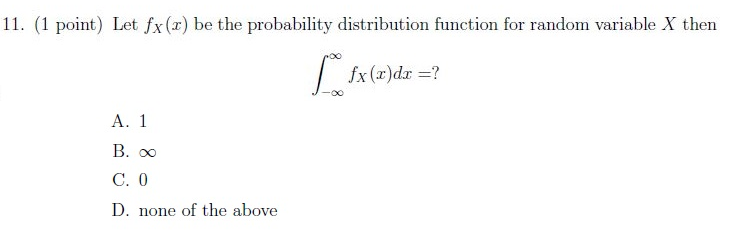

**Figure 6.** Printed question 11 from scanned offline paper, covering total integral of a probability distribution function.

**Options**

**A.**

1

**B.**

$\infty$

**C.**

0

**D.**

none of the above

#### Worked answer — independently derived

**Answer: A — 1**, interpreting $f_X$ as a probability **density** function. Normalization requires $\int_{-\infty}^{\infty}f_X(x)\,dx=1$. The source says “probability distribution function”; if that meant a CDF, this normalization integral would not apply. The notation and options indicate a PDF.

---

### 2023 Term 1 · Quiz 1 · NA — Question 12 (MCQ)

**Source:** [Original PDF, p. 4](../sources/exam-papers/pdfs/ee4001_2023T1_Q1_NA.pdf#page=4) · [Archived extraction](../sources/exam-papers/extractions/ee4001_2023T1_Q1_NA.md#q12)  
**Topics:** Gaussian symmetry. **Marks:** 1.

12. (1 point) The Gaussian curve is always symmetrical about _______.

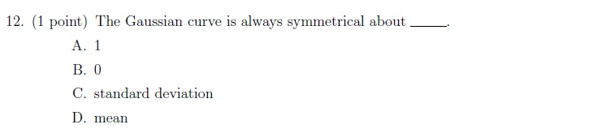

**Figure 7.** Printed question 12 from scanned offline paper, covering symmetry axis of the Gaussian curve.

**Options**

**A.**

1

**B.**

0

**C.**

standard deviation

**D.**

mean

#### Worked answer — independently derived

**Answer: D — mean.** A Gaussian satisfies $f(\mu+d)=f(\mu-d)$, so its symmetry axis is $x=\mu$.

---

### 2023 Term 1 · Quiz 1 · NA — Question 13 (Fill in the Blanks)

**Source:** [Original PDF, p. 4](../sources/exam-papers/pdfs/ee4001_2023T1_Q1_NA.pdf#page=4) · [Archived extraction](../sources/exam-papers/extractions/ee4001_2023T1_Q1_NA.md#q13)  
**Topics:** Perception: frequency and pitch. **Marks:** 1.

13. (1 point) Psychophysical equivalent of frequency is _______.

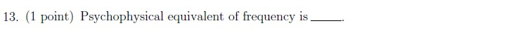

**Figure 8.** Printed question 13 from scanned offline paper, covering psychophysical equivalent of frequency.

#### Worked answer — independently derived

**Answer: pitch.** Frequency is a physical quantity in Hz; pitch is its perceptual correlate. The Mel scale measures perceived pitch, rather than being the name of the percept itself.

---

### 2023 Term 3 · Quiz 1 · NA — Question 2 (MCQ)

**Source:** [Original PDF, p. 2](../sources/exam-papers/pdfs/ee4001_2023T3_Q1_NA.pdf#page=2) · [Archived extraction](../sources/exam-papers/extractions/ee4001_2023T3_Q1_NA.md#q2)  
**Topics:** Univariate Gaussian parameters. **Marks:** 1.

2. (1 point) A uni-variate Gaussian distribution is completely defined by the following parameters.

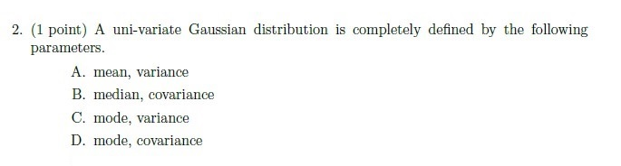

**Figure 9.** Printed question 2 from scanned offline paper, covering parameters defining a univariate Gaussian distribution.

**Options**

**A.**

mean, variance

**B.**

median, covariance

**C.**

mode, variance

**D.**

mode, covariance

#### Worked answer — independently derived

**Conventional answer: A — mean, variance. The options are not mathematically unique.** A nondegenerate univariate Gaussian is determined by $\mu$ and $\sigma^2>0$. Its mean, median and mode coincide, and its scalar covariance is its variance. Consequently **A, B, C and D** all specify sufficient parameters if “covariance” means the univariate covariance. A is the standard notation; the supplied source has no academic key to resolve the intended choice.

> [!warning] Source ambiguity
> The answer above identifies the precise defect or missing assumption. No official key was available to settle it.

---

### 2023 Term 3 · Quiz 1 · NA — Question 11 (MCQ)

**Source:** [Original PDF, p. 5](../sources/exam-papers/pdfs/ee4001_2023T3_Q1_NA.pdf#page=5) · [Archived extraction](../sources/exam-papers/extractions/ee4001_2023T3_Q1_NA.md#q11)  
**Topics:** Density normalization. **Marks:** 1.

11. (1 point) Let $f_X(x)$ be the probability distribution function for random variable X then
$$\int_{-\infty}^{\infty} f_X(x) dx = ?$$

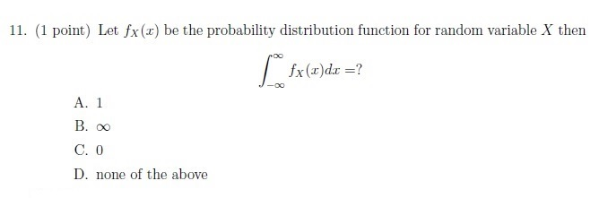

**Figure 10.** Printed question 11 from scanned offline paper, covering total integral of a probability distribution function.

**Options**

**A.**

1

**B.**

$\infty$

**C.**

0

**D.**

none of the above

#### Worked answer — independently derived

**Answer: A — 1**, interpreting $f_X$ as a probability **density** function. Normalization requires $\int_{-\infty}^{\infty}f_X(x)\,dx=1$. The source says “probability distribution function”; if that meant a CDF, this normalization integral would not apply. The notation and options indicate a PDF.

---

### 2023 Term 3 · Quiz 1 · NA — Question 12 (MCQ)

**Source:** [Original PDF, p. 5](../sources/exam-papers/pdfs/ee4001_2023T3_Q1_NA.pdf#page=5) · [Archived extraction](../sources/exam-papers/extractions/ee4001_2023T3_Q1_NA.md#q12)  
**Topics:** Gaussian symmetry. **Marks:** 1.

12. (1 point) The Gaussian curve is always symmetrical about _______.

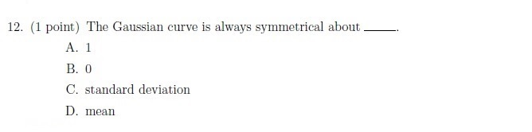

**Figure 11.** Printed question 12 from scanned offline paper, covering symmetry axis of the Gaussian curve.

**Options**

**A.**

1

**B.**

0

**C.**

standard deviation

**D.**

mean

#### Worked answer — independently derived

**Answer: D — mean.** A Gaussian satisfies $f(\mu+d)=f(\mu-d)$, so its symmetry axis is $x=\mu$.

---

### 2023 Term 3 · Quiz 1 · NA — Question 13 (Fill in the Blanks)

**Source:** [Original PDF, p. 5](../sources/exam-papers/pdfs/ee4001_2023T3_Q1_NA.pdf#page=5) · [Archived extraction](../sources/exam-papers/extractions/ee4001_2023T3_Q1_NA.md#q13)  
**Topics:** Perception: frequency and pitch. **Marks:** 1.

13. (1 point) Psychophysical equivalent of frequency is _______.

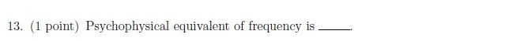

**Figure 12.** Printed question 13 from scanned offline paper, covering psychophysical equivalent of frequency.

#### Worked answer — independently derived

**Answer: pitch.** Frequency is a physical quantity in Hz; pitch is its perceptual correlate. The Mel scale measures perceived pitch, rather than being the name of the percept itself.

---

### 2025 Term 2 · Quiz 1 · NA — Question 1 (MCQ)

**Source:** [Original PDF, p. 3](../sources/exam-papers/pdfs/ee4001_2025T2_Q1_NA.pdf#page=3) · [Archived extraction](../sources/exam-papers/extractions/ee4001_2025T2_Q1_NA.md#q1)  
**Topics:** STFT and local stationarity. **Marks:** 1.

Short Time Fourier Transform (STFT) is required to analyze speech because speech is

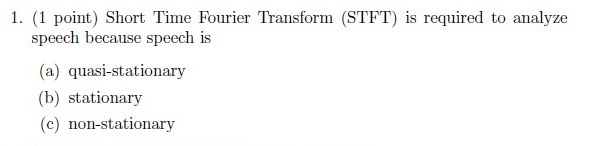

**Figure 13.** Printed Question 1 from scanned offline paper, covering why Short Time Fourier Transform (STFT) is required to analyze speech.

**Options**

**A.**

quasi-stationary

**B.**

stationary

**C.**

non-stationary

#### Worked answer — independently derived

**Preferred answer: C — non-stationary (globally).** A single whole-utterance Fourier spectrum cannot describe how speech changes with time, motivating STFT windows. Within a short frame, speech is approximately stationary: **A — quasi-stationary** describes the local approximation that makes the method useful. Because the stem does not distinguish global variation from local approximation, A may reflect classroom intent; no official key is supplied. B, globally stationary, is not the speech assumption.

> [!warning] Source ambiguity
> The answer above identifies the precise defect or missing assumption. No official key was available to settle it.

---

### 2025 Term 2 · Quiz 1 · NA — Question 4 (MCQ)

**Source:** [Original PDF, p. 3](../sources/exam-papers/pdfs/ee4001_2025T2_Q1_NA.pdf#page=3) · [Archived extraction](../sources/exam-papers/extractions/ee4001_2025T2_Q1_NA.md#q4)  
**Topics:** speech perception and spectral features. **Marks:** 1.

Which of the following best describes the role of the Mel-Frequency Cepstral Coefficients (MFCC) in speech processing?

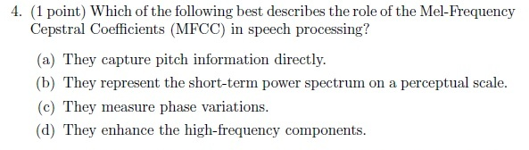

**Figure 14.** Printed Question 4 from scanned offline paper, covering the role of Mel-Frequency Cepstral Coefficients (MFCC) in speech processing.

**Options**

**A.**

They capture pitch information directly.

**B.**

They represent the short-term power spectrum on a perceptual scale.

**C.**

They measure phase variations.

**D.**

They enhance the high-frequency components.

#### Worked answer — independently derived

**B. They represent the short-term power spectrum on a perceptual scale.** MFCCs summarize log Mel-filterbank spectral energy through a decorrelating DCT; they are not direct pitch or phase measurements.

---

### 2026 Term 1 · Quiz 1 · NA — Question 1 (MCQ)

**Source:** [Original PDF, p. 4](../sources/exam-papers/pdfs/ee4001_2026T1_Q1_NA.pdf#page=4) · [Archived extraction](../sources/exam-papers/extractions/ee4001_2026T1_Q1_NA.md#q1)  
**Topics:** speech perception and spectral features. **Marks:** 1.

Which of the following best describes the role of the Mel-Frequency Cepstral Coefficients (MFCC) in speech processing?

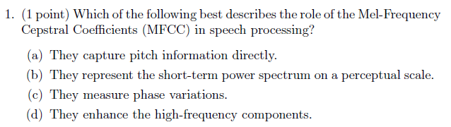

**Figure 15.** Printed question 1 from scanned offline paper, covering the role of Mel-Frequency Cepstral Coefficients (MFCC) in speech processing.

**Options**

**A.**

They capture pitch information directly.

**B.**

They represent the short-term power spectrum on a perceptual scale.

**C.**

They measure phase variations.

**D.**

They enhance the high-frequency components.

#### Worked answer — independently derived

**B. They represent the short-term power spectrum on a perceptual scale.** MFCCs summarize log Mel-filterbank spectral energy through a decorrelating DCT; they are not direct pitch or phase measurements.

---

### 2026 Term 1 · Quiz 1 · NA — Question 3 (MCQ)

**Source:** [Original PDF, p. 4](../sources/exam-papers/pdfs/ee4001_2026T1_Q1_NA.pdf#page=4) · [Archived extraction](../sources/exam-papers/extractions/ee4001_2026T1_Q1_NA.md#q3)  
**Topics:** STFT and local stationarity. **Marks:** 1.

Short Time Fourier Transform (STFT) is required to analyze speech because speech is

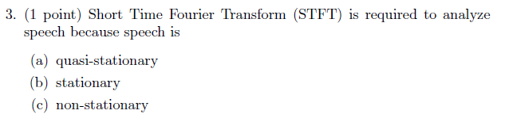

**Figure 16.** Printed question 3 from scanned offline paper, analyzing the requirement of Short Time Fourier Transform (STFT) for speech signals.

**Options**

**A.**

quasi-stationary

**B.**

stationary

**C.**

non-stationary

#### Worked answer — independently derived

**Preferred answer: C — non-stationary (globally).** A single whole-utterance Fourier spectrum cannot describe how speech changes with time, motivating STFT windows. Within a short frame, speech is approximately stationary: **A — quasi-stationary** describes the local approximation that makes the method useful. Because the stem does not distinguish global variation from local approximation, A may reflect classroom intent; no official key is supplied. B, globally stationary, is not the speech assumption.

> [!warning] Source ambiguity
> The answer above identifies the precise defect or missing assumption. No official key was available to settle it.

---

### 2026 Term 1 · Quiz 1 · NA — Question 4 (Fill in the Blank)

**Source:** [Original PDF, p. 4](../sources/exam-papers/pdfs/ee4001_2026T1_Q1_NA.pdf#page=4) · [Archived extraction](../sources/exam-papers/extractions/ee4001_2026T1_Q1_NA.md#q4)  
**Topics:** speech perception and spectral features. **Marks:** 1.

____ membrane in the ear acts as a frequency analyzer.

**Figure 17.** Printed question 4 from scanned offline paper, fill-in-the-blank question regarding the auditory membrane acting as a frequency analyzer.

#### Worked answer — independently derived

**Basilar membrane.** Its position-dependent mechanical response decomposes incoming sound by frequency.

---

### 2026 Term 1 · Quiz 1 · NA — Question 7 (MCQ)

**Source:** [Original PDF, p. 4](../sources/exam-papers/pdfs/ee4001_2026T1_Q1_NA.pdf#page=4) · [Archived extraction](../sources/exam-papers/extractions/ee4001_2026T1_Q1_NA.md#q7)  
**Topics:** speech perception and spectral features. **Marks:** 2.

When spectrograms are obtained using longer time-windows, we get ____ frequency-resolution.

Note: 1 mark for the right option and 1 mark for explanation

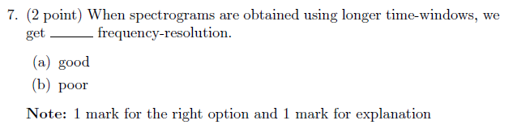

**Figure 18.** Printed question 7 from scanned offline paper, assessing frequency resolution of spectrograms obtained using longer time-windows.

**Options**

**A.**

good

**B.**

poor

#### Worked answer — independently derived

**A. good.** A longer analysis window yields narrower spectral main lobes and finer frequency resolution, at the cost of poorer temporal localization.

---

## Quiz 2 questions

### 2025 Term 2 · Quiz 2 · NA — Question 7 (Subjective)

**Source:** [Original PDF, p. 3](../sources/exam-papers/pdfs/ee4001_2025T2_Q2_NA.pdf#page=3) · [Archived extraction](../sources/exam-papers/extractions/ee4001_2025T2_Q2_NA.md#q7)  
**Topics:** MFCC extraction pipeline. **Marks:** 5.

7. (5 points) Explain all the steps involved in computing Mel-Frequency Cepstral Coefficients (MFCCs).

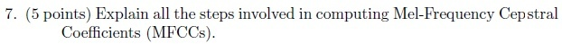

**Figure 19.** Printed question 7 from scanned offline paper, asking for explanation of steps involved in computing MFCCs.

#### Worked answer — independently derived

1. **Frame and window:** optionally pre-emphasize; split into overlapping short frames (typical window 25 ms, hop 10 ms). Multiply by a taper such as Hamming. Speech is only approximately stationary locally.
2. **Spectrum:** compute $X_t[k]=\sum_n x[n+tH]w[n]e^{-j2\pi kn/N}$ and power $P_t[k]=|X_t[k]|^2/N$ (normalization conventions vary).
3. **Mel bands:** use triangular filters $H_m[k]$ uniformly spaced in Mel coordinates, $\operatorname{mel}(f)\approx1127\ln(1+f/700)$; compute $E_t[m]=\sum_k H_m[k]P_t[k]$. This pools spectral detail on a perceptual frequency scale.
4. **Log:** $L_t[m]=\ln\max(E_t[m],\varepsilon)$, using a positive floor to avoid $\log0$. Log compresses dynamic range and makes multiplicative spectral factors additive approximately under the source–filter model.
5. **DCT:** $c_t[r]=\sum_{m=0}^{M-1} L_t[m]\cos[\pi r(m+1/2)/M]$, up to normalization. Retain selected low-order coefficients; treatment of $c_0$/log-energy varies. DCT approximately decorrelates neighboring log-band features and supports economical diagonal-covariance modeling; it is not an exact independence guarantee.
6. **Optional postprocessing:** cepstral liftering, mean/variance normalization and temporal delta/delta-delta features. Log-Mel features stop before the DCT. MFCCs emphasize the spectral envelope; neither filtering nor DCT guarantees complete removal of pitch or speaker information.

---

## End Term questions

### 2023 Term 3 · End Term · FN — Question 4 (Subjective)

**Source:** [Original PDF, p. 3](../sources/exam-papers/pdfs/ee4001_2023T3_ET_FN.pdf#page=3) · [Archived extraction](../sources/exam-papers/extractions/ee4001_2023T3_ET_FN.md#q-subj-4)  
**Topics:** speech framing; STFT; spectrogram. **Marks:** 10.

**Partial scope:** Included: raw-WAV framing/windowing/STFT feature-extraction portion only. Beyond Weeks 1–4: Transformer architecture, training/alignment, and CTC portions. The full question is retained as context; this is not a complete answer to the later-topic question.

4. (10 points) Describe all the steps involved in Transformer based Automatic Speech Recognition when you have raw WAV files and corresponding transcription. (You have to discuss everything detail from the start to end like STFT, CTC etc.)

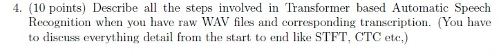

**Figure 20.** Printed Question 4 from Section 1.2 Subjective on Transformer based Automatic Speech Recognition pipeline.

#### Worked answer — independently derived

For the in-scope acoustic front end: read the waveform and sampling rate; divide it into short overlapping frames (speech is approximately stationary over a short frame); multiply each frame by a tapering window; compute the DFT for each windowed frame; retain magnitudes or power to form a spectrogram. The STFT is $X(m,\omega)=\sum_n x[n]w[n-mH]e^{-j\omega n}$, where $w$ is the window and $H$ the hop size. The rest of the requested Transformer/CTC pipeline is beyond Weeks 1–4.

---

### 2026 Term 1 · End Term · FN — Question 12 (MCQ)

**Source:** [Original PDF, p. 5, 6](../sources/exam-papers/pdfs/ee4001_2026T1_ET_FN.pdf#page=5) · [Archived extraction](../sources/exam-papers/extractions/ee4001_2026T1_ET_FN.md#q12)  
**Topics:** Short-time frame correlation. **Marks:** 1.

**Shared source instructions:**

Instructions :

All option-based questions are MCQs, and all fill-in-the-blank questions are short answer questions.

For Questions 3 to 20, answer all questions.

• In MCQs, you must write the correct option and also the complete text of that option.
• You must then provide a detailed explanation of why that specific option is the correct answer.
• In short answer questions, write the answer clearly with proper explanation wherever needed.
• In all problem-solving or example-based questions, present the solution with all intermediate steps clearly shown.
• Step-wise explanation is compulsory for all such questions.
• The final answer must be written clearly at the end.

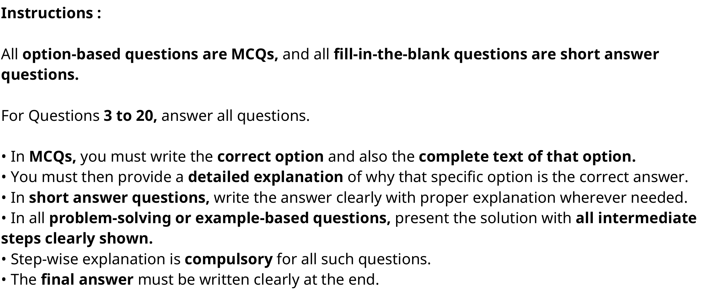

**Figure 21.** General examination instructions specifying answer requirements for MCQs, short answer, and problem-solving questions

Why is predicting the immediate next frame (e.g., at t+1) often considered a ”trivial” task in speech processing?

**Options**

**A.**

Speech signals are completely random.

**B.**

Digital speech has very low sample rates.

**C.**

Closely occurring frames (10ms apart) in speech are highly correlated.

**D.**

Next-token prediction is only effective for text, not audio.

#### Worked answer — independently derived

**Answer: C — closely occurring frames (10 ms apart) in speech are highly correlated.** Vocal-tract configuration typically changes gradually over adjacent frames; overlapping windows also share samples. Predicting a nearby frame can exploit local continuity without learning long-range linguistic structure. This is a typical property, not perfect equality at every speech boundary.

---

## Reproducibility and source integrity

Source PDFs, original extracted text and crops are archived under `sources/exam-papers/`. The inventory records PDF SHA-256 hashes. Rebuild with `uv run python build_exam_question_banks.py`; verify numerical examples and generated links with `uv run python verify_exam_question_banks.py`. The reviewed routing manifest includes every source question, including excluded later material.
