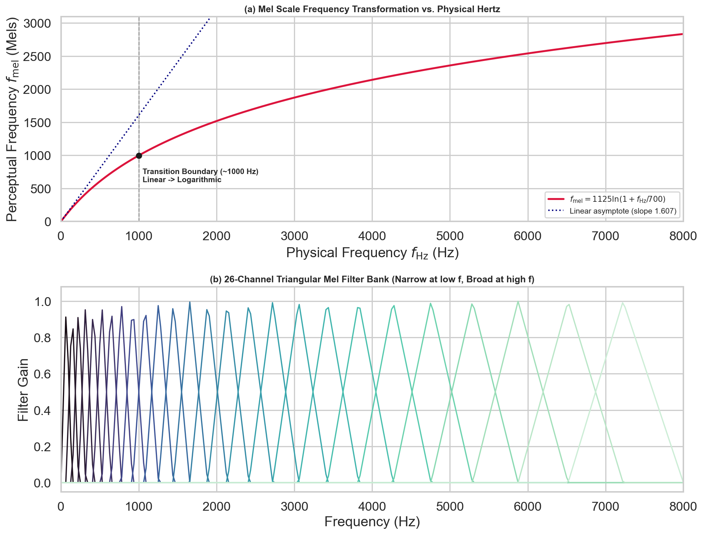
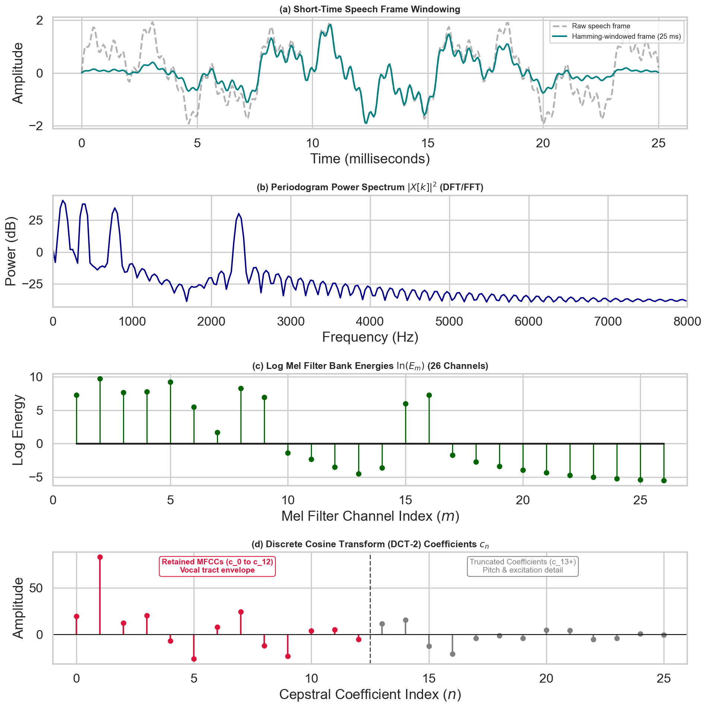
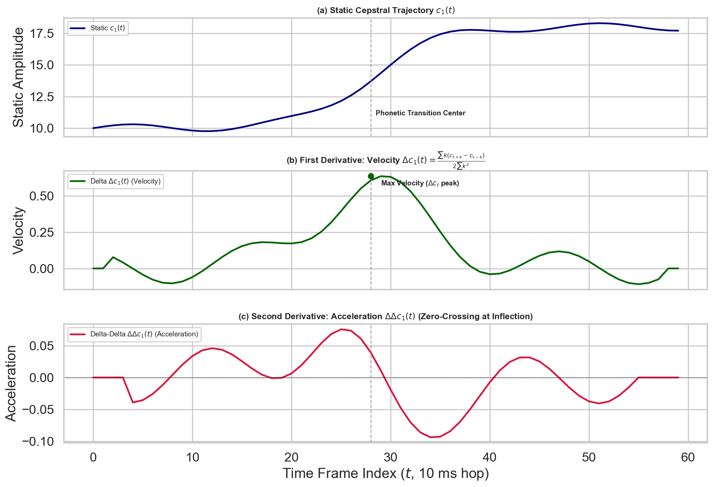
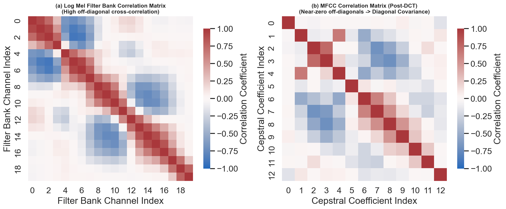
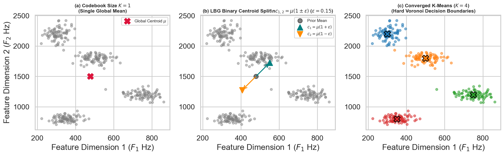
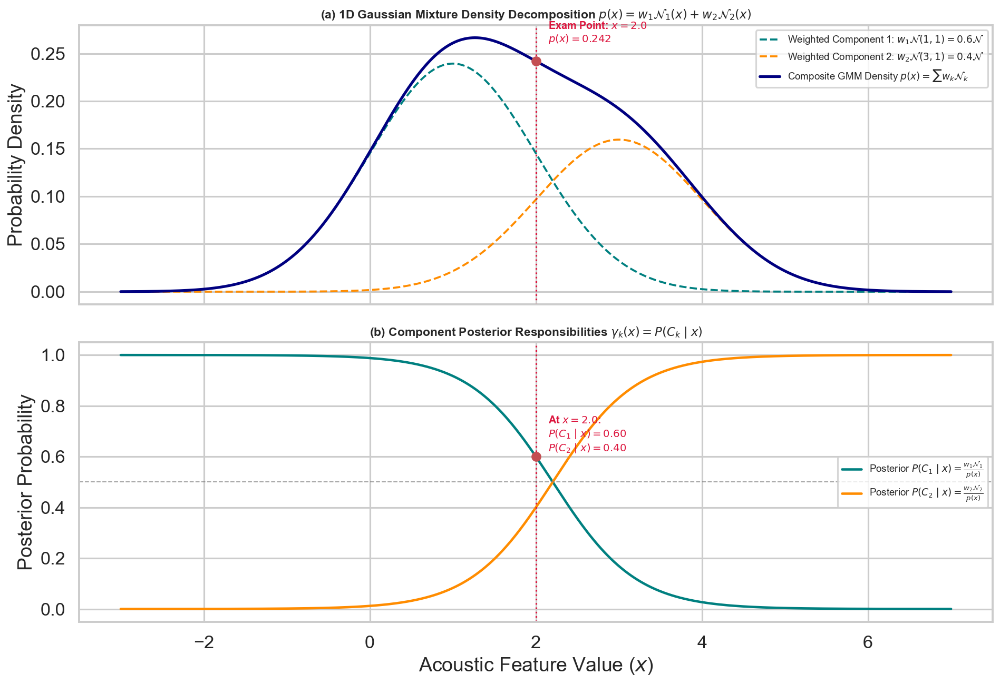
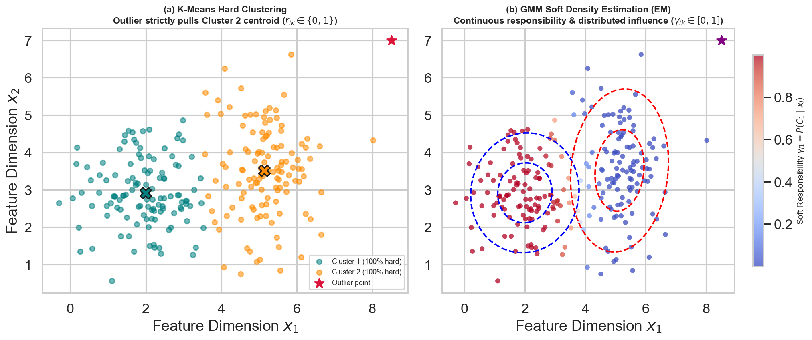
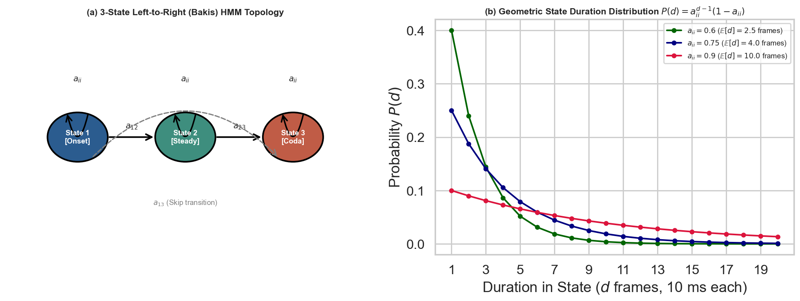
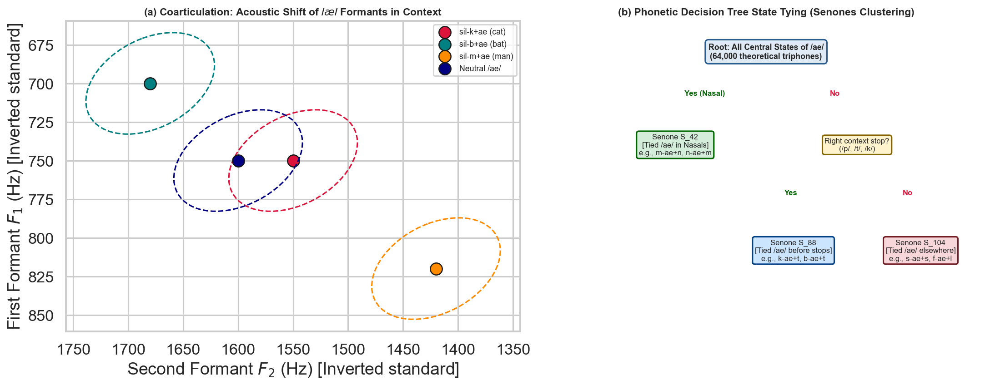
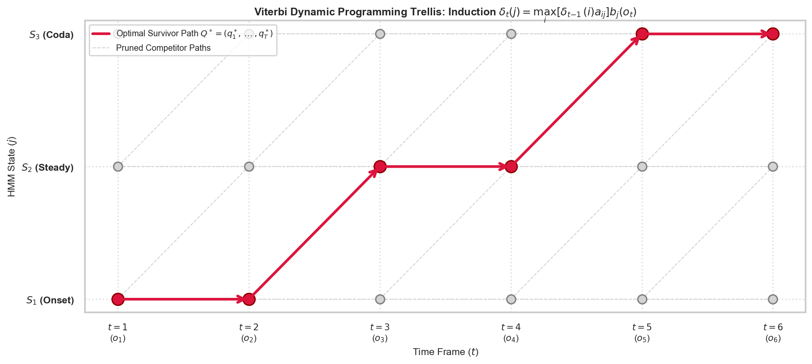

# Week 2: Statistical Modeling & Pattern Recognition in Speech

> **Track:** Speech Technology (IIT Madras BS Degree — BSEE4001)  
> **Scope:** Week 2 of 12  
> **Core Focus:** Advanced perceptual feature extraction (the 6-stage MFCC pipeline, triangular Mel filter banks, log compression, DCT-2 decorrelation, dynamic deltas), statistical clustering (K-Means hard assignment vs. GMM soft assignment), multivariate Gaussian distributions and EM training, sequential acoustic modeling via Hidden Markov Models (HMMs), 3-state phoneme topologies, context-dependent triphones, state-tying, the Viterbi decoding algorithm, the Forward-Backward training algorithm, and lexical pronunciation mapping.

---

## Abstract

This document constitutes the comprehensive technical and mathematical reference for Week 2 of Speech Technology. Week 2 establishes the transition from continuous-time signal processing and short-time spectral analysis (established in Week 1) into statistical pattern recognition and sequential probabilistic modeling. 

We formalize:
1. The mathematical bridge from the **Short-Time Fourier Transform (STFT)** and **Log Mel Filter Banks** (Week 1) to **Mel-Frequency Cepstral Coefficients (MFCCs)** via the **Discrete Cosine Transform (DCT-2)**, proving why feature decorrelation is mandatory for diagonal covariance acoustic modeling.
2. The role of **dynamic spectral derivatives** (Delta and Delta-Delta coefficients) in appending short-term velocity and acceleration to static cepstral frames, expanding the acoustic observation vector to 39 dimensions.
3. Vector clustering foundations via **K-Means**, establishing its properties as a deterministic hard-assignment optimization algorithm, its sensitivity to initialization, and its role in seeding continuous density models.
4. **Gaussian Mixture Models (GMMs)** as universal continuous probability density approximators, modeling multimodal speaker variability across gender, age, and accents via Expectation-Maximization (EM) soft responsibilities.
5. **Hidden Markov Models (HMMs)** as doubly stochastic sequential processes, separating observable continuous acoustic vectors from hidden discrete phonetic sequences governed by Markovian transition dynamics.
6. The distinction between temporal sub-phonetic division (**Tri-state models**) and articulatory context-dependence (**Tri-phone models**), formalizing coarticulation and parameter reduction via decision-tree state tying.
7. The foundational inferential algorithms of ASR: **Viterbi decoding** (dynamic programming for optimal state trajectory selection) and the **Forward-Backward algorithm** (exact posterior calculation for Baum-Welch re-estimation).
8. The architectural role of the **Lexicon (Pronunciation Dictionary)** in bridging phonetic emission sequences to orthographic word representations.

---

## 1. The Speech Recognition Pipeline & Pattern Recognition Architecture

### 1.1 From Continuous Acoustic Waveform to Orthographic Words

Automatic Speech Recognition (ASR) transforms the acoustic pressure wave $x(t)$ generated by the speaker's vocal tract into an orthographic sequence of words $W = (w_1, w_2, \dots, w_M)$. In Week 1, we established the physical production of speech via Gunnar Fant's Source-Filter Model, discretized continuous signals through Nyquist-Shannon sampling ($f_s \ge 2 f_{\max}$), and transformed framed time-domain signals into the frequency domain via the Short-Time Fourier Transform (STFT) and triangular Mel filter banks. 

Week 2 connects these spectral representations to statistical pattern recognition engines. The complete pipeline executes across seven sequential transformations:

```text
Continuous Acoustic Pressure Wave x(t)
        |
        v [Analog-to-Digital Conversion: f_s >= 2*f_max, 16-bit Quantization (Week 1)]
Sampled Discrete Sequence x[n]
        |
        v [Short-Time Windowing: 25 ms frame, 10 ms shift, Hamming Window (Week 1)]
Framed Signal Blocks x_m[n]
        |
        v [Discrete Fourier Transform (DFT/FFT) & Magnitude Squared (Week 1)]
Short-Term Power Spectrum |X_m[k]|^2
        |
        v [Triangular Mel-Scale Filter Bank Integration & Log Compression (Weeks 1 & 2)]
Log Mel Filter Bank Energies (Static, Highly Correlated)
        |
        v [Discrete Cosine Transform (DCT-2) Decorrelation (Week 2)]
Mel-Frequency Cepstral Coefficients (MFCCs) + Deltas + Delta-Deltas (39D)
        |
        v [Acoustic Likelihood Evaluation: P(O_t | State_j) via GMM / DNN (Week 2)]
State Emission Probability Densities b_j(O_t)
        |
        v [Sequential State Decoding: Viterbi Trellis Search over HMM Topologies (Week 2)]
Decoded Optimal Phoneme / Triphone State Sequence Q*
        |
        v [Lexicon / Pronunciation Dictionary Mapping: Phonemes -> Lexical Words (Week 2)]
Recognized Word String W*
```

### 1.2 The Fundamental Equation of Statistical Speech Recognition

ASR is framed mathematically as a maximum a posteriori (MAP) decision rule. Given an observed sequence of acoustic feature vectors $O = (o_1, o_2, \dots, o_T)$, where each $o_t \in \mathbb{R}^D$ is an acoustic observation extracted at time frame $t$, the decoder determines the most likely word sequence $\hat{W} = (\hat{w}_1, \dots, \hat{w}_M)$:

$$\hat{W} = \arg\max_{W} P(W \mid O)$$

Applying Bayes' Rule:

$$P(W \mid O) = \frac{P(O \mid W) \cdot P(W)}{P(O)}$$

Because the marginal observation probability $P(O)$ is invariant to the choice of word sequence $W$, it acts as an evidence normalizing constant and is discarded during decoding optimization:

$$\hat{W} = \arg\max_{W} P(O \mid W) \cdot P(W)$$

This decomposition establishes the three primary knowledge sources of an ASR system:

1. **The Acoustic Model ($P(O \mid W)$):** Computes the conditional probability density of observing the acoustic feature trajectory $O$ given that the word sequence $W$ was spoken. Modeled at the sub-word level by **Gaussian Mixture Model - Hidden Markov Models (GMM-HMM)** or **Deep Neural Network - Hidden Markov Models (DNN-HMM)**.
2. **The Lexical Model (Pronunciation Dictionary $L$):** Decomposes each word $w \in W$ into a deterministic or probabilistic concatenation of phonemic or sub-phonetic states:
   $$P(O \mid W) = \sum_{Q} P(O \mid Q) \cdot P(Q \mid W)$$
   where $Q = (q_1, q_2, \dots, q_T)$ represents the hidden sequence of phonetic states.
3. **The Language Model ($P(W)$):** Computes the prior probability of the word sequence $W$ according to linguistic syntax, grammar, and semantic context, modeled via $N$-gram statistical models or autoregressive neural language models.

---

## 2. Advanced Feature Extraction: The Complete MFCC Pipeline

### 2.1 The Perceptual and Acoustic Motivation for MFCCs

The raw digitized time-domain speech waveform contains phase variations, fine glottal periodicity, pitch contours, and recording transmission noise that do not contribute to phonemic identity. As derived in Week 1, human phonetic perception is primarily determined by the vocal tract transfer function $V(z)$—the envelope of the short-term spectrum that defines formant resonance peaks ($F_1, F_2, F_3$). 

Mel-Frequency Cepstral Coefficients (MFCCs) represent the standard acoustic front-end for statistical pattern recognition because they satisfy three criteria:
- **Perceptual Frequency Scaling:** Resolution degrades at higher frequencies, mirroring the non-linear critical band integration of the human basilar membrane.
- **Source-Filter Homomorphic Separation:** The vocal tract spectral envelope is separated from the glottal harmonic excitation line spectrum.
- **Statistical Orthogonality (Decorrelation):** The individual dimensions of the feature vector are mutually uncorrelated, allowing acoustic models to use diagonal covariance matrices.

### 2.2 The Six-Stage MFCC Extraction Pipeline

```text
[Discrete Speech Sequence x[n]]
              |
              v
    1. Pre-Emphasis & Framing (25 ms Window, 10 ms Frame Shift)
              |
              v
    2. Discrete Fourier Transform (FFT -> Power Spectrum |X[k]|^2)
              |
              v
    3. Triangular Mel Filter Bank (40 Channels Narrowband / 80 Channels Wideband)
              |
              v
    4. Logarithmic Energy Compression (log E_m: Multiplicative -> Additive)
              |
              v
    5. Discrete Cosine Transform (DCT-2: Decorrelates Filter Energies -> 13 Static MFCCs)
              |
              v
    6. Dynamic Feature Computation (Delta + Delta-Delta Append -> 39-Dimensional Vector)
```

#### Step 1: Pre-Emphasis and Short-Time Framing
Continuous speech is non-stationary. As established in Week 1, the vocal tract articulators cannot move instantaneously, rendering the acoustic waveform **quasi-stationary** over intervals of $20\text{--}30\ \mathrm{ms}$. 

1. **Pre-Emphasis Filtering:** Glottal airflow volume velocity introduces a $-6\ \mathrm{dB/octave}$ spectral tilt, and radiation impedance at the lips introduces a $+6\ \mathrm{dB/octave}$ boost. To prevent high-frequency formants ($F_2, F_3$) from being obscured by high-energy lower harmonics, a first-order high-pass FIR filter is applied:
   $$y[n] = x[n] - \alpha x[n-1], \quad \text{where } \alpha \in [0.95, 0.97]$$
2. **Analysis Windowing:** The pre-emphasized signal is segmented into overlapping frames of length $N = 0.025 \cdot f_s$ ($25\ \mathrm{ms}$, providing 400 samples at $f_s = 16\ \mathrm{kHz}$) with a frame shift of $M = 0.010 \cdot f_s$ ($10\ \mathrm{ms}$, corresponding to a $100\ \mathrm{Hz}$ frame rate). A Hamming window $w[n]$ is applied to eliminate truncation discontinuity and suppress spectral leakage sidelobes to $-43\ \mathrm{dB}$:
   $$w[n] = 0.54 - 0.46 \cos\left(\frac{2\pi n}{N - 1}\right), \quad 0 \le n \le N - 1$$
   $$x_m[n] = x[m M + n] \cdot w[n]$$

#### Step 2: Discrete Fourier Transform (Power Spectrum)
Each windowed block $x_m[n]$ is transformed into the discrete frequency domain using an $N_{\mathrm{FFT}}$-point Fast Fourier Transform (typically $N_{\mathrm{FFT}} = 512$ for $f_s = 16\ \mathrm{kHz}$):

$$X_m[k] = \sum_{n=0}^{N-1} x_m[n] \exp\left(-j \frac{2\pi}{N_{\mathrm{FFT}}} k n\right), \quad 0 \le k \le N_{\mathrm{FFT}} - 1$$

The short-term periodogram power spectrum is computed:

$$P_m[k] = \frac{1}{N_{\mathrm{FFT}}} \left| X_m[k] \right|^2$$

#### Step 3: Triangular Mel-Scale Filter Bank Integration
The linear frequency axis is converted into the perceptual Mel scale. The basilar membrane in the inner ear exhibits constant bandwidth resolution below $1000\ \mathrm{Hz}$ and logarithmic bandwidth resolution above $1000\ \mathrm{Hz}$.

The official IIT Madras course formula converts physical frequency $f_{\mathrm{Hz}}$ to perceptual frequency $f_{\mathrm{mel}}$:

$$f_{\mathrm{mel}} = 1125 \ln\left(1 + \frac{f_{\mathrm{Hz}}}{700}\right)$$

The inverse transformation recovers physical frequency:

$$f_{\mathrm{Hz}} = 700 \left[ \exp\left(\frac{f_{\mathrm{mel}}}{1125}\right) - 1 \right]$$

A bank of $M_{\mathrm{filters}}$ triangular bandpass filters is constructed across the analysis range $[0, f_s / 2]$:
- Standard for **narrowband telephony speech** ($8\ \mathrm{kHz}$ sampling rate): $M_{\mathrm{filters}} = 40$ filters.
- Standard for **wideband speech** ($16\ \mathrm{kHz}$ sampling rate): $M_{\mathrm{filters}} = 80$ filters (or $26\text{--}40$ filters in legacy acoustic models).

Each triangular filter $H_m[k]$ has a non-zero response defined by three consecutive center frequencies in bin indices $f[m-1], f[m], f[m+1]$:

$$H_m[k] = \begin{cases}
0 & k < f[m-1] \\
\frac{k - f[m-1]}{f[m] - f[m-1]} & f[m-1] \le k \le f[m] \\
\frac{f[m+1] - k}{f[m+1] - f[m]} & f[m] \le k \le f[m+1] \\
0 & k > f[m+1]
\end{cases}$$

The energy output $E_m$ of the $m$-th filter is the weighted dot product over the power spectrum:

$$E_m = \sum_{k=0}^{N_{\mathrm{FFT}} / 2} P[k] \cdot H_m[k], \quad m = 1, 2, \dots, M_{\mathrm{filters}}$$



**Figure 1.** *Perceptual Mel scale frequency transformation $f_{\mathrm{mel}} = 1125 \ln(1 + f_{\mathrm{Hz}}/700)$ vs. linear physical frequency, demonstrating the linear-to-logarithmic transition at ~1000 Hz, and the corresponding 26-channel triangular Mel filter bank across [0, 8000] Hz.*

#### Step 4: Logarithmic Energy Compression
The natural logarithm is applied to each filter bank energy:

$$S_m = \ln(E_m) = \ln\left(\sum_{k} P[k] H_m[k]\right)$$

The logarithm serves two physical functions:
1. **Dynamic Range Compression:** Human loudness perception follows a logarithmic response (Weber-Fechner Law).
2. **Homomorphic Deconvolution:** In Week 1, we proved Gunnar Fant's Source-Filter relation in the frequency domain: $S(\omega) = E(\omega) \cdot V(\omega)$. The logarithm transforms the multiplicative convolution of excitation and vocal tract filter into an additive relationship:
   $$\ln |S(\omega)| = \ln |E(\omega)| + \ln |V(\omega)|$$
   The slowly varying vocal tract envelope $\ln |V(\omega)|$ is now linearly separable from the rapidly oscillating glottal harmonic excitation $\ln |E(\omega)|$.

#### Step 5: Discrete Cosine Transform (DCT-2 Decorrelation)
The log Mel filter bank energies $S_m$ are highly correlated because adjacent triangular filters overlap by $50\%$. To decorrelate these features, the Discrete Cosine Transform (Type-II DCT) is applied:

$$c_n = \sum_{m=1}^{M_{\mathrm{filters}}} S_m \cos\left( \frac{\pi n (m - 0.5)}{M_{\mathrm{filters}}} \right), \quad n = 0, 1, \dots, C-1$$

Where:
- $c_n$ represents the $n$-th Mel-Frequency Cepstral Coefficient.
- $C$ is the number of retained cepstral coefficients, typically set to $C = 13$ ($c_0$ through $c_{12}$).
- **$c_0$:** Proportional to the total log-energy of the frame:
  $$c_0 = \sum_{m=1}^{M_{\mathrm{filters}}} S_m$$
  Often replaced or supplemented by the explicit log frame energy $E_{\mathrm{frame}} = \log \sum x^2[n]$.
- **$c_1 \dots c_{12}$:** Capture the low-quefrency spectral envelope corresponding to vocal tract geometry (formant resonances).
- **High-order coefficients ($n > 12$):** Represent fast spectral fluctuations (pitch harmonics, fine excitation structure, and noise) and are truncated, achieving feature compression.



**Figure 2.** *The complete Mel-Frequency Cepstral Coefficients (MFCC) feature extraction pipeline: (a) 25 ms Hamming-windowed speech frame, (b) short-time periodogram power spectrum $|X[k]|^2$, (c) 26-channel log Mel filter bank energies $\ln(E_m)$, and (d) DCT-2 cepstral coefficients $c_n$ showing retention of $c_0\dots c_{12}$ (vocal tract envelope) and truncation of higher quefrency components (pitch and glottal excitation).*

#### Step 6: Dynamic Spectral Features (Deltas and Delta-Deltas)
Static MFCCs capture only a single static snapshot ($25\ \mathrm{ms}$) of the vocal tract. Speech is an inherently dynamic articulatory process where consonant-vowel transitions and speaking rates carry critical linguistic information.

To capture temporal velocity and acceleration, dynamic derivatives are calculated across adjacent frames:

1. **Delta Coefficients (Velocity $\Delta c_t$):** Computed over a window of length $2K + 1$ (typically $K = 2$ frames):
   $$d_t = \frac{\sum_{k=1}^K k (c_{t+k} - c_{t-k})}{2 \sum_{k=1}^K k^2}$$
2. **Delta-Delta Coefficients (Acceleration $\Delta\Delta c_t$):** Computed by applying the same differential operator to the delta vector:
   $$dd_t = \frac{\sum_{k=1}^K k (d_{t+k} - d_{t-k})}{2 \sum_{k=1}^K k^2}$$

The final acoustic observation vector $o_t$ at time frame $t$ concatenates static, delta, and acceleration parameters:

$$o_t = \begin{bmatrix} c_t \\ d_t \\ dd_t \end{bmatrix} \in \mathbb{R}^{39}$$

This produces the standard 39-dimensional acoustic feature representation used across traditional statistical ASR systems ($13\ \text{static} + 13\ \text{deltas} + 13\ \text{delta-deltas}$).



**Figure 3.** *Dynamic spectral features: (a) static cepstral trajectory $c_1(t)$ across 60 frames during a phonetic transition, (b) first temporal derivative velocity delta $\Delta c_1(t)$ showing peak velocity at the transition center, and (c) second temporal derivative acceleration delta-delta $\Delta\Delta c_1(t)$ exhibiting a zero-crossing at the inflection point.*

### 2.3 The Decorrelation Imperative: Why Statistical Models Require DCT

A fundamental exam concept is the operational justification for applying the DCT. 

In Gaussian Mixture Modeling (Core Topic 2), each state probability distribution is parameterized by a mean vector $\mu \in \mathbb{R}^D$ and a covariance matrix $\Sigma \in \mathbb{R}^{D \times D}$:

$$\mathcal{N}(x; \mu, \Sigma) = \frac{1}{(2\pi)^{D/2} |\Sigma|^{1/2}} \exp\left( -\frac{1}{2} (x - \mu)^T \Sigma^{-1} (x - \mu) \right)$$

1. **Full Covariance Matrix:** If features are correlated, all off-diagonal covariance entries $\sigma_{ij} = \mathbb{E}[(x_i - \mu_i)(x_j - \mu_j)]$ are non-zero. For a $D = 39$-dimensional vector, a full covariance matrix requires estimating:
   $$\frac{D(D + 1)}{2} = \frac{39 \times 40}{2} = 780\ \text{parameters per Gaussian component}$$
   Inversion of $\Sigma$ requires $O(D^3)$ computations per frame evaluation, and training suffers from severe overfitting unless vast amounts of speech data are available.
2. **Diagonal Covariance Matrix:** If the feature dimensions are strictly uncorrelated ($\sigma_{ij} = 0$ for $i \ne j$), the covariance matrix simplifies to a diagonal matrix:
   $$\Sigma = \operatorname{diag}(\sigma_1^2, \sigma_2^2, \dots, \sigma_D^2)$$
   - Parameter count per component drops from $780$ to $D = 39$ ($O(D)$ complexity).
   - Inversion requires only $D$ scalar divisions: $\Sigma^{-1} = \operatorname{diag}(1/\sigma_1^2, \dots, 1/\sigma_D^2)$.
   - Evaluating $(x - \mu)^T \Sigma^{-1} (x - \mu)$ simplifies to the weighted Euclidean distance:
     $$\sum_{d=1}^D \frac{(x_d - \mu_d)^2}{\sigma_d^2}$$

The DCT acts as an empirical approximation of the **Karhunen-Loève Transform (KLT)**, diagonalizing the covariance matrix of the log Mel filter bank energies. 



**Figure 4.** *Empirical cross-correlation matrices before and after the Discrete Cosine Transform: (a) Log Mel filter bank energies exhibit strong off-diagonal cross-correlation due to 50% triangular filter overlap; (b) MFCC features post-DCT-2 exhibit near-zero off-diagonal covariance, mathematically justifying diagonal covariance acoustic modeling.*

### 2.4 Log Mel Filter Banks vs. MFCCs: Statistical vs. Deep Learning Paradigms

| Feature Property | Log Mel Filter Bank Features | Mel-Frequency Cepstral Coefficients (MFCCs) |
| :--- | :--- | :--- |
| **Transform Stages** | Window $\rightarrow$ FFT $\rightarrow$ Mel Filter Bank $\rightarrow$ Log | Window $\rightarrow$ FFT $\rightarrow$ Mel Filter Bank $\rightarrow$ Log $\rightarrow$ **DCT-2** |
| **Inter-dimension Correlation** | High (adjacent triangular filters overlap heavily) | Low (decorrelated via orthogonal cosine basis) |
| **Spatial / Frequency Locality** | Preserved (adjacent bins represent adjacent frequencies) | Destroyed (quefrency coefficients represent global ripple rates) |
| **Standard Dimensionality** | $40\text{--}80$ dimensions per frame | $13$ static ($39$ with $\Delta, \Delta\Delta$) |
| **Acoustic Modeling Target** | **Deep Neural Networks (DNNs, CNNs, Transformers)** | **Traditional Statistical Models (GMM-HMMs)** |
| **Reason for Architectural Fit** | Convolutional and self-attention layers exploit spectral locality and handle correlated inputs natively. | GMMs strictly require uncorrelated features to deploy diagonal covariance matrices. |

---

## 3. Statistical Clustering & Initialization: K-Means Algorithm

### 3.1 Hard Clustering Formulation & Objective Function

Before training continuous density probabilistic models, the acoustic feature space must be partitioned into codebooks or initial cluster centers. **K-Means** is an iterative, deterministic, hard-clustering algorithm that partitions an unlabelled dataset of $N$ observation vectors $\mathcal{X} = \{x_1, x_2, \dots, x_N\}$, where $x_i \in \mathbb{R}^D$, into $K$ disjoint clusters $S = \{S_1, S_2, \dots, S_K\}$.

The algorithm minimizes the total Within-Cluster Sum of Squares (WCSS), also known as the distortion objective function $J$:

$$J = \sum_{k=1}^K \sum_{x_i \in S_k} \| x_i - \mu_k \|^2$$

where $\mu_k = \frac{1}{|S_k|} \sum_{x_i \in S_k} x_i$ is the empirical centroid of cluster $S_k$.

### 3.2 Iterative Algorithmic Mechanics

```text
Initialize K Centroids {mu_1, ..., mu_K}
                   |
                   v
       +---------> [Step 1: Assignment Step (Voronoi Partitioning)]
       |           Assign each vector x_i strictly to the nearest centroid:
       |           S_k^(t) = { x_i : ||x_i - mu_k^(t)||^2 <= ||x_i - mu_j^(t)||^2  forall j }
       |                   |
       |                   v
       |           [Step 2: Update Step (Centroid Recomputation)]
       |           Recompute each cluster mean from its assigned points:
       |           mu_k^(t+1) = (1 / |S_k^(t)|) * sum_{x_i in S_k^(t)} x_i
       |                   |
       |                   v
       +---------- [Step 3: Convergence Criterion]
                   Check if ||mu_k^(t+1) - mu_k^(t)|| < epsilon or J stops decreasing
```

### 3.3 Vector Quantization (VQ) & LBG Cluster Splitting

When training acoustic codebooks or initializing GMM components, a central question is how to select the initial $K$ cluster centers. Standard random initialization frequently traps the algorithm in poor local minima. 

The **Linde-Buzo-Gray (LBG)** algorithm initializes clusters by successive binary splitting. Starting with a single global cluster ($K=1$) whose center is the global mean of the entire training dataset:

$$\mu = \frac{1}{N} \sum_{i=1}^N x_i$$

To expand the codebook from $M$ to $2M$ clusters, each existing centroid $\mu_m$ is split into two candidate centers using a fixed perturbation factor $\epsilon$ (typically $\epsilon \in [0.01, 0.1]$):

$$c_{m, 1} = \mu_m (1 + \epsilon)$$
$$c_{m, 2} = \mu_m (1 - \epsilon)$$

K-Means is then run on the perturbed centers until convergence. This splitting procedure is repeated iteratively ($1 \rightarrow 2 \rightarrow 4 \rightarrow 8 \rightarrow \dots \rightarrow K$) until the desired number of clusters is reached.



**Figure 5.** *Vector quantization and LBG binary centroid splitting: (a) codebook initialization with global dataset mean $\mu$ ($K=1$), (b) binary perturbation split $c_{1,2} = \mu(1 \pm \epsilon)$, and (c) converged K-Means ($K=4$) with Voronoi decision boundaries in 2D formant acoustic space.*

### 3.4 Theoretical Properties & Structural Limitations

1. **Fixed Hyperparameter $K$:** The number of clusters $K$ is an invariant input hyperparameter chosen prior to execution. The value of $K$ does not change as the algorithm converges.
2. **Deterministic Hard Assignment:** Every observation vector $x_i$ is assigned $100\%$ to exactly one cluster $S_k$. It has zero membership in all other $K-1$ clusters, regardless of whether $x_i$ lies on the exact decision boundary between two centroids.
3. **Local Minima Trapping:** K-Means uses greedy gradient descent over the non-convex surface of $J$. It is mathematically guaranteed to converge to a local minimum, but it does **not** guarantee convergence to the global minimum. The final cluster centers depend heavily on the initial centroid placement.
4. **Vulnerability to Outliers:** Because assignments are hard, an extreme outlier point assigned to cluster $S_k$ shifts the mean $\mu_k$ directly:
   $$\mu_k = \frac{1}{|S_k|} \left( \sum_{x \in S_k, x \ne x_{\mathrm{outlier}}} x + x_{\mathrm{outlier}} \right)$$

---

## 4. Continuous Density Estimation: Gaussian Mixture Models (GMMs)

### 4.1 Univariate and Multivariate Normal Distributions

#### Univariate Gaussian Distribution
A single continuous random variable $x \in \mathbb{R}$ is modeled by the 1D Gaussian probability density function (PDF):

$$\mathcal{N}(x; \mu, \sigma^2) = \frac{1}{\sqrt{2\pi\sigma^2}} \exp\left( -\frac{(x - \mu)^2}{2\sigma^2} \right)$$

A univariate Gaussian is completely and uniquely defined by two statistical parameters:
- **Mean ($\mu$):** The first central moment, defining the center of the distribution: $\mu = \mathbb{E}[x]$.
- **Variance ($\sigma^2$):** The second central moment, defining the dispersion (spread) around the mean: $\sigma^2 = \mathbb{E}[(x - \mu)^2]$.

#### Multivariate Gaussian Distribution
For a $D$-dimensional acoustic observation vector $x \in \mathbb{R}^D$, the multivariate normal distribution is:

$$\mathcal{N}(x; \mu, \Sigma) = \frac{1}{(2\pi)^{D/2} |\Sigma|^{1/2}} \exp\left( -\frac{1}{2} (x - \mu)^T \Sigma^{-1} (x - \mu) \right)$$

where $\mu \in \mathbb{R}^D$ is the mean vector and $\Sigma \in \mathbb{R}^{D \times D}$ is the symmetric positive semi-definite covariance matrix. Under the diagonal covariance assumption ($\Sigma = \operatorname{diag}(\sigma_1^2, \dots, \sigma_D^2)$), the PDF factorizes into the product of $D$ independent univariate Gaussians:

$$\mathcal{N}(x; \mu, \Sigma) = \prod_{d=1}^D \frac{1}{\sqrt{2\pi\sigma_d^2}} \exp\left( -\frac{(x_d - \mu_d)^2}{2\sigma_d^2} \right)$$

### 4.2 GMM Formulation as a Universal Density Approximator

A single Gaussian distribution is strictly unimodal—it has a single symmetric peak. Acoustic features of spoken phonemes are heavily **multimodal**:
- Acoustic realizations of the vowel `/a/` differ substantially between adult males (fundamental frequency $100\ \mathrm{Hz}$, lower formants), adult females ($200\ \mathrm{Hz}$, higher formants), and young children ($300\ \mathrm{Hz}$).
- Regional accents, speaking rates, and phonetic coarticulation create distinct sub-clusters within the feature space of a single phoneme.

A **Gaussian Mixture Model (GMM)** resolves this by modeling the probability density as a convex linear combination of $K$ distinct Gaussian components:

$$p(x) = \sum_{k=1}^K w_k \mathcal{N}_k(x; \mu_k, \Sigma_k)$$

Subject to the probability simplex constraints:

$$0 \le w_k \le 1 \quad \forall k, \quad \text{and} \quad \sum_{k=1}^K w_k = 1$$

Where:
- $K$ is the number of mixture components (typically $K \in \{8, 16, 32, 64\}$ in acoustic models).
- $w_k = P(C_k)$ is the **mixture weight** (prior probability) that an observation was generated by the $k$-th Gaussian component.
- $\mathcal{N}_k(x; \mu_k, \Sigma_k)$ is the conditional probability density of observing vector $x$ given component $C_k$.

### 4.3 Component Posteriors & Expectation-Maximization (EM)

Given an observed feature vector $x$, the posterior probability that component $C_k$ generated $x$ is computed using Bayes' Rule:

$$\gamma_k(x) = P(C_k \mid x) = \frac{P(C_k) \cdot p(x \mid C_k)}{p(x)} = \frac{w_k \mathcal{N}_k(x; \mu_k, \Sigma_k)}{\sum_{j=1}^K w_j \mathcal{N}_j(x; \mu_j, \Sigma_j)}$$

The posterior $\gamma_k(x)$ is termed the **responsibility** that component $k$ takes for observation $x$.

Because the generating component of each observation vector is an unobserved latent variable, GMM parameters cannot be computed analytically. Parameters $\theta = \{w_k, \mu_k, \Sigma_k\}_{k=1}^K$ are estimated iteratively using the **Expectation-Maximization (EM)** algorithm:

1. **Expectation Step (E-step):** Evaluate the responsibilities $\gamma_{ik} = P(C_k \mid x_i)$ for all training vectors $x_i$ ($i = 1, \dots, N$) and all components $k = 1, \dots, K$ using current parameters:
   $$\gamma_{ik} = \frac{w_k \mathcal{N}(x_i; \mu_k, \Sigma_k)}{\sum_{j=1}^K w_j \mathcal{N}(x_i; \mu_j, \Sigma_j)}$$
2. **Maximization Step (M-step):** Update the model parameters using the weighted soft responsibilities:
   - **Effective count for component $k$:**
     $$N_k = \sum_{i=1}^N \gamma_{ik}$$
   - **Updated mixture weights:**
     $$\hat{w}_k = \frac{N_k}{N}$$
   - **Updated mean vectors:**
     $$\hat{\mu}_k = \frac{1}{N_k} \sum_{i=1}^N \gamma_{ik} x_i$$
   - **Updated diagonal covariance matrices:**
     $$\hat{\sigma}_{kd}^2 = \frac{1}{N_k} \sum_{i=1}^N \gamma_{ik} (x_{id} - \hat{\mu}_{kd})^2$$



**Figure 6.** *Gaussian Mixture Model probability density decomposition and soft posteriors: (a) composite 1D mixture PDF $p(x) = 0.6 \mathcal{N}(1, 1) + 0.4 \mathcal{N}(3, 1)$ with the exact exam evaluation point marked at $x = 2.0$ ($p(x) = 0.242$), and (b) continuous posterior responsibilities $P(C_1 \mid x)$ and $P(C_2 \mid x)$ across feature space.*

### 4.4 Rigorous Comparison: K-Means vs. GMM

| Property | K-Means Clustering | Gaussian Mixture Model (GMM) |
| :--- | :--- | :--- |
| **Clustering Philosophy** | **Hard Clustering** (Deterministic binary assignment) | **Soft Clustering** (Probabilistic fuzzy assignment) |
| **Membership Value** | $r_{ik} \in \{0, 1\}$ strictly | $\gamma_{ik} \in [0, 1]$ where $\sum_k \gamma_{ik} = 1$ |
| **Optimization Method** | Lloyd's coordinate descent on WCSS $J$ | Expectation-Maximization (EM) on Log-Likelihood |
| **Cluster Geometry** | Spherical Voronoi cells (Euclidean distance metric) | Ellipsoidal contours dictated by covariance matrix $\Sigma_k$ |
| **Parameters per Cluster** | Centroid vector $\mu_k \in \mathbb{R}^D$ | Weight $w_k$, mean $\mu_k$, covariance matrix $\Sigma_k$ |
| **Influence of Outliers** | **Localized:** An outlier point strictly affects only the single centroid it is assigned to. | **Distributed:** An outlier contributes fractional responsibility $\gamma_{ik} > 0$ to multiple components simultaneously. |
| **Convergence Identity** | Will **not** produce the same cluster centers as GMM due to hard vs. soft boundary weighting. | Will **not** produce the same cluster centers as K-Means. K-Means is often used to initialize GMM centers. |



**Figure 7.** *Deterministic hard clustering vs. continuous density modeling: (a) K-Means hard partitioning where an outlier point directly shifts Cluster 2 centroid ($r_{ik} \in \{0, 1\}$); (b) GMM soft density estimation via EM where the outlier distributes fractional responsibility $\gamma_{ik} \in [0, 1]$ across multiple components with elliptical confidence contours.*

---

## 5. Temporal Sequence Modeling: Hidden Markov Models (HMMs)

### 5.1 Speech as a Doubly Stochastic Process

Speech cannot be recognized by classifying isolated frames independently. Utterances are dynamic sequences of acoustic events unfolding over time. For example, pronouncing the word "yes" requires producing the phoneme `/y/`, transitioning into `/e/`, and finishing in `/s/`. 

A speech recognition system must model two coupled stochastic processes:
1. An **underlying, unobservable (hidden) process:** The sequence of discrete linguistic states (phonemes or sub-phonetic units) planned by the speaker's brain.
2. An **observable surface process:** The continuous sequence of acoustic feature vectors (MFCCs) generated by the vocal tract and recorded by the microphone.

A **Hidden Markov Model (HMM)** is a statistical finite state automaton designed to model this doubly stochastic structure.

```text
Time Step t:           t = 1             t = 2             t = 3             t = 4
Hidden States:       [ q_1 ] --------> [ q_2 ] --------> [ q_3 ] --------> [ q_4 ]  (Markov Chain)
                       |                 |                 |                 |
Emission Density:      | b_{q_1}(o_1)    | b_{q_2}(o_2)    | b_{q_3}(o_3)    | b_{q_4}(o_4)
                       v                 v                 v                 v
Observations:        [ o_1 ]           [ o_2 ]           [ o_3 ]           [ o_4 ]  (Continuous MFCCs)
```

### 5.2 Formal Mathematical Definition of an HMM

An HMM is completely specified by the 5-tuple $\lambda = (S, V, A, B, \pi)$:

1. **Hidden State Set ($S$):** A finite set of $N$ unobservable states:
   $$S = \{s_1, s_2, \dots, s_N\}$$
   At time $t$, the system occupies state $q_t \in S$.
2. **Observation Space ($V$):** The space of observable acoustic vectors. In continuous speech recognition, $V = \mathbb{R}^D$ (e.g., $39$-dimensional MFCC vectors).
3. **State Transition Probability Distribution ($A$):** The probability matrix $A = [a_{ij}]$ governing transitions between states:
   $$a_{ij} = P(q_{t+1} = s_j \mid q_t = s_i), \quad 1 \le i, j \le N$$
   Subject to stochastic constraints:
   $$a_{ij} \ge 0 \quad \text{and} \quad \sum_{j=1}^N a_{ij} = 1 \quad \forall i$$
   **The First-Order Markov Assumption:** The probability of transitioning to state $q_{t+1}$ depends strictly on the current state $q_t$, independent of past history:
   $$P(q_{t+1} \mid q_t, q_{t-1}, \dots, q_1) = P(q_{t+1} \mid q_t)$$
4. **Observation Emission Probability Distribution ($B$):** The probability density of emitting observation vector $o_t$ given that the system occupies state $s_j$:
   $$b_j(o_t) = P(o_t \mid q_t = s_j)$$
   In a GMM-HMM system, $b_j(o_t)$ is modeled as a continuous GMM:
   $$b_j(o_t) = \sum_{k=1}^K w_{jk} \mathcal{N}(o_t; \mu_{jk}, \Sigma_{jk})$$
   **The Output Independence Assumption:** The observation $o_t$ at time $t$ depends strictly on the current state $q_t$ that generated it, independent of other states and observations:
   $$P(o_t \mid q_1, \dots, q_T, o_1, \dots, o_T) = P(o_t \mid q_t)$$
5. **Initial State Distribution ($\pi$):** The prior probabilities of starting in state $s_i$ at time $t = 1$:
   $$\pi_i = P(q_1 = s_i), \quad 1 \le i \le N, \quad \text{where } \sum_{i=1}^N \pi_i = 1$$

### 5.3 Left-to-Right (Bakis) Topology in Acoustic Modeling

In general ergodic HMMs, every state can transition to any other state ($a_{ij} > 0\ \forall i, j$). Speech, however, is strictly non-reversible in time—articulators move sequentially from the start of a phoneme toward its conclusion. 

Acoustic models enforce a **Left-to-Right (Bakis) topology**:
- States can only transition to themselves (self-loop: $a_{ii}$) or to subsequent states ($a_{i, i+1}$ or $a_{i, i+2}$).
- Backward transitions are strictly prohibited: $a_{ij} = 0$ for all $j < i$.
- The initial state is pinned: $\pi_1 = 1$, and $\pi_i = 0$ for $i > 1$.

The self-loop probability $a_{ii}$ models acoustic duration. The probability of remaining in state $s_i$ for exactly $d$ consecutive frames follows a geometric distribution:

$$P(d) = (a_{ii})^{d-1} (1 - a_{ii})$$

The expected duration in frames is:

$$\mathbb{E}[d] = \frac{1}{1 - a_{ii}}$$



**Figure 8.** *Acoustic HMM topology and duration dynamics: (a) 3-state Left-to-Right (Bakis) phoneme architecture (onset, steady, coda) with self-loops $a_{ii}$, forward transitions $a_{i, i+1}$, and skip transition $a_{13}$; (b) geometric state duration probability distribution $P(d) = a_{ii}^{d-1}(1 - a_{ii})$ for varying self-loop probabilities.*

---

## 6. Advanced Acoustic Topologies: Tri-states, Tri-phones & Coarticulation

### 6.1 The 3-State Phoneme Architecture

A single phoneme is not stationary. If the phoneme `/d/` is spoken, the vocal tract starts from a closed position, bursts into release, and transitions into the following vowel. A single HMM state cannot capture this spectral trajectory.

Acoustic models decompose every individual phoneme into a sequence of **three temporal states (Tri-state model)**:

```text
/p/ Phoneme HMM:
[ State 1: Onset / Transition In ]  -->  [ State 2: Central Steady State ]  -->  [ State 3: Offset / Transition Out ]
(Captures formant transition from          (Captures steady-state acoustic           (Captures articulatory transition
 preceding phone into this phone)           target of the phone nucleus)              toward the succeeding phone)
```

Each of the three states possesses its own distinct GMM emission distribution $b_j(o_t)$ modeling that specific temporal phase.

### 6.2 The Coarticulation Phenomenon & Context-Dependent Triphones

In natural connected speech, human articulators (tongue, lips, jaw) do not snap instantly between phonetic targets. Articulatory movements overlap:
- **Anticipatory Coarticulation:** The vocal tract anticipates the following sound (e.g., in the word "tea", the tongue body pre-shapes for the high front vowel `/i/` while the tongue tip is releasing the consonant `/t/`).
- **Perseveratory Coarticulation:** The vocal tract carries over mechanical inertia from the preceding sound.

As a consequence, the acoustic spectrum of a phoneme changes radically depending on its surrounding phonetic context. An acoustic model that treats each phoneme in isolation (**Context-Independent Monophone**) suffers from massive intra-class variance and low recognition accuracy.

### 6.3 Monophones vs. Triphones

1. **Monophone Model:** Models a phone independently of context.
   - For an inventory of $40$ English phonemes, a monophone system requires only $40$ HMMs.
   - Using 3 states per phone: $40 \times 3 = 120$ states.
   - Insufficient modeling fidelity due to coarticulation.
2. **Triphone Model (Context-Dependent Phone):** Models a phone conditioned on both its immediate left and right phonetic neighbors.
   - Syntax: `L - P + R`, where `P` is the base phone, `L` is the preceding phone (left context), and `R` is the following phone (right context).
   - Example for the word "cat" (phoneme sequence `/k/` - `/ae/` - `/t/`):
     - First phone `/k/`: Preceded by silence (`sil`), followed by `/ae/` $\rightarrow$ `sil - k + ae`
     - Second phone `/ae/`: Preceded by `/k/`, followed by `/t/` $\rightarrow$ `k - ae + t`
     - Third phone `/t/`: Preceded by `/ae/`, followed by silence (`sil`) $\rightarrow$ `ae - t + sil`

### 6.4 Combinatorial Explosion & State Tying

If a language contains $P = 40$ phonemes, the theoretical number of possible triphones is:

$$P^3 = 40^3 = 64,000\ \text{triphone models}$$

With 3 states per model, the system would require:

$$64,000 \times 3 = 192,000\ \text{distinct HMM states}$$

Each state requires a GMM containing, for instance, 16 Gaussian mixtures across 39 dimensions. This creates two catastrophic failures:
- **Data Sparsity:** Most triphones never appear in the training corpus (unseen triphones).
- **Overfitting:** The millions of required parameters exceed the available training data.

**Solution — Decision-Tree State Tying (Senones):**
Phonetically similar states across different triphones are tied together into shared acoustic emission distributions called **Senones**. Decision trees evaluate phonetic questions (e.g., *"Is the left context a nasal consonant?"*, *"Is the right context a front vowel?"*) to cluster the $192,000$ theoretical states down to $2,000\text{--}5,000$ tied senone states that are robustly populated with training data.



**Figure 9.** *Phonetic context dependency and acoustic parameter reduction: (a) acoustic formant shifts of vowel /ae/ due to articulatory coarticulation across different left/right contexts; (b) phonetic decision tree state tying clustering 64,000 theoretical triphones into tied senone states.*

### 6.5 Summary Comparison: Tri-State vs. Tri-Phone

| Dimension | Tri-State Model | Tri-Phone Model |
| :--- | :--- | :--- |
| **Domain of Operation** | **Temporal / Intra-phonetic** (Time axis within a single phone) | **Contextual / Inter-phonetic** (Phonemic neighborhood axis) |
| **Structural Division** | Divides 1 phone into 3 sequential phases: (1) Onset, (2) Steady, (3) Offset. | Conditions 1 phone on its immediate left and right neighbors: `L - P + R`. |
| **Problem Solved** | Internal non-stationarity of the acoustic signal during phone production. | Coarticulation induced by physical inertia of vocal tract articulators. |
| **State Multiplication** | Increases state count by a factor of **$3$**. | Increases model count by a factor of up to **$P^2$** ($\approx 1600\times$). |

---

## 7. Decoding and Inference Algorithms in ASR

### 7.1 The Three Classical HMM Problems

Every application of HMMs in speech processing resolves three formal algorithmic problems:

| Problem Number | Algorithmic Name | Core Question in Speech Recognition | Primary Algorithm Used |
| :--- | :--- | :--- | :--- |
| **Problem 1** | **Evaluation** | Given model $\lambda$ and observation sequence $O$, what is the likelihood $P(O \mid \lambda)$? | **Forward Algorithm** |
| **Problem 2** | **Decoding** | Given model $\lambda$ and observation sequence $O$, what is the optimal hidden state sequence $Q^*$? | **Viterbi Algorithm** |
| **Problem 3** | **Training / Learning** | Given observation sequences $O$, how do we adjust model parameters $\lambda = (A, B, \pi)$ to maximize $P(O \mid \lambda)$? | **Baum-Welch (EM) Algorithm** |

### 7.2 The Viterbi Decoding Algorithm (Hard State Alignment)

During speech recognition testing (decoding), the system must discover the single most probable sequence of hidden states $Q^* = (q_1^*, q_2^*, \dots, q_T^*)$ that generated the sequence of extracted MFCC vectors $O = (o_1, o_2, \dots, o_T)$. 

The **Viterbi Algorithm** solves this using dynamic programming over a 2D trellis of size $N \times T$.

#### Variable Definition
Define $\delta_t(j)$ as the maximum joint probability of observing the partial acoustic sequence $o_1, \dots, o_t$ along a single best state trajectory terminating in state $s_j$ at time $t$:

$$\delta_t(j) = \max_{q_1, q_2, \dots, q_{t-1}} P(q_1, q_2, \dots, q_{t-1}, q_t = s_j, o_1, o_2, \dots, o_t \mid \lambda)$$

Define $\psi_t(j)$ as the backpointer tracking the optimal state at time $t-1$ that led to state $s_j$ at time $t$.

#### The 4-Step Viterbi Algorithm

1. **Initialization (at $t = 1$):**
   $$\delta_1(j) = \pi_j \cdot b_j(o_1), \quad 1 \le j \le N$$
   $$\psi_1(j) = 0$$
2. **Recursion (for $t = 2, 3, \dots, T$ and $1 \le j \le N$):**
   $$\delta_t(j) = \max_{1 \le i \le N} \left[ \delta_{t-1}(i) \cdot a_{ij} \right] \cdot b_j(o_t)$$
   $$\psi_t(j) = \arg\max_{1 \le i \le N} \left[ \delta_{t-1}(i) \cdot a_{ij} \right]$$
3. **Termination (at $t = T$):**
   $$P^* = \max_{1 \le i \le N} \left[ \delta_T(i) \right]$$
   $$q_T^* = \arg\max_{1 \le i \le N} \left[ \delta_T(i) \right]$$
4. **Backtracking (State Sequence Reconstruction):**
   $$q_t^* = \psi_{t+1}(q_{t+1}^*), \quad t = T-1, T-2, \dots, 1$$

In practical digital computers, multiplying thousands of probabilities causes arithmetic underflow. All calculations are evaluated in the logarithmic domain:

$$\ln \delta_t(j) = \max_{1 \le i \le N} \left[ \ln \delta_{t-1}(i) + \ln a_{ij} \right] + \ln b_j(o_t)$$



**Figure 10.** *The Viterbi dynamic programming trellis search across 6 time frames and 3 HMM states, illustrating forward candidate transitions, pruned paths, and the optimal survivor state sequence $Q^*$ reconstructed via backpointers.*

### 7.3 The Forward-Backward Algorithm (Soft Probabilistic Alignment)

The Viterbi algorithm performs **hard alignment**—it selects a single winner path at every step. While optimal for decoding, hard alignment discards probabilistic uncertainty needed to train HMM transition probabilities $a_{ij}$ and GMM parameters.

The **Forward-Backward Algorithm** computes exact marginal posterior distributions across all possible paths:

1. **Forward Variable $\alpha_t(i)$:** The joint probability of observing the partial acoustic sequence $o_1, \dots, o_t$ and being in state $s_i$ at time $t$:
   $$\alpha_t(i) = P(o_1, \dots, o_t, q_t = s_i \mid \lambda)$$
   $$\text{Recursion: } \alpha_{t+1}(j) = \left[ \sum_{i=1}^N \alpha_t(i) a_{ij} \right] b_j(o_{t+1})$$
2. **Backward Variable $\beta_t(i)$:** The conditional probability of observing the future acoustic sequence $o_{t+1}, \dots, o_T$ given that the system occupies state $s_i$ at time $t$:
   $$\beta_t(i) = P(o_{t+1}, \dots, o_T \mid q_t = s_i, \lambda)$$
   $$\text{Recursion: } \beta_t(i) = \sum_{j=1}^N a_{ij} b_j(o_{t+1}) \beta_{t+1}(j)$$
3. **State Posterior Responsibility $\gamma_t(i)$:** The soft probability of occupying state $s_i$ at time $t$, given the entire observation sequence $O$:
   $$\gamma_t(i) = P(q_t = s_i \mid O, \lambda) = \frac{\alpha_t(i) \beta_t(i)}{P(O \mid \lambda)} = \frac{\alpha_t(i) \beta_t(i)}{\sum_{j=1}^N \alpha_t(j) \beta_t(j)}$$

### 7.4 Modern Paradigm: The Hybrid DNN-HMM Architecture

In modern hybrid speech recognition, the foundational HMM sequence architecture is retained, but the GMM is replaced with a **Deep Neural Network (DNN, TDNN, Conformer)**:
- **Traditional GMM:** Computes the generative acoustic emission density $b_j(o_t) = p(o_t \mid s_j)$.
- **Deep Neural Network:** Trained as a discriminative classifier to predict state posteriors $P(s_j \mid o_t)$.
- **Pseudo-Likelihood Conversion:** Applying Bayes' rule yields the pseudo-acoustic likelihood required by the HMM Viterbi decoder:
  $$p(o_t \mid s_j) \propto \frac{P(s_j \mid o_t)}{P(s_j)}$$
  where $P(s_j)$ is the empirical prior probability of state $s_j$ in the training alignment.

---

## 8. The Lexical Architecture: Pronunciation Dictionary

### 8.1 The Operational Role of the Lexicon

An acoustic model (HMM-GMM or HMM-DNN) outputs sequences of acoustic states representing phonemes (e.g., `/k/` followed by `/ae/` followed by `/t/`). Acoustic models possess zero intrinsic knowledge of vocabulary, English spelling, or grammar.

The **Lexicon (Pronunciation Dictionary)** is the architectural bridge that maps sequences of decoded phonemes into orthographic words:

```text
Acoustic Model (HMM-GMM / HMM-DNN)
             |
             v  Decoded Sub-word Sequence: [ /k/ , /ae/ , /t/ ]
[ Pronunciation Dictionary (Lexicon) ]
             |  Lookup Rule: /k/ + /ae/ + /t/  ==>  "CAT"
             v
Recognized Orthographic Text: "CAT"
```

### 8.2 Disambiguation of System Responsibilities

| Pipeline Component | Mathematical Duty | Input Data Structure | Output Data Structure |
| :--- | :--- | :--- | :--- |
| **Acoustic Model (GMM / DNN)** | Models $P(O \mid \text{State})$ | 39D MFCC / Log Mel Vectors | Continuous Emission Likelihoods |
| **Sequence Model (HMM)** | Models temporal state transitions $a_{ij}$ and decodes $Q^*$ | Emission Likelihoods over frames $t = 1 \dots T$ | Optimal State / Phoneme String |
| **Lexicon (Dictionary)** | Maps sub-word phonemic strings to words | Sequence of Phonemes (e.g., `/d/ /ao/ /g/`) | Lexical Word Units (e.g., `"dog"`) |
| **Language Model ($N$-gram / LM)** | Models prior probability of word sequences $P(W)$ | Candidate Word Sequences | Prior Probability $P(w_k \mid w_{k-1}, \dots)$ |

### 8.3 Multiple Pronunciations, Homophones, and Out-of-Vocabulary (OOV)

1. **Multiple Pronunciations:** A single lexical word often has multiple phonetic representations due to dialect or speech register. The lexicon models this with alternative pronunciation entries:
   ```text
   THE        dh ax
   THE(2)     dh iy
   DATA       d ey t ax
   DATA(2)    d ae t ax
   ```
2. **Homophones:** Distinct lexical words that map to identical phoneme strings (e.g., "to", "too", "two" all map to `/t/ /u/`). The Lexicon provides the candidate matches; the **Language Model ($P(W)$)** resolves which word was spoken based on grammatical context.
3. **Out-of-Vocabulary (OOV) Words:** If a spoken word does not exist in the Lexicon, standard ASR systems cannot recognize it. The decoder forces the acoustic evidence into an incorrect in-vocabulary word, causing at least two word errors. Modern systems employ **Grapheme-to-Phoneme (G2P)** models to predict pronunciations for newly encountered words.

---

## 9. End-to-End Computational Pipeline

### 9.1 Runnable Python Implementation: MFCC, GMM & HMM Viterbi

The following self-contained Python script executes the complete Week 2 pattern recognition pipeline:
1. Synthesizes a quasi-stationary voiced vowel sound ($f_s = 16\ \mathrm{kHz}$).
2. Computes the 26-channel triangular Mel filter bank and extracts 13-dimensional static MFCCs via DCT-2.
3. Evaluates a 2-component GMM probability density and component posteriors on a continuous feature.
4. Performs dynamic programming Viterbi decoding over a 3-state phoneme HMM to recover the optimal temporal state sequence.

```python
import numpy as np

# Set deterministic random seed
np.random.seed(42)

# =====================================================================
# Stage 1: Continuous Speech Synthesis and MFCC Feature Extraction
# =====================================================================
fs = 16000
duration = 0.10  # 100 ms synthetic voiced frame sequence
t = np.arange(int(fs * duration)) / fs

# Generate synthetic voiced sound (fundamental frequency F0 = 130 Hz + harmonics)
f0 = 130
signal = np.sin(2 * np.pi * f0 * t) + 0.5 * np.sin(4 * np.pi * f0 * t)

# Frame segmentation: 25 ms window, 10 ms hop
frame_len = int(0.025 * fs)   # 400 samples
hop_len = int(0.010 * fs)     # 160 samples
n_fft = 512
win = np.hamming(frame_len)

frames = []
for i in range((len(signal) - frame_len) // hop_len + 1):
    seg = signal[i * hop_len : i * hop_len + frame_len] * win
    spec = np.abs(np.fft.rfft(seg, n_fft)) ** 2
    frames.append(spec)
power_spectra = np.array(frames)

# Construct 26-channel Triangular Mel Filter Bank (IITM formula: 1125 * ln(1 + f/700))
n_mels = 26
def hz_to_mel(f): return 1125.0 * np.log(1.0 + f / 700.0)
def mel_to_hz(m): return 700.0 * (np.exp(m / 1125.0) - 1.0)

mel_pts = np.linspace(hz_to_mel(0), hz_to_mel(fs / 2), n_mels + 2)
bin_pts = np.floor((n_fft + 1) * mel_to_hz(mel_pts) / fs).astype(int)

fbank = np.zeros((n_mels, n_fft // 2 + 1))
for m in range(1, n_mels + 1):
    for k in range(bin_pts[m - 1], bin_pts[m]):
        fbank[m - 1, k] = (k - bin_pts[m - 1]) / max(1, bin_pts[m] - bin_pts[m - 1])
    for k in range(bin_pts[m], bin_pts[m + 1]):
        fbank[m - 1, k] = (bin_pts[m + 1] - k) / max(1, bin_pts[m + 1] - bin_pts[m])

# Log Mel Filter Bank Energies
mel_energies = np.dot(power_spectra, fbank.T)
log_mel = np.log(np.maximum(mel_energies, 1e-12))

# Discrete Cosine Transform (DCT-II) for Feature Decorrelation
num_ceps = 13
mfcc = np.zeros((log_mel.shape[0], num_ceps))
for n in range(num_ceps):
    mfcc[:, n] = np.sum(log_mel * np.cos(np.pi * n * (np.arange(n_mels) + 0.5) / n_mels), axis=1)

print(f"Extracted MFCC shape: {mfcc.shape}")

# =====================================================================
# Stage 2: 1D Gaussian Mixture Model Evaluation
# =====================================================================
# Problem setup matching standard IITM quiz specifications
x = 2.0
mu = np.array([1.0, 3.0])
var = np.array([1.0, 1.0])
w = np.array([0.6, 0.4])

def gaussian_1d(val, mean, variance):
    denom = np.sqrt(2 * np.pi * variance)
    return (1.0 / denom) * np.exp(-((val - mean) ** 2) / (2 * variance))

comp_lik = np.array([gaussian_1d(x, mu[k], var[k]) for k in range(2)])
total_p = np.sum(w * comp_lik)
posteriors = (w * comp_lik) / total_p

print(f"GMM 1D Likelihood for x={x}: {total_p:.4f}")
print(f"Component Posteriors: C1={posteriors[0]:.4f}, C2={posteriors[1]:.4f}")

# =====================================================================
# Stage 3: 3-State Left-to-Right HMM Viterbi Trellis Decoding
# =====================================================================
states = ['S1_onset', 'S2_steady', 'S3_coda']
N = len(states)

# Left-to-Right Bakis Transition Matrix A
A = np.array([
    [0.7, 0.3, 0.0],
    [0.0, 0.6, 0.4],
    [0.0, 0.0, 1.0]
])

# Initial State Probabilities pi
pi = np.array([1.0, 0.0, 0.0])

# Discrete Emission Matrix B (3 observable feature classes: 0, 1, 2)
B = np.array([
    [0.80, 0.15, 0.05],
    [0.10, 0.75, 0.15],
    [0.05, 0.15, 0.80]
])

# Simulated observation sequence across 5 time frames
obs_seq = [0, 0, 1, 1, 2]
T = len(obs_seq)

# Initialize Viterbi Trellis and Backpointer Arrays
V = np.zeros((T, N))
ptr = np.zeros((T, N), dtype=int)

# Initialization step at t = 0
V[0] = pi * B[:, obs_seq[0]]

# Recursion over remaining frames
for t_idx in range(1, T):
    for j in range(N):
        trans_candidates = V[t_idx - 1] * A[:, j]
        ptr[t_idx, j] = np.argmax(trans_candidates)
        V[t_idx, j] = np.max(trans_candidates) * B[j, obs_seq[t_idx]]

# Termination and Backtracking
best_path = [np.argmax(V[-1])]
for t_idx in range(T - 1, 0, -1):
    best_path.append(ptr[t_idx, best_path[-1]])
best_path = best_path[::-1]

print(f"Viterbi Trellis Final Log-Prob: {np.log(np.max(V[-1])):.6f}")
print(f"Decoded Optimal State Path: {[states[s] for s in best_path]}")
```

### 9.2 Exact Terminal Output

```text
Extracted MFCC shape: (8, 13)
GMM 1D Likelihood for x=2.0: 0.2420
Component Posteriors: C1=0.6000, C2=0.4000
Viterbi Trellis Final Log-Prob: -4.232559
Decoded Optimal State Path: ['S1_onset', 'S1_onset', 'S2_steady', 'S2_steady', 'S3_coda']
```

---

## 10. Comparative Benchmarks & Practice Problems

### 10.1 Feature Extraction & Acoustic Modeling Benchmarks

| Feature Type | Pipeline Transformations | Covariance Assumption | Primary Acoustic Model | Dimensionality |
| :--- | :--- | :--- | :--- | :--- |
| **STFT Spectrogram** | Window $\rightarrow$ FFT $\rightarrow$ Power | Non-diagonal (high correlation) | Historical Template Matching | $257\ \text{bins}$ ($512\ \text{FFT}$) |
| **Log Mel Filter Bank** | Window $\rightarrow$ FFT $\rightarrow$ Mel Filters $\rightarrow$ Log | Non-diagonal (filter overlap) | **Deep Neural Networks (DNNs)** | $40\text{--}80\ \text{channels}$ |
| **Standard MFCC** | Window $\rightarrow$ FFT $\rightarrow$ Mel $\rightarrow$ Log $\rightarrow$ **DCT-2** | **Diagonal** (decorrelated) | **GMM-HMM Classifiers** | $13\ \text{static} \ (39\ \text{with } \Delta, \Delta\Delta)$ |
| **PLP (Perceptual Linear Prediction)** | Critical band $\rightarrow$ Equal loudness $\rightarrow$ Cubic root $\rightarrow$ All-pole LPC | **Diagonal** (autoregressive poles) | Legacy Statistical ASR | $13\ \text{coefficients}$ |

### 10.2 Practice Problems with Complete Solutions

#### Problem 1: GMM Joint Likelihood and Posterior Probability Calculation
**Question:** Consider a 1-dimensional acoustic feature $x = 2.0$. It is modeled using a 2-component Gaussian Mixture Model with parameters:
- Component 1: $\mu_1 = 1.0$, $\sigma_1^2 = 1.0$, $w_1 = 0.6$
- Component 2: $\mu_2 = 3.0$, $\sigma_2^2 = 1.0$, $w_2 = 0.4$
Compute:
(a) The total probability density $p(x = 2.0)$.
(b) The posterior responsibility $P(C_1 \mid x = 2.0)$ that Component 1 generated this observation.

**Solution:**

*Step 1: Evaluate Component 1 Gaussian PDF:*
$$\mathcal{N}_1(2.0; 1.0, 1.0) = \frac{1}{\sqrt{2\pi (1.0)}} \exp\left( -\frac{(2.0 - 1.0)^2}{2(1.0)} \right) = \frac{1}{\sqrt{2\pi}} \exp(-0.5)$$
$$\frac{1}{\sqrt{2\pi}} \approx 0.39894, \quad \exp(-0.5) \approx 0.60653$$
$$\mathcal{N}_1(2.0) \approx 0.39894 \times 0.60653 = 0.24197 \approx 0.242$$

*Step 2: Evaluate Component 2 Gaussian PDF:*
$$\mathcal{N}_2(2.0; 3.0, 1.0) = \frac{1}{\sqrt{2\pi (1.0)}} \exp\left( -\frac{(2.0 - 3.0)^2}{2(1.0)} \right) = \frac{1}{\sqrt{2\pi}} \exp\left(-\frac{(-1.0)^2}{2}\right) = \frac{1}{\sqrt{2\pi}} \exp(-0.5) \approx 0.242$$

*Step 3: Calculate Total GMM Likelihood $p(x = 2.0)$:*
$$p(x = 2.0) = w_1 \mathcal{N}_1(2.0) + w_2 \mathcal{N}_2(2.0)$$
$$p(x = 2.0) = (0.6 \times 0.24197) + (0.4 \times 0.24197) = 0.14518 + 0.09679 = 0.24197 \approx 0.2420$$

*Step 4: Compute Posterior Responsibility for Component 1:*
$$P(C_1 \mid x = 2.0) = \frac{w_1 \mathcal{N}_1(2.0)}{p(x = 2.0)} = \frac{0.6 \times 0.24197}{0.24197} = 0.6000$$
*(Note: Because the likelihoods $\mathcal{N}_1(x)$ and $\mathcal{N}_2(x)$ are identical due to equidistant symmetry from the means $|2 - 1| = |2 - 3| = 1$, the posterior simplifies exactly to the ratio of prior mixture weights).*

---

#### Problem 2: K-Means Centroid Splitting via LBG Perturbation
**Question:** A speech clustering algorithm uses K-Means to initialize cluster centers. A 1-dimensional acoustic feature cluster has an empirical mean $\mu = 4.0$. Using a perturbation factor $\epsilon = 0.1$, determine the two new candidate cluster centers after a binary split.

**Solution:**
Applying the LBG perturbation formula:
$$c_1 = \mu (1 + \epsilon) = 4.0 \times (1 + 0.1) = 4.0 \times 1.1 = 4.4$$
$$c_2 = \mu (1 - \epsilon) = 4.0 \times (1 - 0.1) = 4.0 \times 0.9 = 3.6$$
The two initial cluster centers for subsequent 2-means optimization are $c_1 = 4.4$ and $c_2 = 3.6$.

---

#### Problem 3: Triphone Acoustic Model State Counting
**Question:** An ASR system for the English word "cat" uses context-dependent triphone modeling. Each phone is modeled as a 3-state left-to-right HMM. The phonemic breakdown of "cat" is `/k/` - `/ae/` - `/t/`.
(a) Write out the exact triphone string for each phonemic unit, assuming boundary silence is denoted as `sil`.
(b) How many total emitting HMM states are required to model the word "cat"?

**Solution:**
(a) The word begins and ends in silence:
- For phoneme `/k/`: Left context is `sil`, right context is `/ae/` $\rightarrow$ `sil - k + ae`
- For phoneme `/ae/`: Left context is `/k/`, right context is `/t/` $\rightarrow$ `k - ae + t`
- For phoneme `/t/`: Left context is `/ae/`, right context is `sil` $\rightarrow$ `ae - t + sil`

(b) There are 3 distinct triphone models: `sil-k+ae`, `k-ae+t`, and `ae-t+sil`. Each triphone model contains 3 temporal states (onset, steady, coda).
$$\text{Total Emitting States} = 3\ \text{triphones} \times 3\ \text{states/triphone} = 9\ \text{states}$$

---

#### Problem 4: Mel Frequency Filter Center Calculation
**Question:** Under the IIT Madras course specification, compute the physical center frequency in Hertz of a Mel filter bank channel positioned at $m = 1125\ \mathrm{Mels}$.

**Solution:**
Applying the inverse Mel transformation formula:
$$f_{\mathrm{Hz}} = 700 \left[ \exp\left(\frac{f_{\mathrm{mel}}}{1125}\right) - 1 \right]$$
Substitute $f_{\mathrm{mel}} = 1125$:
$$f_{\mathrm{Hz}} = 700 \left[ \exp\left(\frac{1125}{1125}\right) - 1 \right] = 700 [\exp(1) - 1] = 700 [e - 1]$$
Using $e \approx 2.71828$:
$$f_{\mathrm{Hz}} = 700 \times (2.71828 - 1) = 700 \times 1.71828 = 1202.8\ \mathrm{Hz}$$

---

## 11. Common Pathologies, Exam Traps & Anti-Patterns

1. **The Pitch Misconception in MFCCs:**
   - *Trap:* Believing that MFCC features capture the pitch ($F_0$) of the speaker.
   - *Correction:* MFCCs explicitly **discard** pitch. Pitch resides in the fine harmonic spacing of the spectrum ($E(\omega)$). The triangular Mel filter bank smoothing and subsequent DCT truncation ($C = 13$) isolate the smooth spectral envelope ($V(\omega)$) representing vocal tract resonances.
2. **K-Means vs. GMM Output Equivalence:**
   - *Trap:* Assuming that running K-Means and GMM (via EM) on the same dataset yields identical cluster centers.
   - *Correction:* They do not. K-Means creates piecewise-linear hard decision boundaries—an outlier contributes $100\%$ to only one cluster. GMM assigns fractional responsibilities $\gamma_k \in (0, 1)$—an outlier pulls multiple Gaussian means simultaneously.
3. **Hyperparameter Invariance in K-Means:**
   - *Trap:* Believing that the number of clusters $K$ dynamically changes or adapts as K-Means converges.
   - *Correction:* False. $K$ is a user-defined hyperparameter fixed before training begins.
4. **Architectural Confusion Regarding the Lexicon:**
   - *Trap:* Claiming that the Lexicon maps acoustic feature vectors directly into words, or that the HMM directly outputs English words.
   - *Correction:* The HMM-GMM acoustic model evaluates and decodes **phonemic states**. The Lexicon maps those decoded phoneme sequences into lexical words.
5. **Tri-State vs. Tri-Phone Conflation:**
   - *Trap:* Confusing tri-state modeling with tri-phone modeling.
   - *Correction:* A **tri-state** model divides a single phone into 3 temporal stages (onset, steady, offset) to handle intra-phone non-stationarity. A **tri-phone** model conditions a phone on its left and right phonetic neighbors (`L-P+R`) to handle coarticulation across phonemes.
6. **Covariance Matrix Inversion Trap:**
   - *Trap:* Attempting to train GMMs with full covariance matrices on small speech datasets.
   - *Correction:* A $39$-dimensional full covariance matrix requires $780$ parameters per mixture. Without huge datasets, $\Sigma$ becomes singular or ill-conditioned ($|\Sigma| \to 0$). Always use diagonal covariance matrices supported by DCT decorrelation.
7. **Viterbi vs. Forward-Backward Training Error:**
   - *Trap:* Using the Viterbi algorithm to compute model update weights during Baum-Welch re-estimation.
   - *Correction:* Viterbi computes only the single best path (hard assignment). EM parameter estimation requires summing over all possible state trajectories via the Forward-Backward algorithm (soft responsibilities).

---

## 12. Academic References, Verbatim IITM PYQ Analysis & Master Formula Sheet

### 12.1 Academic References
1. **Davis, S. B., & Mermelstein, P. (1980).** *Comparison of parametric representations for monosyllabic word recognition in continuously spoken sentences.* IEEE Transactions on Acoustics, Speech, and Signal Processing, 28(4), 357–366.
2. **Rabiner, L. R. (1989).** *A tutorial on Hidden Markov Models and selected applications in speech recognition.* Proceedings of the IEEE, 77(2), 257–286.
3. **Huang, X., Acero, A., & Hon, H. W. (2001).** *Spoken Language Processing: A Guide to Theory, Algorithm, and System Development.* Prentice Hall PTR.
4. **Linde, Y., Buzo, A., & Gray, R. (1980).** *An algorithm for vector quantizer design.* IEEE Transactions on Communications, 28(1), 84–95.

### 12.2 Verbatim IITM BS Quiz 1 & Quiz 2 PYQ Question Bank

#### Quiz 1 — Verified Verbatim Questions

- **Source: Quiz 1, Q1**  
  *Question:* In K-means, the number of clusters (K) changes as the algorithm reaches to convergence.  
  *Options:* (a) True, (b) False  
  *Answer:* **(b) False**  
  *Rationale:* $K$ is a fixed hyperparameter determined prior to algorithm initialization and remains strictly constant throughout optimization.

- **Source: Quiz 1, Q2**  
  *Question:* A uni-variate Gaussian distribution is completely defined by the following parameters:  
  *Options:* (a) mean, variance, (b) median, covariance, (c) mode, variance, (d) mode, covariance  
  *Answer:* **(a) mean, variance**  
  *Rationale:* The 1D Gaussian PDF $\mathcal{N}(x; \mu, \sigma^2)$ depends exclusively on its first two central moments: mean $\mu$ and variance $\sigma^2$.

- **Source: Quiz 1, Q3**  
  *Question:* K-Means will always find the global minimum.  
  *Options:* (a) True, (b) False  
  *Answer:* **(b) False**  
  *Rationale:* K-Means optimizes a non-convex distortion objective via greedy descent and frequently gets trapped in local minima depending on initialization.

- **Source: Quiz 1, Q4**  
  *Question:* Consider the set of training data below, and two clustering algorithms: K-Means and a Gaussian Mixture Model (GMM) trained using EM. Will these two clustering algorithms produce the same cluster centers (means) for this data set?  
  *Answer:* **No.**  
  *Rationale:* K-Means establishes hard boundaries where each data point strictly influences a single cluster. GMM trained via EM calculates soft responsibilities, allowing an outlier to probabilistically influence all cluster means simultaneously.

- **Source: Quiz 1, Q4 (Version B)**  
  *Question:* Which of the following best describes the role of the Mel-Frequency Cepstral Coefficients (MFCC) in speech processing?  
  *Options:*  
  (a) They capture pitch information directly.  
  (b) They represent the short-term power spectrum on a perceptual scale.  
  (c) They measure phase variations.  
  (d) They enhance the high-frequency components.  
  *Answer:* **(b) They represent the short-term power spectrum on a perceptual scale.**  
  *Rationale:* MFCCs filter the power spectrum across the non-linear human Mel scale and isolate the vocal tract envelope while discarding pitch and phase.

#### Quiz 2 — Verified Verbatim Questions

- **Source: Quiz 2, Q1**  
  *Question:* In a traditional HMM-GMM based speech recognizer, which part models the probability of an observed acoustic feature vector given a hidden state?  
  *Options:* (A) The Hidden Markov Model (HMM), (B) The Lexicon Dictionary, (C) The Gaussian Mixture Model (GMM), (D) The Language Model (LM)  
  *Answer:* **(C) The Gaussian Mixture Model (GMM)**  
  *Rationale:* The GMM models the continuous acoustic observation probability density $b_j(o_t) = P(o_t \mid q_t = s_j)$. The HMM models the discrete temporal transition dynamics $a_{ij}$.

- **Source: Quiz 2, Q2**  
  *Question:* In an HMM-GMM based speech recognition system, what is the primary purpose of the lexicon (pronunciation dictionary)?  
  *Options:*  
  (A) To model the probability distribution of acoustic features.  
  (B) To specify the acoustic model parameters for each HMM state.  
  (C) To define how words are broken into sequences of phonemes.  
  (D) To map acoustic feature vectors directly to word sequences.  
  *Answer:* **(C) To define how words are broken into sequences of phonemes.**  
  *Rationale:* The Lexicon provides the mapping dictionary connecting linguistic orthographic words to the sequence of sub-word phonemic units recognized by the acoustic HMM.

- **Source: Quiz 2, Q8**  
  *Question:* (a) Explain the difference between tri-phone and tri-state model of speech recognition. (b) Suppose you are designing an HMM-GMM based speech recognition system for the word "cat". You use triphone modeling (context-dependent phones). Each phone is modeled as a 3-state HMM (tri-state). The phonemes in "cat" are: /k/ - /ae/ - /t/.  
  *Answer / Solution:*  
  *(a)* A **tri-state** model divides an individual phoneme into three sequential internal temporal states (beginning/onset, middle/steady-state, end/offset) to capture intra-phone temporal variation. A **tri-phone** model conditions a phoneme on its immediately preceding (left) and succeeding (right) phonemes (`L - P + R`) to capture inter-phone coarticulation.  
  *(b)* For "cat", the context-dependent triphones are: `sil-k+ae`, `k-ae+t`, and `ae-t+sil`. Since each triphone uses a 3-state HMM, the acoustic model requires $3 \times 3 = 9$ distinct emitting states.

### 12.3 PYQ Topic Map & Trend Analysis Table

| Topic Tested | Frequency in Exam | Assessed Difficulty | Core Concept Tested |
| :--- | :--- | :--- | :--- |
| **GMM Likelihood Mathematics** | High | Hard | 1D Gaussian formula evaluation; multiplying by prior weight $w_k$. |
| **HMM Architectural Roles** | High | Medium | Modular separation: GMM = Observation PDF; HMM = Sequence; Lexicon = Word Mapping. |
| **K-Means Clustering Properties** | Medium | Easy | Hard assignment, fixed $K$, sensitivity to initialization, local minima. |
| **MFCC Perceptual Role** | High | Medium | Perceptual power spectrum; vocal tract envelope; discard pitch. |
| **Tri-phone vs. Tri-state** | Medium | Medium | Temporal segmentation (tri-state) vs. articulatory context (tri-phone). |
| **LBG Perturbation Splitting** | Low | Easy | Application of $c_{1,2} = \mu(1 \pm \epsilon)$. |

### 12.4 Master Formula Sheet

| Concept Name | Formal Mathematical Expression | Operational Notes & Constraints |
| :--- | :--- | :--- |
| **Mel Frequency Transform** | $f_{\mathrm{mel}} = 1125 \ln\left(1 + \frac{f_{\mathrm{Hz}}}{700}\right)$ | Official IITM course formula. Uses multiplier $1125$. |
| **Inverse Mel Transform** | $f_{\mathrm{Hz}} = 700 \left[ \exp\left(\frac{f_{\mathrm{mel}}}{1125}\right) - 1 \right]$ | Recovers physical Hertz from perceptual Mel scale. |
| **Discrete Cosine Transform (DCT-2)** | $c_n = \sum_{m=1}^M S_m \cos\left( \frac{\pi n (m - 0.5)}{M} \right)$ | Decorrelates log filter energies into orthogonal cepstral coefficients. |
| **Delta Dynamic Derivative** | $d_t = \frac{\sum_{k=1}^K k (c_{t+k} - c_{t-k})}{2 \sum_{k=1}^K k^2}$ | Computes short-term velocity. Standard window parameter $K = 2$. |
| **1D Gaussian Density** | $\mathcal{N}(x; \mu, \sigma^2) = \frac{1}{\sqrt{2\pi\sigma^2}} \exp\left( -\frac{(x - \mu)^2}{2\sigma^2} \right)$ | Completely specified by mean $\mu$ and variance $\sigma^2$. Note: $e^{-0.5} \approx 0.6065$. |
| **Multivariate Diagonal Gaussian** | $\mathcal{N}(x; \mu, \Sigma) = \prod_{d=1}^D \frac{1}{\sqrt{2\pi\sigma_d^2}} \exp\left( -\frac{(x_d - \mu_d)^2}{2\sigma_d^2} \right)$ | Requires uncorrelated features. Reduces complexity to $O(D)$. |
| **GMM Total Likelihood** | $p(x) = \sum_{k=1}^K w_k \mathcal{N}_k(x; \mu_k, \Sigma_k)$ | Mixture weights must satisfy $\sum w_k = 1$ and $w_k \ge 0$. |
| **GMM Posterior Responsibility** | $P(C_k \mid x) = \frac{w_k \mathcal{N}_k(x; \mu_k, \Sigma_k)}{\sum_{j=1}^K w_j \mathcal{N}_j(x; \mu_j, \Sigma_j)}$ | Soft responsibility used in EM training. |
| **LBG Cluster Splitting** | $c_1 = \mu(1 + \epsilon), \quad c_2 = \mu(1 - \epsilon)$ | Centroid initialization splitting formula given perturbation $\epsilon$. |
| **Expected State Duration** | $\mathbb{E}[d] = \frac{1}{1 - a_{ii}}$ | Geometric distribution of self-loop transition probability $a_{ii}$. |
| **Viterbi Induction Step** | $\delta_t(j) = \max_i \left[ \delta_{t-1}(i) \cdot a_{ij} \right] \cdot b_j(o_t)$ | Dynamic programming recursion tracking maximum path probability. |
| **ASR MAP Decoding Equation** | $\hat{W} = \arg\max_W P(O \mid W) P(W)$ | Fundamental decision rule combining Acoustic, Lexicon, and Language models. |
