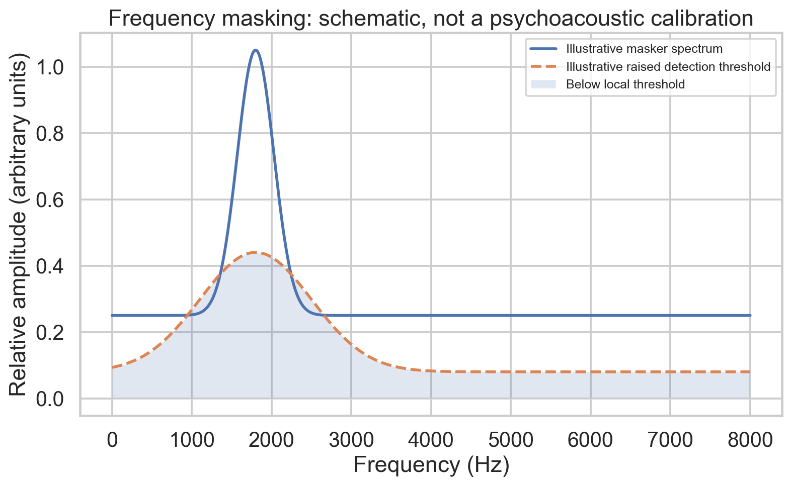
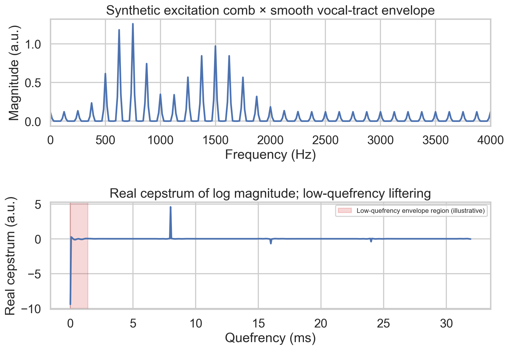
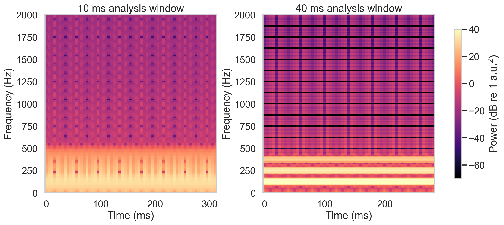
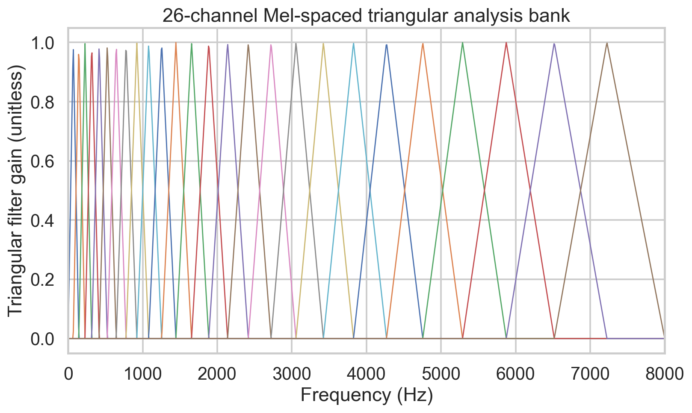
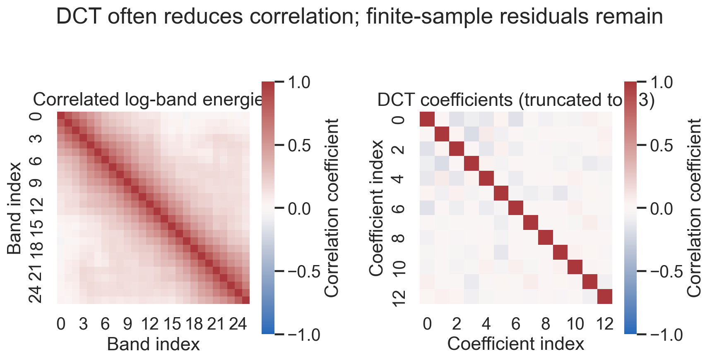
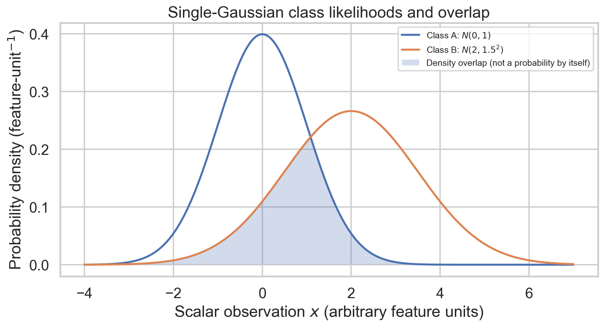

# Week 2: Auditory Perception, Cepstral Analysis, MFCCs, and Gaussian Review

**Learn and revise for the exam:** [[week-2-exam-focused-notes|Week 2 beginner-friendly exam guide]] · [[exam-study-guide|Study route and priorities]]


**Authentic past papers:** [[week-2-exam-questions|Week 2 questions and worked answers]] · [[exam-question-index|Paper coverage and routing audit]]


> **Track:** Speech Technology (IIT Madras BS Degree — BSEE4001)  
> **Curriculum scope:** Speech Production, Perception and Frequency Analysis; Perceptual Masking, Cepstrum and Filtering; Feature Extraction for Speech Processing — Parts 01 and 02; MFCC; Gaussian Review.  
> **Method:** Concept → Code → Output → Interpretation.

**Navigation:** ← [[week 1/week-1-notes|Week 1 Notes]] · [[Knowledge-Map|Knowledge Map]] · [[week 3/week-3-notes|Week 3 Notes]] →
**Associated concepts:** [[speech-perception-and-masking]] · [[cepstral-analysis-mfcc]] · [[mel-scale-filter-banks]] · [[gaussian-distribution]]

## Abstract

This module connects the physical spectrum of speech to perceptual frequency analysis and compact frame-level descriptions. It treats frequency masking as a perceptual interaction, the real cepstrum as a transformation that can separate slowly varying spectral envelope from rapid harmonic structure under stated assumptions, and Mel filter banks plus the discrete cosine transform as a practical feature map. A reproducible synthetic front end uses 16 kHz sampling, 25 ms frames, 10 ms hops, 26 triangular Mel filters, logarithmic energies, and 13 orthonormal DCT-II coefficients; its outputs are checked for shape and finiteness. The final lecture, Gaussian Review, is confined to univariate and multivariate single-Gaussian densities, maximum-likelihood parameter estimates, and likelihood-based classification with overlap. Figures and computations are synthetic demonstrations; they establish algorithmic behavior rather than measured human thresholds or speech-recognition accuracy.

## Learning outcomes and lecture sequence

| Screenshot lecture | Learning target | Evidence in this note |
|---|---|---|
| Speech Production, Perception and Frequency Analysis | Relate the source-filter spectrum to auditory pitch, loudness, and frequency analysis | §§1–2 |
| Perceptual Masking, Cepstrum and Filtering | Distinguish masking from physical filtering; derive log-spectrum/cepstrum and liftering | §§2–3 |
| Feature Extraction for Speech Processing — Part 01 | Calculate Mel-spaced filterbank energies and frame parameters | §4, Figure 4 |
| Feature Extraction for Speech Processing — Part 02 | Explain the DCT and the information lost by coefficient truncation | §4, Figure 5 |
| MFCC | Run the complete synthetic waveform-to-MFCC pipeline | §5, runnable lab |
| Gaussian Review | Derive the univariate and multivariate PDF and single-Gaussian MLE | §6 |

**Assessment labels shown in the supplied curriculum screenshots:** `AQ2.6 Activity Questions6` — Not Graded; `Practice Assignment1` — Not Graded; `Graded Assignment2` — question text not supplied. These labels are recorded as supplied. No question text or answer is inferred for the graded assignment.

**Prerequisite check (with answers).** (1) At $f_s=16$ kHz, the Nyquist frequency is 8 kHz; it is distinct from the Nyquist sampling rate for a chosen signal bandwidth. (2) A 25 ms frame has 400 samples at 16 kHz. (3) A 10 ms hop is 160 samples, hence adjacent 400-sample frames share 240 samples. (4) An STFT frame is a windowed local segment represented by complex Fourier coefficients; magnitude or power removes phase. (5) In the source-filter approximation, $S(f)=E(f)V(f)$ (optionally including radiation), so the observed spectrum is a product in frequency, not a sum. (6) For $f_s=16$ kHz, 26 filters spanning 0–8 kHz integrate positive-frequency spectral bins into 26 band energies.

## 1. Production and perception: what is measured and what is heard

Speech production can be approximated by an excitation filtered by the vocal tract. For voiced segments, quasi-periodic glottal excitation produces harmonics; vocal-tract resonances shape the spectral envelope. In the frequency domain, a simplified model is

$$S(f)=E(f)V(f), \qquad \log|S(f)|=\log|E(f)|+\log|V(f)|.$$

This is an approximation: radiation, nasal coupling, source-tract interaction, room response, and unvoiced turbulence may contribute. Harmonic spacing relates to fundamental frequency $F_0$, while broad resonant peaks characterize the vocal-tract envelope. Neither cue alone uniquely identifies a speaker or phoneme.

The auditory system maps physical attributes to perceptual observations: frequency contributes to pitch and intensity contributes to loudness. Perception is not a linear meter: equal waveform amplitudes at different frequencies need not sound equally loud, and pitch is not identical to a fundamental-frequency estimate in every signal. The Mel coordinate is a useful psychoacoustic-inspired warping, not a universal model of hearing.

### Frequency masking

Masking means that a sound can make a nearby-frequency component less detectable. It changes the effective detection threshold; it does not remove the masked component from the waveform, and a digital bandpass filter is not the same phenomenon. Masking depends on level, frequency separation, duration, and listening conditions. The figure below is intentionally schematic and must not be read as a calibrated threshold curve.

Temporal masking is the analogous interaction across time: a sufficiently strong sound may reduce detectability of a weaker sound shortly before or after it. Its duration and magnitude depend on stimulus and listener, so no universal fixed window is assumed here.



**Figure 1.** *Illustrative masker and raised local threshold. The vertical axis is arbitrary; the panel communicates the concept of reduced detectability and is not a measured auditory filter.*

## 2. Cepstrum, source-filter structure, and liftering

For a discrete frame $x[n]$ of length $N$, define its real cepstrum by

$$c[q]=\operatorname{IDFT}\{\log(|X[k]|+\epsilon)\}, \quad X[k]=\operatorname{DFT}\{x[n]w[n]\}.$$

Here $q$ is quefrency in samples (or seconds after division by $f_s$), $w[n]$ is an analysis window, and a small positive $\epsilon$ prevents a logarithm of zero. Multiplication of excitation and vocal-tract spectra becomes addition after logarithm. The inverse Fourier transform then maps slowly varying spectral structure mainly toward low quefrencies and regularly spaced harmonic structure toward higher quefrencies. A low-pass operation in quefrency is called liftering; it can emphasize an envelope estimate.

The separation is approximate, not an exact factorization theorem for arbitrary speech. Finite frames, zeros, additive noise, unvoiced excitation, and overlapping source/tract variations can mix the components. The figure uses a synthetic harmonic comb and smooth resonant envelope and labels the low-quefrency region as illustrative.



**Figure 2.** *A synthetic magnitude spectrum formed from a 125 Hz harmonic comb and smooth resonances, followed by its real cepstrum. The low-quefrency interval emphasizes broad envelope variation; this demonstration uses log magnitude and an inverse real DFT, not a complex-cepstrum phase-unwrapping procedure.*

**Distinction from ordinary filtering.** If two components add in time/frequency and occupy separable frequency bands, a conventional filter may isolate a band. If production is modeled as convolution, its spectral terms multiply; logarithm changes this product to a sum, after which cepstral-domain liftering can separate scales. The operation is nonlinear because of the logarithm and is not equivalent to applying an LTI filter to the original waveform.

## 3. Frequency resolution and short-time analysis

Speech changes over time, so local spectra use overlapping frames. For sample rate $f_s$, frame duration $T_w$, and hop $T_h$, sample counts are $N_w=f_sT_w$ and $N_h=f_sT_h$. A 25 ms window and 10 ms hop at 16 kHz produce 400 samples per frame and 160 samples per hop. Short windows localize events in time but give coarser frequency spacing; longer windows resolve frequency more finely while smearing rapid changes. The 10 ms and 40 ms panels use the same synthetic voiced signal and FFT size for qualitative comparison.

The discrete STFT makes frame position explicit:

$$X_t[k]=\sum_{n=0}^{N_w-1}x[tN_h+n]w[n]e^{-j2\pi kn/N_{\mathrm{FFT}}},\qquad 0\le k<N_{\mathrm{FFT}},\quad N_{\mathrm{FFT}}\ge N_w.$$

For a record of $L\ge N_w$ samples without boundary padding, the number of frames is $1+\lfloor(L-N_w)/N_h\rfloor$. The spectrogram demonstration uses a 1024-point FFT for both the 160-sample and 640-sample windows, preserving each complete frame. Zero-padding samples the windowed spectrum on a finer grid; it does not provide the resolving power of a longer observation.



**Figure 3.** *Synthetic voiced-signal power spectrograms with 10 ms and 40 ms windows and 5 ms hops. Both axes carry physical units; the colorbar reports power in dB relative to one squared arbitrary unit. The longer window yields finer frequency detail and poorer temporal localization.*

## 4. Mel filter banks and the DCT

The lecture uses the mapping

$$m(f)=1127\ln\left(1+\frac{f}{700}\right), \qquad f(m)=700\left(e^{m/1127}-1\right).$$

At 1000 Hz this convention gives approximately 1000 mels. Equally spaced points in Mel coordinates map to increasingly wide intervals in hertz. Overlapping triangular filters $H_j[k]$ pool a frame's power spectrum $P[k]=|X[k]|^2$:

$$E_j=\sum_k H_j[k]P[k], \qquad z_j=\ln(\max(E_j,\epsilon)).$$

The logarithm compresses dynamic range and converts multiplicative spectral scaling into an additive offset. It does not restore details removed by band integration.

The type-II DCT maps log-band energies to cepstral coefficients. The orthonormal convention used here is

$$c_r=\alpha_r\sum_{j=0}^{M-1}z_j\cos\left[\frac{\pi r(j+1/2)}{M}\right],\quad \alpha_0=\frac1{\sqrt M},\quad \alpha_{r>0}=\sqrt{\frac2M}.$$

When neighboring filter energies are correlated, this cosine basis often concentrates broad spectral variation into low-order coefficients and can reduce covariance. It does not guarantee statistical independence or a diagonal covariance matrix. Keeping only the first 13 of 26 coefficients is lossy truncation, and a DCT without truncation is invertible under the stated normalization.

Static MFCCs describe one frame at a time. Optional dynamic coefficients summarize local movement; a common regression estimate for coefficient sequence $c_t$ is $\Delta c_t=\frac{\sum_{r=1}^{R}r(c_{t+r}-c_{t-r})}{2\sum_{r=1}^{R}r^2}$, with edge frames handled by an explicit padding or replication rule. Applying the same operator to $\Delta c_t$ gives $\Delta^2c_t$. Appending 13 static, 13 first-difference, and 13 second-difference values yields a 39-dimensional frame vector. Differencing emphasizes change and can amplify noise; the executable retains static coefficients so its output is directly auditable.



**Figure 4.** *Twenty-six unit-peak triangular filters uniformly placed in the 1127-log Mel coordinate between 0 and 8 kHz. Wider high-frequency support reflects the nonlinear frequency mapping.*



**Figure 5.** *Correlation heatmaps for deterministic synthetic correlated band energies and their first 13 orthonormal DCT coefficients. The transformed sample is often less correlated, but residual off-diagonal values remain and the truncation discards dimensions.*

## 5. Concept → Code → Output → Interpretation: complete synthetic MFCC front end

**Concept.** The executed pipeline creates a 120 ms synthetic signal, segments it into 25 ms frames at 10 ms hops, applies a Hamming window, computes a 512-point real FFT power spectrum, integrates 26 Mel triangles, takes log energies, and projects onto 13 DCT-II coefficients. This demonstrates dimensions and numeric operations; it is not a speech recognizer and omits optional preprocessing and dynamic coefficients.

**Code.** Run `uv run python week2_lab.py` from the `Speech Technology/` directory. The complete executable is [week2_lab.py](../week2_lab.py).

**Output (verbatim):**

```text
Frame samples: 400; hop samples: 160; overlap samples: 240
Mel(1000 Hz): 999.99 mels
DCT-II coefficients: [1.0000e+00 2.2304e+00 3.3307e-16 1.5851e-01]
DCT reconstruction max error: 4.44e-16
Gaussian MLE: mean=2.50, variance=1.25, std=1.12
At x=1: density N(0,1)=0.241971; density N(2,1)=0.241971
Equal-prior decision threshold for N(0,1) vs N(2,1): 1.00
Equal-prior error: 0.158655 (standard-normal tail beyond 1)
Synthetic front end: frames=(10, 400), Mel energies=(10, 26), MFCC=(10, 13)
First-frame MFCC[0:5]: [-3.399 16.858  2.564  0.902  4.678]
MFCC finite: True
```

**Interpretation.** The hop and frame counts agree with the sampling configuration. The 10 frames have shape `[10, 400]`, produce 26 log-band values per frame, then 13 retained coefficients. The 4-point DCT sub-check uses the transpose of the orthonormal transform for inversion and reconstructs to floating-point precision; the production front end separately truncates from 26 coefficients to 13 and is therefore not invertible.

### Complete executable

```python
"""Reproducible numeric exercises for the screenshot-bounded Week 2 syllabus."""
import math
import numpy as np


def main():
    # Physical-analysis values drawn from the stated 16 kHz / 25 ms / 10 ms setup.
    fs, frame_ms, hop_ms = 16000, 25, 10
    frame_n, hop_n = round(fs*frame_ms/1000), round(fs*hop_ms/1000)
    print(f"Frame samples: {frame_n}; hop samples: {hop_n}; overlap samples: {frame_n-hop_n}")

    mel_1000 = 1127*np.log1p(1000/700)
    print(f"Mel(1000 Hz): {mel_1000:.2f} mels")

    # Four-point orthonormal DCT-II and exact full-coefficient inverse check.
    x=np.array([2.,1.,0.,-1.])
    k, n = np.arange(4)[:,None], np.arange(4)[None,:]
    D=np.sqrt(2/4)*np.cos(np.pi*k*(n+.5)/4)
    D[0] /= np.sqrt(2)
    c=D @ x
    xr=D.T @ c
    print("DCT-II coefficients: " + np.array2string(c, precision=4))
    print(f"DCT reconstruction max error: {np.max(np.abs(x-xr)):.2e}")

    # Gaussian MLE uses denominator N for maximum likelihood (not unbiased N-1).
    obs=np.array([1.,2.,3.,4.])
    mu=obs.mean(); var=np.mean((obs-mu)**2)
    print(f"Gaussian MLE: mean={mu:.2f}, variance={var:.2f}, std={np.sqrt(var):.2f}")
    # PDF values have inverse-feature units and are not point probabilities.
    def pdf(value, mean, variance):
        return np.exp(-.5*(value-mean)**2/variance)/np.sqrt(2*np.pi*variance)
    p0,p1=pdf(1.,0.,1.),pdf(1.,2.,1.)
    print(f"At x=1: density N(0,1)={p0:.6f}; density N(2,1)={p1:.6f}")

    # Exact Bayes error for equal priors/common variance: threshold midpoint.
    threshold=1.
    print(f"Equal-prior decision threshold for N(0,1) vs N(2,1): {threshold:.2f}")
    error = 0.5*math.erfc(1/math.sqrt(2))
    print(f"Equal-prior error: {error:.6f} (standard-normal tail beyond 1)")

    # Complete synthetic front end: signal -> overlapping frames -> power FFT ->
    # triangular Mel energies -> log -> orthonormal DCT-II (13/26 coefficients).
    fs=16000
    time=np.arange(int(.12*fs))/fs
    signal=.7*np.sin(2*np.pi*125*time)+.25*np.sin(2*np.pi*700*time)+.12*np.sin(2*np.pi*1500*time)
    frame_n, hop_n, nfft, nmel = 400, 160, 512, 26
    frames=np.stack([signal[s:s+frame_n] for s in range(0,len(signal)-frame_n+1,hop_n)])
    window=np.hamming(frame_n)
    power=np.abs(np.fft.rfft(frames*window,n=nfft,axis=1))**2
    hz=np.fft.rfftfreq(nfft,1/fs)
    mel=lambda f:1127*np.log1p(f/700)
    inv=lambda m:700*np.expm1(m/1127)
    edges=inv(np.linspace(mel(0),mel(fs/2),nmel+2))
    bank=np.zeros((nmel,len(hz)))
    for j in range(nmel):
        left,center,right=edges[j:j+3]
        bank[j]=np.maximum(0,np.minimum((hz-left)/(center-left),(right-hz)/(right-center)))
    log_energy=np.log(np.maximum(np.einsum("tf,mf->tm",power,bank),1e-12))
    k,m=np.arange(13)[:,None],np.arange(nmel)[None,:]
    dct=np.sqrt(2/nmel)*np.cos(np.pi*k*(m+.5)/nmel)
    dct[0]/=np.sqrt(2)
    mfcc=np.einsum("tm,km->tk",log_energy,dct)
    print(f"Synthetic front end: frames={frames.shape}, Mel energies={log_energy.shape}, MFCC={mfcc.shape}")
    print(f"First-frame MFCC[0:5]: {np.array2string(mfcc[0,:5], precision=3)}")
    print(f"MFCC finite: {bool(np.isfinite(mfcc).all())}")


if __name__ == "__main__": main()
```

## 6. Gaussian Review: density, estimation, and simple classification

### 6.1 Univariate Gaussian

For scalar feature $x\in\mathbb R$, mean $\mu$, and variance $\sigma^2>0$,

$$p(x\mid\mu,\sigma^2)=\frac{1}{\sqrt{2\pi\sigma^2}}\exp\left[-\frac{(x-\mu)^2}{2\sigma^2}\right].$$

This is a probability density, with units inverse to those of $x$. A point density can exceed one and is not the probability of observing exactly $x$; probability is the integral over a region. For independent scalar observations $x_1,\ldots,x_N$, the log-likelihood is

$$\ell(\mu,\sigma^2)=-\frac N2\ln(2\pi\sigma^2)-\frac{1}{2\sigma^2}\sum_i(x_i-\mu)^2.$$

Setting derivatives to zero yields the maximum-likelihood estimates $\hat\mu=N^{-1}\sum_i x_i$ and $\hat\sigma^2=N^{-1}\sum_i(x_i-\hat\mu)^2$. The variance denominator is $N$ for MLE; the unbiased sample variance uses $N-1$ and answers a different estimation criterion.



**Figure 6.** *Two one-dimensional Gaussian class densities and their pointwise overlap. The shaded area displays the smaller density, not directly the Bayes error unless class priors and integration are also included.*

For two classes with equal priors and equal variance $\sigma^2$, the maximum-likelihood/Bayes decision boundary is the midpoint of the means. For $N(0,1)$ versus $N(2,1)$, the threshold is $x=1$. The error for either class is $\Phi(-1)=0.158655\ldots$, so the equal-prior total error is the same. Unequal priors move the boundary; unequal variances can create a quadratic log-likelihood boundary.

### 6.2 Multivariate Gaussian

For $\mathbf{x}\in\mathbb R^d$, mean vector $\boldsymbol\mu$, and symmetric positive-definite covariance $\Sigma$,

$$p(\mathbf{x})=\frac{\exp\{-\tfrac12(\mathbf{x}-\boldsymbol\mu)^T\Sigma^{-1}(\mathbf{x}-\boldsymbol\mu)\}}{(2\pi)^{d/2}|\Sigma|^{1/2}}.$$

The quadratic form is squared Mahalanobis distance, accounting for scale and correlation. Given independent vectors $\mathbf{x}_i$, the MLEs are $\hat{\boldsymbol\mu}=N^{-1}\sum_i\mathbf{x}_i$ and $\hat\Sigma=N^{-1}\sum_i(\mathbf{x}_i-\hat{\boldsymbol\mu})(\mathbf{x}_i-\hat{\boldsymbol\mu})^T$. A full covariance requires enough observations and can be singular when sample count is too small or features are linearly dependent; diagonal covariance discards cross-feature dependence as a modeling assumption.

### 6.3 Likelihood comparison and limits

Given a labeled dataset, fit one Gaussian per class and compare $p(\mathbf{x}\mid C_k)P(C_k)$. This is a transparent generative baseline. A Gaussian assigns density over all of $\mathbb R^d$, whereas speech-feature class distributions may be skewed or multimodal; a single Gaussian then gives a coarse approximation. This review establishes the Gaussian density and MLE only; it does not extend to composite density models or sequential state models.

## 7. Worked practice and mastery checks

1. **Frame arithmetic.** At 16 kHz, find samples in a 30 ms window and 12.5 ms hop. **Solution:** $N_w=16000(0.030)=480$, $N_h=16000(0.0125)=200$, overlap $=280$ samples.
2. **Mel conversion.** Evaluate the supplied Mel formula at 700 Hz. **Solution:** $1127\ln 2\approx781.1$ mels. This is a coordinate conversion, not an auditory threshold.
3. **Gaussian MLE.** For observations $\{1,2,3,4\}$ find MLE mean and variance. **Solution:** $\hat\mu=2.5$; squared deviations sum to 5, so $\hat\sigma^2=5/4=1.25$ and $\hat\sigma=\sqrt{1.25}\approx1.118$.
4. **Density versus probability.** Why is $p(x=1)$ not a probability mass? **Solution:** For a continuous variable, $P(X=1)=0$ under a density model; an interval probability is an integral, e.g. $P(a<X<b)=\int_a^b p(x)dx$.
5. **DCT claim.** Does a DCT force MFCC covariance to be diagonal? **Solution:** No. It is an orthogonal coordinate transform, and it can reduce correlations for smoothly varying spectra, but orthogonality of basis vectors does not imply independence of arbitrary data. Truncation and dataset structure also matter.
6. **Masking versus filtering.** Does a masked tone disappear from the measured spectrum? **Solution:** No. Masking describes perceptual detectability in the presence of another sound; physical filtering changes the signal according to a system response.
7. **Multivariate covariance.** What does a nonzero off-diagonal $\Sigma_{ij}$ mean? **Solution:** Coordinates $i$ and $j$ covary under the fitted distribution; Mahalanobis distance then weights joint deviations, unlike a diagonal model.

The supplied screenshots identify `AQ2.6 Activity Questions6` and `Practice Assignment1` as not graded and `Graded Assignment2` without visible question text. The problems above are original review exercises, not transcriptions of those assignments.

## 8. Reproducibility and verification

From `Speech Technology/` run:

```bash
uv run python week2_lab.py
uv run python generate_week2_plots.py
```

The plot generator uses `np.random.default_rng(42)` and writes the six active figures to `week 2/assets/`. The active asset manifest and SHA-256 hashes are in `week 2/plot_sha256.txt`. Earlier files in that directory may remain on disk as inactive historical artifacts; they are not referenced by this note or listed in the active manifest. Source filenames and physical PDF page ranges are indexed in [[source-catalog]]. The course-slide citations relevant to this note are the lecture slides on speech production/perception, masking and cepstrum, filter banks/MFCCs; the Gaussian Review slides establish univariate Gaussian fitting, likelihood, MLE, and class comparison. Consult the source catalog for exact source files and page ranges.

## 9. References and formula sheet

1. Umesh, S. *Speech Processing and Speech Technology course slides: Speech Production, Perception and Frequency Analysis; Perceptual Masking, Cepstrum and Filtering; Feature Extraction for Speech Processing; MFCC.* IIT Madras, course material, supplied PDF, relevant physical PDF pages 44–72. **Contribution:** lecture definitions and workflow for auditory attributes, Mel warping, masking, cepstral liftering, filter-bank energies, and MFCC features. Source details: [[source-catalog]].
2. Umesh, S. *Gaussian Review / Gaussian Distribution* lecture slides, supplied course PDF, physical PDF pages 2–22 (Gaussian material before composite distributions). **Contribution:** Gaussian density, parameter estimation by maximum likelihood, and single-Gaussian class comparison. Source details: [[source-catalog]].
3. Davis, S. B., and Mermelstein, P. (1980). “Comparison of parametric representations for monosyllabic word recognition in continuously spoken sentences.” *IEEE Transactions on Acoustics, Speech, and Signal Processing*, 28(4), 357–366. DOI: [10.1109/TASSP.1980.1163420](https://doi.org/10.1109/TASSP.1980.1163420). **Contribution:** foundational evaluation of cepstral and related spectral representations for speech recognition.

| Quantity | Definition / convention |
|---|---|
| Frame length | $N_w=f_sT_w$ samples |
| Hop | $N_h=f_sT_h$ samples |
| Mel | $m(f)=1127\ln(1+f/700)$ |
| Mel band energy | $E_j=\sum_k H_j[k]|X[k]|^2$ |
| Log band energy | $z_j=\ln(\max(E_j,\epsilon))$ |
| Orthonormal DCT-II | $c_r=\alpha_r\sum_jz_j\cos[\pi r(j+1/2)/M]$ |
| Univariate Gaussian MLE | $\hat\mu=N^{-1}\sum_i x_i$, $\hat\sigma^2=N^{-1}\sum_i(x_i-\hat\mu)^2$ |
| Multivariate Gaussian | Quadratic form $(\mathbf{x}-\mu)^T\Sigma^{-1}(\mathbf{x}-\mu)$; $\Sigma\succ0$ |

## Knowledge graph connections

**Upstream:** [[week 1/week-1-notes|Week 1 Notes]], [[short-time-fourier-transform]], [[source-filter-model]], [[discrete-fourier-transform]].  
**Core nodes:** [[speech-perception-and-masking]], [[cepstral-analysis-mfcc]], [[mel-scale-filter-banks]], [[gaussian-distribution]].  
**Hub:** [[Knowledge-Map]] · **Source index:** [[source-catalog]].
