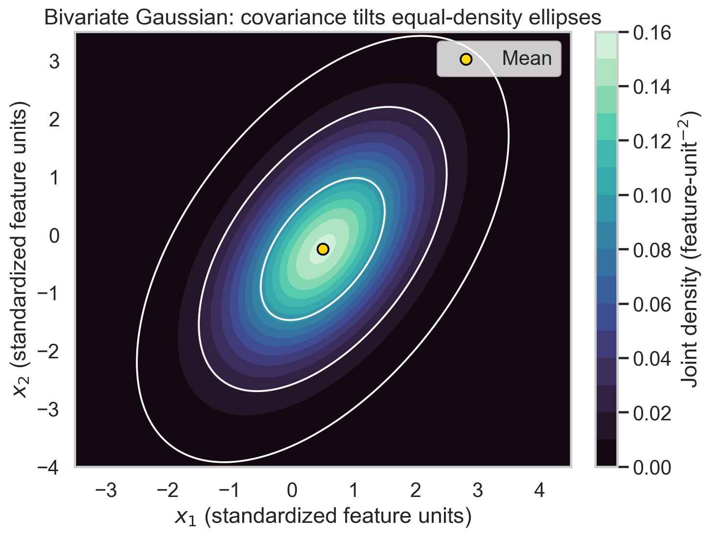
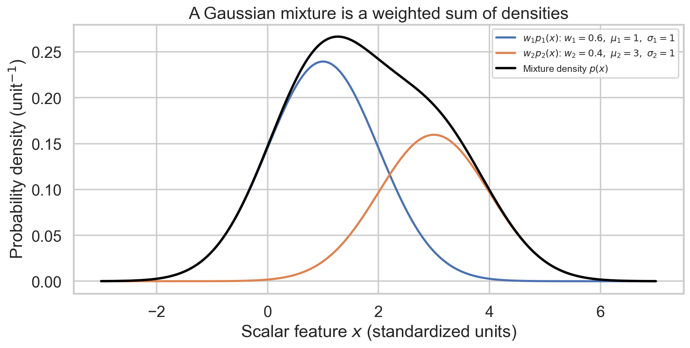
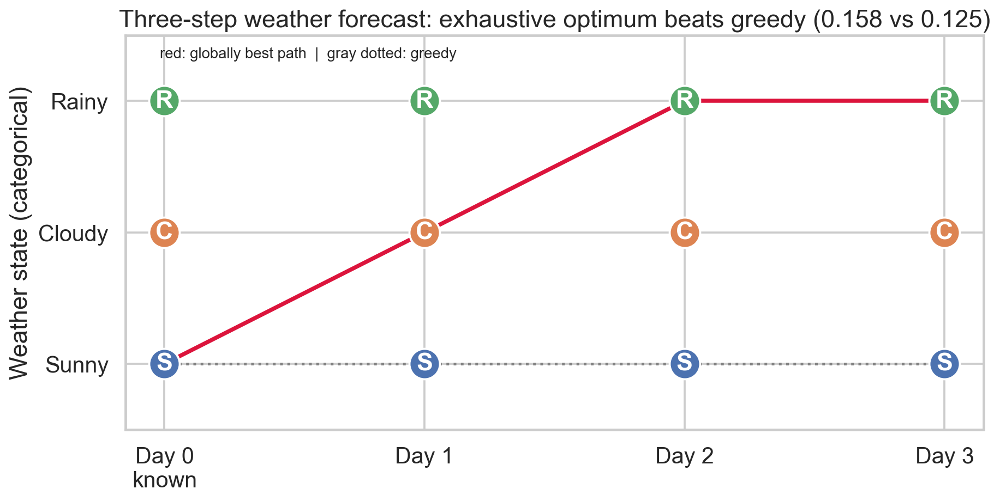

# Week 3 — Gaussian Decisions, GMMs, Clustering and Markov Paths for the Exam

**Navigation:** [[exam-study-guide|Study route]] · [[week-2-exam-focused-notes|Previous week]] · [[week-3-notes|Full reference]] · [[week-3-exam-questions|Authentic questions and worked answers]] · [[week-4-exam-focused-notes|Next week]]

## 1. Priorities supported by the papers

**Give most practice to GMM calculations, K-means/LBG iterations, and complete Markov-path calculations.** Learn probability, Gaussian classification and covariance first: they explain the algorithms rather than being optional mathematical decoration.

**P1:** learn deeply and solve changed numbers without help. **P2:** learn fully and practise a compact explanation. **P3:** covered curriculum without a direct standalone item found; still required, particularly where it supports P1.

<!-- evidence:start -->
| Study priority | Topic family | Question occurrences: Q1 / Q2 / ET | Distinct exam–terms |
| :--- | :--- | :--- | ---: |
| P1 — calculate and explain | GMM density, posterior, likelihood and EM | 8 / 0 / 3 = **11** | 7 |
| P1 — work iterations by hand | K-means, LBG and vector quantization | 11 / 0 / 2 = **13** | 5 |
| P1 — build trellises | Observed Markov forecasts and max-path trellis | 3 / 0 / 3 = **6** | 5 |
| P2 — retrieve accurately | Conditional probability / Bayes rule | 0 / 0 / 4 = **4** | 3 |
| P2 — explain limitations | Local versus global optima | 0 / 0 / 4 = **4** | 3 |
<!-- evidence:end -->

The 38 entries include repeated prompts and multiple sessions. For example, the older Q1 clustering questions recur across three terms; some ET MCQs recur in FN/AN versions. Distinct exam–term counts merge those session variants, not identical templates across different terms. “GMM” includes density/posterior calculation, log-likelihood, hard-versus-soft clustering and the underspecified EM diagram; it is not eleven copies of the same numerical problem.

**P3 coverage:** binary Gaussian decision boundaries and error integrals beyond the Bayes MCQ; bivariate Gaussian/covariance calculations; transition-count estimation. These are named Week 3 lessons even though the located questions emphasize their algorithmic consequences. Do not infer that a future Q1 cannot test them.

## 2. Probability language before the algorithms

A **class** is a category, such as two speaker populations. A feature $x$ is the measured input. A **prior** $P(C_k)$ describes class prevalence before examining $x$. A **likelihood density** $p(x\mid C_k)$ describes how compatible that measurement is with a class model. A **posterior** updates class belief after observing it:

$$P(C_k\mid x)=\frac{P(C_k)p(x\mid C_k)}{\sum_jP(C_j)p(x\mid C_j)}.$$

For ordinary events, $P(A\mid B)=P(A\cap B)/P(B)$ when $P(B)>0$, the answer to the repeated Bayes MCQ. A conditional probability reverses neither automatically nor without a prior: $P(C\mid x)$ and $p(x\mid C)$ answer different questions.

**Example:** at one measurement, class likelihoods are 0.2 and 0.5, but priors are 0.8 and 0.2. Weighted values are 0.16 and 0.10; class 1 has the larger posterior despite the smaller likelihood. Normalize by 0.26 to obtain posteriors about 0.6154 and 0.3846.

**Notation for calculations:** $\sum$ adds terms; $\prod$ multiplies them. $\max$ returns the largest value; $\arg\max$ returns the index achieving it. A density can exceed one; normalized class/component posterior probabilities must remain between zero and one.

## 3. Gaussian binary classification and error — P3 lesson, P2 Bayes prerequisite

### 3.1 Compare fitted bell curves

The scalar Gaussian density is

$$\mathcal N(x;\mu,\sigma^2)=\frac{1}{\sqrt{2\pi\sigma^2}}e^{-(x-\mu)^2/(2\sigma^2)}.$$

Fit one curve per class. **Maximum likelihood (ML)** chooses the larger density. **Maximum a posteriori (MAP)** chooses the larger prior-weighted density, equivalent to the larger posterior. ML and MAP agree under equal class priors and equal misclassification costs, apart from ties.

With means $\mu_0=0$, $\mu_1=2$, equal variance 1 and equal priors, the curves intersect at $x=1$. Choose class 0 below 1 and class 1 above 1; either tie convention can be stated at exactly 1. The midpoint boundary relies on equal variances and priors. Unequal variances can yield two crossings; there is not always one threshold.

### 3.2 Calculate the area assigned to the wrong class

Let the rule predict class 1 when $x>\tau$. The class-conditional errors are

$$P(\text{predict }1\mid C_0)=\int_\tau^\infty p(x\mid C_0)\,dx,$$

$$P(\text{predict }0\mid C_1)=\int_{-\infty}^\tau p(x\mid C_1)\,dx.$$

The overall error must weight those conditional errors:

$$P_e=P(C_0)P(\text{predict }1\mid C_0)+P(C_1)P(\text{predict }0\mid C_1).$$

In the equal-prior example with $\tau=1$, each tail is $\Phi(-1)\approx0.158655$, where $\Phi$ is the standard-normal CDF. The total is $0.5(0.158655)+0.5(0.158655)=0.158655$, **not** 0.31731. Without the prior factors, two conditional rates were added as though they were disjoint population probabilities.

**False accept versus false reject:** define the target class and acceptance region first. A false accept means accepting a non-target; a false reject means rejecting a target. Raising an acceptance threshold often trades one error against the other, but the tail direction depends on the chosen score convention. Derive it from the decision region instead of memorizing a universal integral direction.

## 4. Two or more features: covariance — P3, required understanding

One number cannot describe all speech variation. With height and weight, or two acoustic coefficients, an observation is a vector $\mathbf x=[x_1,x_2]^T$. A bivariate Gaussian has mean vector `[2]` and covariance matrix `[2, 2]`:

$$\Sigma=\begin{bmatrix}\sigma_1^2&\operatorname{cov}(X_1,X_2)\\\operatorname{cov}(X_1,X_2)&\sigma_2^2\end{bmatrix}.$$

Variance measures spread along one feature; covariance measures whether two features tend to increase together. Positive covariance tilts an elliptical density cloud toward the rising diagonal; negative covariance tilts it the other way. The matrix is symmetric. Covariance has units equal to the product of its feature units, so changing feature scales changes Euclidean distances and covariance values.

**Worked MLE example:** four vectors $(0,0),(2,0),(0,2),(2,2)$ have mean $(1,1)$. Each coordinate's mean squared deviation is 1. The four cross-products are $1,-1,-1,1$, averaging to zero. Thus $\hat\Sigma=\begin{bmatrix}1&0\\0&1\end{bmatrix}$. Use $1/N$ for Gaussian MLE; an unbiased sample covariance instead uses $1/(N-1)$.



**Figure 1.** *Covariance changes the orientation and spread of a Gaussian cloud. A diagonal covariance model forbids cross-feature covariance; it is a modeling constraint rather than a property of every dataset.*

For $d$ features, the density is

$$\mathcal N(\mathbf x;\boldsymbol\mu,\Sigma)=\frac{\exp[-\tfrac12(\mathbf x-\boldsymbol\mu)^T\Sigma^{-1}(\mathbf x-\boldsymbol\mu)]}{(2\pi)^{d/2}|\Sigma|^{1/2}}.$$

The quadratic form measures distance relative to spread and correlation. The determinant controls volume normalization. The ordinary nonsingular density requires positive-definite covariance. A singular estimated matrix cannot simply be inverted. Zero covariance does not imply independence for arbitrary data; it does for jointly Gaussian components.

## 5. Gaussian mixture models — P1

### 5.1 Why several Gaussians?

A single Gaussian has one central mode and elliptical contours. Different acoustic realizations can form several dense regions; one broad Gaussian may waste density between them. A **GMM** adds component densities:

$$p(x)=\sum_{k=1}^{K}w_k\mathcal N(x;\mu_k,\Sigma_k),\qquad w_k\ge0,\quad\sum_kw_k=1.$$

The component index is a latent variable. A component is not automatically a named class such as male, female or child, and an acoustic state's mixture components are not automatically different phonemes. Such examples illustrate multimodality; fitted components need not align with those labels.

### 5.2 Work the authentic density/posterior problem

[2026 Q1 Q10](week-3-exam-questions.md#ee4001_2026T1_Q1_NA--q10) and [2025 Q1 Q8](week-3-exam-questions.md#ee4001_2025T2_Q1_NA--q8) use $x=2$, means 1 and 3, unit variances, weights 0.6 and 0.4.

1. Both squared standardized distances are $(2-1)^2=(2-3)^2=1$.
2. Each Gaussian density is $e^{-1/2}/\sqrt{2\pi}=0.2419707$ approximately.
3. Multiply by weights: contributions are 0.1451824 and 0.0967883.
4. Add: $p(2)=0.2419707$.
5. Normalize the first contribution: $P(Z=1\mid x=2)=0.1451824/0.2419707=0.6$.

**Different quantities:** component density → weighted contribution → total density → posterior responsibility. Only the last is a normalized membership probability. Equality of the two component densities makes the posterior equal the prior weight here; it does not happen at every $x$.



**Figure 2.** *A mixture density adds weighted components. It does not choose only the highest curve and discard the others.*

**Variation check:** densities 0.2 and 0.5, weights 0.75 and 0.25. Total $=0.15+0.125=0.275$; component-2 posterior $=0.125/0.275\approx0.454545$. Omitting the weights gives the wrong posterior.

### 5.3 Dataset likelihood and logarithms

For independent measurements $x_i$,

$$L(\theta)=\prod_i\left[\sum_kw_k\mathcal N(x_i;\mu_k,\Sigma_k)\right],$$

$$\ell(\theta)=\sum_i\log\left[\sum_kw_k\mathcal N(x_i;\mu_k,\Sigma_k)\right]=\log L(\theta).$$

This equivalence explains the [ET log-likelihood MCQ](week-3-exam-questions.md#ee4001_2023T1_ET_FN--q-mcq-1). The logarithm of a **product** becomes a sum; the logarithm of a **mixture sum** does not become a sum of component logs. Keep the inner brackets.

## 6. GMM estimation with EM — P1

### 6.1 Why fitting is harder than averaging one cloud

If every observation came with a component label, each component could be fitted from its own data. Those labels are unknown. **Expectation–Maximization (EM)** alternates between fractional label estimates and weighted parameter fitting.

**E-step:** compute responsibility of component $k$ for data point $i$:

$$r_{ik}=\frac{w_k^{old}\mathcal N(x_i;\mu_k^{old},\Sigma_k^{old})}{\sum_j w_j^{old}\mathcal N(x_i;\mu_j^{old},\Sigma_j^{old})}.$$

Each row sums to 1. **M-step:** keep those responsibilities fixed and set

$$N_k=\sum_i r_{ik},\quad w_k^{new}=\frac{N_k}{N},\quad\mu_k^{new}=\frac{\sum_i r_{ik}x_i}{N_k},$$

$$\Sigma_k^{new}=\frac{\sum_i r_{ik}(x_i-\mu_k^{new})(x_i-\mu_k^{new})^T}{N_k}.$$

For a scalar variance, the outer product becomes a squared deviation. The covariance update uses the **new mean**. Then repeat the E-step with the new model.

### 6.2 A small complete M-step

Suppose data are $x=[0,2]$ and an E-step has produced responsibility rows $[0.8,0.2]$ and $[0.2,0.8]$. We are given responsibilities for this exercise, not claiming to obtain them from unspecified initial parameters.

- Effective counts: $N_1=N_2=1$; weights become 0.5 each.
- Means: $\mu_1'=0(0.8)+2(0.2)=0.4$; $\mu_2'=0(0.2)+2(0.8)=1.6$.
- First variance: $0.8(0-0.4)^2+0.2(2-0.4)^2=0.128+0.512=0.64$.
- The second variance is also 0.64 by symmetry.

Every point can influence every component with nonzero responsibility. Ordinary K-means assigns each point to one cluster; it does not perform these soft updates.

**Source warning:** the repeated [EM movement diagram](week-3-exam-questions.md#ee4001_2022T3_Q1_AN--q5) gives no sufficient current weights/variances or numerical locations. A unique direction and increase/decrease of a mixing weight cannot be derived generally. State the update equations and identify missing information. Four visually grouped points do not prove a component's weight increased unless its previous weight and responsibilities are known.

## 7. K-means, LBG and VQ — P1

### 7.1 Quantize vectors by a codebook

A codebook is a finite list of representative vectors. **Vector quantization (VQ)** replaces a vector by its nearest representative, or sends that representative's index. Error is the distance between input and representative. This compresses representation but loses detail.

K-means designs $K$ centroids to reduce squared Euclidean distortion:

$$J=\sum_i\min_k\|x_i-c_k\|^2.$$

**Algorithm:** choose initial centers → assign each point to its nearest center → replace every center by its assigned points' mean → repeat until stable. $K$ stays fixed during this ordinary refinement loop. Empty clusters require a stated implementation policy.

### 7.2 One authentic iteration

[2025 Q1 Q6](week-3-exam-questions.md#ee4001_2025T2_Q1_NA--q6): data $[2,4,5,8,9]$, initial centers 4 and 8.

The midpoint boundary is 6. Points $2,4,5$ go to center 4; $8,9$ go to center 8. New centers are $(2+4+5)/3=11/3\approx3.6667$ and $(8+9)/2=8.5$. Both steps must be shown; listing the averages without the assignments omits the mechanism. If further iterations are requested, reassign using the **new** centers.

### 7.3 LBG splitting and refinement

Linde–Buzo–Gray codebook design commonly starts with one global mean, splits codevectors with small perturbations, then runs nearest-neighbor/centroid refinement. In the source's multiplicative scalar convention,

$$c_+=\mu(1+\epsilon),\qquad c_-=\mu(1-\epsilon).$$

[2025 Q1 Q7](week-3-exam-questions.md#ee4001_2025T2_Q1_NA--q7): data $1,2,3,8,9,10$ give mean 5.5. With $\epsilon=0.1$, split to 6.05 and 4.95; the midpoint remains 5.5. Assign $8,9,10$ to 6.05 and $1,2,3$ to 4.95. Updated centers become 9 and 2. The split centers and the refined centers are different requested quantities.

**Important limitation:** multiplicative splitting fails to separate a zero centroid; vector/additive perturbations can address that. LBG grows the codebook between refinement stages; this does not contradict fixed $K$ in a single ordinary K-means run.

### 7.4 Hard versus soft and local versus global — P2 explanation, P1 application

K-means gives hard memberships and minimizes distortion. EM fits a mixture density using soft responsibilities and also adjusts weights/covariances. Their means need not agree, but agreement is possible under particular data and model limits. “They must always differ” overstates the result.

A local minimum is best within a neighborhood; a global minimum is best across the feasible domain. K-means descent need not reach the global distortion minimum; EM is a likelihood-maximization method that need not reach a global maximum. Use informed initialization and multiple restarts, compare final objectives, and acknowledge that these measures are not general finite-time global guarantees. GMM variance floors also address covariance collapse, a separate likelihood pathology.

### 7.5 Codebook size and rate

[2026 ET Q18](week-3-exam-questions.md#ee4001_2026T1_ET_FN--q18): for $z=[1.2,0.8]$, distances squared to $[1,1]$ and $[0,0]$ are 0.08 and 2.08. Choose $[1,1]$; that vector is the quantized output, while its index is the compact label.

With one token per frame, larger $K$ increases available index choices, not frame count. $K=50$ needs 6 fixed-width bits/token; $K=2000$ needs 11. At token rate $f$ tokens/s the corresponding payload rates are $6f$ and $11f$ bits/s. Larger codebooks can reduce distortion but may fit nuisance variation or poorly estimated clusters. They do not guarantee phoneme-aligned clusters. See [2026 ET Q17](week-3-exam-questions.md#ee4001_2026T1_ET_FN--q17).

## 8. Observed Markov chains and forecasting — P1 paths; P3 count estimation

### 8.1 State and transition vocabulary

A state describes a condition, for example Sunny, Cloudy or Rainy. A **first-order Markov** model assumes the next state's distribution depends only on the current state:

$$P(q_t\mid q_{1:t-1})=P(q_t\mid q_{t-1}),\qquad a_{ij}=P(q_t=j\mid q_{t-1}=i).$$

Rows represent the current/previous state and columns the next state. Each row sums to 1. Estimate a transition by counting departures:

$$\hat a_{ij}=\frac{\#(i\to j)}{\#\text{observed transitions leaving }i}.$$

For sequence S,C,S,C,C, the departures from C are C→S and C→C. The final C has no observed successor, so it contributes no departure. Thus $P(S\mid C)=1/2$, not $1/3$. A state with no observed departure needs a separate modeling/smoothing policy; do not divide by zero.

### 8.2 Greedy chooses one step; Viterbi chooses the whole path

The authentic weather transition matrix is

$$A=\begin{bmatrix}0.5&0.375&0.125\\0.25&0.125&0.625\\0.25&0.075&0.675\end{bmatrix},$$

with state order S,C,R. Given Day 0 Sunny, greedy always selects the largest outgoing transition: S→S→S→S, score $0.5^3=0.125$.

Viterbi retains the best partial-path score **for each ending state**:

$$\delta_t(j)=\max_i[\delta_{t-1}(i)a_{ij}],\qquad\psi_t(j)=\arg\max_i[\delta_{t-1}(i)a_{ij}].$$

Initialize the known Day 0 with scores $(1,0,0)$. Here there are no observation-emission factors; this is forecasting a state path in an observed-chain model.

| Future day | Best score ending S | Ending C | Ending R |
| :--- | ---: | ---: | ---: |
| 1 | 0.5 | 0.375 | 0.125 |
| 2 | 0.25 | 0.1875 | 0.234375 |
| 3 | 0.125 | 0.09375 | 0.158203125 |

For example, the best Day 2 Rainy score is $\max(0.5\cdot0.125,0.375\cdot0.625,0.125\cdot0.675)=0.234375$, from Cloudy. The best final score is Rainy, reached from Rainy; trace back to Cloudy on Day 1. The forecast is **Cloudy, Rainy, Rainy**, with known start **Sunny → Cloudy → Rainy → Rainy**, score $0.375(0.625)(0.675)=0.158203125$.



**Figure 3.** *A locally weaker first transition can lead to a stronger complete path. Saving one best prefix per ending state avoids discarding that possibility.*

**Why saving one prefix per state works:** two prefixes ending at the same state have the same available future transitions under the first-order model. The lower-scoring prefix cannot overtake the higher-scoring one when multiplied by the same future factors. Prefixes ending at different states must both be retained.

Practise [2023 Q1 Q6](week-3-exam-questions.md#ee4001_2023T3_Q1_NA--q6). In the [ET trellis MCQ](week-3-exam-questions.md#ee4001_2023T1_ET_FN--q-mcq-8), the printed $\gamma$ denotes maximum-path score in the course convention: incoming products 0.08, 0.0882 and 0.06 give **max 0.0882**, whereas their **sum 0.2282** belongs to a sum-path interpretation. The bank preserves the scan/OCR distinction.

## 9. Retrieval checks and answer-writing rules

These are **new exercises**, not claims of additional authentic questions.

1. **Equal likelihoods, weights 0.7 and 0.3: first posterior?** 0.7. Equal density values cancel, leaving the prior weights.
2. **Responsibilities $[0.2,0.8]$ for one sample: does it belong to only component 2?** Not in soft EM; both components receive weighted contributions.
3. **Why divide an EM mean by $N_k$ rather than $N$?** The numerator counts weighted membership in that component, whose effective sample count is $N_k$.
4. **Does a diagonal covariance mean equal variances?** No. Diagonal entries may differ; off-diagonal covariances are zero.
5. **Can first-order weather have a long correlated run?** Yes. Repeated self-transitions can sustain it even though the next-state conditional uses only the current state.
6. **Does choosing the largest Viterbi state in each column guarantee the final path?** No. Use stored predecessor pointers from the best final state; independent column choices may not form its best connected path.
7. **Why is the Gaussian error not always one tail per class?** A one-threshold ordering is an assumption. Unequal variances or more complicated decision regions can require integrating over several intervals.

**Answer-writing habits:** GMM → component densities, weights, sum, then normalization if requested. K-means/LBG → initial centers, assignments, updated centers. Viterbi → initial condition, score table, predecessor information, traceback, final score. A correct final number without intermediate reasoning is a weak exam answer.

## 10. Practice route and readiness

**Learning order:** §2 probability → §§3–4 Gaussian decisions/covariance → §§5–6 GMM/EM → §7 hard clustering → §8 sequences. Priority controls how often you practise, not which prerequisites you omit.

**Repetition order:** solve the authentic GMM problem; change the weights and recalculate; do the K-means and LBG questions; reconstruct the weather table and traceback; explain one EM update; finish the P3 covariance/error/counting exercises.

- [ ] I can distinguish ML, MAP, density and posterior.
- [ ] I can calculate class-conditional and prior-weighted overall errors.
- [ ] I can construct a symmetric covariance matrix and interpret its entries.
- [ ] I can calculate mixture density and responsibility without omitting weights.
- [ ] I can perform one soft M-step and distinguish it from hard assignment.
- [ ] I can execute K-means/LBG updates and explain local-optimum limitations.
- [ ] I can estimate a transition and backtrack a globally best weather path.

### Formula retrieval sheet

| Requested quantity | Formula / reasoning |
| :--- | :--- |
| Posterior class/component | Prior × density, divided by the sum of all weighted densities |
| Gaussian class error | Integrate each class density over its wrong-decision region; weight by priors for overall error |
| Gaussian covariance MLE | $N^{-1}\sum_i(x_i-\hat\mu)(x_i-\hat\mu)^T$ |
| Mixture density | $\sum_kw_k\mathcal N(x;\mu_k,\Sigma_k)$ |
| EM effective count and mean | $N_k=\sum_ir_{ik}$; $\mu_k'=\sum_ir_{ik}x_i/N_k$ |
| K-means update | Nearest-center assignment, then mean of assigned points |
| Transition MLE | Transition count divided by observed departures from its starting state |
| Observed-chain Viterbi | $\delta_t(j)=\max_i\delta_{t-1}(i)a_{ij}$, with traceback |

## 11. Optional computation — Concept → Code → Output → Interpretation

**Concept:** check the authentic mixture arithmetic and the small M-step demonstrated above.

**Code:**

```python
import math
phi = math.exp(-0.5) / math.sqrt(2 * math.pi)
x, r = [0.0, 2.0], [0.8, 0.2]
count = sum(r)
mean = sum(a*b for a, b in zip(x, r)) / count
variance = sum(b*(a-mean)**2 for a, b in zip(x, r)) / count
print(f"Mixture density: {0.6*phi + 0.4*phi:.9f}")
print(f"Component 1 posterior: {0.6*phi / phi:.6f}")
print(f"M-step: count={count:.3f}, mean={mean:.3f}, variance={variance:.3f}")
print(f"Weather: greedy={0.5**3:.9f}, best={0.375*0.625*0.675:.9f}")
```

**Output:**

<!-- lab-output:start -->
```text
Mixture density: 0.241970725
Component 1 posterior: 0.600000
M-step: count=1.000, mean=0.400, variance=0.640
Weather: greedy=0.125000000, best=0.158203125
```
<!-- lab-output:end -->

**Interpretation:** an effective count may be fractional in general; this example's count happens to equal 1. The posterior is dimensionless, whereas the mixture result is a density. Comparing the two weather products verifies why a greedy decision can miss the best path.

**References:** confirmed curriculum, derivations and slide locations in [[week-3-notes]]; original prompts in [[week-3-exam-questions]]. Dempster, A. P., Laird, N. M., and Rubin, D. B. (1977), “Maximum likelihood from incomplete data via the EM algorithm,” *Journal of the Royal Statistical Society, Series B*, 39(1), 1–38, [doi:10.1111/j.2517-6161.1977.tb01600.x](https://doi.org/10.1111/j.2517-6161.1977.tb01600.x). Linde, Y., Buzo, A., and Gray, R. M. (1980), “An algorithm for vector quantizer design,” *IEEE Transactions on Communications*, 28(1), 84–95, [doi:10.1109/TCOM.1980.1094577](https://doi.org/10.1109/TCOM.1980.1094577). Continue to [[week-4-exam-focused-notes]] to add hidden states and observation likelihoods.
