# Week 3 — Authentic Exam Questions and Worked Answers

**Navigation:** [[week-3-notes|Study notes]] · [[week-3-exam-focused-notes|Exam-focused learning guide]] · [[exam-question-index|All weeks and source audit]]

**Coverage:** 38 source question occurrences. Repeated questions are retained for each paper/session. Questions come from Q1, Q2 and ET whenever their tested content falls in this week's confirmed scope. These are authentic paper extractions, separate from generated practice in the study notes.

**Answer provenance:** The supplied PDFs do not provide verifiable academic answer keys. All solutions below are independently derived, with source ambiguities stated explicitly. Read the question and source figure before checking the worked answer. Physical PDF page numbers include cover/portal pages. FN/AN/NA are retained exactly from filenames; NA means no session specified in the filename.

## Topic checklist and evidence

The topic list follows the confirmed weekly notes. “No direct question found” describes these supplied papers, not permission to skip the topic. A question can support several rows.

| Topic | Matching source questions |
| :--- | :--- |
| Gaussian binary classification, priors, Bayes rule and error analysis | [2022T3_ET_FN q-mcq-7](#ee4001_2022T3_ET_FN--q-mcq-7), [2023T1_ET_AN q-mcq-7](#ee4001_2023T1_ET_AN--q-mcq-7), [2023T1_ET_FN q-mcq-7](#ee4001_2023T1_ET_FN--q-mcq-7), [2023T3_ET_AN q-mcq-4](#ee4001_2023T3_ET_AN--q-mcq-4) |
| Bivariate Gaussian and covariance geometry | No direct question found; revise the linked study notes. |
| Mixture density, likelihood and component posterior | [2022T3_ET_FN q-mcq-1](#ee4001_2022T3_ET_FN--q-mcq-1), [2023T1_ET_AN q-mcq-1](#ee4001_2023T1_ET_AN--q-mcq-1), [2023T1_ET_FN q-mcq-1](#ee4001_2023T1_ET_FN--q-mcq-1), [2025T2_Q1_NA q8](#ee4001_2025T2_Q1_NA--q8), [2026T1_Q1_NA q10](#ee4001_2026T1_Q1_NA--q10) |
| GMM estimation, responsibilities and EM updates | [2022T3_Q1_AN q4](#ee4001_2022T3_Q1_AN--q4), [2022T3_Q1_AN q5](#ee4001_2022T3_Q1_AN--q5), [2023T1_Q1_NA q4](#ee4001_2023T1_Q1_NA--q4), [2023T1_Q1_NA q5](#ee4001_2023T1_Q1_NA--q5), [2023T3_Q1_NA q4](#ee4001_2023T3_Q1_NA--q4), [2023T3_Q1_NA q5](#ee4001_2023T3_Q1_NA--q5) |
| K-means, LBG, VQ and local/global optimization | [2022T3_ET_FN q-subj-3](#ee4001_2022T3_ET_FN--q-subj-3), [2022T3_Q1_AN q1](#ee4001_2022T3_Q1_AN--q1), [2022T3_Q1_AN q3](#ee4001_2022T3_Q1_AN--q3), [2022T3_Q1_AN q4](#ee4001_2022T3_Q1_AN--q4), [2022T3_Q1_AN q7](#ee4001_2022T3_Q1_AN--q7), [2023T1_ET_AN q-subj-3](#ee4001_2023T1_ET_AN--q-subj-3), [2023T1_ET_FN q-subj-3](#ee4001_2023T1_ET_FN--q-subj-3), [2023T1_Q1_NA q1](#ee4001_2023T1_Q1_NA--q1), [2023T1_Q1_NA q3](#ee4001_2023T1_Q1_NA--q3), [2023T1_Q1_NA q4](#ee4001_2023T1_Q1_NA--q4), [2023T1_Q1_NA q7](#ee4001_2023T1_Q1_NA--q7), [2023T3_ET_FN q-subj-1](#ee4001_2023T3_ET_FN--q-subj-1), [2023T3_Q1_NA q1](#ee4001_2023T3_Q1_NA--q1), [2023T3_Q1_NA q3](#ee4001_2023T3_Q1_NA--q3), [2023T3_Q1_NA q4](#ee4001_2023T3_Q1_NA--q4), [2023T3_Q1_NA q7](#ee4001_2023T3_Q1_NA--q7), [2025T2_Q1_NA q6](#ee4001_2025T2_Q1_NA--q6), [2025T2_Q1_NA q7](#ee4001_2025T2_Q1_NA--q7), [2026T1_ET_FN q17](#ee4001_2026T1_ET_FN--q17), [2026T1_ET_FN q18](#ee4001_2026T1_ET_FN--q18) |
| Observed Markov models and transition estimation | [2022T3_Q1_AN q6](#ee4001_2022T3_Q1_AN--q6), [2023T1_Q1_NA q6](#ee4001_2023T1_Q1_NA--q6), [2023T3_Q1_NA q6](#ee4001_2023T3_Q1_NA--q6) |
| Greedy versus Viterbi weather forecasts and trellis computation | [2022T3_ET_FN q-mcq-8](#ee4001_2022T3_ET_FN--q-mcq-8), [2022T3_Q1_AN q6](#ee4001_2022T3_Q1_AN--q6), [2023T1_ET_AN q-mcq-8](#ee4001_2023T1_ET_AN--q-mcq-8), [2023T1_ET_FN q-mcq-8](#ee4001_2023T1_ET_FN--q-mcq-8), [2023T1_Q1_NA q6](#ee4001_2023T1_Q1_NA--q6), [2023T3_Q1_NA q6](#ee4001_2023T3_Q1_NA--q6) |

## Question navigator

| Paper | Question | Topic | Answer status |
| :--- | :--- | :--- | :--- |
| 2022T3_ET_FN | [Question 1 (MCQ)](#ee4001_2022T3_ET_FN--q-mcq-1) | Gaussian mixture likelihood; acoustic-state emissions | derived |
| 2022T3_ET_FN | [Question 7 (MCQ)](#ee4001_2022T3_ET_FN--q-mcq-7) | Conditional probability and Bayes rule | derived |
| 2022T3_ET_FN | [Question 8 (MCQ)](#ee4001_2022T3_ET_FN--q-mcq-8) | Trellis max versus sum | derived-with-source-caveat |
| 2022T3_ET_FN | [Question 3 (Subjective)](#ee4001_2022T3_ET_FN--q-subj-3) | Local and global optima in clustering | derived |
| 2022T3_Q1_AN | [Question 1 (MCQ)](#ee4001_2022T3_Q1_AN--q1) | K-means: fixed cluster count | derived |
| 2022T3_Q1_AN | [Question 3 (MCQ)](#ee4001_2022T3_Q1_AN--q3) | Gaussian models and clustering | derived |
| 2022T3_Q1_AN | [Question 4 (Subjective)](#ee4001_2022T3_Q1_AN--q4) | Gaussian models and clustering | derived |
| 2022T3_Q1_AN | [Question 5 (Subjective)](#ee4001_2022T3_Q1_AN--q5) | Gaussian models and clustering | needs-review |
| 2022T3_Q1_AN | [Question 6 (Subjective)](#ee4001_2022T3_Q1_AN--q6) | observed first-order Markov chains and path prediction | derived |
| 2022T3_Q1_AN | [Question 7 (Subjective)](#ee4001_2022T3_Q1_AN--q7) | Gaussian models and clustering | derived |
| 2023T1_ET_AN | [Question 1 (MCQ)](#ee4001_2023T1_ET_AN--q-mcq-1) | Gaussian mixture likelihood; acoustic-state emissions | derived |
| 2023T1_ET_AN | [Question 7 (MCQ)](#ee4001_2023T1_ET_AN--q-mcq-7) | Conditional probability and Bayes rule | derived |
| 2023T1_ET_AN | [Question 8 (MCQ)](#ee4001_2023T1_ET_AN--q-mcq-8) | Trellis max versus sum | derived-with-source-caveat |
| 2023T1_ET_AN | [Question 3 (Subjective)](#ee4001_2023T1_ET_AN--q-subj-3) | Local and global optima in clustering | derived |
| 2023T1_ET_FN | [Question 1 (MCQ)](#ee4001_2023T1_ET_FN--q-mcq-1) | Gaussian mixture likelihood; acoustic-state emissions | derived |
| 2023T1_ET_FN | [Question 7 (MCQ)](#ee4001_2023T1_ET_FN--q-mcq-7) | Conditional probability and Bayes rule | derived |
| 2023T1_ET_FN | [Question 8 (MCQ)](#ee4001_2023T1_ET_FN--q-mcq-8) | Trellis max versus sum | derived-with-source-caveat |
| 2023T1_ET_FN | [Question 3 (Subjective)](#ee4001_2023T1_ET_FN--q-subj-3) | Local and global optima in clustering | derived |
| 2023T1_Q1_NA | [Question 1 (MCQ)](#ee4001_2023T1_Q1_NA--q1) | K-means: fixed cluster count | derived |
| 2023T1_Q1_NA | [Question 3 (MCQ)](#ee4001_2023T1_Q1_NA--q3) | Gaussian models and clustering | derived |
| 2023T1_Q1_NA | [Question 4 (Subjective)](#ee4001_2023T1_Q1_NA--q4) | Gaussian models and clustering | derived |
| 2023T1_Q1_NA | [Question 5 (Subjective)](#ee4001_2023T1_Q1_NA--q5) | Gaussian models and clustering | needs-review |
| 2023T1_Q1_NA | [Question 6 (Subjective)](#ee4001_2023T1_Q1_NA--q6) | observed first-order Markov chains and path prediction | derived |
| 2023T1_Q1_NA | [Question 7 (Subjective)](#ee4001_2023T1_Q1_NA--q7) | Gaussian models and clustering | derived |
| 2023T3_ET_AN | [Question 4 (MCQ)](#ee4001_2023T3_ET_AN--q-mcq-4) | Conditional probability and Bayes rule | derived |
| 2023T3_ET_FN | [Question 1 (Subjective)](#ee4001_2023T3_ET_FN--q-subj-1) | Local and global optima in clustering | derived |
| 2023T3_Q1_NA | [Question 1 (MCQ)](#ee4001_2023T3_Q1_NA--q1) | K-means: fixed cluster count | derived |
| 2023T3_Q1_NA | [Question 3 (MCQ)](#ee4001_2023T3_Q1_NA--q3) | Gaussian models and clustering | derived |
| 2023T3_Q1_NA | [Question 4 (Subjective)](#ee4001_2023T3_Q1_NA--q4) | Gaussian models and clustering | derived |
| 2023T3_Q1_NA | [Question 5 (Subjective)](#ee4001_2023T3_Q1_NA--q5) | Gaussian models and clustering | needs-review |
| 2023T3_Q1_NA | [Question 6 (Subjective)](#ee4001_2023T3_Q1_NA--q6) | observed first-order Markov chains and path prediction | derived |
| 2023T3_Q1_NA | [Question 7 (Subjective)](#ee4001_2023T3_Q1_NA--q7) | Gaussian models and clustering | derived |
| 2025T2_Q1_NA | [Question 6 (Subjective)](#ee4001_2025T2_Q1_NA--q6) | Gaussian models and clustering | derived |
| 2025T2_Q1_NA | [Question 7 (Subjective)](#ee4001_2025T2_Q1_NA--q7) | Gaussian models and clustering | derived |
| 2025T2_Q1_NA | [Question 8 (Subjective)](#ee4001_2025T2_Q1_NA--q8) | Gaussian models and clustering | derived |
| 2026T1_ET_FN | [Question 17 (Subjective)](#ee4001_2026T1_ET_FN--q17) | Vector quantization: distortion and bit rate | derived |
| 2026T1_ET_FN | [Question 18 (Subjective)](#ee4001_2026T1_ET_FN--q18) | Nearest-codeword quantization | derived |
| 2026T1_Q1_NA | [Question 10 (Subjective)](#ee4001_2026T1_Q1_NA--q10) | Gaussian models and clustering | derived |

## Quiz 1 questions

### 2022 Term 3 · Quiz 1 · AN — Question 1 (MCQ)

**Source:** [Original PDF, p. 3](../sources/exam-papers/pdfs/ee4001_2022T3_Q1_AN.pdf#page=3) · [Archived extraction](../sources/exam-papers/extractions/ee4001_2022T3_Q1_AN.md#q1)  
**Topics:** K-means: fixed cluster count. **Marks:** 1.

1. (1 point) In K-means, the number of clusters (K) changes as the algorithm reaches to convergence.

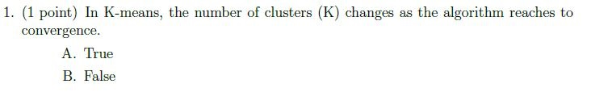

**Figure 1.** Printed question 1 from scanned offline paper, covering K-means cluster number changes during convergence.

**Options**

**A.**

True

**B.**

False

#### Worked answer — independently derived

**Answer: B. False.** $K$ is fixed at initialization; assignment and centroid updates alter membership and centers, not the number of clusters.

---

### 2022 Term 3 · Quiz 1 · AN — Question 3 (MCQ)

**Source:** [Original PDF, p. 3](../sources/exam-papers/pdfs/ee4001_2022T3_Q1_AN.pdf#page=3) · [Archived extraction](../sources/exam-papers/extractions/ee4001_2022T3_Q1_AN.md#q3)  
**Topics:** Gaussian models and clustering. **Marks:** 1.

3. (1 point) K-Means will always find the global minimum.

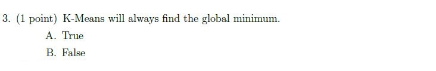

**Figure 2.** Printed question 3 from scanned offline paper, covering whether K-means always finds the global minimum.

**Options**

**A.**

True

**B.**

False

#### Worked answer — independently derived

**Answer: B. False.** K-means monotonically reduces within-cluster squared error but can converge to a local minimum determined by initialization.

---

### 2022 Term 3 · Quiz 1 · AN — Question 4 (Subjective)

**Source:** [Original PDF, p. 3](../sources/exam-papers/pdfs/ee4001_2022T3_Q1_AN.pdf#page=3) · [Archived extraction](../sources/exam-papers/extractions/ee4001_2022T3_Q1_AN.md#q4)  
**Topics:** Gaussian models and clustering. **Marks:** 3.

4. (3 points) Consider the set of training data below, and two clustering algorithms:
K-Means and a Gaussian Mixture Model (GMM) trained using EM. Will these two
clustering algorithms produce the same cluster centers (means) for this data set?
Explain why or why not.

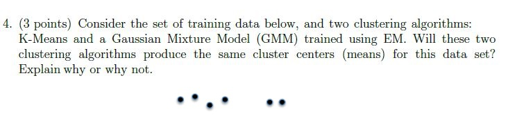

**Figure 3.** Printed question 4 from scanned offline paper, covering cluster centers for K-means vs GMM EM with training data plot.

#### Worked answer — independently derived

Not necessarily. K-means assigns points hard to the nearest center and minimizes squared Euclidean distortion. EM estimates GMM means using soft posterior responsibilities and also fits variances and mixture weights; those different assignments/objectives can yield different centers. The exact locations depend on the plotted data and initialization.

---

### 2022 Term 3 · Quiz 1 · AN — Question 5 (Subjective)

**Source:** [Original PDF, p. 4](../sources/exam-papers/pdfs/ee4001_2022T3_Q1_AN.pdf#page=4) · [Archived extraction](../sources/exam-papers/extractions/ee4001_2022T3_Q1_AN.md#q5)  
**Topics:** Gaussian models and clustering. **Marks:** 3.

5. (3 points) Assume there are two Gaussian components in the GMM; $\mu_0, \mu_1, \sigma_0$ and $\sigma_1$ define means and variances of these two components, $\pi_0$ and $(1-\pi_0)$ denote the mixture proportions of the two Gaussians (i.e. $p(x) = \pi_0 \mathcal{N}(\mu_0, \sigma_0) + (1-\pi_0) \mathcal{N}(\mu_1, \sigma_1)$).

(a) (1 point) Draw on the figure the directions in which $\mu_0$ and $\mu_1$ will move during the next M-step.

(b) (2 points) Will the estimate of $\pi_0$ increase or decrease on the next EM step? Explain your reasoning in one sentence.

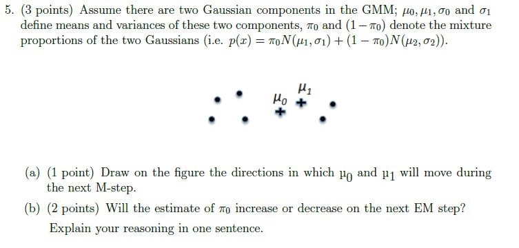

**Figure 4.** Printed question 5 from scanned offline paper, covering two-component GMM M-step mean movement and pi_0 estimate change.

#### Worked answer — independently derived

The M-step sets each mean to its responsibility-weighted sample mean. Without the numeric sample locations/responsibilities encoded in the source plot, neither arrow direction can be uniquely specified. The mixing-weight update is $\pi_0^{new}=N^{-1}\sum_n r_{n0}$, so its increase/decrease also depends on the plotted responsibilities. The original crop gives no numeric axes or weights sufficient to derive these; no unique direction or sign is inferable. The full updates are $r_{nk}=\pi_k\mathcal N(x_n;\mu_k,\sigma_k^2)/\sum_l\pi_l\mathcal N(x_n;\mu_l,\sigma_l^2)$ and $\mu_k^{new}=\sum_n r_{nk}x_n/\sum_n r_{nk}$. Compare $\mu_k^{new}$ with $\mu_k$, and $N^{-1}\sum_n r_{n0}$ with the current $\pi_0$. Under nearly hard membership, the four-point cluster would receive weight near $4/6$; whether that is an increase still depends on the unspecified current weight. The scan also mixes component indices $0,1$ with $1,2$ in its displayed formula; the source crop is retained.

> [!warning] Source ambiguity
> The answer above identifies the precise defect or missing assumption. No official key was available to settle it.

---

### 2022 Term 3 · Quiz 1 · AN — Question 6 (Subjective)

**Source:** [Original PDF, p. 4](../sources/exam-papers/pdfs/ee4001_2022T3_Q1_AN.pdf#page=4) · [Archived extraction](../sources/exam-papers/extractions/ee4001_2022T3_Q1_AN.md#q6)  
**Topics:** observed first-order Markov chains and path prediction. **Marks:** 5.

6. (5 points) We saw two approaches to solve the sequence prediction problem: greedy and viterbi. Consider a weather sequence prediction problem, assuming first-order markov chain. Given that Sunny weather was observed on Day-0, compute the best possible weather forcast sequence for the next three days using 1) greedy approach, 2) viterbi approach.

Hint: For viterbi keep a track of path taken to calculate $\gamma_A(B)$, where $\gamma_A(B)$ denotes maximum probability of reaching state A at time step B.

| | Today Sunny | Today Cloudy | Today Rainy |
| :--- | :--- | :--- | :--- |
| **Yesterday Sunny** | 0.5 | 0.375 | 0.125 |
| **Yesterday Cloudy** | 0.25 | 0.125 | 0.625 |
| **Yesterday Rainy** | 0.25 | 0.075 | 0.675 |

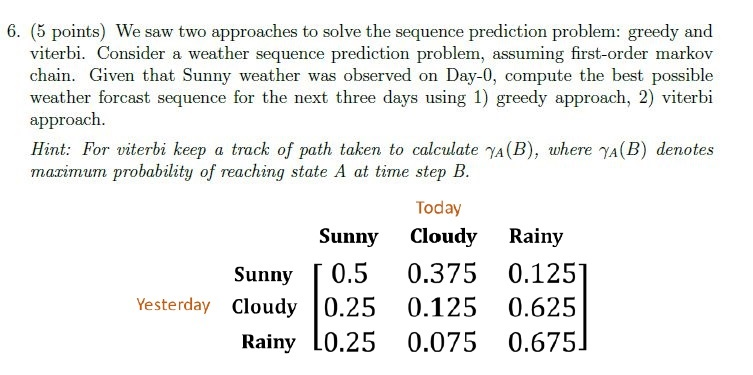

**Figure 5.** Printed question 6 from scanned offline paper, covering weather sequence prediction using greedy and Viterbi approaches with transition matrix table.

#### Worked answer — independently derived

Greedy: select the largest next-state transition at each step, giving Sunny→Sunny→Sunny→Sunny. Viterbi: retain the maximum path score to each state. After day 1 (Sunny, Cloudy, Rainy) scores are (0.5, 0.375, 0.125); after day 2 they are (0.25, 0.1875, 0.234375), with best paths S→S, S→C, and C→R; after day 3 they are (0.125, 0.09375, 0.158203125). The best forecast is **Sunny→Cloudy→Rainy→Rainy**, with probability $0.375·0.625·0.675=0.158203125$.

---

### 2022 Term 3 · Quiz 1 · AN — Question 7 (Subjective)

**Source:** [Original PDF, p. 4](../sources/exam-papers/pdfs/ee4001_2022T3_Q1_AN.pdf#page=4) · [Archived extraction](../sources/exam-papers/extractions/ee4001_2022T3_Q1_AN.md#q7)  
**Topics:** Gaussian models and clustering. **Marks:** 3.

7. (3 points) We saw two approaches for vector quantization, namely: k-means & Linde-Buzo-Gray Algorithm (LBG). Explain in detail the clustering mechanism used in these two algorithms, highlighting differences in their approach.

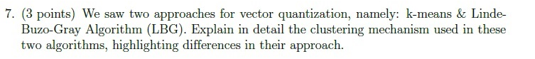

**Figure 6.** Printed question 7 from scanned offline paper, comparing clustering mechanisms between K-means and Linde-Buzo-Gray (LBG) algorithm.

#### Worked answer — independently derived

K-means begins with a fixed $K$, alternates nearest-centroid assignment and arithmetic-mean updates, and converges to a local distortion minimum. LBG is a codebook-design procedure that starts with one centroid (the training-vector mean), repeatedly splits codevectors by small perturbations, then runs the same nearest-neighbor/mean-update refinement before further splitting to reach the requested codebook size or distortion tolerance.

---

### 2023 Term 1 · Quiz 1 · NA — Question 1 (MCQ)

**Source:** [Original PDF, p. 2](../sources/exam-papers/pdfs/ee4001_2023T1_Q1_NA.pdf#page=2) · [Archived extraction](../sources/exam-papers/extractions/ee4001_2023T1_Q1_NA.md#q1)  
**Topics:** K-means: fixed cluster count. **Marks:** 1.

1. (1 point) In K-means, the number of clusters (K) changes as the algorithm reaches to convergence.

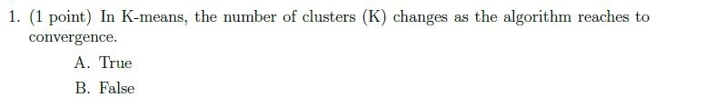

**Figure 7.** Printed question 1 from scanned offline paper, covering K-means cluster number changes during convergence.

**Options**

**A.**

True

**B.**

False

#### Worked answer — independently derived

**Answer: B. False.** $K$ is fixed at initialization; assignment and centroid updates alter membership and centers, not the number of clusters.

---

### 2023 Term 1 · Quiz 1 · NA — Question 3 (MCQ)

**Source:** [Original PDF, p. 2](../sources/exam-papers/pdfs/ee4001_2023T1_Q1_NA.pdf#page=2) · [Archived extraction](../sources/exam-papers/extractions/ee4001_2023T1_Q1_NA.md#q3)  
**Topics:** Gaussian models and clustering. **Marks:** 1.

3. (1 point) K-Means will always find the global minimum.

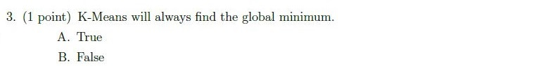

**Figure 8.** Printed question 3 from scanned offline paper, covering whether K-means always finds the global minimum.

**Options**

**A.**

True

**B.**

False

#### Worked answer — independently derived

**Answer: B. False.** K-means monotonically reduces within-cluster squared error but can converge to a local minimum determined by initialization.

---

### 2023 Term 1 · Quiz 1 · NA — Question 4 (Subjective)

**Source:** [Original PDF, p. 2](../sources/exam-papers/pdfs/ee4001_2023T1_Q1_NA.pdf#page=2) · [Archived extraction](../sources/exam-papers/extractions/ee4001_2023T1_Q1_NA.md#q4)  
**Topics:** Gaussian models and clustering. **Marks:** 3.

4. (3 points) Consider the set of training data below, and two clustering algorithms:
K-Means and a Gaussian Mixture Model (GMM) trained using EM. Will these two
clustering algorithms produce the same cluster centers (means) for this data set?
Explain why or why not.

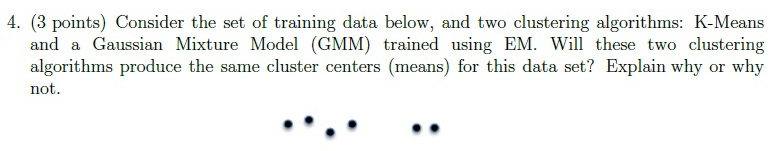

**Figure 9.** Printed question 4 from scanned offline paper, covering cluster centers for K-means vs GMM EM with training data plot.

#### Worked answer — independently derived

Not necessarily. K-means assigns points hard to the nearest center and minimizes squared Euclidean distortion. EM estimates GMM means using soft posterior responsibilities and also fits variances and mixture weights; those different assignments/objectives can yield different centers. The exact locations depend on the plotted data and initialization.

---

### 2023 Term 1 · Quiz 1 · NA — Question 5 (Subjective)

**Source:** [Original PDF, p. 3](../sources/exam-papers/pdfs/ee4001_2023T1_Q1_NA.pdf#page=3) · [Archived extraction](../sources/exam-papers/extractions/ee4001_2023T1_Q1_NA.md#q5)  
**Topics:** Gaussian models and clustering. **Marks:** 3.

5. (3 points) Assume there are two Gaussian components in the GMM; $\mu_0, \mu_1, \sigma_0$ and $\sigma_1$ define means and variances of these two components, $\pi_0$ and $(1-\pi_0)$ denote the mixture proportions of the two Gaussians (i.e. $p(x) = \pi_0 \mathcal{N}(\mu_0, \sigma_0) + (1-\pi_0) \mathcal{N}(\mu_1, \sigma_1)$).

(a) (1 point) Draw on the figure the directions in which $\mu_0$ and $\mu_1$ will move during the next M-step.

(b) (2 points) Will the estimate of $\pi_0$ increase or decrease on the next EM step? Explain your reasoning in one sentence.

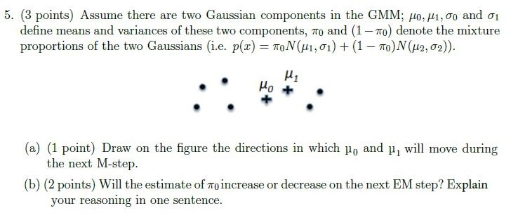

**Figure 10.** Printed question 5 from scanned offline paper, covering two-component GMM M-step mean movement and pi_0 estimate change.

#### Worked answer — independently derived

The M-step sets each mean to its responsibility-weighted sample mean. Without the numeric sample locations/responsibilities encoded in the source plot, neither arrow direction can be uniquely specified. The mixing-weight update is $\pi_0^{new}=N^{-1}\sum_n r_{n0}$, so its increase/decrease also depends on the plotted responsibilities. The original crop gives no numeric axes or weights sufficient to derive these; no unique direction or sign is inferable. The full updates are $r_{nk}=\pi_k\mathcal N(x_n;\mu_k,\sigma_k^2)/\sum_l\pi_l\mathcal N(x_n;\mu_l,\sigma_l^2)$ and $\mu_k^{new}=\sum_n r_{nk}x_n/\sum_n r_{nk}$. Compare $\mu_k^{new}$ with $\mu_k$, and $N^{-1}\sum_n r_{n0}$ with the current $\pi_0$. Under nearly hard membership, the four-point cluster would receive weight near $4/6$; whether that is an increase still depends on the unspecified current weight. The scan also mixes component indices $0,1$ with $1,2$ in its displayed formula; the source crop is retained.

> [!warning] Source ambiguity
> The answer above identifies the precise defect or missing assumption. No official key was available to settle it.

---

### 2023 Term 1 · Quiz 1 · NA — Question 6 (Subjective)

**Source:** [Original PDF, p. 3](../sources/exam-papers/pdfs/ee4001_2023T1_Q1_NA.pdf#page=3) · [Archived extraction](../sources/exam-papers/extractions/ee4001_2023T1_Q1_NA.md#q6)  
**Topics:** observed first-order Markov chains and path prediction. **Marks:** 5.

6. (5 points) We saw two approaches to solve the sequence prediction problem: greedy and viterbi. Consider a weather sequence prediction problem, assuming first-order markov chain. Given that Sunny weather was observed on Day-0, compute the best possible weather forcast sequence for the next three days using 1) greedy approach, 2) viterbi approach.

Hint: For viterbi keep a track of path taken to calculate $\gamma_A(B)$, where $\gamma_A(B)$ denotes maximum probability of reaching state A at time step B.

| | Today Sunny | Today Cloudy | Today Rainy |
| :--- | :--- | :--- | :--- |
| **Yesterday Sunny** | 0.5 | 0.375 | 0.125 |
| **Yesterday Cloudy** | 0.25 | 0.125 | 0.625 |
| **Yesterday Rainy** | 0.25 | 0.075 | 0.675 |

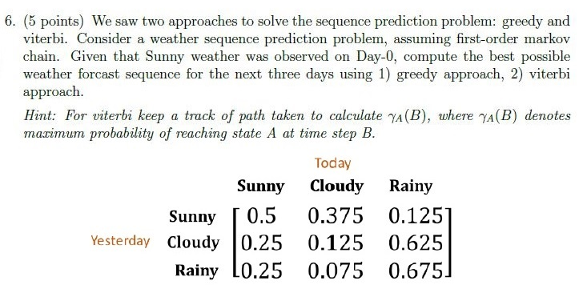

**Figure 11.** Printed question 6 from scanned offline paper, covering weather sequence prediction using greedy and Viterbi approaches with transition matrix table.

#### Worked answer — independently derived

Greedy: select the largest next-state transition at each step, giving Sunny→Sunny→Sunny→Sunny. Viterbi: retain the maximum path score to each state. After day 1 (Sunny, Cloudy, Rainy) scores are (0.5, 0.375, 0.125); after day 2 they are (0.25, 0.1875, 0.234375), with best paths S→S, S→C, and C→R; after day 3 they are (0.125, 0.09375, 0.158203125). The best forecast is **Sunny→Cloudy→Rainy→Rainy**, with probability $0.375·0.625·0.675=0.158203125$.

---

### 2023 Term 1 · Quiz 1 · NA — Question 7 (Subjective)

**Source:** [Original PDF, p. 3](../sources/exam-papers/pdfs/ee4001_2023T1_Q1_NA.pdf#page=3) · [Archived extraction](../sources/exam-papers/extractions/ee4001_2023T1_Q1_NA.md#q7)  
**Topics:** Gaussian models and clustering. **Marks:** 3.

7. (3 points) We saw two approaches for vector quantization, namely: k-means & Linde-Buzo-Gray Algorithm (LBG). Explain in detail the clustering mechanism used in these two algorithms, highlighting differences in their approach.

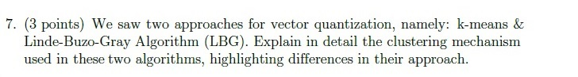

**Figure 12.** Printed question 7 from scanned offline paper, comparing clustering mechanisms between K-means and Linde-Buzo-Gray (LBG) algorithm.

#### Worked answer — independently derived

K-means begins with a fixed $K$, alternates nearest-centroid assignment and arithmetic-mean updates, and converges to a local distortion minimum. LBG is a codebook-design procedure that starts with one centroid (the training-vector mean), repeatedly splits codevectors by small perturbations, then runs the same nearest-neighbor/mean-update refinement before further splitting to reach the requested codebook size or distortion tolerance.

---

### 2023 Term 3 · Quiz 1 · NA — Question 1 (MCQ)

**Source:** [Original PDF, p. 2](../sources/exam-papers/pdfs/ee4001_2023T3_Q1_NA.pdf#page=2) · [Archived extraction](../sources/exam-papers/extractions/ee4001_2023T3_Q1_NA.md#q1)  
**Topics:** K-means: fixed cluster count. **Marks:** 1.

1. (1 point) In K-means, the number of clusters (K) changes as the algorithm reaches to convergence.

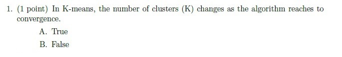

**Figure 13.** Printed question 1 from scanned offline paper, covering K-means cluster number changes during convergence.

**Options**

**A.**

True

**B.**

False

#### Worked answer — independently derived

**Answer: B. False.** $K$ is fixed at initialization; assignment and centroid updates alter membership and centers, not the number of clusters.

---

### 2023 Term 3 · Quiz 1 · NA — Question 3 (MCQ)

**Source:** [Original PDF, p. 2](../sources/exam-papers/pdfs/ee4001_2023T3_Q1_NA.pdf#page=2) · [Archived extraction](../sources/exam-papers/extractions/ee4001_2023T3_Q1_NA.md#q3)  
**Topics:** Gaussian models and clustering. **Marks:** 1.

3. (1 point) K-Means will always find the global minimum.

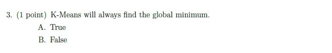

**Figure 14.** Printed question 3 from scanned offline paper, covering whether K-means always finds the global minimum.

**Options**

**A.**

True

**B.**

False

#### Worked answer — independently derived

**Answer: B. False.** K-means monotonically reduces within-cluster squared error but can converge to a local minimum determined by initialization.

---

### 2023 Term 3 · Quiz 1 · NA — Question 4 (Subjective)

**Source:** [Original PDF, p. 2](../sources/exam-papers/pdfs/ee4001_2023T3_Q1_NA.pdf#page=2) · [Archived extraction](../sources/exam-papers/extractions/ee4001_2023T3_Q1_NA.md#q4)  
**Topics:** Gaussian models and clustering. **Marks:** 3.

4. (3 points) Consider the set of training data below, and two clustering algorithms:

K-Means and a Gaussian Mixture Model (GMM) trained using EM. Will these two clustering algorithms produce the same cluster centers (means) for this data set?

Explain why or why not.

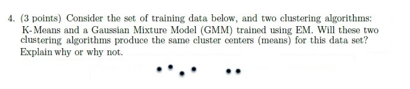

**Figure 15.** Printed question 4 from scanned offline paper, covering cluster centers for K-means vs GMM EM with training data plot.

#### Worked answer — independently derived

Not necessarily. K-means assigns points hard to the nearest center and minimizes squared Euclidean distortion. EM estimates GMM means using soft posterior responsibilities and also fits variances and mixture weights; those different assignments/objectives can yield different centers. The exact locations depend on the plotted data and initialization.

---

### 2023 Term 3 · Quiz 1 · NA — Question 5 (Subjective)

**Source:** [Original PDF, p. 4](../sources/exam-papers/pdfs/ee4001_2023T3_Q1_NA.pdf#page=4) · [Archived extraction](../sources/exam-papers/extractions/ee4001_2023T3_Q1_NA.md#q5)  
**Topics:** Gaussian models and clustering. **Marks:** 3.

5. (3 points) Assume there are two Gaussian components in the GMM; $\mu_0, \mu_1, \sigma_0$ and $\sigma_1$ define means and variances of these two components, $\pi_0$ and $(1-\pi_0)$ denote the mixture proportions of the two Gaussians (i.e. $p(x) = \pi_0 \mathcal{N}(\mu_0, \sigma_0) + (1-\pi_0) \mathcal{N}(\mu_1, \sigma_1)$).

(a) (1 point) Draw on the figure the directions in which $\mu_0$ and $\mu_1$ will move during the next M-step.

(b) (2 points) Will the estimate of $\pi_0$ increase or decrease on the next EM step? Explain your reasoning in one sentence.

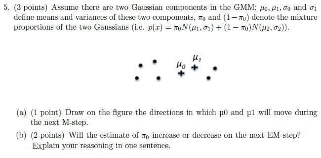

**Figure 16.** Printed question 5 from scanned offline paper, covering two-component GMM M-step mean movement and pi_0 estimate change.

#### Worked answer — independently derived

The M-step sets each mean to its responsibility-weighted sample mean. Without the numeric sample locations/responsibilities encoded in the source plot, neither arrow direction can be uniquely specified. The mixing-weight update is $\pi_0^{new}=N^{-1}\sum_n r_{n0}$, so its increase/decrease also depends on the plotted responsibilities. The original crop gives no numeric axes or weights sufficient to derive these; no unique direction or sign is inferable. The full updates are $r_{nk}=\pi_k\mathcal N(x_n;\mu_k,\sigma_k^2)/\sum_l\pi_l\mathcal N(x_n;\mu_l,\sigma_l^2)$ and $\mu_k^{new}=\sum_n r_{nk}x_n/\sum_n r_{nk}$. Compare $\mu_k^{new}$ with $\mu_k$, and $N^{-1}\sum_n r_{n0}$ with the current $\pi_0$. Under nearly hard membership, the four-point cluster would receive weight near $4/6$; whether that is an increase still depends on the unspecified current weight. The scan also mixes component indices $0,1$ with $1,2$ in its displayed formula; the source crop is retained.

> [!warning] Source ambiguity
> The answer above identifies the precise defect or missing assumption. No official key was available to settle it.

---

### 2023 Term 3 · Quiz 1 · NA — Question 6 (Subjective)

**Source:** [Original PDF, p. 4](../sources/exam-papers/pdfs/ee4001_2023T3_Q1_NA.pdf#page=4) · [Archived extraction](../sources/exam-papers/extractions/ee4001_2023T3_Q1_NA.md#q6)  
**Topics:** observed first-order Markov chains and path prediction. **Marks:** 5.

6. (5 points) We saw two approaches to solve the sequence prediction problem: greedy and viterbi. Consider a weather sequence prediction problem, assuming first-order markov chain. Given that Sunny weather was observed on Day-0, compute the best possible weather forcast sequence for the next three days using 1) greedy approach, 2) viterbi approach.

Hint: For viterbi keep a track of path taken to calculate $\gamma_A(B)$, where $\gamma_A(B)$ denotes maximum probability of reaching state A at time step B.

| | Today Sunny | Today Cloudy | Today Rainy |
| :--- | :--- | :--- | :--- |
| **Yesterday Sunny** | 0.5 | 0.375 | 0.125 |
| **Yesterday Cloudy** | 0.25 | 0.125 | 0.625 |
| **Yesterday Rainy** | 0.25 | 0.075 | 0.675 |

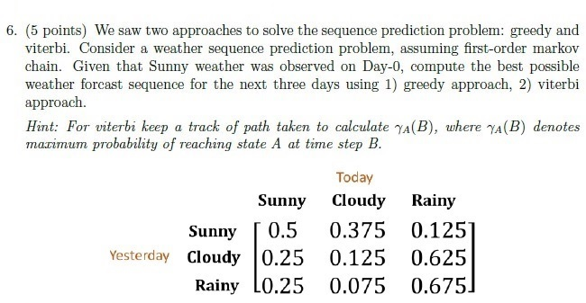

**Figure 17.** Printed question 6 from scanned offline paper, covering weather sequence prediction using greedy and Viterbi approaches with transition matrix table.

#### Worked answer — independently derived

Greedy: select the largest next-state transition at each step, giving Sunny→Sunny→Sunny→Sunny. Viterbi: retain the maximum path score to each state. After day 1 (Sunny, Cloudy, Rainy) scores are (0.5, 0.375, 0.125); after day 2 they are (0.25, 0.1875, 0.234375), with best paths S→S, S→C, and C→R; after day 3 they are (0.125, 0.09375, 0.158203125). The best forecast is **Sunny→Cloudy→Rainy→Rainy**, with probability $0.375·0.625·0.675=0.158203125$.

---

### 2023 Term 3 · Quiz 1 · NA — Question 7 (Subjective)

**Source:** [Original PDF, p. 4](../sources/exam-papers/pdfs/ee4001_2023T3_Q1_NA.pdf#page=4) · [Archived extraction](../sources/exam-papers/extractions/ee4001_2023T3_Q1_NA.md#q7)  
**Topics:** Gaussian models and clustering. **Marks:** 3.

7. (3 points) We saw two approaches for vector quantization, namely: k-means & Linde-Buzo-Gray Algorithm (LBG). Explain in detail the clustering mechanism used in these two algorithms, highlighting differences in their approach.

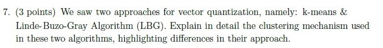

**Figure 18.** Printed question 7 from scanned offline paper, comparing clustering mechanisms between K-means and Linde-Buzo-Gray (LBG) algorithm.

#### Worked answer — independently derived

K-means begins with a fixed $K$, alternates nearest-centroid assignment and arithmetic-mean updates, and converges to a local distortion minimum. LBG is a codebook-design procedure that starts with one centroid (the training-vector mean), repeatedly splits codevectors by small perturbations, then runs the same nearest-neighbor/mean-update refinement before further splitting to reach the requested codebook size or distortion tolerance.

---

### 2025 Term 2 · Quiz 1 · NA — Question 6 (Subjective)

**Source:** [Original PDF, p. 4](../sources/exam-papers/pdfs/ee4001_2025T2_Q1_NA.pdf#page=4) · [Archived extraction](../sources/exam-papers/extractions/ee4001_2025T2_Q1_NA.md#q6)  
**Topics:** Gaussian models and clustering. **Marks:** 3.

KMeans clustering You are given the following 1-dimensional data points:

$$X = \{2, 4, 5, 8, 9\}$$

(a) Initialize 2 cluster centroids: $c_1 = 4$ and $c_2 = 8$.

(b) Assign each data point to the nearest cluster.

(c) Compute the new centroids after assignment.

(d) Write the new clusters and their updated centroids.

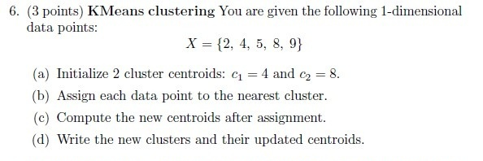

**Figure 19.** Printed Question 6 from scanned offline paper, covering KMeans clustering with 1-dimensional data points and two centroids.

#### Worked answer — independently derived

Starting centers are 4 and 8. Nearest-center assignment gives $C_1=\{2,4,5\}$ and $C_2=\{8,9\}$; updated centroids are $11/3\approx3.667$ and $17/2=8.5$. (Point 5 is closer to 4.)

---

### 2025 Term 2 · Quiz 1 · NA — Question 7 (Subjective)

**Source:** [Original PDF, p. 4](../sources/exam-papers/pdfs/ee4001_2025T2_Q1_NA.pdf#page=4) · [Archived extraction](../sources/exam-papers/extractions/ee4001_2025T2_Q1_NA.md#q7)  
**Topics:** Gaussian models and clustering. **Marks:** 5.

In speech coding, the Linde-Buzo-Gray (LBG) algorithm is used to design a vector quantizer for compressing feature vectors.

Given the following 1-dimensional training data points:

$$X = \{1, 2, 3, 8, 9, 10\}$$

(a) Perform one iteration of the LBG algorithm starting with a single centroid at the global mean.

(b) Apply the splitting step to obtain two centroids.

(c) Reassign the training data to the nearest centroid and compute the new centroids.

*Hint:* Use a small perturbation factor $\epsilon = 0.1$ for splitting:
$$\text{Split: } c_1 = \mu(1 + \epsilon), \quad c_2 = \mu(1 - \epsilon)$$

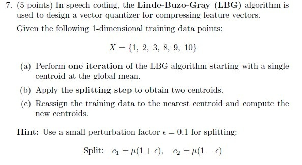

**Figure 20.** Printed Question 7 from scanned offline paper, covering Linde-Buzo-Gray (LBG) vector quantization algorithm iteration and splitting.

#### Worked answer — independently derived

Global mean is $(1+2+3+8+9+10)/6=5.5$. After splitting with $\epsilon=0.1$, centers are $6.05$ and $4.95$ (labels interchangeable). Nearest assignments are $\{8,9,10\}$ and $\{1,2,3\}$; updated means are 9 and 2. This is one reassignment/centroid update after splitting.

---

### 2025 Term 2 · Quiz 1 · NA — Question 8 (Subjective)

**Source:** [Original PDF, p. 4](../sources/exam-papers/pdfs/ee4001_2025T2_Q1_NA.pdf#page=4) · [Archived extraction](../sources/exam-papers/extractions/ee4001_2025T2_Q1_NA.md#q8)  
**Topics:** Gaussian models and clustering. **Marks:** 5.

In speech recognition, Gaussian Mixture Models (GMMs) are used to model the probability distribution of feature vectors such as MFCCs.

Suppose you have a 1-dimensional MFCC feature $x = 2.0$. The feature is modeled using a 2-component GMM with the following parameters:

- Component 1: $\mu_1 = 1.0, \sigma_1^2 = 1.0, w_1 = 0.6$
- Component 2: $\mu_2 = 3.0, \sigma_2^2 = 1.0, w_2 = 0.4$

(a) Compute the probability density $p(x)$ of $x$ under this GMM.

(b) Compute the posterior probability that the feature $x$ was generated by Component 1.

*Hint:* The PDF of a 1D Gaussian is
$$\mathcal{N}(x; \mu, \sigma^2) = \frac{1}{\sqrt{2\pi\sigma^2}} \exp\left( - \frac{(x - \mu)^2}{2\sigma^2} \right)$$

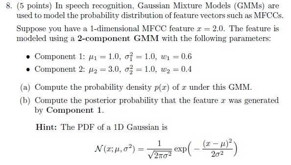

**Figure 21.** Printed Question 8 from scanned offline paper, covering 2-component Gaussian Mixture Model (GMM) probability density and posterior calculation.

#### Worked answer — independently derived

At $x=2$, each component density is $\phi(1)=e^{-1/2}/\sqrt{2\pi}\approx0.241971$. Hence $p(x)=0.6(0.241971)+0.4(0.241971)=0.241971$ per feature unit. Bayes responsibility for component 1 is $0.6\phi/[0.6\phi+0.4\phi]=0.60$.

---

### 2026 Term 1 · Quiz 1 · NA — Question 10 (Subjective)

**Source:** [Original PDF, p. 5](../sources/exam-papers/pdfs/ee4001_2026T1_Q1_NA.pdf#page=5) · [Archived extraction](../sources/exam-papers/extractions/ee4001_2026T1_Q1_NA.md#q10)  
**Topics:** Gaussian models and clustering. **Marks:** 5.

In speech recognition, Gaussian Mixture Models (GMMs) are used to model the probability distribution of feature vectors such as MFCCs.

Suppose you have a 1-dimensional MFCC feature $x = 2.0$. The feature is modeled using a 2-component GMM with the following parameters:

- Component 1: $\mu_1 = 1.0$, $\sigma_1^2 = 1.0$, $w_1 = 0.6$
- Component 2: $\mu_2 = 3.0$, $\sigma_2^2 = 1.0$, $w_2 = 0.4$

(a) Compute the probability density $p(x)$ of $x$ under this GMM.

(b) Compute the posterior probability that the feature $x$ was generated by Component 1.

Hint: The PDF of a 1D Gaussian is

$$\mathcal{N}(x; \mu, \sigma^2) = \frac{1}{\sqrt{2\pi\sigma^2}} \exp\left(-\frac{(x - \mu)^2}{2\sigma^2}\right)$$

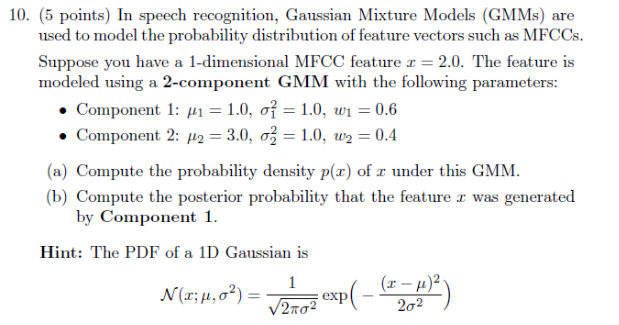

**Figure 22.** Printed question 10 from scanned offline paper, calculating probability density and posterior component probability for a 2-component GMM.

#### Worked answer — independently derived

At $x=2$, each component density is $\phi(1)=e^{-1/2}/\sqrt{2\pi}\approx0.241971$. Hence $p(x)=0.6(0.241971)+0.4(0.241971)=0.241971$ per feature unit. Bayes responsibility for component 1 is $0.6\phi/[0.6\phi+0.4\phi]=0.60$.

---

## End Term questions

### 2022 Term 3 · End Term · FN — Question 1 (MCQ)

**Source:** [Original PDF, p. 3](../sources/exam-papers/pdfs/ee4001_2022T3_ET_FN.pdf#page=3) · [Archived extraction](../sources/exam-papers/extractions/ee4001_2022T3_ET_FN.md#q-mcq-1)  
**Topics:** Gaussian mixture likelihood; acoustic-state emissions. **Marks:** 1.

1. (1 point) For a given set of data points $X = \{x_1, x_2, \dots, x_N\}$, log-likelihood for a GMM with $k$ mixtures can be defined as:

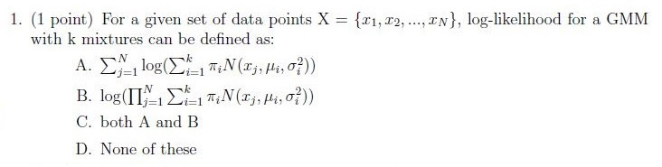

**Figure 23.** Printed question 1 from scanned offline paper, covering GMM log-likelihood formulation.

**Options**

**A.**

$$\sum_{i=1}^N \log\left(\sum_{j=1}^k w_j \mathcal{N}(x_i; \mu_j, \Sigma_j)\right)$$

**B.**

$$\log\left(\prod_{i=1}^N \sum_{j=1}^k w_j \mathcal{N}(x_i; \mu_j, \Sigma_j)\right)$$

**C.**

both A and B

**D.**

None of these

#### Worked answer — independently derived

**Answer: C — both A and B.** For independent observations, $\log L=\sum_i\log[\sum_jw_j\mathcal N(x_i;\mu_j,\Sigma_j)]$. By $\sum_i\log a_i=\log\prod_i a_i$, option B is algebraically identical to A.

---

### 2022 Term 3 · End Term · FN — Question 7 (MCQ)

**Source:** [Original PDF, p. 4](../sources/exam-papers/pdfs/ee4001_2022T3_ET_FN.pdf#page=4) · [Archived extraction](../sources/exam-papers/extractions/ee4001_2022T3_ET_FN.md#q-mcq-7)  
**Topics:** Conditional probability and Bayes rule. **Marks:** 1.

7. (1 point) Which of the following is correct according to Bayes rule?

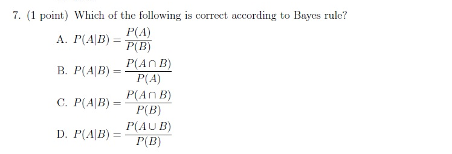

**Figure 24.** Printed question 7 from scanned offline paper, covering Bayes rule formulation.

**Options**

**A.**

$$P(A|B) = \frac{P(A)}{P(B)}$$

**B.**

$$P(A|B) = \frac{P(A \cap B)}{P(A)}$$

**C.**

$$P(A|B) = \frac{P(A \cap B)}{P(B)}$$

**D.**

$$P(A|B) = \frac{P(A \cup B)}{P(B)}$$

#### Worked answer — independently derived

**Answer: C.** For $P(B)>0$, $P(A\mid B)=P(A\cap B)/P(B)$. Using $P(A\cap B)=P(B\mid A)P(A)$ gives the familiar Bayes form $P(A\mid B)=P(B\mid A)P(A)/P(B)$.

---

### 2022 Term 3 · End Term · FN — Question 8 (MCQ)

**Source:** [Original PDF, p. 5](../sources/exam-papers/pdfs/ee4001_2022T3_ET_FN.pdf#page=5) · [Archived extraction](../sources/exam-papers/extractions/ee4001_2022T3_ET_FN.md#q-mcq-8)  
**Topics:** Trellis max versus sum. **Marks:** 1.

**Overlap:** [[week-4-notes|Week 4]]. Primary placement follows the earliest substantive mechanism.

8. (1 point) Consider the Fig. and determine $\alpha_2(2)$

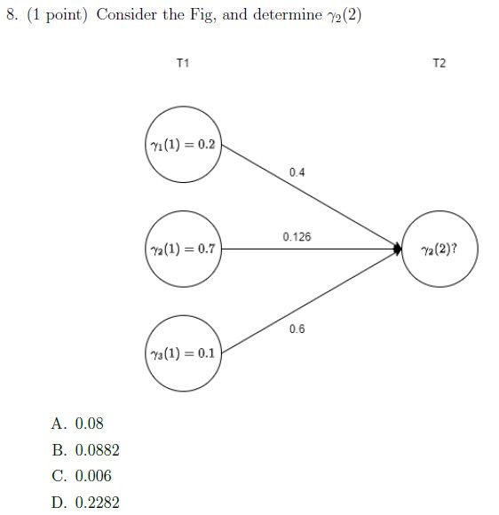

**Figure 25.** Printed question 8 and state trellis diagram from scanned offline paper, computing HMM forward probability alpha_2(2).

**Options**

**A.**

0.08

**B.**

0.0882

**C.**

0.006

**D.**

0.2282

#### Worked answer — independently derived

**Answer under the course maximum-path convention: B — 0.0882.** The scan prints $\gamma_2(2)$; the text extraction reads $\alpha_2(2)$. The three incoming products are $0.2\times0.4=0.08$, $0.7\times0.126=0.0882$, and $0.1\times0.6=0.06$. Their **maximum is 0.0882**. Their **sum is 0.2282 (D)**, which would be appropriate for a Forward-sum quantity with these incoming factors. No separate emission factor is displayed. The related Q1 paper explicitly defines $\gamma$ as a maximum-path score; that convention supports B.

---

### 2022 Term 3 · End Term · FN — Question 3 (Subjective)

**Source:** [Original PDF, p. 6](../sources/exam-papers/pdfs/ee4001_2022T3_ET_FN.pdf#page=6) · [Archived extraction](../sources/exam-papers/extractions/ee4001_2022T3_ET_FN.md#q-subj-3)  
**Topics:** Local and global optima in clustering. **Marks:** 3.

3. (3 points) Explain the difference between local and global minima. Discuss the steps suggested in literature to avoid problem of getting stuck at a local minima.

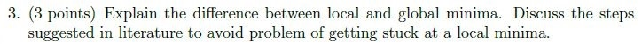

**Figure 26.** Printed subjective question 3 from scanned offline paper, covering local vs global minima.

#### Worked answer — independently derived

A **local minimum** $\theta^*$ satisfies $J(\theta^*)\le J(\theta)$ in some neighborhood. A **global minimum** satisfies that inequality throughout the feasible domain. Every global minimum is local under the non-strict definition; a local minimum need not be global.

For K-means and GMM fitting, use informed initialization (e.g., K-means++ or cluster-based GMM means), multiple independent restarts, and retain the best achieved distortion or likelihood. Perturbation, stochastic search, and annealing may escape poor basins; they do not generally guarantee a global optimum in finite time. Plain K-means descent and ordinary EM are locally improving methods, not global solvers. For GMMs, variance regularization is also needed to prevent likelihood singularities; avoiding a local optimum alone does not fix covariance collapse.

---

### 2023 Term 1 · End Term · AN — Question 1 (MCQ)

**Source:** [Original PDF, p. 3](../sources/exam-papers/pdfs/ee4001_2023T1_ET_AN.pdf#page=3) · [Archived extraction](../sources/exam-papers/extractions/ee4001_2023T1_ET_AN.md#q-mcq-1)  
**Topics:** Gaussian mixture likelihood; acoustic-state emissions. **Marks:** 1.

1. (1 point) For a given set of data points $X = \{x_1, x_2, \dots, x_N\}$, log-likelihood for a GMM with $k$ mixtures can be defined as:

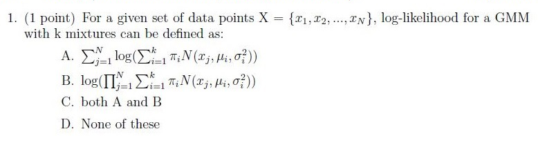

**Figure 27.** Printed question 1 from scanned offline paper, covering GMM log-likelihood formulation.

**Options**

**A.**

$$\sum_{i=1}^N \log\left(\sum_{j=1}^k \pi_j \mathcal{N}(x_i; \mu_j, \sigma_j^2)\right)$$

**B.**

$$\log\left(\prod_{i=1}^N \sum_{j=1}^k \pi_j \mathcal{N}(x_i; \mu_j, \sigma_j^2)\right)$$

**C.**

both A and B

**D.**

None of these

#### Worked answer — independently derived

**Answer: C — both A and B.** For independent observations, $\log L=\sum_i\log[\sum_jw_j\mathcal N(x_i;\mu_j,\Sigma_j)]$. By $\sum_i\log a_i=\log\prod_i a_i$, option B is algebraically identical to A.

---

### 2023 Term 1 · End Term · AN — Question 7 (MCQ)

**Source:** [Original PDF, p. 4](../sources/exam-papers/pdfs/ee4001_2023T1_ET_AN.pdf#page=4) · [Archived extraction](../sources/exam-papers/extractions/ee4001_2023T1_ET_AN.md#q-mcq-7)  
**Topics:** Conditional probability and Bayes rule. **Marks:** 1.

7. (1 point) Which of the following is correct according to Bayes rule?

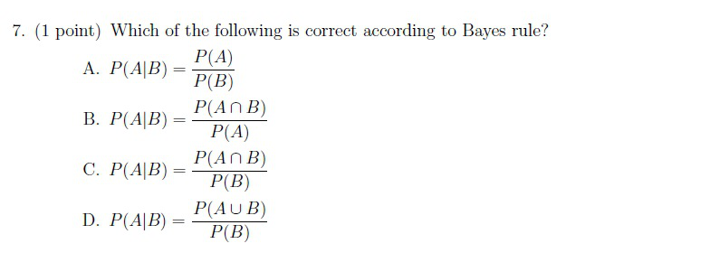

**Figure 28.** Printed question 7 from scanned offline paper, covering Bayes rule formulation.

**Options**

**A.**

$$P(A|B) = \frac{P(A)}{P(B)}$$

**B.**

$$P(A|B) = \frac{P(A \cap B)}{P(A)}$$

**C.**

$$P(A|B) = \frac{P(A \cap B)}{P(B)}$$

**D.**

$$P(A|B) = \frac{P(A \cup B)}{P(B)}$$

#### Worked answer — independently derived

**Answer: C.** For $P(B)>0$, $P(A\mid B)=P(A\cap B)/P(B)$. Using $P(A\cap B)=P(B\mid A)P(A)$ gives the familiar Bayes form $P(A\mid B)=P(B\mid A)P(A)/P(B)$.

---

### 2023 Term 1 · End Term · AN — Question 8 (MCQ)

**Source:** [Original PDF, p. 4](../sources/exam-papers/pdfs/ee4001_2023T1_ET_AN.pdf#page=4) · [Archived extraction](../sources/exam-papers/extractions/ee4001_2023T1_ET_AN.md#q-mcq-8)  
**Topics:** Trellis max versus sum. **Marks:** 1.

**Overlap:** [[week-4-notes|Week 4]]. Primary placement follows the earliest substantive mechanism.

8. (1 point) Consider the Fig. and determine $\alpha_2(2)$

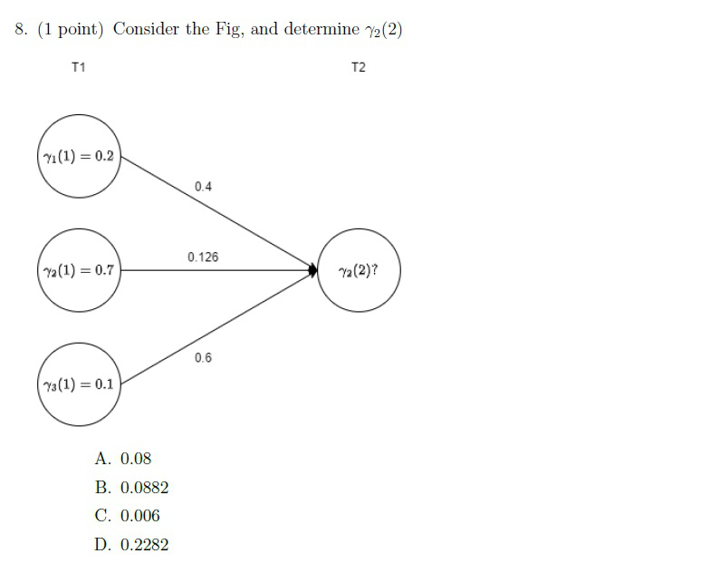

**Figure 29.** Printed question 8 and state trellis diagram from scanned offline paper, computing HMM forward probability alpha_2(2).

**Options**

**A.**

0.08

**B.**

0.0882

**C.**

0.006

**D.**

0.2282

#### Worked answer — independently derived

**Answer under the course maximum-path convention: B — 0.0882.** The scan prints $\gamma_2(2)$; the text extraction reads $\alpha_2(2)$. The three incoming products are $0.2\times0.4=0.08$, $0.7\times0.126=0.0882$, and $0.1\times0.6=0.06$. Their **maximum is 0.0882**. Their **sum is 0.2282 (D)**, which would be appropriate for a Forward-sum quantity with these incoming factors. No separate emission factor is displayed. The related Q1 paper explicitly defines $\gamma$ as a maximum-path score; that convention supports B.

---

### 2023 Term 1 · End Term · AN — Question 3 (Subjective)

**Source:** [Original PDF, p. 6](../sources/exam-papers/pdfs/ee4001_2023T1_ET_AN.pdf#page=6) · [Archived extraction](../sources/exam-papers/extractions/ee4001_2023T1_ET_AN.md#q-subj-3)  
**Topics:** Local and global optima in clustering. **Marks:** 3.

3. (3 points) Explain the difference between local and global minima. Discuss the steps suggested in literature to avoid problem of getting stuck at a local minima.

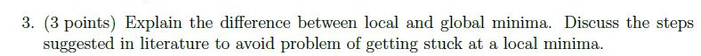

**Figure 30.** Printed subjective question 3 from scanned offline paper, covering local vs global minima.

#### Worked answer — independently derived

A **local minimum** $\theta^*$ satisfies $J(\theta^*)\le J(\theta)$ in some neighborhood. A **global minimum** satisfies that inequality throughout the feasible domain. Every global minimum is local under the non-strict definition; a local minimum need not be global.

For K-means and GMM fitting, use informed initialization (e.g., K-means++ or cluster-based GMM means), multiple independent restarts, and retain the best achieved distortion or likelihood. Perturbation, stochastic search, and annealing may escape poor basins; they do not generally guarantee a global optimum in finite time. Plain K-means descent and ordinary EM are locally improving methods, not global solvers. For GMMs, variance regularization is also needed to prevent likelihood singularities; avoiding a local optimum alone does not fix covariance collapse.

---

### 2023 Term 1 · End Term · FN — Question 1 (MCQ)

**Source:** [Original PDF, p. 3](../sources/exam-papers/pdfs/ee4001_2023T1_ET_FN.pdf#page=3) · [Archived extraction](../sources/exam-papers/extractions/ee4001_2023T1_ET_FN.md#q-mcq-1)  
**Topics:** Gaussian mixture likelihood; acoustic-state emissions. **Marks:** 1.

1. (1 point) For a given set of data points $X = \{x_1, x_2, \dots, x_N\}$, log-likelihood for a GMM with $k$ mixtures can be defined as:

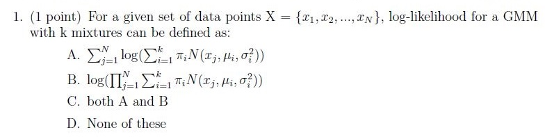

**Figure 31.** Printed question 1 from scanned offline paper, covering GMM log-likelihood formulation.

**Options**

**A.**

$$\sum_{i=1}^N \log\left(\sum_{j=1}^k w_j \mathcal{N}(x_i; \mu_j, \Sigma_j)\right)$$

**B.**

$$\log\left(\prod_{i=1}^N \sum_{j=1}^k w_j \mathcal{N}(x_i; \mu_j, \Sigma_j)\right)$$

**C.**

both A and B

**D.**

None of these

#### Worked answer — independently derived

**Answer: C — both A and B.** For independent observations, $\log L=\sum_i\log[\sum_jw_j\mathcal N(x_i;\mu_j,\Sigma_j)]$. By $\sum_i\log a_i=\log\prod_i a_i$, option B is algebraically identical to A.

---

### 2023 Term 1 · End Term · FN — Question 7 (MCQ)

**Source:** [Original PDF, p. 4](../sources/exam-papers/pdfs/ee4001_2023T1_ET_FN.pdf#page=4) · [Archived extraction](../sources/exam-papers/extractions/ee4001_2023T1_ET_FN.md#q-mcq-7)  
**Topics:** Conditional probability and Bayes rule. **Marks:** 1.

7. (1 point) Which of the following is correct according to Bayes rule?

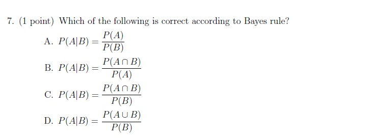

**Figure 32.** Printed question 7 from scanned offline paper, covering Bayes rule formulation.

**Options**

**A.**

$$P(A|B) = \frac{P(A)}{P(B)}$$

**B.**

$$P(A|B) = \frac{P(A \cap B)}{P(A)}$$

**C.**

$$P(A|B) = \frac{P(A \cap B)}{P(B)}$$

**D.**

$$P(A|B) = \frac{P(A \cup B)}{P(B)}$$

#### Worked answer — independently derived

**Answer: C.** For $P(B)>0$, $P(A\mid B)=P(A\cap B)/P(B)$. Using $P(A\cap B)=P(B\mid A)P(A)$ gives the familiar Bayes form $P(A\mid B)=P(B\mid A)P(A)/P(B)$.

---

### 2023 Term 1 · End Term · FN — Question 8 (MCQ)

**Source:** [Original PDF, p. 4](../sources/exam-papers/pdfs/ee4001_2023T1_ET_FN.pdf#page=4) · [Archived extraction](../sources/exam-papers/extractions/ee4001_2023T1_ET_FN.md#q-mcq-8)  
**Topics:** Trellis max versus sum. **Marks:** 1.

**Overlap:** [[week-4-notes|Week 4]]. Primary placement follows the earliest substantive mechanism.

8. (1 point) Consider the Fig. and determine $\alpha_2(2)$

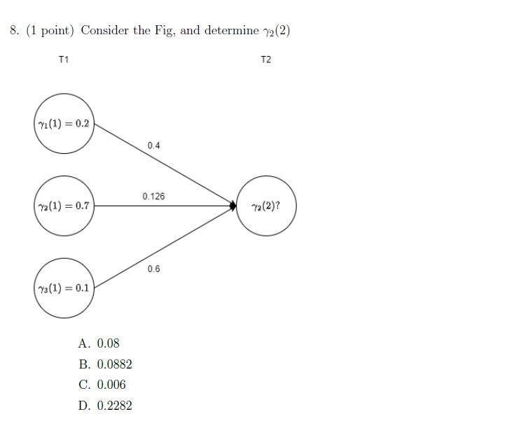

**Figure 33.** Printed question 8 and state trellis diagram from scanned offline paper, computing HMM forward probability alpha_2(2).

**Options**

**A.**

0.08

**B.**

0.0882

**C.**

0.006

**D.**

0.2282

#### Worked answer — independently derived

**Answer under the course maximum-path convention: B — 0.0882.** The scan prints $\gamma_2(2)$; the text extraction reads $\alpha_2(2)$. The three incoming products are $0.2\times0.4=0.08$, $0.7\times0.126=0.0882$, and $0.1\times0.6=0.06$. Their **maximum is 0.0882**. Their **sum is 0.2282 (D)**, which would be appropriate for a Forward-sum quantity with these incoming factors. No separate emission factor is displayed. The related Q1 paper explicitly defines $\gamma$ as a maximum-path score; that convention supports B.

---

### 2023 Term 1 · End Term · FN — Question 3 (Subjective)

**Source:** [Original PDF, p. 6](../sources/exam-papers/pdfs/ee4001_2023T1_ET_FN.pdf#page=6) · [Archived extraction](../sources/exam-papers/extractions/ee4001_2023T1_ET_FN.md#q-subj-3)  
**Topics:** Local and global optima in clustering. **Marks:** 3.

3. (3 points) Explain the difference between local and global minima. Discuss the steps suggested in literature to avoid problem of getting stuck at a local minima.

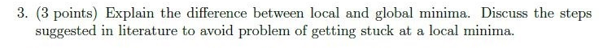

**Figure 34.** Printed subjective question 3 from scanned offline paper, covering local vs global minima.

#### Worked answer — independently derived

A **local minimum** $\theta^*$ satisfies $J(\theta^*)\le J(\theta)$ in some neighborhood. A **global minimum** satisfies that inequality throughout the feasible domain. Every global minimum is local under the non-strict definition; a local minimum need not be global.

For K-means and GMM fitting, use informed initialization (e.g., K-means++ or cluster-based GMM means), multiple independent restarts, and retain the best achieved distortion or likelihood. Perturbation, stochastic search, and annealing may escape poor basins; they do not generally guarantee a global optimum in finite time. Plain K-means descent and ordinary EM are locally improving methods, not global solvers. For GMMs, variance regularization is also needed to prevent likelihood singularities; avoiding a local optimum alone does not fix covariance collapse.

---

### 2023 Term 3 · End Term · AN — Question 4 (MCQ)

**Source:** [Original PDF, p. 3](../sources/exam-papers/pdfs/ee4001_2023T3_ET_AN.pdf#page=3) · [Archived extraction](../sources/exam-papers/extractions/ee4001_2023T3_ET_AN.md#q-mcq-4)  
**Topics:** Conditional probability and Bayes rule. **Marks:** 2.

4. (2 points) Which of the following is correct according to Bayes rule?

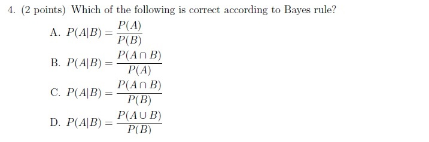

**Figure 35.** Printed question 4 from scanned offline paper, covering Bayes rule formulation.

**Options**

**A.**

$$P(A|B) = \frac{P(A)}{P(B)}$$

**B.**

$$P(A|B) = \frac{P(A \cap B)}{P(A)}$$

**C.**

$$P(A|B) = \frac{P(A \cap B)}{P(B)}$$

**D.**

$$P(A|B) = \frac{P(A \cup B)}{P(B)}$$

#### Worked answer — independently derived

**Answer: C.** For $P(B)>0$, $P(A\mid B)=P(A\cap B)/P(B)$. Using $P(A\cap B)=P(B\mid A)P(A)$ gives the familiar Bayes form $P(A\mid B)=P(B\mid A)P(A)/P(B)$.

---

### 2023 Term 3 · End Term · FN — Question 1 (Subjective)

**Source:** [Original PDF, p. 3](../sources/exam-papers/pdfs/ee4001_2023T3_ET_FN.pdf#page=3) · [Archived extraction](../sources/exam-papers/extractions/ee4001_2023T3_ET_FN.md#q-subj-1)  
**Topics:** Local and global optima in clustering. **Marks:** 2.

1. (2 points) Explain the difference between local and global minima. Discuss the steps suggested in literature to avoid the problem of getting stuck at a local minima.

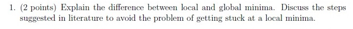

**Figure 36.** Printed Question 1 from Section 1.2 Subjective on local versus global minima.

#### Worked answer — independently derived

A **local minimum** $\theta^*$ satisfies $J(\theta^*)\le J(\theta)$ in some neighborhood. A **global minimum** satisfies that inequality throughout the feasible domain. Every global minimum is local under the non-strict definition; a local minimum need not be global.

For K-means and GMM fitting, use informed initialization (e.g., K-means++ or cluster-based GMM means), multiple independent restarts, and retain the best achieved distortion or likelihood. Perturbation, stochastic search, and annealing may escape poor basins; they do not generally guarantee a global optimum in finite time. Plain K-means descent and ordinary EM are locally improving methods, not global solvers. For GMMs, variance regularization is also needed to prevent likelihood singularities; avoiding a local optimum alone does not fix covariance collapse.

---

### 2026 Term 1 · End Term · FN — Question 17 (Subjective)

**Source:** [Original PDF, p. 7](../sources/exam-papers/pdfs/ee4001_2026T1_ET_FN.pdf#page=7) · [Archived extraction](../sources/exam-papers/extractions/ee4001_2026T1_ET_FN.md#q17)  
**Topics:** Vector quantization: distortion and bit rate. **Marks:** 2.

**Shared source instructions:**

Instructions :

All option-based questions are MCQs, and all fill-in-the-blank questions are short answer questions.

For Questions 3 to 20, answer all questions.

• In MCQs, you must write the correct option and also the complete text of that option.
• You must then provide a detailed explanation of why that specific option is the correct answer.
• In short answer questions, write the answer clearly with proper explanation wherever needed.
• In all problem-solving or example-based questions, present the solution with all intermediate steps clearly shown.
• Step-wise explanation is compulsory for all such questions.
• The final answer must be written clearly at the end.

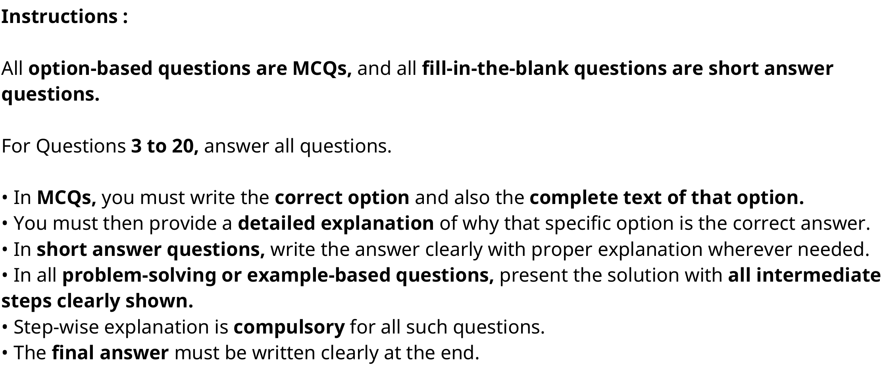

**Figure 37.** General examination instructions specifying answer requirements for MCQs, short answer, and problem-solving questions

When applying K-Means clustering for speech discretization, a specific vocabulary size (number of clusters, K) must be defined. Discuss the trade-offs between choosing a very small vocabulary (e.g., K=50) versus a very large vocabulary (e.g., K=2000). How does this choice impact phonetic discriminability and token sequence bit-rate?

#### Worked answer — independently derived

**Small $K=50$:** coarse partitions, greater quantization distortion and merging of acoustically different sounds; fewer bits per token and easier estimation of each centroid. **Large $K=2000$:** finer acoustic distinctions and potentially lower distortion, at the cost of more storage/search, sparser cluster estimates and possible allocation of clusters to speaker/noise differences instead of phonetic distinctions. More clusters do not guarantee more useful phoneme labels.

At fixed frame rate $f$, one codebook index is emitted per frame in either case: increasing $K$ does **not** itself increase token sequence length. The ideal index capacities are $\log_2 50\approx5.644$ and $\log_2 2000\approx10.966$ bits/token. Fixed-width indices require 6 and 11 bits/token, respectively; rates are $6f$ and $11f$ bits/s, before overhead or entropy coding. Deduplication or a changed frame rate would introduce separate duration/rate assumptions.

---

### 2026 Term 1 · End Term · FN — Question 18 (Subjective)

**Source:** [Original PDF, p. 7, 8](../sources/exam-papers/pdfs/ee4001_2026T1_ET_FN.pdf#page=7) · [Archived extraction](../sources/exam-papers/extractions/ee4001_2026T1_ET_FN.md#q18)  
**Topics:** Nearest-codeword quantization. **Marks:** 2.

**Shared source instructions:**

Instructions :

All option-based questions are MCQs, and all fill-in-the-blank questions are short answer questions.

For Questions 3 to 20, answer all questions.

• In MCQs, you must write the correct option and also the complete text of that option.
• You must then provide a detailed explanation of why that specific option is the correct answer.
• In short answer questions, write the answer clearly with proper explanation wherever needed.
• In all problem-solving or example-based questions, present the solution with all intermediate steps clearly shown.
• Step-wise explanation is compulsory for all such questions.
• The final answer must be written clearly at the end.

**Figure 38.** General examination instructions specifying answer requirements for MCQs, short answer, and problem-solving questions

Given a latent vector: z=[1.2,0.8] and codebook vectors: c1=[1,1], c2=[0,0]

(a) Find the closest codebook vector.
(b) Compute the quantized output.

#### Worked answer — independently derived

**(a) Closest vector: $c_1=[1,1]$.** Squared Euclidean distances are $\|z-c_1\|^2=(0.2)^2+(-0.2)^2=0.08$ and $\|z-c_2\|^2=1.2^2+0.8^2=2.08$. Taking square roots preserves the ordering. **(b) Quantized output: $\hat z=c_1=[1,1]$.** The corresponding transmitted index is 1 if the codebook uses the printed one-based labels.

---

## Reproducibility and source integrity

Source PDFs, original extracted text and crops are archived under `sources/exam-papers/`. The inventory records PDF SHA-256 hashes. Rebuild with `uv run python build_exam_question_banks.py`; verify numerical examples and generated links with `uv run python verify_exam_question_banks.py`. The reviewed routing manifest includes every source question, including excluded later material.
