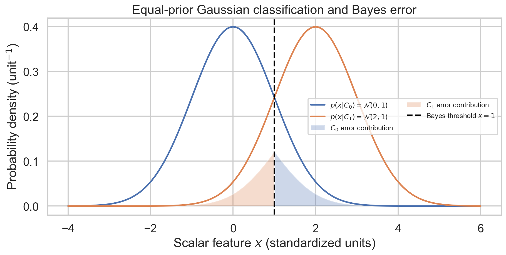
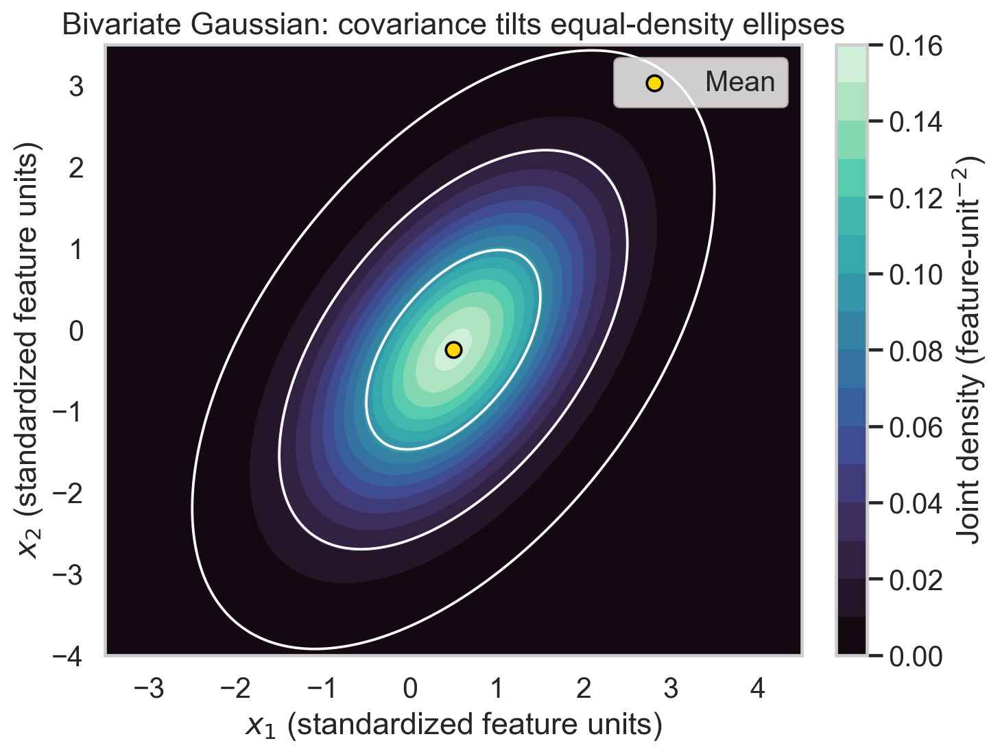
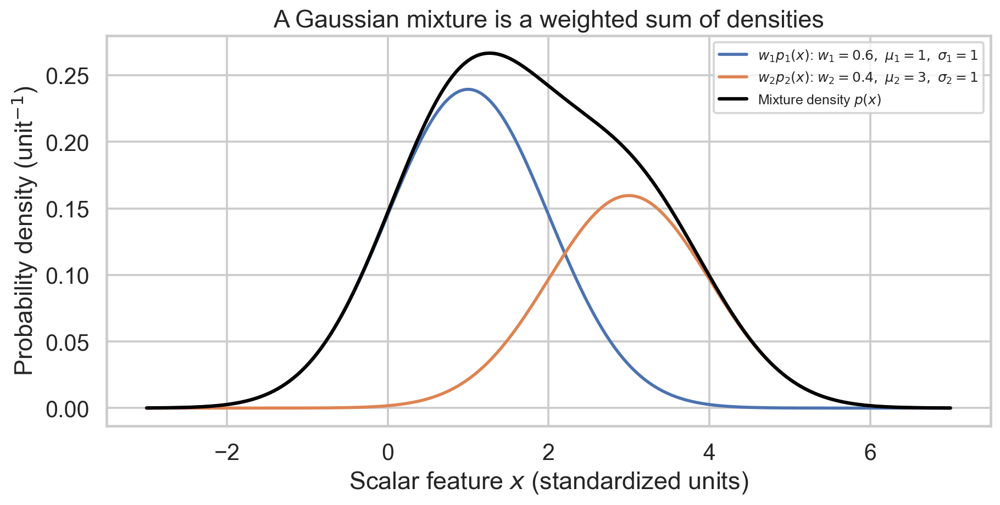
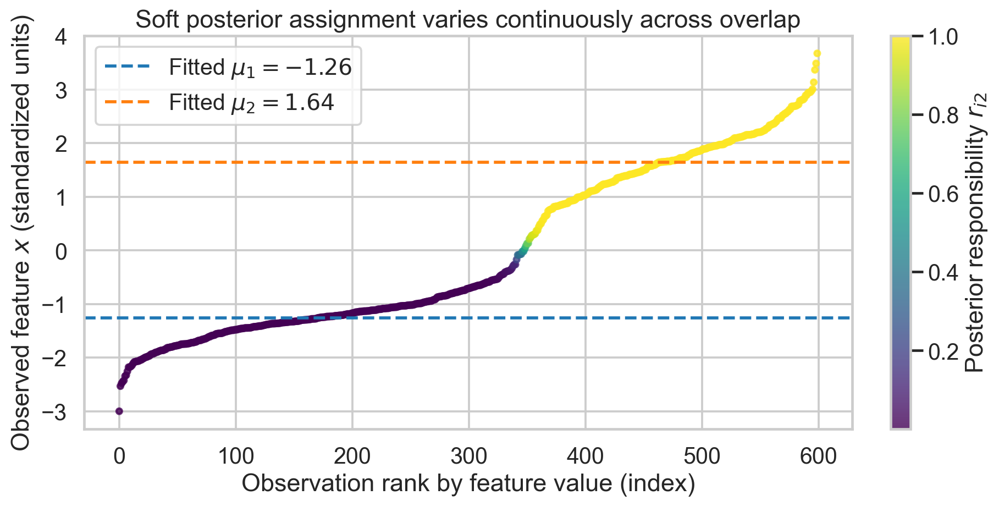
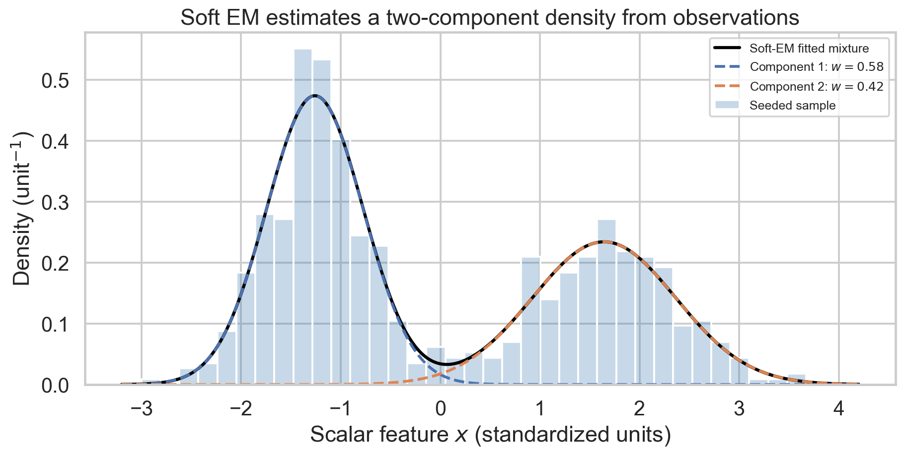
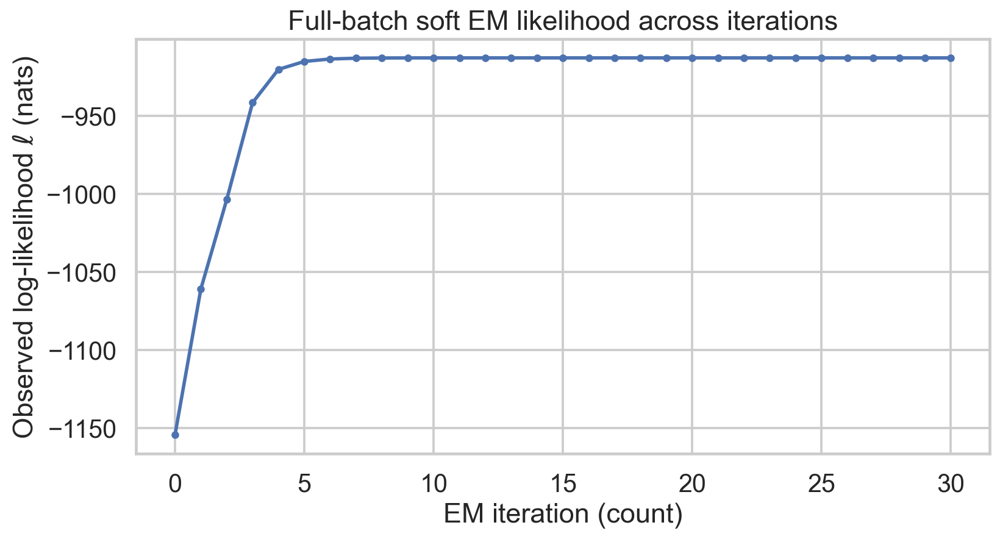
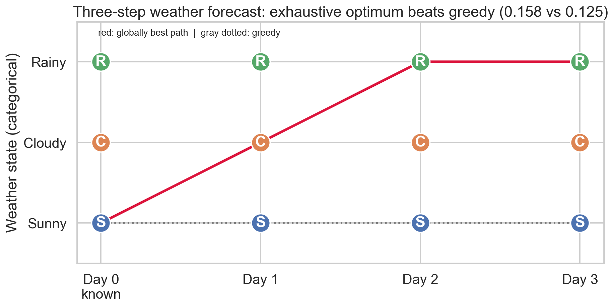
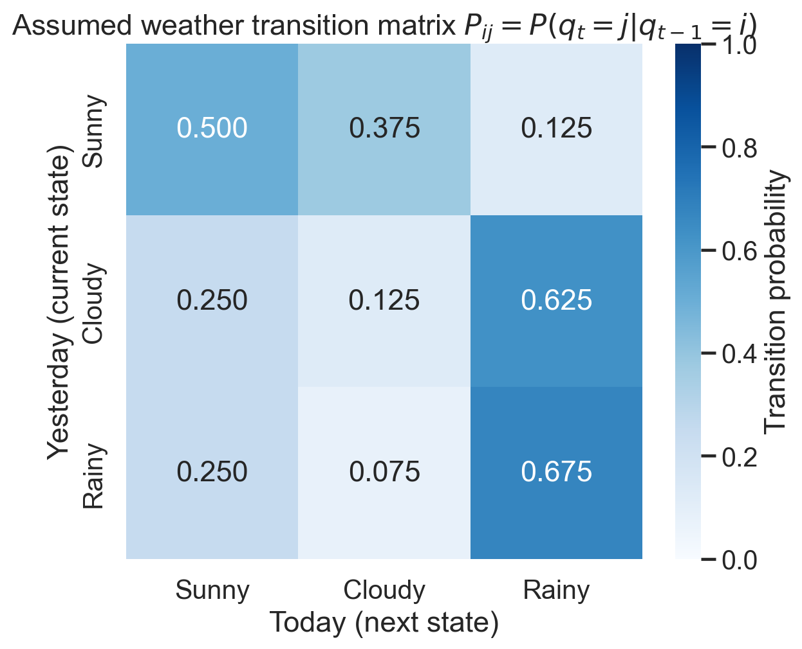

# Week 3: Gaussian Classification, Mixture Models, and Markov Prediction

**Learn and revise for the exam:** [[week-3-exam-focused-notes|Week 3 beginner-friendly exam guide]] · [[exam-study-guide|Study route and priorities]]


**Authentic past papers:** [[week-3-exam-questions|Week 3 questions and worked answers]] · [[exam-question-index|Paper coverage and routing audit]]


**Navigation:** ← [[week 2/week-2-notes|Week 2 Notes]] · [[Knowledge-Map|Knowledge Map]] · [[source-catalog|Source Catalog]]

> **Scope:** This note follows the supplied Week 3 lecture list and the two retained GMM/HMM slide decks. It develops Gaussian classification and error analysis, bivariate Gaussian geometry, Gaussian mixture models (GMMs), maximum-likelihood estimation and EM, observed-state Markov chains, and dynamic programming for weather-sequence prediction. Week 2's MFCC feature vector is used only as a motivating input example; it is not retaught here. The Markov and Viterbi material is the fully observed state-chain setting in the slides. No emission model or hidden-state inference is assumed.

## Abstract

Week 3 extends the single-Gaussian likelihood model into class decisions, correlated vector observations, flexible mixture densities, and time-ordered state sequences. A class-conditional Gaussian becomes a classifier only after priors and a decision rule are specified; its error must be separated into false positives and false negatives, then summarized with an explicitly defined denominator. A bivariate Gaussian uses a covariance matrix whose off-diagonal terms encode linear association and whose quadratic form defines tilted elliptical contours. A GMM combines normalized component densities, with latent component indicators making direct maximum-likelihood fitting a coupled nonlinear problem; expectation-maximization (EM) alternates posterior responsibility calculation with weighted parameter updates. For sequences, the Markov assumption factors a path probability into one-step transitions, and Viterbi dynamic programming finds the maximum-probability observed-state path without enumerating all paths. Worked arithmetic, solved checks, and a reproducible lab connect each equation to its interpretation while distinguishing classroom hard allocation from standard soft EM.

## How to use this note

The route is cumulative: (1) compare class likelihoods and define error, (2) replace one scalar feature by a correlated pair, (3) replace one Gaussian by a weighted sum, (4) fit hidden mixture assignments with EM, and (5) use transition probabilities to evaluate or optimize a sequence. In every example, write down what is observed, what is unknown, and what probability is being computed before substituting numbers. A density value is not itself a point probability, a locally best next state is not necessarily a globally best path, and the most probable path is not the same as the sequence's marginal forecast.

**Prerequisite bridge.** Week 2 established the univariate Gaussian and multivariate density, maximum-likelihood estimates, and likelihood comparison. It also introduced frame-wise MFCC vectors. Here an MFCC frame is simply an example of a feature vector that could be scored by a class model or density; no new feature-extraction method is needed.

### Prerequisite self-check — with answers

1. **What do $\sigma$ and $\sigma^2$ measure?** Standard deviation and variance. If $\sigma=2$, insert variance $4$ into $\mathcal N(x;\mu,\sigma^2)$; confusing them changes both normalization and exponent.
2. **Can a density exceed one?** Yes. A probability is an integral of density over a region; a density value is not itself a probability mass.
3. **What is a weighted mean?** $\sum_i r_ix_i/\sum_i r_i$. The denominator is total weight, not necessarily the number of observations. This is the core operation in the EM M-step.
4. **Does zero covariance always mean independence?** No. The implication holds for jointly Gaussian coordinates; arbitrary variables can be dependent but uncorrelated.
5. **What does $P(R\mid C)$ condition on?** The current cloudy state. With previous-state rows and next-state columns, read row $C$, column $R$.

### Lecture and source map

| Lecture heading in supplied scope | What to learn here | Main source |
|:--|:--|:--|
| 3.1 Gaussian Model for Binary Classification and Error Analysis | Class-conditional density, priors, decision regions, confusion counts and class-specific error | Mar 2026 deck, physical pp. 2–15 |
| 3.2 Introduction to Bivariate Gaussian | Vector mean, covariance, correlation, density contours | Mar 2026 deck, pp. 16–24 |
| 3.3 Mixture of Gaussians Introduction | Why a single bell curve fails for multimodal data; component weights | Mar 2026 deck, pp. 25–30 |
| 3.4 Mixture of Gaussians | Latent component labels, hard allocation, soft assignment and GMM likelihood | Mar 2026 deck, pp. 28–36 |
| 3.5 Parameter Estimation of GMM | Responsibilities, weighted sufficient statistics, EM derivation and update | Final deck, pp. 25–54; Mar 2026 deck, pp. 30–36 |
| 3.6 Markov Model | State, transition matrix, first-order factorization, observed sequence likelihood | Mar 2026 deck, pp. 47–54; final deck, pp. 65–72 |
| 3.7 Predicting weather sequence | Greedy versus global path, Viterbi recurrence, traceback | Mar 2026 deck, pp. 55–75; final deck, pp. 73–89 |

The later HMM slides in the source decks are outside this note's stated scope: the weather states here are observed, and there are no observation-emission probabilities.

### Assessment labels supplied with the curriculum

`AQ3.1`, `AQ3.2`, `AQ3.3`, `AQ3.4`, `AQ3.5`, `AQ3.6`, `AQ3.7`, `AQ3.7b Activity Questions8`, and `Practice Assignment3` are listed as not graded; `Graded Assignment3` is listed without question text. Those labels do not reveal question content. The problems below are original study exercises with worked solutions, not transcriptions or claimed solutions to the authentic assignment.

## 1. Gaussian model for binary classification and error analysis

### 1.1 From a fitted curve to a decision

Suppose each observation is a scalar feature $x$ and its class $C$ is either $C_0$ or $C_1$. A generative classifier fits a conditional density to each labeled training subset:

$$p(x\mid C_k)=\mathcal{N}(x;\mu_k,\sigma_k^2),\qquad k\in\{0,1\}.$$

For observations $x_{k,1},\ldots,x_{k,N_k}$ belonging to class $C_k$, the Gaussian maximum-likelihood estimates are

$$\hat\mu_k=\frac{1}{N_k}\sum_{i=1}^{N_k}x_{k,i},\qquad
\hat\sigma_k^2=\frac{1}{N_k}\sum_{i=1}^{N_k}(x_{k,i}-\hat\mu_k)^2.$$

The divisor is $N_k$ for maximum likelihood. The familiar unbiased sample variance uses $N_k-1$; it is a different estimator. For a new feature value, comparing just $p(x\mid C_k)$ is a maximum-likelihood decision. A Bayes/MAP classifier instead compares the joint scores $p(x\mid C_k)P(C_k)$, and a minimum-risk classifier additionally incorporates the cost of each kind of mistake.

Let $C_1$ be the declared positive class. Under equal error costs, decide $C_1$ when

$$p(x\mid C_1)P(C_1)>p(x\mid C_0)P(C_0).$$

With unequal costs, choose the action with lower conditional expected loss. For two classes and zero loss on correct decisions, choose $C_1$ if

$$\frac{p(x\mid C_1)}{p(x\mid C_0)}>\frac{P(C_0)}{P(C_1)}\,\frac{L(C_1\mid C_0)}{L(C_0\mid C_1)},$$

where $L(a\mid C)$ denotes the loss of taking action $a$ when the true class is $C$. This threshold makes explicit why priors and the consequences of errors matter.

**Equal-variance case.** If both classes have common variance $\sigma^2$, taking log scores yields a linear threshold. For $\mu_0<\mu_1$,

$$x^*=\frac{\mu_0+\mu_1}{2}+\frac{\sigma^2}{\mu_1-\mu_0}\ln\frac{P(C_0)}{P(C_1)}$$

under equal costs. Equal priors put the threshold at the midpoint. If variances differ, the log-score difference is quadratic in $x$ and may have two crossing points; there is no universal rule that one class always occupies one tail. A Gaussian density can also overlap another class substantially even when both fitted curves look plausible.

**Worked example.** Let $x\mid C_0\sim\mathcal{N}(0,1)$ and $x\mid C_1\sim\mathcal{N}(2,1)$, with equal priors and equal error costs. Equality of the two log densities gives $x^*=1$. At $x=0.8$, $p(x\mid C_0)>p(x\mid C_1)$ and the decision is $C_0$; at $x=1.4$, the decision is $C_1$. Under this model the conditional error rate in either class is $P(Z>1)=\Phi(-1)\approx0.1587$, so the equal-prior total error is also approximately $15.87\%$.



**Figure 1.** *Equal-prior $\mathcal{N}(0,1)$ and $\mathcal{N}(2,1)$ class densities, their decision threshold at $x=1$, and the two shaded false-classification tails. Their integrated probability is the Bayes error $0.158655$ for this specified model.*

### 1.2 Error names and denominators

With $C_1$ positive, a false positive is a true $C_0$ predicted as $C_1$; a false negative is a true $C_1$ predicted as $C_0$. These are not interchangeable. A confusion matrix records actual classes in rows and predicted classes in columns (state this convention every time). Overall misclassification rate is $(FP+FN)/N$ for a binary test set, but it can hide poor performance on a rare class. Class-conditional rates include

$$\mathrm{FPR}=\frac{FP}{FP+TN},\qquad \mathrm{FNR}=\frac{FN}{FN+TP},\qquad
\mathrm{accuracy}=\frac{TP+TN}{N}.$$

For general decision regions $\mathcal R_1$ (predict positive) and $\mathcal R_0$ (predict negative), the model-based conditional errors are

$$\mathrm{FPR}=\int_{\mathcal R_1}p(x\mid C_0)\,dx,\qquad \mathrm{FNR}=\int_{\mathcal R_0}p(x\mid C_1)\,dx,$$

$$P(\text{error})=P(C_0)\,\mathrm{FPR}+P(C_1)\,\mathrm{FNR}.$$

When the specified rule predicts $C_1$ for $x>\tau$, these become $\int_\tau^\infty p(x\mid C_0)\,dx$ and $\int_{-\infty}^\tau p(x\mid C_1)\,dx$. Unequal-variance decisions can instead require unions of intervals, so tail bounds follow the **decision region**, not an unconditional memorized rule. For the equal-prior example, the unweighted overlap integral $\int\min(p_0,p_1)\,dx$ is twice the total Bayes error; Figure 1 shades the prior-weighted contributions.

If 100 test cases contain 40 positive and 60 negative examples, and the classifier yields $TP=32$, $FN=8$, $TN=45$, $FP=15$, then the total error is $23/100=0.23$, sensitivity is $32/40=0.80$, and specificity is $45/60=0.75$. Always identify the positive class before interpreting the rates. The lecture's height-based example is an illustration of the generative method; the worked examples here instead use generic classes and explicitly specified synthetic distributions.

### Check 1 — solved

**Question.** A test contains 100 items: 10 false negatives and 15 false positives, with all others correct. Find the error rate. If the positive class has 20 actual items, find FNR.

**Solution.** There are $10+15=25$ errors, so overall error is $25/100=0.25$. The actual positive count is $TP+FN=20$, hence $TP=10$ and $\mathrm{FNR}=10/20=0.50$. The overall error alone would conceal that half of the positive items were missed.

## 2. Bivariate Gaussian: two features and their geometry

### 2.1 Build the covariance matrix from observations

For a feature vector $\mathbf{x}=[x_1,x_2]^T$, a bivariate Gaussian has a mean vector $\boldsymbol\mu$ and symmetric positive-definite covariance matrix $\Sigma$:

$$\boldsymbol\mu=\begin{bmatrix}\mu_1\\\mu_2\end{bmatrix},\qquad
\Sigma=\begin{bmatrix}\sigma_1^2&\sigma_{12}\\\sigma_{12}&\sigma_2^2\end{bmatrix},
\qquad \sigma_{12}=\operatorname{Cov}(X_1,X_2).$$

The density in $d$ dimensions is

$$p(\mathbf{x})=\frac{1}{(2\pi)^{d/2}|\Sigma|^{1/2}}
\exp\!\left[-\frac12(\mathbf{x}-\boldsymbol\mu)^T\Sigma^{-1}(\mathbf{x}-\boldsymbol\mu)\right].$$

For $d=2$, its surface lives over a two-dimensional feature plane; equal-density contours are generally ellipses. The covariance determines ellipse size, orientation, and eccentricity. The correlation coefficient

$$\rho=\frac{\sigma_{12}}{\sigma_1\sigma_2},\qquad -1\leq\rho\leq1,$$

is dimensionless and describes linear association. A nondegenerate bivariate Gaussian requires $|\rho|<1$; $|\rho|=1$ makes the covariance singular. Gaussian marginals alone do not establish a jointly Gaussian distribution. Positive correlation tilts contours toward the upper-right; negative correlation tilts them toward the upper-left. If covariance is zero, the bivariate Gaussian factorizes into two independent univariate Gaussians. For arbitrary distributions, zero covariance alone does not imply independence.

Given $N$ labeled vector observations $\mathbf{x}_i$, the Gaussian MLE is

$$\hat{\boldsymbol\mu}=\frac1N\sum_i\mathbf{x}_i,\qquad
\hat\Sigma=\frac1N\sum_i(\mathbf{x}_i-\hat{\boldsymbol\mu})(\mathbf{x}_i-\hat{\boldsymbol\mu})^T.$$

The off-diagonal entries preserve co-variation. For class comparison, evaluate the full density or its log form, including the determinant term: a covariance with larger spread has a lower peak, and dropping $|\Sigma|$ changes comparisons across models. In Week 2's context, one could use a pair of features such as two MFCC coefficients, but the Gaussian assumptions and the feature's scaling still require scrutiny.

**Worked covariance.** For points $(1,2),(2,4),(3,6)$, the mean is $(2,4)$. The centered vectors are $(-1,-2),(0,0),(1,2)$. Dividing their outer-product sum by 3 gives

$$\hat\Sigma=\begin{bmatrix}2/3&4/3\\4/3&8/3\end{bmatrix}.$$

This particular covariance is singular because every point lies exactly on $x_2=2x_1$. A proper two-dimensional Gaussian density requires positive-definite covariance, so this finite toy sample does not support a nonsingular full-rank density without regularization or additional data. This is a useful reminder that a formula for an estimate does not guarantee it is numerically usable.



**Figure 2.** *Contours of a positive-definite bivariate Gaussian with covariance $[[1,0.65],[0.65,1.5]]$. The positive off-diagonal covariance tilts the ellipses; contours are constant Mahalanobis-distance levels.*

### Check 2 — solved

**Question.** If two features have variances 4 and 9 and covariance 3, find $\rho$. What does the positive sign indicate?

**Solution.** The standard deviations are 2 and 3, so $\rho=3/(2\cdot3)=0.5$. The positive covariance indicates a moderate positive linear association: above-mean values of one feature tend to accompany above-mean values of the other. It does not establish causality.

## 3. Mixtures of Gaussians: model multiple modes

### 3.1 A weighted density, not a set of labels

A single Gaussian has one mode and symmetric tails. A histogram with multiple peaks or a heavy-tailed shape may therefore be poorly represented by one component, even if its fitted mean and variance are correct as global summaries. A $K$-component Gaussian mixture is

$$p(\mathbf{x}\mid\Theta)=\sum_{k=1}^{K}\pi_k\,\mathcal{N}(\mathbf{x};\boldsymbol\mu_k,\Sigma_k),
\qquad \pi_k\geq0,\quad\sum_{k=1}^{K}\pi_k=1.$$

The mixing weight $\pi_k$ is the prior probability of choosing component $k$ in the generative story. The component then generates a value from its Gaussian. Thus the marginal density is a weighted sum, not a product; every observation's density is obtained by summing the component contributions. Parameters are $\Theta=\{\pi_k,\boldsymbol\mu_k,\Sigma_k\}_{k=1}^K$. In one dimension, each $\Sigma_k$ is simply a positive variance.

The latent assignment variable $Z_i$ records which component generated observation $\mathbf{x}_i$. It is unobserved in the ordinary unsupervised fitting problem. If assignments were known, each component could be fitted from its assigned observations and the weight estimated by its relative count. Unknown assignments couple the component parameters to the data allocation.

**Do not confuse these uses:** A mixture component is a density component, not inherently a real-world category. Components can overlap, split one semantic class, or represent local shape. Component indices have no intrinsic ordering, so swapping all labels and their parameters leaves the same model (label symmetry). A GMM is not automatically a classifier; classification additionally needs class labels or a decision interpretation.

### 3.2 Density calculation by hand

Consider the univariate mixture

$$p(x)=0.6\,\mathcal{N}(x;1,1)+0.4\,\mathcal{N}(x;3,1).$$

At $x=2$, both components are one standard deviation from their means, so each density is $\phi(1)=e^{-1/2}/\sqrt{2\pi}\approx0.24197$. The mixture density is $0.6(0.24197)+0.4(0.24197)=0.24197$. The posterior responsibility of component 1 is

$$r_1(2)=\frac{0.6\,\mathcal{N}(2;1,1)}{p(2)}=0.6,$$

and component 2's is $0.4$. Although the likelihood contributions match, the posterior membership reflects the prior weights. A density is probability per unit $x$; probabilities require integrating over intervals.



**Figure 3.** *The total mixture density is the sum of weighted component densities for weights $0.6,0.4$ and unit variances centered at 1 and 3. The components overlap; the mixture does not assign each point to only one curve.*

### Check 3 — solved

**Question.** At a point where component densities are $0.2$ and $0.5$, with mixture weights $0.75$ and $0.25$, calculate total density and the responsibility of component 2.

**Solution.** The total is $0.75(0.2)+0.25(0.5)=0.275$. Component 2 contributes $0.125$, hence $r_2=0.125/0.275=5/11\approx0.4545$. The responsibility is not just the component density normalized; the prior weight must be applied first.

## 4. GMM parameter estimation: hard allocation and soft EM

### 4.1 Why direct maximization is difficult

For independent observations $\mathbf{x}_1,\ldots,\mathbf{x}_N$, the observed-data log-likelihood is

$$\ell(\Theta)=\sum_{i=1}^{N}\log\left[\sum_{k=1}^{K}\pi_k\mathcal{N}(\mathbf{x}_i;\boldsymbol\mu_k,\Sigma_k)\right].$$

The inner sum is inside the logarithm, so parameters do not separate into independent Gaussian MLE problems. If the assignments $Z_i$ were observed, the complete-data log-likelihood would separate into component-wise terms. EM uses the current model to estimate a distribution over the missing assignments, then maximizes the expected complete-data log-likelihood under that distribution.

### 4.2 Hard allocation is a different approximation

Given current parameters, posterior responsibilities are

$$r_{ik}=P(Z_i=k\mid\mathbf{x}_i,\Theta^{old})=
\frac{\pi_k^{old}\mathcal{N}(\mathbf{x}_i;\boldsymbol\mu_k^{old},\Sigma_k^{old})}
{\sum_j\pi_j^{old}\mathcal{N}(\mathbf{x}_i;\boldsymbol\mu_j^{old},\Sigma_j^{old})}.$$

The slide deck first describes a **hard allocation** variant: choose $\hat z_i=\arg\max_k r_{ik}$, assign each sample to one component, and refit from those groups. This resembles hard clustering and discards uncertainty. The standard soft EM algorithm keeps every responsibility and weights each observation fractionally. They share the same latent-label intuition, but are not interchangeable algorithms.

### 4.3 Derive the soft M-step

At iteration $t$, the E-step computes $r_{ik}$ using $\Theta^{(t)}$. Define the effective membership count

$$N_k=\sum_{i=1}^N r_{ik}.$$

Ignoring the constant term independent of parameters, that expected complete-data objective is

$$Q(\Theta\mid\Theta^{(t)})=\sum_{i,k}r_{ik}\left[\ln\pi_k-\frac12\ln|\Sigma_k|-\frac12(\mathbf{x}_i-\boldsymbol\mu_k)^T\Sigma_k^{-1}(\mathbf{x}_i-\boldsymbol\mu_k)\right].$$

The responsibilities are held fixed while differentiating in the M-step. The M-step maximizes the responsibility-weighted complete-data objective subject to $\sum_k\pi_k=1$. A Lagrange multiplier gives $\pi_k^{(t+1)}=N_k/N$. Differentiating with respect to the means and setting the result to zero gives the weighted average. Differentiating with respect to covariance yields the weighted centered outer-product matrix:

$$\boldsymbol\mu_k^{(t+1)}=\frac{\sum_i r_{ik}\mathbf{x}_i}{N_k},\qquad
\Sigma_k^{(t+1)}=\frac{\sum_i r_{ik}(\mathbf{x}_i-\boldsymbol\mu_k^{(t+1)})(\mathbf{x}_i-\boldsymbol\mu_k^{(t+1)})^T}{N_k}.$$

In the univariate case, replace the outer product by a squared deviation. Then recompute responsibilities under the updated parameters and iterate. These are maximum-likelihood rather than unbiased covariance estimates because they follow the weighted likelihood objective.

**Why EM ascends.** The E-step forms the posterior distribution over latent assignments under the current parameter estimate. The M-step maximizes the expectation of the complete-data log likelihood under that posterior. This coordinate-ascent construction guarantees non-decrease of the observed-data likelihood in exact arithmetic when each M-step is solved exactly and the standard regularity conditions hold. It does **not** guarantee a global maximum: initialization can lead to different local stationary points, and a singular covariance can make likelihood unbounded.

### 4.4 One fully worked EM update

Take scalar observations $x=(0,2,4)$, two components with initial unit variances, equal weights, and means $\mu_1=0$, $\mu_2=4$. Define $a=1/(1+e^{-8})\approx0.99966465$. The Gaussian normalization factors cancel in each responsibility, giving

$$R=\begin{bmatrix}a&1-a\\1/2&1/2\\1-a&a\end{bmatrix}.$$

For $x=0$, component 1 is nearly certain; for the midpoint $x=2$, each component receives half the observation; for $x=4$, the endpoint responsibilities reverse. Symmetry gives **exactly** $N_1=N_2=1.5$ and updated weights $(0.5,0.5)$, not merely approximately equal weights.

The first updated mean is

$$\mu_1'=\frac{0a+2(1/2)+4(1-a)}{1.5}\approx0.66756093,$$

and symmetry gives $\mu_2'=4-\mu_1'\approx3.33243907$. The variance update uses the **new** mean:

$$\sigma_1'^2=\frac{a(0-\mu_1')^2+(1/2)(2-\mu_1')^2+(1-a)(4-\mu_1')^2}{1.5}\approx0.89127280,$$

with $\sigma_2'^2=\sigma_1'^2$. The executable verifies this complete update. In hard allocation the midpoint would need a single tie-breaking assignment; soft EM preserves its shared responsibility.

**Numerical caution.** In unconstrained full-covariance GMMs, a component can collapse around one point while its covariance determinant approaches zero, driving the density and likelihood arbitrarily high. Implementations often constrain covariance eigenvalues with a floor or add a diagonal regularizer $\epsilon I$, but the floor is a modeling/numerical choice, not part of the unconstrained MLE formula. Try multiple initializations and compare final observed-data log-likelihoods; selecting $K$ itself is a model-selection decision, not solved by EM.



**Figure 4.** *A deterministic sample's observations sorted by feature value, colored by final posterior responsibility for component 2. Responsibilities vary continuously through overlap; dashed horizontal lines mark fitted component means.*



**Figure 5.** *Histogram of the seeded synthetic sample with the two-component soft-EM mixture after 30 updates and its weighted component curves. This illustrates fit mechanics on generated data, not a validated speech distribution.*



**Figure 6.** *The observed-data log likelihood rises from $-1154.540495$ to $-912.934508$ for this initialization. The minimum increment is about $-1.14\times10^{-13}$, floating-point roundoff consistent with non-decrease; this trace is not a proof of global optimality.*

### 4.5 Initialization by vector quantization: K-means and LBG

The slides introduce vector quantization as a way to represent many feature vectors by a smaller codebook. A codebook of $K$ centroids partitions feature space by nearest Euclidean centroid. Lloyd's K-means iteration alternates hard assignment

$$z_i=\arg\min_k\|\mathbf{x}_i-\mathbf{c}_k\|_2^2$$

with centroid recomputation $\mathbf{c}_k=|C_k|^{-1}\sum_{i:z_i=k}\mathbf{x}_i$. This decreases the within-cluster squared distortion for fixed $K$, but it is a hard partition, depends on initialization, and can converge to local minima. A Gaussian mixture instead uses a probability density and soft posterior weights; K-means is not a probabilistic GMM fit.

The Linde–Buzo–Gray (LBG) codebook-splitting procedure starts with a centroid, creates two nearby copies $\mathbf{c}-\boldsymbol{\delta}$ and $\mathbf{c}+\boldsymbol{\delta}$, then refines the codebook with clustering. Repeating split and refinement grows the codebook size progressively. The perturbation $\boldsymbol{\delta}$ is a small chosen offset; the slide does not specify a universal multiplicative formula. K-means/LBG are therefore useful conceptual initializers for vector clustering, but an implementation still needs an explicit strategy to initialize GMM covariances and weights.

### Check 4 — solved

**Question.** Three samples have responsibilities for a component $r=(0.8,0.5,0.2)$ and values $x=(1,3,5)$. Find $N_k$, updated mean, and updated mixture weight for a two-component model.

**Solution.** $N_k=0.8+0.5+0.2=1.5$. The weighted numerator is $0.8(1)+0.5(3)+0.2(5)=3.3$, so the mean becomes $3.3/1.5=2.2$. With $N=3$, its weight is $1.5/3=0.5$.

## 5. Markov model for observed sequences

### 5.1 First-order factorization

A time-homogeneous first-order Markov chain over states $S_1,\ldots,S_M$ assumes that the next state's distribution depends on the current state, not the full earlier history:

$$P(q_t\mid q_{t-1},q_{t-2},\ldots,q_1)=P(q_t\mid q_{t-1}).$$

The transition matrix $A$ has entry $a_{ij}=P(q_t=S_j\mid q_{t-1}=S_i)$. Here **rows are the previous state and columns are the next state**, so each row sums to one. Given a known initial state $q_0$, a path probability is

$$P(q_1,\ldots,q_T\mid q_0)=\prod_{t=1}^{T}a_{q_{t-1},q_t}.$$

If the start is random with distribution $\pi$, the consistently indexed joint probability is $P(q_0,\ldots,q_T)=\pi_{q_0}\prod_{t=1}^T a_{q_{t-1},q_t}$. A zero transition makes any path containing it have probability zero. For long sequences, products underflow in floating-point arithmetic; the equivalent log-likelihood is a sum of $\log a_{ij}$.

### 5.2 The lecture's observed weather sequence

The slide training sequence is

$$S,C,R,R,C,S,S,R,S,C,C,R,S,$$

where $S$ = sunny, $C$ = cloudy, and $R$ = rainy. There are 12 adjacent transitions. From cloudy, the observed successors are sunny once, cloudy once, and rainy twice, so the empirical row is

$$\hat P(\cdot\mid C)=(1/4,1/4,1/2),\quad\text{in column order }(S,C,R).$$

Similarly, the sequence's transition counts give the row-normalized matrix

$$\hat A_{counts}=\begin{bmatrix}
1/4&1/2&1/4\\
1/4&1/4&1/2\\
1/2&1/4&1/4
\end{bmatrix},$$

with rows and columns ordered $(S,C,R)$. This is the count-estimated model for the displayed training sequence. It must not be conflated with the separate forecasting matrix used in the lecture's next-days example below.

For the count matrix, the conditional probability of observing $S,S,C,R,C$ given that the preceding day was cloudy is

$$P(S,S,C,R,C\mid q_0=C)=\hat a_{CS}\hat a_{SS}\hat a_{SC}\hat a_{CR}\hat a_{RC}
=\frac14\cdot\frac14\cdot\frac12\cdot\frac12\cdot\frac14=\frac1{256}\approx0.00390625.$$

**Why not divide sunny transitions by all sunny labels?** The displayed training sequence ends in sunny, which has no observed successor. The maximum-likelihood row estimate divides each transition count by the number of outgoing transitions from that state; here each state has four observed outgoing transitions. Counting the final sunny label as a transition would invent an unobserved next-day outcome.

### Check 5 — solved

**Question.** If $P(S\mid C)=0.25$, $P(S\mid S)=0.5$, $P(C\mid S)=0.375$, $P(R\mid C)=0.625$, and $P(C\mid R)=0.075$, find the probability of the next sequence $S,S,C,R,C$ given the preceding state $C$.

**Solution.** Multiply the five transitions in order: $0.25\times0.5\times0.375\times0.625\times0.075=0.002197265625$. The order matters because each term conditions on the immediately preceding state.

## 6. Forecasting paths with Viterbi dynamic programming

### 6.1 Forecast matrix and why greedy can fail

For the 3-day forecast and Viterbi slides, the separately specified matrix is

$$A_{forecast}=\begin{array}{c|ccc}
&S&C&R\\\hline
S&0.5&0.375&0.125\\
C&0.25&0.125&0.625\\
R&0.25&0.075&0.675
\end{array}.$$

Each row conditions on yesterday; each column denotes today. Given Day 0 = Sunny, a greedy step picks Sunny on Day 1 because $0.5$ is the largest entry in row $S$, then repeats and predicts $S,S,S$. But the globally most probable 3-day sequence is $C,R,R$ with probability

$$P(C,R,R\mid q_0=S)=0.375\cdot0.625\cdot0.675=0.158203125,$$

which is larger than the greedy path probability $0.5^3=0.125$. A sequence of $T$ future states from $M$ possibilities has $M^T$ paths; here $3^3=27$. Exhaustive search scales exponentially with the horizon.

### 6.2 Recurrence, predecessor pointers, and traceback

Define $\delta_t(j)$ as the probability of the most probable path that ends in state $j$ at time $t$. With a known previous state $q_0$, initialize

$$\delta_1(j)=a_{q_0j},$$

then update

$$\delta_t(j)=\max_i\left[\delta_{t-1}(i)a_{ij}\right],\qquad
\psi_t(j)=\arg\max_i\left[\delta_{t-1}(i)a_{ij}\right].$$

The $\psi_t(j)$ pointer remembers which prior state achieved the maximum. At the final time, take $q_T^*=\arg\max_j\delta_T(j)$ and follow the stored pointers backward. This is exact dynamic programming for the maximum-product path: it reuses the best prefix ending at each state because every continuation from that state shares the same future transition factors. Complexity is $O(TM^2)$ for a dense transition matrix, instead of $O(M^T)$ path enumeration.

For the matrix above with $q_0=S$, the first-day scores are $(0.5,0.375,0.125)$. At Day 2:

| Day 2 state | Candidate predecessor scores | Best score |
|:--|:--|--:|
| $S$ | $0.5(0.5)=0.25$, $0.375(0.25)=0.09375$, $0.125(0.25)=0.03125$ | 0.25 via $S$ |
| $C$ | $0.5(0.375)=0.1875$, $0.375(0.125)=0.046875$, $0.125(0.075)=0.009375$ | 0.1875 via $S$ |
| $R$ | $0.5(0.125)=0.0625$, $0.375(0.625)=0.234375$, $0.125(0.675)=0.084375$ | 0.234375 via $C$ |

At Day 3, the best-ending scores are $\delta_3(S)=0.125$, $\delta_3(C)=0.09375$, and $\delta_3(R)=0.158203125$. The final state is rainy; its predecessor pointer is rainy, whose predecessor pointer is cloudy. Traceback therefore returns $C,R,R$.

**Matrix powers answer a different question.** If the initial state is known, the row vector after $h$ transitions is $e_{q_0}A^h$ and gives the marginal distribution of the state on day $h$. It does not return the most probable *joint path*. Viterbi maximizes over whole paths; repeated one-step argmax is greedy; matrix multiplication sums over paths. These are distinct calculations.



**Figure 7.** *For the assumed transition matrix and a Sunny start, dotted greedy prediction gives $S,S,S$ with probability $0.125$, while Viterbi identifies $C,R,R$ with probability $0.158203$. All 27 paths were enumerated as a check.*



**Figure 8.** *The lecture-assumed forecast matrix is shown with rows as previous states and columns as next states. It differs from the count-estimated matrix in §5.2; the shared entry $P(S\mid C)=0.25$ does not make the full matrices identical.*

**Tie rule.** If several predecessors have exactly the same maximum score, they are tied MAP paths. A deterministic implementation should document its tie-breaking convention (for example, smallest state index) and preserve all ties if all optimal paths are required. Rounded display values can create apparent ties that are absent in full precision.

### Check 6 — solved

**Question.** From a known starting state, two paths have transition products $0.4\cdot0.4\cdot0.4$ and $0.7\cdot0.2\cdot0.8$. Which is more probable?

**Solution.** The first is $0.064$; the second is $0.112$. The second path is globally more probable even though its second transition is smaller. Choosing each locally largest edge independently is not a valid general optimization strategy.

## 7. Worked lab: one pipeline from class density to sequence path

The companion script [week3_lab.py](../week3_lab.py) contains deterministic calculations for a binary Gaussian decision, a positive-definite bivariate covariance, fixed-mixture responsibilities, seeded soft EM, count-estimated weather transitions, sequence likelihoods, marginal forecasts, and Viterbi traceback. The synthetic examples make the arithmetic auditable; they do not measure a speech corpus or establish real-world classifier performance. The script uses only NumPy and the Python standard library and runs from the track root with `uv run python week3_lab.py`.

**Concept.** Keep densities, responsibilities, transition products, and path maxima as separate quantities. The same elementary operations—normalization, weighted sums, and maximization—play different probabilistic roles in the models.

**Code.** The standalone implementation is reproduced below and saved as [week3_lab.py](../week3_lab.py). It asserts positive definiteness, normalized responsibilities and weights, non-decreasing likelihood within roundoff, and agreement between exhaustive search and max-product dynamic programming. Direct density evaluation suffices for this small well-scaled example; production mixtures typically evaluate responsibilities using log-sum-exp to avoid numerical underflow.

```python
"""Deterministic Week 3 probability, Gaussian-mixture, and Markov-chain lab."""
from itertools import product
import math
import numpy as np


def normal_pdf(x, mean, variance):
    return np.exp(-0.5 * (x - mean) ** 2 / variance) / np.sqrt(2 * np.pi * variance)


def gaussian_em(x, iterations=30):
    """Two-component univariate full-batch soft EM with variance floor."""
    weights = np.array([0.5, 0.5])
    means = np.quantile(x, [0.25, 0.75])
    variances = np.full(2, np.var(x))
    history = []
    responsibilities = None
    for _ in range(iterations + 1):
        densities = np.column_stack([
            weights[k] * normal_pdf(x, means[k], variances[k]) for k in range(2)
        ])
        totals = np.maximum(densities.sum(axis=1), np.finfo(float).tiny)
        responsibilities = densities / totals[:, None]
        history.append(float(np.log(totals).sum()))
        if len(history) > iterations:
            break
        nk = responsibilities.sum(axis=0)
        weights = nk / len(x)
        means = (responsibilities * x[:, None]).sum(axis=0) / nk
        variances = (responsibilities * (x[:, None] - means) ** 2).sum(axis=0) / nk
        variances = np.maximum(variances, 1e-6)
    order = np.argsort(means)
    return weights[order], means[order], variances[order], np.asarray(history), responsibilities[:, order]


def main():
    # Equal-prior Bayes decision for N(0,1) and N(2,1): crossing at x=1.
    error = 0.5 * math.erfc(1 / math.sqrt(2))
    print(f"Equal-prior threshold: x=1.000; Bayes error={error:.6f}")

    # Positive-definite bivariate Gaussian; covariance .65 implies rho=.65/sqrt(1.5).
    covariance = np.array([[1.0, 0.65], [0.65, 1.5]])
    eigenvalues = np.linalg.eigvalsh(covariance)
    assert np.all(eigenvalues > 0), "Covariance must be positive definite"
    print(f"Bivariate covariance eigenvalues: {np.array2string(eigenvalues, precision=6)}")

    # A two-component GMM density evaluated at a fixed acoustic feature x.
    x0 = 2.0
    terms = np.array([0.6 * normal_pdf(x0, 1.0, 1.0), 0.4 * normal_pdf(x0, 3.0, 1.0)])
    print(f"Fixed GMM at x=2.0: weighted component densities={np.array2string(terms, precision=6)}; mixture={terms.sum():.6f}")
    print(f"Fixed GMM posterior responsibilities: {np.array2string(terms / terms.sum(), precision=6)}")

    # One exact soft-EM update for the symmetric worked example in the note.
    toy = np.array([0., 2., 4.])
    joint = np.column_stack([0.5 * normal_pdf(toy, mean, 1.) for mean in (0., 4.)])
    toy_resp = joint / joint.sum(axis=1, keepdims=True)
    toy_nk = toy_resp.sum(axis=0)
    toy_mu = (toy_resp * toy[:, None]).sum(axis=0) / toy_nk
    toy_var = (toy_resp * (toy[:, None] - toy_mu) ** 2).sum(axis=0) / toy_nk
    assert np.allclose(toy_nk, [1.5, 1.5])
    print(f"One soft-EM update: effective counts={toy_nk}; weights={toy_nk/3}")
    print(f"One soft-EM update: means={np.array2string(toy_mu, precision=6)}; variances={np.array2string(toy_var, precision=6)}")

    # Seeded complete-data sample; soft EM estimates parameters from observations only.
    rng = np.random.default_rng(42)
    z = rng.choice(2, size=600, p=[0.58, 0.42])
    sample = rng.normal(np.where(z == 0, -1.25, 1.65), np.where(z == 0, 0.48, 0.72))
    weights, means, variances, ll, resp = gaussian_em(sample)
    assert np.all(np.diff(ll) >= -1e-10), "Observed-data log-likelihood should not decrease beyond roundoff"
    assert np.allclose(resp.sum(axis=1), 1.0, atol=1e-12), "Posterior responsibilities must normalize"
    assert np.all(weights > 0) and np.isclose(weights.sum(), 1), "Mixture weights must be positive and sum to one"
    print(f"Synthetic sample: N={sample.size}; generator seed=42; true weights=[0.58, 0.42]")
    print(f"Soft-EM estimates (ordered by mean): weights={np.array2string(weights, precision=4)}, means={np.array2string(means, precision=4)}, variances={np.array2string(variances, precision=4)}")
    print(f"Observed log-likelihood: start={ll[0]:.6f}; end={ll[-1]:.6f}; minimum increment={np.diff(ll).min():.3e}")
    print(f"Responsibility checks: row-sum max error={np.max(np.abs(resp.sum(axis=1)-1)):.2e}; effective counts={np.array2string(resp.sum(axis=0), precision=2)}")
    hard = np.bincount(resp.argmax(axis=1), minlength=2) / sample.size
    print(f"Hard-assignment fractions from final posterior: {np.array2string(hard, precision=4)}")

    # Slide's illustrative transition matrix is conditioned on yesterday's state.
    states = ("Sunny", "Cloudy", "Rainy")
    transition = np.array([[0.5, 0.375, 0.125], [0.25, 0.125, 0.625], [0.25, 0.075, 0.675]])
    observed = ("Sunny", "Cloudy", "Rainy", "Rainy", "Cloudy", "Sunny", "Sunny", "Rainy", "Sunny", "Cloudy", "Cloudy", "Rainy", "Sunny")
    index = {s: i for i, s in enumerate(states)}
    counts = np.zeros((3, 3), dtype=int)
    for a, b in zip(observed[:-1], observed[1:]):
        counts[index[a], index[b]] += 1
    empirical = counts / counts.sum(axis=1, keepdims=True)
    given = index["Cloudy"]
    path = ("Sunny", "Sunny", "Cloudy", "Rainy", "Cloudy")
    path_prob = 1.0
    prev = "Cloudy"
    for nxt in path:
        path_prob *= transition[index[prev], index[nxt]]
        prev = nxt
    print(f"Observed weather transitions (rows S,C,R): {counts.tolist()}")
    print(f"Count-estimated transition matrix (rows S,C,R): {np.array2string(empirical, precision=3)}")
    print(f"Assumed forecast transition matrix (rows S,C,R): {np.array2string(transition, precision=3)}")
    print(f"P(Sunny|Cloudy): count estimate={empirical[1,0]:.3f}; assumed forecast={transition[1,0]:.3f}; full matrices are distinct")
    print(f"P(next five states S,S,C,R,C | yesterday C)={path_prob:.8f}")
    forecast = np.eye(3)[index["Cloudy"]] @ np.linalg.matrix_power(transition, 3)
    print(f"Three-day marginal from Cloudy (S,C,R): {np.array2string(forecast, precision=6)}")
    sunny_forecast = np.eye(3)[index["Sunny"]] @ np.linalg.matrix_power(transition, 3)
    print(f"Three-day marginal from Sunny (S,C,R): {np.array2string(sunny_forecast, precision=6)}")

    start = index["Sunny"]
    paths = list(product(range(3), repeat=3))
    scored = [(float(np.prod([transition[a, b] for a, b in zip((start,) + p[:-1], p)])), p) for p in paths]
    best_prob, best_path = max(scored, key=lambda item: (item[0], tuple(-i for i in item[1])))
    greedy = []
    state = start
    for _ in range(3):
        state = int(np.argmax(transition[state]))
        greedy.append(state)
    greedy_prob = float(np.prod([transition[a, b] for a, b in zip((start,) + tuple(greedy[:-1]), greedy)]))
    print(f"Sunny-start greedy path: {' -> '.join(states[i] for i in greedy)}; probability={greedy_prob:.6f}")
    print(f"Sunny-start exhaustive best of {len(paths)} paths: {' -> '.join(states[i] for i in best_path)}; probability={best_prob:.6f}")
    # Max-product dynamic programming, with argmax backpointers.
    delta = np.eye(3)[start]
    back = []
    for _ in range(3):
        candidates = delta[:, None] * transition
        back.append(np.argmax(candidates, axis=0))
        delta = candidates.max(axis=0)
    final = int(np.argmax(delta))
    decoded = [final]
    for pointers in reversed(back):
        decoded.append(int(pointers[decoded[-1]]))
    decoded = tuple(reversed(decoded))[1:]
    print(f"Max-product DP path: {' -> '.join(states[i] for i in decoded)}; probability={float(delta.max()):.6f}; matches enumeration={decoded == best_path}")
    assert decoded == best_path and np.isclose(float(delta.max()), best_prob), "Max-product DP must match exhaustive path search"


if __name__ == "__main__":
    main()
```

**Output (verbatim from `uv run python week3_lab.py`):**

```text
Equal-prior threshold: x=1.000; Bayes error=0.158655
Bivariate covariance eigenvalues: [0.553581 1.946419]
Fixed GMM at x=2.0: weighted component densities=[0.145182 0.096788]; mixture=0.241971
Fixed GMM posterior responsibilities: [0.6 0.4]
One soft-EM update: effective counts=[1.5 1.5]; weights=[0.5 0.5]
One soft-EM update: means=[0.667561 3.332439]; variances=[0.891273 0.891273]
Synthetic sample: N=600; generator seed=42; true weights=[0.58, 0.42]
Soft-EM estimates (ordered by mean): weights=[0.5769 0.4231], means=[-1.2601  1.643 ], variances=[0.2363 0.5202]
Observed log-likelihood: start=-1154.540495; end=-912.934508; minimum increment=-1.137e-13
Responsibility checks: row-sum max error=2.22e-16; effective counts=[346.17 253.83]
Hard-assignment fractions from final posterior: [0.58 0.42]
Observed weather transitions (rows S,C,R): [[1, 2, 1], [1, 1, 2], [2, 1, 1]]
Count-estimated transition matrix (rows S,C,R): [[0.25 0.5  0.25]
 [0.25 0.25 0.5 ]
 [0.5  0.25 0.25]]
Assumed forecast transition matrix (rows S,C,R): [[0.5   0.375 0.125]
 [0.25  0.125 0.625]
 [0.25  0.075 0.675]]
P(Sunny|Cloudy): count estimate=0.250; assumed forecast=0.250; full matrices are distinct
P(next five states S,S,C,R,C | yesterday C)=0.00219727
Three-day marginal from Cloudy (S,C,R): [0.328125 0.176563 0.495313]
Three-day marginal from Sunny (S,C,R): [0.34375  0.199687 0.456562]
Sunny-start greedy path: Sunny -> Sunny -> Sunny; probability=0.125000
Sunny-start exhaustive best of 27 paths: Cloudy -> Rainy -> Rainy; probability=0.158203
Max-product DP path: Cloudy -> Rainy -> Rainy; probability=0.158203; matches enumeration=True
```

**Interpretation.** The classifier scores a single observation; the GMM assigns fractional component membership; the Markov chain scores an observed sequence; Viterbi retains the best prefix for each ending state. Agreement between a calculation and code is a check of implementation, not evidence that the model assumptions fit a particular speech dataset.

### Reproduce the laboratory and figures

From the `Speech Technology/` track root:

```bash
uv sync --frozen
uv run python week3_lab.py
uv run python generate_week3_plots.py
```

The exact lab output is saved in `week 3/week3_lab_output.txt`; `week 3/plot_sha256.txt` records the eight generated PNGs. The generator uses seeded data and was rerun to verify byte-identical figures and console output. These are synthetic verification experiments, not comparative accuracy measurements on real speech.

## 8. Common misconceptions and failure modes

| Tempting shortcut | Why it fails | Better check |
|:--|:--|:--|
| Compare Gaussian densities and ignore priors | The Bayes decision threshold depends on class priors and error costs | Write the posterior or risk comparison explicitly |
| Assume every Gaussian comparison has one midpoint threshold | Unequal variances can yield two decision boundaries | Solve the quadratic log-likelihood ratio and inspect regions |
| Call an error rate meaningful without specifying the positive class | False-positive and false-negative labels depend on that choice | Declare class and confusion-matrix orientation |
| Treat covariance zero as independence for all data | That implication holds for jointly Gaussian vectors, not arbitrary distributions | State the Gaussian assumption |
| Treat mixture components as known semantic groups | A component is a latent density mechanism; labels may overlap or permute | Interpret only relative to the model and task |
| Call winner-take-all labels standard soft EM | Hard allocation removes posterior uncertainty | Keep responsibilities fractional in standard EM |
| Assume each EM iteration finds the global optimum | EM is initialization-sensitive and may stop at a local stationary point | Use restarts and inspect converged likelihoods |
| Assume an unconstrained covariance MLE always exists | Components may collapse, making likelihood unbounded | Use covariance constraints/floors and report them |
| Estimate transition probabilities but forget row convention | Transposed indexing changes conditional probabilities | Label rows as previous state and columns as next state |
| Predict a whole path by repeating one-step argmax | A temporarily weaker edge may open a better future path | Use Viterbi or exhaustive enumeration for tiny examples |
| Read Viterbi's best path as the most likely state at each day | Joint-path MAP differs from per-time marginal MAP | Use matrix forward propagation for marginals |

## 9. Study exercises with worked answers

These problems are practice authored for this note. They are not the unseen `AQ3.*` or graded assignment questions.

### Exercise A — prior-shifted decision

Let $X\mid C_0\sim\mathcal{N}(0,1)$, $X\mid C_1\sim\mathcal{N}(2,1)$, with priors $P(C_0)=0.8$ and $P(C_1)=0.2$, and equal costs. Find the MAP threshold.

**Answer.** Use $x^*=1+\frac{1}{2}\ln(0.8/0.2)=1+\ln2\approx1.6931$. The less common class needs stronger likelihood evidence. Decide $C_1$ only above this threshold.

### Exercise B — one GMM responsibility and M-step

For samples $x=(0,2)$, current means $(0,4)$, unit variances, and equal weights, give responsibilities for $x=2$ and the next mean of component 1 using both observations.

**Answer.** At $x=2$, the component densities match, so responsibility is $(0.5,0.5)$. At $x=0$, component-1 responsibility is $1/(1+e^{-8})\approx0.999665$. Hence $N_1\approx1.499665$ and $\mu_1'=(0.5\cdot2)/(1.499665)\approx0.6668$.

### Exercise C — sequence probability versus Viterbi

Why does multiplying matrix $A$ by itself produce the marginal probability of a later state rather than the single best path?

**Answer.** Matrix multiplication sums products over every possible intermediate state. For example, $(A^2)_{ij}=\sum_k a_{ik}a_{kj}$ adds the probabilities of all two-step paths from $i$ to $j$. Viterbi replaces the summation by maximization and stores the maximizing predecessor, preserving one best path.

## 10. Rapid review sheet

| Object | Formula | Meaning |
|:--|:--|:--|
| Univariate Gaussian MLE | $\hat\mu=N^{-1}\sum_i x_i$, $\hat\sigma^2=N^{-1}\sum_i(x_i-\hat\mu)^2$ | Fit one Gaussian to observations |
| Equal-variance binary MAP boundary | $x^*=\frac{\mu_0+\mu_1}{2}+\frac{\sigma^2}{\mu_1-\mu_0}\ln\frac{P(C_0)}{P(C_1)}$ | Threshold shifts with priors |
| Bivariate density | $(2\pi\lvert\Sigma\rvert^{1/2})^{-1}\exp[-\frac12(x-\mu)^T\Sigma^{-1}(x-\mu)]$ | Joint density and elliptical geometry |
| GMM density | $p(x)=\sum_k\pi_k\mathcal N(x;\mu_k,\Sigma_k)$ | Weighted component sum |
| Responsibility | $r_{ik}=\frac{\pi_k\mathcal N(x_i;\mu_k,\Sigma_k)}{\sum_j\pi_j\mathcal N(x_i;\mu_j,\Sigma_j)}$ | Posterior component membership |
| EM effective count | $N_k=\sum_i r_{ik}$ | Fractional membership mass |
| EM weight update | $\pi_k=N_k/N$ | Updated mixture prior |
| EM mean update | $\mu_k=N_k^{-1}\sum_i r_{ik}x_i$ | Responsibility-weighted center |
| EM covariance update | $\Sigma_k=N_k^{-1}\sum_i r_{ik}(x_i-\mu_k)(x_i-\mu_k)^T$ | Deviations use the new mean |
| Markov path score | $\prod_t a_{q_{t-1},q_t}$ | Joint path probability given start |
| Viterbi recurrence | $\delta_t(j)=\max_i\delta_{t-1}(i)a_{ij}$ | Best path score ending at state $j$ |

## Mastery checklist and handoff

- [ ] I can distinguish a density, a class posterior, and an interval probability.
- [ ] I can derive a binary threshold and integrate over its error regions, including class priors.
- [ ] I can construct a covariance matrix, interpret correlation, and diagnose singularity.
- [ ] I can evaluate a weighted mixture density and posterior responsibilities.
- [ ] I can perform a complete soft-EM update and distinguish it from hard allocation.
- [ ] I can estimate transition rows using outgoing counts and score a weather sequence.
- [ ] I can distinguish greedy prediction, marginal forecasts, and the best joint path.
- [ ] I can trace the max-product scores and backpointers for the lecture's three-day example.

**Handoff:** Week 2 supplied the acoustic feature representation; Week 3 supplies density estimation and observed-state sequence reasoning. The model assumptions and the computed quantity should be explicit before introducing any later architecture. Continue through [[Knowledge-Map]] when the next week's curriculum is supplied.

## References and source notes

1. Dempster, A. P., Laird, N. M., and Rubin, D. B. (1977). “Maximum Likelihood from Incomplete Data via the EM Algorithm.” *Journal of the Royal Statistical Society: Series B*, 39(1), 1–38. [https://doi.org/10.1111/j.2517-6161.1977.tb01600.x](https://doi.org/10.1111/j.2517-6161.1977.tb01600.x). **Contribution:** Foundational likelihood framework for EM with latent or incomplete data.
2. McLachlan, G. J., and Krishnan, T. (2008). *The EM Algorithm and Extensions*, 2nd ed. Wiley. [https://doi.org/10.1002/9780470191613](https://doi.org/10.1002/9780470191613). **Contribution:** Detailed treatment of EM theory, convergence, and practical extensions.
3. Viterbi, A. J. (1967). “Error Bounds for Convolutional Codes and an Asymptotically Optimum Decoding Algorithm.” *IEEE Transactions on Information Theory*, 13(2), 260–269. [doi:10.1109/TIT.1967.1054010](https://doi.org/10.1109/TIT.1967.1054010). **Contribution:** Foundational finite-state maximum-probability path algorithm; the course applies its dynamic-programming principle to weather prediction.
4. Umesh, S. *Gaussian Mixture Model*, supplied course slides, [GMM_HMM_mar2026.pdf](../sources/GMM_HMM_mar2026.pdf), physical pp. 2–75. **Contribution:** Gaussian classification, bivariate distributions, GMM motivation and allocation, observed weather transitions, and Viterbi path prediction.
5. Umesh, S. *Gaussian Mixture Model*, supplied course slides, [GMM_HMM_final.pdf](../sources/GMM_HMM_final.pdf), physical pp. 25–89. **Contribution:** Soft EM derivation and supplementary Markov/weather/Viterbi examples. The later emission-model/HMM sections are not treated as Week 3 content here.

**Knowledge graph:** [[gaussian-distribution]] · [[gaussian-binary-classification]] · [[gaussian-mixture-models]] · [[expectation-maximization]] · [[markov-chain]] · [[viterbi-algorithm]] · [[week 2/week-2-notes|Week 2 Notes]] · [[source-catalog]]
