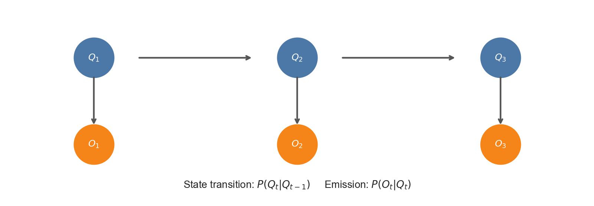
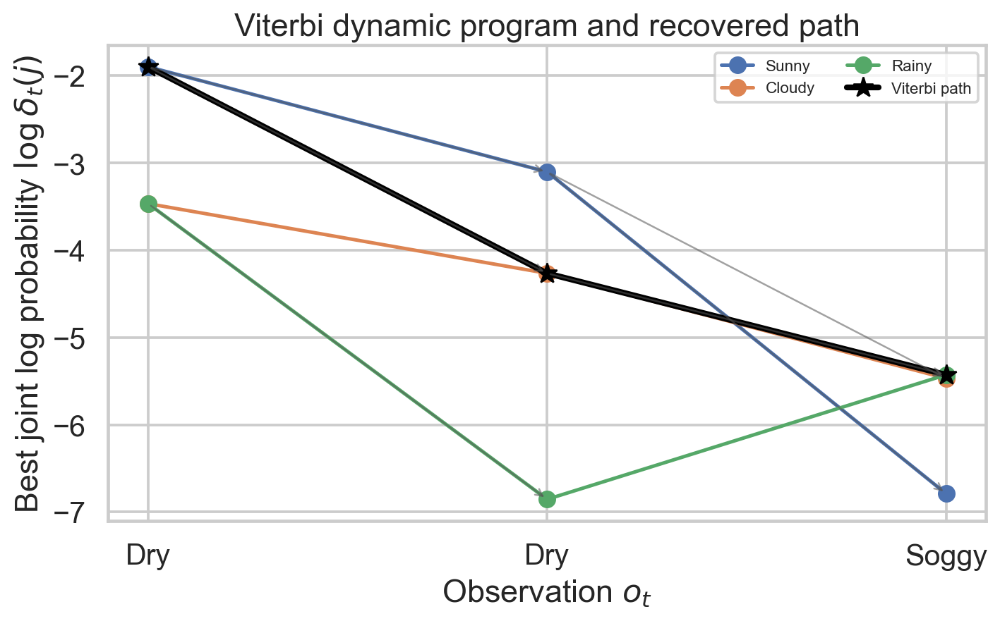

# Week 4 — HMMs, Viterbi, Forward and Acoustic Models for the Exam

**Navigation:** [[exam-study-guide|Study route]] · [[week-3-exam-focused-notes|Prerequisite Week 3]] · [[week-4-notes|Full reference]] · [[week-4-exam-questions|Authentic questions and worked answers]]

## 1. What to practise most

**The central skill is turning a model and observations into the correct calculation.** Ask whether the question wants one path's joint score, the best path, or the total observation likelihood. These are different answers built from many of the same numbers.

**P1** marks mechanisms requiring thorough study and repeated application. **P2** elsewhere marks direct concise-answer topics; **P3** marks syllabus content without a direct standalone question located. A low occurrence count can still be P1 when the concept is necessary to distinguish two heavily tested algorithms.

<!-- evidence:start -->
| Study priority | Topic family | Question occurrences: Q1 / Q2 / ET | Distinct exam–terms |
| :--- | :--- | :--- | ---: |
| P1 — calculate with traceback | HMM Viterbi: weather and POS examples | 3 / 2 / 3 = **8** | 6 |
| P1 — understand every probability | HMM versus chain and probability normalization | 0 / 2 / 3 = **5** | 4 |
| P1 — compare with Viterbi | Forward likelihood; foundation for soft alignment | 0 / 0 / 1 = **1** | 1 |
| P1 — explain and count correctly | HMM–GMM roles, emissions, topology, duration, triphones | 0 / 5 / 2 = **7** | 4 |
<!-- evidence:end -->

There are 21 occurrences. Eight involve HMM Viterbi decoding, including repeated weather problems and two POS versions. The five basic-HMM occurrences include three copies of an ambiguously indexed normalization MCQ. The seven acoustic-model entries include emissions, topology, duration and phone-context questions. **Forward is P1 despite one direct MCQ:** understanding “sum over paths” prevents confusing evidence with the best-path score. These labels are study judgments based on tasks and dependencies, not estimates of next-exam marks.

**P3 extensions within this week's foundations:** conditional-independence factorization, precise duration mathematics, Forward–Backward posterior interpretation, and initialization/realignment details. Learn them to explain why the algorithms work; the bank's lack of a standalone numerical item does not remove them from the syllabus. Elementary HMM types/continuous emissions overlap Week 5; detailed language models and lexicon calculations remain outside this guide.

## 2. Begin with the hidden/observed distinction

In a weather chain, you see Sunny, Cloudy and Rainy directly. In a weather HMM, you see whether grass is Dry, Dryish, Damp or Soggy and infer the weather that might have produced it. A dry observation is evidence for a state, not the state itself.

In speech, you observe a vector of measured features for each frame, such as 13 MFCC coefficients. The underlying phone or sub-phone state is hidden. A vector is not intrinsically labeled /s/ or /a/; the acoustic model scores its compatibility with each state.

An HMM has three parameter sets, often abbreviated $\lambda=(\pi,A,B)$:

| Symbol | Meaning | Normalization |
| :--- | :--- | :--- |
| $\pi_i=P(q_1=i)$ | Initial state distribution at the first modeled frame | $\sum_i\pi_i=1$ |
| $a_{ij}=P(q_t=j\mid q_{t-1}=i)$ | State transition probability | $\sum_j a_{ij}=1$ for each $i$ |
| $b_j(o)=P(o_t=o\mid q_t=j)$ for discrete observations | Emission probability of a symbol in state $j$ | Sum over the observation alphabet equals 1 for each state |
| $b_j(\mathbf o)=p(\mathbf o_t=\mathbf o\mid q_t=j)$ for continuous observations | Emission density of a feature vector | Integral over feature space equals 1 |

For $N$ states and $M$ discrete symbols, $A$ has shape `[N, N]`, $\pi$ shape `[N]`, and a state-by-symbol emission table shape `[N, M]`. A sequence of $T$ acoustic vectors with $d$ coefficients has shape `[T, d]`.

### The two model assumptions

1. **First-order hidden chain:** given the current state, the next-state distribution does not depend on earlier states.
2. **Conditional observation independence:** given the state sequence, each observation depends only on its corresponding state in the standard HMM.

This does not assert that raw speech frames are uncorrelated in reality. It is an approximation that makes inference tractable.



**Figure 1.** *Transitions connect hidden states across time; emissions connect each hidden state to its measured observation. Separating those arrows prevents confusing $P(q_t\mid q_{t-1})$ with $p(o_t\mid q_t)$.*

**Authentic checkpoint:** explain the [chain-versus-HMM distinction](week-4-exam-questions.md#ee4001_2023T3_Q2_NA--q7) in terms of what is observed, not merely by saying “HMM is more complex.” For the [normalization MCQ](week-4-exam-questions.md#ee4001_2023T1_ET_FN--q-mcq-2), the source writes symbol-first notation $b_j(k)$; then sum over symbol $j=1,\ldots,M$ for each state $k=1,\ldots,N$. Its options contain index/quantifier errors; use the correct meaning rather than learning the typo.

## 3. Score a path before searching for one — P1

Let $q_{1:T}$ be a proposed hidden path and $O=o_{1:T}$ the observations. The HMM factorization is

$$P(q_{1:T},O\mid\lambda)=\pi_{q_1}b_{q_1}(o_1)\prod_{t=2}^{T}a_{q_{t-1}q_t}b_{q_t}(o_t).$$

Start with one initial-state probability and the first emission. Thereafter multiply one transition and one emission at every step. There are $T$ emissions and $T-1$ transitions in this first-frame convention.

**Another common convention:** Day 0 is known, with first observation on Day 1. Then use $a_{q_0q_1}b_{q_1}(o_1)$ at the start. There are $T$ transitions from the known Day 0 to the $T$ observed days. Do not use both an extra Day 0 transition and an unrelated first-frame prior unless the problem actually defines both.

| What is asked? | Operation |
| :--- | :--- |
| Joint score for a specified path and observations | Multiply the factors for that path |
| Probability of observations given a fixed path | Multiply emissions only; transitions do not belong in this conditional |
| Best hidden path given observations and model | Maximize joint score using Viterbi |
| Observation likelihood | Sum joint scores over every path using Forward |
| Posterior probability of one path | Divide its joint score by observation likelihood |

For continuous emissions these are densities with the appropriate observation-space units. The same max/sum operations apply; a joint density score is still not a normalized posterior.

## 4. Viterbi algorithm — P1: calculate, save pointers, trace back

### 4.1 Why a trellis helps

With $N$ states and $T$ observations, there are up to $N^T$ state sequences before topology constraints. Exhaustive path enumeration is costly. Viterbi keeps the best partial path **to each current state**, not just the best partial path overall.

Define $\delta_t(j)$ as the largest joint score of any prefix ending in state $j$ at time $t$. Initialize and recur:

$$\delta_1(j)=\pi_jb_j(o_1),$$

$$\delta_t(j)=b_j(o_t)\max_i[\delta_{t-1}(i)a_{ij}],\qquad\psi_t(j)=\arg\max_i[\delta_{t-1}(i)a_{ij}].$$

At the end choose $q_T^*=\arg\max_j\delta_T(j)$; then set $q_{t-1}^*=\psi_t(q_t^*)$. The $\psi$ values are **backpointers**. If several predecessors tie, retain ties when all optimal paths are requested, or state a tie-breaking convention.

Dense Viterbi costs $O(TN^2)$ arithmetic operations, because every current state compares $N$ predecessors at each frame. Rolling score memory is $O(N)$; usual traceback stores $O(TN)$ backpointers. Sparse allowed transitions reduce the work. $N^T$ is the candidate-path count, not the Viterbi runtime.

### 4.2 Authentic weather example: known Cloudy Day 0; Dry, then Damp

[2022 Q2 Q9](week-4-exam-questions.md#ee4001_2022T3_Q2_NA--q9) and several ET versions use state order S,C,R and

$$A=\begin{bmatrix}0.5&0.375&0.125\\0.25&0.125&0.625\\0.25&0.075&0.675\end{bmatrix}.$$

| Weather | Dry | Dryish | Damp | Soggy |
| :--- | ---: | ---: | ---: | ---: |
| S | 0.60 | 0.20 | 0.15 | 0.05 |
| C | 0.25 | 0.25 | 0.25 | 0.25 |
| R | 0.05 | 0.10 | 0.35 | 0.50 |

**Initialize with the known start:**

$$\delta_1=(0.25\cdot0.60,\;0.125\cdot0.25,\;0.625\cdot0.05)=(0.15,0.03125,0.03125).$$

**Compute every destination at Day 2:**

$$\delta_2(S)=0.15\max(0.15\cdot0.5,0.03125\cdot0.25,0.03125\cdot0.25)=0.01125,$$

$$\delta_2(C)=0.25\max(0.15\cdot0.375,0.03125\cdot0.125,0.03125\cdot0.075)=0.0140625,$$

$$\delta_2(R)=0.35\max(0.15\cdot0.125,0.03125\cdot0.625,0.03125\cdot0.675)=0.0073828125.$$

The corresponding predecessors are S, S and R. The best final state is C; its pointer gives S on Day 1. Therefore **Days 1–2: Sunny → Cloudy**; including the given start: **Cloudy → Sunny → Cloudy**. The score is $0.25\cdot0.60\cdot0.375\cdot0.25=0.0140625$.

**Do not copy between versions:** [2023 T1 ET AN](week-4-exam-questions.md#ee4001_2023T1_ET_AN--q-subj-8) starts Rainy and observes Soggy then Dry. Its answer is Days 1–2 **Rainy → Sunny**, score 0.050625. Initial state and observations are part of the problem, not decorative wording.



**Figure 2.** *The existing lab trellis illustrates one retained best prefix per destination and backtracking through predecessor links. Its numerical setup is the master-note lab's setup; use the explicitly given initial-state convention for each exam question rather than transplanting figure values.*

### 4.3 Another authentic example: tied best paths

[2026 Q1 Q9](week-4-exam-questions.md#ee4001_2026T1_Q1_NA--q9) gives two states S,R, $\pi=(0.6,0.4)$,

$$A=\begin{bmatrix}0.8&0.2\\0.4&0.6\end{bmatrix},\qquad B=\begin{bmatrix}0.6&0.3&0.1\\0.1&0.4&0.5\end{bmatrix},$$

where emission columns are Walk, Shop, Clean.

| Observation | Best score ending S | Ending R |
| :--- | ---: | ---: |
| Walk | 0.36 | 0.04 |
| Shop | 0.0864 | 0.0288 |
| Clean | 0.006912 | 0.00864 |

At final R, arrival from S gives $0.0864(0.2)(0.5)=0.00864$; arrival from R gives $0.0288(0.6)(0.5)=0.00864$. Both prefixes at Shop came from initial S. Hence **S,S,R and S,R,R** are equally optimal. A single deterministic traceback may output either, but a complete mathematical answer notes the tie.

### 4.4 POS tags and greedy decisions

The authentic [Time flies fast question](week-4-exam-questions.md#ee4001_2026T1_Q1_NA--q11) uses the same HMM machinery for tags rather than weather. Given “Time” is Noun, the “flies” scores for Noun/Verb/Adjective are $(0.03,0.40,0.02)$. Final “fast” Viterbi scores are $(0.032,0.048,0.040)$. Best path: **Noun → Verb → Verb**. Greedy happens to agree in this instance; that does not prove it always agrees with Viterbi.

## 5. Forward algorithm — P1: replace max by sum

Viterbi asks which single path contributes most. **Forward** asks for the combined likelihood of the observation sequence under all possible paths.

$$\alpha_1(j)=\pi_jb_j(o_1),\qquad\alpha_t(j)=b_j(o_t)\sum_i\alpha_{t-1}(i)a_{ij},$$

$$P(O\mid\lambda)=\sum_j\alpha_T(j).$$

The recurrence is visually similar to Viterbi, but the sum is essential. Forward does not produce one best path and needs no best-path backpointer for likelihood evaluation.

### 5.1 Use the same Cloudy-start weather problem to see the difference

Day 1 values equal the Viterbi initialization: $(0.15,0.03125,0.03125)$. At Day 2 sum predecessor contributions instead of maximizing:

$$\alpha_2(S)=0.15(0.15\cdot0.5+0.03125\cdot0.25+0.03125\cdot0.25)=0.01359375,$$

$$\alpha_2(C)=0.25(0.15\cdot0.375+0.03125\cdot0.125+0.03125\cdot0.075)=0.015625,$$

$$\alpha_2(R)=0.35(0.15\cdot0.125+0.03125\cdot0.625+0.03125\cdot0.675)=0.02078125.$$

Summing final entries gives $P(O\mid q_0=C)=0.05$. The best path's posterior is therefore $0.0140625/0.05=0.28125$. A single path cannot have greater joint mass than the sum of all paths.

**A useful distinction:** the most probable final state after summing paths is R, because 0.02078125 is largest. The most probable complete path ends in C. Marginal-state decisions and globally best-path decisions need not agree.

Practise the direct [Forward-purpose MCQ](week-4-exam-questions.md#ee4001_2023T3_ET_FN--q-mcq-1): **likelihood of observed data given model parameters**.

### 5.2 Soft alignment needs Forward–Backward, not Forward alone

Define the backward suffix probability $\beta_t(i)=P(o_{t+1:T}\mid q_t=i,\lambda)$:

$$\beta_T(i)=1,\qquad\beta_t(i)=\sum_j a_{ij}b_j(o_{t+1})\beta_{t+1}(j).$$

Combine prefix and suffix evidence for a smoothed state posterior:

$$\gamma_t(i)=P(q_t=i\mid O,\lambda)=\frac{\alpha_t(i)\beta_t(i)}{P(O\mid\lambda)}.$$

**Meaning:** a frame can have fractional membership in several states. Forward–Backward also supplies expected transition counts; Baum–Welch uses these for EM training. Forward alone evaluates evidence and is part of that procedure; it does not by itself compute the full smoothed alignment or update all parameters.

For the Cloudy-start example, $\beta_1=(0.2125,0.2875,0.2925)$ gives Day 1 smoothed posteriors $(0.6375,0.1796875,0.1828125)$. These sum to 1 and express uncertainty rather than declaring every frame to belong exclusively to one state.

**Notation warning:** $\gamma$ here means a smoothed posterior, a common HMM convention. The older course trellis question uses $\gamma$ for a maximum-path score. Read its local definition; the same letter is not evidence that the two quantities are equal.

## 6. HMM–GMM speech recognition — P1

### 6.1 Assign a role to each model

The **HMM** supplies the hidden-state sequence structure and allowed transitions. Within each emitting state $j$, a **GMM** supplies a continuous feature density:

$$b_j(\mathbf o_t)=\sum_{k=1}^{K}w_{jk}\mathcal N(\mathbf o_t;\mu_{jk},\Sigma_{jk}).$$

$j$ indexes the acoustic state; $k$ indexes a mixture component **inside that state**. These are not interchangeable indices. A frame is scored under competing state densities, and sequence inference combines those densities with transition probabilities.

**Discrete HMM:** first quantize a feature vector into a finite codebook symbol; look up a probability mass. **Continuous-emission HMM:** model the actual real-valued vector with a density, avoiding that codebook quantization stage. Continuous does not mean time is continuous; digital frames still form discrete steps.

For [2025 Q2 Q1](week-4-exam-questions.md#ee4001_2025T2_Q2_NA--q1), the state-conditioned observation model is the **GMM**. For [2026 Q2 Q1](week-4-exam-questions.md#ee4001_2026T1_Q2_NA--q1), the advantage is direct modeling of real-valued features, not absence of training, features or transitions.

### 6.2 Topology and self-loop duration

A left-to-right phone HMM permits a state to repeat or advance through stages. In a basic no-skip version, the emitting sequence is beginning → middle → end with self-loops at each stage. Backward arcs within that phone are disallowed by this chosen topology. This is a useful approximation to progression through a sound, not a theorem that every state graph used in speech must be globally acyclic; decoding networks can revisit phones or words.

A fully connected topology permits all state pairs directly. Formal ergodicity is broader than full connectivity. State topology and continuous/discrete emission type are separate choices.

A self-loop lets the model remain in a state for more frames. If the self-loop probability is $a<1$ and all remaining probability exits it, the duration distribution is geometric:

$$P(D=d)=a^{d-1}(1-a),\qquad E[D]=\frac1{1-a},\quad d=1,2,\ldots.$$

For $a=0.8$, the expected stay is 5 frames; at a 10 ms frame step, that is approximately 50 ms of modeled time steps. Frame-window duration and frame-step duration are different; use the step when mapping a run of state occupancies to time. This explains [2026 Q2 Q2](week-4-exam-questions.md#ee4001_2026T1_Q2_NA--q2): self-loops model **variable duration**.

### 6.3 Tri-state versus triphone: two independent distinctions

| Term | What varies? | Example |
| :--- | :--- | :--- |
| Three-state / tri-state phone | Temporal position within a phone | Beginning, middle, end of /ae/ |
| Triphone | Left and right phonetic context | /k-ae+t/ means /ae/ preceded by /k/ and followed by /t/ |

A triphone can itself have three emitting states. Triphone means three phones participate in the **context description**, not that three phones collapse into one time-state.

For “cat” /k/–/ae/–/t/ with boundary silence, [2025 Q2 Q8](week-4-exam-questions.md#ee4001_2025T2_Q2_NA--q8) asks for:

- Monophone concatenation: $3\text{ phones}\times3\text{ states}=9$ emitting-state positions.
- Triphone units: `sil-k+ae`, `k-ae+t`, `ae-t+sil` — three context-dependent units.
- Three-state triphone concatenation: again $3\times3=9$ emitting-state positions.

Boundary silence supplies contexts; do not add separate silence-state counts unless an explicit silence HMM is requested. Nine positions do not necessarily mean nine distinct emission PDFs if states share parameters.

For a fixed central phone in an inventory of 50 phones, theoretical left/right choices give $50^2=2500$ models, the [2023 ET question](week-4-exam-questions.md#ee4001_2023T3_ET_AN--q-mcq-1). Across **all** central phones, the unrestricted count would be $50^3=125000$. Real contexts, boundary handling and parameter sharing reduce the realized inventory. **State tying** shares emission parameters among selected context-dependent states to address sparse training data; it does not erase their positions in an utterance's state path.

### 6.4 Initialization and iterative alignment — P3 foundation

Training speech models needs both state assignments and model parameters. With known transcriptions, a pronunciation specification can constrain the allowed phone path. A practical hard-alignment loop initializes segments/models, finds a best allowed state alignment with Viterbi, refits state GMMs using aligned frames, and repeats. A soft alternative uses expected state/transition occupancies from Forward–Backward and EM-style parameter updates.

Thus **Viterbi can be used during training** for hard realignment, even though finding a best path is its core inference task. “Viterbi never trains” is false. A full recognizer also uses pronunciation and language constraints; detailed lexicon and language-model study belongs to Week 5.

## 7. Failure modes and how to avoid losing marks

| Failure | Correction |
| :--- | :--- |
| Use only transition scores in an HMM | Multiply the appropriate emission at every observed frame |
| Treat known Day 0 as if it were an observed Day 1 | State exactly when the first emission occurs |
| Add Viterbi predecessors | Use max for Viterbi, sum for Forward |
| Pick the highest state separately at every time | Trace back the connected best path |
| Call the final Viterbi score a posterior | Divide by total evidence if posterior is requested |
| Drop an equal predecessor | State the tie or the chosen tie-break rule |
| Normalize continuous density by summing a finite list of arbitrary feature points | Integrate over feature space; discrete symbols instead sum |
| Call Forward alone a complete training algorithm | Separate evidence evaluation, smoothing and parameter updating |
| Assume every phone context requires a new independently fitted PDF | Account for state tying and sparse contexts |

Long sequences multiply many small values and can underflow. In log space, Viterbi replaces multiplication by addition and retains max; Forward must use **log-sum-exp**, not max, to retain all paths. Zero-probability arcs have log score $-\infty$. Appropriate scaling is another implementation approach.

## 8. Retrieval practice with complete checks

These are **new learning exercises**, not additional source questions.

1. **Three states, four observations: how many unconstrained state paths?** $3^4=81$. The observation alphabet size does not replace the state count in this expression.
2. **Two prefixes end in the same state with scores 0.2 and 0.1. Why can Viterbi discard the second?** Under the model they have identical allowable future factors, so the smaller cannot win with a shared suffix.
3. **Joint best score 0.03, total likelihood 0.12: posterior of that path?** $0.03/0.12=0.25$. Dividing is necessary because evidence contains contributions from other paths.
4. **Why can a GMM density exceed 1 without violating the HMM?** Density is per unit feature volume and integrates to 1; it is not a discrete symbol probability.
5. **Self-loop 0.75: expected duration?** $1/(1-0.75)=4$ frames. At 10 ms frame step this is about 40 ms of modeled steps.
6. **Fixed central phone, 40 possible neighbors on each side: theoretical contexts?** $40^2=1600$. Across all 40 central phones the unrestricted count is $40^3=64000$.
7. **Does a three-state model necessarily have only three observation frames?** No. Self-loops allow multiple frames at a state; the number of emitting states is not the observation-sequence length.
8. **What exactly is the hidden object in speech?** The acoustic state sequence; the feature vectors are measured observations, not hidden states or words already decoded.

## 9. Practice sequence and final formula sheet

**First:** reconstruct §2's parameter table. **Second:** score one specified path by multiplication. **Third:** do the Cloudy-start weather problem with max and traceback. **Fourth:** repeat using sums and compute evidence. **Fifth:** solve the tied two-state and POS problems from the bank. **Sixth:** answer emission-role, duration and triphone-count questions. Return to §6.4 for a verbal account of how training obtains alignments.

| Task | Formula / decision |
| :--- | :--- |
| Viterbi start | $\delta_1(j)=\pi_jb_j(o_1)$, or known-Day-0 transition initialization |
| Viterbi recursion | $b_j(o_t)\max_i\delta_{t-1}(i)a_{ij}$ plus predecessor |
| Forward recursion | $b_j(o_t)\sum_i\alpha_{t-1}(i)a_{ij}$ |
| Total evidence | $\sum_j\alpha_T(j)$ |
| Smoothed occupancy | $\alpha_t(j)\beta_t(j)/P(O)$ |
| GMM emission | $\sum_kw_{jk}\mathcal N(\mathbf o;\mu_{jk},\Sigma_{jk})$ |
| Three-state phone sequence | $3\times$ number of phone units, subject to explicit topology |
| Fixed-center triphone contexts | Number of left choices × number of right choices |

- [ ] I can label every probability in a path product and state its conditioning.
- [ ] I can produce a Viterbi table and valid traceback, including ties.
- [ ] I can calculate total evidence and distinguish it from a best-path score.
- [ ] I can explain what Forward–Backward adds to Forward alone.
- [ ] I can distinguish discrete masses from acoustic densities.
- [ ] I can explain HMM/GMM roles, variable duration, tri-state, triphone and state tying.

## 10. Optional computation — Concept → Code → Output → Interpretation

**Concept:** enumerate the nine two-day paths in the authentic Cloudy-start example, independently checking both max-path score and summed evidence.

**Code:**

```python
from itertools import product
A = [[0.5, 0.375, 0.125], [0.25, 0.125, 0.625], [0.25, 0.075, 0.675]]
dry, damp = [0.6, 0.25, 0.05], [0.15, 0.25, 0.35]
scores = [(A[1][i]*dry[i]*A[i][j]*damp[j], (i, j))
          for i, j in product(range(3), repeat=2)]
best, path = max(scores)
evidence = sum(score for score, _ in scores)
names = ["Sunny", "Cloudy", "Rainy"]
print(f"Days 1-2: {names[path[0]]} -> {names[path[1]]}")
print(f"Best joint score: {best:.9f}")
print(f"Observation likelihood: {evidence:.9f}")
print(f"Best-path posterior: {best/evidence:.6f}")
```

**Output:**

<!-- lab-output:start -->
```text
Days 1-2: Sunny -> Cloudy
Best joint score: 0.014062500
Observation likelihood: 0.050000000
Best-path posterior: 0.281250
```
<!-- lab-output:end -->

**Interpretation:** enumeration is feasible for this tiny check, but dynamic programming avoids its exponential growth. The likelihood includes all nine paths; the best-path posterior is their normalized winning contribution.

**References:** supplied Week 4 curriculum and slide map in [[week-4-notes]]; original source variants in [[week-4-exam-questions]]. Rabiner, L. R. (1989), “A tutorial on hidden Markov models and selected applications in speech recognition,” *Proceedings of the IEEE*, 77(2), 257–286, [doi:10.1109/5.18626](https://doi.org/10.1109/5.18626). See [[week-5-notes]] for the later pronunciation/language-model interface; keep that extension separate from Weeks 1–4 exam evidence.
