# Week 4 — Authentic Exam Questions and Worked Answers

**Navigation:** [[week-4-notes|Study notes]] · [[week-4-exam-focused-notes|Exam-focused learning guide]] · [[exam-question-index|All weeks and source audit]]

**Coverage:** 21 source question occurrences. Repeated questions are retained for each paper/session. Questions come from Q1, Q2 and ET whenever their tested content falls in this week's confirmed scope. These are authentic paper extractions, separate from generated practice in the study notes.

**Answer provenance:** The supplied PDFs do not provide verifiable academic answer keys. All solutions below are independently derived, with source ambiguities stated explicitly. Read the question and source figure before checking the worked answer. Physical PDF page numbers include cover/portal pages. FN/AN/NA are retained exactly from filenames; NA means no session specified in the filename.

## Topic checklist and evidence

The topic list follows the confirmed weekly notes. “No direct question found” describes these supplied papers, not permission to skip the topic. A question can support several rows.

| Topic | Matching source questions |
| :--- | :--- |
| Viterbi max-product, traceback, hard alignment and ties | [2022T3_ET_FN q-subj-8](#ee4001_2022T3_ET_FN--q-subj-8), [2022T3_Q2_NA q9](#ee4001_2022T3_Q2_NA--q9), [2023T1_ET_AN q-subj-8](#ee4001_2023T1_ET_AN--q-subj-8), [2023T1_ET_FN q-subj-8](#ee4001_2023T1_ET_FN--q-subj-8), [2023T3_ET_FN q-mcq-1](#ee4001_2023T3_ET_FN--q-mcq-1), [2023T3_Q2_NA q4](#ee4001_2023T3_Q2_NA--q4), [2025T2_Q1_NA q9](#ee4001_2025T2_Q1_NA--q9), [2026T1_Q1_NA q9](#ee4001_2026T1_Q1_NA--q9), [2026T1_Q1_NA q11](#ee4001_2026T1_Q1_NA--q11) |
| HMM states, observations, normalization and assumptions | [2022T3_ET_FN q-mcq-2](#ee4001_2022T3_ET_FN--q-mcq-2), [2022T3_Q2_NA q8](#ee4001_2022T3_Q2_NA--q8), [2023T1_ET_AN q-mcq-2](#ee4001_2023T1_ET_AN--q-mcq-2), [2023T1_ET_FN q-mcq-2](#ee4001_2023T1_ET_FN--q-mcq-2), [2023T3_ET_FN q-mcq-1](#ee4001_2023T3_ET_FN--q-mcq-1), [2023T3_Q2_NA q7](#ee4001_2023T3_Q2_NA--q7), [2025T2_Q1_NA q9](#ee4001_2025T2_Q1_NA--q9), [2025T2_Q2_NA q1](#ee4001_2025T2_Q2_NA--q1), [2026T1_Q1_NA q11](#ee4001_2026T1_Q1_NA--q11) |
| Weather–grass HMM worked inference | [2022T3_ET_FN q-subj-8](#ee4001_2022T3_ET_FN--q-subj-8), [2022T3_Q2_NA q9](#ee4001_2022T3_Q2_NA--q9), [2023T1_ET_AN q-subj-8](#ee4001_2023T1_ET_AN--q-subj-8), [2023T1_ET_FN q-subj-8](#ee4001_2023T1_ET_FN--q-subj-8), [2023T3_Q2_NA q4](#ee4001_2023T3_Q2_NA--q4) |
| Forward likelihood and Forward–Backward soft alignment | [2023T3_ET_FN q-mcq-1](#ee4001_2023T3_ET_FN--q-mcq-1) |
| HMM–GMM emissions, real-valued versus discrete observations | [2022T3_Q2_NA q10](#ee4001_2022T3_Q2_NA--q10), [2023T3_ET_AN q-subj-3](#ee4001_2023T3_ET_AN--q-subj-3), [2025T2_Q2_NA q1](#ee4001_2025T2_Q2_NA--q1), [2025T2_Q2_NA q8](#ee4001_2025T2_Q2_NA--q8), [2026T1_Q2_NA q1](#ee4001_2026T1_Q2_NA--q1) |
| Speech-state topology, self-loop duration, tri-state/triphone and tying | [2022T3_Q2_NA q10](#ee4001_2022T3_Q2_NA--q10), [2023T3_ET_AN q-mcq-1](#ee4001_2023T3_ET_AN--q-mcq-1), [2025T2_Q2_NA q8](#ee4001_2025T2_Q2_NA--q8), [2026T1_Q2_NA q2](#ee4001_2026T1_Q2_NA--q2) |

## Question navigator

| Paper | Question | Topic | Answer status |
| :--- | :--- | :--- | :--- |
| 2022T3_ET_FN | [Question 2 (MCQ)](#ee4001_2022T3_ET_FN--q-mcq-2) | Discrete HMM normalization | needs-review |
| 2022T3_ET_FN | [Question 8 (Subjective)](#ee4001_2022T3_ET_FN--q-subj-8) | HMM Viterbi weather decoding | derived |
| 2022T3_Q2_NA | [Question 8 (Subjective)](#ee4001_2022T3_Q2_NA--q8) | Markov chain versus HMM | derived |
| 2022T3_Q2_NA | [Question 9 (Subjective)](#ee4001_2022T3_Q2_NA--q9) | HMM Viterbi weather decoding | derived |
| 2022T3_Q2_NA | [Question 10 (Subjective)](#ee4001_2022T3_Q2_NA--q10) | HMM topology and discrete/continuous emissions | derived |
| 2023T1_ET_AN | [Question 2 (MCQ)](#ee4001_2023T1_ET_AN--q-mcq-2) | Discrete HMM normalization | needs-review |
| 2023T1_ET_AN | [Question 8 (Subjective)](#ee4001_2023T1_ET_AN--q-subj-8) | HMM Viterbi weather decoding | derived |
| 2023T1_ET_FN | [Question 2 (MCQ)](#ee4001_2023T1_ET_FN--q-mcq-2) | Discrete HMM normalization | needs-review |
| 2023T1_ET_FN | [Question 8 (Subjective)](#ee4001_2023T1_ET_FN--q-subj-8) | HMM Viterbi weather decoding | derived |
| 2023T3_ET_AN | [Question 1 (MCQ)](#ee4001_2023T3_ET_AN--q-mcq-1) | triphones; context-dependent phones | derived |
| 2023T3_ET_AN | [Question 3 (Subjective)](#ee4001_2023T3_ET_AN--q-subj-3) | hidden Markov models | derived |
| 2023T3_ET_FN | [Question 1 (MCQ)](#ee4001_2023T3_ET_FN--q-mcq-1) | HMM forward algorithm; sequence likelihood | derived |
| 2023T3_Q2_NA | [Question 4 (Subjective)](#ee4001_2023T3_Q2_NA--q4) | HMM Viterbi weather decoding | derived |
| 2023T3_Q2_NA | [Question 7 (Subjective)](#ee4001_2023T3_Q2_NA--q7) | Markov chain versus HMM | derived |
| 2025T2_Q1_NA | [Question 9 (Subjective)](#ee4001_2025T2_Q1_NA--q9) | Markov models and HMM decoding | derived |
| 2025T2_Q2_NA | [Question 1 (MCQ)](#ee4001_2025T2_Q2_NA--q1) | HMM-GMM emission role | derived |
| 2025T2_Q2_NA | [Question 8 (Subjective)](#ee4001_2025T2_Q2_NA--q8) | triphones; three-state phone HMMs | derived |
| 2026T1_Q1_NA | [Question 9 (Subjective)](#ee4001_2026T1_Q1_NA--q9) | Markov models and HMM decoding | derived |
| 2026T1_Q1_NA | [Question 11 (Subjective)](#ee4001_2026T1_Q1_NA--q11) | Markov models and HMM decoding | derived |
| 2026T1_Q2_NA | [Question 1 (MCQ)](#ee4001_2026T1_Q2_NA--q1) | hidden Markov models | derived |
| 2026T1_Q2_NA | [Question 2 (MCQ)](#ee4001_2026T1_Q2_NA--q2) | hidden Markov models | derived |

## Quiz 1 questions

### 2025 Term 2 · Quiz 1 · NA — Question 9 (Subjective)

**Source:** [Original PDF, p. 5](../sources/exam-papers/pdfs/ee4001_2025T2_Q1_NA.pdf#page=5) · [Archived extraction](../sources/exam-papers/extractions/ee4001_2025T2_Q1_NA.md#q9)  
**Topics:** Markov models and HMM decoding. **Marks:** 5.

We discussed two approaches for decoding in Hidden Markov Models (HMMs): the greedy approach and the Viterbi algorithm.

Consider a part-of-speech (POS) tagging problem modeled as a first-order HMM. Given the observed word sequence: “Time flies fast” and that the first word “Time” is tagged as a Noun, determine the most probable tag sequence for the next two words using:

(a) the greedy approach

(b) the Viterbi algorithm

*Hint:* In the Viterbi approach, keep track of the best path probabilities for each possible tag at each position.

Assume the following transition and emission probabilities:

**Transition Probabilities:**

| Transition | To Noun | To Verb | To Adjective |
| :--- | :---: | :---: | :---: |
| **From Noun** | 0.3 | 0.5 | 0.2 |
| **From Verb** | 0.4 | 0.4 | 0.2 |
| **From Adjective** | 0.2 | 0.3 | 0.5 |

**Emission Probabilities:**

| Word | $P(\text{Word} \mid \text{Noun})$ | $P(\text{Word} \mid \text{Verb})$ | $P(\text{Word} \mid \text{Adjective})$ |
| :--- | :---: | :---: | :---: |
| **flies** | 0.1 | 0.8 | 0.1 |
| **fast** | 0.2 | 0.3 | 0.5 |

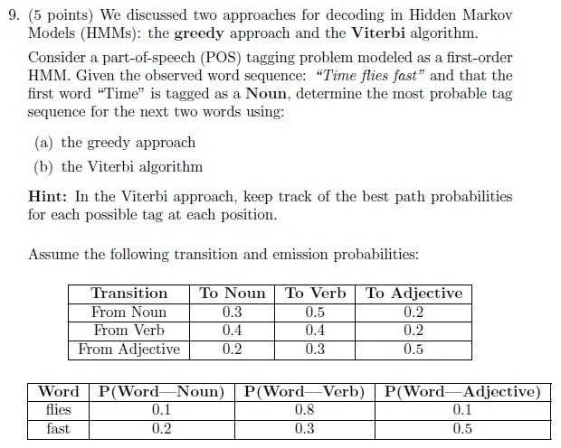

**Figure 1.** Printed Question 9 from scanned offline paper, covering greedy approach and Viterbi algorithm decoding for POS tagging in first-order HMM with transition and emission tables.

#### Worked answer — independently derived

Greedy: on “flies”, scores from Noun are Noun $0.3·0.1=0.03$, Verb $0.5·0.8=0.40$, Adjective $0.2·0.1=0.02$, so choose Verb. On “fast” from Verb: Noun $0.4·0.2=0.08$, Verb $0.4·0.3=0.12$, Adjective $0.2·0.5=0.10$; greedy gives **Noun→Verb→Verb**. Viterbi after “flies” has best scores $(N,V,A)=(0.03,0.40,0.02)$. After “fast”: $N=0.032$ via V; $V=0.048$ via V; $A=0.040$ via V. Maximum is V, so best path is also **Noun→Verb→Verb**, score $0.048$. In detail, the final scores are $0.2\max(0.03\cdot0.3,0.40\cdot0.4,0.02\cdot0.2)=0.032$, $0.3\max(0.03\cdot0.5,0.40\cdot0.4,0.02\cdot0.3)=0.048$, and $0.5\max(0.03\cdot0.2,0.40\cdot0.2,0.02\cdot0.5)=0.040$. The score is conditional on the given first tag; a separate emission probability for “Time” is not supplied.

---

### 2026 Term 1 · Quiz 1 · NA — Question 9 (Subjective)

**Source:** [Original PDF, p. 5](../sources/exam-papers/pdfs/ee4001_2026T1_Q1_NA.pdf#page=5) · [Archived extraction](../sources/exam-papers/extractions/ee4001_2026T1_Q1_NA.md#q9)  
**Topics:** Markov models and HMM decoding. **Marks:** 3.

Consider a weather HMM with 2 hidden states: Sunny (S) and Rainy (R). The transition probabilities are:

$$A = \begin{bmatrix} P(S \to S) & P(S \to R) \\ P(R \to S) & P(R \to R) \end{bmatrix} = \begin{bmatrix} 0.8 & 0.2 \\ 0.4 & 0.6 \end{bmatrix}$$

The emission probabilities (observations are Walk, Shop, Clean):

$$B = \begin{bmatrix} P(\text{Walk} \mid S) & P(\text{Shop} \mid S) & P(\text{Clean} \mid S) \\ P(\text{Walk} \mid R) & P(\text{Shop} \mid R) & P(\text{Clean} \mid R) \end{bmatrix} = \begin{bmatrix} 0.6 & 0.3 & 0.1 \\ 0.1 & 0.4 & 0.5 \end{bmatrix}$$

Initial probabilities:

$$\pi = [P(S) = 0.6, P(R) = 0.4]$$

Given the observation sequence $O = (\text{Walk}, \text{Shop}, \text{Clean})$, use the Viterbi algorithm to compute the most likely sequence of weather states.

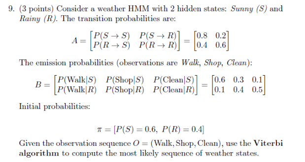

**Figure 2.** Printed question 9 from scanned offline paper, computing the most likely weather state sequence using the Viterbi algorithm for an HMM.

#### Worked answer — independently derived

Initialization for Walk: $\delta_1(S)=0.6·0.6=0.36$, $\delta_1(R)=0.4·0.1=0.04$. Shop: $S=\max(0.36·0.8,0.04·0.4)·0.3=0.0864$ (from S); $R=\max(0.36·0.2,0.04·0.6)·0.4=0.0288$ (from S). Clean: $S=\max(0.0864·0.8,0.0288·0.4)·0.1=0.006912$ (from S); $R=\max(0.0864·0.2,0.0288·0.6)·0.5=0.00864$ (tie: from S or R). **All optimal paths:** the last Rainy value has two equal predecessors: $0.0864\times0.2\times0.5=0.00864$ and $0.0288\times0.6\times0.5=0.00864$. Thus both **Sunny → Sunny → Rainy** and **Sunny → Rainy → Rainy** are MAP paths with score 0.00864. A deterministic tie-breaking implementation may return either; both are correct.

---

### 2026 Term 1 · Quiz 1 · NA — Question 11 (Subjective)

**Source:** [Original PDF, p. 5](../sources/exam-papers/pdfs/ee4001_2026T1_Q1_NA.pdf#page=5) · [Archived extraction](../sources/exam-papers/extractions/ee4001_2026T1_Q1_NA.md#q11)  
**Topics:** Markov models and HMM decoding. **Marks:** 5.

We discussed two approaches for decoding in Hidden Markov Models (HMMs): the greedy approach and the Viterbi algorithm.

Consider a part-of-speech (POS) tagging problem modeled as a first-order HMM. Given the observed word sequence: "Time flies fast" and that the first word "Time" is tagged as a Noun, determine the most probable tag sequence for the next two words using:

(a) the greedy approach

(b) the Viterbi algorithm

Hint: In the Viterbi approach, keep track of the best path probabilities for each possible tag at each position.

Assume the following transition and emission probabilities:

| Transition | To Noun | To Verb | To Adjective |
| :--- | :--- | :--- | :--- |
| From Noun | 0.3 | 0.5 | 0.2 |
| From Verb | 0.4 | 0.4 | 0.2 |
| From Adjective | 0.2 | 0.3 | 0.5 |

| Word | P(Word \| Noun) | P(Word \| Verb) | P(Word \| Adjective) |
| :--- | :--- | :--- | :--- |
| flies | 0.1 | 0.8 | 0.1 |
| fast | 0.2 | 0.3 | 0.5 |

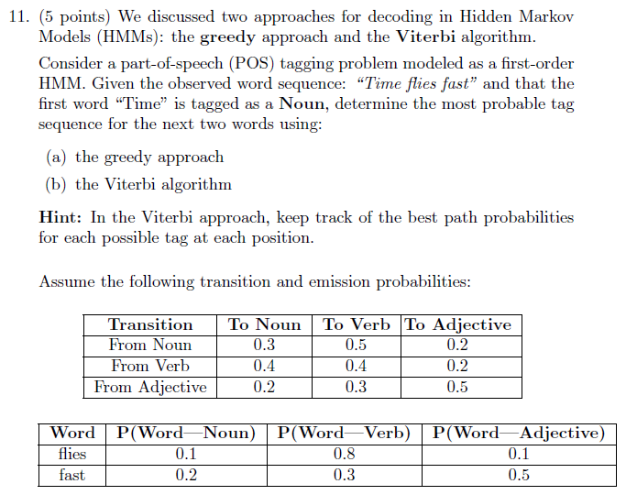

**Figure 3.** Printed question 11 from scanned offline paper, decoding part-of-speech tag sequence using greedy and Viterbi approaches in an HMM.

#### Worked answer — independently derived

Greedy: on “flies”, scores from Noun are Noun $0.3·0.1=0.03$, Verb $0.5·0.8=0.40$, Adjective $0.2·0.1=0.02$, so choose Verb. On “fast” from Verb: Noun $0.4·0.2=0.08$, Verb $0.4·0.3=0.12$, Adjective $0.2·0.5=0.10$; greedy gives **Noun→Verb→Verb**. Viterbi after “flies” has best scores $(N,V,A)=(0.03,0.40,0.02)$. After “fast”: $N=0.032$ via V; $V=0.048$ via V; $A=0.040$ via V. Maximum is V, so best path is also **Noun→Verb→Verb**, score $0.048$. In detail, the final scores are $0.2\max(0.03\cdot0.3,0.40\cdot0.4,0.02\cdot0.2)=0.032$, $0.3\max(0.03\cdot0.5,0.40\cdot0.4,0.02\cdot0.3)=0.048$, and $0.5\max(0.03\cdot0.2,0.40\cdot0.2,0.02\cdot0.5)=0.040$. The score is conditional on the given first tag; a separate emission probability for “Time” is not supplied.

---

## Quiz 2 questions

### 2022 Term 3 · Quiz 2 · NA — Question 8 (Subjective)

**Source:** [Original PDF, p. 4](../sources/exam-papers/pdfs/ee4001_2022T3_Q2_NA.pdf#page=4) · [Archived extraction](../sources/exam-papers/extractions/ee4001_2022T3_Q2_NA.md#q8)  
**Topics:** Markov chain versus HMM. **Marks:** 2.

**Overlap:** [[week-3-notes|Week 3]]. Primary placement follows the earliest substantive mechanism.

8. (2 points) Explain in brief the difference between Markov Chains and Hidden Markov models.

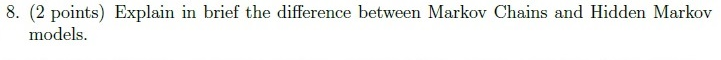

**Figure 4.** Printed question 8 from scanned offline paper, explaining the difference between Markov Chains and Hidden Markov models.

#### Worked answer — independently derived

A **Markov chain** has directly observed states and transition law $P(q_t\mid q_{1:t-1})=P(q_t\mid q_{t-1})$. Its parameters are the initial distribution and transition matrix.

An **HMM** retains this Markov law for latent states but observes emissions $o_t$ generated from $b_{q_t}(o_t)$, with observations conditionally independent given the state path. Its parameters are $\lambda=(\pi,A,B)$. A weather chain directly observes Sunny/Rainy; a weather HMM observes grass dryness and infers the hidden weather. In ASR the features are observed and sub-phone states are hidden. HMM decoding therefore combines transitions **and emissions**.

---

### 2022 Term 3 · Quiz 2 · NA — Question 9 (Subjective)

**Source:** [Original PDF, p. 4](../sources/exam-papers/pdfs/ee4001_2022T3_Q2_NA.pdf#page=4) · [Archived extraction](../sources/exam-papers/extractions/ee4001_2022T3_Q2_NA.md#q9)  
**Topics:** HMM Viterbi weather decoding. **Marks:** 5.

9. (5 points) Consider a weather prediction based HMM problem with three hidden states: Sunny, Cloudy and Rainy. There are four different observable states that depend on the hidden states, namely: Dry, Dryish, Damp, and Soggy. The transition and observation probabilities are shown in fig. Given initial Cloudy weather condition on Day0. It was observed that the weather was Dry followed by Damp for the next two days. Compute the best possible weather forecast sequence which best explains these two observations (hint: Use Viterbi Algorithm).

**Observation Probabilities:**

| Weather | Dry | Dryish | Damp | Soggy |
| :--- | :---: | :---: | :---: | :---: |
| Sunny | 0.60 | 0.20 | 0.15 | 0.05 |
| Cloudy | 0.25 | 0.25 | 0.25 | 0.25 |
| Rainy | 0.05 | 0.10 | 0.35 | 0.50 |

**Transition Probabilities:**

| Yesterday \ Today | Sunny | Cloudy | Rainy |
| :--- | :---: | :---: | :---: |
| Sunny | 0.5 | 0.375 | 0.125 |
| Cloudy | 0.25 | 0.125 | 0.625 |
| Rainy | 0.25 | 0.075 | 0.675 |

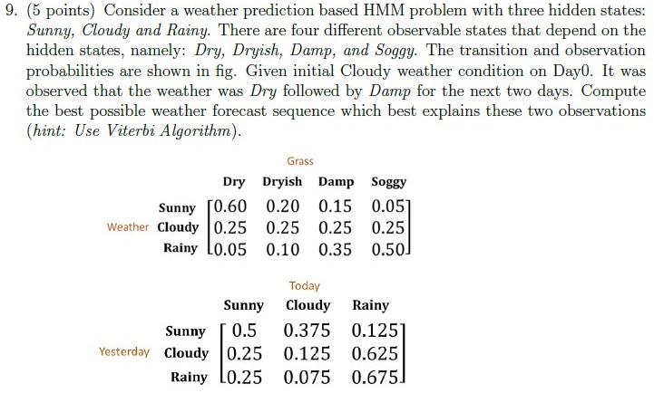

**Figure 5.** Printed question 9 from scanned offline paper, weather prediction HMM with Viterbi algorithm and transition/observation probability tables.

#### Worked answer — independently derived

**Answer: Sunny → Cloudy for Days 1–2; given Day 0, Cloudy → Sunny → Cloudy.**

Use state order $(S,C,R)$ and $\delta_t(j)=b_j(o_t)\max_i[\delta_{t-1}(i)a_{ij}]$. Day 0 is known and precedes the first emission; initialize Day 1 with $a_{Cj}b_j(\mathrm{Dry})$.

| Day / observation | Sunny | Cloudy | Rainy |
| :--- | ---: | ---: | ---: |
| 1 / Dry | 0.150000 | 0.031250 | 0.031250 |
| 2 / Damp | 0.011250 | 0.0140625 | 0.0073828125 |

At Day 2, Sunny's best predecessor is Sunny; Cloudy's is Sunny; Rainy's is Rainy. The largest final entry is Cloudy. Traceback gives Sunny then Cloudy. The joint score conditional on the known start is $0.25\times0.60\times0.375\times0.25=0.0140625$. This is a path-and-observations score, not a normalized posterior probability of the path.

---

### 2022 Term 3 · Quiz 2 · NA — Question 10 (Subjective)

**Source:** [Original PDF, p. 4](../sources/exam-papers/pdfs/ee4001_2022T3_Q2_NA.pdf#page=4) · [Archived extraction](../sources/exam-papers/extractions/ee4001_2022T3_Q2_NA.md#q10)  
**Topics:** HMM topology and discrete/continuous emissions. **Marks:** 3.

**Overlap:** [[week-5-notes|Week 5]]. Primary placement follows the earliest substantive mechanism.

10. (3 points) Explain in detail different types of HMM models detailing differences between them.

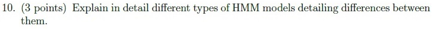

**Figure 6.** Printed question 10 from scanned offline paper, explaining different types of HMM models and differences between them.

#### Worked answer — independently derived

**By topology:** a fully connected HMM allows direct transitions between all state pairs; a left-to-right (Bakis) HMM permits self-loops and forward transitions, with $a_{ij}=0$ for $j<i$. A no-skip version allows only $j=i$ or $j=i+1$, apart from entry/exit conventions. Self-loops model variable frame duration. Ergodicity formally concerns irreducibility and aperiodicity; full connectivity is a common sufficient topology, not its only mathematical definition.

**By emission space:** a discrete HMM emits finite codebook symbols with probability masses $b_j(v_k)$; a continuous-emission HMM assigns a density to real-valued feature vectors, often $b_j(x)=\sum_k w_{jk}\mathcal N(x;\mu_{jk},\Sigma_{jk})$. “Continuous” refers to observations, not continuous time. These are independent classifications: a model can be both left-to-right and continuous-emission. Speech commonly uses left-to-right phone models with multiple emitting states.

---

### 2023 Term 3 · Quiz 2 · NA — Question 4 (Subjective)

**Source:** [Original PDF, p. 4](../sources/exam-papers/pdfs/ee4001_2023T3_Q2_NA.pdf#page=4) · [Archived extraction](../sources/exam-papers/extractions/ee4001_2023T3_Q2_NA.md#q4)  
**Topics:** HMM Viterbi weather decoding. **Marks:** 7.

4. (7 points) Consider a weather prediction based HMM problem with three hidden states: Sunny, Cloudy and Rainy. There are four different observable states that depend on the hidden states, namely: Dry, Dryish, Damp, and Soggy. The transition and observation probabilities are shown in fig. Given initial Cloudy weather condition on Day0. It was observed that the grass was Dry followed by Damp for the next two days. Compute the best possible weather forecast sequence which best explains these two observations (hint: Use Viterbi Algorithm).

**Observation Probabilities:**

| Weather | Dry | Dryish | Damp | Soggy |
| :--- | :---: | :---: | :---: | :---: |
| Sunny | 0.60 | 0.20 | 0.15 | 0.05 |
| Cloudy | 0.25 | 0.25 | 0.25 | 0.25 |
| Rainy | 0.05 | 0.10 | 0.35 | 0.50 |

**Transition Probabilities:**

| Yesterday \ Today | Sunny | Cloudy | Rainy |
| :--- | :---: | :---: | :---: |
| Sunny | 0.5 | 0.375 | 0.125 |
| Cloudy | 0.25 | 0.125 | 0.625 |
| Rainy | 0.25 | 0.075 | 0.675 |

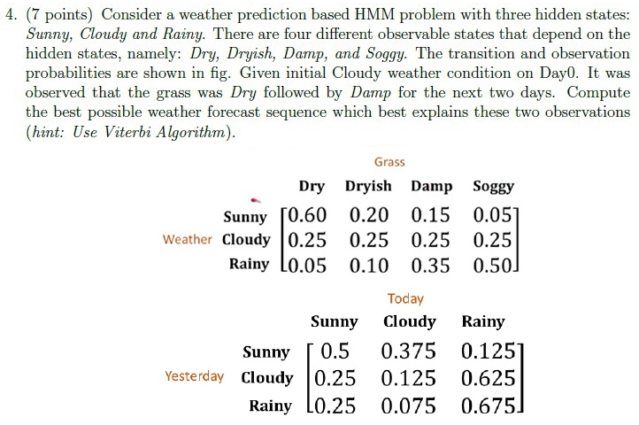

**Figure 7.** Printed question 4 from scanned offline paper, weather prediction HMM with Viterbi algorithm and probability tables.

#### Worked answer — independently derived

**Answer: Sunny → Cloudy for Days 1–2; given Day 0, Cloudy → Sunny → Cloudy.**

Use state order $(S,C,R)$ and $\delta_t(j)=b_j(o_t)\max_i[\delta_{t-1}(i)a_{ij}]$. Day 0 is known and precedes the first emission; initialize Day 1 with $a_{Cj}b_j(\mathrm{Dry})$.

| Day / observation | Sunny | Cloudy | Rainy |
| :--- | ---: | ---: | ---: |
| 1 / Dry | 0.150000 | 0.031250 | 0.031250 |
| 2 / Damp | 0.011250 | 0.0140625 | 0.0073828125 |

At Day 2, Sunny's best predecessor is Sunny; Cloudy's is Sunny; Rainy's is Rainy. The largest final entry is Cloudy. Traceback gives Sunny then Cloudy. The joint score conditional on the known start is $0.25\times0.60\times0.375\times0.25=0.0140625$. This is a path-and-observations score, not a normalized posterior probability of the path.

---

### 2023 Term 3 · Quiz 2 · NA — Question 7 (Subjective)

**Source:** [Original PDF, p. 5](../sources/exam-papers/pdfs/ee4001_2023T3_Q2_NA.pdf#page=5) · [Archived extraction](../sources/exam-papers/extractions/ee4001_2023T3_Q2_NA.md#q7)  
**Topics:** Markov chain versus HMM. **Marks:** 2.

**Overlap:** [[week-3-notes|Week 3]]. Primary placement follows the earliest substantive mechanism.

7. (2 points) Explain in brief the difference between Markov Chains and Hidden Markov models.

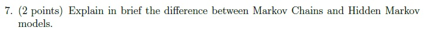

**Figure 8.** Printed question 7 from scanned offline paper, explaining difference between Markov Chains and Hidden Markov models.

#### Worked answer — independently derived

A **Markov chain** has directly observed states and transition law $P(q_t\mid q_{1:t-1})=P(q_t\mid q_{t-1})$. Its parameters are the initial distribution and transition matrix.

An **HMM** retains this Markov law for latent states but observes emissions $o_t$ generated from $b_{q_t}(o_t)$, with observations conditionally independent given the state path. Its parameters are $\lambda=(\pi,A,B)$. A weather chain directly observes Sunny/Rainy; a weather HMM observes grass dryness and infers the hidden weather. In ASR the features are observed and sub-phone states are hidden. HMM decoding therefore combines transitions **and emissions**.

---

### 2025 Term 2 · Quiz 2 · NA — Question 1 (MCQ)

**Source:** [Original PDF, p. 2](../sources/exam-papers/pdfs/ee4001_2025T2_Q2_NA.pdf#page=2) · [Archived extraction](../sources/exam-papers/extractions/ee4001_2025T2_Q2_NA.md#q1)  
**Topics:** HMM-GMM emission role. **Marks:** 1.

**Overlap:** [[week-3-notes|Week 3]]. Primary placement follows the earliest substantive mechanism.

1. (1 point) In a traditional HMM-GMM based speech recognizer, which part models the probability of an observed acoustic feature vector given a hidden state?

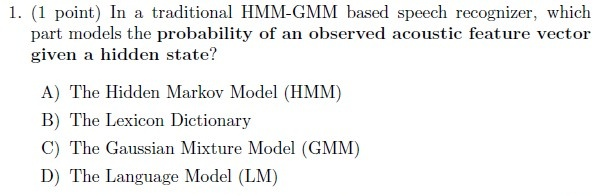

**Figure 9.** Printed question 1 from scanned offline paper, covering HMM-GMM acoustic feature vector probability modeling.

**Options**

**A.**

The Hidden Markov Model (HMM)

**B.**

The Lexicon Dictionary

**C.**

The Gaussian Mixture Model (GMM)

**D.**

The Language Model (LM)

#### Worked answer — independently derived

**Answer: C — The Gaussian Mixture Model (GMM).** The HMM supplies state transitions; the state-conditioned GMM models the continuous acoustic observation density p(xₜ|sₜ).

---

### 2025 Term 2 · Quiz 2 · NA — Question 8 (Subjective)

**Source:** [Original PDF, p. 4](../sources/exam-papers/pdfs/ee4001_2025T2_Q2_NA.pdf#page=4) · [Archived extraction](../sources/exam-papers/extractions/ee4001_2025T2_Q2_NA.md#q8)  
**Topics:** triphones; three-state phone HMMs. **Marks:** 5.

8. (5 points)
(a) (2 point) Explain the difference between tri-phone and tri-state model of speech recognition.
(b) Suppose you are designing an HMM-GMM based speech recognition system for the word “cat”.
• You use triphone modeling (context-dependent phones).
• Each phone is modeled as a 3-state HMM (tri-state).

The phonemes in “cat” are: /k/ — /ae/ — /t/.

(a) (1 point) How many HMM states will there be for the word “cat” if you model each phoneme as a monophone with 3 states?

(b) (1 point) If you instead use triphones, how many unique context-dependent phone units does “cat” contain? Write out their left and right contexts. Assume a silence /sil/ at the start and end.

(c) (1 point) How many total HMM states would this triphone model use for “cat”?

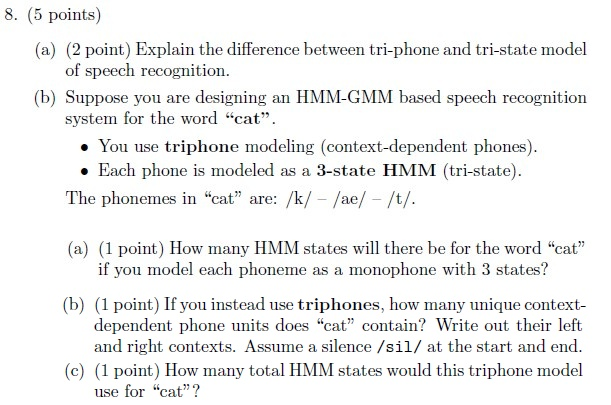

**Figure 10.** Printed question 8 from scanned offline paper, covering triphone vs tri-state models and HMM state counting for the word 'cat'.

#### Worked answer — independently derived

(a) A triphone is a context-dependent phone (central phone plus left and right neighboring phones); a tri-state model represents one phone with three sequential HMM emitting states. (b-a) Three monophones × three states = **9 states**. (b-b) The three context-dependent units with boundary silence are /sil-k+ae/, /k-ae+t/, and /ae-t+sil/. (b-c) Three triphones × three states = **9 states**. These count the word-internal units only; explicit silence HMM states are not included. These are 9 emitting-state positions in the concatenated word model; state tying may share emission parameters, so 9 positions do not imply 9 distinct GMM parameter sets.

---

### 2026 Term 1 · Quiz 2 · NA — Question 1 (MCQ)

**Source:** [Original PDF, p. 3](../sources/exam-papers/pdfs/ee4001_2026T1_Q2_NA.pdf#page=3) · [Archived extraction](../sources/exam-papers/extractions/ee4001_2026T1_Q2_NA.md#q1)  
**Topics:** hidden Markov models. **Marks:** 1.

**Shared source instructions:**

Instructions:

All option-based questions are MCQs, and all fill-in-the-blank questions are short answer questions.

For Questions 3 (1 to 14), answer all questions.

• In MCQs, you must write the correct option and also the complete text of that option.
• You must then provide a detailed explanation of why that specific option is the correct answer.
• In short answer questions, write the answer clearly with proper explanation wherever needed.
• In all problem-solving or example-based questions, present the solution with all intermediate steps clearly shown.
• Step-wise explanation is compulsory for all such questions.
• The final answer must be written clearly at the end.

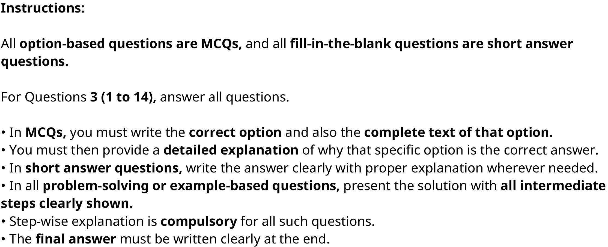

**Figure 11.** Source instructions for all fourteen printed Speech Technology questions.

A key advantage of continuous HMM over discrete HMM in speech recognition is:

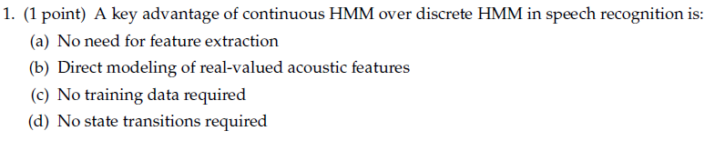

**Figure 12.** Printed question 1 from scanned offline paper, covering advantage of continuous HMM over discrete HMM.

**Options**

**A.**

No need for feature extraction

**B.**

Direct modeling of real-valued acoustic features

**C.**

No training data required

**D.**

No state transitions required

#### Worked answer — independently derived

**Answer: B — Direct modeling of real-valued acoustic features.** A continuous-emission HMM (often Gaussian/GMM) assigns densities to real-valued feature vectors without quantizing them into symbols.

---

### 2026 Term 1 · Quiz 2 · NA — Question 2 (MCQ)

**Source:** [Original PDF, p. 3](../sources/exam-papers/pdfs/ee4001_2026T1_Q2_NA.pdf#page=3) · [Archived extraction](../sources/exam-papers/extractions/ee4001_2026T1_Q2_NA.md#q2)  
**Topics:** hidden Markov models. **Marks:** 1.

**Shared source instructions:**

Instructions:

All option-based questions are MCQs, and all fill-in-the-blank questions are short answer questions.

For Questions 3 (1 to 14), answer all questions.

• In MCQs, you must write the correct option and also the complete text of that option.
• You must then provide a detailed explanation of why that specific option is the correct answer.
• In short answer questions, write the answer clearly with proper explanation wherever needed.
• In all problem-solving or example-based questions, present the solution with all intermediate steps clearly shown.
• Step-wise explanation is compulsory for all such questions.
• The final answer must be written clearly at the end.

**Figure 13.** Source instructions for all fourteen printed Speech Technology questions.

In a typical 3-state phoneme HMM, self-loops are mainly used to model:

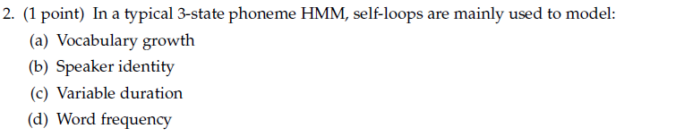

**Figure 14.** Printed question 2 from scanned offline paper, covering role of self-loops in 3-state phoneme HMM.

**Options**

**A.**

Vocabulary growth

**B.**

Speaker identity

**C.**

Variable duration

**D.**

Word frequency

#### Worked answer — independently derived

**Answer: C — Variable duration.** Self-transition probability lets a state emit successive frames before advancing, representing variable phoneme-state duration.

---

## End Term questions

### 2022 Term 3 · End Term · FN — Question 2 (MCQ)

**Source:** [Original PDF, p. 3](../sources/exam-papers/pdfs/ee4001_2022T3_ET_FN.pdf#page=3) · [Archived extraction](../sources/exam-papers/extractions/ee4001_2022T3_ET_FN.md#q-mcq-2)  
**Topics:** Discrete HMM normalization. **Marks:** 1.

2. (1 point) Given a HMM with $N$ hidden states and $M$ observation symbols, let $b_j(k)$ represent the probability of observing event $j$ when in state $k$. Also, let $\pi_j$ represent the probability of being in state $j$ initially ($\pi_j$\'s represent the initial state probabilities). Which of the following statements is True?

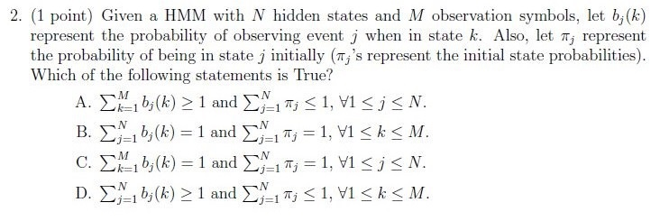

**Figure 15.** Printed question 2 from scanned offline paper, covering HMM probability properties.

**Options**

**A.**

$\sum_{j=1}^M b_j(k) > 1$ and $\sum_{j=1}^N \pi_j < 1, \forall 1 \le j \le N$.

**B.**

$\sum_{j=1}^M b_j(k) = 1$ and $\sum_{j=1}^N \pi_j = 1, \forall 1 \le k \le M$.

**C.**

$\sum_{j=1}^M b_j(k) = 1$ and $\sum_{j=1}^N \pi_j = 1, \forall 1 \le j \le N$.

**D.**

$\sum_{j=1}^M b_j(k) > 1$ and $\sum_{j=1}^M \pi_j \le 1, \forall 1 \le k \le M$.

#### Worked answer — independently derived

**Required normalization:** $\sum_{j=1}^{M} b_j(k)=1$ for **each state** $k=1,\ldots,N$, and $\sum_{j=1}^{N}\pi_j=1$. Both B and C display the right sums but have defective quantifiers: B bounds the state index by $M$; C quantifies the summed dummy index $j$ instead of $k$. **C is a plausible intended option, but neither B nor C is written fully correctly.** Retain the mathematically correct statement rather than treating the typo as a new HMM convention.

> [!warning] Source ambiguity
> The answer above identifies the precise defect or missing assumption. No official key was available to settle it.

---

### 2022 Term 3 · End Term · FN — Question 8 (Subjective)

**Source:** [Original PDF, p. 8](../sources/exam-papers/pdfs/ee4001_2022T3_ET_FN.pdf#page=8) · [Archived extraction](../sources/exam-papers/extractions/ee4001_2022T3_ET_FN.md#q-subj-8)  
**Topics:** HMM Viterbi weather decoding. **Marks:** 5.

8. (5 points) Consider a weather prediction based HMM problem with three hidden states: Sunny, Cloudy and Rainy. There are four different observable states that depend on the hidden states, namely: Dry, Dryish, Damp, and Soggy. The transition and observation probabilities are shown in fig. Given initial Cloudy weather condition on Day0. It was observed that the weather was Dry followed by Damp for the next two days. Compute the best possible weather forecast sequence which best explains these two observations (hint: Use Viterbi Algorithm).

**Observation Probabilities (Grass / Weather):**

| State | Dry | Dryish | Damp | Soggy |
| :--- | :--- | :--- | :--- | :--- |
| Sunny | 0.60 | 0.20 | 0.15 | 0.05 |
| Cloudy | 0.25 | 0.25 | 0.25 | 0.25 |
| Rainy | 0.05 | 0.10 | 0.35 | 0.50 |

**Transition Probabilities (Yesterday \ Today):**

| State | Sunny | Cloudy | Rainy |
| :--- | :--- | :--- | :--- |
| Sunny | 0.5 | 0.375 | 0.125 |
| Cloudy | 0.25 | 0.125 | 0.625 |
| Rainy | 0.25 | 0.075 | 0.675 |

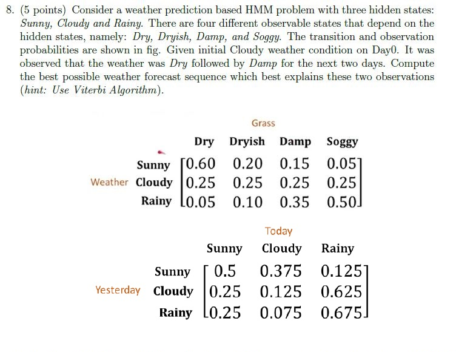

**Figure 16.** Printed subjective question 8 from scanned offline paper, covering weather HMM prediction with Viterbi algorithm and probability tables.

#### Worked answer — independently derived

**Answer: Sunny → Cloudy for Days 1–2; given Day 0, Cloudy → Sunny → Cloudy.**

Use state order $(S,C,R)$ and $\delta_t(j)=b_j(o_t)\max_i[\delta_{t-1}(i)a_{ij}]$. Day 0 is known and precedes the first emission; initialize Day 1 with $a_{Cj}b_j(\mathrm{Dry})$.

| Day / observation | Sunny | Cloudy | Rainy |
| :--- | ---: | ---: | ---: |
| 1 / Dry | 0.150000 | 0.031250 | 0.031250 |
| 2 / Damp | 0.011250 | 0.0140625 | 0.0073828125 |

At Day 2, Sunny's best predecessor is Sunny; Cloudy's is Sunny; Rainy's is Rainy. The largest final entry is Cloudy. Traceback gives Sunny then Cloudy. The joint score conditional on the known start is $0.25\times0.60\times0.375\times0.25=0.0140625$. This is a path-and-observations score, not a normalized posterior probability of the path.

---

### 2023 Term 1 · End Term · AN — Question 2 (MCQ)

**Source:** [Original PDF, p. 3](../sources/exam-papers/pdfs/ee4001_2023T1_ET_AN.pdf#page=3) · [Archived extraction](../sources/exam-papers/extractions/ee4001_2023T1_ET_AN.md#q-mcq-2)  
**Topics:** Discrete HMM normalization. **Marks:** 1.

2. (1 point) Given a HMM with $N$ hidden states and $M$ observation symbols, let $b_j(k)$ represent the probability of observing event $j$ when in state $k$. Also, let $\pi_j$ represent the probability of being in state $j$ initially ($\pi_j$'s represent the initial state probabilities). Which of the following statements is True?

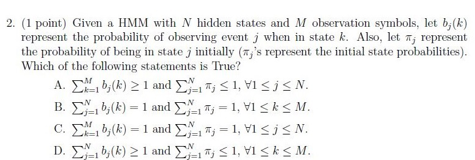

**Figure 17.** Printed question 2 from scanned offline paper, covering HMM probability properties.

**Options**

**A.**

$$\sum_{j=1}^M b_j(k) > 1 \text{ and } \sum_{j=1}^N \pi_j < 1, \forall 1 \le j \le N.$$

**B.**

$$\sum_{j=1}^M b_j(k) = 1 \text{ and } \sum_{j=1}^N \pi_j = 1, \forall 1 \le k \le M.$$

**C.**

$$\sum_{j=1}^M b_j(k) = 1 \text{ and } \sum_{j=1}^N \pi_j = 1, \forall 1 \le j \le N.$$

**D.**

$$\sum_{j=1}^M b_j(k) > 1 \text{ and } \sum_{j=1}^M \pi_j \le 1, \forall 1 \le k \le M.$$

#### Worked answer — independently derived

**Required normalization:** $\sum_{j=1}^{M} b_j(k)=1$ for **each state** $k=1,\ldots,N$, and $\sum_{j=1}^{N}\pi_j=1$. Both B and C display the right sums but have defective quantifiers: B bounds the state index by $M$; C quantifies the summed dummy index $j$ instead of $k$. **C is a plausible intended option, but neither B nor C is written fully correctly.** Retain the mathematically correct statement rather than treating the typo as a new HMM convention.

> [!warning] Source ambiguity
> The answer above identifies the precise defect or missing assumption. No official key was available to settle it.

---

### 2023 Term 1 · End Term · AN — Question 8 (Subjective)

**Source:** [Original PDF, p. 7](../sources/exam-papers/pdfs/ee4001_2023T1_ET_AN.pdf#page=7) · [Archived extraction](../sources/exam-papers/extractions/ee4001_2023T1_ET_AN.md#q-subj-8)  
**Topics:** HMM Viterbi weather decoding. **Marks:** 5.

8. (5 points) Consider a weather prediction based HMM problem with three hidden states: Sunny, Cloudy and Rainy. There are four different observable states that depend on the hidden states, namely: Dry, Dryish, Damp, and Soggy. The transition and observation probabilities are shown in fig. Given initial Rainy weather condition on Day0. It was observed that the weather was Soggy followed by Dry for the next two days. Compute the best possible weather forecast sequence which best explains these two observations (hint: Use Viterbi Algorithm).

**Observation Probabilities (Grass / Weather):**

| State | Dry | Dryish | Damp | Soggy |
| :--- | :--- | :--- | :--- | :--- |
| Sunny | 0.60 | 0.20 | 0.15 | 0.05 |
| Cloudy | 0.25 | 0.25 | 0.25 | 0.25 |
| Rainy | 0.05 | 0.10 | 0.35 | 0.50 |

**Transition Probabilities (Yesterday \ Today):**

| State | Sunny | Cloudy | Rainy |
| :--- | :--- | :--- | :--- |
| Sunny | 0.5 | 0.375 | 0.125 |
| Cloudy | 0.25 | 0.125 | 0.625 |
| Rainy | 0.25 | 0.075 | 0.675 |

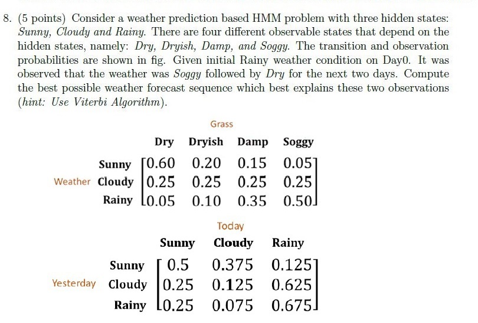

**Figure 18.** Printed subjective question 8 from scanned offline paper, covering weather HMM prediction with Viterbi algorithm and probability tables.

#### Worked answer — independently derived

**Answer: Rainy → Sunny for Days 1–2; given Day 0, Rainy → Rainy → Sunny.**

State order is $(S,C,R)$. Since Day 0 is known Rainy, initialize $\delta_1(j)=a_{Rj}b_j(\mathrm{Soggy})$.

| Day / observation | Sunny | Cloudy | Rainy |
| :--- | ---: | ---: | ---: |
| 1 / Soggy | 0.012500 | 0.018750 | 0.337500 |
| 2 / Dry | 0.050625 | 0.006328125 | 0.011390625 |

For example $\delta_2(S)=0.60\max(0.0125\times0.5,0.01875\times0.25,0.3375\times0.25)=0.050625$. All final states have Rainy as best predecessor. Choose Sunny at the final step and trace back to Rainy. Score $=0.675\times0.50\times0.25\times0.60=0.050625$, conditional on the given initial state. This is a joint path score, not a normalized posterior.

---

### 2023 Term 1 · End Term · FN — Question 2 (MCQ)

**Source:** [Original PDF, p. 3](../sources/exam-papers/pdfs/ee4001_2023T1_ET_FN.pdf#page=3) · [Archived extraction](../sources/exam-papers/extractions/ee4001_2023T1_ET_FN.md#q-mcq-2)  
**Topics:** Discrete HMM normalization. **Marks:** 1.

2. (1 point) Given a HMM with $N$ hidden states and $M$ observation symbols, let $b_j(k)$ represent the probability of observing event $j$ when in state $k$. Also, let $\pi_j$ represent the probability of being in state $j$ initially ($\pi_j$\'s represent the initial state probabilities). Which of the following statements is True?

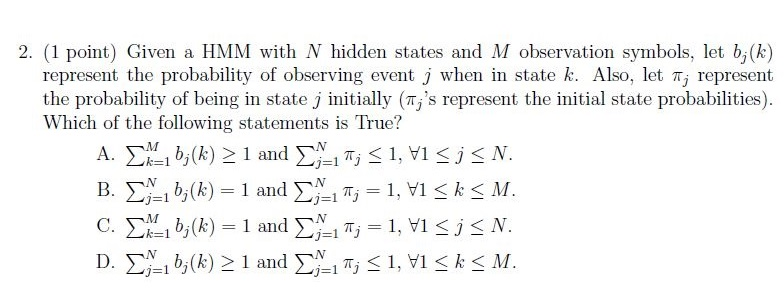

**Figure 19.** Printed question 2 from scanned offline paper, covering HMM probability properties.

**Options**

**A.**

$\sum_{j=1}^M b_j(k) > 1$ and $\sum_{j=1}^N \pi_j < 1, \forall 1 \le j \le N$.

**B.**

$\sum_{j=1}^M b_j(k) = 1$ and $\sum_{j=1}^N \pi_j = 1, \forall 1 \le k \le M$.

**C.**

$\sum_{j=1}^M b_j(k) = 1$ and $\sum_{j=1}^N \pi_j = 1, \forall 1 \le j \le N$.

**D.**

$\sum_{j=1}^M b_j(k) > 1$ and $\sum_{j=1}^M \pi_j \le 1, \forall 1 \le k \le M$.

#### Worked answer — independently derived

**Required normalization:** $\sum_{j=1}^{M} b_j(k)=1$ for **each state** $k=1,\ldots,N$, and $\sum_{j=1}^{N}\pi_j=1$. Both B and C display the right sums but have defective quantifiers: B bounds the state index by $M$; C quantifies the summed dummy index $j$ instead of $k$. **C is a plausible intended option, but neither B nor C is written fully correctly.** Retain the mathematically correct statement rather than treating the typo as a new HMM convention.

> [!warning] Source ambiguity
> The answer above identifies the precise defect or missing assumption. No official key was available to settle it.

---

### 2023 Term 1 · End Term · FN — Question 8 (Subjective)

**Source:** [Original PDF, p. 7](../sources/exam-papers/pdfs/ee4001_2023T1_ET_FN.pdf#page=7) · [Archived extraction](../sources/exam-papers/extractions/ee4001_2023T1_ET_FN.md#q-subj-8)  
**Topics:** HMM Viterbi weather decoding. **Marks:** 5.

8. (5 points) Consider a weather prediction based HMM problem with three hidden states: Sunny, Cloudy and Rainy. There are four different observable states that depend on the hidden states, namely: Dry, Dryish, Damp, and Soggy. The transition and observation probabilities are shown in fig. Given initial Cloudy weather condition on Day0. It was observed that the weather was Dry followed by Damp for the next two days. Compute the best possible weather forecast sequence which best explains these two observations (hint: Use Viterbi Algorithm).

**Observation Probabilities (Grass / Weather):**

| State | Dry | Dryish | Damp | Soggy |
| :--- | :--- | :--- | :--- | :--- |
| Sunny | 0.60 | 0.20 | 0.15 | 0.05 |
| Cloudy | 0.25 | 0.25 | 0.25 | 0.25 |
| Rainy | 0.05 | 0.10 | 0.35 | 0.50 |

**Transition Probabilities (Yesterday \ Today):**

| State | Sunny | Cloudy | Rainy |
| :--- | :--- | :--- | :--- | :--- |
| Sunny | 0.5 | 0.375 | 0.125 |
| Cloudy | 0.25 | 0.125 | 0.625 |
| Rainy | 0.25 | 0.075 | 0.675 |

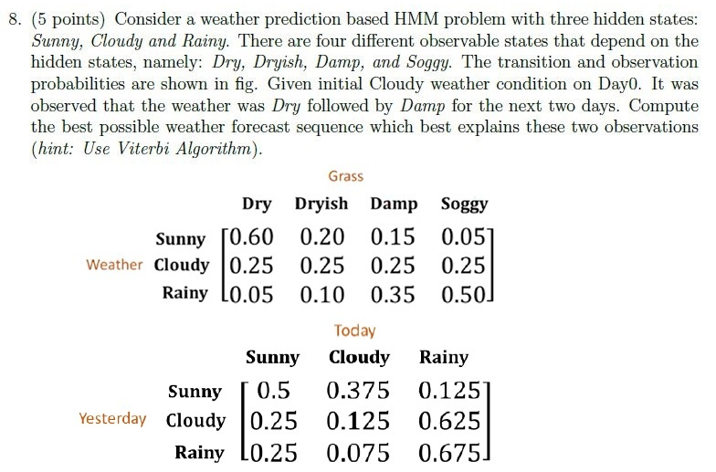

**Figure 20.** Printed subjective question 8 from scanned offline paper, covering weather HMM prediction with Viterbi algorithm and probability tables.

#### Worked answer — independently derived

**Answer: Sunny → Cloudy for Days 1–2; given Day 0, Cloudy → Sunny → Cloudy.**

Use state order $(S,C,R)$ and $\delta_t(j)=b_j(o_t)\max_i[\delta_{t-1}(i)a_{ij}]$. Day 0 is known and precedes the first emission; initialize Day 1 with $a_{Cj}b_j(\mathrm{Dry})$.

| Day / observation | Sunny | Cloudy | Rainy |
| :--- | ---: | ---: | ---: |
| 1 / Dry | 0.150000 | 0.031250 | 0.031250 |
| 2 / Damp | 0.011250 | 0.0140625 | 0.0073828125 |

At Day 2, Sunny's best predecessor is Sunny; Cloudy's is Sunny; Rainy's is Rainy. The largest final entry is Cloudy. Traceback gives Sunny then Cloudy. The joint score conditional on the known start is $0.25\times0.60\times0.375\times0.25=0.0140625$. This is a path-and-observations score, not a normalized posterior probability of the path.

---

### 2023 Term 3 · End Term · AN — Question 1 (MCQ)

**Source:** [Original PDF, p. 3](../sources/exam-papers/pdfs/ee4001_2023T3_ET_AN.pdf#page=3) · [Archived extraction](../sources/exam-papers/extractions/ee4001_2023T3_ET_AN.md#q-mcq-1)  
**Topics:** triphones; context-dependent phones. **Marks:** 2.

1. (2 points) Consider a language with a total of 50 phonemes, how many separate models for a single phoneme will need to be created considering a tri-phone model setup?

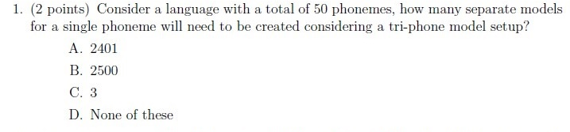

**Figure 21.** Printed question 1 from scanned offline paper, covering number of triphone models for 50 phonemes.

**Options**

**A.**

2401

**B.**

2500

**C.**

3

**D.**

None of these

#### Worked answer — independently derived

**Answer: B — 2,500 possible triphone variants for the fixed central phoneme.** There are 50 choices for the left context and 50 for the right: $50\times50=2,500$. This counts theoretical contexts before boundary symbols or parameter tying.

---

### 2023 Term 3 · End Term · AN — Question 3 (Subjective)

**Source:** [Original PDF, p. 4](../sources/exam-papers/pdfs/ee4001_2023T3_ET_AN.pdf#page=4) · [Archived extraction](../sources/exam-papers/extractions/ee4001_2023T3_ET_AN.md#q-subj-3)  
**Topics:** hidden Markov models. **Marks:** 3.

3. (3 points) Explain how the HMM and GMM are used in classical ASR.

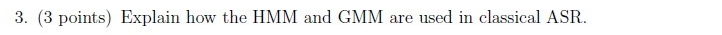

**Figure 22.** Printed subjective question 3 from scanned offline paper, explaining how HMM and GMM are used in classical ASR.

#### Worked answer — independently derived

HMMs model temporal state transitions and sequence structure; GMMs model each state-conditioned acoustic feature density p(xₜ|sₜ). Decoding searches the most probable state/phone sequence given the acoustic frames, then maps phones to words using pronunciation and language resources.

---

### 2023 Term 3 · End Term · FN — Question 1 (MCQ)

**Source:** [Original PDF, p. 2](../sources/exam-papers/pdfs/ee4001_2023T3_ET_FN.pdf#page=2) · [Archived extraction](../sources/exam-papers/extractions/ee4001_2023T3_ET_FN.md#q-mcq-1)  
**Topics:** HMM forward algorithm; sequence likelihood. **Marks:** 2.

1. (2 points) In the context of Hidden Markov Models (HMMs), what is the purpose of the Forward Algorithm?

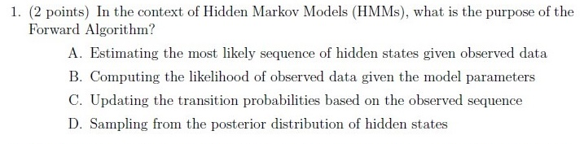

**Figure 23.** Printed Question 1 from Section 1.1 MCQ on purpose of Forward Algorithm in HMMs.

**Options**

**A.**

Estimating the most likely sequence of hidden states given observed data

**B.**

Computing the likelihood of observed data given the model parameters

**C.**

Updating the transition probabilities based on the observed sequence

**D.**

Sampling from the posterior distribution of hidden states

#### Worked answer — independently derived

**Answer: B — Computing the likelihood of observed data given the model parameters.** The Forward algorithm sums the joint probabilities of all hidden-state paths consistent with the observation sequence; it does not select only the single best path (Viterbi).

---

## Reproducibility and source integrity

Source PDFs, original extracted text and crops are archived under `sources/exam-papers/`. The inventory records PDF SHA-256 hashes. Rebuild with `uv run python build_exam_question_banks.py`; verify numerical examples and generated links with `uv run python verify_exam_question_banks.py`. The reviewed routing manifest includes every source question, including excluded later material.
