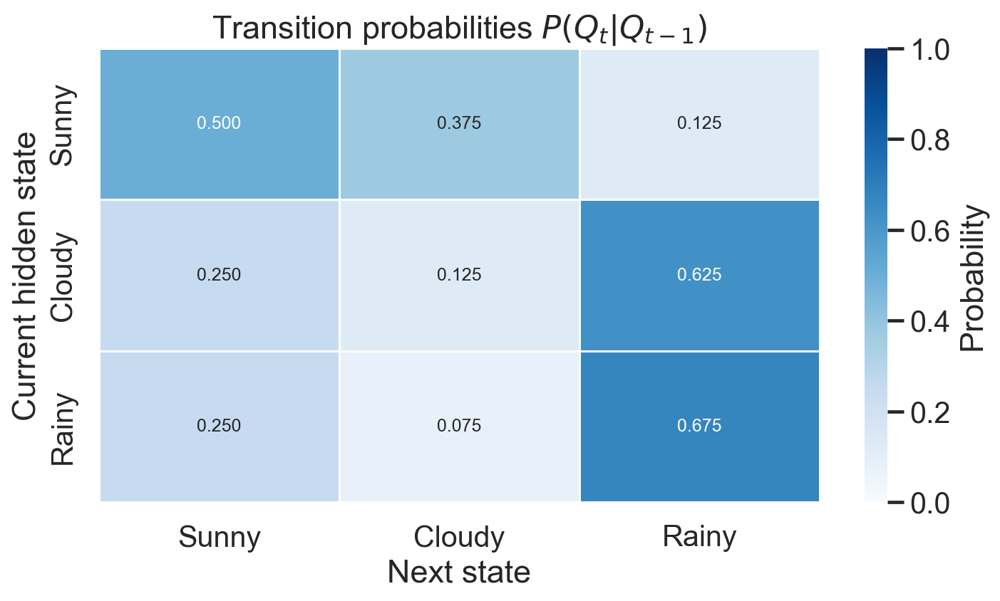
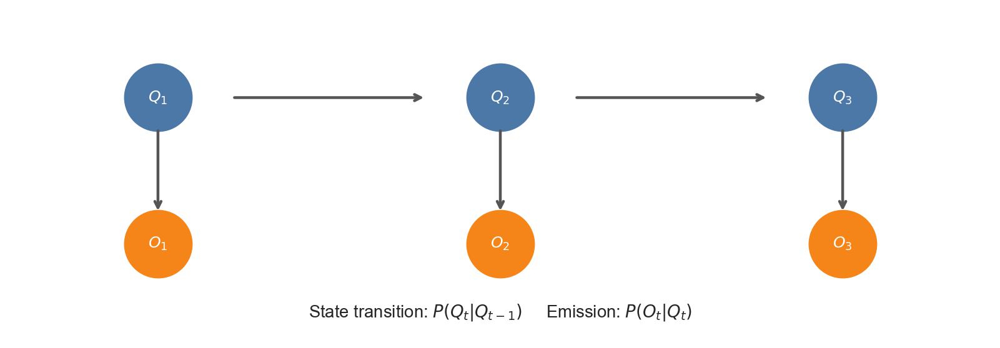
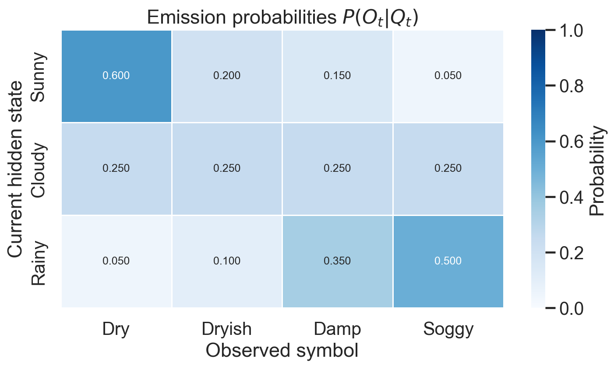
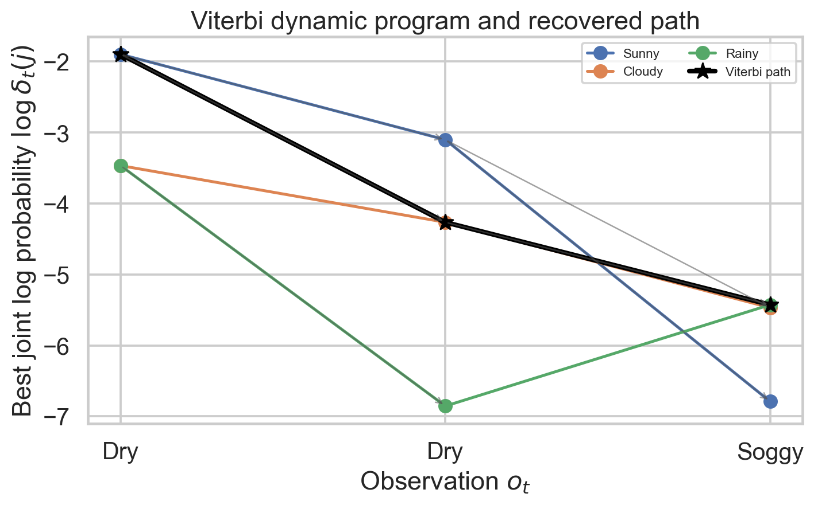
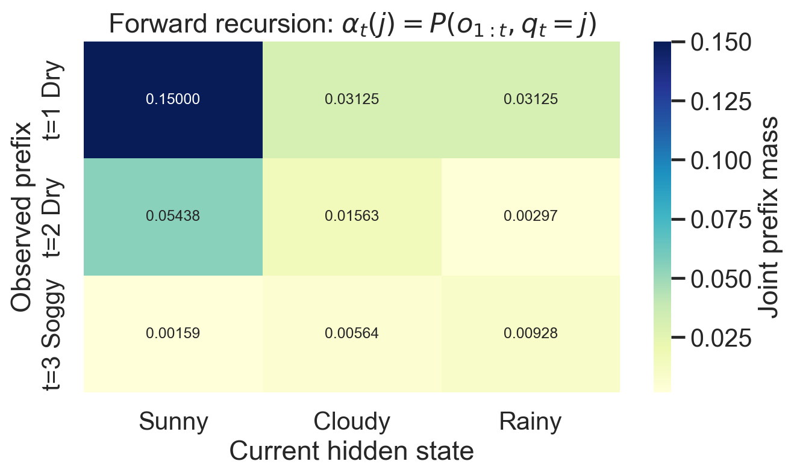
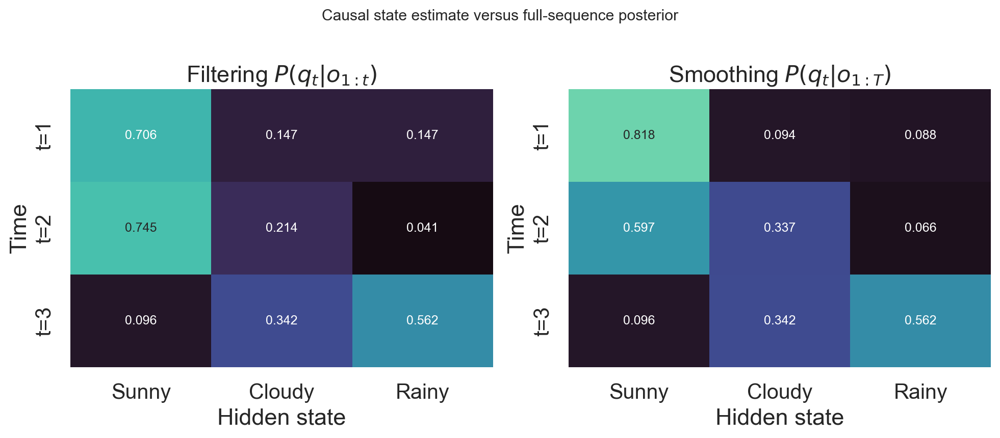
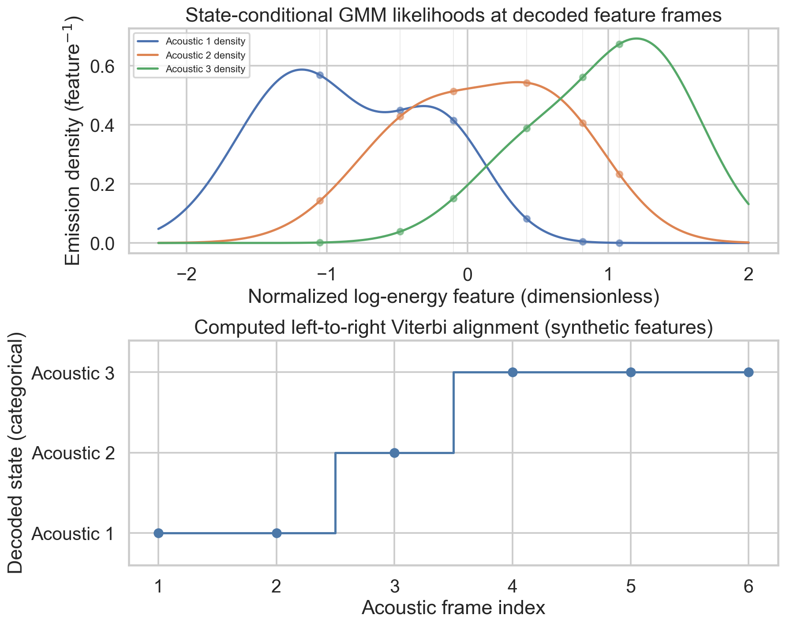
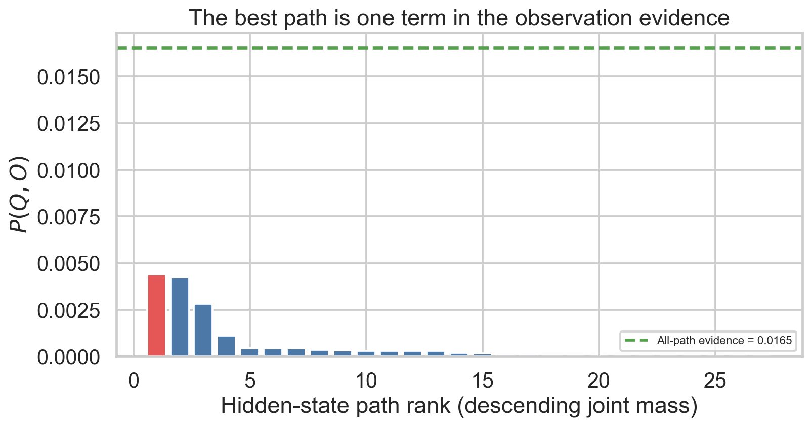

# Week 4: Hidden Markov Models, Dynamic Programming, and GMM Speech Recognition

**Learn and revise for the exam:** [[week-4-exam-focused-notes|Week 4 beginner-friendly exam guide]] · [[exam-study-guide|Study route and priorities]]


**Authentic past papers:** [[week-4-exam-questions|Week 4 questions and worked answers]] · [[exam-question-index|Paper coverage and routing audit]]


**Navigation:** ← [[week 3/week-3-notes|Week 3 Notes]] · [[Knowledge-Map|Knowledge Map]] · [[week 5/week-5-notes|Week 5 Notes]] → · [[source-catalog|Source Catalog]]

> **Scope:** Six supplied lectures cover Viterbi decoding, hidden Markov models (HMMs), the weather-and-grass example, the Forward algorithm, and a two-part introduction to HMM–Gaussian-mixture-model (GMM) speech recognition. This note develops those ideas in that order. Earlier vector quantization, K-means, and observed-state Markov chains are recalled only as prerequisites; they are not additional Week 4 lectures. No deep-learning, CTC, or end-to-end recognition material is included.

## Abstract

An HMM explains an observed sequence through a latent state path whose transitions follow a first-order Markov law and whose observations are generated by state-conditioned distributions. This week distinguishes the most probable hidden path, computed by Viterbi maximization, from the total observation likelihood, computed by Forward summation; these answer different questions even though both use dynamic programming. A three-state weather model makes the distinction concrete, including the initial-state convention, emission conditioning, and the difference between a conditional emission likelihood and a joint path-and-observation score. The speech-recognition introduction replaces discrete observations with continuous acoustic feature vectors and uses state-indexed GMM densities inside a constrained state topology. The resulting acoustic model provides a principled alignment and scoring framework, while exposing assumptions about state duration, initialization, and the limited meaning of an acoustic score without a full decoding objective.

## How to use this note

Follow the progression: (1) compress path maximization with Viterbi, (2) define the hidden-state generative model, (3) calculate a weather/grass example, (4) sum over paths with Forward, then (5) interpret continuous-density HMMs for speech. Keep three quantities separate throughout: $P(O\mid Q,\lambda)$, the likelihood of observations conditional on a specified state path; $P(O,Q\mid\lambda)$, the joint score of that path and observations; and $P(Q\mid O,\lambda)$, the posterior probability of that path. A maximum joint path can be selected without computing every normalized path posterior.

### Prerequisite self-check — with answers

1. **What is the Markov-chain factorization for an observed state sequence?** $P(q_{1:T})=\pi_{q_1}\prod_{t=2}^{T}a_{q_{t-1}q_t}$, with $\pi_i=P(q_1=i)$ and $a_{ij}=P(q_t=j\mid q_{t-1}=i)$. The first-order property conditions on the immediately preceding state.
2. **How are transition-matrix rows interpreted?** With rows indexed by previous state and columns by next state, row $i$ is a distribution over next states and sums to one. The entry $a_{ij}$ is $P(q_t=j\mid q_{t-1}=i)$.
3. **What does Viterbi return for a fully observed Markov chain?** The state sequence with maximum prior path probability, found by max-product recurrence and traceback. It does not return the marginal distribution over states at each time.
4. **What is a Gaussian-mixture density?** $p(x)=\sum_{m=1}^M c_m\mathcal N(x;\mu_m,\Sigma_m)$, where $c_m\ge0$ and $\sum_m c_m=1$. It is a density formed by summing component densities, not a hard clustering assignment.
5. **What does an MFCC vector represent in this week's setup?** A continuous-valued frame-level acoustic feature vector. Week 4 takes such vectors as observations; it does not derive the Week 2 front end again.
6. **Why can density exceed one?** A density is probability per unit feature volume, and only its integral over a region is probability. For multivariate acoustic vectors, its units are inverse feature-space volume.

### Lecture and source map

| Screenshot lecture | Learning target | Main source location |
|:--|:--|:--|
| 4.1 Viterbi Algorithm | Max-product recursion, backpointers, and global best-path traceback | Mar 2026 deck, physical pp. 61–75; final deck pp. 75–89 |
| 4.2 Hidden Markov Model | Latent states, transition probabilities, emissions, and model parameters | Mar 2026 deck, physical pp. 76–80; final deck pp. 90–94 |
| 4.3 Review of HMM—Weather and Grass Example | Apply transitions and emission likelihoods to the supplied observations | Mar 2026 deck, physical pp. 81–93; final deck pp. 95–107 |
| 4.4 Forward Algorithm for HMM | Sum over all hidden paths with sum-product dynamic programming | Mar 2026 deck, physical pp. 94–105; final deck pp. 108–119 |
| 4.5 Introduction to HMM GMM Model for Speech Recognition — Part 01 | Continuous acoustic observations, state-conditioned GMMs, and speech-state topology | Mar 2026 deck, physical pp. 106–132; final deck pp. 120–146 |
| 4.6 Introduction to HMM GMM Model for Speech Recognition — Part 02 | Initialization, alignment, and iterative acoustic-model estimation overview | Mar 2026 deck, physical pp. 133–140; final deck pp. 147–154 |

The page map groups relevant deck material by lecture topic; it does not assert video timestamps or transcript boundaries, which were not supplied.

**Assessment labels shown in supplied screenshots:** `AQ4.1 Activity Questions1`, `AQ4.2 Questions2`, `AQ4.3 Questions3`, `AQ4.4 Questions5` (the source label skips 4), and `AQ4.6 Questions6`; `Practice Assignment4` is not graded; `Week4 Graded Assignment4` is listed. The graded assignment's question text is not reproduced here. The solved problems below are original study exercises, not purported answers to that assignment.

## 1. Viterbi: the best path without enumerating paths

### 1.1 From path products to a recurrence

Let $Q=(q_1,\ldots,q_T)$ be a hidden or observed state path through $N$ states. For a first-order chain with initial distribution $\pi$ and transition matrix $A=[a_{ij}]$, its probability is

$$P(Q\mid\lambda)=\pi_{q_1}\prod_{t=2}^{T}a_{q_{t-1}q_t},\qquad \lambda=(\pi,A).$$

Exhaustive search evaluates up to $N^T$ paths for $T$ emitting times. A fixed state at the first emitting time or forbidden transitions can reduce the number of legal paths; a known pre-observation day-0 state still allows $N^T$ future paths when all transitions are positive. Dynamic programming instead keeps, for each time $t$ and ending state $j$, only the best partial path ending at $j$:

$$\delta_1(j)=\pi_j,\qquad
\delta_t(j)=\max_{1\le i\le N}\left[\delta_{t-1}(i)a_{ij}\right],\quad t\ge2.$$

Store its maximizing predecessor $\psi_t(j)=\arg\max_i[\delta_{t-1}(i)a_{ij}]$. At the end, choose $q_T^*=\arg\max_j\delta_T(j)$ and follow the saved predecessors backward. With $N$ states and $T$ steps, time is $O(TN^2)$ and storage is $O(TN)$ if all backpointers are retained. The recurrence's correctness follows from optimal substructure: any best path ending at $j$ must have as its length-$(t-1)$ prefix the best path ending at whichever predecessor $i$ attains the maximum.

### 1.2 Why greedy next-step choice can fail

A locally largest transition from the current state can lead to a poor remainder. Viterbi retains one best partial route per destination state, so it considers future consequences without preserving every complete path. **It does not mean “choose the most likely state independently at each time.”** Such independent marginal decisions can even form a transition-forbidden sequence. Viterbi's output is the valid path maximizing the joint path score under the model.

For numerical stability, products are evaluated in log space:

$$\ell_1(j)=\log\pi_j,\qquad
\ell_t(j)=\max_i\left[\ell_{t-1}(i)+\log a_{ij}\right].$$

Use $\log 0=-\infty$ for impossible starts/transitions. Log space prevents underflow, but it does not change which path maximizes the probability.



**Figure 1.** *The lecture transition matrix, with previous-state rows and next-state columns. Each row is a distribution; its entries are transition probabilities, not grass-observation probabilities.*

### Check 1 — solved

Suppose two states are $A,B$, the current best partial scores are $\delta_t(A)=0.30$ and $\delta_t(B)=0.25$, and transitions into $C$ are $a_{AC}=0.40$ and $a_{BC}=0.80$. Which predecessor reaches $C$ in the best path?

**Solution.** The candidates are $0.30(0.40)=0.12$ and $0.25(0.80)=0.20$. Thus $B$ is saved as $C$'s predecessor, even though $A$ had the larger incoming partial score before the transition.

## 2. Hidden Markov model: states generate observations

An HMM is $\lambda=(\pi,A,B)$ together with a state set $\mathcal S$. The latent state $q_t$ evolves according to the initial distribution and first-order transition law, while observation $o_t$ is generated according to the emission distribution associated with the current state. The assumptions used for the standard discrete-time HMM are

$$P(q_t\mid q_{1:t-1})=P(q_t\mid q_{t-1}),\qquad
P(o_t\mid q_{1:t},o_{1:t-1})=P(o_t\mid q_t).$$

The emission distribution conditions on the current state, not on the observation itself: $b_j(o_t)=P(o_t\mid q_t=j)$ for discrete observations, or a density $b_j(o_t)=p(o_t\mid q_t=j)$ for continuous observations. The latter is a density, not a point mass.

For a discrete observation alphabet, $b_j(k)=P(o_t=k\mid q_t=j)$ and each state's emission row sums to one. For continuous acoustic feature vectors, $b_j(\mathbf o)$ is a probability density; it need not be at most one and its units depend on feature scaling. Under the HMM conditional-independence assumptions, the joint probability/density of an observation sequence and a particular path is

$$P(O,Q\mid\lambda)=\pi_{q_1}b_{q_1}(o_1)\prod_{t=2}^{T}a_{q_{t-1}q_t}b_{q_t}(o_t),$$

and the observation likelihood marginalizes the hidden path:

$$P(O\mid\lambda)=\sum_Q P(O,Q\mid\lambda).$$

For continuous observations, expressions involving $P(O\mid\lambda)$ are technically densities with respect to the feature measure. The usual likelihood notation is retained.



**Figure 2.** *The standard HMM dependency graph: hidden states connect across time and each observation depends on its aligned state. The graph expresses the conditional-independence assumptions behind the joint factorization.*

**The central distinction.** Viterbi replaces the sum over paths by a maximum and returns a path. Forward computes the sum and returns sequence evidence. A high Viterbi score is not the same quantity as a high total likelihood: one path may dominate, or many moderate paths may contribute substantial total mass.

### Check 2 — solved

If state $q_t=j$ emits a symbol $x$ with probability $0.7$, what exactly is asserted, and what is not asserted?

**Solution.** The assertion is $P(o_t=x\mid q_t=j)=0.7$ under the model. It does not mean that the state probability is $0.7$, that $P(q_t=j\mid o_t=x)=0.7$, or that the observation's unconditional probability is $0.7$; the latter requires summing over possible states with their prior or posterior weights.

## 3. Worked HMM example: weather and grass observation

Use ordered states $(S,C,R)$ for Sunny, Cloudy, Rainy and ordered observation symbols $(Dry,Dryish,Damp,Soggy)$. The supplied example matrices are

$$A=\begin{bmatrix}
0.5&0.375&0.125\\
0.25&0.125&0.625\\
0.25&0.075&0.675
\end{bmatrix},\qquad
B=\begin{bmatrix}
0.60&0.20&0.15&0.05\\
0.25&0.25&0.25&0.25\\
0.05&0.10&0.35&0.50
\end{bmatrix}.$$

Rows of $A$ index the previous state and columns the next state. Rows of $B$ index state and columns observation symbol. Both matrices are row-stochastic. The example observations are $O=(Dry,Dry,Soggy)$, and the model's initial condition before the first observation is $q_0=Cloudy$.



**Figure 3.** *State-conditioned grass-symbol probabilities. Rows index Sunny, Cloudy, Rainy; columns index Dry, Dryish, Damp, Soggy. These discrete emission rows sum to one.*

**Initial-state convention matters.** Because the slide specifies a Cloudy state at day 0 and the first listed observation is day 1, the distribution for day 1 is the Cloudy transition row, $\pi^{(1)}=A_{C,:}=(0.25,0.125,0.625)$. Day 1's state is therefore not fixed to Cloudy. Treating $q_1=C$ as a one-hot initial condition would describe a different model and change the inference.

For the path $Q=(q_1,q_2,q_3)$, its joint score with the observed sequence is

$$P(O,Q\mid q_0=C,\lambda)=a_{Cq_1}b_{q_1}(Dry)\,a_{q_1q_2}b_{q_2}(Dry)\,a_{q_2q_3}b_{q_3}(Soggy).$$

If only the emission factors are multiplied, $\prod_t b_{q_t}(o_t)$, that is $P(O\mid Q,\lambda)$ and is conditional on the path. The transition and initial factors turn it into the joint path-and-observation score. Normalizing a particular path's joint score by the total Forward likelihood gives its posterior probability $P(Q\mid O,\lambda)$.

For the HMM, extend the Week 3 recurrence by multiplying the current emission:

$$\delta_1(j)=\pi_jb_j(o_1),\qquad\delta_t(j)=b_j(o_t)\max_i[\delta_{t-1}(i)a_{ij}],\qquad\psi_t(j)=\arg\max_i[\delta_{t-1}(i)a_{ij}].$$

For example, the Day-2 Cloudy score is $0.25\max(0.15\cdot0.375,\,0.03125\cdot0.125,\,0.03125\cdot0.075)=0.0140625$, with Sunny as predecessor. The Day-3 Rainy score is $0.50\max(0.045\cdot0.125,\,0.0140625\cdot0.625,\,0.0010546875\cdot0.675)=0.00439453125$, with Cloudy as predecessor. Backtracking therefore gives Sunny → Cloudy → Rainy.



**Figure 4.** *Best joint log-prefix scores for the weather HMM with Dry, Dry, Soggy observations. Thin arrows show saved predecessor choices; the heavy path follows the recovered Sunny → Cloudy → Rainy alignment. The vertical axis is log probability, not raw probability.*

The verified trellis values (state order $S,C,R$) are:

| Observation time | Viterbi $\delta_t(S,C,R)$ | Forward $\alpha_t(S,C,R)$ |
|:--|:--|:--|
| Day 1: Dry | $(0.150000,\ 0.031250,\ 0.031250)$ | $(0.150000,\ 0.031250,\ 0.031250)$ |
| Day 2: Dry | $(0.045000,\ 0.0140625,\ 0.0010546875)$ | $(0.054375,\ 0.015625,\ 0.00296875)$ |
| Day 3: Soggy | $(0.001125,\ 0.00421875,\ 0.00439453125)$ | $(0.001591796875,\ 0.0056416015625,\ 0.009283203125)$ |

Thus the total observation likelihood is $0.0165166015625$, while the best path is $(S,C,R)$ with joint score $0.00439453125$ and posterior probability $0.2660675220$. The smoothed state posteriors $P(q_t\mid O,\lambda)$ are approximately $(0.818069,0.094306,0.087625)$ on day 1, $(0.596701,0.337019,0.066280)$ on day 2, and $(0.096376,0.341572,0.562053)$ on day 3. Their per-time marginal MAP labels are $(S,S,R)$, which differ from the joint Viterbi path $(S,C,R)$; the former is not a valid substitute for sequence-level maximization.

### Check 3 — solved

For path $(S,C,R)$, identify the initial transition and the three emission terms in its joint score.

**Solution.** From day-0 Cloudy to day-1 Sunny, the initial transition is $a_{CS}=0.25$. The emissions are $b_S(Dry)=0.60$, $b_C(Dry)=0.25$, and $b_R(Soggy)=0.50$. The remaining transitions are $a_{SC}=0.375$ and $a_{CR}=0.625$. Therefore its joint score is $0.25(0.60)(0.375)(0.25)(0.625)(0.50)=0.00439453125$. The conditional emission likelihood alone is $0.60(0.25)(0.50)=0.075$; it excludes all transition and initial-state factors.

### Check 4 — solved: path joint score versus posterior

Why is the number above not $P(Q\mid O,\lambda)$?

**Solution.** It is the unnormalized joint probability of that specific path and observations. The posterior is this joint score divided by $P(O\mid q_0=C,\lambda)$, the sum of joint scores over all possible state paths. Since the denominator is not generally one, the joint score is not already the posterior. Terminology on source slides sometimes uses “joint” and “posterior” imprecisely; the equations above state the conditioning explicitly.

## 4. Forward algorithm: sum over every path

Define $\alpha_t(j)=P(o_1,\ldots,o_t,q_t=j\mid\lambda)$, with the specified initial convention folded into $\pi$. Then

$$\alpha_1(j)=\pi_jb_j(o_1),\qquad
\alpha_t(j)=b_j(o_t)\sum_{i=1}^{N}\alpha_{t-1}(i)a_{ij},\quad t\ge2,$$

and the sequence likelihood is

$$P(O\mid\lambda)=\sum_{j=1}^N\alpha_T(j).$$

The sum combines all prefixes that end at $j$. Viterbi uses the same trellis edges and emission multipliers but replaces $\sum_i$ with $\max_i$ and retains an argmax backpointer. Each algorithm therefore costs $O(TN^2)$ time, compared with enumeration over $N^T$ paths. For long sequences, scaled Forward values or log-sum-exp recurrences avoid underflow. In log space, the sum operation becomes $\operatorname{LSE}(x_i)=\log\sum_i e^{x_i}$; using max in its place changes Forward into Viterbi.

**What Forward does and does not return.** The final sum gives a scalar model evidence/likelihood for the observation sequence. Intermediate normalized values can support filtering distributions $P(q_t\mid o_{1:t},\lambda)$, but the unnormalized $\alpha_t$ values are not themselves state posteriors. Forward alone does not return a best path, normalized soft alignment at every time, or updated model parameters. Posterior state and transition probabilities require a backward pass (or another normalization); parameter re-estimation requires a learning procedure.



**Figure 5.** *Forward joint prefix masses for the same observations. Every cell sums the contributions of all predecessor paths; the final row sums to the observation evidence, 0.0165166015625.*

### Backward probabilities and expected counts

For the Baum–Welch expectation step, define $\beta_t(i)=P(o_{t+1:T}\mid q_t=i,\lambda)$, with $\beta_T(i)=1$. The backward recursion is

$$\beta_t(i)=\sum_j a_{ij}b_j(o_{t+1})\beta_{t+1}(j).$$

Then the posterior state occupancy and transition probabilities are

$$\gamma_t(i)=P(q_t=i\mid O,\lambda)=\frac{\alpha_t(i)\beta_t(i)}{P(O\mid\lambda)},$$

$$\xi_t(i,j)=P(q_t=i,q_{t+1}=j\mid O,\lambda)=\frac{\alpha_t(i)a_{ij}b_j(o_{t+1})\beta_{t+1}(j)}{P(O\mid\lambda)}.$$

For a standard fixed-length HMM whose initial emitting distribution is parameterized independently, the expected-count M-step includes

$$\hat a_{ij}=\frac{\sum_{t=1}^{T-1}\xi_t(i,j)}{\sum_{t=1}^{T-1}\gamma_t(i)},\qquad
\hat b_j(k)=\frac{\sum_{t=1}^T\gamma_t(j)\mathbf1\{o_t=k\}}{\sum_{t=1}^T\gamma_t(j)}.$$

The transition denominator stops at $T-1$ because the final frame has no observed outgoing transition; the emission denominator includes all $T$ frames. Zero expected occupancy needs explicit handling. A known day-0 state ties the first emitting prior to a row of $A$; fitting that constrained model must also account for the initial transition rather than treating its prior as an unrelated free parameter.

These posterior expectations yield soft expected transition counts; for discrete emissions they also yield expected state/symbol counts. The maximization step re-estimates parameters from those expectations, producing the Baum–Welch EM procedure. This concise bridge explains how inference can support learning; it is not a seventh lecture nor a full derivation of speech-model training. A hard Viterbi alignment followed by count re-estimation is a different, hard-alignment training procedure and can be used deliberately; it is not equivalent to Baum–Welch.

**A concrete difference between joint and marginal decisions.** For this example,

$$\gamma=\begin{bmatrix}0.818069&0.094306&0.087625\\0.596701&0.337019&0.066280\\0.096376&0.341572&0.562053\end{bmatrix}.$$

Each row sums to one. Independent row-wise maxima give Sunny → Sunny → Rainy, whose joint score is $0.0028125$. Viterbi instead returns Sunny → Cloudy → Rainy with the larger joint score $0.00439453125$. Both are legal paths here, but they optimize different criteria. The best-path posterior is $0.00439453125/0.0165166015625\approx0.266067522$; the remaining probability belongs to alternative paths.



**Figure 6.** *Filtering uses only observations up to each time; smoothing also uses subsequent observations through the backward factors. The estimates differ at earlier frames and agree at the final frame, where no future observations remain.*

### Check 5 — solved

What is the difference between $\alpha_t(j)$ and $P(q_t=j\mid o_{1:t},\lambda)$?

**Solution.** $\alpha_t(j)$ includes the probability/density of the observed prefix and the joint event that the current state is $j$. The filtering posterior is $\alpha_t(j)/\sum_i\alpha_t(i)$, after the same prefix has been marginalized over current state. Normalization changes the quantity from joint prefix mass to a conditional distribution.

## 5. HMM–GMM acoustic models for speech recognition

### 5.1 From discrete emissions to acoustic feature densities

For speech, observation $\mathbf o_t\in\mathbb R^d$ is usually a real-valued frame feature vector, such as an MFCC vector from the earlier feature-extraction material. A state emission can be modeled by a Gaussian mixture:

$$b_j(\mathbf o)=p(\mathbf o\mid q_t=j)=\sum_{m=1}^{M_j}c_{jm}\,\mathcal N(\mathbf o;\boldsymbol\mu_{jm},\Sigma_{jm}),
\qquad c_{jm}\ge0,\quad\sum_m c_{jm}=1.$$

The state index $j$ chooses an emission distribution; mixture index $m$ is an additional latent variable inside that distribution. The mixture is evaluated by a sum, not by assigning the feature vector to just its nearest component. Covariances may be diagonal or full depending on the model and estimation regime. Continuous densities are not categorical emission probabilities over individual real-valued vectors.

Vector quantization is optional: a continuous-density HMM–GMM consumes real-valued features directly. It does not require each MFCC vector to be replaced by a codebook index. The toy lab uses explicit one-dimensional state mixtures and a separate left-to-right topology; it is an acoustic-scoring demonstration, not a trained recognizer.



**Figure 7.** *Explicit two-component GMM emission densities evaluated at six synthetic feature frames, followed by their computed left-to-right Viterbi alignment. The acoustic states are generic model units; no corpus-based phonetic boundary or recognition accuracy is claimed.*

### 5.2 State topology, duration, and phonetic interpretation

An HMM's states need not correspond one-to-one with whole words or with every physical articulatory configuration. A common introductory phone model uses three emitting states to represent beginning, middle, and end portions of a phone, with optional non-emitting entry/exit nodes in the graph. The topology constrains allowed temporal order, often through left-to-right transitions and self-loops. A self-loop produces a geometric state-duration distribution: if the self-transition is $a_{ii}<1$, then the probability of remaining for $d-1$ steps and exiting at the next step is $a_{ii}^{d-1}(1-a_{ii})$. The expectation is $1/(1-a_{ii})$ steps under this convention. As $a_{ii}\to1$, expected duration grows; $a_{ii}=1$ has no finite exit duration.

Real phones vary with left and right context. Triphone states model context-conditioned variants; data sparsity motivates tying acoustically similar states so that they share GMM parameters. These are standard structural ideas introduced by the speech-model slides, not a derivation of a complete pronunciation lexicon or language model. The acoustic HMM alone scores frame sequences under state paths; full word recognition requires the appropriate pronunciation and search constraints, with language-model terms if that system uses them.

**Three-state versus triphone.** These describe different axes of modeling. Three emitting positions capture within-phone progression; a triphone $L-P+R$ conditions central phone $P$ on its left and right phonetic context. For an isolated “cat” example with boundary silence, `sil-k+ae`, `k-ae+t`, and `ae-t+sil` are three context-dependent phone instances. Using three positions for each gives nine emitting positions in the expanded path, not necessarily nine distinct GMM parameter sets after state tying.

**Non-emitting states.** Entry/exit or null states organize model composition without consuming an acoustic frame. Transitioning through such a state differs from a self-loop on an emitting state, which accounts for another observed frame. The simple lab uses only emitting states; implementing null states requires additional graph handling rather than applying the one-emission-per-step recurrence unchanged.

### 5.3 Alignment and parameter initialization

Training needs a mapping between frame sequence and state sequence, even when that alignment is initially unknown. The slides introduce initialization by equal-duration segmentation, manual alignment, or forced alignment when a transcript and an existing model are available. Equal segmentation is a start point, not evidence that phones occupy equal time. An iterative hard procedure can align by Viterbi and update state/component statistics. A soft procedure such as Baum–Welch distributes posterior state and transition mass across alternatives. These procedures optimize different surrogate objectives and can converge to different solutions. Exact soft EM has an observed-likelihood non-decrease property under its usual assumptions; hard Viterbi realignment does not inherit that guarantee.

GMM initialization matters because mixture likelihoods have local optima and poorly supported covariance estimates can become singular. K-means/LBG-style vector quantization can seed component means, followed by covariance and weight initialization; this is a concise prerequisite link to Week 3 rather than a new K-means lecture. After initialization, alignments and acoustic parameters are refined iteratively according to the chosen hard or soft estimation method.

### 5.4 Audit the slide's “hi” path calculation

The supplied speech example (March deck, physical pp. 133–134) gives $O=(0.8,0.8,0.2)$, path $Q=(1,2,2)$, initial probability $1$, transitions $a_{12}=0.7$, $a_{22}=0.4$, and emission-density values $0.76,0.27,0.84$. Using those displayed values,

$$p(O\mid Q)=0.76\cdot0.27\cdot0.84=0.172368,$$

$$p(O,Q)=1\cdot0.76\cdot0.7\cdot0.27\cdot0.4\cdot0.84=0.04826304.$$

The latter is a joint path-and-observation score, even though the slide's question says “given the state sequence.” Its printed result $0.0471$ does not equal the product of the shown rounded factors. If the scoring event additionally requires taking the displayed exit with probability $0.6$, multiply by that factor to obtain $0.028957824$. That exit event must be specified; it is not part of the emission-only likelihood. The provided density readings do not specify a full GMM, so they are kept separate from the lab's fully specified continuous-emission model.

### Check 6 — solved

An emitting state has self-loop probability $0.8$. Under the ordinary geometric-duration interpretation, what is its expected duration in frames?

**Solution.** The exit probability per step is $1-0.8=0.2$. A geometric duration with support $d=1,2,\ldots$ has mean $1/0.2=5$ frames. The model has an exponentially decreasing duration tail; it does not express an arbitrary empirical duration distribution.

### Check 7 — solved: emission density versus discrete probability

Why might a GMM state's density at an MFCC vector be numerically greater than one without violating probability theory?

**Solution.** The density has units inverse to the $d$-dimensional feature volume, and probability is obtained by integrating over a region. A narrow Gaussian can have a high peak while its integral remains one. A density value should not be interpreted as the probability that a continuous vector equals exactly that point.

## 6. Concept → Code → Output → Interpretation: weather HMM lab

**Concept.** The complete worked lab computes (i) Forward probability mass at each weather state for $O=(Dry,Dry,Soggy)$, (ii) Viterbi best-prefix values and traceback, and (iii) the score of a fixed speech-style toy path under explicit transition and emission factors. For the weather calculation, day 0 is Cloudy, so the day-1 prior is $A_{C,:}$; no one-hot day-1 Cloudy shortcut is used.

**Code.** The full self-contained executable is saved as [week4_lab.py](../week4_lab.py). Its assertions check the source prior, path enumeration, normalized state/transition posteriors, and continuous-emission inference.

```python
"""Deterministic discrete-HMM and HMM-GMM laboratory for Week 4."""
from itertools import product
import math
import numpy as np

STATES = ("Sunny", "Cloudy", "Rainy")
SYMBOLS = ("Dry", "Dryish", "Damp", "Soggy")
A = np.array([[0.500, 0.375, 0.125],
              [0.250, 0.125, 0.625],
              [0.250, 0.075, 0.675]], dtype=float)
PI = A[1].copy()  # Day 0 is Cloudy; transition once to the first emitting state.
SPEECH_STATES = ("Acoustic 1", "Acoustic 2", "Acoustic 3")
SPEECH_PI = np.array([1., 0., 0.])
SPEECH_A = np.array([[.6, .4, 0.], [0., .5, .5], [0., 0., 1.]])
B = np.array([[0.60, 0.20, 0.15, 0.05],
              [0.25, 0.25, 0.25, 0.25],
              [0.05, 0.10, 0.35, 0.50]], dtype=float)
OBS = (0, 0, 3)  # Dry, Dry, Soggy

def logsumexp(x):
    x = np.asarray(x, dtype=float)
    m = np.max(x)
    if not np.isfinite(m):
        return float(m)
    return float(m + np.log(np.exp(x - m).sum()))

def logp(x):
    values = np.asarray(x, dtype=float)
    result = np.full(values.shape, -np.inf)
    np.log(values, out=result, where=values > 0)
    return result

def viterbi(pi, a, b, obs):
    n, tmax = len(pi), len(obs)
    d = np.full((tmax, n), -np.inf)
    back = np.full((tmax, n), -1, dtype=int)
    d[0] = logp(pi) + logp(b[:, obs[0]])
    for t in range(1, tmax):
        for j in range(n):
            candidates = d[t - 1] + logp(a[:, j])
            back[t, j] = int(np.argmax(candidates))
            d[t, j] = candidates[back[t, j]] + logp(b[j, obs[t]])
    if not np.isfinite(d[-1].max()):
        raise ValueError("No supported state path for these observations")
    path = np.empty(tmax, dtype=int)
    path[-1] = int(np.argmax(d[-1]))
    for t in range(tmax - 1, 0, -1):
        path[t - 1] = back[t, path[t]]
    return path, d, back, float(np.max(d[-1]))

def forward_backward(pi, a, b, obs):
    n, tmax = len(pi), len(obs)
    la, lb = logp(a), logp(b)
    alpha = np.full((tmax, n), -np.inf)
    beta = np.full((tmax, n), -np.inf)
    alpha[0] = logp(pi) + lb[:, obs[0]]
    for t in range(1, tmax):
        for j in range(n):
            alpha[t, j] = lb[j, obs[t]] + logsumexp(alpha[t-1] + la[:, j])
    beta[-1] = 0.0
    for t in range(tmax-2, -1, -1):
        for i in range(n):
            beta[t, i] = logsumexp(la[i] + lb[:, obs[t+1]] + beta[t+1])
    ll = logsumexp(alpha[-1])
    if not np.isfinite(ll):
        raise ValueError("Zero observation evidence: posterior is undefined")
    gamma = np.exp(alpha + beta - ll)
    xi = np.empty((tmax-1, n, n))
    for t in range(tmax-1):
        xi[t] = np.exp(alpha[t, :, None] + la + lb[None, :, obs[t+1]] + beta[t+1] - ll)
    filt = np.exp(alpha - np.array([logsumexp(row) for row in alpha])[:, None])
    return alpha, beta, gamma, xi, filt, ll

def enumerate_paths(pi, a, b, obs):
    records = []
    for path in product(range(len(pi)), repeat=len(obs)):
        p = pi[path[0]] * b[path[0], obs[0]]
        for t in range(1, len(obs)):
            p *= a[path[t-1], path[t]] * b[path[t], obs[t]]
        records.append((path, p))
    return records

def gaussian_mixture_pdf(x, weights, means, variances):
    x = np.asarray(x, dtype=float)
    density = np.zeros_like(x)
    for w, mu, var in zip(weights, means, variances):
        density += w * np.exp(-0.5*(x-mu)**2/var) / math.sqrt(2*math.pi*var)
    return density

def hmm_gmm_demo():
    # Explicit state-conditional 1-D two-component GMMs (feature units: normalized log-energy).
    weights = np.array([[.65,.35],[.55,.45],[.40,.60]])
    means = np.array([[-1.2,-.2],[-.3,.6],[.5,1.3]])
    variances = np.array([[.20,.12],[.25,.18],[.22,.16]])
    features = np.array([-1.05,-.48,-.10,.42,.82,1.08])
    g = np.stack([gaussian_mixture_pdf(features, weights[s], means[s], variances[s]) for s in range(3)])
    path, delta, back, best = viterbi(SPEECH_PI, SPEECH_A, g, range(len(features)))
    _, _, gamma, xi, filt, ll = forward_backward(SPEECH_PI, SPEECH_A, g, range(len(features)))
    assert np.allclose(weights.sum(1), 1) and np.all(variances > 0)
    assert np.allclose(SPEECH_A.sum(1), 1)
    checks = enumerate_paths(SPEECH_PI, SPEECH_A, g, range(len(features)))
    assert np.isclose(sum(v for _, v in checks), math.exp(ll))
    assert np.isclose(max(v for _, v in checks), math.exp(best))
    assert np.allclose(gamma.sum(1), 1) and np.allclose(xi.sum((1,2)), 1)
    return weights, means, variances, features, g, path, delta, back, best, gamma, xi, filt, ll

def run():
    path, delta, back, best = viterbi(PI, A, B, OBS)
    alpha, beta, gamma, xi, filt, ll = forward_backward(PI, A, B, OBS)
    records = enumerate_paths(PI, A, B, OBS)
    total = sum(p for _, p in records)
    max_enum = max(p for _, p in records)
    best_joint = math.exp(best)
    assert np.allclose(PI, [.25, .125, .625])
    assert np.allclose(A.sum(axis=1), 1) and np.allclose(B.sum(axis=1), 1)
    assert np.allclose(gamma.sum(axis=1), 1) and np.allclose(xi.sum(axis=(1,2)), 1)
    assert np.isclose(total, math.exp(ll)) and np.isclose(max_enum, best_joint)
    assert best_joint <= total + 1e-15 and np.allclose(np.exp(alpha[-1]).sum(), total)
    assert np.allclose(np.exp(alpha + beta - ll), gamma)
    assert np.all(np.isfinite(filt))
    enum_gamma = np.zeros_like(gamma)
    for candidate, value in records:
        for t, state in enumerate(candidate):
            enum_gamma[t, state] += value / total
    assert np.allclose(enum_gamma, gamma)
    assert np.allclose(filt[-1], gamma[-1])
    assert np.allclose(xi.sum(axis=2), gamma[:-1])
    assert np.allclose(xi.sum(axis=1), gamma[1:])
    print("STATE ORDER:", ", ".join(STATES))
    print("OBSERVATIONS:", ", ".join(SYMBOLS[i] for i in OBS))
    print("First-observation prior (Day 0 Cloudy):", PI)
    print("A row sums:", np.array2string(A.sum(1), precision=3))
    print("B row sums:", np.array2string(B.sum(1), precision=3))
    print("Viterbi log-score table (rows t=1..3; columns Sunny,Cloudy,Rainy):")
    print(np.array2string(delta, precision=6, suppress_small=True))
    print("Backpointers (rows t=1..3; -1 denotes initialization):")
    print(back)
    print("Forward log-alpha table:")
    print(np.array2string(alpha, precision=6, suppress_small=True))
    print("Enumerated paths:", len(records))
    print(f"Best path: {' → '.join(STATES[i] for i in path)}")
    print(f"Best path joint probability: {best_joint:.9f}")
    print(f"Observation evidence P(O): {total:.9f}")
    print(f"Best-path posterior P(Q*|O): {best_joint/total:.9f}")
    print("Smoothed gamma P(q_t|O), rows t=1..3:")
    print(np.array2string(gamma, precision=6, suppress_small=True))
    print("Filtering posterior P(q_t|o_1:t), rows t=1..3:")
    print(np.array2string(filt, precision=6, suppress_small=True))
    print("xi transition posterior sums:", np.array2string(xi.sum((1,2)), precision=6))
    print("Check: P(O|Q*) =", f"{np.prod([B[path[t], OBS[t]] for t in range(len(OBS))]):.9f}")
    print("Check: P(Q*,O) = P(Q*)P(O|Q*) =", f"{best_joint:.9f}")
    print("Check: P(Q*|O) = P(Q*,O)/P(O) =", f"{best_joint/total:.9f}")
    marginal_path = np.argmax(gamma, axis=1)
    marginal_joint = PI[marginal_path[0]] * B[marginal_path[0], OBS[0]]
    for t in range(1, len(OBS)):
        marginal_joint *= A[marginal_path[t-1], marginal_path[t]] * B[marginal_path[t], OBS[t]]
    print("Marginal-MAP states:", " → ".join(STATES[i] for i in marginal_path))
    print(f"Marginal-MAP sequence joint score: {marginal_joint:.9f}")
    # Source-provided illustrative speech-HMM values, kept distinct from the GMM experiment.
    p_emissions = .76*.27*.84
    p_joint = .7*.4*p_emissions
    print("Illustrative hi example (provided values): emission product =", f"{p_emissions:.6f}")
    print("Illustrative hi example: transition-emission product (a12=.7,a22=.4) =", f"{p_joint:.8f}")
    print("Illustrative hi example: with explicit exit factor .6 =", f"{p_joint*.6:.9f}")
    w,m,v,x,g,p,d,bk,bestg,gg,xx,ff,llg = hmm_gmm_demo()
    print("HMM-GMM normalized log-energy features:", np.array2string(x, precision=2))
    print("HMM-GMM Viterbi state path:", " → ".join(SPEECH_STATES[i] for i in p))
    print(f"HMM-GMM log evidence: {llg:.6f}")
    print("Speech topology: fixed 6-frame horizon; final state absorbing; no exit factor.")
    # Independent two-observation practice example (third symbol completes row normalization).
    pa = np.array([[.7, .3], [.2, .8]])
    pb = np.array([[.5, .2, .3], [.1, .9, 0.]])
    _, _, _, _, _, practice_ll = forward_backward(np.array([.6, .4]), pa, pb, (0,1))
    practice = enumerate_paths(np.array([.6,.4]), pa, pb, (0,1))
    practice_total = math.exp(practice_ll)
    assert np.isclose(sum(v for _,v in practice), practice_total)
    print(f"Two-step practice: evidence={practice_total:.6f}; best joint={max(v for _,v in practice):.6f}; best posterior={.081/practice_total:.6f}")

if __name__ == '__main__':
    run()
```

**Output (verbatim):**

```text
STATE ORDER: Sunny, Cloudy, Rainy
OBSERVATIONS: Dry, Dry, Soggy
First-observation prior (Day 0 Cloudy): [0.25  0.125 0.625]
A row sums: [1. 1. 1.]
B row sums: [1. 1. 1.]
Viterbi log-score table (rows t=1..3; columns Sunny,Cloudy,Rainy):
[[-1.89712  -3.465736 -3.465736]
 [-3.101093 -4.264244 -6.854511]
 [-6.789972 -5.468216 -5.427394]]
Backpointers (rows t=1..3; -1 denotes initialization):
[[-1 -1 -1]
 [ 0  0  2]
 [ 0  0  1]]
Forward log-alpha table:
[[-1.89712  -3.465736 -3.465736]
 [-2.911851 -4.158883 -5.819614]
 [-6.442892 -5.177587 -4.679549]]
Enumerated paths: 27
Best path: Sunny → Cloudy → Rainy
Best path joint probability: 0.004394531
Observation evidence P(O): 0.016516602
Best-path posterior P(Q*|O): 0.266067522
Smoothed gamma P(q_t|O), rows t=1..3:
[[0.818069 0.094306 0.087625]
 [0.596701 0.337019 0.06628 ]
 [0.096376 0.341572 0.562053]]
Filtering posterior P(q_t|o_1:t), rows t=1..3:
[[0.705882 0.147059 0.147059]
 [0.745182 0.214133 0.040685]
 [0.096376 0.341572 0.562053]]
xi transition posterior sums: [1. 1.]
Check: P(O|Q*) = 0.075000000
Check: P(Q*,O) = P(Q*)P(O|Q*) = 0.004394531
Check: P(Q*|O) = P(Q*,O)/P(O) = 0.266067522
Marginal-MAP states: Sunny → Sunny → Rainy
Marginal-MAP sequence joint score: 0.002812500
Illustrative hi example (provided values): emission product = 0.172368
Illustrative hi example: transition-emission product (a12=.7,a22=.4) = 0.04826304
Illustrative hi example: with explicit exit factor .6 = 0.028957824
HMM-GMM normalized log-energy features: [-1.05 -0.48 -0.1   0.42  0.82  1.08]
HMM-GMM Viterbi state path: Acoustic 1 → Acoustic 1 → Acoustic 2 → Acoustic 3 → Acoustic 3 → Acoustic 3
HMM-GMM log evidence: -4.425771
Speech topology: fixed 6-frame horizon; final state absorbing; no exit factor.
Two-step practice: evidence=0.153400; best joint=0.081000; best posterior=0.528031
```

**Interpretation.** Read the two dynamic-programming tables by their definitions: Forward values aggregate all state prefixes; Viterbi values retain only the largest prefix ending at a state. The ending Forward values sum to the probability of the complete observation sequence. The Viterbi terminal maximum plus its traceback identify a single best path, whose joint score is no greater than the total likelihood. The fixed-path emission product excludes state priors and transitions, whereas the fixed-path joint score includes them.



**Figure 8.** *All 27 hidden paths ranked by their joint probability with the observations. The red bar is the best path; the dashed line is the sum of all bars, the Forward evidence. A path joint score and a normalized path posterior are different quantities.*

## 7. Comparative view and numerical cautions

| Task | Quantity maintained per state | Combine predecessor values with | Result |
|:--|:--|:--|:--|
| Viterbi decoding | Best joint prefix ending in state | Maximum | Best state path after traceback |
| Forward evaluation | Sum of joint prefixes ending in state | Sum | Total observation likelihood after terminal sum |
| Filtering | Forward values normalized at current time | Sum, then normalize | $P(q_t\mid o_{1:t},\lambda)$ |
| Smoothing | Forward and backward products, normalized | Sum in both directions | $P(q_t\mid O,\lambda)$ and transition posteriors |

If every path has zero score, the observation has zero evidence and its posterior alignment is undefined; taking an argmax over zeros does not create a supported explanation. Raw products underflow for long sequences; log-space Viterbi and scaled/log-sum-exp Forward are practical remedies. Zero-probability transitions must remain impossible rather than acquiring arbitrary small values unless explicit smoothing is part of the model. For continuous GMM emissions, feature normalization and covariance regularization affect density scales and numerical stability. Comparing acoustic scores from models with different observation dimensions, feature transforms, or conventions requires care; a raw density value is not a calibrated word posterior.

## 8. Original worked practice problems

### Problem A — two-step Forward calculation

Let the initial state distribution over $A,B$ be $(0.6,0.4)$, with transition matrix $\begin{bmatrix}0.7&0.3\\0.2&0.8\end{bmatrix}$. At the first time, emission probabilities for observed symbol $x$ are $(0.5,0.1)$; at the second time, for symbol $y$, they are $(0.2,0.9)$. Find the total likelihood of $(x,y)$.

**Solution.** Initialize $\alpha_1(A)=0.6(0.5)=0.30$ and $\alpha_1(B)=0.4(0.1)=0.04$. Then $\alpha_2(A)=0.2[0.30(0.7)+0.04(0.2)]=0.0436$, and $\alpha_2(B)=0.9[0.30(0.3)+0.04(0.8)]=0.1098$. The evidence is $0.0436+0.1098=0.1534$.

### Problem B — compare the best path with total likelihood

For Problem A, calculate the maximum joint path score and explain why it differs from the answer to Problem A.

**Solution.** Path $AA$ has score $0.6(0.5)(0.7)(0.2)=0.042$. Path $AB$ has $0.6(0.5)(0.3)(0.9)=0.081$. Path $BA$ has $0.4(0.1)(0.2)(0.2)=0.0016$. Path $BB$ has $0.4(0.1)(0.8)(0.9)=0.0288$. Viterbi selects $AB$ with score $0.081$. The Forward likelihood $0.1534$ is the sum of all four scores, so it is larger than any single path score.

### Problem C — conditional path posterior

What is $P(Q=AB\mid x,y)$ in Problem A?

**Solution.** Divide the joint score for $AB$ by total evidence: $0.081/0.1534\approx0.52803$. This posterior is distinct from both the joint path score $0.081$ and the conditional emission likelihood $0.5(0.9)=0.45$; the latter omits the path prior and transition.

### Problem D — effect of the day-0 state convention

If a weather model explicitly fixes $q_0=C$ and then observes its first emission at day 1, should the first trellis column use $\pi=(0,1,0)$?

**Solution.** Not unless the problem says that the day-1 state is fixed to Cloudy. With a fixed day-0 state, the day-1 state distribution is the transition row $A_{C,:}$. The one-hot vector would instead constrain the hidden state at the first observation time to Cloudy and remove paths that begin Sunny or Rainy.

## 9. Common misconceptions and failure modes

1. **“Viterbi gives the likelihood of the observation sequence.”** It gives the maximum joint path score; Forward sums the joint scores over paths.
2. **“The best path is the sequence of pointwise most likely states.”** The best joint path respects transition structure and temporal dependencies; independent marginal argmaxes can be invalid or suboptimal.
3. **“The first named weather state is automatically the initial state.”** Distinguish day-0 conditioning from the distribution of state at the first observation, and state the time index explicitly.
4. **“An emission probability already includes the transition.”** $b_j(o_t)$ is conditional on state $j$ only; transition and initial factors enter separately in the joint factorization.
5. **“Forward's alpha values are posterior probabilities.”** They are unnormalized joint prefix masses; filtering requires normalization, and smoothing requires the backward factors too.
6. **“A GMM labels each frame with one Gaussian.”** The model density sums weighted component contributions. A hard component choice is an approximation used by some algorithms, not the mixture likelihood itself.
7. **“An HMM state is always an entire phoneme or word.”** State semantics follow the chosen topology and context modeling. A common phone model has several emitting sub-states; triphone context and state tying refine that representation.
8. **“The self-loop is only a computational convenience.”** It defines the geometric duration behavior of a standard HMM; this is a modeling assumption that can mismatch speech duration distributions.

## 10. Rapid review sheet

$$\begin{aligned}
\text{Path prior: }&P(Q)=\pi_{q_1}\prod_{t=2}^{T}a_{q_{t-1}q_t},\\
\text{HMM joint: }&P(O,Q)=\pi_{q_1}b_{q_1}(o_1)\prod_{t=2}^{T}a_{q_{t-1}q_t}b_{q_t}(o_t),\\
\text{Viterbi: }&\delta_t(j)=b_j(o_t)\max_i\{\delta_{t-1}(i)a_{ij}\},\\
\text{Forward: }&\alpha_t(j)=b_j(o_t)\sum_i\{\alpha_{t-1}(i)a_{ij}\},\\
\text{Evidence: }&P(O)=\sum_j\alpha_T(j),\\
\text{State posterior: }&\gamma_t(j)=\alpha_t(j)\beta_t(j)/P(O),\\
\text{GMM emission: }&b_j(\mathbf o)=\sum_m c_{jm}\mathcal N(\mathbf o;\mu_{jm},\Sigma_{jm}).
\end{aligned}$$

Remember: **max** selects one path; **sum** accounts for every path; **normalize** to obtain a posterior; and a continuous GMM returns a density. Viterbi/Forward cost $O(TN^2)$ for $N$ states and sequence length $T$, compared with $O(N^T)$ path enumeration.

## Mastery checklist and handoff

- [ ] I can label the time index and distinguish an initial distribution from a known pre-observation state.
- [ ] I can derive the HMM joint factorization from transition and emission conditional-independence assumptions.
- [ ] I can write the Viterbi and Forward recurrences and identify max versus sum.
- [ ] I can trace backpointers and explain why greedy local choices do not generally yield the best global path.
- [ ] I can distinguish conditional emission likelihood, joint path score, total observation likelihood, and path posterior.
- [ ] I can explain how a GMM supplies continuous, state-conditioned acoustic densities and why HMM topology affects duration.
- [ ] I can distinguish hard Viterbi alignment/re-estimation from soft Forward–Backward Baum–Welch expectations.

Week 5's scope is not assumed here. This note hands forward the general inference vocabulary—latent variables, conditional independence, likelihood, dynamic programming, and alignment—without assigning an unconfirmed next-week topic.

## References and source notes

1. **Rabiner, Lawrence R. (1989).** “A Tutorial on Hidden Markov Models and Selected Applications in Speech Recognition.” *Proceedings of the IEEE*, 77(2), 257–286. [https://doi.org/10.1109/5.18626](https://doi.org/10.1109/5.18626). **Contribution:** A foundational exposition of discrete and continuous HMMs, Viterbi and Forward–Backward inference, and speech-recognition applications.
2. **Viterbi, Andrew J. (1967).** “Error Bounds for Convolutional Codes and an Asymptotically Optimum Decoding Algorithm.” *IEEE Transactions on Information Theory*, 13(2), 260–269. [https://doi.org/10.1109/TIT.1967.1054010](https://doi.org/10.1109/TIT.1967.1054010). **Contribution:** Introduces the dynamic-programming decoding algorithm that motivates maximum-path recursion and traceback.
3. **Baum, Leonard E., and Ted Petrie (1966).** “Statistical Inference for Probabilistic Functions of Finite State Markov Chains.” *The Annals of Mathematical Statistics*, 37(6), 1554–1563. [https://doi.org/10.1214/aoms/1177699147](https://doi.org/10.1214/aoms/1177699147). **Contribution:** Establishes statistical estimation results for finite-state Markov models with probabilistic outputs, underlying the forward/backward and re-estimation framework.
4. **Speech Technology course slides.** *Gaussian Mixture Model and Hidden Markov Model*, [March 2026 deck](../sources/GMM_HMM_mar2026.pdf), physical pp. 61–140; [final deck](../sources/GMM_HMM_final.pdf), physical pp. 75–154. **Contribution:** Primary course source for the six listed Week 4 lectures, example matrices, weather/grass sequence, and introductory speech HMM–GMM topology and alignment.

## Reproducibility note

The lab listing and console output in §6 are executed and kept synchronized. From the track root, use `uv sync --frozen`, `uv run python week4_lab.py`, and `uv run python generate_week4_plots.py`. Exact console output and the active figure hashes are saved in `week 4/week4_lab_output.txt` and `week 4/plot_sha256.txt`. Synthetic demonstrations verify inference arithmetic; they do not establish performance on a speech corpus.
