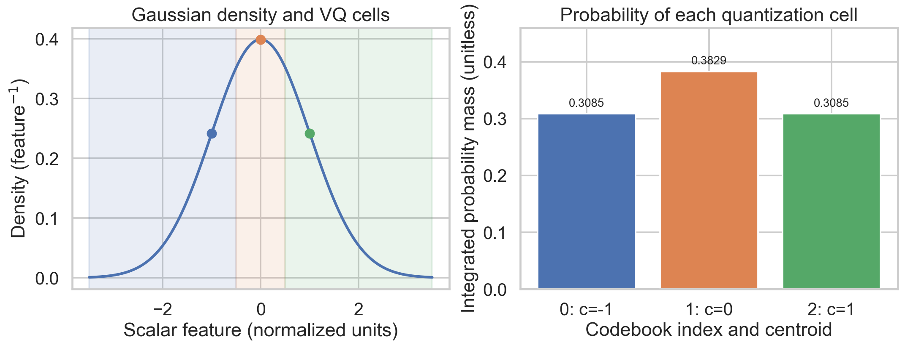
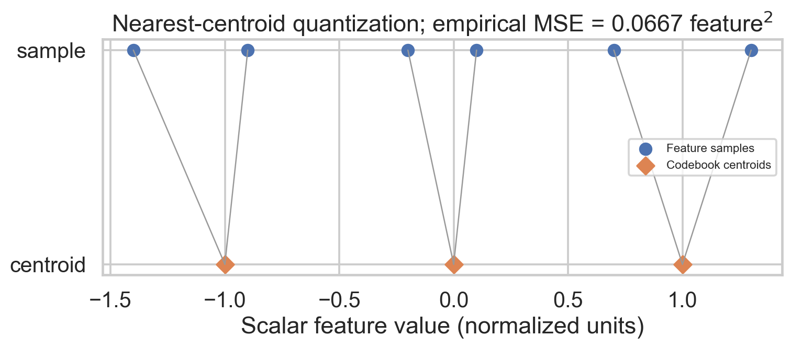
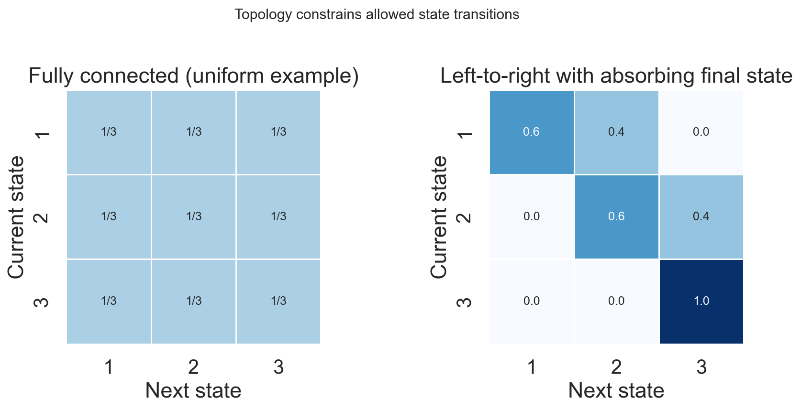
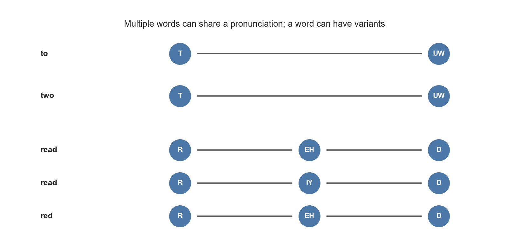
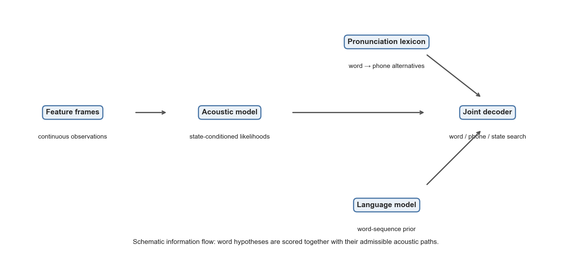
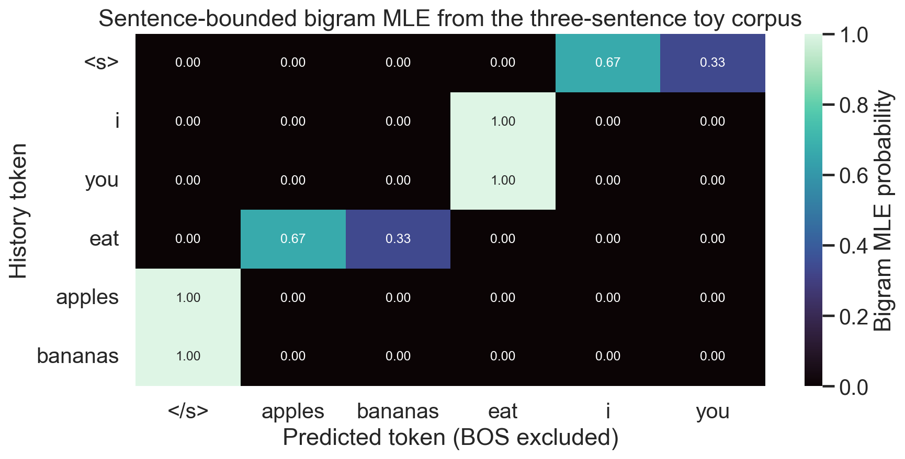
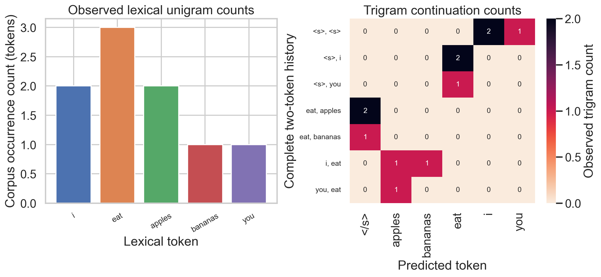
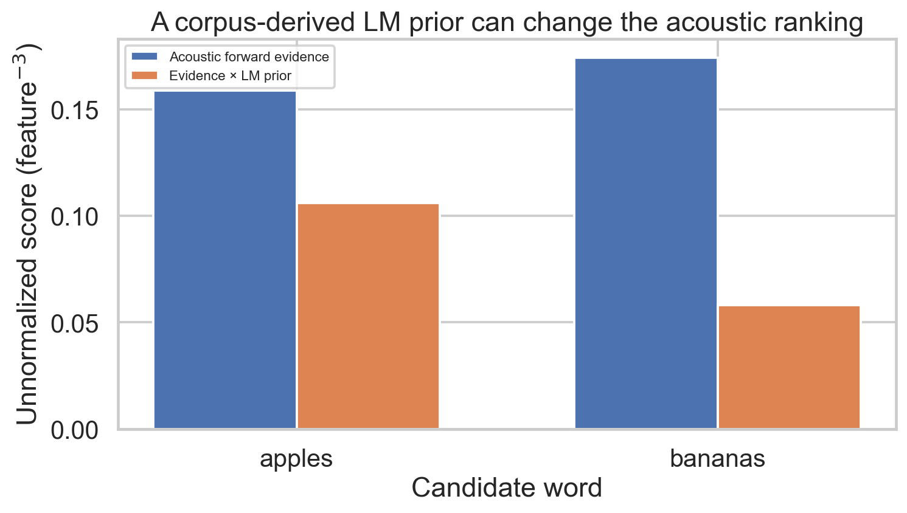

# Week 5: HMM Acoustic Models, Pronunciation Lexicons, and N-Gram Language Models

**Navigation:** ← [[week 4/week-4-notes|Week 4 Notes]] · [[Knowledge-Map|Knowledge Map]] · [[source-catalog|Source Catalog]]

> **Scope:** Six supplied lectures cover HMM applications to speech, continuous versus discrete observations, HMM topology variants, pronunciation lexicons, language-model foundations, and N-gram estimation. This note treats the acoustic model, pronunciation model, and language model as cooperating factors in recognition. The supplied curriculum screenshot also lists assessment labels; no authentic question paper was supplied, and the visible curriculum shows no Practice Assignment.

## Abstract

Week 5 develops the classical statistical architecture that converts acoustic feature sequences into word hypotheses by composing state-based acoustic models, a pronunciation lexicon, and a language model. The HMM is stated completely through its initial distribution, transition law, and state-conditioned emission distributions; discrete emissions are categorical probabilities, whereas continuous emissions are densities over feature vectors and need not be Gaussian mixtures. Speech-oriented topologies encode duration and alignment preferences, while phoneme-state counts, context inventories, and state tying remain modeling conventions rather than universal constants. A pronunciation dictionary maps words to one or more phone sequences, and N-gram language models approximate the chain-rule factorization through an explicit finite-history assumption and smoothing for sparse counts. A fully worked three-sentence corpus gives reproducible unigram, bigram, and trigram probabilities and illustrates why acoustic fit, lexical coverage, and linguistic plausibility must be searched jointly.

## Week 5 lecture and assessment map

| Screenshot lecture | Core question | Treatment here |
|:--|:--|:--|
| 5.1 HMM Applied to Speech | How do hidden states and emissions model a feature-frame sequence? | Sections 1–2 |
| 5.2 Continuous Vs Discrete HMM Models | What changes when observations are vectors rather than symbols? | Section 2 |
| 5.3 Different Types of HMM Models | How do transition constraints encode sequence structure? | Section 3 |
| 5.4 Lexicon/Pronunciation Dictionary | How does a word hypothesis become a phone sequence? | Section 4 |
| 5.5 Introduction to Language Model | How does prior word-sequence probability complement acoustic evidence? | Section 5 |
| 5.6 N-Gram Language Model | How are finite-context probabilities estimated and used? | Sections 6–7 |

**Assessment labels visible in the supplied screenshot:** `AQ5.1 Questions1`; `AQ5.2 Questions1` (repeated title number as shown); `AQ5.3 Questions3`; `AQ5.4 Questions4`; `AQ5.5 Questions5`; `AQ5.6 Questions5`; `Week5 Graded Assignment5`. No Practice Assignment is visible. These are displayed assignment titles; they do not establish how many questions are inside. No question text or official solutions were provided. All solved exercises below are original study problems, not purported past-paper questions.

**Source boundary.** The supplied [March GMM/HMM deck](../sources/GMM_HMM_mar2026.pdf), physical pp. 106–140, and [final GMM/HMM deck](../sources/GMM_HMM_final.pdf), pp. 120–154, support the speech-HMM material. The conventional-ASR review in [End-to-End ASR](../sources/End-to-End-ASR-VW.pdf), physical pp. 6, 10, and 12, corroborates the acoustic-model/lexicon/language-model roles. Its later neural topics are not assigned to this week. No dedicated count-based N-gram lesson or video transcript was found among the supplied files. The N-gram derivations and toy corpus therefore expand the screenshot-defined topic mathematically, rather than reproduce unseen lecture wording. Detailed source ranges are recorded in [[source-catalog]].

## Prerequisite check — answered

1. **What are the three defining pieces of a discrete-time HMM?** The initial-state distribution $\boldsymbol\pi$, transition matrix $A$, and state-conditioned emission model $B$ (a probability mass function for discrete observations or a density for continuous observations). Omitting any one leaves the sequence model incomplete.
2. **What does a GMM provide?** A flexible density $p(\mathbf x)=\sum_{m=1}^{K}c_m\mathcal N(\mathbf x;\boldsymbol\mu_m,\Sigma_m)$, with nonnegative weights summing to one. It is not by itself a phoneme posterior or a complete recognizer.
3. **What does a phoneme-state HMM add to a frame classifier?** A transition structure over latent states, allowing an observation sequence to be scored over temporally constrained state paths.
4. **Why can a continuous density exceed one?** Its integral over the feature space is one; its value at a point is probability per unit volume, not a point-event probability.
5. **How does the probability chain rule begin a word-sequence model?** $P(W)=\prod_i P(w_i\mid w_1,\ldots,w_{i-1})$. This identity is exact; an N-gram approximation limits the conditioning history.

## 1. HMM acoustic modeling for speech

Let the acoustic front end produce frame vectors $O=(\mathbf o_1,\ldots,\mathbf o_T)$ with $\mathbf o_t\in\mathbb R^D$. A speech HMM has hidden state sequence $Q=(q_1,\ldots,q_T)$ taking values in $\{1,\ldots,N\}$. With parameters $\lambda=(\boldsymbol\pi,A,B)$, its generative factorization is

$$P(O,Q\mid\lambda)=\pi_{q_1}b_{q_1}(\mathbf o_1)\prod_{t=2}^{T}a_{q_{t-1}q_t}b_{q_t}(\mathbf o_t).$$

Here $\pi_i=P(q_1=i)$, $a_{ij}=P(q_t=j\mid q_{t-1}=i)$, and $b_j(\mathbf o)=p(\mathbf o\mid q_t=j)$ for continuous features. The observation likelihood sums over all legal paths, $p(O\mid\lambda)=\sum_Q P(O,Q\mid\lambda)$; Viterbi instead selects the best path. A trained HMM therefore defines sequence likelihoods or path scores. Those are not automatically the posterior probability that a frame belongs to a phoneme: posterior classification also depends on priors and competing models, and word recognition additionally requires lexical and language constraints.

### 1.1 GMM emissions: density, not phoneme posterior

A common continuous-observation emission is a $K$-component Gaussian mixture:

$$b_j(\mathbf o)=\sum_{m=1}^{K}c_{jm}\,\mathcal N(\mathbf o;\boldsymbol\mu_{jm},\Sigma_{jm}),\qquad c_{jm}\ge0,\quad\sum_{m=1}^{K}c_{jm}=1.$$

The mixture describes the distribution of feature vectors conditional on state $j$. It is not $P(q_t=j\mid\mathbf o_t)$; Bayes' rule would require state priors and normalization across states, and temporal decoding also uses transitions. Gaussian components can capture multiple acoustic modes within a state. $K$ is a finite model hyperparameter: a GMM does not contain infinitely many components. Gaussian mixtures are conventional and useful, not mandatory; other normalized density families can serve as continuous emissions.

**Terminology guardrail.** $N$ denotes the number of HMM states, $D$ the observation feature dimension, $M$ the number of discrete symbols in a categorical observation alphabet, and $K$ the number of GMM components. These quantities answer different questions and should not be conflated.

## 2. Discrete and continuous observation HMMs

In a discrete-observation HMM, each state emits a symbol $v\in\{1,\ldots,M\}$ with probability $b_j(v)$, where $\sum_{v=1}^M b_j(v)=1$. In a continuous-observation HMM, a state emits a vector $\mathbf o\in\mathbb R^D$ with density $b_j(\mathbf o)$ satisfying $\int_{\mathbb R^D}b_j(\mathbf o)\,d\mathbf o=1$. A density value at one observed frame does not sum to one across frames or across a finite list of sample points. Continuous observations mean continuous-valued features; the model remains a discrete-time sequence indexed by frames.

Vector quantization can map a continuous vector to a codebook index, making a discrete HMM possible. If $C_v$ is the region assigned to codeword $v$, the principled discrete probability is $P(v\mid j)=\int_{C_v}p(\mathbf x\mid j)\,d\mathbf x$. Simply evaluating a density at the codeword centroid does not produce that probability. Quantization discards within-cell detail and is optional; continuous-density models avoid this particular discretization.

| Property | Discrete-emission HMM | Continuous-emission HMM |
|:--|:--|:--|
| Observation | Symbol $v$ in an alphabet of size $M$ | Feature vector $\mathbf o\in\mathbb R^D$ |
| State emission | Mass $b_j(v)$; sums over symbols to 1 | Density $b_j(\mathbf o)$; integrates over feature space to 1 |
| Typical estimation issue | Sparse state-symbol counts | Density family, parameter estimation, covariance regularization |
| Quantization | Symbols may originate from a codebook, but need not | Not required |



**Figure 1.** *A standard-normal density is partitioned by the nearest-centroid cells for codebook values -1, 0, and 1. The right panel integrates each complete cell, including the unbounded tails; those probability masses sum to one, whereas density values at the centroids do not.*



**Figure 2.** *Six fixed scalar feature samples are mapped to their nearest codewords. Lines show the representation error; the mean squared quantization distortion is 0.066667 in squared feature units. This is a deterministic illustration, not a trained speech codebook.*

### Worked check 1 — symbols, dimensions, and normalization

A model has $N=40$ hidden states, uses $D=13$-dimensional feature vectors, and quantizes them into a codebook with $M=256$ labels. Which number controls the row count of $A$, and which controls the number of entries in a discrete emission row?

**Solution.** $A$ is $40\times40$ because its rows and columns index hidden states. A categorical emission row has 256 symbol probabilities. The input dimension is 13 in the continuous representation; it is neither the state count nor the alphabet size.

## 3. HMM topologies for temporal structure

**Course terminology.** The slides use “ergodic HMM” for the fully connected example with all $a_{ij}>0$. That is the intended topology in the course comparison. Formal finite-chain ergodicity is a broader property; the distinction below prevents turning a sufficient condition into a necessary theorem.

Topology is encoded by permitted transition entries in $A$. A fully connected chain permits transitions between every state pair (and sometimes self-loops, depending on the convention). Strictly positive transition probabilities for every pair in a finite chain are sufficient for irreducibility and aperiodicity, hence ergodicity. Ergodicity does not require every transition to be positive: an irreducible, aperiodic chain can contain zero-probability edges. Conversely, a merely connected drawing does not establish both properties unless directionality and periods are considered.

A left-to-right or Bakis topology permits progression through ordered states, often with self-loops and limited forward skips. This expresses a useful alignment prior for speech units. It does not claim that articulators physically cannot move backward; it limits paths in a model of time-aligned acoustic realization. Left-to-right is common for isolated phone/subword models, not a universal rule for all speech HMMs or all ASR architectures. The transition constraint also does not make the acoustic model perfect.

In a conventional phone HMM, a three-emitting-state template is a widespread design convention that allows rough beginning, middle, and ending variation. It is not a universal phonetic law. If an illustrative inventory contains 44 phones and each receives three distinct state positions, the untied count is $44\times3=132$ positions. English phone inventories are not fixed at 44 across dialects, transcription systems, and tasks. Context-dependent triphones can distinguish left/right phone contexts; $P^3$ is an upper combinatorial count for $P$ phone identities, while many contexts never occur. State tying clusters statistically related context-dependent states to share emission parameters, reducing data sparsity.

A complete fixed-horizon example of a no-skip left-to-right transition matrix is

$$A_{LR}=\begin{bmatrix}0.6&0.4&0\\0&0.6&0.4\\0&0&1\end{bmatrix}.$$

It has $a_{31}=0$ and an absorbing final state. This version models a fixed number of emitting frames; it does not model a separate utterance-exit event. A model with an explicit exit must allocate probability to that exit and use a matching termination rule. Self-loops encode duration: for a state with $a_{ii}<1$ and an eventual exit, $P(d)=a_{ii}^{d-1}(1-a_{ii})$ and $E[d]=1/(1-a_{ii})$. The absorbing state has no finite exit duration under that convention.



**Figure 3.** *The two complete transition matrices use the same three-state indexing. Zeros in the left-to-right model forbid backward transitions; its final state is absorbing under the fixed-horizon convention. Numeric annotations are rounded; the underlying rows sum to one.*

### Worked check 2 — correcting an overclaim

**Claim as a general finite-chain theorem:** “Ergodicity requires positive probability on every transition.” Is it valid?

**Solution.** No. Positive probability for all entries of a finite transition matrix is sufficient for ergodicity, but not necessary. For example, a chain can have self-loops and a directed cycle linking all states while several other edges remain zero; the chain is still irreducible and aperiodic. The zero entries encode impossible one-step transitions in that model.

## 4. Pronunciation lexicon: words to phone sequences

A pronunciation lexicon maps each lexical word type to one or more phone sequences under a specified phone inventory and transcription convention. For example, the same orthographic word can have alternate pronunciations conditioned on dialect, stress, or reduction. The lexicon's phone symbols and the acoustic model's phone-state inventory must agree. A lexicon may use ARPAbet-style symbols (often ASCII labels such as `AH0`) or IPA; ARPAbet and IPA are distinct symbol systems and should never be presented as interchangeable spellings.

The lexicon participates in decoding as a constraint and mapping between word sequences and acoustic-unit sequences. It is not necessarily built once and left unchanged: vocabulary, domain, dialect, and observed pronunciation variants can motivate updates. A grapheme-to-phoneme (G2P) system can propose pronunciations for new vocabulary, but adding a word does not make a recognizer automatically recognize it; the vocabulary/search graph and language-model support must also admit it. If the correct pronunciation has been removed from a lexicon, a GMM cannot generally repair the missing lexical path. Acoustic scores may still select a wrong available word whose pronunciation happens to fit, but the intended word is unavailable under that decoding graph.

**Pronunciation probability.** If a word has variants $\phi^{(r)}$ with probabilities $P(\phi^{(r)}\mid w)$, decoding can account for the alternatives rather than silently assuming one canonical realization. The acoustic model scores each expanded state path; the lexicon supplies admissible word-to-phone paths. Lexical alternatives are therefore part of the search, not a post-processing lookup that occurs only after a hard phoneme string has been selected.



**Figure 4.** *A stress-stripped ARPAbet-style toy lexicon illustrates homophones (to/two) and multiple pronunciations (read). The rows map words to phone sequences; they do not claim a one-to-one inverse mapping from a phone string to an orthographic word.*

### Worked check 3 — lexical coverage

A domain-specific surname is absent from the active lexicon. A G2P tool proposes a plausible phone sequence, but the decoder vocabulary/search graph and language model remain unchanged. Has the recognizer's OOV problem necessarily been fixed?

**Solution.** No. The pronunciation proposal must be integrated into the lexicon/search vocabulary, and language-model support or an appropriate unknown-word strategy must allow it to compete. A pronunciation alone is not a complete word hypothesis path.

## 5. Language models and joint ASR decoding

Let $W=(w_1,\ldots,w_L)$ be a candidate word sequence and $O$ the acoustic observations. Bayes' rule gives

$$\hat W=\arg\max_W P(W\mid O)=\arg\max_W P(O\mid W)P(W),$$

since $P(O)$ is common to all candidates. In a practical decoder, $P(O\mid W)$ is induced by acoustic HMM paths consistent with the lexicon's pronunciations; paths and alternate pronunciations may be summed or approximated by a best-path search. $P(W)$ is the language-model prior. A tunable language-model weight $\alpha$ and word insertion term $\beta$ are often used in log-score form, $\log P(O\mid W)+\alpha\log P(W)+\beta|W|$, to compensate for model mismatch and search bias. These are decoder calibration terms, not changes to Bayes' identity.

Let $\Phi$ be a pronunciation sequence admitted by the lexicon $\mathcal L(W)$ and $\mathcal Q(\Phi)$ its compatible HMM paths. A marginal acoustic score can be written as

$$p(O\mid W)=\sum_{\Phi\in\mathcal L(W)}P(\Phi\mid W)\sum_{Q\in\mathcal Q(\Phi)}p(O,Q\mid\Phi).$$

A Viterbi-style decoder can approximate these sums by maxima over compatible pronunciation/state paths. The best single path and the most probable word after summing its paths need not select the same hypothesis. All candidates must be scored on the same observation sequence and feature convention for their densities to be comparable.

The computation is a joint search over compatible word, pronunciation, state, and frame alignments. A rigid “first predict hard phones, then dictionary lookup, then language model” pipeline loses ambiguity too early and is not the general formulation. Likewise, language-model probability expresses statistical preference in training data; it is not a grammatical truth condition. A grammatical sentence can receive low probability, and a frequent but nonsensical sequence can receive a high estimate under a limited model.



**Figure 5.** *Acoustic likelihoods, pronunciation constraints, and a word-sequence prior contribute to a joint decoder. These information-flow arrows do not require committing to a hard phone string before consulting the dictionary or language model.*

## 6. N-gram language models

The chain rule expresses a sequence probability exactly:

$$P(w_1,\ldots,w_L)=\prod_{i=1}^{L}P(w_i\mid w_1,\ldots,w_{i-1}).$$

An N-gram model approximates each conditional using at most the preceding $N-1$ tokens:

$$P(w_i\mid w_1,\ldots,w_{i-1})\approx P(w_i\mid w_{i-N+1},\ldots,w_{i-1}).$$

Thus a unigram uses no history, a bigram uses one preceding token, and a trigram uses two. This finite-context assumption is a tractable approximation with a bias/variance tradeoff; it is not based on a claim that full-context probabilities are mathematically impossible. The challenge is data sparsity and estimation: many long histories have few or zero observations. Smoothing redistributes probability mass to unseen or rare events, while backoff/interpolation uses lower-order evidence. Exact chain-rule contexts would require reliable estimates for an enormous number of histories, which finite corpora cannot supply.

### 6.1 Maximum-likelihood counts and sentence boundaries

For a bigram model with explicit start token `<s>` and end token `</s>`, the unsmoothed maximum-likelihood estimate is

$$\widehat P(w_i\mid w_{i-1})=\frac{C(w_{i-1},w_i)}{C_{\mathrm{out}}(w_{i-1})},$$

The estimate follows by maximizing $\ell=\sum_{h,w}C(h,w)\ln p(w\mid h)$ subject to $\sum_w p(w\mid h)=1$ for each observed history. A Lagrange multiplier yields $p(w\mid h)=C(h,w)/C_{\mathrm{out}}(h)$, where $C_{\mathrm{out}}(h)=\sum_w C(h,w)$ counts the observed outgoing bigrams from history $h$. It is the outgoing-history count, not blindly the raw count of a token in all positions: a final token has no observed successor unless an `</s>` transition is included. Sentence boundaries reset history. `<s>` is context supplied to predict the first token; it is not itself predicted. `</s>` is an outcome predicted at sentence end.

For this week's explicit toy corpus, the vocabulary is case-folded and whitespace-tokenized, contains only the words `i`, `you`, `eat`, `apples`, `bananas`, and adds one `</s>` after each sentence. No `<s>` is included in the predicted-token denominator; each sentence receives one `<s>` context. The three sentences are:

```text
i eat apples
i eat bananas
you eat apples
```

The word-token count is 9. With sentence-end tokens, the model predicts 12 outcomes. Relevant counts include $C(\texttt{eat},\texttt{apples})=2$, $C(\texttt{eat},\texttt{bananas})=1$, and $C_{\mathrm{out}}(\texttt{eat})=3$. Hence

$$\widehat P(\texttt{apples}\mid\texttt{eat})=\frac23,\qquad
\widehat P(\texttt{bananas}\mid\texttt{eat})=\frac13.$$

The start-token bigrams are `<s> i` twice and `<s> you` once. The end transitions are `apples </s>` twice and `bananas </s>` once. Therefore the unsmoothed bigram sentence probability for `i eat apples` is

$$P(\texttt{i eat apples </s>}\mid\texttt{<s>})=\frac23\cdot1\cdot\frac23\cdot1=\frac49.$$



**Figure 6.** *Every row is the outgoing-token MLE distribution for a history observed in the toy corpus. BOS occurs only as history; EOS is a predicted outcome. Zero cells indicate unseen continuations for those known histories, not impossible English constructions.*

**Unigram denominators.** Word-only counts give $P(eat)=3/9=1/3$. If EOS is also an outcome in the unigram model, there are 12 predicted tokens and $P(eat)=3/12=1/4$. These are two explicitly different outcome conventions, not competing answers to the same model. BOS is excluded in both.

**Trigram calculation.** Pad each sentence with two BOS context tokens. Then $P(i\mid BOS,BOS)=2/3$, $P(eat\mid BOS,i)=1$, $P(apples\mid i,eat)=1/2$, and $P(EOS\mid eat,apples)=1$. Therefore

$$P(i,\,eat,\,apples,\,EOS\mid BOS,BOS)=\frac23\cdot1\cdot\frac12\cdot1=\frac13.$$

The difference from the bigram score $4/9$ comes from conditioning on two preceding tokens rather than one. The bigram model also assigns $1/9$ to the unobserved complete sentence `you eat bananas`, because its individual bigrams were observed elsewhere. The trigram `you eat bananas` has zero count under the observed history `you eat`, so the unsmoothed trigram sentence score is zero. “Unseen sentence” and “unseen N-gram” are different statements.



**Figure 7.** *The left panel shows lexical token counts without EOS. The right panel retains each complete two-token history when tabulating trigram continuations; collapsing the first history token would discard the defining trigram context.*

### 6.2 Vocabulary and zeros; additive smoothing as a practical extension

An operational N-gram model needs a documented tokenization, casing policy, punctuation policy, vocabulary, and unknown-token strategy (often mapping rare/unseen words to `<unk>` before counting). Without these choices, corpus counts are ambiguous. For a history with observed continuations, unsmoothed MLE assigns zero probability to an unseen continuation. If the history itself has no observations, the ratio is $0/0$ and the data do not identify a unique conditional distribution; the lab reports an undefined MLE row rather than pretending it is normalized. A zero-probability event under a known history makes the complete sentence score zero. Additive smoothing such as Laplace estimation uses $(C(h,w)+\alpha)/(C_{out}(h)+\alpha V)$ with $\alpha>0$ for a fixed predicted-outcome vocabulary of size $V$, but can over-allocate mass for language data. Discounting and interpolation/backoff are generally more effective for realistic corpora. Smoothing applies only to the declared vocabulary: it does not introduce a new OOV word or make BOS a predicted token. Whatever the method, probability distributions must normalize over their explicitly defined predicted-token vocabulary.

### Worked check 4 — bigram probability and boundary accounting

Using the stated toy corpus with EOS, compute $P(\texttt{bananas}\mid\texttt{eat})$ and explain why the denominator is three.

**Solution.** `eat` is followed by `apples` twice and `bananas` once. Thus $C(\texttt{eat},\cdot)=2+1=3$ and $P(\texttt{bananas}\mid\texttt{eat})=1/3$. No sentence ends immediately after `eat` in this corpus, so EOS adds no outgoing count from `eat`. In another corpus, EOS would be counted as an outcome after any final `eat`.

## 7. Concept → Code → Output → Interpretation laboratory

### Concept

This small deterministic calculation verifies the unsmoothed bigram counts for the specified corpus. It includes one EOS prediction per sentence, does not predict BOS, and resets context between sentences. The lab also checks quantizer distortion, integrated cell probabilities, topology normalization, lexicon alternatives, and a computed acoustic/LM candidate comparison.

### Code and actual output

The executable is saved as [week5_lab.py](../week5_lab.py). It includes normalized count-model checks, vocabulary guards, VQ calculations, and exhaustive verification of the short acoustic-HMM Forward sums.

```python
"""Self-contained deterministic Week 5 speech-recognition foundations lab."""
from collections import Counter
from itertools import product
import math
import numpy as np

CORPUS = [["i", "eat", "apples"], ["i", "eat", "bananas"], ["you", "eat", "apples"]]
BOS, EOS = "<s>", "</s>"

def ngram_counts(sentences):
    unigram, bigram, trigram = Counter(), Counter(), Counter()
    for sentence in sentences:
        seq = [BOS, BOS] + list(sentence) + [EOS]
        unigram.update(sentence)
        bigram.update(zip(seq[1:], seq[2:]))
        trigram.update(zip(seq[:-2], seq[1:-1], seq[2:]))
    return unigram, bigram, trigram

UNIGRAM, BIGRAM, TRIGRAM = ngram_counts(CORPUS)
VOCAB = sorted(set(UNIGRAM) | {EOS})  # BOS is context only.
HISTORY_COUNTS = Counter()
for (history, _word), count in BIGRAM.items():
    HISTORY_COUNTS[history] += count

def bigram_mle(history, word):
    denominator = HISTORY_COUNTS[history]
    if denominator == 0:
        raise ValueError(f"unseen history {history!r}: MLE row is undefined")
    return BIGRAM[(history, word)] / denominator

def bigram_add_one(history, word, alpha=1.0):
    if alpha <= 0:
        raise ValueError("additive smoothing requires positive alpha")
    if word not in VOCAB:
        return 0.0  # Fixed vocabulary: smoothing does not invent an OOV outcome.
    denominator = HISTORY_COUNTS[history] + alpha * len(VOCAB)
    return (BIGRAM[(history, word)] + alpha) / denominator

def utterance_probability(words):
    seq = [BOS] + list(words) + [EOS]
    p = 1.0
    for h, w in zip(seq[:-1], seq[1:]):
        p *= bigram_mle(h, w)
        if p == 0:
            return 0.0
    return p

TRIGRAM_HISTORY = Counter()
for (h1, h2, _word), count in TRIGRAM.items():
    TRIGRAM_HISTORY[(h1,h2)] += count

def trigram_mle(h1, h2, word):
    denominator = TRIGRAM_HISTORY[(h1,h2)]
    if denominator == 0:
        raise ValueError(f"unseen two-token history {(h1,h2)!r}: MLE row is undefined")
    return TRIGRAM[(h1,h2,word)] / denominator

def trigram_probability(words):
    seq = [BOS,BOS] + list(words) + [EOS]
    probability = 1.0
    for h1,h2,word in zip(seq,seq[1:],seq[2:]):
        probability *= trigram_mle(h1,h2,word)
        if probability == 0:
            return 0.0
    return probability

def quantize_1d(values, codebook):
    """Nearest centroid; np.argmin gives deterministic lower-index tie breaking."""
    values, codebook = np.asarray(values, float), np.asarray(codebook, float)
    indices = np.argmin(np.abs(values[:, None] - codebook[None, :]), axis=1)
    return indices, codebook[indices], float(np.mean((values - codebook[indices])**2))

def gaussian_cell_mass(lo, hi, mean, variance):
    scale = math.sqrt(2.0 * variance)
    return 0.5 * (math.erf((hi-mean)/scale) - math.erf((lo-mean)/scale))

def gaussian_pdf(x, mean, variance):
    return math.exp(-0.5*(x-mean)**2/variance) / math.sqrt(2*math.pi*variance)

def forward(pi, transition, emissions):
    alpha = np.asarray(pi, float) * emissions[0]
    for e in emissions[1:]:
        alpha = (alpha @ transition) * e
    return float(alpha.sum())

def enumerate_hmm(pi, transition, emissions):
    n, T = len(pi), len(emissions)
    total = 0.0
    for path in product(range(n), repeat=T):
        p = pi[path[0]] * emissions[0][path[0]]
        for t in range(1, T):
            p *= transition[path[t-1], path[t]] * emissions[t][path[t]]
        total += p
    return total

def acoustic_candidates():
    pi = np.array([1., 0., 0.])
    a = np.array([[.6,.4,0.],[0.,.6,.4],[0.,0.,1.]])
    assert np.allclose(a.sum(1),1) and np.isclose(pi.sum(),1)
    observations = np.array([0.0, 0.1, 0.2])
    means = {"apples": np.array([.2,.4,.6]), "bananas": np.array([0.,.2,.4])}
    variance = .5
    result = {}
    for word, mu in means.items():
        emissions = np.array([[gaussian_pdf(x, m, variance) for m in mu] for x in observations])
        result[word] = forward(pi, a, emissions)
    assert all(math.isclose(forward(pi,a,np.array([[gaussian_pdf(x,m,variance) for m in mu] for x in observations])),
                            enumerate_hmm(pi,a,np.array([[gaussian_pdf(x,m,variance) for m in mu] for x in observations])))
               for mu in means.values())
    return result

def run():
    assert sum(map(len, CORPUS)) == 9
    assert sum(BIGRAM.values()) == 12
    assert not any(w == BOS for (_h,w) in BIGRAM)
    assert BIGRAM[("apples","i")] == 0  # Sentences do not create cross-boundary bigrams.
    assert math.isclose(trigram_probability(["i","eat","apples"]), 1/3)
    assert trigram_probability(["you","eat","bananas"]) == 0
    assert all(math.isclose(sum(trigram_mle(*h,w) for w in VOCAB),1) for h in TRIGRAM_HISTORY)
    assert all(math.isclose(sum(bigram_add_one(h,w) for w in VOCAB),1) for h in [*HISTORY_COUNTS,"unseen"])
    assert bigram_add_one("eat", BOS) == 0 and bigram_add_one("eat", "outside-vocabulary") == 0
    assert math.isclose(bigram_mle("eat", "apples"), 2/3)
    assert math.isclose(utterance_probability(["i","eat","apples"]), 4/9)
    assert math.isclose(TRIGRAM[(BOS,BOS,"you")]/sum(v for (a,b,_),v in TRIGRAM.items() if (a,b)==(BOS,BOS)), 1/3)
    assert math.isclose(utterance_probability(["you","eat","bananas"]), 1/9)
    assert TRIGRAM[("you","eat","bananas")] == 0
    assert math.isclose(sum(utterance_probability(w) for w in product(("i","you"), ("eat",), ("apples","bananas"))), 1)
    assert all(math.isclose(sum(bigram_mle(h,w) for w in VOCAB), 1) for h in HISTORY_COUNTS)
    assert bigram_mle("eat", "you") == 0 and bigram_add_one("eat", "you") > 0
    try:
        bigram_mle("unseen", "apples")
    except ValueError:
        pass
    else:
        raise AssertionError("unseen-history MLE must be undefined")
    print("Corpus lexical tokens:", sum(map(len,CORPUS)))
    print(f"Unigram P(eat): word-only={UNIGRAM['eat']/sum(UNIGRAM.values()):.6f}; with EOS={UNIGRAM['eat']/sum(BIGRAM.values()):.6f}")
    print("Bigram prediction events (BOS once, EOS once per sentence):", sum(BIGRAM.values()))
    print("Prediction vocabulary (BOS excluded):", ", ".join(VOCAB))
    print(f"P(apples | eat) = {bigram_mle('eat','apples'):.6f}")
    print(f"P(i eat apples EOS | BOS) = {utterance_probability(['i','eat','apples']):.6f}")
    print(f"P(you | BOS,BOS) trigram = {TRIGRAM[(BOS,BOS,'you')]/sum(v for (a,b,_),v in TRIGRAM.items() if (a,b)==(BOS,BOS)):.6f}")
    print(f"P(you eat bananas EOS | BOS) bigram = {utterance_probability(['you','eat','bananas']):.6f}; trigram count = {TRIGRAM[('you','eat','bananas')]}")
    probs = [utterance_probability(w) for w in product(("i","you"),("eat",),("apples","bananas"))]
    print(f"P(i eat apples EOS | BOS,BOS) trigram = {trigram_probability(['i','eat','apples']):.6f}")
    print(f"P(you eat bananas EOS | BOS,BOS) trigram = {trigram_probability(['you','eat','bananas']):.6f}")
    print("Four-utterance bigram mass (words + EOS):", f"{sum(probs):.6f}")
    print("P(you | eat), unsmoothed / add-one:", f"{bigram_mle('eat','you'):.6f} / {bigram_add_one('eat','you'):.6f}")
    print("Unseen history MLE: undefined (raised ValueError)")
    lexicon = {"to":[("T","UW")], "two":[("T","UW")], "read":[("R","EH","D"),("R","IY","D")], "red":[("R","EH","D")]}
    print("Toy lexicon entries (ARPAbet-like phones, stress stripped):")
    for word, pronunciations in lexicon.items(): print(f"  {word}: {' | '.join(' '.join(p) for p in pronunciations)}")
    assert lexicon["to"][0] == lexicon["two"][0] and len(lexicon["read"]) == 2
    points = np.array([-1.4,-.9,-.2,.1,.7,1.3]); codebook=np.array([-1.,0.,1.])
    ids, q, distortion = quantize_1d(points, codebook)
    assert np.all(np.diff(codebook)>0) and np.allclose(ids,[0,0,1,1,2,2])
    edges=np.array([-math.inf,-.5,.5,math.inf]); masses=np.array([gaussian_cell_mass(edges[i],edges[i+1],0.,1.) for i in range(3)])
    assert np.isclose(masses.sum(),1.)
    print("VQ feature samples:", np.array2string(points, precision=1))
    print("VQ codebook / assignment indices:", np.array2string(codebook,precision=1), "/", ids.tolist())
    print(f"VQ mean squared quantization distortion (feature^2): {distortion:.6f}")
    print("Illustrative MFCC design: N=3 HMM states; K=2 GMM components/state; D=13 features; M=3 VQ codewords.")
    print("Executed scalar demonstrations: D=1; candidate-HMM emissions use single Gaussians (K=1), without training.")
    print("Gaussian N(0,1) masses in VQ Voronoi cells:", np.array2string(masses,precision=6))
    print("Gaussian density at centroids (feature^-1):", np.array2string(np.array([gaussian_pdf(c,0,1) for c in codebook]),precision=6))
    full=np.ones((3,3))/3
    left=np.array([[.6,.4,0.],[0.,.6,.4],[0.,0.,1.]])
    erg=np.array([[.5,.5,0.],[0.,.5,.5],[.5,0.,.5]])
    assert all(np.allclose(m.sum(axis=1),1) for m in (full,left,erg))
    assert np.all(left[np.tril_indices(3,-1)]==0) and left[2,2]==1
    assert np.all(erg @ erg > 0)  # A positive power establishes finite-chain ergodicity here.
    print("Topology row sums: fully connected =",np.array2string(full.sum(1),precision=1),"; left-to-right =",np.array2string(left.sum(1),precision=1))
    print("Left-to-right forbidden backward transitions: exactly 0; final-state self-loop: 1")
    print("Irreducible, aperiodic counterexample (cycle + self-loops) row sums:",np.array2string(erg.sum(1),precision=1))
    am=acoustic_candidates(); lm={w:bigram_mle("eat",w) for w in am}
    am_winner=max(am,key=am.get); combined={w:am[w]*lm[w] for w in am}; joint_winner=max(combined,key=combined.get)
    assert am_winner=="bananas" and joint_winner=="apples"
    print("Synthetic 3-state continuous-HMM acoustic evidence (feature^-3):", ", ".join(f"{w}={am[w]:.9f}" for w in am))
    print("Acoustic-only winner:",am_winner)
    print("LM priors P(word | eat): " + ", ".join(f"{w}={lm[w]:.6f}" for w in am))
    print("Unnormalized AM × LM scores:",", ".join(f"{w}={combined[w]:.9f}" for w in combined))
    print("Combined winner:",joint_winner)
    print("Acoustic models use the same fixed 3-frame horizon; final states are marginalized, with no exit event.")
    print("Recognition score is a toy candidate comparison; the lexicon above is not compiled into these 3-state word models.")

if __name__ == "__main__": run()
```

**Output (verbatim from `uv run python week5_lab.py`):**

```text
Corpus lexical tokens: 9
Unigram P(eat): word-only=0.333333; with EOS=0.250000
Bigram prediction events (BOS once, EOS once per sentence): 12
Prediction vocabulary (BOS excluded): </s>, apples, bananas, eat, i, you
P(apples | eat) = 0.666667
P(i eat apples EOS | BOS) = 0.444444
P(you | BOS,BOS) trigram = 0.333333
P(you eat bananas EOS | BOS) bigram = 0.111111; trigram count = 0
P(i eat apples EOS | BOS,BOS) trigram = 0.333333
P(you eat bananas EOS | BOS,BOS) trigram = 0.000000
Four-utterance bigram mass (words + EOS): 1.000000
P(you | eat), unsmoothed / add-one: 0.000000 / 0.111111
Unseen history MLE: undefined (raised ValueError)
Toy lexicon entries (ARPAbet-like phones, stress stripped):
  to: T UW
  two: T UW
  read: R EH D | R IY D
  red: R EH D
VQ feature samples: [-1.4 -0.9 -0.2  0.1  0.7  1.3]
VQ codebook / assignment indices: [-1.  0.  1.] / [0, 0, 1, 1, 2, 2]
VQ mean squared quantization distortion (feature^2): 0.066667
Illustrative MFCC design: N=3 HMM states; K=2 GMM components/state; D=13 features; M=3 VQ codewords.
Executed scalar demonstrations: D=1; candidate-HMM emissions use single Gaussians (K=1), without training.
Gaussian N(0,1) masses in VQ Voronoi cells: [0.308538 0.382925 0.308538]
Gaussian density at centroids (feature^-1): [0.241971 0.398942 0.241971]
Topology row sums: fully connected = [1. 1. 1.] ; left-to-right = [1. 1. 1.]
Left-to-right forbidden backward transitions: exactly 0; final-state self-loop: 1
Irreducible, aperiodic counterexample (cycle + self-loops) row sums: [1. 1. 1.]
Synthetic 3-state continuous-HMM acoustic evidence (feature^-3): apples=0.158752826, bananas=0.174174945
Acoustic-only winner: bananas
LM priors P(word | eat): apples=0.666667, bananas=0.333333
Unnormalized AM × LM scores: apples=0.105835217, bananas=0.058058315
Combined winner: apples
Acoustic models use the same fixed 3-frame horizon; final states are marginalized, with no exit event.
Recognition score is a toy candidate comparison; the lexicon above is not compiled into these 3-state word models.
```

### Interpretation

The count ratio for `apples` after `eat` must be $2/3$, while `bananas` after `eat` is $1/3$. The sentence probability under the unsmoothed bigram model is $4/9$ for `i eat apples </s>`: the start transition to `i` contributes $2/3$, `eat` after `i` contributes one, `apples` after `eat` contributes $2/3$, and EOS after `apples` contributes one. The trigram sequence probability is $1/3$, because the first-token probability is $2/3$ and the two-token history `i eat` has two observed continuations. These corpus probabilities are exact for this toy sample but poor estimates of general language behavior; an unseen N-gram continuation under an observed history receives zero without smoothing, even though an entirely unseen sentence can have a nonzero score.

### Acoustic evidence and language prior in the executed example

The lab defines two coarse three-state word prototypes over the same three scalar feature frames, with the same normalized transition matrix and initial convention. Forward sums over every final state at that fixed horizon. Acoustic density is about `0.158752826` for the apples prototype and `0.174174945` for bananas, so acoustic-only comparison favors bananas. Multiplication by the measured corpus conditionals $P(apples\mid eat)=2/3$ and $P(bananas\mid eat)=1/3$ gives scores about `0.105835217` and `0.058058315`; the combined comparison favors apples.

These are unnormalized candidate scores for the same acoustic window, not calibrated posterior probabilities or recognition accuracy. The coarse prototype models are not built by compiling the separate toy pronunciation dictionary, and are not claimed to use three states per phoneme.



**Figure 8.** *Forward acoustic likelihoods favor one toy word prototype, while the corpus-derived language prior reverses the ranking. The language-model factors are dimensionless, so both plotted score types retain the three-frame acoustic density units.*

## 8. Original solved practice — not authentic assessment questions

### Problem A: GMM likelihood versus state posterior

Two HMM states assign densities $b_1(x)=0.8$ and $b_2(x)=1.2$ at a particular feature point. Their prior state probabilities are $P(q=1)=0.75$ and $P(q=2)=0.25$, and assume a single independent frame. Which state has the larger posterior probability?

**Solution.** Unnormalized joint densities are $0.75(0.8)=0.60$ and $0.25(1.2)=0.30$. The normalizer is $0.90$, so posterior probabilities are $2/3$ and $1/3$. Although state 2 has the larger density value, state 1 has the larger posterior because its prior is larger. Density values themselves are not posterior probabilities.

### Problem B: topology and illustrative state count

An illustrative system uses 44 phone labels and three untied HMM emitting positions per phone. How many positions does this design create? What does this number fail to establish?

**Solution.** $44\times3=132$ state positions. It does not establish that English universally has 44 phones, that every phone must have three states, or that all deployed models retain 132 distinct emission distributions. State tying may share parameters, and the inventory varies with transcription and language/dialect.

### Problem C: lexicon alternatives in decoding

Word $w$ has pronunciations $r_1,r_2$ with prior probabilities $0.7,0.3$. The acoustic likelihoods are $0.02,0.10$ respectively. Ignoring other words and language terms, compare their weighted contributions.

**Solution.** The joint contributions are $0.7(0.02)=0.014$ and $0.3(0.10)=0.030$. Although $r_2$ has the lower pronunciation prior, its acoustic fit makes the larger contribution. If marginalizing pronunciations, their total contribution is $0.044$; a Viterbi-style approximation would retain the larger path contribution $0.030$. This illustrates why committing to one canonical pronunciation before acoustic scoring can discard the best explanation.

### Problem D: Bayes decoding with a language prior

Two shown candidates from a larger hypothesis set have acoustic likelihoods $P(O\mid W_a)=0.02$, $P(O\mid W_b)=0.01$ and language priors $P(W_a)=0.1$, $P(W_b)=0.4$. Which wins under the unscaled product objective?

**Solution.** Products are $0.002$ and $0.004$, so $W_b$ wins even though its acoustic likelihood is half as large. The result is a model-based preference, not proof that $W_b$ is linguistically correct. Acoustic scaling may change the ranking in a practical decoder.

### Problem E: N-gram zero probability

Suppose `see` has observed outgoing continuations, `birds` belongs to the declared vocabulary, but the bigram `see birds` is unseen. What is its maximum-likelihood bigram probability, and what does smoothing change?

**Solution.** The raw count is zero, so unsmoothed MLE gives $P(\texttt{birds}\mid\texttt{see})=0$. Smoothing reserves some probability mass for unseen continuations, producing a nonzero estimate and reducing mass assigned to observed events. Its normalization depends on the declared vocabulary and smoothing method.

### Problem F: context count versus tied parameter count

Assume an illustrative inventory of 50 phones and that every left-center-right combination is admitted. How many triphone labels are possible? How many emitting positions result if each gets three positions?

**Solution.** There are $50^3=125{,}000$ context labels and $3\cdot125{,}000=375{,}000$ untied emitting positions. Real systems omit inadmissible/unobserved contexts and can tie state emission parameters, so these are combinatorial upper-design counts rather than a requirement for 375,000 distinct learned GMMs.

## 9. Pathologies and diagnostic traps

- **Replacing the HMM with a density:** A GMM estimates a feature density conditional on a component/state; it provides neither initial-state probabilities nor transition dynamics. Keep $\pi$, $A$, and the emission distributions explicit.
- **Calling density a posterior:** $p(\mathbf o\mid q)$ and $P(q\mid\mathbf o)$ are different quantities. Apply Bayes' rule across alternatives when a frame posterior is needed.
- **Confusing time and observation type:** Continuous-valued frame features do not imply continuous-time state dynamics. Standard speech HMMs remain discrete-time models.
- **Treating common conventions as laws:** Three emitting states per phone, a fixed 44-phone English inventory, and universally left-to-right ASR are not universal truths.
- **Overstating ergodicity:** Full positive support is sufficient for a finite chain to be ergodic, not necessary. Check irreducibility and aperiodicity directly.
- **Hard lexical commitment:** A single pronunciation path can fail on reduction, accent, or alternate pronunciation. Preserve supported variants and score paths jointly.
- **Assuming the dictionary repairs OOV automatically:** A G2P pronunciation must be added to the lexicon/search vocabulary and be compatible with language-model decoding.
- **Zero-probability N-grams:** For an observed history, a zero-count continuation annihilates a sentence score; an entirely unobserved history has no uniquely identified MLE row. Smoothing, backoff, or interpolation is required for robust generalization.
- **Boundary-count errors:** Sentence boundaries reset histories; EOS can be a predicted event; BOS is context rather than a predicted word. State denominator conventions before reporting unigram counts.
- **Mistaking LM probability for grammar:** N-gram probability reflects a finite corpus and finite context. It is neither a grammaticality oracle nor a semantic model.

## 10. Master formula sheet

| Quantity | Formula | Interpretation |
|:--|:--|:--|
| HMM path joint | $\pi_{q_1}b_{q_1}(o_1)\prod_{t=2}^T a_{q_{t-1}q_t}b_{q_t}(o_t)$ | Initial state, transitions, and emissions all contribute |
| HMM evidence | $p(O\mid\lambda)=\sum_Q P(O,Q\mid\lambda)$ | Marginalizes all legal hidden paths |
| GMM state emission | $b_j(\mathbf o)=\sum_{m=1}^K c_{jm}\mathcal N(\mathbf o;\mu_{jm},\Sigma_{jm})$ | Finite mixture density conditioned on state |
| Categorical emission normalization | $\sum_{v=1}^M b_j(v)=1$ | Probability mass over discrete symbols |
| Continuous emission normalization | $\int b_j(\mathbf o)\,d\mathbf o=1$ | Density integrates over feature volume |
| ASR Bayes objective | $\hat W=\arg\max_W P(O\mid W)P(W)$ | Acoustic evidence and word-sequence prior jointly rank hypotheses |
| Chain rule | $P(W)=\prod_iP(w_i\mid w_{<i})$ | Exact factorization with entire history |
| N-gram approximation | $P(w_i\mid w_{<i})\approx P(w_i\mid w_{i-N+1:i-1})$ | Retains at most $N-1$ preceding tokens |
| Unigram MLE | $\widehat P(w)=C(w)/N_{pred}$ | Declare whether predicted-token count includes EOS |
| Bigram MLE | $\widehat P(w\mid h)=C(h,w)/C_{out}(h)$ | Outgoing counts under the declared boundary/token policy |
| Trigram MLE | $\widehat P(w\mid h_1,h_2)=C(h_1,h_2,w)/\sum_v C(h_1,h_2,v)$ | Both preceding tokens remain in chronological order |

## Mastery checklist and handoff

- [ ] I can distinguish HMM states, observation dimensions, codebook size, and GMM component count.
- [ ] I can explain why a density at a centroid differs from the probability of its VQ cell.
- [ ] I can write a normalized left-to-right transition matrix and state its ending convention.
- [ ] I can separate course topology terminology from the formal definition of ergodicity.
- [ ] I can represent multiple pronunciations and homophones without confusing phone symbols and words.
- [ ] I can combine acoustic likelihood, pronunciation constraints, and a word-sequence prior.
- [ ] I can count sentence-bounded unigram, bigram, and trigram events with explicit BOS/EOS rules.
- [ ] I can distinguish a zero-count continuation, an unseen history, and a word outside the vocabulary.

Week 4 supplied inference over state paths; Week 5 connects that acoustic reasoning to pronunciation and text-side probability. Continue through [[Knowledge-Map]] when the next week's scope is available.

## References

1. Lawrence R. Rabiner. 1989. “A Tutorial on Hidden Markov Models and Selected Applications in Speech Recognition.” *Proceedings of the IEEE* 77(2), 257–286. [doi:10.1109/5.18626](https://doi.org/10.1109/5.18626). **Contribution:** Standard derivation of HMM sequence likelihood, state inference, and speech recognition use.
2. Frederick Jelinek. 1997. *Statistical Methods for Speech Recognition*. MIT Press. **Contribution:** Comprehensive account of statistical acoustic, pronunciation, and language-model components in speech recognition.
3. Stanley F. Chen and Joshua Goodman. 1999. “An Empirical Study of Smoothing Techniques for Language Modeling.” *Computer Speech & Language* 13(4), 359–394. [doi:10.1006/csla.1999.0128](https://doi.org/10.1006/csla.1999.0128). **Contribution:** Comparative empirical treatment of smoothing methods for sparse N-gram counts.
4. Daniel Jurafsky and James H. Martin. 2009. *Speech and Language Processing*, 2nd ed. Pearson Prentice Hall. ISBN 978-0131873216. **Contribution:** Textbook treatment of chain-rule language models, N-gram count estimation, and speech-recognition architecture.
5. *GMM_HMM_mar2026.pdf* and *GMM_HMM_final.pdf*, supplied course materials, HMM/GMM speech model portions (physical pp. 106–140 and 120–154 respectively). **Contribution:** Course-specific introduction to continuous acoustic observations, HMM/GMM speech models, and phone-state modeling.

6. Supplied [End-to-End ASR course deck](../sources/End-to-End-ASR-VW.pdf), conventional-ASR review, physical pp. 6, 10, 12. **Contribution:** Supporting descriptions of the acoustic model, pronunciation lexicon, and language model as components of conventional recognition.

## Computational reproducibility

From the `Speech Technology/` track root:

```bash
uv sync --frozen
uv run python week5_lab.py
uv run python generate_week5_plots.py
```

The exact console output is saved in `week 5/week5_lab_output.txt`; the eight active figure hashes are recorded in `week 5/plot_sha256.txt`. Fixed examples and count-derived parameters make the figures and printed results deterministic.

## Knowledge graph connections

**Upstream:** [[hidden-markov-models]] · [[gaussian-mixture-models]] · [[viterbi-algorithm]] · [[cepstral-analysis-mfcc]]

**Core Week 5 nodes:** [[hmm-gmm-acoustic-modeling]] · [[discrete-continuous-hmm]] · [[hmm-topologies]] · [[lexicon-pronunciation-dictionary]] · [[n-gram-language-model]] · [[asr-bayesian-decoding]]

**Related structure:** [[triphone-state-tying]] · [[Knowledge-Map]] · [[source-catalog]]
