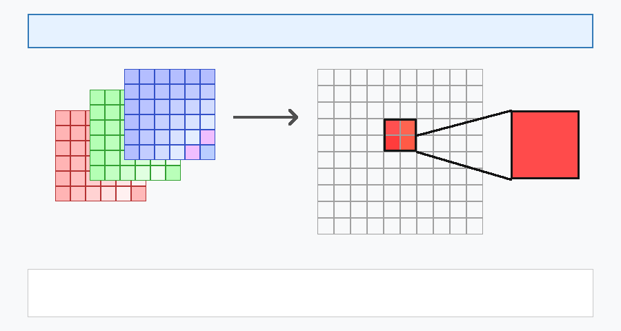
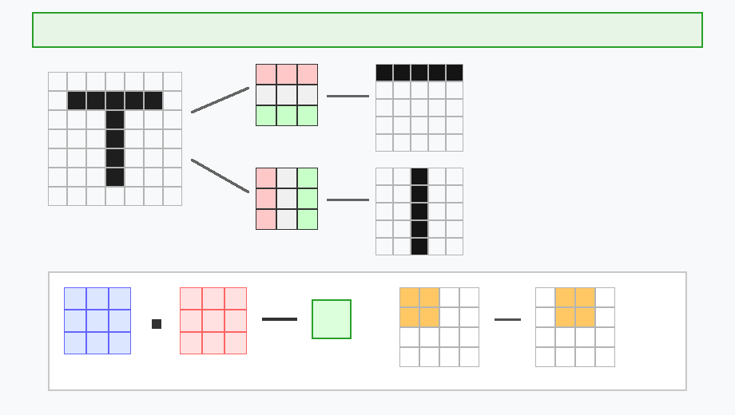
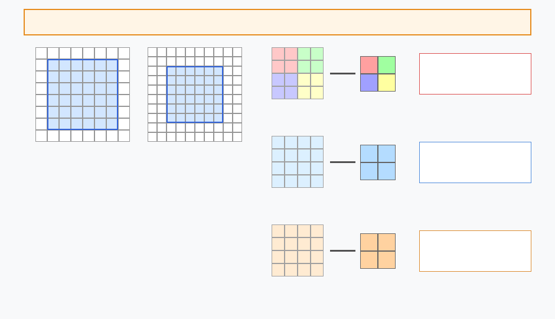
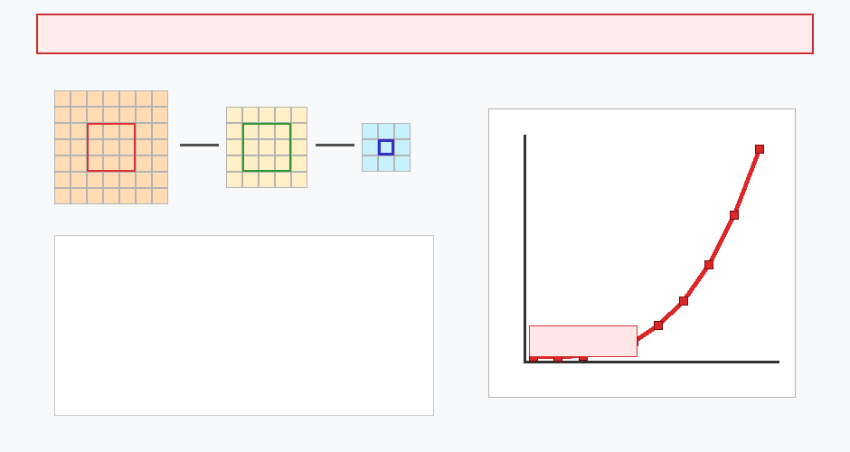
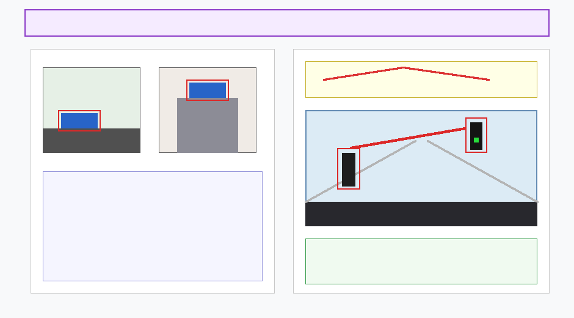
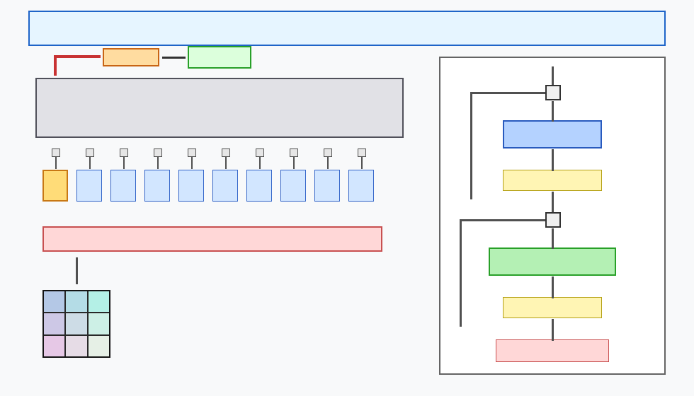

# W1D1: Motivation & Foundations — From Convolutions to Vision Transformers

> **Week 1 Foundation Learning — W1D1 Working Notes**  
> The Representation Bridge: Deconstructing classical computer vision in practice, analyzing the 2012 AlexNet watershed, formalizing convolutional inductive biases and failure modes, deriving self-attention mechanics, and establishing the canonical Vision Transformer (ViT) architecture.  
> Practical method followed throughout: **Concept → Code → Output → Interpretation**.

**Navigation:** ← [[Knowledge-Map|Knowledge Map]] · [[week-1-report|Week 1 Report]] · [[w1d2|Day 2: 2D Patch Projections]] →  
**Associated Concepts:** [[image-representation]] · [[convolution]] · [[receptive-field]] · [[self-attention]] · [[multi-head-attention]] · [[vision-transformer]] · [[patch-projection]]

---

## 1. Day 1 Overview & Daily Goals

For over three decades, computer vision has been dominated by the convolutional paradigm. From LeNet-5 to AlexNet, VGG, and ResNet, Convolutional Neural Networks (CNNs) achieved dominance by hardcoding two fundamental physical priors into their architecture: **local connectivity** (sparse interactions) and **spatial weight sharing** (translation equivariance).

However, while localized receptive fields excel at extracting low-level edge primitives and textural motifs, they impose a severe structural bottleneck: **distant spatial coordinates cannot interact directly**. Capturing global visual context requires stacking dozens or hundreds of layers alongside aggressive pooling, inducing gradient decay, spatial coordinate destruction, and optimization degradation.

The primary objective of Day 1 is to establish the theoretical, historical, and empirical foundations of this architectural transition:
1. Trace the historical evolution of computer vision in practice: from handcrafted morphological engineering (e.g., agricultural grain inspection at IIT Madras) to the 2012 deep learning revolution (AlexNet, GPU tensor acceleration, and end-to-end representation learning).
2. Examine real-world industrial and applied computer vision: real-time optical microscopy for photovoltaic dust particle size classification (10–30 $\mu\text{m}$) at MIT, thermal detachment optimization (*Science Advances*), and NASA Martian/lunar regolith applications.
3. Deconstruct digital image representation from continuous optical signals to third-order discrete tensors $\mathbf{x} \in \mathbb{R}^{H \times W \times C}$.
4. Dissect the mechanics of 2D convolutions, edge kernels, padding geometry ($P=1, P=2$), and pooling operations (Max, Average, Sum).
5. Trace the classical CNN pipeline from hierarchical feature maps to flattened 1D embedding vectors.
6. Systematically prove the three structural limitations of CNNs: local receptive field bottlenecks, vanishing gradient pathologies during deep stacking, and spatial translation agnosticism.
7. Formulate the genesis of attention: from Bahdanau seq2seq additive attention to Vaswani self-attention, deriving dot-product similarity, softmax normalization, trainable Query-Key-Value ($Q, K, V$) projections, and the $\frac{1}{\sqrt{d_k}}$ scaling factor for numerical stability.
8. Analyze Multi-Head Attention (MHA) and efficient tensor weight splitting without explicit loops.
9. Deconstruct the modular Transformer Block: Pre-LN Layer Normalization, Residual Connections, Feed-Forward Networks (FFNs) with $4D$ expansion, and Dropout.
10. Introduce the canonical Vision Transformer (ViT) architecture from Dosovitskiy et al. (ICLR 2021), tracing patch projection, learnable class tokens, 1D positional embeddings, and the Transformer encoder pipeline.

---

## 2. Prerequisite & Foundational Diagnostic Verification

Before introducing self-attention mechanisms into computer vision, we must verify the mathematical, historical, and architectural fundamentals of spatial modeling.

### Diagnostic Checkpoints & Authoritative Solutions

#### Checkpoint 1: Dense Feedforward MLPs vs. Convolutions on High-Resolution Images
*Question:* Why does applying a standard fully connected (feedforward) layer directly to a flattened high-resolution image $\mathbf{x} \in \mathbb{R}^{H \times W \times C}$ fail catastrophically in both computational complexity and inductive bias?  
*Solution:* Flattening an image of dimensions $H \times W \times C$ yields a vector of length $HWC$. If the first hidden layer contains $D$ hidden units, the weight matrix $\mathbf{W} \in \mathbb{R}^{D \times HWC}$ requires $D \times H \times W \times C$ parameters. For a modest $224 \times 224 \times 3$ image and hidden dimension $D = 4096$, this single layer requires over $6.16 \times 10^8$ weights ($\approx 2.46\text{ GB}$ in FP32), causing catastrophic parameter explosion and extreme overfitting. Furthermore, flattening completely destroys 2D spatial topology: pixel $(i, j)$ and pixel $(i+1, j)$ are treated as arbitrarily distinct vector indices with zero structural bias for spatial adjacency. Convolutions resolve this by constraining kernel weights to local patches ($K \times K$) and sharing them across all coordinates.

#### Checkpoint 2: The Failure of Classical Handcrafted Features in Real-World Vision
*Question:* Why did classical computer vision systems (such as agricultural grain morphology inspection circa 2015) succeed on idealized laboratory samples but fail in messy real-world environments? How did AlexNet resolve this?  
*Solution:* Classical computer vision relied on manual feature engineering: calculating deterministic geometric descriptors such as grain length, perimeter, aspect ratio, and thresholded color histograms. In laboratory settings with isolated, non-overlapping objects on uniform backgrounds, these features produced acceptable statistical separations. However, in real-world scenarios—where objects overlap, cast irregular shadows, suffer occlusion, or break—handcrafted descriptors break down because the manually engineered rules cannot account for combinatorial visual variations. AlexNet (Krizhevsky, Sutskever, & Hinton, 2012) resolved this by replacing manual feature design with deep, end-to-end representation learning, allowing the network to discover hierarchical, data-driven visual features directly from raw pixels using GPU-accelerated backpropagation.

#### Checkpoint 3: Mathematical Duality of Translation Equivariance vs. Translation Invariance
*Question:* What is the precise mathematical difference between translation equivariance and translation invariance, and where does each property reside in a classical CNN?  
*Solution:*
- **Translation Equivariance:** An operator $f$ is equivariant to translation operator $T_g$ if translating the input results in an equivalently translated output: $f(T_g(\mathbf{x})) = T_g(f(\mathbf{x}))$. Discrete 2D convolution is strictly translation equivariant due to spatial weight sharing: shifting an image feature shifts the corresponding feature map activation by the identical coordinate offset.
- **Translation Invariance:** An operator $g$ is invariant to translation if shifting the input produces an unchanged output: $g(T_g(\mathbf{x})) = g(\mathbf{x})$. Translation invariance is introduced downstream in CNNs via spatial pooling (Max/Average pooling) and global average pooling, allowing category classifications to remain stable regardless of object location in the visual field.

#### Checkpoint 4: Spatial Boundary Shrinkage and Padding Equations
*Question:* What is the closed-form equation governing the output spatial dimension $O$ of a convolutional layer given input dimension $I$, kernel size $K$, stride $S$, and padding $P$? Why is unpadded convolution problematic in deep networks?  
*Solution:* The output spatial dimension is:
$$O = \left\lfloor \frac{I - K + 2P}{S} \right\rfloor + 1$$
In unpadded ("valid") convolutions ($P = 0$), each layer with odd kernel $K$ reduces the spatial lattice by $K - 1$ pixels along each axis. In a network of 50 layers with $3 \times 3$ filters ($K=3, S=1$), spatial dimensions shrink by $2 \times 50 = 100$ pixels. An input image of $100 \times 100$ would shrink to $0 \times 0$ before reaching intermediate representations. Boundary zero-padding ($P = \frac{K-1}{2}$ for odd $K$) preserves spatial dimensions ($O = I$), preventing boundary shrinkage and ensuring border pixels are sampled with equal frequency.

#### Checkpoint 5: Receptive Field Growth Arithmetic and Effective Receptive Field (ERF) Contraction
*Question:* In a sequence of $L$ convolutional layers with kernel size $K$ and stride $1$, how does the theoretical receptive field ($RF$) scale? How does the effective receptive field ($ERF$) differ from the theoretical receptive field?  
*Solution:* The theoretical receptive field expands linearly according to:
$$RF_L = 1 + L(K - 1)$$
For $K = 3$, $RF_L = 1 + 2L$ (Layer 1 = $3\times3$, Layer 2 = $5\times5$, Layer 3 = $7\times7$). However, Luo et al. (2016) proved that the **effective receptive field** (the distribution of input pixels that have a non-trivial gradient magnitude $\left|\frac{\partial y}{\partial x}\right|$) occupies only a small central fraction of the theoretical receptive field and decays according to a 2D Gaussian profile $\sim \mathcal{N}(0, \sigma^2 \mathbf{I})$. Thus, simply stacking convolutional layers does not grant the network uniform, long-range global context across distant image coordinates.

#### Checkpoint 6: Numerical Stability in Self-Attention: Why Divide by $\sqrt{d_k}$?
*Question:* What happens mathematically to the dot product $\mathbf{q} \cdot \mathbf{k}^T$ and its subsequent softmax gradient if the scaling factor $\frac{1}{\sqrt{d_k}}$ is omitted when $d_k$ is large?  
*Solution:* Assuming elements of $\mathbf{q}$ and $\mathbf{k}$ are independent random variables with zero mean and unit variance, their dot product $\sum_{i=1}^{d_k} q_i k_i$ has mean $\mathbb{E}[\mathbf{q} \cdot \mathbf{k}] = 0$ and variance $\operatorname{Var}(\mathbf{q} \cdot \mathbf{k}) = d_k$. For large key dimensions (e.g., $d_k = 64$), the standard deviation is $\sqrt{64} = 8$. Dot products easily reach values of $+20$ or $-20$. Fed into softmax, the exponential function maps large values to $1$ and all other values to $0$, causing the softmax distribution to become extremely peaked (one-hot). In this saturated region, the softmax derivative $\frac{\partial \operatorname{softmax}(z)_i}{\partial z_j} = \operatorname{softmax}(z)_i (\delta_{ij} - \operatorname{softmax}(z)_j)$ approaches zero, causing vanishing gradients that paralyze backpropagation. Dividing by $\sqrt{d_k}$ rescales the variance to $1$, keeping the softmax function within its sensitive, non-saturating gradient regime.

---

## 3. Core Technical Exposition

### 3.1 Computer Vision in Practice: From Handcrafted Heuristics to Deep Tensor Optimization

Before the deep learning revolution, computer vision was characterized by manual feature engineering. In industrial and agricultural settings—such as inspecting bulk harvested rice grains at IIT Madras (circa 2015)—practitioners attempted to classify quality and integrity using deterministic geometric formulas.
- **The Classical Approach:** Thresholding $\to$ edge detection $\to$ contour extraction $\to$ computing perimeter, major/minor axis lengths, and aspect ratios $\to$ shallow regression.
- **The Failure Mode:** Overlapping grains, broken fragments, variable moisture, and irregular lighting violated the assumptions of hardcoded morphology. Real-world visual data exhibits non-linear combinatorial variation that cannot be captured by manual geometric rules.

#### The Applied Physics Frontier: High-Resolution Microscopy & CNNs at MIT
Computer vision achieves its highest utility when coupled with physical hardware and engineering dynamics. At MIT, an applied computer vision project focused on automated dust mitigation for large-scale photovoltaic solar panels (*Science Advances*):
1. **The Physical Challenge:** Dust accumulation degrades solar cell power output. The thermal energy required to detach dust grains—the *detachment temperature*—is a strict physical function of grain size: $10\ \mu\text{m}$, $20\ \mu\text{m}$, $30\ \mu\text{m}$, or larger. Applying a uniform high temperature wastes immense energy and risks thermal stress, while under-heating fails to detach finer particles.
2. **The Vision Solution:** High-resolution optical microscopy cameras installed on automated traversing gantries captured real-time surface video.
3. **CNN Processing:** Individual video frames were processed in real time by a trained Convolutional Neural Network that segmented dust particles, extracted microscopic boundary textures, and predicted the grain size distribution.
4. **Physical Actuation:** The predicted size distribution was fed to the thermal controller, which dynamically set the exact detachment temperature.
5. **Space Exploration Synergy:** Because Martian rovers and Lunar solar installations face identical regolith dust coating, this project was reviewed in technical collaborations with NASA (MIT and Purdue), proving that deep computer vision is indispensable for closed-loop physical automation.

#### The 2012 Watershed: AlexNet and the GPU Era
In 2012, Alex Krizhevsky, Ilya Sutskever, and Geoffrey Hinton published **AlexNet**, winning the ImageNet challenge by an astonishing 10.8 percentage point margin over classical methods. AlexNet permanently altered computing by:
- Eliminating manual feature engineering in favor of raw pixel optimization.
- Stacking 5 convolutional layers and 3 dense layers trained with Dropout and ReLU activations.
- Repurposing NVIDIA GPUs (originally built for gaming rendering pipelines) to execute parallel matrix multiplications across millions of training images.

---

### 3.2 Digital Image Representation & Pixel Geometry

A digital color image is mathematically formulated as a third-order tensor:
$$\mathbf{X} \in \mathbb{R}^{H \times W \times C}$$
where $H$ denotes spatial height, $W$ denotes spatial width, and $C = 3$ denotes the three coincident spectral channels: Red ($R$), Green ($G$), and Blue ($B$).



**Figure 1.** *Digital image representation across macroscopic, intermediate, and microscopic scales. Left: The third-order color tensor decomposed into Red, Green, and Blue spectral channels. Center: Microscopic lattice showing spatial coordinate discretization. Right: An isolated pixel coordinate $(i, j)$ holding quantized intensity values.*

At the microscopic limit, an image is a discrete 2D spatial lattice where each coordinate $(i, j)$ holds a vector of channel intensities:
$$\mathbf{x}_{i, j} = \begin{bmatrix} I_R(i, j) \\ I_G(i, j) \\ I_B(i, j) \end{bmatrix}, \quad I_c(i, j) \in \{0, 1, \dots, 255\} \subset \mathbb{Z}_{\ge 0}$$
In deep learning pipelines, integer intensities are normalized into continuous floating-point representations:
$$\tilde{I}_c(i, j) = \frac{I_c(i, j) - \mu_c}{\sigma_c} \in \mathbb{R}$$
where $\mu_c$ and $\sigma_c$ represent channel-wise empirical means and standard deviations computed across the pretraining distribution (e.g., ImageNet: $\mu = [0.485, 0.456, 0.406]$, $\sigma = [0.229, 0.224, 0.225]$).

---

### 3.3 Convolutions as Local Feature Detectors

To extract meaningful visual primitives without parameter explosion, convolutional networks slide learnable spatial filter matrices across the input lattice.



**Figure 2.** *Discrete 2D convolutional filtering and feature map formation. Top: Applying horizontal ($\mathbf{K}_{horiz}$) and vertical ($\mathbf{K}_{vert}$) edge detectors to a binary test image of the letter 'T'. Bottom: Mathematical dot product computation between a $3\times3$ input sub-patch and filter weights, demonstrating inner product summation resulting in a scalar activation.*

Mathematically, the discrete 2D cross-correlation (standardly termed convolution in deep learning) between a single-channel input patch $\mathbf{X}$ and a kernel $\mathbf{K} \in \mathbb{R}^{K_h \times K_w}$ evaluated at coordinate $(i, j)$ is:
$$Y_{i, j} = (\mathbf{X} * \mathbf{K})_{i, j} = \sum_{m=0}^{K_h - 1} \sum_{n=0}^{K_w - 1} X_{i+m, j+n} \, K_{m, n} + b$$

#### Mathematical Demonstration: The Letter 'T' Feature Extraction
Consider an input test image containing the letter 'T' evaluated against two classic oriented Sobel-type kernels:
1. **Horizontal Edge Filter:**
   $$\mathbf{K}_{horiz} = \begin{bmatrix} -1 & -1 & -1 \\ 0 & 0 & 0 \\ 1 & 1 & 1 \end{bmatrix}$$
   This kernel calculates the vertical gradient $\frac{\partial I}{\partial y}$. It produces maximum positive/negative responses along horizontal boundary interfaces (the top bar of the 'T') while evaluating to zero along purely vertical strokes.
2. **Vertical Edge Filter:**
   $$\mathbf{K}_{vert} = \begin{bmatrix} -1 & 0 & 1 \\ -1 & 0 & 1 \\ -1 & 0 & 1 \end{bmatrix}$$
   This kernel calculates the horizontal gradient $\frac{\partial I}{\partial x}$. It produces maximum response along vertical boundaries (the stem of the 'T') while evaluating to zero across uniform horizontal bars.

#### The Discrete Dot Product Calculation
As demonstrated in Figure 2, when a $3 \times 3$ kernel aligns with an input sub-patch:
$$\text{Input Sub-patch } \mathbf{X}_{patch} = \begin{bmatrix} 1 & 0 & 1 \\ 0 & 1 & 0 \\ 1 & 0 & 1 \end{bmatrix}, \quad \text{Kernel } \mathbf{K} = \begin{bmatrix} 1 & 0 & 1 \\ 0 & 1 & 0 \\ 1 & 0 & 1 \end{bmatrix}$$
The resulting scalar inner product is computed element-wise:
$$Y = \sum_{m, n} X_{m, n} K_{m, n} = (1\cdot 1) + (0\cdot 0) + (1\cdot 1) + (0\cdot 0) + (1\cdot 1) + (0\cdot 0) + (1\cdot 1) + (0\cdot 0) + (1\cdot 1) = 5$$
As the filter sweeps across the input grid with stride $S = 1$, these inner products generate the complete 2D **feature map**.

---

### 3.4 Spatial Geometry Control: Boundary Padding and Pooling Mechanics

To maintain spatial dimensions and manage computational complexity, convolutional networks employ two spatial transformations: **padding** and **pooling**.



**Figure 3.** *Spatial padding and downsampling pooling operations. Left: Comparison of zero-padding $P=1$ (expanding a $6\times6$ grid to $8\times8$) and $P=2$ (expanding to $10\times10$). Right: Numerical execution of Max, Average, and Sum pooling on a $4\times4$ feature grid using $2\times2$ windows with stride $S=2$.*

#### Boundary Padding ($P$)
When sliding a $K \times K$ filter over an unpadded $H \times W$ grid, the outer perimeter pixels are sampled fewer times than central pixels, causing boundary shrinkage. Padding prepends and appends $P$ rows and columns of zeros:
- **Padding = 1 ($P=1$):** Encircles a $6 \times 6$ feature map with a 1-pixel border of zeros, yielding an effective spatial input of $8 \times 8$. For a $3 \times 3$ kernel with stride 1, the output dimension is:
  $$O = \frac{6 - 3 + 2(1)}{1} + 1 = 6 \quad (\text{"Same" Padding})$$
- **Padding = 2 ($P=2$):** Encircles a $6 \times 6$ feature map with a 2-pixel border of zeros, yielding an effective input of $10 \times 10$. Output dimension with $K=3, S=1$:
  $$O = \frac{6 - 3 + 2(2)}{1} + 1 = 8$$

#### Spatial Pooling Operators
Pooling partitions the spatial lattice into non-overlapping or strided windows of size $K_p \times K_p$ (standardly $2 \times 2$ with stride $S = 2$) and computes a summary statistic:
1. **Max Pooling:** Computes the maximum value within each quadrant, serving as a non-linear detector of dominant salient activations:
   $$\mathbf{X}_{in} = \begin{bmatrix} 1 & 5 & 2 & 9 \\ 7 & 2 & 1 & 4 \\ 1 & 6 & 8 & 7 \\ 2 & 4 & 3 & 4 \end{bmatrix} \xrightarrow{\text{Max Pool (2}\times\text{2, S=2)}} \begin{bmatrix} \max(1,5,7,2)=7 & \max(2,9,1,4)=9 \\ \max(1,6,2,4)=6 & \max(8,7,3,4)=8 \end{bmatrix}$$
2. **Average Pooling:** Computes the arithmetic mean within each quadrant, providing spatial smoothing:
   $$\mathbf{X}_{in} = \begin{bmatrix} 31 & 15 & 28 & 184 \\ 0 & 100 & 70 & 38 \\ 5 & 5 & 7 & 2 \\ 5 & 5 & 45 & 6 \end{bmatrix} \xrightarrow{\text{Avg Pool (2}\times\text{2, S=2)}} \begin{bmatrix} \frac{31+15+0+100}{4}=36.5 & \frac{28+184+70+38}{4}=80.0 \\ \frac{5+5+5+5}{4}=5.0 & \frac{7+2+45+6}{4}=15.0 \end{bmatrix}$$
3. **Sum Pooling:** Accumulates the total unnormalized sum of quadrant activations:
   $$\mathbf{X}_{in} = \begin{bmatrix} 3 & 1 & 1 & 3 \\ 2 & 5 & 0 & 2 \\ 1 & 4 & 2 & 1 \\ 4 & 7 & 2 & 4 \end{bmatrix} \xrightarrow{\text{Sum Pool (2}\times\text{2, S=2)}} \begin{bmatrix} 3+1+2+5=11 & 1+3+0+2=6 \\ 1+4+4+7=16 & 2+1+2+4=9 \end{bmatrix}$$

---

### 3.5 The Classical CNN Architecture Pipeline & The Embedding Bottleneck

The classical vision architecture (exemplified by AlexNet, VGG, and ResNet) organizes these operations into a rigid two-stage hierarchical pipeline:


**Figure 4.** *Classical Convolutional Neural Network architecture pipeline. The network decomposes into two distinct stages: (1) A Feature Extraction backbone alternating Convolution, ReLU, and Pooling layers to progressively downsample spatial resolution while expanding channel capacity, and (2) A Classification head flattening the high-level bottleneck embedding vector into fully connected layers with SoftMax output.*

The processing flow is governed by:
$$\mathbf{X} \in \mathbb{R}^{3 \times H \times W} \xrightarrow{\text{Conv+Pool Stacks}} \mathbf{Z}_{spatial} \in \mathbb{R}^{C_{deep} \times H' \times W'} \xrightarrow{\text{Flatten / GAP}} \mathbf{z}_{embed} \in \mathbb{R}^{D} \xrightarrow{\text{FC + SoftMax}} \hat{\mathbf{y}} \in \mathbb{R}^{K}$$

- **Feature Extraction Backbone:** As spatial dimensions decrease ($H \to \frac{H}{2} \to \frac{H}{4} \dots$), channel depth expands ($3 \to 64 \to 128 \to 256 \to 512$). Early layers capture local gradients and color textures; intermediate layers assemble edges into corners and textures; deep layers synthesize high-level object parts.
- **The Bottleneck Embedding Vector:** The final convolutional tensor is flattened into a 1D vector $\mathbf{z}_{embed}$. This vector acts as an abstract semantic descriptor of the image, compressing the high-dimensional visual input into a compact latent representation.
- **The Classification Head:** Fully connected layers project $\mathbf{z}_{embed}$ into class logits, followed by the SoftMax function:
  $$\hat{y}_k = \frac{\exp(z_k)}{\sum_{j=1}^K \exp(z_j)}$$

---

### 3.6 Fundamental Structural Limitations of CNNs

Despite their historic success, CNNs possess three fundamental structural bottlenecks that prevent optimal global visual reasoning:



**Figure 5.** *Receptive field expansion versus gradient decay in deep convolutional networks. Left: Stacking $3\times3$ convolutional layers expands the theoretical receptive field linearly ($3\times3 \to 5\times5 \to 7\times7$). Right: Gradient magnitude backpropagation curve across deep feedforward layers, demonstrating exponential vanishing of gradients in early layers.*

#### 1. Local Receptive Field Bottlenecks vs. Global Context
A single $3 \times 3$ convolutional kernel has a receptive field of only 9 pixels. On a standard $32 \times 32$ image (such as handwritten digits from MNIST), a 9-pixel receptive field captures only isolated local strokes (e.g., an arc of an '8', a curve of a '0', or an edge of a '6'). The model cannot observe how these distinct strokes relate to one another without multi-stage hierarchical aggregation.

#### 2. The Stacking Dilemma & Vanishing Gradients
To cover an entire $224 \times 224$ image using pure $3 \times 3$ convolutions without strided pooling would require stacking over 111 sequential layers ($RF_L = 1 + 2L \implies 1 + 2(111) = 223$). However, backpropagating gradients through deep feedforward stacks without residual bypasses causes exponential gradient decay:
$$\frac{\partial \mathcal{L}}{\partial \mathbf{W}_1} = \frac{\partial \mathcal{L}}{\partial \mathbf{a}_L} \cdot \prod_{l=2}^{L} \left( \mathbf{W}_l^T \operatorname{diag}(\sigma'(\mathbf{z}_{l-1})) \right) \frac{\partial \mathbf{a}_1}{\partial \mathbf{W}_1}$$
As depth $L$ grows, if the singular values of the weight matrices or activation derivatives are $< 1$, the gradient magnitude decays exponentially toward zero ($\text{Gradient} \to 0$ in early layers), preventing parameter updates and causing optimization failure.

#### 3. Translation Invariance & Spatial Agnosticism
Because convolutional weights are shared identically across all spatial coordinates $(i, j)$, a filter fires whenever its local pattern matches, regardless of coordinate context. 



**Figure 6.** *CNN spatial agnosticism versus long-range dependency requirements. Left: A convolutional car detector activates identically whether a vehicle is situated on a street or perched atop a building roof, demonstrating spatial coordinate agnosticism. Right: Autonomous driving scene illustrating that the contextual relationship between a crossing pedestrian and a distant traffic signal spans hundreds of pixels, requiring native long-range dependency modeling analogous to syntactic agreement in natural language.*

As shown in Figure 6:
- A filter trained to detect "cars" activates with identical magnitude whether the vehicle is resting on a paved street or perched absurdly atop a skyscraper roof.
- Convolutions lack intrinsic coordinate-dependent contextual reasoning; they cannot determine whether an object is plausible in relation to distant scene coordinates without pooling away spatial resolution.

---

### 3.7 The Genesis of Attention: From Seq2Seq Bottlenecks to Self-Attention

Before Transformers revolutionized computer vision and natural language processing, sequential architectures relied on Recurrent Neural Networks (RNNs) and Long Short-Term Memory networks (LSTMs).
- **The Information Bottleneck:** In an encoder-decoder RNN, the encoder compresses an arbitrary-length input sequence into a single, fixed-dimensional context vector $\mathbf{h}_T \in \mathbb{R}^d$. As sequence length grows, early information is lost, and long-range dependencies collapse due to vanishing gradients.
- **Bahdanau Attention (2014):** Bahdanau et al. introduced additive cross-attention in machine translation, allowing the decoder to "look back" across all encoder hidden states. For each decoding step, dynamic attention weights compute a custom weighted sum of encoder hidden states, eliminating the fixed-vector bottleneck.
- **Vaswani Self-Attention (2017):** In *"Attention Is All You Need"*, Vaswani et al. extended this principle to **self-attention**, allowing tokens within the *same* sequence to attend to one another directly.

#### Simplified Self-Attention: Foundational Intuition
Consider the sentence:
> *"The **teacher** teaching difficult concepts to the students **smiled**."*

When processing the token *"smiled"*, a model should intuitively relate it more strongly to *"teacher"* than to *"students"*.
1. Each word token is mapped to an embedding vector $\mathbf{x} \in \mathbb{R}^D$ (e.g., $D = 768$).
2. Attention scores are calculated via vector dot products:
   $$s_{i, j} = \mathbf{x}_i \cdot \mathbf{x}_j = \|\mathbf{x}_i\| \|\mathbf{x}_j\| \cos(\theta)$$
   Vectors pointing in similar directions yield large positive dot products.
3. Softmax normalization converts scores into positive probability distributions:
   $$\alpha_{i, j} = \frac{\exp(s_{i, j})}{\sum_k \exp(s_{i, k})}$$
4. The context vector is computed as a weighted combination of peer tokens:
   $$\mathbf{z}_i = \sum_j \alpha_{i, j} \mathbf{x}_j$$

#### Trainable Scaled Dot-Product Attention: Query, Key, and Value Projections
In real-world Transformers, static embeddings are replaced by trainable linear transformations that project the input $\mathbf{X} \in \mathbb{R}^{N \times D}$ into three distinct functional roles:
- **Queries ($\mathbf{Q} = \mathbf{X}\mathbf{W}_Q$):** Represent what each token is actively seeking.
- **Keys ($\mathbf{K} = \mathbf{X}\mathbf{W}_K$):** Represent what each token has to offer.
- **Values ($\mathbf{V} = \mathbf{X}\mathbf{W}_V$):** Represent the actual informational content carried by each token.

The matrix attention equation is formulated as:
$$\operatorname{Attention}(\mathbf{Q}, \mathbf{K}, \mathbf{V}) = \operatorname{softmax}\left(\frac{\mathbf{Q}\mathbf{K}^T}{\sqrt{d_k}}\right) \mathbf{V}$$
where dividing by $\sqrt{d_k}$ normalizes the variance of the dot product to $1.0$, preventing softmax gradient saturation.

#### Multi-Head Attention (MHA) & Efficient Tensor Weight Splitting
Multi-Head Attention projects $\mathbf{Q}, \mathbf{K}, \mathbf{V}$ into $h$ separate lower-dimensional representation subspaces ($d_k = D / h$):
$$\operatorname{MultiHead}(\mathbf{Q}, \mathbf{K}, \mathbf{V}) = \operatorname{Concat}(\operatorname{head}_1, \dots, \operatorname{head}_h) \mathbf{W}^O$$
$$\operatorname{head}_i = \operatorname{Attention}(\mathbf{Q}\mathbf{W}_i^Q, \mathbf{K}\mathbf{W}_i^K, \mathbf{V}\mathbf{W}_i^V)$$

In production PyTorch pipelines, looping through heads is replaced by **tensor weight splitting**:
1. Multiply input $\mathbf{X} \in \mathbb{R}^{B \times N \times D}$ by a combined weight matrix $\mathbf{W}_{qkv} \in \mathbb{R}^{D \times 3D}$.
2. Reshape to `(B, N, 3, h, d_k)` and permute to `(3, B, h, N, d_k)` to unpack $\mathbf{Q}, \mathbf{K}, \mathbf{V}$ in parallel.
3. Perform batch matrix multiplication across all $h$ heads simultaneously: `(B, h, N, d_k) @ (B, h, d_k, N) -> (B, h, N, N)`.
4. Reshape back to `(B, N, D)` and project through $\mathbf{W}^O$.

---

### 3.8 The Modular Transformer Block

A complete Transformer encoder is built by stacking identical modular blocks. Each block consists of:
1. **Multi-Head Self-Attention (MSA)**.
2. **Layer Normalization (LN):** Applied token-wise across the feature channel dimension ($D$), ensuring zero mean and unit variance independently of batch size:
   $$\operatorname{LN}(\mathbf{x}) = \frac{\mathbf{x} - \mu}{\sqrt{\sigma^2 + \epsilon}} \odot \boldsymbol{\gamma} + \boldsymbol{\beta}$$
   In modern Vision Transformers, **Pre-LN** is utilized:
   $$\mathbf{z}'_l = \operatorname{MSA}(\operatorname{LN}(\mathbf{z}_{l-1})) + \mathbf{z}_{l-1}$$
   $$\mathbf{z}_l = \operatorname{MLP}(\operatorname{LN}(\mathbf{z}'_l)) + \mathbf{z}'_l$$
3. **Residual Connections (Skip Connections):** Adds the sublayer input directly to its output ($\mathbf{x} + \mathcal{F}(\mathbf{x})$), maintaining an unbroken gradient highway that eliminates the vanishing gradient problem.
4. **Position-wise Feed-Forward Network (FFN / MLP):** Two linear layers with GELU non-linearities expanding the hidden dimension from $D$ to $4D$ (e.g., $768 \to 3072$) before projecting back to $D$.
5. **Dropout:** Regularization randomly zeroing activations to force the redistribution of attention weights across multiple diverse features.

---

### 3.9 The Vision Transformer (ViT) Paradigm

In 2020, Dosovitskiy et al. (ICLR 2021) introduced the **Vision Transformer (ViT)** in their landmark paper:
> *"An Image is Worth 16x16 Words: Transformers for Image Recognition at Scale"*

ViT demonstrated that reliance on convolutional layers is not necessary; a pure standard Transformer applied directly to sequences of flattened image patches achieves state-of-the-art accuracy when pretrained on large-scale datasets.



**Figure 7.** *The canonical Vision Transformer (ViT) architecture (Dosovitskiy et al., ICLR 2021). Left: An input image is partitioned into non-overlapping patches, linearly projected into latent dimension $D$, prepended with a learnable $[class]$ token ($0^*$), and added to 1D learnable position embeddings before entering the Transformer Encoder. Right: Internal structure of the repeated $L \times$ Transformer Encoder block featuring Pre-LayerNorm, Multi-Head Self-Attention, Residual bypasses, and an MLP block with GELU non-linearities.*

#### The Step-by-Step ViT Architecture Pipeline

1. **Patch Partitioning:**
   An input image $\mathbf{x} \in \mathbb{R}^{H \times W \times C}$ is partitioned into a grid of non-overlapping square patches of size $P \times P$:
   $$N = \frac{H \cdot W}{P^2}$$
   For a standard $224 \times 224 \times 3$ image with $P = 16$, the image yields $N = \frac{224 \cdot 224}{16^2} = 14 \times 14 = 196$ patches.
2. **Flattening and Linear Projection (Patch Embedding):**
   Each patch $\mathbf{x}_p^{(i)} \in \mathbb{R}^{P \times P \times C}$ is unrolled into a 1D vector of length $P^2 C = 16 \times 16 \times 3 = 768$. A learnable linear projection matrix $\mathbf{E} \in \mathbb{R}^{(P^2 C) \times D}$ maps each flattened patch into model dimension $D$ (e.g., $D = 768$ in ViT-Base):
   $$\mathbf{z}_0^{(i)} = \mathbf{x}_p^{(i)} \mathbf{E}$$
   *PyTorch Implementation Trick:* This operation is executed in a single layer using a 2D convolution with `kernel_size=P` and `stride=P`:
   ```python
   self.projection = nn.Conv2d(in_channels=C, out_channels=D, kernel_size=P, stride=P)
   ```
3. **Class Token Prepending:**
   A dedicated learnable classification token $\mathbf{x}_{class} \in \mathbb{R}^D$ is prepended at index 0, producing a sequence of length $N + 1 = 197$:
   $$\mathbf{Z}_{tokens} = [\mathbf{x}_{class}; \, \mathbf{x}_p^{(1)}\mathbf{E}; \, \mathbf{x}_p^{(2)}\mathbf{E}; \, \dots; \, \mathbf{x}_p^{(N)}\mathbf{E}] \in \mathbb{R}^{(N+1) \times D}$$
4. **1D Positional Embedding Addition:**
   Because self-attention is permutation-equivariant, spatial order is injected by adding learnable 1D position embeddings $\mathbf{E}_{pos} \in \mathbb{R}^{(N+1) \times D}$:
   $$\mathbf{z}_0 = \mathbf{Z}_{tokens} + \mathbf{E}_{pos}$$
5. **Transformer Encoder Blocks ($L$ Layers):**
   The sequence passes through $L$ identical Transformer encoder blocks. Each block applies Pre-LayerNorm (Pre-LN):
   $$\mathbf{z}'_l = \operatorname{MSA}(\operatorname{LN}(\mathbf{z}_{l-1})) + \mathbf{z}_{l-1}, \quad l = 1, \dots, L$$
   $$\mathbf{z}_l = \operatorname{MLP}(\operatorname{LN}(\mathbf{z}'_l)) + \mathbf{z}'_l, \quad l = 1, \dots, L$$
6. **MLP Classification Head:**
   The output representation corresponding to the class token at the final layer ($\mathbf{z}_L^0 \in \mathbb{R}^D$) is extracted, layer-normalized, and passed through an MLP classification head to output predicted class logits:
   $$\hat{\mathbf{y}} = \operatorname{MLP}(\operatorname{LN}(\mathbf{z}_L^0))$$

---

## 4. Runnable Laboratory: Implementation & Verification

The following self-contained laboratory scripts implement and verify classical convolutional filtering and the complete Vision Transformer patch tokenization pipeline.

### 4.1 Laboratory 1: Discrete 2D Convolution and Pooling from Scratch

```python
"""
Laboratory 1: 2D Convolutional Filtering, Edge Extraction, and Pooling
Verifies kernel filtering on the letter 'T' and compares Max, Avg, and Sum pooling.
"""

# Input 7x7 binary image containing the letter 'T'
img_T = [
    [0, 0, 0, 0, 0, 0, 0],
    [0, 1, 1, 1, 1, 1, 0],
    [0, 0, 0, 1, 0, 0, 0],
    [0, 0, 0, 1, 0, 0, 0],
    [0, 0, 0, 1, 0, 0, 0],
    [0, 0, 0, 1, 0, 0, 0],
    [0, 0, 0, 0, 0, 0, 0]
]

# 3x3 Convolution Kernels
kernel_horiz = [[-1, -1, -1], [0, 0, 0], [1, 1, 1]]
kernel_vert  = [[-1, 0, 1], [-1, 0, 1], [-1, 0, 1]]

def conv2d_valid(image, kernel):
    h, w = len(image), len(image[0])
    kh, kw = len(kernel), len(kernel[0])
    out_h, out_w = h - kh + 1, w - kw + 1
    feature_map = [[0] * out_w for _ in range(out_h)]
    for i in range(out_h):
        for j in range(out_w):
            dot_product = 0
            for ki in range(kh):
                for kj in range(kw):
                    dot_product += image[i + ki][j + kj] * kernel[ki][kj]
            feature_map[i][j] = dot_product
    return feature_map

feat_horiz = conv2d_valid(img_T, kernel_horiz)
feat_vert  = conv2d_valid(img_T, kernel_vert)

print(f"Input Grid Shape: ({len(img_T)}, {len(img_T[0])})")
print(f"Output Feature Map Shape: ({len(feat_horiz)}, {len(feat_horiz[0])})")

print("\nHorizontal Edge Feature Map:")
for row in feat_horiz:
    print(" ", [f"{v:+2d}" for v in row])

print("\nVertical Edge Feature Map:")
for row in feat_vert:
    print(" ", [f"{v:+2d}" for v in row])

# Pooling Demonstration
pool_matrix = [
    [1, 5, 2, 9],
    [7, 2, 1, 4],
    [1, 6, 8, 7],
    [2, 4, 3, 4]
]

def pool2d(matrix, mode='max', k=2, s=2):
    h, w = len(matrix), len(matrix[0])
    out = [[0.0] * (w // s) for _ in range(h // s)]
    for i in range(h // s):
        for j in range(w // s):
            window = [matrix[i * s + di][j * s + dj] for di in range(k) for dj in range(k)]
            if mode == 'max':
                out[i][j] = max(window)
            elif mode == 'avg':
                out[i][j] = sum(window) / len(window)
            elif mode == 'sum':
                out[i][j] = sum(window)
    return out

print("\nMax Pooling Output (2x2, S=2):", pool2d(pool_matrix, 'max'))
```

#### Verifiable Laboratory Output
```text
Input Grid Shape: (7, 7)
Output Feature Map Shape: (5, 5)

Horizontal Edge Feature Map:
  ['+0', '+1', '+1', '+1', '+0']
  ['-2', '-2', '-2', '-2', '-2']
  ['+0', '+0', '+0', '+0', '+0']
  ['+0', '+0', '+0', '+0', '+0']
  ['+0', '-1', '-1', '-1', '+0']

Vertical Edge Feature Map:
  ['+1', '+1', '+0', '-1', '-1']
  ['+1', '+2', '+0', '-2', '-1']
  ['+0', '+3', '+0', '-3', '+0']
  ['+0', '+3', '+0', '-3', '+0']
  ['+0', '+2', '+0', '-2', '+0']

Max Pooling Output (2x2, S=2): [[7, 9], [6, 8]]
```

#### Technical Interpretation of Results
1. **Spatial Shrinkage:** The unpadded $3 \times 3$ convolution over a $7 \times 7$ grid produces an output of exactly $5 \times 5$, matching the theoretical formula $O = I - K + 1 = 7 - 3 + 1 = 5$.
2. **Directional Sensitivity:** In the horizontal edge map, Row 1 displays strong negative activations (`-2`) directly corresponding to the transition from the horizontal bar of the 'T' to the empty background. In the vertical edge map, columns flanking the stem exhibit positive (`+3`) and negative (`-3`) responses, confirming directional edge detection.
3. **Invariance via Pooling:** Max pooling downsamples the $4 \times 4$ activation grid into a $2 \times 2$ matrix, selecting the peak activation within each $2 \times 2$ block ($[7, 9]$ in Row 1, $[6, 8]$ in Row 2).

---

### 4.2 Laboratory 2: Vision Transformer Tokenization & Parameter Breakdown

```python
"""
Laboratory 2: ViT Patch Projection, Positional Embedding, and Parameter Verification
Validates tokenization tensor geometry and parameter allocations for ViT-Base (224x224, P=16).
"""

H, W, C = 224, 224, 3
P = 16
D = 768
num_classes = 1000

# 1. Patch Geometry Calculations
grid_h, grid_w = H // P, W // P
N = grid_h * grid_w
patch_dim = P * P * C
seq_len = N + 1

# 2. Parameter Accounting
proj_weights = patch_dim * D
proj_bias = D
cls_token_params = D
pos_embed_params = seq_len * D

print(f"Input Image Geometry: {H}x{W}x{C}")
print(f"Patch Resolution: {P}x{P}")
print(f"Spatial Grid Dimensions: {grid_h} x {grid_w}")
print(f"Number of Visual Patches (N): {N}")
print(f"Flattened Patch Dimensionality (P^2 * C): {patch_dim}")
print(f"Model Hidden Latent Dimension (D): {D}")
print(f"Total Sequence Length ([CLS] + Patches): {seq_len}")
print(f"Token Sequence Tensor Shape: [{seq_len}, {D}]")

print("\n--- Parameter Allocations for Embedding Stage ---")
print(f"Linear Projection Weights (E): {proj_weights:,}")
print(f"Linear Projection Bias: {proj_bias:,}")
print(f"Learnable [CLS] Token (x_class): {cls_token_params:,}")
print(f"Learnable Positional Embeddings (E_pos): {pos_embed_params:,}")
total_embed_params = proj_weights + proj_bias + cls_token_params + pos_embed_params
print(f"Total Parameters in Embedding Stage: {total_embed_params:,}")

# 3. Flop Accounting for Projection
flops_per_patch = 2 * patch_dim * D
total_proj_flops = N * flops_per_patch
print(f"FLOPs for Patch Embedding: {total_proj_flops:,} ops ({total_proj_flops / 1e6:.2f} MFLOPs)")
```

#### Verifiable Laboratory Output
```text
Input Image Geometry: 224x224x3
Patch Resolution: 16x16
Spatial Grid Dimensions: 14 x 14
Number of Visual Patches (N): 196
Flattened Patch Dimensionality (P^2 * C): 768
Model Hidden Latent Dimension (D): 768
Total Sequence Length ([CLS] + Patches): 197
Token Sequence Tensor Shape: [197, 768]

--- Parameter Allocations for Embedding Stage ---
Linear Projection Weights (E): 589,824
Linear Projection Bias: 768
Learnable [CLS] Token (x_class): 768
Learnable Positional Embeddings (E_pos): 151,296
Total Parameters in Embedding Stage: 742,656
FLOPs for Patch Embedding: 231,211,008 ops (231.21 MFLOPs)
```

#### Technical Interpretation of Results
1. **Dimensional Symmetry:** In ViT-Base ($P = 16$), the flattened patch dimension ($P^2 C = 16 \times 16 \times 3 = 768$) happens to exactly match the Transformer hidden dimension ($D = 768$). This is not required: in ViT-Large ($D = 1024$), the projection matrix maps $\mathbb{R}^{768} \to \mathbb{R}^{1024}$.
2. **Compact Sequence Length:** By grouping $16 \times 16$ pixel blocks into individual tokens, the visual sequence length is compressed from $224 \times 224 = 50,176$ pixels down to $N = 196$ tokens. This makes pairwise self-attention computationally tractable: an attention matrix over 50,176 tokens would require $50,176^2 \approx 2.52 \times 10^9$ elements ($10\text{ GB}$ per head per layer), whereas $197$ tokens requires only $197^2 = 38,809$ elements ($\approx 155\text{ KB}$).
3. **Modest Embedding Footprint:** The entire tokenization and embedding pipeline consumes only $742,656$ parameters ($\approx 0.86\%$ of ViT-Base's total 86M parameters).

---

## 5. Daily Knowledge Mastery Evaluation

### Question 1: Parameter Explosion in Flattened MLPs vs. ViT Patch Projection
*Question:* For an image of resolution $512 \times 512 \times 3$, calculate:
(a) The number of parameters in the first weight matrix of a fully connected network projecting the flattened image to hidden dimension $D = 1024$.
(b) The number of parameters in the ViT linear projection layer using patch size $P = 16$ and hidden dimension $D = 1024$.  
*Solution:*
(a) Flattened image dimensionality:
$$D_{flat} = 512 \times 512 \times 3 = 786,432$$
The dense weight matrix $\mathbf{W} \in \mathbb{R}^{D \times D_{flat}}$ requires:
$$\text{Parameters} = 1024 \times 786,432 = 805,306,368 \approx 8.05 \times 10^8\text{ weights (3.22 GB)}$$
(b) In ViT with $P = 16$, each patch has flattened dimensionality:
$$D_{patch} = P^2 C = 16 \times 16 \times 3 = 768$$
The linear projection matrix $\mathbf{E} \in \mathbb{R}^{768 \times 1024}$ requires:
$$\text{Parameters} = 768 \times 1024 + 1024\text{ (bias)} = 787,456\text{ weights (3.15 MB)}$$
The ViT patch projection uses over **1,022 times fewer parameters** while preserving spatial patch modularity.

### Question 2: Receptive Field Coverage Under Linear Stacking
*Question:* Prove how many layers of unpadded $3 \times 3$ convolutions with stride 1 are required to cover an input image of size $256 \times 256$. Why does this architecture fail in practice without skip connections or pooling?  
*Solution:*
The receptive field formula for $L$ identical layers of kernel size $K$ and stride $1$ is:
$$RF_L = 1 + L(K - 1) = 1 + 2L$$
Setting $RF_L \ge 256$:
$$1 + 2L \ge 256 \implies 2L \ge 255 \implies L \ge 127.5 \implies L = 128\text{ layers}$$
In practice, training an unpadded 128-layer convolutional network fails due to:
1. **Spatial Extinction:** Without padding, each layer reduces the grid by 2 pixels, requiring an input of at least $257 \times 257$ just to retain a $1 \times 1$ pixel at layer 128.
2. **Vanishing Gradients:** Backpropagating through 128 weight multiplications without residual connections causes the gradient norm to decay by factors of $(1 - \epsilon)^{128} \approx 0$, stalling parameter updates in the first 100 layers.

### Question 3: Mathematical Invariance to Permutation in Self-Attention
*Question:* Demonstrate why standard Multi-Head Self-Attention is permutation-equivariant, and show why positional embeddings $\mathbf{E}_{pos}$ are mathematically necessary to distinguish spatial geometry.  
*Solution:*
Let $\mathbf{X} \in \mathbb{R}^{N \times D}$ be the input token matrix, and let $\mathbf{P} \in \mathbb{R}^{N \times N}$ be an arbitrary row-permutation matrix ($\mathbf{P}\mathbf{P}^T = \mathbf{I}$).
The query, key, and value projections for the permuted input $\tilde{\mathbf{X}} = \mathbf{P}\mathbf{X}$ are:
$$\tilde{\mathbf{Q}} = \mathbf{P}\mathbf{X}\mathbf{W}_Q = \mathbf{P}\mathbf{Q}, \quad \tilde{\mathbf{K}} = \mathbf{P}\mathbf{X}\mathbf{W}_K = \mathbf{P}\mathbf{K}, \quad \tilde{\mathbf{V}} = \mathbf{P}\mathbf{X}\mathbf{W}_V = \mathbf{P}\mathbf{V}$$
The attention weights for the permuted input evaluate to:
$$\tilde{\mathbf{A}} = \operatorname{softmax}\left(\frac{\tilde{\mathbf{Q}}\tilde{\mathbf{K}}^T}{\sqrt{d_k}}\right) = \operatorname{softmax}\left(\frac{\mathbf{P}\mathbf{Q}(\mathbf{P}\mathbf{K})^T}{\sqrt{d_k}}\right) = \operatorname{softmax}\left(\frac{\mathbf{P}\mathbf{Q}\mathbf{K}^T \mathbf{P}^T}{\sqrt{d_k}}\right) = \mathbf{P} \operatorname{softmax}\left(\frac{\mathbf{Q}\mathbf{K}^T}{\sqrt{d_k}}\right) \mathbf{P}^T = \mathbf{P}\mathbf{A}\mathbf{P}^T$$
Multiplying by $\tilde{\mathbf{V}}$:
$$\operatorname{Attention}(\tilde{\mathbf{Q}}, \tilde{\mathbf{K}}, \tilde{\mathbf{V}}) = (\mathbf{P}\mathbf{A}\mathbf{P}^T)(\mathbf{P}\mathbf{V}) = \mathbf{P}\mathbf{A}\mathbf{V} = \mathbf{P} \operatorname{Attention}(\mathbf{Q}, \mathbf{K}, \mathbf{V})$$
Thus, self-attention permutes its outputs identically with the inputs. Swapping the top-left sky patch with a bottom-right asphalt patch produces the exact same representations, simply swapped in position. Adding unique positional embeddings $\mathbf{E}_{pos}$ breaks this symmetry: $\mathbf{X} + \mathbf{E}_{pos} \ne \mathbf{P}(\mathbf{X} + \mathbf{E}_{pos})$, providing coordinate identity to each patch.

### Question 4: Pooling Operations and Information Loss
*Question:* Given the $2 \times 2$ pooling block $\mathbf{B} = \begin{bmatrix} 12 & 4 \\ 2 & 8 \end{bmatrix}$, compute the outputs for Max Pooling, Average Pooling, and Sum Pooling. Discuss the specific gradient flow behavior of each operation during backpropagation.  
*Solution:*
- **Max Pooling:** $\max(12, 4, 2, 8) = 12$.
  - *Gradient Flow:* During backpropagation, the incoming upstream gradient $\frac{\partial \mathcal{L}}{\partial y}$ is routed *exclusively* to the element with the maximum value (index $(0, 0)$), while gradients for all other elements are strictly zero: $\frac{\partial y}{\partial B_{0,0}} = 1$, $\frac{\partial y}{\partial B_{i, j}} = 0$ for $(i, j) \ne (0, 0)$.
- **Average Pooling:** $\frac{12 + 4 + 2 + 8}{4} = \frac{26}{4} = 6.5$.
  - *Gradient Flow:* The upstream gradient is uniformly distributed across all four input elements: $\frac{\partial y}{\partial B_{i, j}} = \frac{1}{4} = 0.25$ for all $i, j$.
- **Sum Pooling:** $12 + 4 + 2 + 8 = 26$.
  - *Gradient Flow:* The upstream gradient passes through unattenuated to all inputs: $\frac{\partial y}{\partial B_{i, j}} = 1.0$ for all $i, j$.

### Question 5: Why Pretrain ViT on Large-Scale Datasets (JFT-300M / ImageNet-21k)?
*Question:* Why does a Vision Transformer trained from scratch on ImageNet-1k (1.3M images) typically achieve lower accuracy than a ResNet-50, whereas the same ViT model significantly outperforms ResNet when pretrained on ImageNet-21k (14M images) or JFT-300M (300M images)?  
*Solution:*
The difference stems from **inductive bias**:
- **CNNs possess hardcoded spatial inductive biases:** 2D neighborhood locality and translation equivariance are baked directly into every convolutional layer. On smaller datasets (1M images), the model does not need to learn that adjacent pixels form edges or that visual patterns are invariant to translation—the architecture forces this constraint, giving CNNs high sample efficiency.
- **ViTs possess minimal spatial inductive bias:** ViT must learn both 2D neighborhood locality and translation invariance entirely from data through self-attention weights. On smaller datasets, ViT overfits because its unconstrained hypothesis space is too large. However, when trained on tens or hundreds of millions of images, ViT's unconstrained capacity allows it to learn rich, flexible representations that surpass the rigid constraints of convolutions, reaching higher asymptotic performance with fewer training FLOPs.

---

## 6. Daily Synthesis & Tomorrow's Bridge

Today we established the theoretical foundation and empirical motivation for the Vision Transformer:
- We contextualized computer vision in practice: from the failure of handcrafted agricultural morphology features at IIT Madras to the 2012 AlexNet GPU revolution, and applied microscopy CNNs for solar array dust mitigation at MIT and NASA.
- We deconstructed digital images into continuous tensors $\mathbf{x} \in \mathbb{R}^{H \times W \times C}$ and proved why dense MLPs induce parameter explosion.
- We analyzed convolutional filtering, edge extraction, padding margins ($P=1, P=2$), and downsampling pooling operators.
- We traced the classical CNN feature extraction pipeline and proved its three core limitations: local receptive field bottlenecks, vanishing gradient degradation, and spatial coordinate agnosticism.
- We derived the mathematical formulation of self-attention from Bahdanau seq2seq foundations to Vaswani scaled dot-product attention, establishing why variance normalization by $\frac{1}{\sqrt{d_k}}$ preserves gradient stability.
- We formalized Multi-Head Attention with efficient tensor weight splitting, and analyzed the Pre-LN Transformer Block with residual highways and FFN expansion.
- We formulated the canonical Vision Transformer (ViT) pipeline: non-overlapping patch partitioning, linear projection, `[class]` token prepending, 1D position embeddings, and Transformer encoder blocks.

**Tomorrow's Challenge ([[w1d2|W1D2]]):** Now that the conceptual framework is in place, how do we implement and optimize 2D patch projection in code? Tomorrow, we will derive the exact mathematical equivalence between strided 2D convolutions and patch extraction, implement custom patch embedding layers in PyTorch, analyze projection FLOPs and memory access patterns, and visualize the initial patch embedding space.
