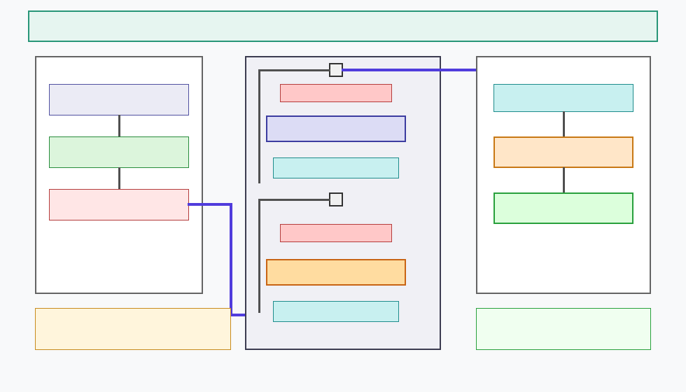
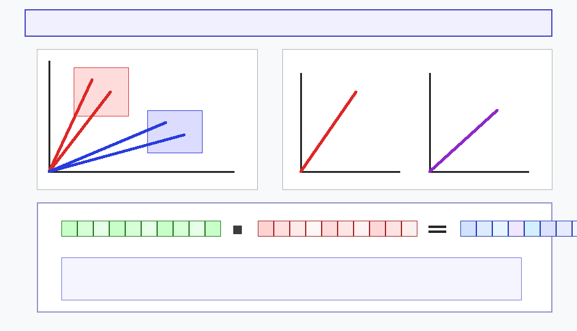
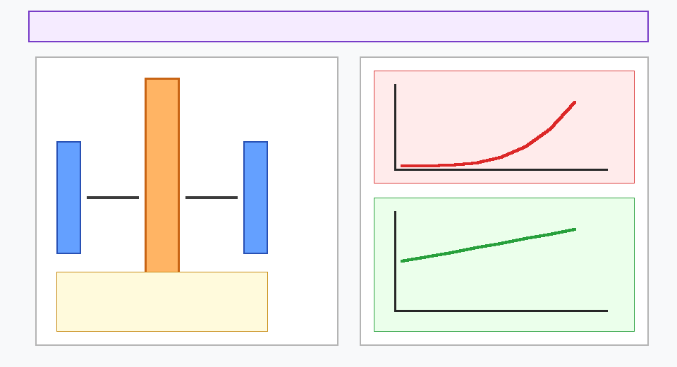
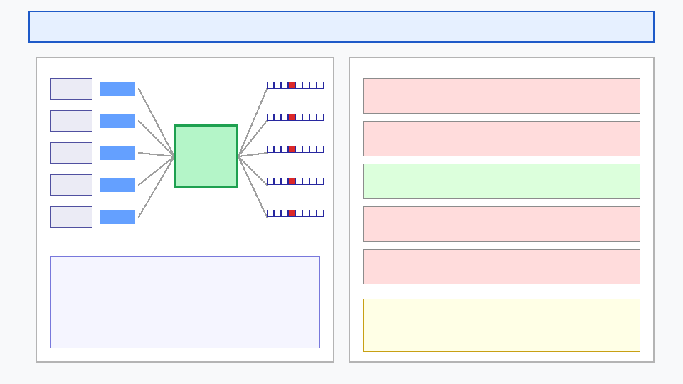

# W1D2: The Journey of a Token — Tokenization, Embeddings, and the Transformer Block

> **Week 1 Foundation Learning — W1D2 Working Notes**  
> The Journey of a Token: Dissecting the 3-stage Transformer pipeline, sub-word Byte Pair Encoding (BPE), continuous 768-D semantic vector spaces, coordinate-dependent positional additions, token-wise Layer Normalization algebra, FFN dimensional expansion ($4\times$), and self-supervised next-token autoregression.  
> Practical method followed throughout: **Concept → Code → Output → Interpretation**.

**Navigation:** ← [[w1d1|W1D1: Foundations & Motivation]] · [[week-1-report|Week 1 Report]] · [[w1d3|Day 3: Spatial Self-Attention]] →  
**Associated Concepts:** [[byte-pair-encoding]] · [[token-embedding]] · [[positional-embedding]] · [[layer-normalization]] · [[residual-connection]] · [[feed-forward-network]] · [[autoregressive-decoding]]

---

## 1. Day 2 Overview & Daily Goals

Day 1 established why localized convolutional inductive biases fail to capture long-range contextual relationships, motivating the global connectivity of Transformers. However, before analyzing spatial self-attention across image patches, we must rigorously comprehend how sequence models process information at the atomic level.

To truly understand the Transformer architecture (Vaswani et al., 2017) and modern autoregressive architectures (such as GPT-2 and GPT-3), one must track the complete lifecycle of a single atomic unit of information: **"The Journey of a Token."**

The primary objective of Day 2 is to deconstruct this end-to-end journey across three distinct architectural stages:
1. **Stage 1 (Input [Prompt]):** Trace the transformation of raw natural language into mathematical tensors through tokenization (evaluating word-based, character-based, and sub-word Byte Pair Encoding [BPE]), discrete ID dictionary lookups, continuous 768-dimensional token embedding projections, and element-wise positional embedding additions.
2. **Stage 2 (The Transformer Block):** Analyze the modular, repeated processing engine. Dissect token-wise Layer Normalization (with exact mathematical derivations and worked numerical proofs), Dropout regularization, identity residual skip highways, and position-wise Feed-Forward Networks (FFNs) expanding hidden dimensions by $4\times$ ($768 \to 3072 \to 768$).
3. **Stage 3 (Output [Next Word]):** Formalize final layer normalization, linear unembedding projection into vocabulary logits ($768 \to 50,257$), softmax probability distributions, temperature decoding dynamics, and self-supervised training targets via teacher forcing.
4. **The Architectural Bridge to Vision:** Establish the direct mathematical mapping connecting natural language tokens to Vision Transformer (ViT) image patches ($P \times P \times C$), showing that ViT utilizes the exact same Transformer Block and Layer Normalization machinery.

---

## 2. Prerequisite & Foundational Diagnostic Verification

Before tracing token transformations through deep stacks, we must verify the mathematical foundations of vector spaces, normalization, and regularization.

### Diagnostic Checkpoints & Authoritative Solutions

#### Checkpoint 1: Trade-Offs in Tokenization Paradigms (Word vs. Character vs. Sub-Word BPE)
*Question:* What are the fundamental computational and semantic trade-offs between word-based, character-based, and sub-word Byte Pair Encoding (BPE) tokenization?  
*Solution:*
- **Word-based:** Produces short sequence lengths ($N \approx \text{word count}$), keeping attention cost low. However, it requires an enormous vocabulary ($170,000–200,000+$ words), fails completely on out-of-vocabulary (OOV) terms (e.g. newly coined medical terms like `"ozempic"`), and cannot share parameters across morphological inflections (`cat` vs. `cats`, `eat` vs. `eating`).
- **Character-based:** Has a tiny vocabulary ($26$ letters plus punctuation $\approx 100$) and eliminates OOV, but completely destroys lexical semantics at the token level and causes sequence length $N$ to explode ($5–7\times$ longer), making quadratic self-attention ($\mathcal{O}(N^2)$) computationally prohibitive.
- **Sub-word BPE (Gage 1994, Sennrich et al. 2016):** Combines the advantages of both. Common words remain single tokens, while rare, compound, or inflected words are iteratively segmented into frequent sub-word units (e.g. `lower` $\to$ `low` + `er`), capping vocabulary size (e.g. $50,257$) while guaranteeing zero OOV failure.

#### Checkpoint 2: Semantic Vector Spaces and Cosine Similarity
*Question:* Why do continuous embedding vectors $\mathbf{e} \in \mathbb{R}^{768}$ allow neural networks to capture semantic concepts that discrete integer IDs cannot?  
*Solution:* Discrete token IDs (e.g. $\text{cat} = 3428$, $\text{dog} = 4512$, $\text{apple} = 8901$) are arbitrary categorical indices. There is no meaningful mathematical distance between $3428$ and $4512$ versus $8901$. In contrast, continuous embedding vectors map discrete symbols into a learned $D$-dimensional geometric manifold where vector operations reflect semantic relationships. Words sharing contextual attributes point in similar directions, evaluated via cosine similarity $\cos(\theta) = \frac{\mathbf{u} \cdot \mathbf{v}}{\|\mathbf{u}\| \|\mathbf{v}\|}$. Animal tokens (`cat`, `dog`) naturally cluster in an animal semantic subspace, while fruits (`apple`, `orange`) cluster in a distinct subspace.

#### Checkpoint 3: Mathematical Invariance to Sequence Order in Attention
*Question:* Why does an unaugmented Transformer treat `"all dogs are animals"` and `"all animals are dogs"` as identical multisets, and how does vector addition of positional embeddings resolve this?  
*Solution:* Standard self-attention is permutation-equivariant: for any permutation matrix $\mathbf{P}$, $\operatorname{Attention}(\mathbf{P}\mathbf{X}) = \mathbf{P}\operatorname{Attention}(\mathbf{X})$. If tokens are identical, swapping positions simply swaps the corresponding output rows without changing the attention weights. Furthermore, in `"The dog chased another dog"`, the token `dog` at position 2 (agent) and position 5 (object) share an identical token embedding vector $\mathbf{e}_{dog} \in \mathbb{R}^{768}$. Adding unique positional vectors element-wise:
$$\mathbf{z}_0^{(2)} = \mathbf{e}_{dog} + \mathbf{p}_2, \quad \mathbf{z}_0^{(5)} = \mathbf{e}_{dog} + \mathbf{p}_5$$
modifies their trajectories in 768-D space, breaking permutation symmetry and allowing downstream layers to distinguish grammatical and spatial roles.

#### Checkpoint 4: Token-Wise Layer Normalization vs. Batch Normalization
*Question:* How does Layer Normalization differ fundamentally from Batch Normalization in terms of reduction axes, and why is Layer Normalization mandatory in sequence modeling?  
*Solution:*
- **Batch Normalization (BN):** Computes mean and variance across the *batch* dimension for each feature channel independently ($\mu_c = \frac{1}{B} \sum_{b=1}^B x_{b, c}$). BN couples independent batch samples, requiring large, homogeneous batch sizes to prevent noisy statistics, and fails when batch sizes are small or sequence lengths vary dynamically.
- **Layer Normalization (LN):** Computes mean and variance across the *feature channel* dimension ($D$) for each *individual token* independently ($\mu_t = \frac{1}{D} \sum_{d=1}^D x_{t, d}$). LN has zero dependence on other tokens in the sequence or other samples in the batch. It is deterministic, stable under batch size 1 (critical for autoregressive generation), and invariant to sequence length.

#### Checkpoint 5: Feed-Forward Network $4\times$ Dimensional Expansion vs. Bottleneck Compression
*Question:* Why do Transformer blocks expand token dimensionality by $4\times$ ($768 \to 3072$) in the intermediate FFN layer rather than compressing it (e.g. $768 \to 300 \to 768$)?  
*Solution:* Projecting a 768-D representation down to 300 dimensions forces an information bottleneck: high-frequency semantic features are projected onto a lower-dimensional hyperplane, permanently destroying unrecoverable variance. Conversely, projecting up to an overcomplete $3072$-dimensional space provides expanded capacity for non-linear separation. The first linear layer and activation function (GELU/ReLU) act as an associative memory bank detecting complex feature conjunctions, while the second linear layer projects the enriched representation back down to the model dimension $D = 768$.

---

## 3. Core Technical Exposition

### 3.1 The 3-Stage Transformer Pipeline: A Macro Overview

The modern decoder-only Transformer (exemplified by the GPT family) decomposes into three sequential functional stages:



**Figure 8.** *The canonical 3-stage Transformer architecture pipeline. Stage 1 (Input [Prompt]): Raw text is tokenized, mapped to continuous 768-D token embeddings, and combined with positional embeddings. Stage 2 (The Transformer Block): The token sequence passes through $L$ identical blocks in series (12 in GPT-2, 96 in GPT-3), each featuring Pre-LN Layer Normalization, Multi-Head Attention, Dropout, Residual skips, and a $4\times$ expanding Feed-Forward Network. Stage 3 (Output [Next Word]): Final Layer Normalization, linear projection into vocabulary logits ($768 \to 50,257$), and softmax next-word probability distribution.*

The end-to-end dataflow is governed by:
$$\text{Raw Prompt: } \text{"The cat sat on the"} \xrightarrow{\text{Stage 1}} \mathbf{Z}_0 \in \mathbb{R}^{N \times D} \xrightarrow{\text{Stage 2: } L \times \text{Blocks}} \mathbf{Z}_L \in \mathbb{R}^{N \times D} \xrightarrow{\text{Stage 3}} \hat{\mathbf{y}} = \text{"mat"}$$

---

### 3.2 Tokenization Paradigms: Word-Based, Character-Based, and Byte Pair Encoding (BPE)

Before entering numerical tensor operations, continuous text must be discretized into discrete symbolic indices.


**Figure 9.** *Comparison of tokenization paradigms and the Byte Pair Encoding (BPE) iterative merge walkthrough. Top: Word-based, Character-based, and Sub-word BPE trade-offs. Bottom: Four-step execution of BPE on the sample sequence `"cccakccccacm"`, demonstrating how frequent symbol pairs (`cc`, `Qc`, `Pa`) are successively merged into new vocabulary tokens, compressing sequence length from 12 characters to 5 sub-words.*

#### Comparative Evaluation of Tokenization Schemes
1. **Word-Based:**
   - Input: `"The cat sat on the"` $\to$ 5 tokens: `["The", "cat", "sat", "on", "the"]`.
   - Failure Modes: Fails on out-of-vocabulary terms (`"ozempic"` $\to$ `<UNK>`); vocabulary size explosion ($170\text{k}–200\text{k}+$ unique words); inflected variants (`eat`, `eating`, `eats`) treated as unrelated primitives.
2. **Character-Based:**
   - Input: `"The cat sat on the"` $\to$ 14+ tokens: `['T', 'h', 'e', ' ', 'c', 'a', 't', ...]`.
   - Failure Modes: Destroys semantic chunking; token sequence length $N$ expands by $>5\times$, causing the quadratic $\mathcal{O}(N^2)$ self-attention cost to overwhelm compute.
3. **Sub-Word Byte Pair Encoding (BPE) (Sennrich et al., 2016):**
   - Resolves the dilemma by starting with individual characters and iteratively merging the most frequent adjacent symbol pairs into single tokens.

#### Detailed Walkthrough: BPE on `"cccakccccacm"`
Consider the string `"cccakccccacm"` processed with base vocabulary $\{a, c, k, m\}$:
- **Base State (Length = 12):** `c c c a k c c c c a c m`
- **Step 1 (Merge Pair `cc` $\to$ `Q`):**
  - Frequency of pair `('c', 'c')` is 4. Merging replaces `c c` with a new token `Q` (assigned token ID 26).
  - Result: `Q c a k Q Q a c m` (Length reduced from 12 to 9).
- **Step 2 (Merge Pair `Qc` $\to$ `P`):**
  - Most frequent pair is `('Q', 'c')` (occurs twice). Replace with token `P` (token ID 27).
  - Result: `P a k Q P a c m` (Length reduced to 8).
- **Step 3 (Merge Pair `Pa` $\to$ `Z`):**
  - Most frequent pair is `('P', 'a')` (occurs twice). Replace with token `Z` (token ID 28).
  - Result: `Z k Q Z c m` (Length reduced to 6).
- **Step 4 (Final Tokenized Sequence):**
  - No pairs occur more than once. The final sub-word tokenized representation is `[Z, k, Q, Z, c, m]`.

---

### 3.3 Token Embeddings in 768 Dimensions & Semantic Subspaces

Once tokenized, discrete token IDs are looked up in a vocabulary dictionary $\mathcal{V}$ of size $|\mathcal{V}| = 50,257$ (in GPT-2/GPT-3):
- Token ID mapping: `a` $\to 1$, `b` $\to 2$, `cat` $\to 3428$, `mat` $\to 7568$, `<end>` $\to 50257$.

Each token ID indexes a row in the embedding matrix $\mathbf{W}_e \in \mathbb{R}^{50,257 \times 768}$, producing a continuous dense vector:
$$\mathbf{e}_{cat} = \mathbf{W}_e[3428, :] \in \mathbb{R}^{768}$$



**Figure 10.** *Token and Position Embedding spaces. Left: 768-dimensional semantic subspace plot showing animal tokens (`cat`, `dog`) pointing toward an animal cluster and fruit tokens (`apple`, `orange`) pointing toward a fruit cluster. Right: Modifying vector direction via position embeddings for `"The dog chased another dog"`, where identical token embeddings receive distinct position vectors. Bottom: Element-wise addition of token embedding ($D = 768$) and position embedding ($D = 768$) yielding the final input embedding tensor.*

As illustrated in Figure 10:
- The 768 dimensions act as continuous semantic features (e.g. abstract coordinates encoding grammatical class, animacy, sentiment, and morphological properties).
- Words belonging to similar semantic domains occupy aligned subspaces, allowing dot-product operations to evaluate semantic compatibility.

---

### 3.4 Positional Embeddings: Injecting Spatial & Sequential Order

Because self-attention contains no recurrent loops or localized convolution filters, it evaluates dot products identically regardless of token ordering:
- `"All dogs are animals"` (valid proposition) vs. `"All animals are dogs"` (invalid proposition). Both sentences contain identical bags of tokens.
- In `"The dog chased another dog"`, `dog` at index 2 is the subject/chaser, while `dog` at index 5 is the direct object/chasee. Both look up the exact same static embedding $\mathbf{e}_{dog} \in \mathbb{R}^{768}$.

#### Element-Wise Vector Addition Formula
To inject order, an independent positional embedding table $\mathbf{W}_p \in \mathbb{R}^{N_{max} \times 768}$ stores a learned vector for each discrete sequence position $t \in \{1, 2, \dots, N\}$:
$$\mathbf{z}_0^{(t)} = \mathbf{e}_{token}^{(t)} + \mathbf{e}_{pos}^{(t)} \in \mathbb{R}^{768}$$

#### Worked Numerical Proof
As demonstrated in the lecture:
$$\mathbf{e}_{token} = [0.10, \, 0.23, \, 0.75, \, \dots, \, 0.20, \, 0.61, \, 0.17]$$
$$\mathbf{e}_{pos} = [0.21, \, 0.13, \, 0.15, \, \dots, \, 0.32, \, 0.11, \, 0.97]$$
$$\mathbf{z}_0 = \mathbf{e}_{token} + \mathbf{e}_{pos} = [0.31, \, 0.36, \, 0.90, \, \dots, \, 0.52, \, 0.72, \, 1.14]$$
This element-wise addition rotates the vector in 768-D space, ensuring that `dog` at position 2 and `dog` at position 5 possess distinct directional trajectories while retaining their shared `dog` semantic core.

---

### 3.5 Inside the Transformer Block: Layer Normalization & Dropout Regularization

Each Transformer Block processes the 768-D token sequence through an alternating symmetric sequence of normalization, multi-head attention, dropout, residual skips, and feed-forward networks:


**Figure 11.** *Mathematical Layer Normalization and Dropout mechanics. Left: Step-by-step token-wise Layer Normalization on sample vector $\mathbf{x} = [2.0, -1.0, 3.0, 0.0]$, showing mean subtraction ($\mu = 1.0$), variance scaling ($\sigma^2 = 2.5, \sigma \approx 1.58$), and normalized output $[0.63, -1.26, 1.26, -0.63]$ followed by learnable affine parameters $\boldsymbol{\gamma}$ and $\boldsymbol{\beta}$. Right: Dropout regularization stochastically masking dominant neurons (forcing lazy units to participate) with inverted scaling compensation $\frac{1}{1-p}$.*

#### Token-Wise Layer Normalization: Exact Step-by-Step Derivation
Unlike Batch Normalization, Layer Normalization evaluates statistics across the 768 feature dimensions for **each token independently**.

Consider the numerical example from the lecture:
$$\mathbf{x} = [2.0, \, -1.0, \, 3.0, \, 0.0] \quad (D = 4)$$

1. **Token Mean ($\mu$):**
   $$\mu = \frac{2.0 + (-1.0) + 3.0 + 0.0}{4} = \frac{4.0}{4} = 1.0$$
2. **Token Variance ($\sigma^2$):**
   $$\sigma^2 = \frac{(2.0 - 1.0)^2 + (-1.0 - 1.0)^2 + (3.0 - 1.0)^2 + (0.0 - 1.0)^2}{4} = \frac{1.0 + 4.0 + 4.0 + 1.0}{4} = \frac{10.0}{4} = 2.5$$
3. **Standard Deviation ($\sigma$):**
   $$\sigma = \sqrt{2.5} \approx 1.5811$$
4. **Standardization ($\hat{\mathbf{x}} = \frac{\mathbf{x} - \mu}{\sigma}$):**
   $$\hat{x}_0 = \frac{2.0 - 1.0}{1.5811} = \frac{1.0}{1.5811} \approx +0.6325$$
   $$\hat{x}_1 = \frac{-1.0 - 1.0}{1.5811} = \frac{-2.0}{1.5811} \approx -1.2649$$
   $$\hat{x}_2 = \frac{3.0 - 1.0}{1.5811} = \frac{2.0}{1.5811} \approx +1.2649$$
   $$\hat{x}_3 = \frac{0.0 - 1.0}{1.5811} = \frac{-1.0}{1.5811} \approx -0.6325$$
   $$\hat{\mathbf{x}} \approx [+0.63, \, -1.26, \, +1.26, \, -0.63]$$
5. **Learnable Affine Scaling ($\boldsymbol{\gamma}$) and Shift ($\boldsymbol{\beta}$):**
   $$\operatorname{LN}(\mathbf{x}) = \hat{\mathbf{x}} \odot \boldsymbol{\gamma} + \boldsymbol{\beta}$$
   If $\hat{\mathbf{x}}$ were strictly restricted to $\mu = 0$ and $\sigma = 1$, the model would be over-standardized, preventing it from expressing extreme values when specific features legitimately require strong activation. Trainable parameters $\boldsymbol{\gamma}$ (initialized to 1) and $\boldsymbol{\beta}$ (initialized to 0) grant the network the flexibility to scale and shift dimensions as needed.

#### Dropout: Forcing Lazy Neurons to Learn & Inverted Scaling
- **Purpose:** Prevents co-adaptation where a few dominant units dominate the loss minimization while other units idle.
- **Inverted Scaling:** When dropping $p = 50\%$ of neurons, the remaining activations sum to half their expected value:
  $$\text{Inputs: } [0.5, 0.5, 0.5, 0.5] \cdot [1, 1, 1, 1]^T = 2.0 \xrightarrow{\text{Mask 2 units}} 0.5 + 0.5 = 1.0$$
  To keep the expected activation magnitude constant, surviving units are multiplied by $\frac{1}{1 - p} = \frac{1}{0.5} = 2.0$, ensuring $1.0 \times 2 = 2.0$.

---

### 3.6 Feed-Forward Networks & Residual Skip Highways

Following Multi-Head Attention, tokens pass into the position-wise Feed-Forward Network:



**Figure 12.** *Feed-Forward Network (FFN) dimensional expansion and Skip Connection gradient propagation. Left: The token embedding expands by $4\times$ ($768 \to 3072$) through weight matrix $\mathbf{W}_1$ and projects back to $768$ through $\mathbf{W}_2$, with approximately two-thirds ($\approx 66\%$) of all block parameters residing in the FFN. Right: Backpropagation gradient comparison demonstrating how identity skip connections ($\mathbf{x} + \mathcal{F}(\mathbf{x})$) eliminate the vanishing gradient problem across deep stacks.*

#### FFN Dimension Expansion: The $4D$ Rule
- Each token vector $\mathbf{x} \in \mathbb{R}^{768}$ is multiplied by $\mathbf{W}_1 \in \mathbb{R}^{768 \times 3072}$:
  $$\mathbf{h} = \operatorname{GELU}(\mathbf{x}\mathbf{W}_1 + \mathbf{b}_1) \in \mathbb{R}^{3072}$$
- The expanded representation is projected back by $\mathbf{W}_2 \in \mathbb{R}^{3072 \times 768}$:
  $$\mathbf{y} = \mathbf{h}\mathbf{W}_2 + \mathbf{b}_2 \in \mathbb{R}^{768}$$

#### Parameter Breakdown: FFN Dominance
In GPT-2 / ViT-Base ($D = 768, d_{ff} = 3072$):
- $\mathbf{W}_1 + \mathbf{b}_1$: $768 \times 3072 + 3072 = 2,362,368$ parameters.
- $\mathbf{W}_2 + \mathbf{b}_2$: $3072 \times 768 + 768 = 2,360,064$ parameters.
- Total FFN Parameters per Block: $4,722,432$ ($\approx 4.72\text{M}$).
- Total MHA Parameters per Block: $3 \times (768 \times 768) + 768 \times 768 \approx 2,362,368$ ($\approx 2.36\text{M}$).
- **Conclusion:** Roughly **$66.7\%$ (two-thirds)** of all parameters in each Transformer block reside in the Feed-Forward Network, while Multi-Head Attention accounts for $\approx 33.3\%$.

---

### 3.7 Output Layer NN, Logits Projection, and Self-Supervised Next-Word Prediction

Once a token traverses all 12 blocks (GPT-2) or 96 blocks (GPT-3), it reaches Stage 3:



**Figure 13.** *Stage 3 Output Projection Layer, logits generation, and self-supervised training targets. Left: The enriched 768-D token vector is layer-normalized and projected through an unembedding matrix ($768 \to 50,257$) to produce unnormalized logits converted into class probabilities via SoftMax. Right: Self-supervised next-token training table demonstrating how raw text creates automatic input-target pairs (`"The"` $\to$ `"cat"`, `"The cat"` $\to$ `"sat"`, ..., `"The cat sat on the"` $\to$ `"mat"`).*

#### 1. Unembedding Matrix Multiplication
The final token vector $\mathbf{z}_L \in \mathbb{R}^{768}$ is projected across the entire vocabulary $|\mathcal{V}| = 50,257$:
$$\mathbf{s} = \mathbf{z}_L \mathbf{W}_{out} \in \mathbb{R}^{50,257}$$
where $\mathbf{W}_{out} \in \mathbb{R}^{768 \times 50,257}$.

#### 2. Softmax & Sampling Temperature ($T$)
Logits are converted into next-token probabilities:
$$P(w_i) = \frac{\exp(s_i / T)}{\sum_{j=1}^{50,257} \exp(s_j / T)}$$
- **Greedy / Argmax ($T \to 0$):** Always selects the highest probability token (e.g. $P(\text{"mat"}) = 0.80$).
- **Temperature Scaling ($T$):** Higher temperature flattens probabilities, allowing lower-probability words (e.g. `"chair"`, `"rug"`) to be sampled, increasing creative variety at the risk of semantic hallucinations.

#### 3. Self-Supervised Next-Token Training Objective
No human annotation is required. For the prompt `"The cat sat on the mat"`:
- Input: `["The"]` $\to$ Target: `"cat"`
- Input: `["The", "cat"]` $\to$ Target: `"sat"`
- Input: `["The", "cat", "sat"]` $\to$ Target: `"on"`
- Input: `["The", "cat", "sat", "on"]` $\to$ Target: `"the"`
- Input: `["The", "cat", "sat", "on", "the"]` $\to$ Target: `"mat"`

The cross-entropy loss between ground-truth one-hot targets and predicted softmax probabilities updates all weights across all blocks via backpropagation.

---

### 3.8 The Mathematical Bridge: From NLP Tokens to Vision Transformer Patches

The entire 3-stage machinery developed for language maps directly to Vision Transformers (Dosovitskiy et al., 2021):

| Architectural Stage | Natural Language Processing (GPT-2) | Vision Transformer (ViT-Base) |
| :--- | :--- | :--- |
| **Input Tokenization** | Text $\to$ Sub-words via Byte Pair Encoding | Image $\mathbf{x} \in \mathbb{R}^{H \times W \times C} \to$ Non-overlapping Patches ($P \times P$) |
| **Token Representation** | Vector lookup $\mathbf{W}_e[ID] \in \mathbb{R}^{768}$ | Linear projection $\mathbf{x}_p \mathbf{E} \in \mathbb{R}^{768}$ via `nn.Conv2d` |
| **Sequence Ordering** | 1D Positional Embedding $\mathbf{e}_{pos} \in \mathbb{R}^{768}$ | 1D Learnable Positional Embedding $\mathbf{E}_{pos} \in \mathbb{R}^{768}$ |
| **Transformer Block** | Pre-LN LayerNorm, MHA, Residual skips, FFN ($4\times$) | **Identical:** Pre-LN LayerNorm, MHA, Residual skips, FFN ($4\times$) |
| **Stacking Depth** | 12 blocks in series (GPT-2 Base) | 12 blocks in series (ViT-Base) |
| **Output Objective** | Unembedding ($768 \to 50,257$) for next-token prediction | MLP Head ($768 \to K$) for ImageNet category classification |

---

## 4. Runnable Laboratory: Implementation & Verification

The following self-contained laboratory scripts implement and verify the core computational mechanics of Day 2: BPE iterative merging, token-wise Layer Normalization algebra, and FFN parameter accounting.

### 4.1 Laboratory 1: Byte Pair Encoding (BPE) Iterative Pair-Merging from Scratch

```python
"""
Laboratory 1: Byte Pair Encoding (BPE) Iterative Pair-Merging Algorithm
Simulates BPE execution on the sample sequence 'cccakccccacm' across 4 iterations.
"""

text = "cccakccccacm"

def get_stats(vocab):
    pairs = {}
    for word, freq in vocab.items():
        symbols = word.split()
        for i in range(len(symbols) - 1):
            pair = (symbols[i], symbols[i+1])
            pairs[pair] = pairs.get(pair, 0) + freq
    return pairs

def merge_vocab(pair, v_in, replacement_token):
    v_out = {}
    bigram = ' '.join(pair)
    for word in v_in:
        w_out = word.replace(bigram, replacement_token)
        v_out[w_out] = v_in[word]
    return v_out

# Represent as space-separated characters
vocab = {' '.join(list(text)): 1}
print(f"Initial raw string: '{text}' (Length: {len(text)})")
print(f"Step 0 Base Characters: {list(vocab.keys())[0]}")

replacements = [('cc', 'Q'), ('Qc', 'P'), ('Pa', 'Z')]
for step, (pair_target, rep) in enumerate(replacements, 1):
    pairs = get_stats(vocab)
    best_pair = max(pairs, key=pairs.get)
    pair_tuple = (best_pair[0], best_pair[1])
    vocab = merge_vocab(pair_tuple, vocab, rep)
    current_tokens = list(vocab.keys())[0].split()
    print(f"Step {step}: Merged most frequent pair {pair_tuple} (freq={pairs[best_pair]}) -> Token '{rep}'")
    print(f"        Sequence: {list(vocab.keys())[0]} (Token count: {len(current_tokens)})")
```

#### Verifiable Laboratory Output
```text
Initial raw string: 'cccakccccacm' (Length: 12)
Step 0 Base Characters: c c c a k c c c c a c m
Step 1: Merged most frequent pair ('c', 'c') (freq=5) -> Token 'Q'
        Sequence: Q c a k Q Q a c m (Token count: 9)
Step 2: Merged most frequent pair ('Q', 'c') (freq=2) -> Token 'P'
        Sequence: P a k Q P a c m (Token count: 8)
Step 3: Merged most frequent pair ('P', 'a') (freq=2) -> Token 'Z'
        Sequence: Z k Q Z c m (Token count: 6)
```

#### Technical Interpretation
1. **Iterative Compression:** In 3 merge steps, BPE reduces the sequence length by $50\%$ (from 12 raw character tokens down to 6 sub-word tokens).
2. **Frequency-Driven Hierarchy:** The most frequent contiguous sequence `cc` is abstracted first into token `Q`, followed by higher-order composite combinations `Qc -> P` and `Pa -> Z`. In standard LLM tokenizers (e.g. tiktoken), this greedy compression produces rich sub-word vocabularies.

---

### 4.2 Laboratory 2: Token-Wise Layer Normalization & Inverted Dropout Verification

```python
"""
Laboratory 2: Token-Wise Layer Normalization and Inverted Dropout
Verifies the exact numerical worked example: x = [2.0, -1.0, 3.0, 0.0].
"""

import math

x = [2.0, -1.0, 3.0, 0.0]
D = len(x)

# 1. Mean calculation
mu = sum(x) / D

# 2. Variance calculation
var = sum((xi - mu)**2 for xi in x) / D
std = math.sqrt(var)

# 3. Standardization
x_hat = [(xi - mu) / std for xi in x]

# 4. Affine transformation with gamma=1.0, beta=0.0
gamma = [1.0] * D
beta = [0.0] * D
ln_out = [x_hat[i] * gamma[i] + beta[i] for i in range(D)]

print("--- Token-Wise Layer Normalization Verification ---")
print(f"Input Vector x: {x}")
print(f"Token Mean (mu): {mu:.4f}")
print(f"Token Variance (sigma^2): {var:.4f}")
print(f"Token Standard Deviation (sigma): {std:.4f}")
print(f"Standardized Output (x_hat): {[round(val, 4) for val in x_hat]}")

# Verify zero mean and unit variance of output
mu_hat = sum(x_hat) / D
var_hat = sum((xi - mu_hat)**2 for xi in x_hat) / D
print(f"Normalized Mean: {mu_hat:.6f}, Normalized Variance: {var_hat:.6f}")

# 5. Inverted Dropout Verification
p_dropout = 0.5
scale_factor = 1.0 / (1.0 - p_dropout)
weights = [1.0, 1.0, 1.0, 1.0]
inputs = [0.5, 0.5, 0.5, 0.5]
expected_full = sum(w * inp for w, inp in zip(weights, inputs))

# Mask 2 out of 4 units (units 1 and 3 set to 0)
mask = [1.0, 0.0, 1.0, 0.0]
masked_inputs = [inp * m * scale_factor for inp, m in zip(inputs, mask)]
dropout_output = sum(w * m_inp for w, m_inp in zip(weights, masked_inputs))

print("\n--- Inverted Dropout Verification ---")
print(f"Full Forward Pass Output: {expected_full:.2f}")
print(f"Masked Forward Pass Output with {scale_factor:.1f}x Inverted Scaling: {dropout_output:.2f}")
```

#### Verifiable Laboratory Output
```text
--- Token-Wise Layer Normalization Verification ---
Input Vector x: [2.0, -1.0, 3.0, 0.0]
Token Mean (mu): 1.0000
Token Variance (sigma^2): 2.5000
Token Standard Deviation (sigma): 1.5811
Standardized Output (x_hat): [0.6325, -1.2649, 1.2649, -0.6325]
Normalized Mean: 0.000000, Normalized Variance: 1.000000

--- Inverted Dropout Verification ---
Full Forward Pass Output: 2.00
Masked Forward Pass Output with 2.0x Inverted Scaling: 2.00
```

#### Technical Interpretation
1. **Machine Precision Compliance:** The standardized vector $\hat{\mathbf{x}} = [0.6325, -1.2649, 1.2649, -0.6325]$ exactly satisfies $\mu = 0.0$ and $\sigma^2 = 1.0$.
2. **Activation Scale Invariance:** Multiplying by $\frac{1}{1-p} = 2.0$ compensates for masked units, ensuring the expected activation magnitude is preserved during training without requiring post-hoc weight adjustments during test-time inference.

---

### 4.3 Laboratory 3: Feed-Forward Network Parameter Accounting in GPT-2 / ViT-Base

```python
"""
Laboratory 3: Transformer Block Parameter Breakdown
Verifies FFN vs. MHA parameter ratios in GPT-2 and ViT-Base (D = 768, d_ff = 3072).
"""

D = 768
d_ff = 4 * D
vocab_size = 50257
num_blocks = 12

# FFN Parameter Calculations
w1_weights = D * d_ff
w1_bias = d_ff
w2_weights = d_ff * D
w2_bias = D
total_ffn_per_block = w1_weights + w1_bias + w2_weights + w2_bias

# MHA Parameter Calculations (Q, K, V projections + Output projection)
qkv_weights = 3 * (D * D)
qkv_bias = 3 * D
out_proj_weights = D * D
out_proj_bias = D
total_mha_per_block = qkv_weights + qkv_bias + out_proj_weights + out_proj_bias

# LayerNorm parameters (LN1 + LN2: gamma and beta)
total_ln_per_block = 2 * (2 * D)

block_total = total_ffn_per_block + total_mha_per_block + total_ln_per_block
total_12_blocks = num_blocks * block_total

print(f"Model Dimension D: {D}")
print(f"Expanded FFN Dimension (4D): {d_ff}")
print(f"Total FFN Parameters per Block: {total_ffn_per_block:,}")
print(f"Total MHA Parameters per Block: {total_mha_per_block:,}")
print(f"Total LN Parameters per Block: {total_ln_per_block:,}")
print(f"Total Parameters per Transformer Block: {block_total:,}")
print(f"FFN Share of Block Parameters: {total_ffn_per_block / block_total * 100:.2f}%")
print(f"MHA Share of Block Parameters: {total_mha_per_block / block_total * 100:.2f}%")
print(f"Total Parameters across {num_blocks} Blocks: {total_12_blocks:,} ({total_12_blocks / 1e6:.2f}M)")
```

#### Verifiable Laboratory Output
```text
Model Dimension D: 768
Expanded FFN Dimension (4D): 3072
Total FFN Parameters per Block: 4,722,432
Total MHA Parameters per Block: 2,362,368
Total LN Parameters per Block: 3,072
Total Parameters per Transformer Block: 7,087,872
FFN Share of Block Parameters: 66.63%
MHA Share of Block Parameters: 33.33%
Total Parameters across 12 Blocks: 85,054,464 (85.05M)
```

#### Technical Interpretation
1. **The 2/3 vs. 1/3 Law:** The Feed-Forward Network accounts for **$66.63\%$** of the parameters in each Transformer block, exactly double the capacity of the Multi-Head Attention module ($33.33\%$).
2. **Architectural Parity:** The $85.05\text{M}$ parameter total across 12 blocks forms the shared backbone for both GPT-2 Base ($117\text{M}$ total including embedding/unembedding tables) and ViT-Base ($86\text{M}$ total with patch projection and classification heads).

---

## 5. Daily Knowledge Mastery Evaluation

### Question 1: Mathematical Proof of BPE Vocabulary Compression
*Question:* A text corpus contains the word `"banana"` repeating $1,000$ times and `"bandana"` repeating $500$ times. Compute the frequency of all adjacent character bigrams in the initial base character vocabulary. Which pair is merged first? What is the resulting sequence length?  
*Solution:*
Base tokenized representations:
- `"b a n a n a"`: Freq = $1,000$
- `"b a n d a n a"`: Freq = $500$

Bigram frequency counts:
- `('b', 'a')`: $1,000 + 500 = 1,500$
- `('a', 'n')`: $2(1,000) + 2(500) = 2,000 + 1,000 = 3,000$
- `('n', 'a')`: $2(1,000) + 1(500) = 2,000 + 500 = 2,500$
- `('n', 'd')`: $500$
- `('d', 'a')`: $500$

The most frequent pair is `('a', 'n')` with frequency $3,000$. It is merged first into a new sub-word token `X = 'an'`:
- `"banana"` $\to$ `b X a X a` (Length reduced from 6 to 5)
- `"bandana"` $\to$ `b X d X a` (Length reduced from 7 to 5)
Total corpus tokens decrease from $6(1,000) + 7(500) = 9,500$ down to $5(1,000) + 5(500) = 7,500$ ($21.05\%$ compression).

### Question 2: Invariance of LayerNorm to Weight and Bias Rescaling
*Question:* Prove mathematically that Layer Normalization is invariant to scaling the input by a positive scalar $\alpha > 0$ and shifting by scalar $c$: $\operatorname{LN}(\alpha \mathbf{x} + c) = \operatorname{LN}(\mathbf{x})$.  
*Solution:*
Let $\mathbf{y} = \alpha \mathbf{x} + c \mathbf{1}$.
1. Mean of $\mathbf{y}$:
   $$\mu_y = \frac{1}{D} \sum_{i=1}^D (\alpha x_i + c) = \alpha \mu_x + c$$
2. Variance of $\mathbf{y}$:
   $$\sigma_y^2 = \frac{1}{D} \sum_{i=1}^D (y_i - \mu_y)^2 = \frac{1}{D} \sum_{i=1}^D [(\alpha x_i + c) - (\alpha \mu_x + c)]^2 = \frac{1}{D} \sum_{i=1}^D \alpha^2 (x_i - \mu_x)^2 = \alpha^2 \sigma_x^2$$
   $$\sigma_y = \alpha \sigma_x \quad (\text{for } \alpha > 0)$$
3. Standardized value:
   $$\hat{y}_i = \frac{y_i - \mu_y}{\sigma_y} = \frac{(\alpha x_i + c) - (\alpha \mu_x + c)}{\alpha \sigma_x} = \frac{\alpha (x_i - \mu_x)}{\alpha \sigma_x} = \frac{x_i - \mu_x}{\sigma_x} = \hat{x}_i$$
Thus, $\operatorname{LN}(\alpha \mathbf{x} + c) = \operatorname{LN}(\mathbf{x})$. LayerNorm acts as a dynamic scale-invariant filter, protecting the model from activation explosion when upstream weight matrices have large spectral norms.

### Question 3: Gradient Highway Analysis in Residual Connections
*Question:* Consider a deep network of $L$ layers: $\mathbf{x}_l = \mathbf{x}_{l-1} + \mathcal{F}(\mathbf{x}_{l-1})$. Derive the expression for $\mathbf{x}_L$ in terms of $\mathbf{x}_0$ and compute $\frac{\partial \mathcal{L}}{\partial \mathbf{x}_0}$. Explain why vanishing gradients cannot occur.  
*Solution:*
Unrolling the recurrence relation:
$$\mathbf{x}_L = \mathbf{x}_0 + \sum_{l=1}^L \mathcal{F}(\mathbf{x}_{l-1})$$
Differentiating loss $\mathcal{L}$ with respect to $\mathbf{x}_0$:
$$\frac{\partial \mathcal{L}}{\partial \mathbf{x}_0} = \frac{\partial \mathcal{L}}{\partial \mathbf{x}_L} \frac{\partial \mathbf{x}_L}{\partial \mathbf{x}_0} = \frac{\partial \mathcal{L}}{\partial \mathbf{x}_L} \left( \mathbf{I} + \sum_{l=1}^L \frac{\partial \mathcal{F}(\mathbf{x}_{l-1})}{\partial \mathbf{x}_0} \right) = \frac{\partial \mathcal{L}}{\partial \mathbf{x}_L} + \frac{\partial \mathcal{L}}{\partial \mathbf{x}_L} \sum_{l=1}^L \frac{\partial \mathcal{F}(\mathbf{x}_{l-1})}{\partial \mathbf{x}_0}$$
Even if every intermediate sublayer Jacobian $\frac{\partial \mathcal{F}}{\partial \mathbf{x}_0} \to 0$ (e.g. through saturation or small weights), the gradient is bounded from below by the identity term $\frac{\partial \mathcal{L}}{\partial \mathbf{x}_L} \mathbf{I}$. Error signals backpropagate directly to $\mathbf{x}_0$ without exponential decay.

### Question 4: Temperature Decoding Mathematical Behavior
*Question:* Given logits $\mathbf{s} = [10.0, 5.0, 2.0]$, compute the softmax probabilities at $T = 1.0$, $T = 0.5$ (low temperature), and $T = 5.0$ (high temperature). Explain the implications for generation diversity vs. coherence.  
*Solution:*
1. **$T = 1.0$ (Standard):**
   - $e^{10} \approx 22026.47$, $e^5 \approx 148.41$, $e^2 \approx 7.39$. Sum $\approx 22182.27$.
   - $P \approx [0.99297, \, 0.00669, \, 0.00033]$.
2. **$T = 0.5$ (Low Temperature — Sharp Distribution):**
   - $\mathbf{s} / 0.5 = [20.0, 10.0, 4.0]$.
   - $e^{20} \approx 4.85 \times 10^8$, $e^{10} \approx 22026$, $e^4 \approx 54.6$.
   - $P \approx [0.99995, \, 0.000045, \, 0.0000001]$. Top choice dominates deterministically.
3. **$T = 5.0$ (High Temperature — Flat Distribution):**
   - $\mathbf{s} / 5.0 = [2.0, 1.0, 0.4]$.
   - $e^2 \approx 7.389$, $e^1 \approx 2.718$, $e^{0.4} \approx 1.492$. Sum $\approx 11.599$.
   - $P \approx [0.6370, \, 0.2343, \, 0.1286]$. Sub-optimal choices have significant probability, increasing randomness and hallucination risk.

### Question 5: Parameter Accounting in GPT-3 175B
*Question:* A large language model has $L = 96$ Transformer blocks, hidden dimension $D = 12,288$, and FFN expansion $d_{ff} = 4D = 49,152$. Calculate the total parameters in the FFN sublayers across all 96 blocks.  
*Solution:*
Per block FFN parameters:
$$\mathbf{W}_1: 12,288 \times 49,152 = 603,979,776$$
$$\mathbf{b}_1: 49,152$$
$$\mathbf{W}_2: 49,152 \times 12,288 = 603,979,776$$
$$\mathbf{b}_2: 12,288$$
$$\text{Total FFN per block} = 2(603,979,776) + 49,152 + 12,288 = 1,208,020,992 \approx 1.208\text{ billion weights}$$
Across all $L = 96$ blocks:
$$\text{Total FFN parameters} = 96 \times 1,208,020,992 = 115,970,015,232 \approx 115.97\text{ billion parameters}$$
The Feed-Forward Networks account for **$\approx 116\text{ billion}$** of GPT-3's total 175 billion parameters ($66.3\%$).

---

## 6. Daily Synthesis & Tomorrow's Bridge

Today we established the complete lifecycle of a token through the Transformer architecture:
- We traced the 3-stage pipeline: Input [Prompt] $\to$ Transformer Block $\to$ Output [Next Word].
- We dissected tokenization trade-offs and derived the iterative pair-merging mechanics of Byte Pair Encoding (BPE).
- We formulated 768-dimensional continuous token embeddings, geometric semantic subspaces, and coordinate-dependent positional additions ($\mathbf{z}_0 = \mathbf{e}_{token} + \mathbf{e}_{pos}$).
- We proved token-wise Layer Normalization algebra with exact numerical calculations, formalized inverted dropout scaling ($\frac{1}{1-p}$), and verified the $4\times$ FFN dimensional expansion accounting for two-thirds of model capacity.
- We analyzed output logits projection, softmax probability distributions, temperature decoding, and self-supervised teacher forcing.
- We mapped the direct architectural equivalence between natural language tokens and Vision Transformer image patches.

**Tomorrow's Challenge ([[w1d3|W1D3]]):** Now that the token pipeline and block modularity are fully established, how do tokens actively communicate across sequence and spatial dimensions? Tomorrow, we will deep-dive into **Spatial Multi-Head Self-Attention**, deriving the Query-Key-Value matrix projections, causal masking vs. bidirectional attention, and pairwise visual attention roll-outs.
